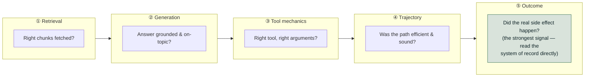
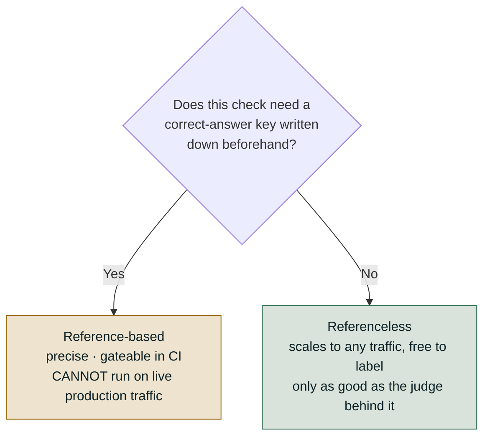
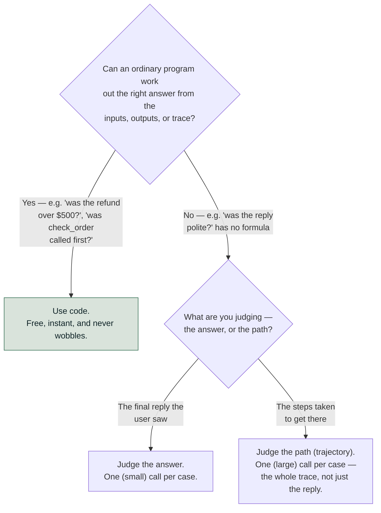
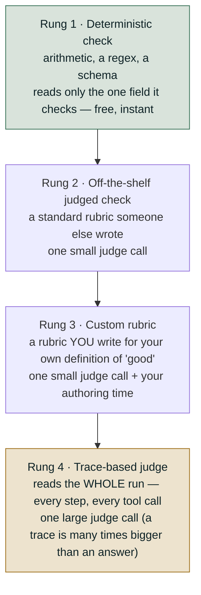
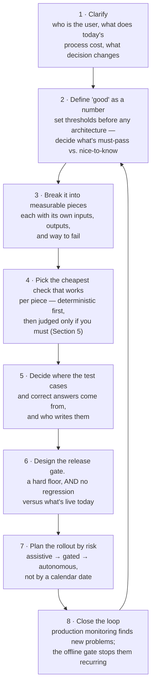

# Level 0 Explainer: Orientation

*A plain-language walkthrough of everything Level 0 covers, pulled together from the
notebook, the field guide, the interactive lab, and the interview question bank — with
nothing repeated twice. If you only read one file before starting the roadmap, read this one.*

> **Who this is for.** You don't need to know any of the tools named below (DeepEval, RAGAS,
> MLflow, Phoenix) to follow this. Every technical term is defined in plain words the first
> time it shows up.

---

## Why this level exists

"Evaluate the AI system" sounds like one task. It isn't. A chatbot that searches documents
and then answers a question is really a small assembly line: it searches, then it writes an
answer, then — if it's an agent — it might call tools (send an email, book something, look up
an order) in some order, across possibly many turns of a conversation, before it finally does
or says the thing the user actually wanted.

Each of those stages can fail in a different way, for a different reason, and the fix for one
failure does nothing for another. If you only have one blunt "is it good?" check, you cannot
tell *which* stage broke — and you'll waste time fixing the wrong thing.

Level 0's whole job is to give you the map before you start measuring anything: what the
stages are, what kind of check fits each one, what that check costs, and which tool people
usually reach for. Nothing here is executable — it's the vocabulary and the decision rules
you'll use in every later level.

---

## 1. The five things you can actually evaluate

Think of a support agent that searches a knowledge base and can also issue refunds. Its work
breaks into five layers, and a wrong final answer could be caused by a problem in *any* of
them:

| Layer                       | The question it answers                                        | A concrete symptom                                         |
| --------------------------- | -------------------------------------------------------------- | ---------------------------------------------------------- |
| **① Retrieval**      | Did we fetch the right information?                            | The agent quotes a policy that isn't the current one       |
| **② Generation**     | Given what it found, did it write a grounded, on-topic answer? | It invents a detail that wasn't in the source it read      |
| **③ Tool mechanics** | Did it call the right tool with the right inputs?              | It calls`refund()` with the wrong order ID               |
| **④ Trajectory**     | Was the*sequence* of steps sensible?                         | It checks the same order three times before acting         |
| **⑤ Outcome**        | Did the real-world result actually happen?                     | It says "refund issued" but no refund exists in the system |

**The rule to remember: mechanics ≠ process ≠ outcome.** Calling the right tool with the right
arguments doesn't guarantee the steps were taken in a sound order, and a sound order doesn't
guarantee the user's goal was actually met. You have to check all three separately — none of
them substitutes for the others.

**Why outcome verification is the strongest check of all.** An LLM can write a perfectly
fluent sentence — *"Your refund of $45 has been issued"* — whether or not a refund actually
happened. A judge that only reads that sentence can be fooled by confident, wrong prose.
Checking the real database, ledger, or booking system directly cannot be fooled this way,
because it isn't reading a description of the event — it's reading the event.

**A sixth behavior worth naming, even though it doesn't fit neatly into the five layers
above: conversational quality.** Across a multi-turn dialogue an agent can pass every one of
the five layer-checks on every individual turn and still fail overall — by forgetting what the
user said three turns ago, drifting off-topic turn by turn, or giving advice it shouldn't once
the conversation has gone on long enough. It's a separate axis from the five above because the
failure only shows up *across* turns, not within any single one. This roadmap picks it up
properly at Level 2.

### What breaks where, at a glance

This is the same five layers, but read as a troubleshooting table: symptom on the left, what
actually catches it and what that costs on the right.

|                                    | ① Retrieval (no labels)       | ① Retrieval (with labels)                             | ② Generation                               | ③ Tool use                                   | ④ Trajectory                                 |
| ---------------------------------- | ------------------------------ | ------------------------------------------------------ | ------------------------------------------- | --------------------------------------------- | --------------------------------------------- |
| **Symptom you'd notice**     | "It hallucinated"              | Missed a chunk you know exists                         | Answer is wrong but every metric is green   | "Your flight is booked!" (it wasn't)          | 99% success rate, but cost tripled            |
| **What actually catches it** | An LLM judge scoring relevance | Precision@K / Recall@K (exact math)                    | Answer Correctness against a written answer | Checking the arguments passed to the tool     | Reading the real system of record             |
| **What it costs**            | One judge call per case        | Free, instant                                          | 1–3 judge calls per case                   | Free (it's just checking a value) or one call | A full run of the whole trace                 |
| **What it needs**            | Nothing pre-written            | A list of which chunks are correct, written in advance | A correct answer, written in advance        | The expected tool name/arguments, or nothing  | The full trace plus the real system of record |
| **Runs in CI?**              | Smoke set per commit           | Every commit                                            | Nightly full suite                          | Every commit                                  | Pre-release                                    |

---

## 2. The one question that splits every metric in two: does it need an answer key?

This is the single most important distinction in evaluation, because it decides *where* a
check can run.

- **Reference-based** — the check compares the output to something a **person wrote down
  before the system ever ran**: the correct answer, the correct list of chunks, the correct
  tool call. Precise, and perfect for automated testing — but someone has to write and
  maintain that answer key, so it only scales to a curated test set, never to live traffic.
- **Referenceless** — the check judges quality using only things the **run itself just
  produced**. Faithfulness, for example, compares the answer to the passages the system just
  retrieved — nobody wrote those passages in advance, the retriever produced them a moment
  ago. This scales to any real user question at zero labeling cost, but it's less precise and
  only as good as whatever is judging it.

> **A common trap.** "Referenceless" does *not* mean "reads nothing." It means no *human-
> written correct answer* is involved. Faithfulness reads plenty — the question, the answer,
> and the retrieved passages — it just never reads a pre-written answer key.

**The mechanical test that settles it every time:** *could this check score a brand-new,
never-seen-before question from a real user, with zero human preparation?* If yes, it's
referenceless and can run in production. If the check needs someone to have already written
the "right answer," it can never run on live traffic — however good it is — because nobody has
written a right answer for a question that hasn't been asked yet.

**This split cuts across the five layers, not along them.** Two checks that both look at
retrieval can land on opposite sides: one metric might compare the retrieved passages to the
*question* (referenceless — no answer key needed), while a close neighbor compares the same
passages to the *expected answer* (reference-based). Same retrieved chunks, opposite sides of
the line — so "which layer is this?" and "does it need a reference?" are two independent
questions, not one.

**Mature setups run both** — reference-based checks in CI against a curated test set,
referenceless checks on live traffic. It's not a choice between the two; each one covers a gap
the other cannot.

### The blind spot in the oldest referenceless metrics: word-overlap scores

Before anyone used an LLM to judge text, quality was scored by counting overlapping words with
a reference answer. You'll still meet these three constantly, so it's worth knowing exactly
where they mislead:

| Metric              | What it actually measures                                                                                       | What it was built for         |
| ------------------- | --------------------------------------------------------------------------------------------------------------- | ----------------------------- |
| **BLEU**      | How many chunks of words ("n-grams") in the answer also appear in the reference                                 | Machine translation           |
| **ROUGE-L**   | The longest run of matching words shared between the answer and the reference                                   | Summarization                 |
| **BERTScore** | The same idea, but matching by meaning (via embeddings) instead of exact words, so a paraphrase can still count | Anything where wording varies |

Here's the example that makes the failure concrete. Reference answer: *"Refunds are available
within 14 days of renewal."*

| Candidate answer                                                      | ROUGE-L | BLEU | Actually correct? |
| --------------------------------------------------------------------- | ------- | ---- | ----------------- |
| "Refunds are available within 14 days of renewal."                    | 1.00    | 1.00 | ✅ Yes            |
| "Refunds are**not** available within 14 days of renewal."       | 0.94    | 0.66 | ❌**No**    |
| "You can get your money back up to two weeks after the renewal date." | 0.09    | 0.00 | ✅ Yes            |

One inserted word ("not") flips the meaning entirely, and it only costs six points of ROUGE-L.
A completely correct paraphrase that shares almost no wording scores 0.09. **The metric ranks
the false answer ten times higher than the true one — reliably, not as a rare edge case.**

The reason, in one line: these metrics measure *how similar the wording looks*, not *whether
the statement is true*. BERTScore fixes half the problem — it correctly rescues the paraphrase
in row three, because embeddings recognize the meaning is the same. It does **not** rescue row
two, because "available" and "not available" sit close together in embedding space too.
Negation, numbers, dates, and conditions are exactly where every similarity-based metric
breaks down — and that is most of what a real support answer needs to get right.

**These metrics aren't useless — they're narrow.** They're the right tool when the output is
templated or extractive (so matching wording actually is the thing you're testing), when
you're regression-testing and only need to know *whether the output changed* rather than
whether it got better (cheap, deterministic, no API call), or when you're summarizing against
a fixed reference and have already measured, on your own data, that the score correlates with
what a human would say. As one data point: a well-known evaluation guide uses "ROUGE-L ≥ 0.40"
as a threshold in a summarization example — read that as "the summary is drawn from the source
text," a formatting-and-extraction check, never as "the summary is correct." Where a real
answer key exists and correctness genuinely matters, an LLM judge given an explicit rubric (or
semantic similarity, where some paraphrase tolerance is wanted) is what later levels reach for
instead.

---

## 3. LLM-as-judge: powerful, but not an oracle

Most referenceless checks (and even some reference-based ones, like Answer Correctness) work
by handing the output to a second LLM and asking it to judge quality against a rubric. This is
the only practical way to score open-ended text at scale — but treating the judge's number as
ground truth is the single most common mistake in evaluation work. Specifically:

- **Judge capability matters.** A weaker model produces noisier, less trustworthy scores — the
  judge often needs to be at least as capable as the system it's grading.
- **The same input can get two different scores.** Ask the same judge to score the same case
  twice and it can disagree with itself, especially near a pass/fail threshold. Treat one score
  as a noisy estimate, never as an exact fact, and never gate a release on a single row.
- **Vague instructions produce a vague judge.** A one-line rubric like "is this a good answer?"
  produces an inconsistent judge. The precision you put into writing the rubric is the
  precision you get back in the judgment.
- **Cost and time add up fast.** Every judged check is at least one extra API call per case,
  per metric. Five checks over 500 test cases is 2,500+ calls — this is why the reference-
  based/referenceless split above is a budget decision, not just a conceptual one.
- **Nobody validates the validator by default.** An unchecked judge produces numbers that are
  internally consistent with itself but never verified against what a human would actually
  say. It's good at detecting *that something changed*, not at asserting *that it's good*.
- **Measure agreement, not average.** A judge that rates almost everything highly produces a
  beautiful-looking average score and is completely useless — the number to watch is how often
  the judge agrees with a human on the *same* case, not how high its scores run overall.
- **It can be fooled by confident, fluent, wrong text.** An LLM judge reads the words and
  decides whether they *sound* right — which is exactly why outcome verification (layer ⑤
  above) matters: reading the real system of record can't be talked into a wrong verdict by
  good writing.
- **The score's direction isn't always what you'd assume.** A metric named after the failure
  it detects runs backwards — a "Hallucination" score of 0.9 means a *lot* of hallucination,
  not excellent grounding. Always check which direction is "good" before wiring a threshold to
  it.

---

## 4. The decision you'll make constantly: code, or a judge?

Every time you want to add a new check, you're really asking one question, twice.

A **scorer** is just one automatic check: it looks at a single case and answers one yes/no or
numeric question about it. There are only two ways to build one:

|                   | How it works                                    | What it costs                     |
| ----------------- | ----------------------------------------------- | --------------------------------- |
| **Code**    | An ordinary program:`if amount > 500: fail`   | Nothing — free and instant       |
| **A judge** | A second LLM reads the case and gives a verdict | One API call, per case, per check |

Every named metric you'll meet in DeepEval, RAGAS, or MLflow is really one of these two, wearing
a framework's naming on top.

**Why an agent needs the "path" question at all.** An agent can reach a *good* answer through a
*terrible* process — refunding money without checking anything and getting lucky produces a
perfectly nice-sounding reply. Judge only the final answer and you will never catch this.

**One wrinkle that isn't a third option.** Sometimes a judge needs information it doesn't have
in front of it — to decide "did this follow our refund policy?", the judge needs the actual
policy text handed to it, since it can't go fetch it. That's not a new kind of scorer; it's the
same judge with someone bringing it the paperwork first.

**Why "code first" isn't really about saving money.** The obvious argument is cost (code is
free, judges aren't), but the real reason is reliability: a judge is an LLM, so its score can
move slightly even when nothing about the system changed. When a code-based score changes, you
know behavior actually changed. When a judged score changes, you're stuck asking "did the
system get worse, or did the judge just have a bad day?" — and you can't always tell. Every
judge you add trades some of that certainty for a measurement you couldn't otherwise get. One
consequence worth remembering: a judged score can tell you something moved, but it can never
*certify* the very thing you used it to optimize toward — you'd just be asking the judge to
grade its own homework.

**Once you do need a judge, ask it to *choose*, not to *compose*.** Models are much better at
picking between options than at generating an unanchored score:

| Ask it this                                                       | Not this                    | Why                                                                                     |
| ----------------------------------------------------------------- | --------------------------- | --------------------------------------------------------------------------------------- |
| "Which of these two replies is better?"                           | "Rate this out of ten"      | A bare number has no anchor and drifts between runs — the other reply*is* the anchor |
| "Which of these four categories?"                                 | "Describe what went wrong"  | A closed set can be counted and compared; prose cannot                                  |
| A yes/no decision tree ("did it cite? → is the citation right?") | "Judge the overall quality" | Each step has a real right answer, and the path explains the verdict                    |

---

## 5. The cost ladder for building a check (which rung do you actually need?)

This is about how *sophisticated* a check needs to be — always start at the cheapest rung that
actually answers your question, and only climb when you must.

**Climbing from rung 2 to 3 changes the standard, not the mechanism** — same evidence, same
cost per call. You only climb because a generic "is this complete?" rubric doesn't know your
answer specifically needs, say, a budget breakdown and a day-by-day itinerary.

**Climbing from rung 3 to 4 is the expensive jump**, because it changes *what evidence the
judge even sees*. Only make this jump when the answer genuinely isn't visible in the final
output — "did it take a sensible path?", "did it recover from an earlier error?", "did it ask
permission before acting?" No rubric can extract those from the finished text alone; the judge
has to be shown the whole run.

**The most common overspend is paying for rung 4 when rung 1 would do.** Counting redundant
calls, detecting loops, counting steps, or spotting an error-then-retry pattern are all things
code can count directly — paying a large-prompt judge to count duplicate tool calls is one of
the most common ways evaluation budgets get wasted. The second most common overspend is rung 3
for something a plain regex would settle.

---

## 6. The other cost ladder: what it costs in real dollars to *run* a notebook or check

This is a completely different ladder from the one above — this one is about actual spend when
you sit down and work through the material, not about how a check is built:

| Tag                 | What it means                                                                   | Example                                                            |
| ------------------- | ------------------------------------------------------------------------------- | ------------------------------------------------------------------ |
| **none**      | No API calls at all                                                             | Reading a concept doc, running deterministic math like Precision@K |
| **key**       | Requires a live API key and makes real calls                                    | Any notebook that runs an LLM judge                                |
| **cached**    | Judged once, then replayed from a saved cache on every later run                | A judge-building notebook you've already run once                  |
| **workspace** | Needs a real cloud workspace (e.g. a Databricks workspace), not just an API key | The advanced Databricks-track phases                               |

You'll see this exact tag on every notebook and resource link across the roadmap, so knowing
what each word means up front saves you from accidentally triggering a paid run.

---

## 7. The tooling landscape: four frameworks, two shapes

You'll meet four tools across this material. None of them is "the right one" in the abstract —
knowing what each is actually *for* matters more than picking a favorite.

| Tool                    | What it's really for                                                                                                                                                                                                                                                          |
| ----------------------- | ----------------------------------------------------------------------------------------------------------------------------------------------------------------------------------------------------------------------------------------------------------------------------- |
| **DeepEval**      | A general-purpose metric library — dozens of ready-made checks (retrieval, generation, tool use, task completion, conversation) plus a way to write custom judge rubrics. Plays well with standard testing tools.                                                            |
| **RAGAS**         | A metric library focused specifically on RAG (retrieval + generation), older and narrower than DeepEval, but a common default in that ecosystem and useful as a second opinion on the same case.                                                                              |
| **MLflow**        | Evaluation built into an experiment-tracking platform — the same underlying ideas as DeepEval, but every run is versioned, logged, and comparable the way you'd compare training runs. Fits teams already living in MLflow.                                                  |
| **Arize Phoenix** | Production-grade tracing plus an offline experiment framework — lets you instrument a live system, capture every step it takes, then run structured checks against those captured traces. The only one of the four built around live tracing rather than one-off test cases. |

**In one line each:** DeepEval and RAGAS both answer "is this output good?"; MLflow answers
"is this output good, tracked as part of my experiment history?"; Phoenix answers "is this
output good, and here's the full trace of how the system produced it?"

Underneath the branding, every tool here is really one of two shapes:

- **Metric libraries** (DeepEval, RAGAS) — ready-made, named measurements. Fast to start with,
  right up until you need a check nobody happened to name and ship.
- **Platforms with primitives** (MLflow, Phoenix) — you're handed a scoring function, a custom
  judge, and a trace to read, rather than a catalog of named metrics. More setup, more
  flexibility, and usually comes paired with versioned runs and a trace store.

None of the four lets you skip the two decisions from sections 2 and 4 above — they only change
how you express the answer.

---

## 8. Offline vs. online: the two questions that decide where a check can run

Pulling sections 2 and 6 together into the one decision that actually matters when a system
goes live:

1. **Does this check need an answer key?** (Section 2.) If yes, it can only ever run offline,
   against a curated test set — never on live traffic, because nobody has pre-written the
   correct answer to a question a real user hasn't asked yet.
2. **What does it cost to run per case?** (Sections 5–6.) A free, deterministic check can run
   on every single production request. A judged check costs a real API call each time, so
   running it on 100% of live traffic is usually the wrong call — you sample instead.

A reference-based check that skips every unlabeled production request will still look
perfectly healthy on a dashboard (100% "skipped" isn't the same as 100% "passed," but it can
easily be *read* that way) — which is exactly why mature teams run reference-based checks in
CI against a curated set, and referenceless checks against sampled live traffic, rather than
picking one and calling it done.

---

## Question-bank corner — what a decomposition round pushes on

*(From `QUESTION_BANK.md`, Part 0 — the only part of the question bank that's genuinely Level-0
material; everything from Q1 onward belongs to later levels.)*

If you're using this material to prepare for a system-design-style interview round, the round
isn't a trivia quiz about metric names — it's scoring how you *think*, across five axes:

| Axis                                | A weak answer                                 | A strong answer                                                                                             |
| ----------------------------------- | --------------------------------------------- | ----------------------------------------------------------------------------------------------------------- |
| **Handling ambiguity**        | Starts drawing a system diagram in minute two | Spends 5–8 minutes first on who the user is, what today's process costs, and what "good" means as a number |
| **Breaking the problem down** | One blob: "the agent does X"                  | Named components, each with a clear input/output and its own way to fail                                    |
| **Measurement discipline**    | "We'd use RAGAS"                              | Separates the five layers from Section 1, and says which are must-pass vs. nice-to-know                     |
| **Reasoning about failure**   | Assumes everything goes right                 | Names what happens when each decision goes wrong, and designs so the model is*allowed* to be wrong safely |
| **Judgment under pressure**   | Agrees with whatever's asked                  | Pushes back with a reason and a different plan                                                              |

**The single highest-signal behavior:** treating evaluation as part of the *design*, not
something bolted on afterward. If you can't say how you'd measure a piece of the system, you
haven't actually finished designing that piece yet.

### The eight-step spine for answering any "design an evaluation" question

Two lines worth having ready when you draw this out loud:

- **"Online discovers; offline prevents recurrence."** A problem caught only by a live
  dashboard gets fixed once. Turned into a permanent offline test, it protects every release
  after.
- **"The gate is the only thing allowed to deploy."** A prompt a person wrote and a prompt a
  machine optimized go through the exact same check — nothing skips it for being
  machine-generated. If anything, an optimized prompt deserves *more* scrutiny, since it was
  tuned specifically against a metric that lives inside that same gate.

---

## References

All content above was drawn only from material already in this repository. Nothing here was
invented, and no external source was consulted.

**Notebook:**

- `courses/01-rag-agent-tool-evaluation/00_Evaluation_Landscape.ipynb` — the taxonomy
  (including the conversational-quality behavior and the cross-cutting reference-based/
  referenceless example), the ROUGE-L/BLEU example and when those metrics are the right tool,
  LLM-as-judge failure modes, the code-vs-judge decision, and the four-framework map.

**Docs:**

- `docs/concepts/rag-agent-tool-evaluation.md`, Part 0 (§0.1–0.5) — the five-layer table, the
  "what breaks where" triage table (including the "runs in CI?" row), the two deciding
  questions, LLM-as-judge failure modes (including "measure agreement, not average"), the
  scorer-cost ladder, and the note on framework shapes.
- `docs/interactive-labs/00-evaluation-index.html` — the same five-surface map presented as an
  interactive page (used to cross-check the triage table above; introduced no topic not
  already covered by the field guide).
- `docs/interview-prep/QUESTION_BANK.md`, Part 0 (§0.1–0.3) — what a decomposition round
  scores, the eight-step Decomposition Spine, and the taxonomy diagram (the taxonomy itself is
  the same one covered in Section 1 above, so it isn't repeated a second time).
- `docs/study-guide/evaluation-roadmap.md` — Level 0's topic list and goal statement, used to
  scope what this file needed to cover.
- `docs/study-guide/evaluation-topic-notebook-mapping.md` — Level 0's resource table and the
  cost-key definitions (none / key / cached / workspace) used in Section 6.

**Limitations.** This file was written by reading the repository's own material, not by running
any notebook or calling any API — no cost was incurred producing it, consistent with this
project's rule against executing anything that spends money without being asked. It does not
independently verify DeepEval's, RAGAS's, MLflow's, or Phoenix's own documentation; the
descriptions of each tool above are this repository's characterization of them, not a review of
the vendors' docs.
