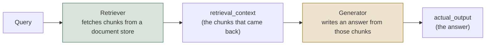
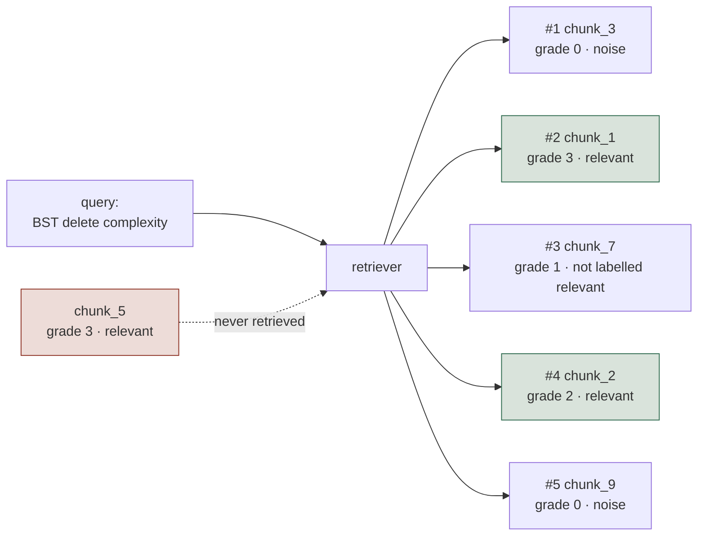
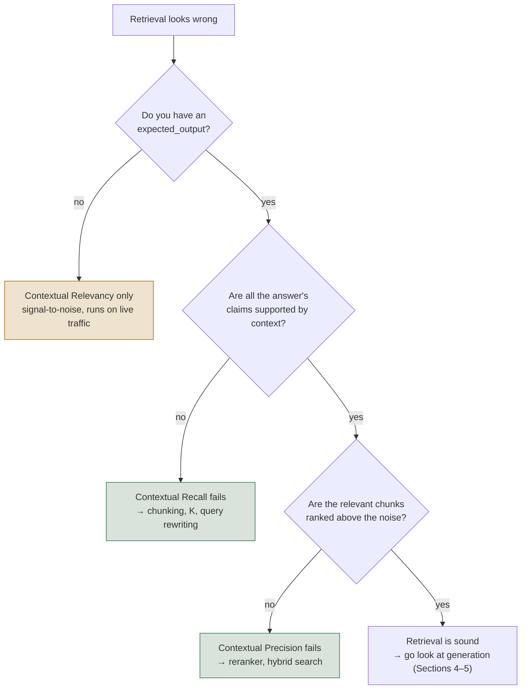
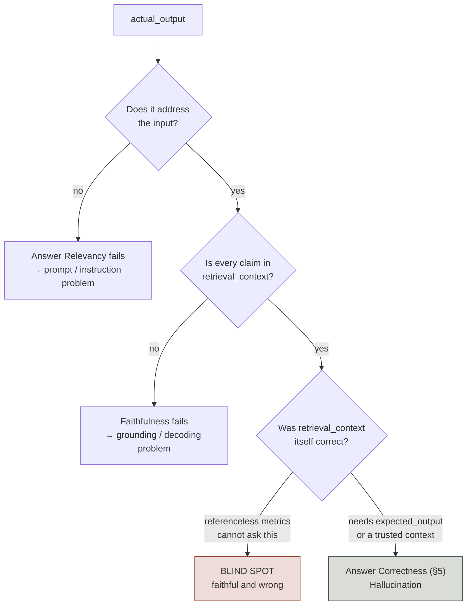
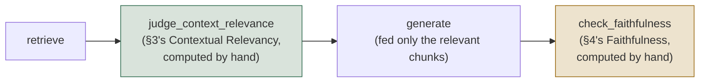
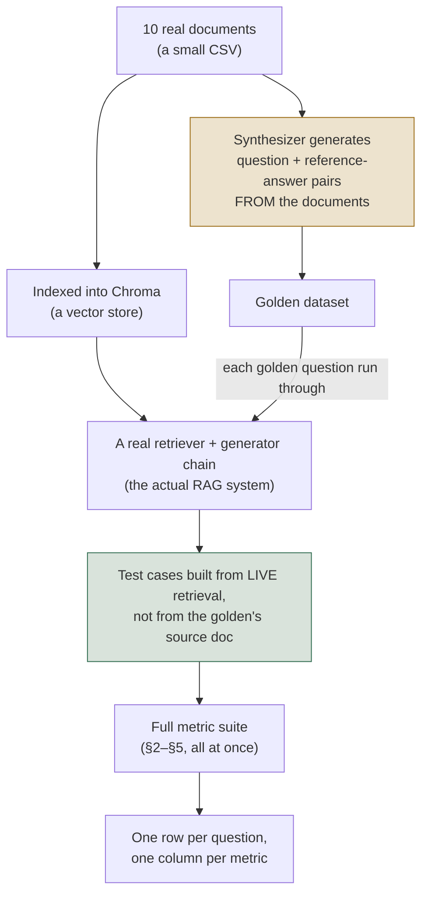

# Level 1 Explainer: RAG (Retrieval and Generation)

*A plain-language walkthrough of everything Level 1 covers, pulled together from the seven
notebooks, the field guide, the three interactive labs, and the interview question bank —
with nothing repeated twice. Level 0's Explainer is the prerequisite: this file assumes you
already have the five-surface map and the reference-based/referenceless split from there, and
builds on top of them rather than re-deriving them.*

> **Who this is for.** You don't need to know DeepEval, RAGAS, or LangGraph to follow this.
> Every technical term is defined in plain words the first time it shows up, and every number
> below is taken straight from this repo's own notebooks and labs — nothing is invented.

---

## Why this level exists

A RAG (Retrieval-Augmented Generation) system answers a question in two steps: it **retrieves**
a handful of text chunks from a document store, then it **generates** an answer using those
chunks as its only source of truth. Several sections below (2, 4, and 5, specifically) return
to the same toy question — *"What is the time complexity of deleting a node from a binary
search tree (BST)?"* — because it makes the two-step failure obvious: the correct fact ("O(h),
where h is the tree's height") either gets found or it doesn't, and the answer either sticks to
what was found or it doesn't. Other sections use whichever worked example the source notebook
built around (Apache Spark, Type 2 Diabetes symptoms, ocean levels) — each is reused as-is
rather than replaced, since the point that example makes is specific to it.

Here is the failure that motivates this entire level: a user reports a wrong answer, and the
reflexive diagnosis is "the model hallucinated." That is often false. If the retriever never
fetched the chunk that says "O(h)", the generator did not hallucinate anything — it answered
faithfully from a context that simply didn't contain the fact. Faithfulness, answer relevancy,
and every other generation metric are **bounded by retrieval**; measuring them while retrieval
is broken tells you nothing about the generator. The fix is completely different in each case:
a retrieval failure wants chunking, hybrid search, or reranking; a generation failure wants
prompt or model changes. Guessing wrong costs a sprint.

So Level 1 is built as two toolkits, retrieval and generation, each with metrics that need
labels and metrics that don't — and then it shows the one failure so structural that *neither*
toolkit, run without a reference answer, can ever catch it.

---

## 1. The RAG pipeline, and why you evaluate its two halves separately

- **Retrieval metrics** (Sections 2–3) score the box on the left: did the right chunks come
  back, and in a good order?
- **Generation metrics** (Sections 4–5) score the box on the right: given whatever *did* come
  back, is the answer any good?
- Every metric in this level takes its inputs from exactly one of these two boxes — which is
  why, later on, you can look at a table of scores and know immediately which half of the
  system to go fix.

Within each half, the metrics split again along the line Level 0 already drew: does the check
need a human-written **label** or **reference answer**, or can it run on its own? Sections 2
and 4 are the label-needing (or reference-needing) checks; Sections 3 and (partly) 5 are the
ones that manage without one.

---

## 2. Deterministic retrieval metrics: four numbers that are supposed to disagree

*Notebook: `01_Retrieval_Metrics_Deterministic.ipynb` · Lab: `01-deterministic-retrieval-metrics.html`*

Before any judge model, any API key, or any cost, there is a layer of retrieval evaluation
that is pure arithmetic over labelled ground truth: a query, the chunk IDs your retriever
returned in rank order, and the chunk IDs that are *actually* relevant (written down once, by
a human, and reused across every eval run). It is the cheapest signal in the whole stack, and
because retrieval is the first stage of the pipeline, it caps everything measured downstream.

**The four metrics:**

| Metric | Question it answers | Penalizes | Reach for it when |
| --- | --- | --- | --- |
| **Precision@K** | Of the K chunks retrieved, how many are relevant? | Noise in the retrieved set | Context windows are expensive and clutter is diluting the prompt |
| **Recall@K** | Of all the relevant chunks that exist, how many made the top K? | Missing evidence | You want to know the hard ceiling everything downstream is capped by |
| **MRR** (Mean Reciprocal Rank) | 1 / the rank of the *first* relevant hit | Burying the best chunk under noise | There's typically one best chunk and you care how early it lands |
| **nDCG@K** (normalized Discounted Cumulative Gain) | Is the ranking good once relevance is a matter of *degree*, not just yes/no? | Bad ordering among several relevant-but-unequal chunks | Relevance is graded (0–3) and more than one relevant chunk can coexist |

The formulas, in plain terms:

    Precision@K = (relevant chunks in top K) / K
    Recall@K    = (relevant chunks in top K) / (total relevant chunks that exist)
    MRR         = 1 / (rank of the FIRST relevant chunk)
    nDCG@K      = DCG@K / IDCG@K,   where DCG = Σ grade_i / log2(i + 2)

The one detail worth sitting with: **IDCG is computed over the ideal ranking of every
relevant chunk that exists — including ones the retriever never returned at all.** That is
why nDCG can stay capped below 1.0 no matter how you reorder what *was* retrieved.

### The worked example

`chunk_5` is the whole lesson: it's labelled relevant, graded 3 (the highest grade), and the
retriever never returned it — so it's invisible to Precision and MRR, and it's the single
reason Recall and nDCG are capped no matter what happens to the other chunks.

At K=5: **Precision@5 = 0.40** (2 of 5 retrieved chunks were relevant — `chunk_1`, `chunk_2`;
3 were noise), **Recall@5 = 0.67** (2 of the 3 relevant chunks that exist were found;
`chunk_5` was missed entirely), **MRR = 0.50** (the first relevant chunk, `chunk_1`, landed at
rank 2, so 1/2), **nDCG@5 = 0.51** (the graded penalty for `chunk_1`, grade 3, ranking below
`chunk_3`, grade 0, is much larger than a small swap between two similarly-graded chunks would
be).

What happens as K moves from 1 to 5:

| K | Precision@K | Recall@K | MRR | nDCG@K |
| - | - | - | - | - |
| 1 | 0.00 | 0.00 | 0.50 | 0.00 |
| 2 | 0.50 | 0.33 | 0.50 | 0.39 |
| 3 | 0.33 | 0.33 | 0.50 | 0.41 |
| 4 | 0.50 | 0.67 | 0.50 | 0.51 |
| 5 | 0.40 | 0.67 | 0.50 | 0.51 |

Three things worth noticing in that table: **Precision is not monotonic** — it drops at K=3
(a noise chunk enters) and recovers at K=4 (a relevant one does), so a single precision number
without its K is meaningless. **MRR is flat at 0.50 across every K** — the first relevant
chunk sits at rank 2 and no amount of retrieving more can move it; a flat, low MRR means a
*ranking* problem (reranker), not a *retrieve-more* problem. **Recall and nDCG both flatline
after K=4** — that flatline is the signature of a chunk that isn't reachable at all; raising K
further buys tokens and latency and nothing else.

### Reading the four together

| What you see | What it means | Where to look |
| --- | --- | --- |
| Low recall, any precision | The answer isn't in the prompt at all | Chunking, embedding model, hybrid search, query rewriting |
| Good recall, low MRR | It's in the prompt, but buried | Reranker / cross-encoder |
| Good recall, falling precision | K is too large for this query | Dynamic K, or retrieve wide and rerank narrow |
| Good recall and MRR, low nDCG | Ranking ignores *degrees* of usefulness | Graded labels + a ranking-aware retriever |
| Everything good, answer still wrong | Retrieval is fine — the bug is downstream | Sections 4–5's generation metrics |

### When to use it, and when not to

Use deterministic retrieval metrics when you're setting up evaluation for the first time (no
keys, no cost, the highest-leverage day of work available), when you're comparing retrievers
or chunk sizes exactly and repeatably, or when you need a CI gate that will never flake — these
numbers can't disagree with themselves the way a judge model can. Don't rely on them alone
when you have no hand-labelled `relevant_ids` and can't produce them at scale, when relevance
is genuinely fuzzy or query-dependent, or when your golden set was built once and never
refreshed — a stale eval set stays green while the real system's quality drifts, because it
has stopped measuring what users actually ask.

---

## 3. LLM-judged retrieval metrics: three metrics because there are three failures

*Notebook: `02_Retrieval_Metrics_LLM_Judged.ipynb` · Lab: `02-llm-judged-retrieval-metrics.html`*

Section 2's metrics all need a hand-written `relevant_ids` list, per query, written by a
person. That doesn't scale to arbitrary production traffic. DeepEval's three **Contextual**
metrics ask the same "is retrieval working" question with an LLM judge standing in for the
hand-labelled IDs — and, on purpose, they ask it three separate times, because averaging the
three into one "retrieval score" is the fastest way to make a real bug invisible: precision
can halve while the average barely moves, and nobody investigates.

> **A naming collision worth flagging early.** Section 2 and this section both use the words
> "Precision" and "Recall" — but the underlying math is not the same. Contextual Relevancy
> turns out to be *exactly* Section 2's Precision@K formula (`relevant / total`, unweighted,
> order-blind) under a different name. Contextual Precision is a genuinely different,
> **rank-weighted** metric — the same idea as Precision@K, but scored so that a relevant chunk
> near the top counts for more than the same chunk buried lower. That's the entire reason
> reordering chunks (with nothing added or removed) can move Contextual Precision while
> leaving Contextual Relevancy untouched.

| Metric | Question | Needs `expected_output`? | Cares about order? | Catches |
| --- | --- | --- | --- | --- |
| **Contextual Precision** | Are relevant chunks ranked *above* irrelevant ones? | Yes | Yes | A good chunk buried under noise |
| **Contextual Recall** | Does the context, as a whole, cover everything the expected answer needs? | Yes | No | Missing information — retrieval found *something*, not *enough* |
| **Contextual Relevancy** | Of everything retrieved, how much is actually on-topic? | No | No | Noise diluting the context, independent of ranking or completeness |

Precision cares about **order**. Recall cares about **coverage**. Relevancy cares about
**signal-to-noise**. A retriever can fail any one of the three while passing the other two —
which is exactly why the tutorial ships all three rather than one blended number.

**One easy-to-miss detail about Contextual Recall:** it checks the retrieved context against
`expected_output` — the reference answer — **not** against what the generator actually said
(`actual_output`). It's asking "was enough fetched to *support* the full expected answer?",
regardless of whether the generator used all of it. That trips people up constantly.

### The judge produces verdicts; arithmetic does the scoring

    Contextual Precision = Σ (precision@i, for each position i holding a relevant chunk) / (number of relevant chunks)
    Contextual Recall    = (claims in expected_output supported by the context) / (total claims)
    Contextual Relevancy = (relevant chunks) / (total chunks retrieved)

The judge's only job is to label each chunk relevant/irrelevant, or each claim
supported/unsupported. Everything after that is deterministic math — which is why the same set
of verdicts always produces the same score, but two separate judge runs can still disagree,
because the *verdicts themselves* are non-deterministic (Level 0, §3).

### One query, four retrieval outcomes

Question: *"What is Apache Spark used for?"*

| Scenario | Contextual Precision | Contextual Recall | Contextual Relevancy | What moved |
| --- | --- | --- | --- | --- |
| Healthy retrieval | 1.00 | 1.00 | 0.67 | — (baseline) |
| **Bad ranking** (same chunks, reordered) | **0.58** | 1.00 | 0.67 | Precision alone |
| **Thin coverage** (one perfect chunk only) | 1.00 | **0.50** | 1.00 | Recall alone |
| **Noise dilution** (1 relevant of 4 chunks) | **0.33** | 1.00 | **0.25** | Relevancy, dragging Precision with it |

Three things easy to miss in that table:

- **Healthy retrieval scores only 0.67 on Relevancy.** That is not a bug in the retriever — a
  perfect 1.00 on Relevancy usually means K was set too small, not that the retriever is
  flawless.
- **Thin coverage scores 1.00 on two of the three metrics.** If Relevancy is the only metric
  you're running (the only one that needs no reference), a retriever with a real coverage gap
  looks perfect.
- **Relevancy and Precision fail *together* under noise dilution**, but they *decouple* under
  bad ranking — noise ranked *above* signal is simultaneously a ranking failure and a
  signal-to-noise failure, while a reordering with the same chunks present doesn't touch
  Relevancy at all.

### Deciding which of the three to run

Coverage is checked before ranking on purpose: there's no point tuning a reranker over a
context that never contained the answer in the first place.

### The threshold trap

The lab's "thin coverage" scenario lands Contextual Recall at exactly **0.50** — DeepEval's
default `threshold`. That's dangerous for a concrete reason: the judge is non-deterministic,
so one flipped claim-level verdict on a re-run flips the whole test case from pass to fail. A
score sitting exactly on its threshold should be read as a coin toss, not a verdict — either
move the threshold away from where your scores actually cluster, or re-run near-threshold
cases and take a majority.

### When to use it, and when not to

Reach for judged contextual metrics when you have production traffic and no labelled chunk
IDs (Relevancy runs on anything), or when your golden set doesn't cover the query shapes real
users send and hand-labelling every new one isn't realistic. Stay with Section 2's
deterministic metrics when you're gating CI on a hard pass/fail line (judge non-determinism
makes for a flaky gate), when comparing two retrievers head to head (deterministic metrics
remove judge variance from the comparison entirely), or when cost matters at volume — three
contextual metrics over 500 test cases is 1,500+ judge calls, before generation has even been
measured.

---

## 4. Generation without a reference: three ways "the answer is wrong" can happen

*Notebook: `03_Generator_Metrics_Referenceless.ipynb` · Lab: `03-generator-metrics.html`*

Sections 2–3 asked whether the right chunks reached the prompt. This section asks the next
question: given whatever *was* retrieved, is the generated answer any good — without a
human-written reference answer for every query. These are the checks you can realistically run
against live production traffic, because none of them need a labelled ground truth for the
specific query being scored.

| Metric | Question | Compares against |
| --- | --- | --- |
| **Answer Relevancy** | Does the answer actually address the question that was asked? | `input` only |
| **Faithfulness** | Is the answer grounded in what was retrieved, with no invented claims? | `retrieval_context` |
| **Hallucination** | Does the answer align with a separately-supplied, trusted `context`, regardless of what retrieval fetched? | a curated `context`, not `retrieval_context` |

> **Why "referenceless" doesn't mean "compares against nothing."** A *reference* means one
> specific thing: a correct answer, written by a person, *before* the system ever ran
> (`expected_output`). `retrieval_context` is not that — it's something the pipeline produced
> *while* answering, exactly like the generated answer itself. The mechanical test: could this
> metric score a brand-new production query with zero human preparation? Faithfulness and
> Answer Relevancy — yes, which is why they can run on live traffic. Answer Correctness
> (Section 5) — no, because a person has to have written down the right answer first.
>
> **One honest caveat.** Hallucination's trusted `context` *is* human-curated, so it isn't free
> the way the other two are. It's referenceless in the sense that matters — it needs no
> *per-query* answer key, just a maintained corpus of trusted source material — but that corpus
> has to be kept current, so it doesn't scale to arbitrary traffic quite as freely as
> Faithfulness does. Source material also isn't an answer key: it says what's *true*, not what
> this specific answer *should have said*.

The judge doesn't score the answer as one blob — it decomposes first, and the three metrics
use **different decompositions of the same text**:

    Faithfulness     = (claims supported by retrieval_context) / (total claims)
    Answer Relevancy = (statements that address the input) / (total statements)
    Hallucination     = (claims contradicting the trusted context) / (total claims)

An answer can have three grounded *claims* and only one on-topic *statement* — Faithfulness
and Answer Relevancy are not just two takes on the same slicing of the text.

**A gotcha worth memorizing: Hallucination's score runs backwards.** A *higher* score means
*more* hallucination, the opposite convention from Faithfulness and Answer Relevancy, where
higher is better. Always check a new metric's score direction rather than assuming.

### Telling the three failures apart

An answer can be wrong in three genuinely different ways, and only one of them is visible to
any referenceless metric:

- **Faithful but irrelevant** — perfectly grounded in the retrieved context, but answers a
  different question than the one asked.
- **Relevant but unfaithful** — directly addresses the question, but invents facts that aren't
  in the context.
- **Faithful to bad context** — accurately reflects retrieved chunks that were themselves
  wrong. **Faithfulness cannot catch this.** Neither can Answer Relevancy. Only a
  reference-based check (Section 5) can.

This blind spot is **structural, not a tuning problem.** Faithfulness is defined *relative to*
the retrieved context, so it has no way to evaluate whether that context was true in the first
place.

**Faithfulness vs. Hallucination — the distinction people get wrong:**

| | Faithfulness | Hallucination |
| --- | --- | --- |
| Compares against | `retrieval_context` — whatever *this* query's retriever fetched | a separate curated `context`, independent of retrieval |
| Score direction | Higher is better | **Higher is worse** |
| Changes per query? | Yes — the baseline moves with retrieval | No — the baseline is fixed |
| Catches | A generator inventing beyond what it was given | An answer contradicting known truth, however it got there |
| Blind to | Retrieved context that was itself wrong | Anything outside the curated context |
| Runs on live traffic | Yes, nothing extra needed | Only where you maintain a trusted corpus |

Use Faithfulness to police the generator. Use Hallucination when you have an independent,
trusted source and want to check the answer against it regardless of what retrieval returned.

### When to use it, and when not to

Reach for referenceless metrics when monitoring production traffic with nobody writing
reference answers, when catching decoding-level failures — invention, over-claiming, drifting
off the question — or whenever you need volume, since they scale to any input at zero labelling
cost. Watch specifically for **Semantic Similarity as a stand-in for correctness** (Section 5)
and for **vague `GEval` criteria** (Section 6) — the specificity you put into a rubric is the
specificity you get back.

**A cheaper alternative for Answer Relevancy specifically.** DeepEval also ships
`RAGASAnswerRelevancyMetric`, a binding into RAGAS that scores relevancy with embedding cosine
similarity instead of an LLM judge call — cheaper and faster, at the cost of missing subtler
forms of "technically similar wording, wrong answer" that a judge would catch. It's the same
tradeoff Section 5 draws out fully for Semantic Similarity vs. Answer Correctness, just applied
one metric earlier in the pipeline.

**What each of the five metrics in this level structurally cannot catch**, gathered in one
place (the individual "blind to" details are scattered across Sections 3–5 above):

| Metric | Cannot catch |
| --- | --- |
| Contextual Precision / Recall / Relevancy (§3) | See §3's own triage table — each of the three is blind to the other two's failure mode |
| Answer Relevancy | A confidently wrong answer *to the right question* |
| Faithfulness | Context that was itself wrong |
| Hallucination | Anything outside the one curated context you supplied |
| Answer Correctness (§5) | Any query with no written reference to check against |
| Semantic Similarity (§5) | Wrong numbers and facts — it measures topic, not truth |

---

## 5. Generation against a reference: Answer Correctness and Semantic Similarity

*Notebook: `04_Generator_Metrics_Reference_Based.ipynb` · Lab: `03-generator-metrics.html`*

Section 4's three metrics all judge the answer on its own terms — grounded, on-topic,
consistent with a trusted source. None of them ask the most direct question: **is the answer
actually correct**, against a known-good reference? That is what this section covers, and it's
the only place in Level 1 that can catch "faithful to bad context."

- **Answer Correctness has no dedicated metric class.** That's not an oversight — "is it
  factually right" is specific to what "right" means for your task, so the recommended pattern
  is a custom `GEval` rubric rather than one generic class (Section 6 covers how to write one).
- **Answer Semantic Similarity** isn't an LLM-judged metric at all — it's plain embedding
  cosine similarity between the answer and the reference. Cheap, fast, no judge call — and
  weaker at catching a subtly wrong fact, because two answers can sit close in embedding space
  while disagreeing on the one number that actually matters.
- **Both need `expected_output`** — a reference answer a person had to write. That's the
  precise cost side of the reference-based/referenceless tradeoff from Level 0: exact, but only
  as scalable as your ability to write and keep reference answers current.

### The same four answers, now with reference-based scores added

Question: *"What is the time complexity of deleting a node from a BST?"* Reference: *"O(h),
where h is the height of the tree."*

| Answer | Answer Relevancy | Faithfulness | Hallucination ↓ | Answer Correctness | Semantic Similarity |
| --- | --- | --- | --- | --- | --- |
| Grounded & relevant | 1.00 | 1.00 | 0.00 | 0.95 | 0.94 |
| Faithful but irrelevant | 0.33 | 1.00 | 0.00 | 0.35 | 0.78 |
| Relevant but unfaithful | 1.00 | 0.50 | 0.50 | 0.40 | 0.91 |
| **Faithful to bad context** | **1.00** | **1.00** | **1.00** | **0.10** | 0.83 |

Read the last row carefully. The retriever returned a chunk claiming BST deletion is O(1). The
generator repeated it accurately. Every claim is supported by the context it was handed, and
the answer directly addresses the question — so **both referenceless metrics report a perfect
score on an answer that is simply false.** Only Answer Correctness, checked against the
reference, catches it: 0.10.

The Semantic Similarity column carries its own warning: **0.83** for an answer that says O(1)
where the truth is O(h). Embeddings measure *topic*, and "constant time" and "logarithmic time"
sit topically close together — similarity will happily score a wrong answer as "pretty good."
Pair Semantic Similarity with a judged correctness check; never let it substitute for one.

### Two ways to write the correctness rubric

`GEval` (the tool behind Answer Correctness) takes exactly one of two configurations — never
both at once, it's one or the other:

- **`criteria`** — a short, plain-language sentence (*"Determine whether actual_output is
  factually correct relative to expected_output, focusing on whether key facts match — wording
  may differ"*), which the judge expands into its own evaluation steps internally.
- **`evaluation_steps`** — an explicit, ordered procedure you write yourself (e.g. *"1. list the
  statements in actual_output, 2. check each is relevant to input, 3. check each agrees with
  expected_output, 4. check each is grounded in retrieval_context, 5. penalize anything
  invented"*), which lets you weave several test-case fields — input, expected answer, *and*
  retrieved context — into one rubric at once.

`evaluation_steps` is the more controllable of the two: instead of trusting the judge to expand
a one-line criteria into a good procedure, you write the procedure. Section 6 explains why that
control matters so much.

### When to use it, and when not to

Gate CI where you control the test set and want a hard pass/fail bar. Reach for reference-based
checks specifically when the failure you fear is *wrongness*, not *ungroundedness* — which
covers every index-corruption and stale-document scenario Section 4 structurally cannot see.
Use them when comparing prompt or model versions, where a fixed reference makes the comparison
meaningful. And always watch the two traps: Semantic Similarity standing in for correctness,
and a `criteria` sentence too vague to say what should fail (Section 6).

---

## 6. Writing a rubric that doesn't produce a vague judge

*Field guide §1.5*

Every custom `GEval` — Answer Correctness above, or any other rubric you write — comes down to
one fact: **you are either writing the test, or letting the judge invent it for you.**

| You give the judge | What happens | Result |
| --- | --- | --- |
| One sentence — *"check the answer is accurate"* | The judge has to invent its own evaluation steps, and invents slightly different ones on every run | The same answer gets different scores on different runs |
| Explicit steps — *"1. every figure appears in the context, 2. it answers the question asked, 3. no advice beyond the policy"* | The judge follows the procedure you wrote | The same answer gets the same score every time |

- **Write explicit steps whenever a one-liner won't pin down what should fail.** Steps also let
  you check several things in one pass — relevance, agreement with a reference, and grounding —
  instead of running three separate metrics.
- **A vague rubric never errors.** Nothing goes red. You just get numbers that wobble slightly
  from run to run, with no signal pointing at the rubric as the cause. That's what makes vague
  rubrics dangerous: they fail silently, as noise, not as a visible break.
- **The test to apply to your own rubric:** if you can't say precisely what would make an
  answer fail it, neither can the judge.

The same idea shows up outside AI evaluation constantly: handing a human grader "mark this
fairly" instead of a marking scheme produces five different grades from five different graders,
every one of them individually defensible.

---

## 7. Evaluation as pipeline gates, not just after-the-fact scoring

*Notebook: `05_RAG_Eval_Inside_the_Pipeline.ipynb`*

Every metric in Sections 2–5 scores a RAG system's output **after the fact** — build a test
case, hand it to a metric, read a score. That's how you evaluate offline, against a batch of
test cases. But context relevance and faithfulness are exactly the kind of check that can also
run **as part of the pipeline itself**, gating generation on bad retrieval, or flagging a
hallucinated answer, before either one ever reaches a user.

Two reasons this pattern is worth knowing, beyond it being a different way to compute the same
numbers:

1. **You can act on the result mid-pipeline.** `judge_context_relevance` runs *before*
   generation — cheap enough, and early enough, that a real system could branch on it: skip
   generation and ask a clarifying question instead of generating a plausible-sounding answer
   from noise, if nothing relevant came back.
2. **It demystifies the metric classes.** Building "context relevance" and "faithfulness" out
   of raw judge calls once, by hand, makes it far clearer what a ready-made metric class like
   `ContextualRelevancyMetric` is actually doing underneath.

The worked example retrieves three chunks for the BST question, one of them deliberately
off-topic (a fact about Python lists). The mock judge correctly flags the off-topic chunk
`irrelevant`, filters it out *before* generation runs, and the resulting answer scores
**Faithfulness 1.00** — no hallucination detected, because it was only ever given the chunks
that actually supported an answer.

**Prototype against mocked judges first.** Same graph structure, byte-identical output, zero
cost — build and debug the pipeline's *shape* this way. Only once that shape is right do you
swap in real judge calls, and that swap is exactly where non-determinism becomes visible: the
same graph, run twice against a live model, can produce slightly different judgments and
slightly different extracted claims each time. That's why production evals typically run a
judge at `temperature=0` (as deterministic as a model can be made) and sometimes track
judge-agreement itself as a metric, rather than trusting any single pass.

---

## 8. RAGAS as a second opinion, and the pytest/CI batch pattern

*Notebook: `06_RAGAS_in_Practice.ipynb`*

RAGAS is a second framework — narrower in scope than DeepEval, RAG-specific, and a common
default in the wider RAG ecosystem — that measures the same ideas from Sections 3–4 in its own
vocabulary:

| RAGAS class | The DeepEval idea it mirrors | Note |
| --- | --- | --- |
| `LLMContextPrecisionWithoutReference` | Contextual Precision (§3) | The `WithoutReference` suffix spells the reference-based/referenceless split out in the class name itself, rather than leaving you to infer it from which fields you populate |
| `LLMContextRecall` | Contextual Recall (§3) | |
| `Faithfulness` | Faithfulness (§4) | |

Two mechanical differences worth knowing if you switch between the two libraries: RAGAS's unit
of evaluation is a `SingleTurnSample` (fields `user_input`, `response`, `retrieved_contexts`,
`reference`) rather than DeepEval's `LLMTestCase` — same idea, different field names — and
RAGAS is **async-first** (`await sample.single_turn_ascore(...)`, or `asyncio.run(...)`),
where DeepEval defaults to a synchronous `.measure()`. RAGAS also wants an explicit
`LangchainLLMWrapper` around any LangChain-compatible chat model to act as its judge, rather
than resolving a judge from a `model="..."` string the way DeepEval does — a small extra step
that buys the ability to use *any* LangChain-integrated provider as the judge, not only
OpenAI models by name.

On a sample built so retrieval pulls in one irrelevant chunk alongside a correct one, Context
Precision comes back lower than Context Recall — the same signature Section 3 already taught
you to read: precision is penalized directly by noise sitting in the ranking, while recall
(checked against the reference, which the irrelevant chunk doesn't contradict) is far less
affected by it.

### The batch/CI pattern

A single hand-built test case teaches you what a metric does. It says nothing about your
system. Turning "one scored example" into "a real evaluation" is always the same shape:

> dataset of inputs → call the **live** system once per row → score the real response → write
> the score back beside its input

The production version of this in the repo's source material is a `pytest`-parametrized test
that reads questions from a spreadsheet, calls a live RAG backend for each one, scores the
response with RAGAS, writes the score back into the same spreadsheet next to the question that
produced it, and asserts the score as a CI gate. `pytest.mark.parametrize` is what turns "one
eval sample" into "one test per row" — pytest itself becomes the batch runner and the pass/fail
reporter, with no separate eval-harness loop to write. This is a general pattern, not specific
to RAGAS or to this one notebook — Level 1's own capstone (Section 9) runs a version of it, and
Level 2 reuses the exact same shape for tool-use and task-completion metrics.

Why every row has to hit the *live* system matters: scores land right next to the input that
produced them (a bad number is one click from its cause — a dashboard, not just a diagnosis),
and the whole thing re-runs on demand, which is the actual prerequisite for comparing a change
against what's currently live.

---

## 9. Building a RAG system and synthesizing a golden set

*Notebook: `07_RAG_Capstone_Build_and_Evaluate.ipynb` · Field guide §1.8*

Every notebook up to this point either used hand-constructed test cases (Sections 2–6) or
fixture data in a toy graph (Section 7). The capstone does the real thing:

**Hand-writing reference answers doesn't scale past a handful of examples.** A synthesizer
generates question/expected-answer pairs directly from your own documents instead, evolved
along dimensions you choose — for instance, requiring multi-step reasoning, or requiring
information pulled from more than one chunk at once — so you get a labelled eval set without
writing a single reference answer by hand. **Spot-check the output anyway**: a generated
question is only as good as the generation process that produced it.

**The one detail that makes this an honest end-to-end test, not a generator-only test:** each
golden question's test case is built by *actually running the live retriever* on that
question — not by reusing the document the golden question was originally generated from. If
the retriever performs badly on a given question, its `retrieval_context` reflects that badly,
and the evaluation below is testing the real, currently-deployed pipeline, not just checking
whether the generator can write a good answer given hand-picked, perfect context.

Running the full metric suite together — retrieval and generation, reference-based and
referenceless, all at once — over every golden question is how a RAG quality report actually
gets read in practice: an aggregate table (mean, min, max per metric), not one hand-picked
example eyeballed at a time. Which is exactly what Section 10 explains how to read.

---

## 10. Reading the results

*Field guide §1.9*

A table of per-metric scores across a golden set is diagnostic, not just descriptive — if you
read it right.

- **Diagnose by pattern, not by the headline number.** Low Contextual Precision with high
  everything else points at a ranking problem (Section 3). Low Faithfulness alongside high
  Contextual Relevancy points at the generator inventing things despite good retrieval
  (Section 4). The *shape* of a scorecard carries more information than any single number in
  it.
- **Aggregates hide the thing you need to see.** An 85% average with one query category sitting
  at zero, and an 85% average spread evenly across every category, are two entirely different
  systems reporting the identical headline score.
- **Slice before you conclude.** Break scores down by query category, tenant, intent, or
  document type before deciding the system is "fine" or "broken" — an aggregate can hide a
  segment that's failing completely.

---

## Question-bank corner — retrieval and generation numbers, live on a dashboard

*(From `QUESTION_BANK.md`, Part 10, §10.1–§10.3 — the three sections that map onto Level 1's
three labs. §10.4 onward belongs to Level 2's tool-use and trajectory material and isn't
repeated here.)*

These aren't the conceptual questions Sections 1–10 already answered — they're the follow-up
questions asked once an interviewer has your metrics dashboard on screen, phrased the way a
production, real-time interview round (OpenAI-, Anthropic-, Google-caliber) tends to phrase
them. A representative sample from each of the three sections:

- **§10.1 (deterministic retrieval):** *"Leadership wants one number for retrieval quality on
  an exec dashboard — what do you put there, and what do you say about the request?"* A strong
  answer picks Recall@K if forced (it's the ceiling everything downstream is capped by), states
  plainly what that one number hides (a good recall figure is compatible with the right answer
  sitting at rank 8 under seven pieces of noise), and proposes Recall@K on the dashboard with
  Precision@K and MRR one click away, rather than either refusing the request or pretending one
  number is enough.
- **§10.2 (LLM-judged retrieval):** *"Contextual Precision drops from 0.91 to 0.62 after a
  release; Recall and Relevancy are unchanged. What shipped?"* The signature reads directly off
  Section 3's table: the same chunks are still being retrieved (recall didn't move) but their
  *order* changed — so the likely cause is a reranker change, a scoring/fusion weight change, or
  how ties get broken, not an embedding or chunking change.
- **§10.3 (generator metrics):** *"Faithfulness and Answer Relevancy both sit above 0.95 for a
  month, then a customer proves the assistant has been giving wrong compliance guidance the
  whole time. How is that possible?"* This is Section 4/5's blind spot, verbatim: both metrics
  are referenceless, so a knowledge-base document that is itself wrong produces a perfectly
  faithful, perfectly relevant, *wrong* answer — no threshold on either metric could have caught
  it, because it's a structural blind spot, not a calibration failure. The fix is reference-based
  coverage (Section 5) for the high-stakes slice, plus an upstream fix: index freshness
  monitoring, since the root cause lives in the knowledge base, not the model.

The full sections (§10.1 has 5 questions, §10.2 has 5, §10.3 has 4) walk through the reasoning
for each in more depth than fits here — this corner is a map of *what kind* of question to
expect, not a substitute for reading them.

---

## References

All content above was drawn only from material already in this repository. Nothing here was
invented, and no external source was consulted.

**Notebook:**

- `courses/01-rag-agent-tool-evaluation/01_Retrieval_Metrics_Deterministic.ipynb` — the four
  deterministic retrieval metrics, their formulas, and the BST worked example (Section 2).
- `courses/01-rag-agent-tool-evaluation/02_Retrieval_Metrics_LLM_Judged.ipynb` — the three
  Contextual metrics and the Apache Spark / Type 2 Diabetes / climate-change worked examples
  (Section 3).
- `courses/01-rag-agent-tool-evaluation/03_Generator_Metrics_Referenceless.ipynb` — Answer
  Relevancy, Faithfulness, and Hallucination, plus the "why referenceless" callout and the
  score-direction gotcha (Section 4).
- `courses/01-rag-agent-tool-evaluation/04_Generator_Metrics_Reference_Based.ipynb` — Answer
  Correctness (`GEval`, both configuration styles) and Answer Semantic Similarity (Sections 5–6).
- `courses/01-rag-agent-tool-evaluation/05_RAG_Eval_Inside_the_Pipeline.ipynb` — evaluation
  wired directly into a LangGraph pipeline as gates, mocked and then live (Section 7).
- `courses/01-rag-agent-tool-evaluation/06_RAGAS_in_Practice.ipynb` — RAGAS's own API shape and
  the pytest/CI batch pattern (Section 8).
- `courses/01-rag-agent-tool-evaluation/07_RAG_Capstone_Build_and_Evaluate.ipynb` — building a
  real RAG system, synthesizing a golden dataset, and running the full metric suite end to end
  (Section 9).

**Docs:**

- `docs/concepts/rag-agent-tool-evaluation.md`, Part 1 (§1.1–§1.9) — the compressed reference
  version of every section above, plus §1.5 (writing a rubric) and §1.9 (reading results), which
  have no notebook of their own.
- `docs/concepts/rag-agent-tool-evaluation.md`, Part 6 (§6.1–§6.3) — the slow narrative version
  of Sections 2–5, walked against the same numbers used above, including the triage tables and
  the "when to use it / when not to" guidance reused directly in this file.
- `docs/interactive-labs/01-deterministic-retrieval-metrics.html`,
  `docs/interactive-labs/02-llm-judged-retrieval-metrics.html`,
  `docs/interactive-labs/03-generator-metrics.html` — the three companion labs; each contributed
  its scenario table and its own framing of the "what this metric is blind to" column, folded
  into Sections 2, 3, and 4–5 respectively rather than repeated separately.
- `docs/interview-prep/QUESTION_BANK.md`, Part 10, §10.1–§10.3 — the metric-level, dashboard-framed
  follow-up questions used in the Question-bank corner.
- `docs/study-guide/evaluation-roadmap.md` — used to scope Level 1's topic list and goal
  statement, not quoted directly.
- `docs/study-guide/evaluation-topic-notebook-mapping.md` — used for the resource list and cost
  tags (all Level 1 notebooks are tagged `key`, meaning they make live `OPENAI_API_KEY` calls
  when actually run; this file was written without running any of them).

**Limitations.** This file was written by reading the repository's own notebooks, field guide,
labs, and question bank — not by running any notebook or calling any API — no cost was incurred
producing it, consistent with this project's rule against executing anything that spends money
without being asked. It does not independently verify DeepEval's, RAGAS's, or LangGraph's own
upstream documentation; every description of what those libraries do is this repository's own
characterization (its notebooks and field guide), not a review of the vendors' docs.
