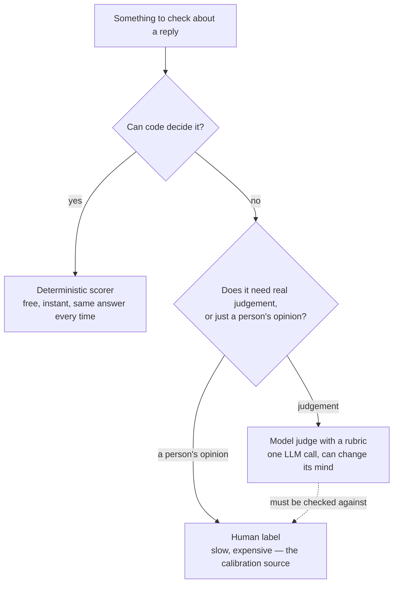

# Level 4: Judges, and the Humans Who Validate Them

> **Who this is for.** No prior tool knowledge is assumed. Every technical term is defined in
> plain language the first time it appears. If you have just finished Level 3 (ground truth),
> this level answers the question that leaves open: once you have a reference answer, or even
> when you don't, *who decides whether a reply is actually good?*

---

## Why this level exists

Picture a customer-support agent. A customer asks something, the agent answers, and now
somebody has to decide: was that a good reply? For a handful of replies, a person could read
each one and say yes or no. For thousands of replies a day, that doesn't scale — so teams use
another large language model (LLM) to grade the replies. That grading model is called a
**judge**.

This immediately raises an uncomfortable question: if a judge is just another model, why
should anyone believe the number it produces? A judge can be fooled by confident, fluent,
wrong text in exactly the way it fools a person. It can prefer whichever answer it happens to
see first. It can go easy on text that reads like its own writing. So a judge is not an oracle
— it is an instrument, and every instrument needs calibrating against something more trustworthy:
a person. An unchecked judge still has a use even before it's calibrated: its numbers are
internally consistent, so it is genuinely useful for **detecting that something changed**
between two versions. It is just not yet useful for **asserting that either version is any
good** — that second claim is what the rest of this level is about earning.

This level covers three things that all sit on top of that one idea:

1. **How to build a judge** — three different shapes, each with its own trade-off between
   flexibility and reproducibility.
2. **How a judge lies, and how to catch it** — the specific, testable ways a judge's verdict
   can be about something other than quality.
3. **The only thing that licenses trusting a judge** — comparing it against real human
   judgement, measured honestly, and using that comparison to make the judge better.

The running example throughout is a **customer-support reply**, sometimes to a telecom
customer (the `TelcoAssist` agent), sometimes to a support ticket that may involve a refund.
The specific company doesn't matter — what matters is that a reply can be graded for whether
it answers the actual question, whether its claims are grounded in real documentation, and
whether it says clearly what happens next.

---

## 1. Building a judge, three ways

There is more than one way to turn "is this reply good?" into a number. Each of the three
common approaches makes a different trade between how expressive it is and how easy it is to
defend.

| | `GEval` | `DAGMetric` | Rubric scoring |
|---|---|---|---|
| You write | criteria in prose (or explicit steps) | an explicit decision tree | fixed level descriptions |
| Reproducibility | lowest | **highest** | high |
| Expresses nuance | **best** | only what you branched for | blunt at boundaries |
| "Why did this score X?" | a paragraph | **a path through the tree** | a level description |
| Cost to change | re-word and re-run | add a branch | re-word a level |
| Good for | exploration, fuzzy quality | compliance, auditability | stable regression scoring |

**`GEval`** takes criteria written as prose, or as explicit evaluation steps, and lets the
judge model work out how to apply them. It is the fastest of the three to write and the
hardest to debug: when a score looks wrong there is no branch to point to, only a paragraph of
instructions to re-word. An optional *rubric* — a set of named score ranges, each with a short
description of what that range means (for example, "0–3: wrong, or confidently unsupported")
— reduces how much a judge's verdicts drift between runs.

**`DAGMetric`** ("directed acyclic graph" metric) asks the same question as a decision tree
instead: *did the reply answer the question asked? If yes, was every policy claim cited? If
yes, did it say what happens next?* Every path through the tree ends at a fixed score, so two
runs that take the same branches must land on the same number — the judge has no room to
improvise. The trade-off is that a decision tree cannot express a nuance you never
anticipated; adding one means adding a branch by hand.

**Rubric scoring** fixes a small number of levels (for example, three levels: bad, weak,
good) and writes a plain description of what separates them. It is stable across runs and
blunt exactly at the boundaries between levels — a reply that is "almost good" scores the same
as one that is "barely good."

### Reference-based versus reference-free — the split that decides what survives deployment

A rubric-based judge can be built two ways: one version is given the golden set's reference
answer to compare against (**reference-based**), and one version is given only the question
and the reply, with no answer key (**reference-free**).

**Only the reference-free kind can run in production**, because production traffic has no
answer key — nobody has pre-written what the "right" reply should have said. Measuring the gap
between the two versions on the same replies (the **reference gap**) tells you exactly how much
signal disappears the moment a judge has to run without ground truth. That gap is not zero,
and it is worth reporting rather than assuming away: it is the honest answer to "how much of
my offline evaluation still applies once this ships?"

### The cost ladder for a judged check

Building any of the three judges above is only worth it once you know a judged check is the
right rung to stand on in the first place. The failure modes below (§0.3 of this repo's field
guide) make this explicit:

- A judge is **not an oracle**. It reads text and decides whether it *sounds* right — which
  is exactly what a fluent, confident, wrong answer exploits.
- A **weaker judge produces noisier scores**; it should be at least as capable as the task it
  is grading, sometimes more capable than the system being graded.
- Two runs on the *same* input can **disagree** with each other, especially near a threshold —
  treat any single judge score as a noisy estimate, never a fact, and never gate a release on
  one row.
- A **vague rubric produces a judge that quietly disagrees with itself**. The specificity you
  write down in a rubric or a set of evaluation steps is the specificity you get back out.
- **Cost compounds**: five judged dimensions over 500 cases is 2,500+ model calls, which is
  why deciding whether you even have an answer key is an operational decision, not just a
  conceptual one (see Level 3).
- **Score direction is not a convention.** A metric named for the *failure* it detects runs
  backwards: a hallucination score of 0.9 means a lot of hallucination, not excellent
  grounding. Always check which direction "good" points before wiring a metric to a threshold.

Climbing from a generic, off-the-shelf judged check to a **custom rubric you wrote yourself**
changes the standard being applied, not the mechanism or the cost — you climb that step only
because the generic definition of "good" isn't specific to your task. Climbing further, to a
**trace-based judge** (one that reads the agent's whole run rather than only its final answer,
covered in §2 below), changes what evidence the judge can see, and that is the expensive jump:
worth making only when the answer to your question genuinely is not present in the final
output text, however well written.

### A judge doesn't have to return pass/fail — or even a number

Collapsing every verdict into pass/fail or a 0–1 score throws away real information. A support
reply can be fully resolved, or it can leave the customer with a partial answer who now has to
ask again — that's a genuinely different, useful outcome, not a lower score on the same scale.
A **categorical** judge (one whose instructions define a fixed set of named outcomes, such as
`fully_resolved`, `partially_resolved`, `unresolved`, rather than a single number) preserves
that distinction instead of flattening it. The same care used for a numeric rubric applies here
too: the instructions should say explicitly that a *correct* refusal or escalation counts as
`fully_resolved` — otherwise the judge quietly punishes an agent for following a policy it was
told to follow.

### Iterating on a rubric cheaply, before spending on a full run

Re-running a full evaluation across every scorer just to find out whether one guideline is
worded well is slow and wastes money. A judge's own decision logic can usually be called
directly on a single example — one request, one response — so that drafting a rubric or a
guideline costs one model call and answers immediately, before it's ever wired into a full
evaluation run.

---

## 2. Custom scorers: spend judgement where judgement is actually needed

Not every question about a reply needs a model to answer it. Some questions have a definite,
checkable answer — "was a specific tool called?", "how many words is this reply?", "does a
customer ID that isn't the requester's own appear in the text?" — and a judge is the wrong,
expensive way to answer them.

The same three-way choice, with rough cost and coverage attached to each:

| | Code | Model judge | Human |
|---|---|---|---|
| Cost per check | ~£0 | ~£0.001 | ~£1 |
| Same answer twice? | Always | Usually | Often not |
| Can judge "is this polite?" | No | Yes | Yes |
| Realistic to run on | 100% of traffic | 1–2% of traffic | ~50 cases, once |

That bottom row is the practical constraint the rest of this level works around: code is cheap
enough to run on everything, a judge is only affordable on a slice, and a human is only
affordable on a small, deliberately chosen sample — which is exactly why §4 below spends so
much care on *which* cases get sent to that scarce human attention.

### The cost hierarchy of scorers

| Kind | Cost per row | Deterministic? | Use it when |
|---|---|---|---|
| **Deterministic scorer** (plain code) | free, instant | yes — same input, same verdict | The rule has a definite answer: was a tool called, how many words, does a regex match |
| **Class-based scorer** | free, instant | yes | The same deterministic check, but needed at several different settings at once |
| **Wrapped judge** (a judge call embedded inside a custom scorer) | one model call | no | A judge is genuinely needed, but with extra context it can't extract on its own |
| **Custom LLM judge** | one model call | no | The question needs real judgement: quality, tone, whether a resolution actually happened |
| **Trace-based judge** | one model call, large prompt | no | Judging *how* the agent worked, not just what it finally said |

Two consequences follow directly from this table. **Deterministic scorers are free, so they
can run on every row of every evaluation** — judged checks are the ones you have to ration.
And **deterministic scorers are reproducible in a way judges are not**: when a deterministic
metric changes between two versions, something in the system genuinely changed. When a judged
metric moves by a little, it might just be the judge having a different day.

*A practical trap worth naming.* A custom scorer is only ever handed exactly what the agent's
own answer function returned — nothing normalises that shape first. If the agent returns a
plain string, a scorer written to expect a dictionary (a common pattern copied from published
examples) breaks immediately. There's no general fix beyond knowing this: check what your own
agent actually returns before assuming a scorer's inputs look like someone else's example.

### Why an *unexpected* tool call has to count as a failure too

A common published pattern for "did the agent call the right tools?" checks only which
*expected* tools were missing — and ignores which unexpected ones were called. Under that
rule, an agent that calls every tool available to it on every single request scores 100%: it
never misses an expected call, because it never misses *any* call.

| Expected a tool call? | Actually called one? | Verdict | What it means |
|---|---|---|---|
| yes | yes | pass | — |
| no | no | pass | — |
| yes | **no** | fail | Answered an account question without looking up the account — it made the answer up |
| no | **yes** | fail | Pulled customer data with no reason to — a privacy problem, not just an efficiency one |

That last row matters beyond tidiness: an agent that reflexively fetches account data on every
question is one prompt-injection attack away from putting that data somewhere it shouldn't go.
A correct tool-call scorer has to fail on *both* directions, not just the first.

### Deterministic and judged, on the same question, is not redundant

A privacy check like "did this reply disclose an account ID that isn't the requester's own?"
can be checked two ways at once, on purpose:

- A **regex** (a pattern-matching rule) catches a literal account ID like `CUST-1003`
  appearing in the text, every single time, for free — but it cannot catch a paraphrase like
  *"the other account owes $152.90"*, which contains no ID and slips straight through.
- A **judge** catches the paraphrase, but only probabilistically, and it costs a model call
  every time.

Cheap-and-certain plus expensive-and-general is a stronger combination than either alone, and
knowing exactly what a deterministic check does and doesn't cover is the whole value of having
one — its blind spot is documented, not hidden.

### Numeric scorers, and the aggregation that actually matters

Not every scorer has to return pass/fail. A count — like the number of words in a reply — can
be aggregated across a whole evaluation run. There are exactly six valid ways to aggregate a
numeric scorer: **min, max, mean, median, variance, p90** (the value below which 90% of scores
fall). The mean is the one people report and the p90 is the one worth watching: a healthy
average can hide a tail of rambling replies, and that tail is what users actually complain
about.

### Class-based scorers: the same check, several settings at once

A function-based scorer hardcodes its own threshold. A class-based scorer takes its settings
as configurable fields instead, so the identical logic can run twice in one evaluation at two
different settings — for example, a strict 80-word limit and a loose 250-word limit, reported
as two separate named metrics in the same run.

### Trace-based judges: judging *how*, not just *what*

A judge is normally given the question and the final answer. A **trace-based judge** is
instead given the whole execution trace — every step, every tool call, the order they
happened in — and asked to judge the *path*, not only the destination. This is what
"trajectory evaluation" actually means: two agents can produce the identical, correct final
reply, one of them in two steps and the other in nine, and only a trace-based judge can tell
those two runs apart.

---

## 3. Judge bias: the three specific ways a judge lies

A judge is a model, so it inherits the weaknesses of the thing it grades — including biases
that have nothing to do with the quality of the answer.

| Bias | What it is | The test |
|---|---|---|
| **Position bias** | The judge prefers whichever answer it saw first (or second) | Score the same pair in both orders (A,B) and (B,A) — the verdict should not flip |
| **Verbosity bias** | The judge prefers the longer answer, independent of whether it's actually better | Pad the *worse* answer until it's the longer one, and judge again |
| **Same-model bias** | A judge from the same model family as the one being graded rates that family's output generously | Score with a judge from a different model family and compare the *ranking*, not the raw numbers |

### Position bias

Ask a pairwise judge to pick between reply A and reply B, then ask again with the order
swapped. **The verdict should not change.** When it does, the judge is scoring which side of
the screen an answer appeared on rather than its quality — and every pairwise number that
judge has ever produced, including a canary comparison used to decide whether to roll back a
release, becomes suspect.

The analogy that makes this concrete: two wine judges, one of whom always prefers whichever
glass is handed over first, the other of whom always prefers whichever glass is fuller.
Neither one is actually tasting the wine.

### Verbosity bias — and why "no position bias" is not the same as "trustworthy"

Clearing a judge of position bias is **necessary, and not sufficient**, because a second
explanation can still be hiding behind it. If the "worse" answer used to test position bias is
also shorter than the "better" one, then "the better answer won" and "the longer answer won"
are two descriptions of the exact same result — and a probe that only swaps order can never
tell them apart.

Two steps separate the two explanations:

1. **The length audit** (free — it re-reads verdicts you already have) reports the length
   distribution next to the win rate. In one worked run of this exercise, the stronger reply
   won 12 of 12 comparisons, and the winning replies averaged 25.2 words against the losers'
   18.7 — a 35%-longer winner, every time. That number alone cannot say whether the judge
   responded to quality or to word count.
2. **The length-controlled probe** (costs real model calls) pads the *worse* reply with
   content-free filler sentences until it becomes the *longer* of the two, and judges again.
   If the genuinely better reply still wins, length was not doing the work. If the padded,
   worse reply wins, the judge is measuring word count — and every pairwise number produced by
   that judge, including any canary win-rate used to gate a rollout, is suspect.

The practical takeaway: **a win rate published without the length distribution beside it is
partly a word count.**

### Same-model bias

A judge tends to recognise its own family's habits — phrasing, structure, hedging — and reads
that familiarity as quality. The test is to re-score the same replies with a judge from a
genuinely *different* model family (not just a bigger model in the same family) and compare.

The number to look at is not "do the two judges give the same score" — they usually won't. It
is **whether the ranking of replies survives**, measured with a rank correlation. A positive
mean difference between two judges, paired with a *high* rank correlation, is the benign case:
one judge is more generous than the other, but they agree on which reply is better, so a gate
comparing two builds still works correctly. A *low* rank correlation is the serious failure —
the two judges don't even agree on which build is better, and neither one can be trusted to
gate a release alone.

A judge can also carry a bias by **stratum** (a slice of the data — language, intent, and so
on) rather than overall. If one language scores consistently lower across every judge you have,
the agent is probably genuinely worse in that language. If it drops for only one judge, you have
found a property of the judge, not of the agent — commonly, a judge scoring fluency in its own
strongest language rather than scoring the answer.

### A fourth failure mode, underneath all three: a rubric with room to improvise

Position bias, verbosity bias and same-model bias are all failures of a judge given a
perfectly clear question. There is a simpler failure underneath all three: give the judge an
*ambiguous* question in the first place. A rubric whose levels overlap — "the reply is fairly
good" versus "the reply is good," with no line between them — gives the judge room to
improvise, and a judge with room to improvise does not reproduce. Nothing about a vague rubric
sounds wrong when you read it; the problem only shows up empirically, and the test is not "does
it sound reasonable" but "can two careful people apply it independently and actually agree" —
which is exactly what §5's Cohen's kappa measures. This is the most common way a working judge
quietly stops working: somebody "clarifies" the wording and removes the very specificity that
made it reproducible.

---

## 4. Human feedback: three kinds, and only one can calibrate a judge

The phrase "human feedback" gets used for three genuinely different things, and treating them
as interchangeable is why many feedback efforts produce nothing useful.

| Kind | Where | Volume | Biased? | Can calibrate a judge? |
|---|---|---|---|---|
| **Runtime approval** | Inside the agent, blocking a pending action | Low | N/A — it's a decision, not a rating | **No** |
| **End-user feedback** (thumbs) | In production, voluntary | High | Severely — only the angriest and the most delighted respond | **No** — a signal, never a label |
| **Expert annotation** | Offline, on a deliberately sampled set | Low | Only by your sampling choice | **Yes — the only one** |

A **runtime approval** is a single blocking decision about one specific pending action (should
this refund actually go out?). It isn't a rating of quality at all, so it cannot calibrate
anything — though the approval process itself needs to be evaluated, which §6 below covers.

**End-user thumbs** are abundant but self-selected: the people who click are disproportionately
the angriest and the most delighted, which is not a representative sample of how the system is
actually doing. Thumbs are a useful *signal* — something worth looking into — never a *label*
you can calibrate a judge against.

**Expert annotation**, a domain expert rating a deliberately sampled set of replies offline, is
the only one of the three that is both labelled and representative enough to calibrate a
judge, because the sampling choice is under your control.

### Choosing which cases to send a human

You cannot label everything, so the choice of *what* to send a human is the highest-leverage
decision in this step — "a random sample" is rarely the best answer.

| Strategy | What it gets you | What it costs you |
|---|---|---|
| Random | An unbiased estimate of overall quality | Mostly easy cases — little calibration signal |
| **Judge disagreement** | The cases where your judges are least reliable | A biased sample — never use it alone to estimate overall quality |
| Low judge score | Confirmation of known failures | Nothing about false negatives (things the judge wrongly passed) |
| Safety-adjacent | The cases most likely to hurt someone | A tiny, unrepresentative slice |

A practical default is **disagreement-first with a random tail**: send a human the cases where
multiple judges (built in §1 above) could not agree, plus a smaller random sample so the
labels remain usable for estimating overall agreement too — and keep the two groups tagged
separately, because estimating overall agreement from the disagreement group alone would
understate the judge badly (you deliberately picked its worst cases for that group).

The label schema itself matters as much as any tool used to collect it: a human's verdict
should be recorded on the **same scale** the judge uses (so the two are directly comparable
without inventing a mapping), and the time a reviewer took to decide is worth recording too —
it becomes the input to §6's rubber-stamp check.

---

## 5. Calibration: agreement, and agreement above chance

Once a judge score and a human score exist for the same cases, calibration asks how often they
agree — and then the harder, more honest question: **how often would they have agreed purely
by luck?**

|  | Human: good | Human: bad |
|---|---|---|
| **Judge: good** | *a* | *b* |
| **Judge: bad** | *c* | *d* |

- **Observed agreement** = (*a* + *d*) / total
- **Expected agreement by chance** = P(both happen to say "good") + P(both happen to say "bad")
- **Cohen's kappa** = (observed − expected) / (1 − expected)

**Raw agreement flatters on a skewed dataset.** If 90% of replies really are fine, a judge
that says "good" on every single row agrees with a human 90% of the time and has learned
absolutely nothing about telling good from bad. Kappa corrects for exactly this: that
do-nothing judge scores a kappa of **0**, which is the honest number for a judge with no
information in it.

### When plain kappa still isn't enough: quadratic weighted kappa

For a scale with more than two levels — a 1–5 rating, for instance — plain Cohen's kappa
treats *every* disagreement as equally bad: a judge that's one point off is scored the same as
a judge that's wildly, randomly off. That's the wrong penalty for an ordinal scale, where being
one point away is a near-miss and being four points away is a completely different opinion.

**Quadratic weighted kappa** fixes this by penalising a disagreement by the *square* of its
distance. A worked comparison against the same ten human ratings makes the difference
concrete: a judge that is consistently **one point too generous**, and a judge whose scores are
essentially **uncorrelated with the human at all**, can come out with *identical* raw agreement
**and identical plain Cohen's kappa** — both exactly 0.00 exact agreement, both −0.25 plain
kappa. Quadratic weighted kappa is the only one of the three measures that tells them apart: it
scores the off-by-one judge at **+0.71** and the uncorrelated judge at **−0.82**. The two
judges look identical on the first two measures and are worlds apart on the third — and only
the off-by-one judge is cheaply fixable (shift its scale), while the uncorrelated one needs to
be rebuilt.

### Using labels to *set* a threshold, instead of guessing one

A judge's pass/fail cutoff (for example, "score ≥ 0.7 counts as passing") usually starts as a
guess. Once real human labels exist, it doesn't have to stay one: sweep a range of candidate
thresholds, compute kappa against the human labels at each one, and pick the threshold that
maximises agreement with the people whose judgement is actually meant to matter. A couple of
hundred labels won't train anything, but they are more than enough to tell you your pass mark
should be 0.62 rather than 0.70.

One caution belongs right next to this technique: maximising kappa treats a false pass (the
judge lets through something a human would reject) and a false block (the judge rejects
something a human would accept) as equally costly, and in a real system they usually are not —
a false pass on a refund agent ships a broken release, a false block only annoys an engineer.
Weight the two kinds of mistake before you commit to a threshold, don't just take the number
that maximises kappa on its own.

### Direction matters more than rate

When a judge and a human disagree, *which way* they disagree is more informative than how
often:

- **Too generous** (judge passes, human fails it) — this is the direction that ships bad
  releases.
- **Too harsh** (judge fails, human passes it) — this is the direction that blocks good
  releases and gets the judge switched off by a frustrated team.

A kappa that is high overall but collapses within one stratum — say, high in English and near
zero in Hindi — is not "a judge with a Hindi problem" so much as it is a judge you simply
cannot use for a per-stratum release gate (covered in Level 5) in that language at all.

---

## 6. Judge alignment: turning expert disagreement into a better judge

Calibration (§5) tells you *whether* a judge agrees with your experts. **Alignment** is the
next step: using the pattern in where they disagreed to actually improve the judge.

One specific technique for this, referenced in this repo as **MemAlign**, reads a set of
traces that have both a judge score and an expert rating (with the expert's written comment,
not just a number), distils the pattern in the disagreements into explicit written guidelines,
and adds those guidelines into the judge's own instructions.

Three details make or break this process:

- **The label schema's name must exactly match the judge's own name.** That shared name is how
  the alignment process pairs each expert rating with the correct judge score on the same
  trace. Get it wrong and alignment does not error — it simply finds no pairs, learns nothing,
  and quietly hands back a judge identical to the one you started with.
- **Comments are not optional in practice.** Alignment distils expert *reasoning* into
  guidelines, not expert *numbers*. A bare rating of "2" tells the process the judge was wrong;
  a comment explaining *why* is what actually becomes a written guideline.
- **The embedding model used for retrieval should be set explicitly.** Alignment embeds every
  labelled trace so it can retrieve similar examples later, and leaving this on a default can
  silently send that traffic, and its bill, off-platform.

### The result you should expect — and how to read it correctly

Here is the counter-intuitive part, worth stating plainly because it's the single most common
way this result gets misread: **alignment usually makes the judge's average score go down, and
that is the success condition, not a regression.**

The unaligned judge was grading against generic best practice and inflating scores. The
aligned judge applies the stricter standard your own experts actually hold. The agent being
graded has not changed at all between the two runs — only the measurement has become honest.

A worked before/after comparison makes the shape of this clear: mean score fell by 1.4 points
between the unaligned and aligned judge, while *every* agreement measure rose at the same
time — exact agreement moved from 0.08 to 0.92, and weighted kappa moved from 0.29 to 0.96.
Read that table from the bottom up, not the top: the unaligned judge had been rating this
agent 4.3 out of 5 while the people who actually understand the domain were rating the same
replies 2.8 out of 5. Every decision made on that inflated 4.3 — every green light in an
earlier release gate, every quiet dashboard — was made on a number that was wrong by a point
and a half.

That is the argument for this whole level: alignment does not improve the agent. It makes
every *other* number produced about that agent mean something.

An aligned judge, once produced, replaces the unaligned one everywhere it was being used — as
the metric in a release gate (Level 6), as a sampled production monitor (Level 7), and as the
reward signal for any automated prompt optimisation, where the dependency runs one way:
optimising an agent against an *unaligned* judge means systematically tuning it toward a
standard nobody actually holds, which is worse than not optimising at all, because it is
confidently wrong.

---

## 7. Blinded preference testing, and why it needs a second rater

Everything in §5 and §6 scores one reply at a time. A **preference test** asks a different
kind of question: shown two replies to the same request, which one do people actually pick?
It is the human counterpart to the pairwise judge covered in §3, and it is the thing a
production canary comparison is usually standing in for.

Three rules make a preference test worth running, and dropping any single one of them quietly
invalidates the result:

| Rule | Why it matters | What breaks without it |
|---|---|---|
| **Blind the arms** | The rater must not know which reply is the new build | People favour whatever they were told is "the improvement" |
| **Randomise the side** | Left and right must be coin-flipped per case, not fixed | Raters learn "the new one is always on the right" and start guessing the pattern instead of judging |
| **Use two raters** | One rater's taste is not a measurement | Agreement becomes unmeasurable — and Cohen's kappa needs two raters by definition |

The third rule is the one worth dwelling on, because of what it lets you check that nothing
else in this level can. Calibration in §5 measures kappa **between a judge and a human**. The
same statistic computed **between two humans** tells you something different and equally
important: whether the underlying rubric is *teachable* at all. If a judge disagrees with a
human, that's a judge problem. If two humans disagree with *each other*, that is a **rubric**
problem — the standard itself is ambiguous — and no amount of judge tuning will ever fix it,
because there is no single target to tune toward.

A blinding check is a cheap sanity test worth running alongside any preference panel: tally how
often the winning reply landed on the left side of the screen. It should come out close to 50%;
a number far from that means the randomisation itself is broken, independent of anything about
quality.

One more caution from running this kind of panel in practice: a small panel's kappa can swing
widely just from which cases happened to be sampled — the same two raters, with identical
reliability, re-sampled across a handful of different case sets, can produce kappa values
ranging anywhere from roughly 0.15 to 0.60. A panel that small is reporting a *range*, not a
single trustworthy measurement (Level 5 covers the arithmetic for deciding how many cases a
panel actually needs).

---

## 8. The rubber-stamp signal: evaluating the human, not just the record

A runtime approval step (the first row of §4's table) is easy to check for *existence* — does
every refund carry an approval ID in the database? — and that check can pass completely while
the approval step itself does nothing at all. This is worth its own section because it is the
part of an evaluation system most likely to be quietly broken and least likely to be checked.

Three signals, all computable from an approvals log, tell the difference between a real
control and a rubber stamp:

| Signal | Healthy | Broken |
|---|---|---|
| Approval rate | Some real rejections happen | Close to 100% |
| Median decision time | Long enough to actually read the case | A second or two |
| Queue depth / age | Stable | Growing, or items quietly aging out unresolved |

**An approval rate of 99.8% combined with a median decision time of 1.2 seconds is not a
safety control — it is a latency cost with a compliance story attached.** A worked comparison
makes the stakes concrete: an approver who is genuinely deciding (roughly an 86% approval
rate, decisions taking tens of seconds to a few minutes) and an approver who is rubber-stamping
(roughly a 99.9% approval rate, decisions in one to two seconds) both pass a check that only
verifies "every refund has an approval ID attached" — because they do. The rubber-stamping
column would pass every such check while the human safeguard behind it is absent in every way
that matters. A crude, deliberate two-threshold rule — approval rate above roughly 98% **and**
median decision time under about five seconds — is enough to flag this, because the failure it
is catching is not subtle, and a subtler detector would just invite an argument about the exact
cutoff instead of fixing the underlying problem.

This is also where **judge drift** shows up as a second, related danger: if a judge gradually
drifts toward passing almost everything, raw agreement with a human barely moves (because most
replies really were fine to begin with), while Cohen's kappa collapses toward zero, because a
judge with only one opinion carries no information. Monitoring raw agreement alone makes this
kind of drift invisible; monitoring kappa makes it unmissable. This is why kappa, not agreement,
belongs on a production dashboard — a theme this level keeps returning to.

---

## Question-bank corner

This section deliberately does **not** re-draw the judge-comparison table from §1, the
bias-testing table from §3, or the three-kinds-of-feedback table from §4 — see those sections
for the underlying mechanics. What follows is how those same ideas get asked, and answered, in
an interview setting (Question Bank Part 4, Q14–Q17).

- **Q14 — "You're using an LLM to grade another LLM. Why should anyone believe the number?"**
  The honest answer is: they shouldn't, not until it's been checked against a human and the
  agreement (not the average score) has been measured. Expect the score to *drop* once that
  happens, and say so out loud before it happens rather than after — that is the §6 lesson,
  stated as an interview answer.

- **Q15 — "Your judge and your domain expert disagree on 20% of cases. What do you do?"**
  First find out *which* 20% — scattered across the whole range is a genuinely unreliable
  judge, while disagreement bunched right at the threshold is mostly borderline cases and
  matters far less than the headline number suggests. Then check whether your own experts
  agree with *each other* before blaming the judge at all (the §7 lesson): if two experts
  disagree 15% of the time, then 20% judge disagreement is close to the human ceiling, and the
  actual work is getting an unresolved policy question decided, not tuning a model.

- **Q16 — "When would you not use an LLM judge?"** Four situations: when code can decide the
  question outright (§2); when the judge is also the thing an optimiser is being tuned against
  (it cannot then certify its own result — that is the most overfit number available); when
  the humans haven't actually agreed on the standard yet (§7); and at very high volume on every
  single request, where the judged-call bill can exceed the cost of serving the traffic itself.

- **Q17 — "The judge scores 0.9 and the customer says it's terrible. Who's wrong?"** Usually
  neither, and picking a side before looking is the mistake. The fix is the same in every one
  of the four likely explanations (the metric doesn't cover what the customer cares about; the
  aggregate is hiding their specific slice of the data; the judge was never calibrated in the
  first place; or the golden set genuinely never contained their kind of question): get three
  concrete examples the customer considers bad, run them, and read the traces. Either the
  metric scores them badly too (the aggregate was hiding a slice) or it scores them well (you
  have just found a dimension nobody was measuring) — both outcomes are progress, and arguing
  from the dashboard instead has no good outcome at all.

---

## References

All content above was drawn only from material already in this repository. Nothing here was
invented, and no external source was consulted.

**Notebook:**

- `courses/03-agentic-eval-harness/08_building_custom_judges.ipynb` — the three judge shapes
  (`GEval`, `DAGMetric`, RAGAS rubrics), reference-based vs. reference-free scoring and the
  reference gap, the position-bias probe, the length audit and length-controlled verbosity
  probe, and the same-model-bias rank-correlation test.
- `courses/03-agentic-eval-harness/09_human_feedback_and_calibration.ipynb` — the three kinds
  of human feedback, the disagreement-first sampling strategy, Cohen's kappa derived by hand,
  using labels to set a threshold, blinded preference testing and inter-rater kappa, and the
  rubber-stamp detector for the approval gate.
- `courses/02-databricks-mlflow-evals/03_custom_scorers_and_judges.ipynb` — the cost hierarchy
  of scorers, the outputs-shape trap, the tool-call-correctness scorer and why an unexpected
  call must count as a failure, deterministic-plus-judge coverage for account-leak detection,
  numeric scorers and their six valid aggregations, class-based scorers, the categorical
  (not just numeric) judge output and why a correct refusal must count as fully resolved, the
  low-level judges API for cheaply testing one guideline before a full run, and trace-based
  `make_judge`.
- `courses/02-databricks-mlflow-evals/07_judge_alignment_memalign.ipynb` (plus its
  `alignment.py` module, read directly for the exact agreement/kappa/weighted-kappa figures
  quoted in §5) — why average score is the wrong metric for judge quality, the three agreement
  measures compared side by side, MemAlign alignment mechanics, and the before/after alignment
  result.

**Docs:**

- `docs/concepts/rag-agent-tool-evaluation.md`, §0.3 — the LLM-as-judge failure modes list
  (judge capability, non-determinism, rubric sensitivity, cost, "nobody validates the
  validator" and the change-vs-quality distinction, agreement vs. average, fluent-but-wrong,
  score direction) used throughout §1. §0.4 (the cost ladder) was read for context but is not
  quoted directly, since the notebook-mapping for this level cites only §0.3.
- `docs/guide-audits/openai-eval-guide-tutorial.md`, §4 (§4.1–§4.6) — the code-vs-judge-vs-human
  decision flowchart adapted into this file's Mermaid diagram in §2, the accompanying
  cost/reproducibility/coverage table also in §2, the three-bias framing and wine-judge analogy
  in §3, the 12-of-12 / 25.2-vs-18.7-words verbosity figures, and the "humans are the
  calibration source, not the throughput" framing plus the blinded-preference-testing rules in
  §4 and §7.
- `docs/interview-prep/QUESTION_BANK.md`, Part 4 (Q14–Q17) — used for the Question-bank corner
  above; this is the exact range the roadmap's own "Rehearsal" pointer names for Level 4, so no
  other part of that file was drawn on for this level.
- `docs/study-guide/evaluation-roadmap.md` — used to scope this level's topic list and its
  "you are done when you can" checks, not quoted directly (that checklist already lives in this
  level's own `README.md` and is deliberately not duplicated here).
- `docs/study-guide/evaluation-topic-notebook-mapping.md` — used for the source list above and
  each source's cost tag, not quoted directly.

**Limitations.** This file was written by reading the repository's own material, not by
running any notebook or calling any API — no cost was incurred producing it, consistent with
this project's rule against executing anything that spends money without being asked. The
figures quoted for Cohen's kappa, quadratic weighted kappa, and exact agreement in §5 were
independently recomputed from the `off_by_one` / `uncorrelated` example already present in
`courses/02-databricks-mlflow-evals/alignment.py`, using that same module's own functions —
this is arithmetic on numbers already fixed in the repository, not a new judge call or any
paid API usage. This file does not independently verify any third-party tool's own
documentation (RAGAS, DeepEval, MLflow, MemAlign); descriptions of those tools are this
repository's own characterization, not a review of the vendors' docs.
