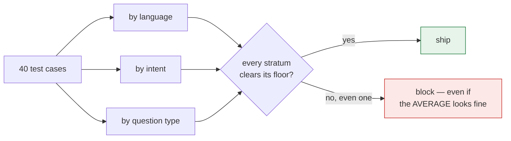
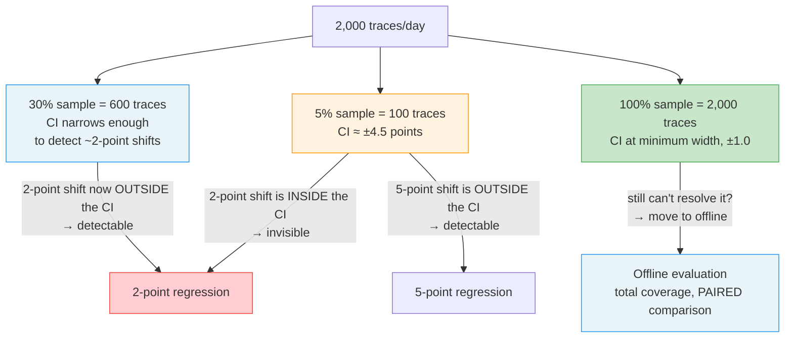

# Level 5 Explainer: Statistics and stratified reporting

*A plain-language walkthrough of everything Level 5 covers, pulled together from the
notebook, the field guide, the interactive lab, and the interview question bank — with
nothing repeated twice.*

> **Who this is for.** You don't need any statistics background to follow this. Every
> technical term — sample size, paired comparison, bootstrap, confidence interval — is
> defined in plain words the first time it shows up.

---

## Why this level exists

A support bot is tested on 40 questions, in English, Spanish and Hindi. Version 1 is live;
version 2 is ready to ship. Here is the full result:

| Group | Cases | v1 passes | v2 passes | Change |
|---|---|---|---|---|
| English | 22 | 20 (91%) | 22 (100%) | better |
| Spanish | 10 | 8 (80%) | 10 (100%) | better |
| Hindi | 8 | 7 (88%) | 4 (50%) | **collapsed** |
| **Overall** | **40** | **35 (87.5%)** | **36 (90%)** | **better** |

The overall score went up — 87.5% to 90%. Every dashboard in the world shows that as green,
and version 2 ships. But Hindi went from 88% to 50%: nearly half of those customers now get a
wrong answer. Nothing in the overall number tells you this happened, because the improvement
in English and Spanish more than paid for the collapse. Hindi is only 8 of 40 cases — 20% of
the test set — so the average only felt 20% of its 37.5-point fall, which is 7.5 points, and
that got buried under 10 points of gain from the other two groups.

This is arithmetic, not bad luck. **A group is only as loud in the average as it is big.** A
group that is 5% of your traffic can fail entirely and move the overall score by five points.

Level 5 is the discipline that stops this from shipping: report every score by the group it
belongs to, not just as one blended number; know, before you argue about a small move,
whether your test set is even large enough to see it; and when you do compare two versions
on the same cases, use the test built for *paired* data instead of throwing that pairing away.

---

## 1. Stratified reporting: score each slice, not the whole

A **stratum** (plural: **strata**) is just a group of test cases that share something — all
the Hindi questions, all the billing questions, all the ones where the right answer is "I
don't know." It's a slice of your test set, nothing more. **Stratified reporting** means
scoring each slice on its own, instead of collapsing everything into one number, and reading
all of them.

**How to choose your groups.** Pick the ways your users actually differ. For a support bot,
four usually matter:

| Split by | Example groups | Catches |
|---|---|---|
| Language | English · Spanish · Hindi | A language with thin documentation behind it |
| What the user wants | billing · account · general question · escalation | One workflow breaking while the rest are fine |
| Question type | simple lookup · multi-step · answer not in the docs | A bot that guesses instead of saying "I don't know" |
| Turns | single message · a back-and-forth | Quality falling apart after turn three |

**The analogy.** A school announces that its average exam score went up this year. It did.
What the announcement doesn't mention is that one class failed every subject, and the other
classes improved enough to cover it. The number is true, and it's useless for the only
decision that mattered.

**Tag cases when you create them, not later.** You can't split a test set by a label it
doesn't have. This cuts both ways when a dashboard looks green but customers are still
complaining: split the results by segment first, but also check whether the test set contains
those customers' questions *at all* — a segment with zero test cases can't show up as failing,
so a gap in coverage and a genuinely healthy segment look identical unless you check.

**Report each split on its own — never cross-tabulate.** It's tempting to slice by language
*and* intent *and* question type at once, but with 40 cases and three dimensions you get
mostly empty cells, and an empty cell is where somebody makes a confident statement about a
segment of size one. Don't combine splits into "Hindi billing multi-step questions" — you'll
end up with twenty groups of one case each, and one case tells you nothing.

**Every mean needs its `n` printed beside it.** A mean without a sample size is a rumor. The
notebook's own report format makes this literal — it prints, for every stratum and every
metric, both the average *and* how many cases that average was computed from, because
different metrics can be missing for different subsets of the same stratum (a stratum with 12
cases overall might have a faithfulness score for only 3 of them).

> *"Never as one number. I tag every test case by language, intent and question type, score
> each group separately, and gate the release on the worst group rather than the mean. An
> average is the easiest place in the system to hide a failing segment."*

**The rule to remember, and the point of doing any of this: gate on the worst group, not the
average.** A release passes when every group clears its floor — not when the mean clears a
line. Reporting by group and then still shipping on the average changes nothing; it's the
same mistake with an extra step.



---

## 2. Sample size: could your suite even see the change?

Before arguing about whether a 4-point move is real, ask a cheaper question first: **could a
test set this size ever detect a move that small?** The rule-of-thumb formula for a
proportion, at 95% confidence and 80% power ("power" is the chance you'd actually notice a
real effect if one were there):

```
n ≈ 15.7 · p(1 − p) / δ²
```

where `p` is roughly where you are now and `δ` (delta) is the size of the change you want to
be able to see. (15.7 comes from `2 × (1.96 + 0.84)²` — the standard two-sided,
95%-confidence, 80%-power constants — so this is a documented rule of thumb, not a substitute
for a full power analysis, but it's the right order of magnitude instantly.)

A worked example: at `p = 0.80` and wanting to see a 10-point move (`δ = 0.10`), you need
`n ≈ 251` cases. A 40-case suite, by contrast, **can see a collapse, but not a slip** — it
simply doesn't have the resolution for small moves. The same formula runs in reverse, too:
given the `n` you actually have, it tells you the smallest change you're capable of detecting
at all (`δ ≈ √(15.7 · p(1−p) / n)`). **Publish that number next to every report.** It turns
"the score dropped 4 points" from a fire drill into a known, honest limitation of the suite —
and it's the honest answer to "do you ship?" when someone asks about a move that's actually
inside your own blind spot.

This same arithmetic is the reason a dashboard sampling live traffic can miss a real
regression — see [Section 6](#6-the-same-problem-in-production-the-sampling-resolution-problem)
below.

---

## 3. The small-stratum rule: when a group is too small to gate on

Sample-size math cuts hardest against your *smallest* groups. With 8 Hindi cases, **one case
flipping moves that group by 12.5 points** — each case is worth `100% / 8 = 12.5` percentage
points on its own. So a "15-point drop in Hindi" might be one case having a bad day, not a
real regression.

**The fix is not to ignore small groups — it's to report them and not block on them, until
they're big enough to mean something, and to say out loud that you're doing it.** A stratum
below that minimum size still gets its number printed on the dashboard; it just isn't allowed
to fail a release on its own. Silently dropping it would hide the very customers it's meant to
protect; silently gating on it would block releases at random.

> *"We report every group, but we only block on groups above a minimum size. Below that, one
> case flipping swings the number more than a real regression would, so blocking there would
> just be reacting to noise."*

This is exactly the argument behind the release gate's `min_cases_to_gate` setting (covered in
full in Level 6): the per-stratum detection-limit table — n, what one case is worth, and the
smallest change that stratum can detect at all — is what tells you where to draw that line, not
a round number picked in advance.

**The three tools from this level, aimed at exactly this scenario, agree with each other.**
Take the smallest stratum in a test set, flip a single case, and check it three ways: the
bootstrap confidence intervals before and after the flip overlap almost completely; McNemar's
test on the same before/after pairing finds nothing significant. All three readings say the
same thing — a single flipped case is statistical noise, not a regression — which is exactly
why the gate reports a small stratum's number instead of blocking on it.

---

## 4. Paired comparison and McNemar's test

You don't compare version 1 and version 2 on two different, unrelated samples — you run the
exact **same** golden cases against both. That pairing is information, and treating the two
runs as independent throws it away.

**McNemar's test looks only at the cases that changed between the two runs:**

```
                 candidate
                pass    fail
  baseline pass   b       c      <- c: regressions (used to pass, now fails)
           fail   d       a      <- d: fixes       (used to fail, now passes)

  statistic = (|c − d| − 1)² / (c + d)      ~ chi-square, 1 degree of freedom
  significant (p < 0.05) when the statistic exceeds 3.84
```

Cases that landed in the same place both times (`a` and `b` above — pass→pass and fail→fail)
carry **no information about a change**, and McNemar deliberately ignores them. That's exactly
*why* a paired test needs far fewer cases than an unpaired one to see the same effect: an
unpaired comparison of two independent proportions has to fight through the noise of all 40
cases, while McNemar only has to look at the handful that actually flipped.

The notebook demonstrates this on a constructed example: take the golden set's pass/fail
results as the baseline, then build a "candidate" by deliberately breaking 5 previously-passing
cases and fixing 2 previously-failing ones, and run McNemar on the pairing. With `c + d` that
small, the test may well come back not-significant — and **that is the correct answer, not a
failure of the test.** A handful of flips in either direction, on a 40-case suite, is
exactly what you'd expect to see from chance alone.

---

## 5. Confidence intervals: bootstrap and Wilson

A single score — "90% resolved" — is a point estimate. It doesn't say how much that number
would move if you'd happened to draw a different 40 cases. A **confidence interval** answers
that: a range that the true rate probably falls inside, given the sample you actually have.
This level covers two different ways to build one.

### The bootstrap

The **bootstrap** answers "how much would this number move if I'd drawn a different sample of
the same size?" by literally simulating that, thousands of times: resample your existing cases
*with replacement* (the same case can be picked more than once, and some cases won't be picked
at all), recompute the statistic on each resample, and take the middle 95% of the resulting
spread as the interval.

It's deliberately implemented in about ten lines of plain `random` and `statistics` — no
scipy, no pandas. The point of writing it by hand, rather than importing it, is that a
confidence interval you can't derive is a confidence interval you'll misread. The bootstrap's
real advantage is that it works for *any* statistic — a mean, a median, a rate — because it
never assumes a particular bell-curve shape for the underlying data; it just resamples what
you actually observed.

**Read the widths, not the points.** A stratum whose interval spans 0.4 isn't telling you it's
worse than another stratum — it's telling you that you don't know, because the sample is too
small to say anything precise.

### Wilson confidence intervals

For the specific, common case of a proportion (a pass rate, a resolution rate), there's a
closed-form formula — no resampling required — called the **Wilson interval**. It's a standard
statistical technique for putting a confidence interval around a proportion that stays
well-behaved even at small sample sizes or when the observed rate is close to 0% or 100%,
where a naive bell-curve approximation breaks down. This repo doesn't reproduce the formula
itself, but it does show what it resolves to in practice, at an observed rate of 0.95:

| Traces scored | Resolution (± points) |
|---|---|
| 50 | ±6.6 |
| 100 | ±4.5 |
| 200 | ±3.1 |
| 600 | ±1.8 |
| 2,000 | ±1.0 |

Read this the same way as the bootstrap widths above: it's the size of the wobble your number
carries purely from *which* cases happened to be sampled, before you've asked anything about
whether the system actually changed.

**Bootstrap vs. Wilson, in one line:** Wilson is a fast, closed-form shortcut that only works
for proportions; the bootstrap is slower but works for any statistic, and — because you write
it yourself — never leaves you unsure what it's actually claiming. Either one is answering the
same question: *how much could this number move on a different sample?*

---

## 6. The same problem in production: the sampling-resolution problem

The Wilson-interval table above isn't just an offline concern — it's exactly the arithmetic
behind a very common production mistake: grading a *sample* of live traffic instead of every
request, because grading everything with an LLM judge costs real money.

**The setup.** Your agent handles 2,000 conversations a day. You grade 100 of them — a 5%
sample — and assume the rest look about the same. But the number wobbles purely from *which*
100 you happened to grade:

```
Day 1:  you grade 100 conversations → 95 pass → you report 95%
Day 2:  you grade a different 100    → 92 pass → you report 92%

Nothing changed. Same agent, same code, same prompt.
Only WHICH 100 you happened to grade changed.
```

That's a ±4.5-point wobble — the same number the Wilson table above gives for n=100. So
whether you can see a real problem depends entirely on how big the problem is relative to that
wobble:



**An alert set at 2 points, at a 5% sample rate, is worse than no alert at all** — two
ordinary, unchanged days can differ by several points from luck alone, so the alert fires on
days when nothing broke. A team that gets paged for nothing learns to close the page without
looking, which is exactly the credibility cost this whole level is trying to avoid.

**To detect a 2-point drop you need about 606 scored traces** — at 2,000 traces/day, that's a
30% sample rate, not the 5% that felt affordable. And if a delta can't be resolved even at
100% sampling, the answer isn't more sampling — it's to move that comparison **offline**,
where every input is scored and, crucially, the comparison is **paired**: the exact same fixed
set of questions asked of the old build and the new one, which removes the day-to-day
variation in *what customers happened to ask* as a confound (this is the same paired-vs-
unpaired idea behind McNemar in Section 4 — a fixed, shared set of cases is what lets you
attribute a difference to the *change*, rather than to which traffic showed up that day).

**The analogy.** Tasting a pot of soup. One spoonful tells you instantly if it's far too
salty; it can never tell you whether today's pot is 2% saltier than yesterday's — especially
when it's a different pot of soup every day.

**The decision this leaves you with, as a repeatable procedure:**

1. Decide the smallest regression you must catch.
2. Look up (or compute, via Section 5's formulas) the samples needed for that resolution.
3. Divide by daily traffic to get the sample rate.
4. Deterministic scorers (checks code can run, not a judge) never need sampling at all — they're free, so score every request.

Name the smallest regression you refuse to miss *first*, then buy the sample rate that can
actually see it — and if no sample rate can, that comparison belongs offline, not on a
dashboard.

---

## 7. Simpson's paradox: when every stratum improves and the total falls

This isn't a trick question — it's a real, mechanical consequence of stratified reporting that
every stratum can genuinely improve while the overall number falls, whenever a release also
shifts the *mix* of traffic between strata. A constructed illustration:

| Stratum | Before | After | Change |
|---|---|---|---|
| English (n: 90 → 20) | 90.00% | 95.00% | **+5.00** |
| Hindi (n: 10 → 80) | 50.00% | 55.00% | **+5.00** |
| **Overall** | **86.00%** | **63.00%** | **−23.00** |

Every single stratum went *up* by 5 points. The overall number *collapsed* by 23 points —
because the mix of who's asking moved from 90% English / 10% Hindi to 20% English / 80% Hindi,
and Hindi is the weaker segment regardless of which version is live. A gate on the aggregate
alone would block a release that made every group better; a gate on the worst stratum would
correctly pass it. **This is the single best argument for gating per stratum rather than on
the mean**, and it's the reason the release gate (Level 6) has a dedicated check for exactly
this case, separate from its overall-average check.

---

## 8. Putting it together

Four small tools, four different questions, and none of them substitutes for another:

| Tool | Question it answers |
|---|---|
| Stratified grouping | *Which segment is bad?* |
| `n ≈ 15.7·p(1−p)/δ²` | *Could this suite even see that change?* |
| McNemar | *Did the same cases really get worse, or did a handful just flip by chance?* |
| Bootstrap / Wilson interval | *How much would this number move on a different sample?* |

And the two decision rules that sit on top of all four: **gate on the worst stratum, not the
average** (Sections 1 and 7), and **report a small stratum's number without blocking a release
on it** (Section 3). Do all of this *before* the release gate itself, covered next in Level 6 —
this level is what makes that gate's numbers trustworthy in the first place.

Put in one sentence, this level's whole job is: **refuse to act on a number you cannot
resolve, and never report an average that buries a segment.** If you're preparing this
material for an interview-style round, Simpson's paradox (Section 7) is the strongest
follow-up to have ready — it's the one case where the aggregate and every individual stratum
genuinely disagree, and the aggregate is the one that's wrong.

---

## Question-bank corner — the two rounds this level prepares you for

*(From `QUESTION_BANK.md` — Q4 and Q21, the two questions in the bank that this level's
material speaks to directly; the rest of the bank belongs to other levels.)*

**Q4 — "The customer wants one number for a dashboard. What do you give them?"** This is
Section 1's argument, aimed at an executive audience: two systems — one slightly mediocre
everywhere, one excellent everywhere except that it leaks account data under an adversarial
prompt — can produce the identical headline average. The strong answer restructures the
dashboard into three layers instead of fighting the request for "one number": a **headline**
that's a pass/fail verdict against the blocking gates (not an average — a verdict can't be
rescued by being good at something else), the **slices** underneath it (by category, by
whether a tool was involved, by attack type, by turn), and a separate **"not measured"**
column, because an unmeasured dimension and a failed one must never look the same — reporting
a gap as a zero makes a healthy system look broken, and hiding it makes a blind spot look like
coverage. The line worth having ready: *"the headline tells you whether to look, the slices
tell you where."*

**Q21 — "A metric dropped two points this week. Walk me through what you do."** This is
Sections 2 and 6 turned into an investigation checklist. The first question is never "what
caused it" — it's *"can this sample even resolve two points?"* (Section 6's whole argument).
If the drop clears the noise floor and is real, three things could have changed, and they
need separating: **us** (a prompt, model, retrieval config or tool — check the deployment
timeline first, because it's cheapest to confirm or rule out), **them** (the traffic mix
shifted — slice by category; a drop concentrated in one category almost always means this,
while a drop spread evenly points at "us"), or **the measurement itself** (a judge model got
upgraded underneath you, or the scored population changed — rare, and easy to miss, because
in that case the system never moved at all). Then reproduce it **offline**, where the
comparison is controlled and paired (Section 6 again), confirm it, fix it, and leave the case
behind as a permanent regression test. The line worth having ready: *"paging someone about
noise is how you teach a team to ignore the alert — that costs more than the drop."*

---

## References

All content above was drawn only from material already in this repository. Nothing here was
invented, and no external source was consulted.

**Notebook:**

- `courses/03-agentic-eval-harness/10_stratified_reporting_and_statistics.ipynb` — the
  by-dimension grouping and reporting code (Part 1), the sample-size formula and the
  per-stratum detection-limit table (Part 2), McNemar's test and its worked "5 broken, 2
  fixed" demonstration (Part 3), the ten-line bootstrap and "read the widths, not the points"
  (Part 4), the one-case-flipping demonstration and the Simpson's-paradox demonstration
  (Break It 1 and 2), and the four-tool recap table.

**Docs:**

- `docs/interview-prep/stratified-reporting-explained.html` — the English/Spanish/Hindi
  worked example used as this file's running example, the plain-English definition of
  "stratum," the "why the average lies" arithmetic, the four-way grouping table (language,
  intent, question type, turns), the "8 Hindi cases, one flip = 12.5 points" illustration used
  in Section 3, the school-average analogy and the "tag cases when you create them" /
  test-coverage-gap point in Section 1, and the one-line "how do you report evaluation
  results" interview answer quoted in Section 1.
- `docs/concepts/online_vs_offline_evaluation.md`, §5 ("The Sampling Resolution Problem") —
  the production sampling-wobble example (Day 1 vs. Day 2), the 5%/30%/100% sample-rate
  table, the sampling-resolution flowchart adapted for Section 6, and the soup-tasting
  analogy.
- `docs/concepts/databricks-mlflow-evals.md`, Part 4 ("Quick reference") — the Wilson-interval
  resolution table (50 through 2,000 traces), the "~606 scored traces for a 2-point drop"
  figure, and the four-step sample-rate decision procedure, all used in Sections 5 and 6.
- `docs/interview-prep/QUESTION_BANK.md`, Q4 and Q21 — the dashboard-design and
  metric-regression interview answers used in the Question-bank corner; no other part of the
  question bank was judged specific to this level.
- `docs/study-guide/evaluation-roadmap.md` — Level 5's topic list and goal statement, used to
  scope what this file needed to cover.
- `docs/study-guide/evaluation-topic-notebook-mapping.md` — Level 5's resource table and the
  cost-key definitions used to identify the source set above.

**Limitations.** This file was written by reading the repository's own material, not by
running any notebook or calling any API — no cost was incurred producing it, consistent with
this project's rule against executing anything that spends money without being asked. The
"how many cases you need," McNemar, and Simpson's-paradox numbers reproduced here are the
notebook's own illustrative worked examples (fixed in its markdown or hard-coded as
constructed demo data), not live output — this repository's `data/golden_set.json` scores
were not computed, so no data-dependent number (such as the suite's actual current detection
limit) is stated here. The plain-language description of the Wilson interval in Section 5 is
standard statistical terminology, included because the source material states the technique's
name and its resulting numbers but not its closed-form definition; it is not itself drawn from
repository material.
