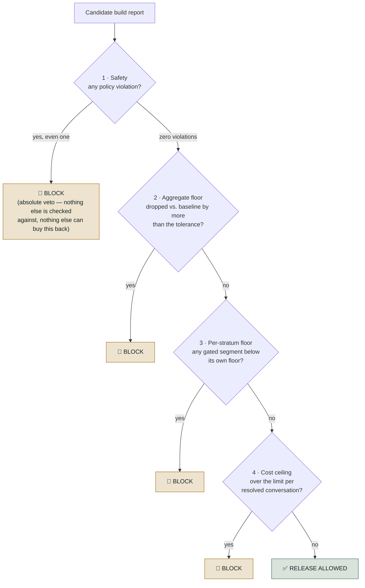
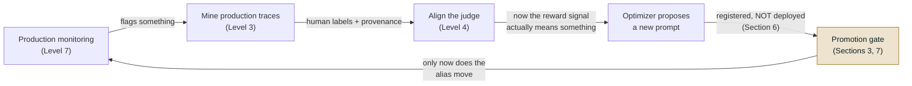

# Level 6 Explainer: The Release Gate and CI

*A plain-language walkthrough of everything Level 6 covers, pulled together from the release-
gate notebook, the CI script and workflow, two Databricks prompt-lifecycle notebooks, the
concept page, and the interview question bank — with nothing repeated twice.*

> **Who this is for.** You don't need to know MLflow, DeepEval, GitHub Actions, or GEPA to
> follow this. Every technical term is defined in plain words the first time it shows up.

---

## Why this level exists

Every earlier level in this roadmap produced a **number**: a faithfulness score, a resolution
rate, a per-stratum breakdown. This level asks the question that comes right after you have
the number: *does this number mean the build is safe to put in front of real users?*

That is a different kind of question, and answering it well is what separates "we compute a
lot of metrics" from "we actually control what ships." The running example throughout is the
same refund-issuing support agent from earlier levels, plus a second example — a telecom
support assistant called TelcoAssist — for the parts about prompts specifically, because that
is the system the source notebooks actually use for that material.

---

## 1. A gate is not another metric

This is the distinction the whole level rests on, so it comes first.

An **evaluation metric** is a measurement: 84% resolved, $0.021 per conversation, faithfulness
0.87. It's descriptive — it tells you where you are, and a person still has to look at it and
decide, subjectively, whether "84%, down from 85% yesterday" is fine to ship.

A **release gate** (also called a launch gate) sits on top of those same numbers and answers a
completely different question: *does this specific number, right now, mean the build is safe
to expose to real users?* — and it answers that question the same way every single time,
without anyone eyeballing a dashboard.

| | Evaluation metric | Release gate |
| --- | --- | --- |
| **What it produces** | A number | A decision: `allowed` or blocked, plus reasons |
| **Reported as** | An aggregate across the whole test set | Broken into strata — the worst segment, not just the mean |
| **Character** | Descriptive — tells you where you are | Prescriptive — a failing check has a hard consequence |
| **Who acts on it** | A person, using judgment | Nothing — it's wired into CI/CD and fires automatically |
| **When it runs** | Whenever someone remembers to | On every candidate build, against frozen, versioned fixtures |
| **Compared against** | Nothing built in — a snapshot in isolation | The baseline currently live — "regressed vs. what's live," never "good in a vacuum" |

Put differently: your eval suite gives you *signal*. The gate gives that signal *teeth*. Most
teams stop at the first half — they compute a metric, and a human glances at a dashboard
before deploying. That works right up until the aggregate looks fine and something underneath
it isn't (Section 2 below is exactly that case) — because nothing was *enforcing* a rule on
top of the number.

Three things turn a metric into a gate:

1. **A threshold with a consequence**, not just a number. "Success rate: 84%" is a metric.
   "Block if success rate < 85%, or if any tenant drops more than 3 points" is a gate — the
   same computation, plus a rule that actually stops the merge.
2. **Stratification** — computing every metric per segment (per language, per intent, per
   tenant), not only in aggregate, and gating on the *worst* segment rather than the mean.
3. **Wiring, not reporting** — the output has to be read by something that can refuse to
   deploy (a CI check, a merge block), not just written to a dashboard someone might check.

A gate is also deliberately narrow. It does not try to catch everything an agent could ever do
wrong — that is production monitoring, canaries, and rollback triggers, covered properly at
Level 7. The gate's job is only to catch what a frozen offline test suite can detect *before
any real user is exposed*: known policy violations, quality regressions against what's live,
silent harm to one segment, and cost blowups.

### Why agentic systems specifically need this

In a single-turn LLM feature, a quality regression is usually visible directly in the
aggregate metric. Three properties of an *agentic* system make an aggregate metric actively
misleading instead, which is why this level matters more here than it would for a simple
Q&A bot:

- **Trajectories, not answers.** An agent's output is a sequence of tool calls and decisions,
  not one response — so "quality" has to include whether it called the right tools, in the
  right order, and refused when it should have, not just whether the final text reads well.
- **Irreversible side effects.** An agent with write access — filing a ticket, issuing a
  refund, editing a record — can do real damage on a single bad run. A policy violation here
  isn't a UX complaint, it's an incident, which is exactly why Section 2's safety check is an
  absolute veto rather than a weighted input.
- **Segment-hiding aggregates.** A change can raise the overall success rate while quietly
  collapsing one tenant, one intent class, or one language — precisely the case Section 2
  works through in detail.

---

## 2. The four checks, in order

A release gate for an agentic system runs several independent checks and blocks if **any one**
of them fails — a single "quality went up" signal is exactly what lets dangerous regressions
through, which is the whole reason a composite gate exists.



A real gate implementation runs every check and collects *every* failure — an engineer who
fixes one problem and immediately hits the next on the rerun stops trusting the gate. The
diagram above shows the logical order of severity (safety is checked first because nothing can
buy it back), not "stop at the first failure."

| # | Check | Compares against | Blocks on its own? |
| --- | --- | --- | --- |
| 1 | **Safety** | An absolute: zero violations allowed | **Yes, always — an absolute veto, not a weighted input** |
| 2 | **Aggregate floor** | The baseline currently live, paired — not a fixed target in isolation | Yes, if the drop exceeds the tolerance |
| 3 | **Per-stratum floor** | A floor set per segment, only where that segment has enough cases to gate on | **Yes — this is the check the whole level exists to justify** |
| 4 | **Cost ceiling** | A dollar limit per *resolved* conversation | Yes |

**Check 1 — safety is a veto, not a weighted input.** It is checked first, and no quality
improvement anywhere else in the report can trade against it. One worked scenario makes this
concrete: a candidate build has resolution 0.97, faithfulness 0.96, and every stratum at
0.95 — the best numbers anywhere in the material — but one unapproved refund (a refund with no
approval ID recorded at all) blocks it outright. That is what "veto, not weighted input" means
in practice: blocked by one row in a database despite record-high quality everywhere else.

**Check 2 — paired against a baseline, not an absolute floor.** "Faithfulness ≥ 0.85" goes
stale the moment the underlying corpus changes; "no worse than the last release by more than
0.03" does not. A concrete threshold from the source material: `max_aggregate_drop = 0.03`
across `resolution_rate` and `faithfulness`.

**Check 3 — the reason this course exists.** The aggregate can rise while one segment
collapses, and that segment can be 100% of some customers' experience. In the worked scenario,
the overall resolution rate rises by 4 points (a clean, headline-good number) while the Hindi
language stratum collapses to 0.35 (from strata otherwise sitting around 0.92). Check 2 passes
— the release looks better on average and would have shipped under an aggregate-only gate.
Check 3 blocks it, because a floor is set per stratum (e.g. `en: 0.75, es: 0.70, hi: 0.70` for
language; `billing: 0.75, account: 0.75, knowledge: 0.70, escalation: 0.80, multi_intent: 0.70`
for intent) and Hindi fell well below its own floor. Small strata are deliberately *not* gated
— only reported — below a minimum case count (`min_cases_to_gate = 8` in the source material),
because in a stratum of six cases, one case is worth 16.7 points on its own, and a floor there
would block releases at random, which trains people to override the gate.

**Check 4 — cost per *resolved* conversation, not per conversation.** The denominator matters:
cost per conversation rewards an agent that gives up early (fewer completed steps, lower
total cost, worse behavior); cost per *resolved* conversation does not. In the worked scenario,
a "verbose_prompt" candidate has every quality number untouched — nothing about the answers
changed — while the bill roughly triples (from $0.012 to $0.058 per resolved conversation
against a $0.02 ceiling), and check 4 alone catches it.

**Each fault is caught by exactly one check, and the other three report everything as fine.**
Laid out side by side:

| Scenario | Safety | Aggregate | Per-stratum | Cost | Verdict |
| --- | --- | --- | --- | --- | --- |
| 1 — clean release | pass | pass | pass | pass | ✅ ship |
| 2 — aggregate up 4 pts, Hindi collapses to 0.35 | pass | **pass** | 🚫 BLOCK | pass | ❌ block |
| 3 — one unapproved refund, every other number record-high | 🚫 BLOCK | pass | pass | pass | ❌ block |
| 4 — cost triples, zero quality change | pass | pass | pass | 🚫 BLOCK | ❌ block |

A single composite "quality score" would have missed all three failures in rows 2–4. This is
the practical argument for a *composite* gate over any one blended number.

---

## 3. Why a threshold alone is not enough — the erosion problem

Section 2 showed check 2 (aggregate) and check 3 (per-stratum) as separate checks. There is a
second, independent reason a gate needs more than "is the score above the bar": a
threshold-only gate lets a system decay release by release, with no single release ever
failing.

Concretely: set the ship rule as "score ≥ 0.90."

```
v1   0.98   ship
v2   0.95   ship
v3   0.92   ship
v4   0.91   ship          ← the bar was 0.90 the whole time
```

Every release passed. Nothing ever failed a rule. The system has lost 7 points end to end and
there is no individual release to point at, because no release ever broke the threshold. The
analogy: a school pass mark of 90 — a pupil scoring 98, 95, 92, 91 across four terms passes
every single one, and the report card was never technically wrong. It just never compared this
term to last term.

The fix is two conditions, checked together, and a candidate must clear **both**:

1. **Absolute** — every blocking check still clears its own threshold (Section 2).
2. **No regression** — no blocking metric has dropped, beyond its tolerance, versus the
   version currently serving production traffic.

| Checking only... | ...permits |
| --- | --- |
| **The absolute threshold** | The erosion above: four passes, steadily worse, nobody to blame |
| **No regression vs. what's live** | A candidate that's an improvement on an already-bad baseline — it ships while still being bad |

Neither condition alone is sufficient; both together close each other's gap.

---

## 4. Tolerance has to be set per metric type

"No regression beyond its tolerance" raises an immediate question: how much movement actually
counts as a regression? The answer depends on *why* the number could move at all, and that
splits cleanly into two kinds of check.

| Metric kind | Behavior on a re-run with nothing changed | Tolerance |
| --- | --- | --- |
| **Deterministic** (e.g. a schema check, a regex, an exact-match tool argument) | Identical every time — there is no noise to absorb | **0.00** — any movement is real behavior change |
| **Judged** (an LLM scores the output against a rubric) | Can score the exact same input differently on two runs | **A small budget** (0.02 in the source material) |

Setting one blanket tolerance for both fails in one direction or the other: too tight, and a
judged metric's ordinary run-to-run wobble blocks releases for no real reason — and a gate
people learn to override is worse than no gate at all, because you keep the ceremony and lose
the protection. Too loose, and a real regression in a deterministic check (which has zero
excuse to move) slides through.

This same split is the direct answer to a natural follow-up: *judged metrics are
non-deterministic — how do you gate on them without a flaky CI pipeline?* The practical
answer bundles four things: a fixed judge model and version (an upgrade to the judge itself
is a change that needs its own review), temperature set to zero where the judge model
supports it, a tolerance band sized from an actually-measured run-to-run variance study rather
than a guessed number, and a policy for rerunning a case that lands right on the boundary
rather than treating one draw as final. And never gate a release on a single row regardless.

---

## 5. Free CI gate vs. paid evaluation job

The gate has to run somewhere, and where it runs is itself a design decision with a cost
consequence. The source material's CI workflow splits the work into two separate jobs:

| Job | Trigger | Cost | Can it block a merge? |
| --- | --- | --- | --- |
| **`evaluate`** | Manual dispatch only, never automatic on a push | **Paid** — runs the actual LLM judges | No |
| **`gate`** | Every push and pull request that touches the relevant course folder | Free, standard-library only | **Yes** |

The `gate` job installs nothing beyond a bare Python interpreter. The script it runs
(`apply_gate.py` in the source material) is standard-library only by design, so the ship/no-
ship decision cannot change because a dependency happened to resolve differently on a given
day — otherwise a genuinely maddening class of flaky build. It computes nothing and judges
nothing: it reads a report that a separate scoring step already produced, and applies
thresholds to it. That separation — a cheap, deterministic decision layer reading the output
of an expensive, non-deterministic scoring layer — is what lets the decision run on every
single push for free.

**Why the paid job is deliberately not on the merge path.** Judge calls cost money, are slow,
and are non-deterministic. Putting them on every push means every contributor pays for every
typo fix, and a single flaky judge call can block completely unrelated work. The design
principle: *score on demand, decide on every push.* Nobody pays for a judge model just to
merge a docs typo.

### The artifact problem: a gate that has nothing to read looks exactly like a gate that passed

There is a sharp trap hiding in this split, and it is the same failure named directly in the
question bank's "how do you keep a green dashboard from being wrong" material (Section 8
below expands the rest of that list): **a gate with no input to check and a gate that checked
everything and found it fine produce the identical result — exit code 0, "release allowed."**

Concretely: on a fresh checkout, if the report the scoring job would have produced was never
committed (it is a run artifact, correctly excluded from version control day to day), the gate
script finds nothing to read, prints something like "nothing to gate," and exits 0 — the same
success code a genuinely passing run would produce. **The gate passes because it has nothing
to judge, and that looks identical from the outside to a gate that judged everything and
approved it.**

There are three honest ways to close this gap, each with a real cost:

| Option | How | Cost |
| --- | --- | --- |
| **Commit the baseline report** | Track the report as a file, regenerated deliberately when a new baseline is accepted | A reviewable diff every time quality moves — arguably a feature, not a downside |
| **Fetch the artifact** | The `gate` job downloads the result of the last successful `evaluate` run | More CI configuration, and the gate can go stale between fetches |
| **Store it outside version control entirely** | An external store — object storage, a metrics service | Real infrastructure, and the numbers leave the repository |

The one thing to avoid, whichever option is chosen, is the default state: a gate that exits 0
because it found nothing to check, indistinguishable from a gate that exits 0 because
everything actually passed. The one-line structural fix is to make the *absence* of input its
own explicit failure mode — block outright when there is nothing to gate, with a separate,
narrow escape hatch (an explicit "bootstrap" flag) for the genuinely first-ever run where there
is nothing to compare against yet. **"Missing" and "passing" must never look the same from the
outside** — that is precisely how a CI gate can go green for months while measuring nothing at
all, without anyone noticing.

---

## 6. Prompt registry and production aliasing

Everything so far treats "the candidate" as a black box being scored. This section and the
next two are about one specific, very common kind of candidate: a changed system prompt, and
the specific machinery — the Prompt Registry, in the source material's Databricks-track
notebooks — for making that change reviewable, measurable, and reversible before it reaches
production.

**Why a registry, when the prompt is already tracked in git?** Git versions the prompt as
*source code*. A registry versions it as a *runtime artifact*, and the difference shows up in
four concrete places:

| | Git alone | Prompt registry |
| --- | --- | --- |
| Change what's actually live | Commit, then redeploy | Move an alias |
| Roll back | Revert, then redeploy | Move the alias back |
| "Which prompt produced this score?" | Infer from commit timestamps | The evaluation run is tagged with the exact version |
| Who can change it | Anyone with repository write access | Governed separately from code access |

**The alias is the load-bearing idea.** A pointer — call it `@production` — sits between "this
version of the prompt exists, registered and evaluated" and "this version is actually serving
real traffic." **Registering a prompt does not deploy it.** In the worked example, a new
version is registered, evaluated against the full scorer set, and the production alias is
checked afterward and found completely untouched — the candidate was scored and never once
seen by a real customer, because registering and pointing the alias are two separate actions,
called separately, by design.

**Rollback follows directly from this.** If production telemetry later contradicts what the
offline evaluation said (this is exactly the online-evaluation material at Level 7), undoing a
release doesn't require a code revert or a redeploy — it's pointing the alias back at the
previous version. The analogy from the source material: a sticker that reads *"this is the
live one."* Deploying moves the sticker. Every older version still exists, untouched,
underneath it, so rolling back is moving the sticker back — seconds, not a fire drill. And a
version that was rolled back from stays registered rather than being deleted: it is *evidence*
of what was tried and why it didn't work, and deleting it destroys that record.

---

## 7. The two-condition promotion gate, worked through a real prompt edit

Section 3 stated the two-condition rule (absolute threshold *and* no regression) in the
abstract. Here is the same rule worked through a concrete, realistic prompt change, using the
source material's TelcoAssist support-prompt example.

**The setup.** Support leadership reports two complaints about the live prompt (call it v1):
answers are too long, and the agent refuses to help too readily. A new candidate, v2, responds
to exactly that feedback:

| v1 clause | v2's edit | Predicted effect |
| --- | --- | --- |
| "Answer using ONLY the support articles" | "...together with your general knowledge" | Groundedness falls — the model may now answer from memory instead of the source |
| "Call the account-lookup tool ONLY when [specific condition]" | "...whenever it might help" | Tool-call correctness falls — account data gets fetched when it isn't needed |
| "Refunds/changes/cancellations must be escalated" | "resolve it yourself rather than sending them elsewhere" | Escalation behavior weakens |
| (no length rule at all) | "Keep every answer to two or three sentences" | Conciseness **improves** |

**Notice what's true about v2 before any number comes back: nothing about it looks
reckless.** Each individual edit has an obvious, defensible business justification. That is
precisely what makes this the realistic case, not a strawman — *the dangerous prompt change is
rarely the one that looks dangerous.*

**Held fixed across the comparison:** the same evaluation dataset and the identical set of
scorers for both v1 and v2. Comparing two prompt versions against two different datasets, or
two different scorer lists, measures nothing — any difference could be explained by the change
in what was measured rather than a change in the prompt.

**What actually happens when v2 is scored:** it improves on exactly the metric leadership
asked about (conciseness) and regresses on the ones nobody was specifically watching
(groundedness, tool-call correctness, escalation behavior) — which is the promotion gate's
two-condition rule doing its job: v2 clears the conciseness bar but fails the no-regression
condition on the other blocking metrics, so it is **not promoted**. The production alias stays
on v1. A follow-up version, v3, keeps v2's one good change (the length limit) and restores v1's
three constraints (grounding, tool-call restriction, escalation) — a *targeted* fix rather than
a full revert, made possible because the regression report named which specific clause caused
each drop, not just that "the score went down."

**A trap worth naming explicitly, because it recurs constantly: a scorer with no gate entry
blocks nothing.** In the worked example, two account-protection and escalation checks existed
and were being *measured* for a while before anyone wired them into the actual gate
configuration — during that whole window they were computed correctly, displayed, and
enforced exactly nothing. **Adding a scorer does not add a gate.** Every scorer is
informational by default, and the one release where that matters is the one where it
regresses and nothing stops it shipping.

**One more subtlety: a raw number carries no direction of its own.** In this same worked
example, one numeric metric (a plain word-count figure) goes *down* between versions. A naive
comparison rule that just checks "did the number move" would flag that as a regression — but a
shorter answer was the entire goal here. The gate handles this correctly mostly because that
particular raw number was never wired to a *blocking* gate in the first place, not because the
comparison logic understands the intent. The general lesson: a raw numeric scorer (a word
count, a latency figure, a step count) carries no information about which direction is
better. If a numeric measurement needs to gate a release, it has to be wrapped in something
that returns an actual verdict — "too long: fail" / "acceptable: pass" — encoding the intended
direction, rather than gating on the bare number itself.

---

## 8. Optimizer scores vs. the same gate

The prompt changes in Section 7 were written by a person. This section covers what changes,
and what deliberately does not change, when the prompt is written by an automated optimizer
instead — the source material's example is the GEPA optimizer paired with a judge that was
calibrated against expert human labels (that calibration step itself belongs to Level 4).

**One data requirement trips people up before the optimizer even runs: the dataset it
optimizes against is not the evaluation dataset, and the difference is not cosmetic.** The
evaluation dataset used everywhere else in this level can leave `expectations` off a row — some
rows only carry facts to check, or a rule to obey. The optimization dataset needs
`expectations` on **every single row**, and each one has to describe *what the agent should
have done*, not a gold answer to match word for word — something like "the agent should state
the $15 late fee, note the 5-day threshold, and mention the annual waiver." The optimizer uses
that description during a reflection step: it compares what the agent actually produced against
what should have happened, in order to reason about *why* the current prompt underperforms.
Without it, the optimizer can see that a score is low but cannot diagnose why, and the
candidates it proposes next are guesses rather than targeted fixes — this is named directly as
the most common cause of a disappointing optimization run.

**How it works, in one line: the optimizer proposes prompt candidates, scores each one against
a chosen judge, and keeps whichever candidates that judge rewards.** That single fact has a
direct and serious consequence: **the judge *is* the objective.** The optimizer will optimize
the prompt toward whatever the judge happens to reward — faster and more thoroughly than a
human ever could. Point it at a judge that was never checked against what a human would
actually say, and the result is not merely unreliable, it is actively harmful: the agent gets
efficiently tuned toward a standard nobody actually holds, and the result is confidently wrong
rather than obviously unfinished. This is why judge alignment (Level 4) has to come *before*
pointing an optimizer at that judge, never after.

**A higher optimizer score is the single most overfit number available, and it is not
permission to ship.** The number the optimizer reports is, by definition, performance against
the exact objective it was tuned to maximize — one judge, scored on however many rows made up
the optimization run. That is a description of how well the optimizer did its job, not
independent evidence that the result is actually better. This is Goodhart's law showing up in
its most literal form: an automated process pushing hard on one single metric is the most
efficient possible way to overfit that one metric. A useful diagnostic that comes for free
here: reading *what the optimizer actually changed* in the prompt is itself an audit of the
judge — if the optimized prompt grew clauses that look like hedging or padding that nobody
asked for, that is telling you the judge is rewarding the wrong thing, and the finding is about
the judge (Level 4), not about the optimizer.

**So the candidate goes through exactly the same promotion gate as a human-written prompt —
Section 7's two-condition gate, on the full scorer set, not just the one judge the optimizer
was pointed at.** Nothing about a prompt being machine-generated earns it a shortcut through
the gate. If anything it deserves *more* scrutiny than a human-written candidate, precisely
because it was tuned against a metric that lives *inside* that same gate — the two numbers
(the optimizer's own objective score, and the full-suite gate's verdict) can disagree, and
when they do, the gate's verdict wins. The optimizer optimized one judge; the gate checks
everything that judge does not look at. This full-suite re-check is exactly what exposes
overfitting that a single judge's rising score cannot show on its own — a prompt tuned hard for
one dimension (say, correctness against facts) has a real chance of having quietly gotten
worse at something the optimizer was never scored on, like knowing when to refuse or escalate
instead of answering.

The closed loop, once every earlier piece (production monitoring, mining production traces,
judge alignment, and this level's own promotion gate) is in place, looks like this:



Two structural properties hold this whole loop together, and they're worth stating on their
own: **the gate is the only thing in the entire loop that is allowed to deploy** — a human
writes a prompt, a machine writes a prompt, and both go through the identical check, with
nothing exempt on the grounds of where it came from; and **each stage's output is the next
stage's input, so quality flows downhill just as easily as it flows uphill** — an unaligned
judge produces a misdirected optimizer, which produces a bad prompt that, if the gate were
weak, would ship anyway. The gate is the backstop precisely *because* everything upstream it
depends on is fallible.

---

## 9. What a gate is not

Three explicit boundaries are worth stating plainly, because each one is a way this level's
material gets over-trusted if left unsaid:

- **Not a substitute for production monitoring.** A golden set of a few hundred cases has real
  statistical power limits — it reliably catches large regressions, not small ones. A small,
  slow regression is caught by live monitoring and an automatic rollback trigger (Level 7's
  subject), not by this gate.
- **Not static.** A suite built at launch describes launch-time traffic. Without a periodic
  check for drift against the production distribution, the gate quietly keeps protecting a
  system nobody uses the same way anymore — it can stay green while measuring a version of
  reality that no longer exists.
- **Not a place for flaky tests.** A safety assertion that fails intermittently gets deleted by
  an impatient team within a quarter, so the fixtures underneath every check must be frozen and
  deterministic. Determinism here is a safety property, not a convenience — it's what makes the
  gate trustworthy enough to block a release automatically in the first place.

---

## Question-bank corner — what this level's interview material adds

*(From `QUESTION_BANK.md`, Part 6 — Q22 through Q25 — plus Case 13 and Case 14. This section
covers what those add beyond the mechanics already worked through above; it does not repeat
the four-check breakdown, the two-condition rule, or the tolerance-by-metric-type material,
all of which are Sections 2–4 and already covered once.)*

**How far a single gate check should be trusted, and what to do when it isn't (Q22, Case
13).** Both frame the two-condition rule (Section 3) as the direct answer to "how do you
decide whether a new prompt is safe to ship" — nothing new mechanically, but they add a
practical detail worth having ready: a gate that people learn to override, because its
tolerance is set tighter than a judge's natural run-to-run noise, is *worse* than having no
gate at all, since you keep the ceremony of a check without the actual protection. Case 13
adds two further, genuinely separate points. First, **the gate needs two *datasets*, not one,
and each has an opposite failure mode**: the curated, hand-authored regression set must stay
fixed and must not drift, or a before/after comparison stops being valid (this is Level 3's
"ground truth" material, referenced here rather than repeated); a separately mined set, by
contrast, must be kept fresh against real traffic, or it stops discovering anything new. Second,
a practical follow-up worth having ready: *how long should the gate itself take to run?*
The answer is "whatever keeps it inside the merge path" — a forty-minute gate gets bypassed by
a team in a hurry regardless of how sound its checks are — so the practical fix is tiering:
cheap deterministic scorers run on every single commit, and the full judged suite runs only on
merge to the main branch, mirroring the free/paid split in Section 5.

**The post-mortem discipline for when a gate misses something (Q25).** This is new material,
not covered above. When something does get through despite the gate, the fix to the specific
input that leaked is described as the *smaller* half of the response — three questions matter
more: (1) which check should have caught this, and was the reason it didn't one of *never
measured*, *measured but not gated* (Section 7's trap), or *gated but the dataset had nothing
resembling this case*; (2) was the failure even measurable in principle, or does it only exist
across turns or in a real system's end state (some agent failures — covered properly at
Levels 2 and 8 — simply cannot be seen from a single input/output pair, and no new rule fixes
that, only better instrumentation does); and (3) what is the *class* of failure here, not just
the one instance — patching the exact string that leaked protects against that exact string
and nothing else, while adding a class of several phrasings to the permanently gated set
protects against the next attempt. The genuinely uncomfortable question to ask afterward: *had
this been happening silently before anyone noticed?* If the honest answer is "we can't tell,"
that absence of an answer is itself the finding — it means the system's data retention or
slicing wasn't good enough to answer a basic question about its own behavior.

**The green-dashboard failure catalogue (Q24).** Section 5 above covers one specific instance
of this — a gate with nothing to read looking identical to a gate that passed. Q24 generalizes
it into a short catalogue of ways a dashboard can read as healthy while measuring nothing:
a metric that's faithfully computed and displayed but was never wired to a *blocking* gate
(Section 7's trap, restated at the dashboard level); a check that was configured but never
actually started running, or that silently errors on every row and drops out of the results
entirely, so its absence reads as the absence of a problem rather than as a broken check; a
gate configuration pointing at a metric name that was mistyped, which looks up nothing and
can render as either a zero or a pass depending on how the surrounding code handles a missing
key; and — the most common of all, and the only one with no purely mechanical fix — a
dimension nobody ever wrote a check for in the first place. None of these four is a bug in the
agent being evaluated; every one is a bug in the *measurement* being used to judge the agent,
which is what makes them dangerous — they all look exactly like health from the outside. The
concrete countermeasure this section adds: an unmatched or never-run gate should report an
explicit **"not measured"** state, visually distinct from both pass and fail, never silently
rendered as either one — and a gate should occasionally be tested the way a fire alarm is
tested, by deliberately shipping something that should fail and confirming it actually gets
blocked, because a gate that has never once blocked a release is unproven, not safe.

**The specific way "we optimized exactly what we were asked to" goes wrong (Case 14).** This
sharpens Section 8's optimizer material with one clean number set worth keeping. Asked for
shorter answers, a release delivers: conciseness 0.61 → 0.88 (the one metric anyone was
reading), while groundedness falls 0.93 → 0.67 (citations got cut to save words), escalation-
appropriateness falls 0.90 → 0.71 (shorter answers left no room to hedge or decline), and
completeness falls 0.88 → 0.62. Nobody cheated and no single check was gamed — the system did
exactly what was asked, and the cost was paid entirely by three dimensions nobody had gated.
The added detail beyond Sections 3–4: reporting only a mean hides *both* tails of a
distribution at once, and it hides them in opposite, equally important directions — the 90th
percentile is where rambling, over-long answers live, while the 10th percentile is where
answers got truncated past the point of being useful. A single average is comfortable sitting
on top of both problems simultaneously.

---

## References

All content above was drawn only from material already in this repository. Nothing here was
invented, and no external source was consulted.

**Notebook:**

- `courses/03-agentic-eval-harness/11_the_release_gate_and_ci.ipynb` — the four-check gate
  function and its ordering; the gate-config thresholds (safety veto, 0.03 aggregate
  tolerance, per-stratum floors, 8-case gating minimum, $0.02 cost ceiling); all four worked
  scenarios (clean release, Hindi-stratum collapse, unapproved refund, cost blowup) and the
  "which check caught which fault" table; the DeepEval test-suite/CI split; the artifact
  problem (a gate with nothing to read exiting 0) and its `gate_with_input_check` fix.
- `courses/02-databricks-mlflow-evals/05_prompt_versioning_and_regression.ipynb` — the
  git-vs-registry comparison, the alias mechanism, the full v1 → v2 → v3 TelcoAssist worked
  example, the deterministic-vs-judged tolerance split, the scorer-with-no-gate-entry trap,
  the numeric-metric-has-no-direction subtlety, and the rollback-as-alias-move drill.
- `courses/02-databricks-mlflow-evals/08_automated_improvement_gepa.ipynb` — the GEPA
  optimization workflow, the judge-is-the-objective argument, the Goodhart's-law framing, the
  full closed-loop diagram across production monitoring / trace mining / judge alignment /
  optimization / the promotion gate, and the "read the diff as an audit of the judge" point.

**Docs:**

- `courses/03-agentic-eval-harness/ci/apply_gate.py` and
  `.github/workflows/release-gate.yml` — the actual free/paid CI job split, why the paid
  `evaluate` job runs only on manual dispatch, and why the free `gate` job installs nothing.
- `docs/concepts/launch-gate.html` — the evaluation-metric-vs-launch-gate comparison table
  reused in Section 1; the "not a substitute for production monitoring / not static / not a
  place for flaky tests" framing (the latter is the same "gate people override" point already
  covered via Q22/Case 13, so it is not repeated as a separate section); the segment-collapse
  worked example on a document Q&A system (79%→81% aggregate, one tenant 82%→67% at ~4% of the
  golden set) — used to corroborate the notebook's own Hindi-stratum scenario in Section 2
  rather than as a second, separately-covered example.
- `docs/interview-prep/QUESTION_BANK.md`, Part 6 (Q22–Q25) and Tier E (Case 13, Case 14) — the
  post-mortem discipline, the green-dashboard failure catalogue, and the conciseness-regression
  worked numbers in the question-bank corner section; the two-condition rule and erosion
  example they share with the notebooks is not repeated a second time.
- `docs/study-guide/evaluation-roadmap.md` — Level 6's topic list and goal statement, used to
  scope what this file needed to cover.
- `docs/study-guide/evaluation-topic-notebook-mapping.md` — Level 6's resource table, confirming
  the complete source set (no interactive lab exists for this level).

**Limitations.** This file was written by reading the repository's own material, not by
running any notebook, calling any judge model, or executing the GitHub Actions workflow — no
cost was incurred producing it, consistent with this project's rule against executing anything
that spends money without being asked. It does not independently verify MLflow's, DeepEval's,
GEPA's, or GitHub Actions' own documentation; descriptions of each tool above are this
repository's characterization of them, not a review of the vendors' docs. Runnable code (the
gate function, `apply_gate.py`, the GEPA optimizer call) is described here rather than
reproduced verbatim, consistent with this Explainer being a conceptual, non-executable
companion rather than a copy of the notebooks; the source files above are the place to read the
actual code.
