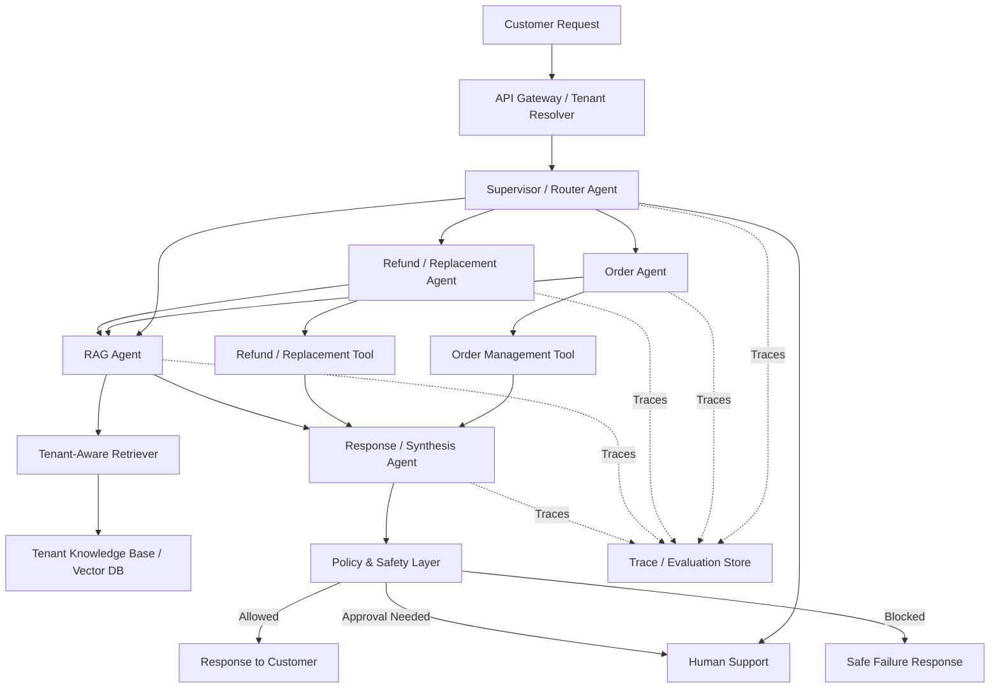
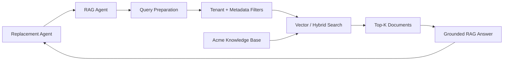
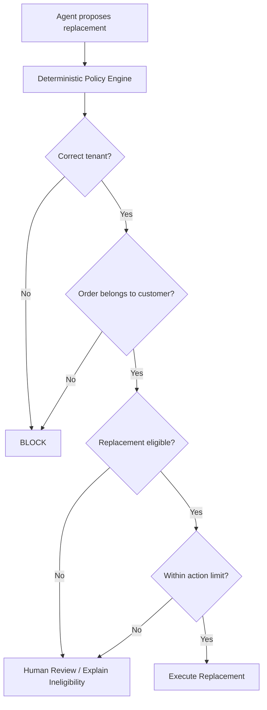
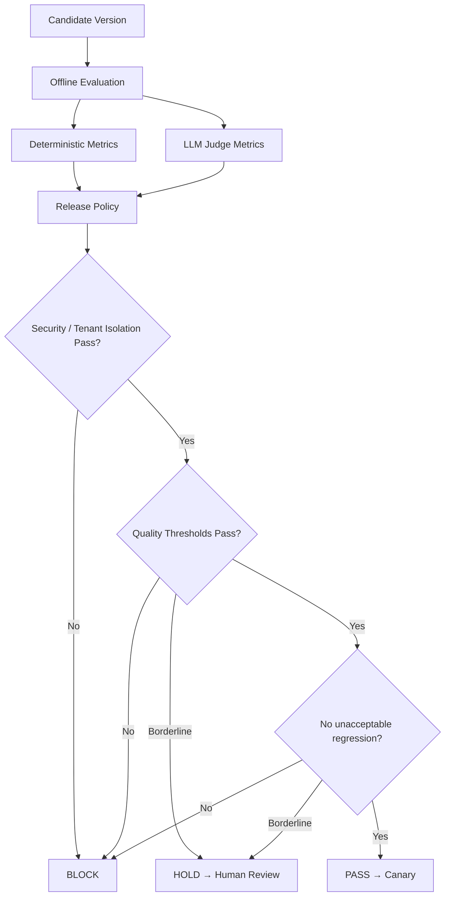
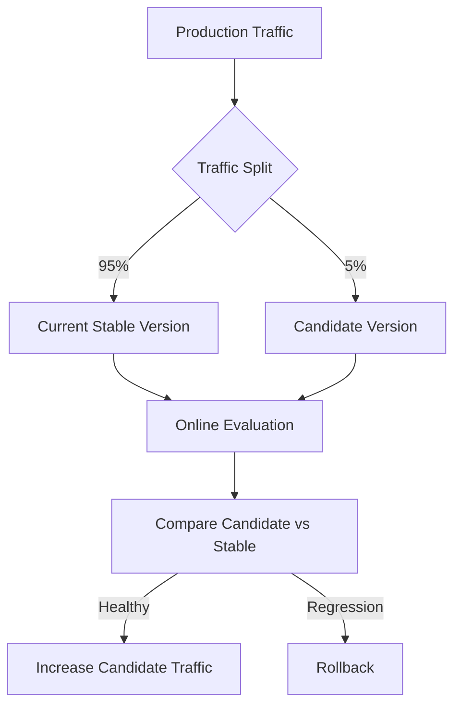
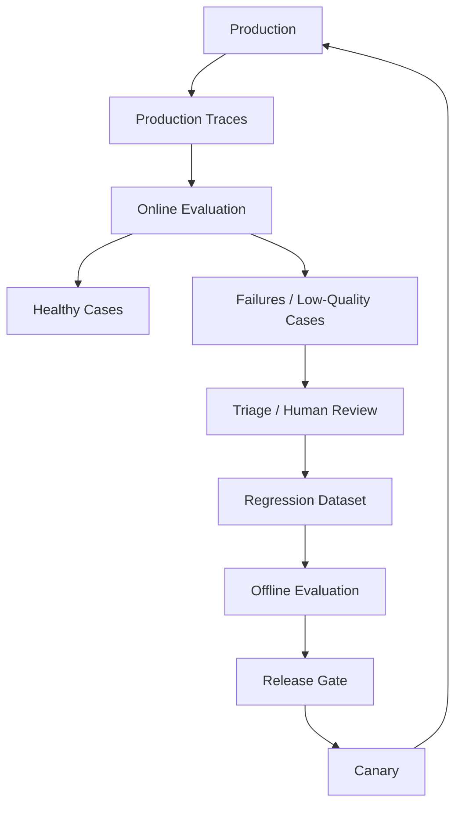
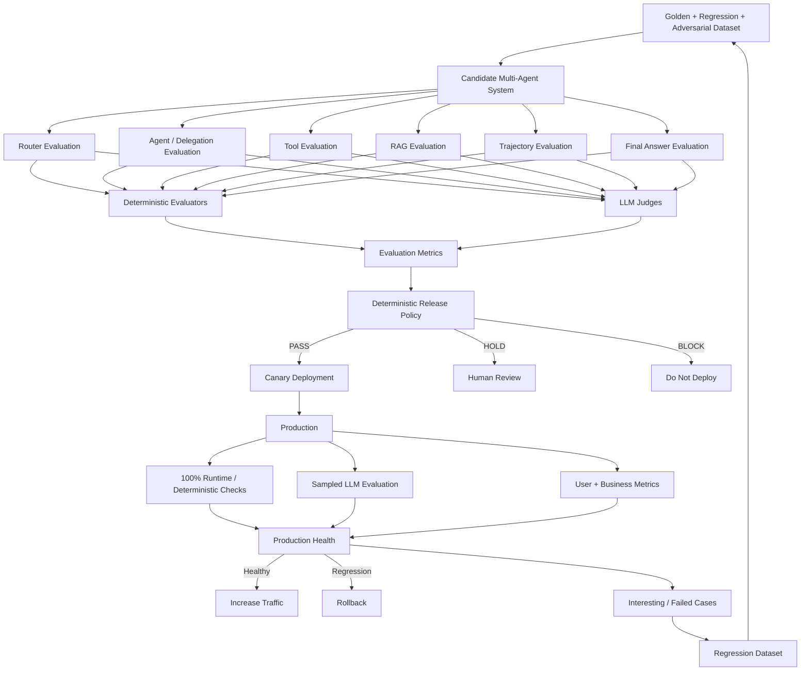

# Customer Support Multi-Agent System --- Evaluation & Release Gating

## 1. Scenario

Assume we are building a **multi-tenant customer-support platform** used
by many companies.

Each tenant has its own:

- customers
- orders
- refund rules
- knowledge base
- permissions
- business policies

A customer can ask:

> "My order arrived damaged. Can I get a replacement?"

The system must understand the request, choose the correct agent, call
the correct tools, retrieve tenant-specific policy when required, and
return a grounded answer.

The important point is that we do **not** evaluate only the final
answer. We evaluate the complete agent trajectory.

---

## 2. High-Level Architecture



### Responsibility separation

A useful design principle is:

```text
Agent recommends / plans
        ↓
Policy decides what is allowed
        ↓
Tool / Executor performs the action
```

For example, the Refund Agent can recommend a refund, but a
deterministic policy layer decides whether the refund can actually be
executed.

---

# 3. One Real Customer Request

Tenant: **Acme Electronics**

Customer says:

> "My headphones arrived damaged yesterday. Can you replace them?"

The expected flow is:

```text
Customer
   ↓
Tenant Resolver
   ↓
Supervisor
   ↓
Refund / Replacement Agent
   ↓
RAG Agent → Find Acme's damaged-item policy
   ↓
Order Tool → Verify purchase and delivery
   ↓
Replacement Tool → Check eligibility
   ↓
Policy Check
   ↓
Create replacement OR ask for human approval
   ↓
Final Response
```

We now evaluate every stage of this flow.

---

# 4. Stage 1 --- Tenant Resolution

Before the agents do anything, the system must know which tenant owns
the request.

For example:

```text
Customer → Acme Electronics
Tenant ID → acme_123
```

This is critical because Acme's customer must never retrieve another
company's orders or documents.

## Deterministic checks

- Tenant ID exists.
- Customer belongs to that tenant.
- Authentication is valid.
- Requested resource belongs to the same tenant.
- Tenant configuration is loaded.
- Cross-tenant access is blocked.
- Correct tenant-specific tools and indexes are selected.

Example:

```text
Request Tenant = acme_123
Document Tenant = acme_123

PASS
```

But:

```text
Request Tenant = acme_123
Document Tenant = globex_456

BLOCK
```

This should **never depend on an LLM judge**.

## Non-deterministic checks

Normally very few are needed here. Tenant isolation and authorization
should remain deterministic.

---

# 5. Stage 2 --- Supervisor / Router Evaluation

The Supervisor decides which agent should handle the request.

For:

> "My headphones arrived damaged. Can you replace them?"

Expected route:

```text
Refund / Replacement Agent
```

## Deterministic checks

- Output follows the routing schema.
- Selected agent exists.
- Selected agent is allowed for this tenant.
- Forbidden agent was not selected.
- Maximum routing attempts were not exceeded.
- For golden test cases, expected route matches actual route.

Example metric:

```text
Routing Accuracy = Correct Routes / Total Test Requests
```

## Non-deterministic checks

Sometimes more than one route can work.

An LLM judge can evaluate:

- Was the selected agent appropriate?
- Was unnecessary delegation avoided?
- Did the router understand the customer's intent?

Example metric:

```text
Routing Quality = 4.7 / 5
```

---

# 6. Stage 3 --- Agent-to-Agent Delegation

The Replacement Agent now realizes:

> "Before replacing this item, I need Acme's damaged-item policy."

So it delegates knowledge retrieval to the **RAG Agent**.

```text
Replacement Agent
       ↓
    RAG Agent
```

The RAG Agent is therefore a real sub-agent, not simply retrieval hidden
inside the main agent.

## Deterministic checks

- RAG Agent is an allowed delegation target.
- Agent transition is permitted.
- Maximum delegation depth is respected.
- No circular delegation occurs.
- Maximum number of agent hops is respected.

For example:

```text
Refund Agent
   ↓
RAG Agent
   ↓
Refund Agent
```

can be valid.

But:

```text
Refund → RAG → Refund → RAG → Refund → RAG ...
```

should trigger a loop check.

## Non-deterministic checks

An LLM judge evaluates:

- Was delegation actually necessary?
- Was the correct sub-agent selected?
- Was the information passed to the RAG Agent sufficient?
- Did the parent agent use the returned information correctly?

---

# 7. Stage 4 --- RAG Agent Evaluation

The RAG Agent receives something like:

> Find the damaged-product replacement policy applicable to this
> customer's order.

The RAG flow is:



## 7.1 Retrieval deterministic checks

We can evaluate:

- Recall@K
- Precision@K
- Hit Rate@K
- MRR
- correct tenant filter
- correct document permissions
- correct metadata filter
- Top-K limit
- duplicate chunk detection
- document version
- expired document exclusion

Example:

```text
Expected relevant document:
Damaged_Item_Policy_v4

Retrieved Top 3:
1. Shipping_FAQ
2. Damaged_Item_Policy_v4
3. Replacement_Guide

Hit@3 = PASS
```

The most important production check here is:

```text
Every retrieved document must have:

tenant_id = acme_123
```

## 7.2 Retrieval non-deterministic checks

An LLM judge evaluates:

- Are the retrieved chunks relevant?
- Is enough information present to answer the question?
- Is irrelevant context dominating retrieval?

Example:

```text
Context Relevance = 4.6 / 5
```

---

# 8. Stage 5 --- RAG Answer Evaluation

Suppose the RAG Agent returns:

> Acme allows replacement of damaged electronics reported within 7 days
> of delivery. The customer may need to provide a photograph of the
> damaged product.

## Deterministic checks

- Answer exists.
- Required citation exists.
- Citation references a retrieved document.
- Referenced document belongs to Acme.
- Document version is valid.
- Required structured fields exist.
- No unsupported tool or document ID appears.

## Non-deterministic checks

LLM judges evaluate:

- correctness
- groundedness
- relevance
- completeness
- citation correctness

The most important question is:

```text
Retrieved Policy
       ↓
Generated Answer
       ↓
Can every important claim be supported
by the retrieved policy?
```

Example:

```text
Groundedness  = 4.8 / 5
Correctness   = 4.7 / 5
Relevance     = 4.9 / 5
Completeness  = 4.5 / 5
```

---

# 9. Stage 6 --- Tool Selection

The Replacement Agent now knows the policy.

It needs to verify:

1. Was this order actually delivered?
2. Was it delivered yesterday?
3. Is the product eligible?

Available tools might conceptually include:

```text
Get Order
Track Shipment
Check Replacement Eligibility
Create Replacement
Issue Refund
Cancel Order
```

## Deterministic checks

For golden cases:

```text
Expected Tool = Get Order
Actual Tool   = Get Order

PASS
```

Also check:

- tool exists
- agent is allowed to call it
- tenant is allowed to use it
- forbidden tool was not called
- maximum tool calls were not exceeded
- read-only stage did not call a write tool

## Non-deterministic checks

An LLM judge asks:

- Was this the right tool for the task?
- Was the tool called at the right time?
- Was a cheaper or safer tool available?
- Were unnecessary tool calls made?

---

# 10. Stage 7 --- Tool Argument Evaluation

Imagine the agent wants to retrieve the order.

The important values conceptually are:

```text
Tenant: acme_123
Order: ORD-48291
Customer: C-9812
```

## Deterministic checks

- required arguments exist
- types are correct
- order ID format is valid
- tenant ID matches the session
- customer owns the order
- values are within allowed limits
- no unexpected arguments
- write operations contain an idempotency key where required

These answer:

> "Is this tool call structurally and operationally valid?"

## Non-deterministic checks

An LLM judge can answer:

> "Do these arguments correctly represent what the customer asked for?"

This distinction is important:

```text
Valid schema
     ↓
Deterministically correct structure

Correct meaning
     ↓
Semantic / non-deterministic evaluation
```

---

# 11. Stage 8 --- Action and Policy Evaluation

Assume the order was delivered yesterday and the damaged-item policy
allows replacement.

The agent proposes:

```text
Create replacement for ORD-48291
```

But the agent should not have unlimited authority.



These checks should be deterministic.

Examples:

- authorization
- tenant isolation
- refund/replacement amount limits
- eligibility
- approval requirements
- idempotency
- duplicate action prevention
- tool permissions

The LLM may **recommend** the action.

The policy system decides whether the action is **allowed**.

---

# 12. Stage 9 --- Complete Trajectory Evaluation

Now evaluate the complete path:

```text
Customer
   ↓
Supervisor
   ↓
Replacement Agent
   ↓
RAG Agent
   ↓
Knowledge Base
   ↓
Replacement Agent
   ↓
Order Tool
   ↓
Eligibility Tool
   ↓
Policy
   ↓
Replacement Tool
   ↓
Final Response
```

## Deterministic trajectory checks

- total agent steps
- total tool calls
- repeated tool calls
- repeated identical queries
- circular agent delegation
- forbidden transitions
- unauthorized actions
- tool failures
- maximum execution time
- total tokens
- total cost

Example:

```text
Maximum Agent Steps = 12
Actual Steps = 7

PASS
```

## Non-deterministic trajectory checks

LLM judge evaluates:

- Was the execution path logical?
- Were unnecessary steps taken?
- Did agents use tool results correctly?
- Did the system recover correctly from failures?
- Was the final action consistent with the evidence?

This is the **trajectory-quality evaluation**.

---

# 13. Stage 10 --- Final Response Evaluation

Customer eventually receives:

> "Your order is eligible for replacement because the damage was
> reported within Acme's 7-day damaged-item window. I've created the
> replacement request. You'll receive tracking details when the
> replacement ships."

## Deterministic checks

- response exists
- required format is followed
- action actually succeeded before claiming success
- valid citation references
- no cross-tenant information
- no forbidden data
- response length limits
- required disclosure included when needed

A particularly important check is:

```text
Agent says:
"I created your replacement."

            ↓

Replacement API status = SUCCESS?

       Yes             No
        │               │
       PASS            BLOCK
```

This prevents the model from claiming an action happened when the tool
actually failed.

## Non-deterministic checks

Evaluate:

- correctness
- relevance
- groundedness
- completeness
- helpfulness
- instruction following
- consistency with tool results

---

# 14. Offline Evaluation

Now assume we want to release:

```text
Supervisor Prompt v17
RAG Prompt v8
Model B
Retriever v5
```

Before production, run an offline evaluation suite.

## Evaluation datasets

```text
Offline Evaluation Dataset
│
├── Normal support cases
├── Routing cases
├── RAG questions
├── Multi-agent cases
├── Tool-calling cases
├── Action cases
├── Failure/retry cases
├── Security cases
├── Cross-tenant attacks
├── Adversarial cases
└── Historical production failures
```

For example, the dataset contains cases such as:

```text
Case 1
"Where is my order?"

Expected:
Order Agent


Case 2
"What is your damaged-product policy?"

Expected:
RAG Agent


Case 3
"My laptop arrived damaged. Replace it."

Expected:
Replacement Agent
→ RAG Agent
→ Order verification
→ eligibility
→ replacement action


Case 4
"Show me Globex customer's refund history."

User belongs to Acme.

Expected:
BLOCK
```

---

# 15. Offline Evaluation Metrics

A release candidate might produce:

| Area       | Metric                   | Result  |
| ---------- | ------------------------ | ------- |
| Routing    | Routing accuracy         | 98.2%   |
| Agent      | Delegation accuracy      | 97.1%   |
| Tools      | Tool selection accuracy  | 97.6%   |
| Tools      | Argument schema validity | 99.9%   |
| RAG        | Recall@5                 | 95.3%   |
| RAG        | Hit@5                    | 97.8%   |
| RAG        | Context relevance        | 4.7 / 5 |
| Answer     | Groundedness             | 4.8 / 5 |
| Answer     | Correctness              | 4.7 / 5 |
| Trajectory | Trajectory quality       | 4.6 / 5 |
| Safety     | Cross-tenant leaks       | 0       |
| Actions    | Unauthorized actions     | 0       |
| System     | P95 latency              | 4.3 sec |
| Cost       | Average request cost     | \$0.021 |

Some of these measurements are deterministic.

Others come from LLM judges.

---

# 16. Candidate vs Current Production

Do not evaluate the candidate in isolation.

Compare it with the currently deployed system.

| Metric             | Production | Candidate |
| ------------------ | ---------- | --------- |
| Routing accuracy   | 97.8%      | 98.2%     |
| Tool accuracy      | 97.1%      | 97.6%     |
| Recall@5           | 94.5%      | 95.3%     |
| Groundedness       | 4.6        | 4.8       |
| Trajectory quality | 4.5        | 4.6       |
| Cross-tenant leaks | 0          | 0         |
| P95 latency        | 4.0 sec    | 4.3 sec   |
| Cost/request       | \$0.019    | \$0.021   |

Now we can detect both **quality improvement** and **regression**.

---

# 17. Release Gate

Evaluation produces measurements.

The **release gate** decides what to do with them.



Example release requirements:

  Metric                             Gate

---

  Cross-tenant leakage          Must be 0
  Unauthorized actions          Must be 0
  Routing accuracy                  ≥ 97%
  Tool accuracy                     ≥ 96%
  Recall@5                          ≥ 93%
  Groundedness                  ≥ 4.5 / 5
  Trajectory quality            ≥ 4.3 / 5
  P95 latency                     ≤ 5 sec
  Cost regression          ≤ agreed limit

Notice something important.

Groundedness may be measured by an **LLM judge**, which is
non-deterministic.

But the release decision is still deterministic:

```text
Groundedness score
       ↓
      4.8
       ↓
Is score >= 4.5?
       ↓
      PASS
```

So:

> **Evaluator measures. Release policy decides.**

---

# 18. Canary Deployment

Passing offline evaluation does not immediately mean 100% rollout.

Start with a small amount of real traffic.



Typical rollout might be:

```text
5%
 ↓
10%
 ↓
25%
 ↓
50%
 ↓
100%
```

Each step has health checks.

---

# 19. Online Deterministic Evaluation

Cheap checks can run on almost **100% of production traffic**.

Monitor:

- request failures
- tool failures
- invalid tool arguments
- schema violations
- agent loops
- excessive steps
- timeouts
- latency
- token usage
- cost
- RAG empty results
- invalid citations
- unauthorized actions
- tenant violations
- duplicate actions

Example:

```text
Cross-tenant violation > 0
            ↓
      Critical Alert
            ↓
        Rollback
```

Another example:

```text
Tool failure rate
       ↓
Current = 2%
Candidate = 9%
       ↓
Regression
       ↓
Rollback / stop rollout
```

---

# 20. Online Non-Deterministic Evaluation

LLM judges are more expensive.

So instead of judging every production trace:

```text
Production Traffic
       ↓
Risk-Based Sampling
       ↓
LLM Judges
```

For normal requests:

```text
Sample maybe 2–5%
```

For important or risky workflows:

```text
Sample much more aggressively
```

Evaluate:

- groundedness
- correctness
- RAG relevance
- routing quality
- tool-selection quality
- trajectory quality
- helpfulness
- final-answer quality

---

# 21. Real Product Signals

LLM evaluation alone is not enough.

We also watch what customers actually do.

```text
AI Quality
│
├── Groundedness
├── Correctness
└── Trajectory quality

System Quality
│
├── Latency
├── Errors
├── Tool failures
└── Cost

Customer Signals
│
├── Thumbs down
├── Repeated question
├── Reformulation
├── Human escalation
└── Conversation abandonment

Business Signals
│
├── Resolution rate
├── First-contact resolution
├── Replacement success
└── Support-agent escalation rate
```

For example:

```text
LLM correctness = GOOD

but

Customer repeatedly asks
"That's not what I asked."

        ↓

Possible hidden quality problem
```

That production trace becomes useful evaluation data.

---

# 22. Production Feedback Loop

This is where the system keeps improving.



Suppose production discovers:

> Customers asking "My parcel arrived broken" are incorrectly routed to
> the Order Agent instead of the Replacement Agent.

That case becomes:

```text
New Regression Case

Input:
"My parcel arrived broken."

Expected behavior:
Replacement Agent
→ policy retrieval
→ order verification
→ eligibility check
```

From then onward, every future release is tested against it.

---

# 23. Complete Evaluation Architecture



---

# 24. Deterministic vs Non-Deterministic Checks — Final View

| Stage                    | Deterministic Checks                          | Non-Deterministic Checks               |
| ------------------------ | --------------------------------------------- | -------------------------------------- |
| **Tenant**         | Tenant ID, ACL, isolation, auth               | Usually none                           |
| **Router**         | Valid agent, expected route, allowed route    | Routing quality                        |
| **Delegation**     | Allowed transition, hop limit, loop detection | Was delegation sensible?               |
| **Tool Selection** | Expected/allowed tool, call count             | Was it the best tool?                  |
| **Tool Arguments** | Schema, types, IDs, permissions               | Do arguments represent intent?         |
| **RAG Retrieval**  | Recall@K, Hit@K, tenant filter, ACL           | Context relevance                      |
| **RAG Answer**     | Citation validity, document existence         | Groundedness, correctness              |
| **Trajectory**     | Steps, loops, forbidden transitions, cost     | Efficiency and reasoning quality       |
| **Action**         | Permission, limits, eligibility, idempotency  | Usually recommendation quality         |
| **Final Answer**   | Format, action-result consistency             | Correctness, completeness, helpfulness |
| **Production**     | Errors, latency, cost, violations             | Sampled quality judging                |

---

# 25. The Mental Model

The easiest way to remember the whole design is:

```text
              BEFORE RELEASE

Golden + Regression Dataset
           ↓
     Offline Evaluation
           ↓
 ┌─────────┴──────────┐
 │                    │
Deterministic      LLM Judges
Checks
 │                    │
 └─────────┬──────────┘
           ↓
      Metrics Store
           ↓
   Deterministic Gate
           ↓
   PASS / HOLD / BLOCK
           ↓
         Canary


              AFTER RELEASE

      Production Traffic
             ↓
    ┌────────┴─────────┐
    │                  │
100% Cheap         Sampled
Deterministic      LLM Judges
Checks
    │                  │
    └────────┬─────────┘
             ↓
    User + Business Metrics
             ↓
       Production Health
             ↓
      ┌──────┴───────┐
   Healthy        Regression
      │               │
   Rollout          Rollback
                      │
                      ↓
              Regression Dataset
                      │
                      └──→ Next Offline Eval
```

# What to Remember for Interview

1. **Do not evaluate only the final answer.** Evaluate router →
   delegation → tools → RAG → trajectory → action → final answer.
2. Use **deterministic checks** whenever an exact rule exists: schemas,
   permissions, tenant isolation, tool validity, loops, latency, cost,
   Recall@K.
3. Use **LLM judges** for semantic quality: correctness, relevance,
   groundedness, routing quality, tool appropriateness, and trajectory
   quality.
4. Evaluate the **RAG Agent separately** for retrieval quality and
   answer quality.
5. Security, tenant isolation, permissions, and action limits should be
   **deterministic**, not left to an LLM.
6. Offline evaluation runs against golden, regression, adversarial, and
   historical production cases.
7. The release gate converts evaluation metrics into a deterministic
   **PASS / HOLD / BLOCK** decision.
8. Deploy through a **canary**, not directly to 100% traffic.
9. In production, run cheap deterministic checks broadly and expensive
   LLM judges on sampled or risk-selected traces.
10. Feed real production failures back into the regression dataset.

## One-line interview explanation

> **For a multi-tenant customer-support agent, I evaluate every layer
> independently---from tenant resolution and routing through agent
> delegation, tool calls, RAG retrieval, trajectory, actions, and final
> response---using deterministic checks for things we can prove and LLM
> judges for semantic quality. I run these offline before release,
> convert the results into a deterministic pass/hold/block gate, canary
> the candidate, continuously evaluate production, and feed real
> failures back into the regression suite.**
