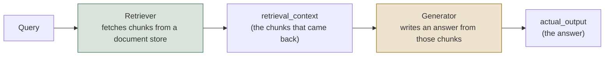
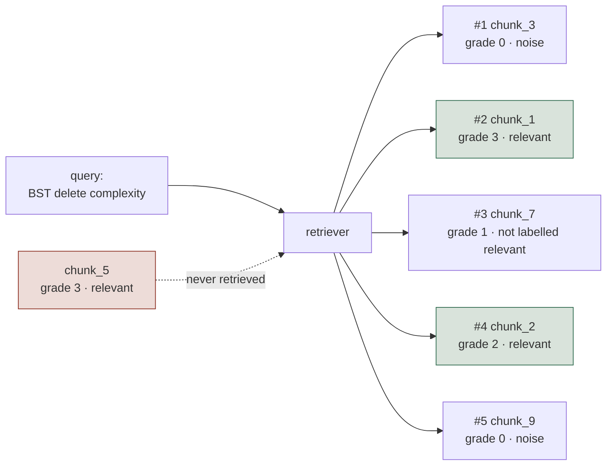
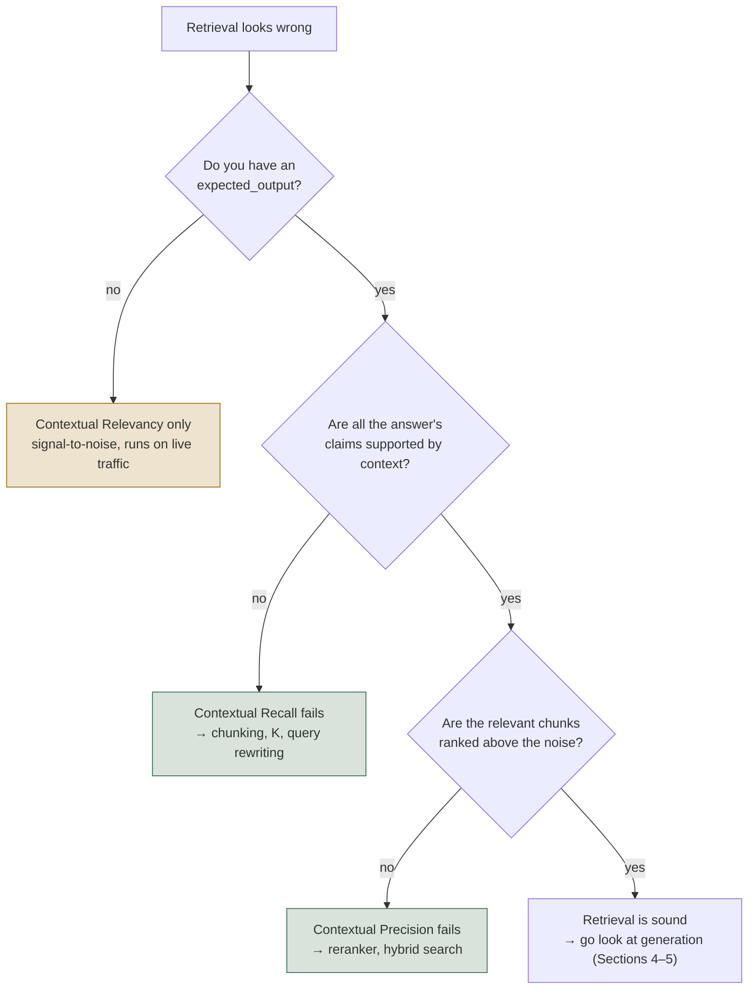
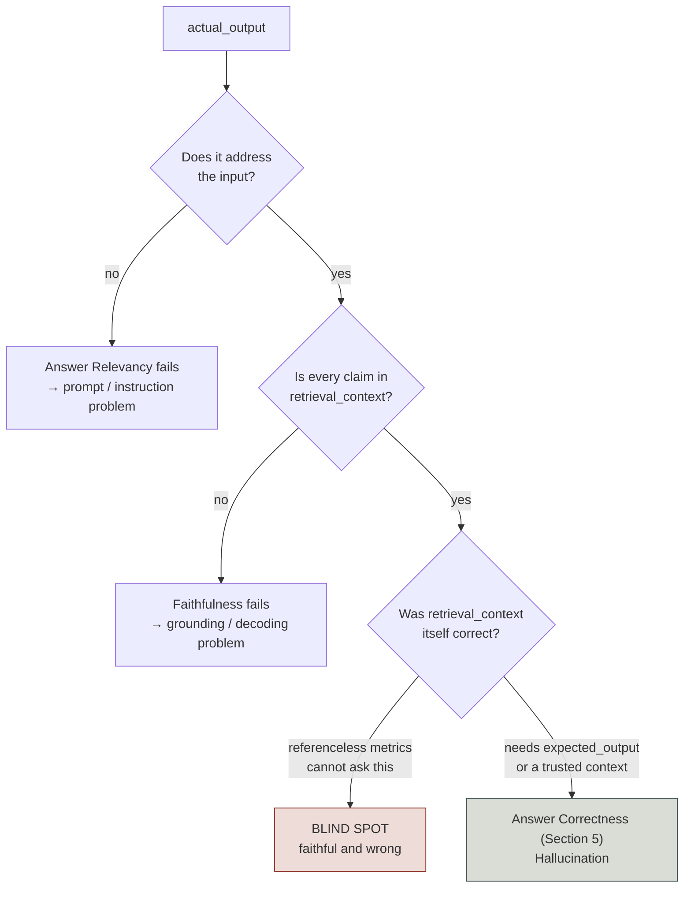
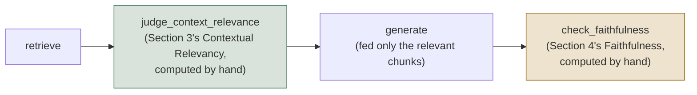
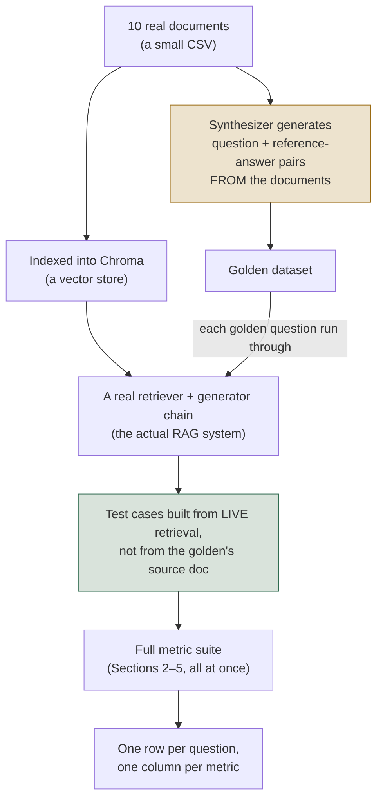

# Level 1 Explainer: RAG (Retrieval and Generation)

*A plain-language walkthrough of everything Level 1 covers, pulled together from the seven
notebooks, the field guide, the three interactive labs, and the interview question bank —
with nothing repeated twice. Level 0's Explainer is the prerequisite: this file assumes you
already have the five-surface map and the reference-based/referenceless split from there, and
builds on top of them rather than re-deriving them.*

> **Who this is for.** You don't need to know DeepEval, RAGAS, or LangGraph to follow this.
> Every technical term is defined in plain words the first time it shows up, and every number
> below is taken straight from this repo's own notebooks and labs — nothing is invented.

---

## Why this level exists

A RAG (Retrieval-Augmented Generation) system answers in two steps: it **retrieves** chunks
from a document store, then **generates** an answer using those chunks as its only source of
truth. Sections 2, 4 and 5 reuse one toy question — *"What is the time complexity of deleting
a node from a binary search tree (BST)?"* — so the two-step failure stays visible: the fact
("O(h), where h is the tree's height") either gets found or it doesn't, and the answer either
sticks to what was found or it doesn't.

A user reports a wrong answer and the reflexive diagnosis is "the model hallucinated." Often
it didn't. If the retriever never fetched the chunk saying "O(h)", the generator answered
faithfully from a context that didn't contain the fact.

> **Every generation metric is bounded by retrieval.** Measuring them while retrieval is
> broken tells you nothing about the generator — and the two failures want opposite fixes
> (chunking and reranking vs. prompt and model).

---

## 1. The RAG pipeline, and why you evaluate its two halves separately

- **Retrieval metrics** (Sections 2–3) score the box on the left: did the right chunks come
  back, and in a good order?
- **Generation metrics** (Sections 4–5) score the box on the right: given whatever *did* come
  back, is the answer any good?
- Every metric in this level takes its inputs from exactly one of these two boxes — which is
  why, later on, you can look at a table of scores and know immediately which half of the
  system to go fix.

Within each half the metrics split again on Level 0's line — does the check need a
human-written **label** or **reference answer**? Sections 2 and 4 need one; Sections 3 and
(partly) 5 do not.

---

## 2. Deterministic retrieval metrics: four numbers that are supposed to disagree

*Notebook: `01_Retrieval_Metrics_Deterministic.ipynb` · Lab: `01-deterministic-retrieval-metrics.html`*

Did the retriever find the right chunks, and put them near the top? Pure arithmetic over
labelled ground truth — a query, the chunk IDs returned in rank order, and the IDs that are
*actually* relevant, written down once by a human. No judge, no key, no cost, and it caps
everything measured downstream.

**The four metrics:**

| Metric | Question it answers | Penalizes | Reach for it when |
| --- | --- | --- | --- |
| **Precision@K** | Of the K chunks retrieved, how many are relevant? | Noise in the retrieved set | Context windows are expensive and clutter is diluting the prompt |
| **Recall@K** | Of all the relevant chunks that exist, how many made the top K? | Missing evidence | You want to know the hard ceiling everything downstream is capped by |
| **MRR** (Mean Reciprocal Rank) | 1 / the rank of the *first* relevant hit | Burying the best chunk under noise | There's typically one best chunk and you care how early it lands |
| **nDCG@K** (normalized Discounted Cumulative Gain) | Is the ranking good once relevance is a matter of *degree*, not just yes/no? | Bad ordering among several relevant-but-unequal chunks | Relevance is graded (0–3) and more than one relevant chunk can coexist |

The formulas, in plain terms:

    Precision@K = (relevant chunks in top K) / K
    Recall@K    = (relevant chunks in top K) / (total relevant chunks that exist)
    MRR         = 1 / (rank of the FIRST relevant chunk)
    nDCG@K      = DCG@K / IDCG@K,   where DCG = Σ grade_i / log2(i + 2)

The one detail worth sitting with: **IDCG is computed over the ideal ranking of every
relevant chunk that exists — including ones the retriever never returned at all.** That is
why nDCG can stay capped below 1.0 no matter how you reorder what *was* retrieved.

### The worked example

`chunk_5` is the whole lesson: it's labelled relevant, graded 3 (the highest grade), and the
retriever never returned it — so it's invisible to Precision and MRR, and it's the single
reason Recall and nDCG are capped no matter what happens to the other chunks.

At K=5: **Precision@5 = 0.40** (2 of 5 retrieved chunks were relevant — `chunk_1`, `chunk_2`;
3 were noise), **Recall@5 = 0.67** (2 of the 3 relevant chunks that exist were found;
`chunk_5` was missed entirely), **MRR = 0.50** (the first relevant chunk, `chunk_1`, landed at
rank 2, so 1/2), **nDCG@5 = 0.51** (the graded penalty for `chunk_1`, grade 3, ranking below
`chunk_3`, grade 0, is much larger than a small swap between two similarly-graded chunks would
be).

What happens as K moves from 1 to 5:

| K | Precision@K | Recall@K | MRR | nDCG@K |
| - | - | - | - | - |
| 1 | 0.00 | 0.00 | 0.50 | 0.00 |
| 2 | 0.50 | 0.33 | 0.50 | 0.39 |
| 3 | 0.33 | 0.33 | 0.50 | 0.41 |
| 4 | 0.50 | 0.67 | 0.50 | 0.51 |
| 5 | 0.40 | 0.67 | 0.50 | 0.51 |

What each shape in that table diagnoses:

- **Precision is not monotonic** — so a precision number quoted without its K means nothing.
- **Flat, low MRR** — a *ranking* problem (reach for a reranker), not a *retrieve-more* problem.
- **Recall and nDCG flatlining** — the signature of a chunk that isn't reachable at all;
  raising K buys tokens and latency and nothing else.

### Reading the four together

| What you see | What it means | Where to look |
| --- | --- | --- |
| Low recall, any precision | The answer isn't in the prompt at all | Chunking, embedding model, hybrid search, query rewriting |
| Good recall, low MRR | It's in the prompt, but buried | Reranker / cross-encoder |
| Good recall, falling precision | K is too large for this query | Dynamic K, or retrieve wide and rerank narrow |
| Good recall and MRR, low nDCG | Ranking ignores *degrees* of usefulness | Graded labels + a ranking-aware retriever |
| Everything good, answer still wrong | Retrieval is fine — the bug is downstream | Sections 4–5's generation metrics |

### When to use it, and when not to

**Reach for them** on day one of any eval setup, to compare retrievers or chunk sizes
repeatably, and for a CI gate that will never flake — arithmetic cannot disagree with itself
the way a judge can. **Don't rely on them alone** when you have no hand-labelled
`relevant_ids` and can't produce them at scale, when relevance is genuinely query-dependent,
or when the golden set is stale — it stays green while the real system drifts.

---

## 3. LLM-judged retrieval metrics: three metrics because there are three failures

*Notebook: `02_Retrieval_Metrics_LLM_Judged.ipynb` · Lab: `02-llm-judged-retrieval-metrics.html`*

Same question as Section 2 — is retrieval working? — but with an LLM judge standing in for
the hand-labelled IDs that don't scale to production traffic. DeepEval asks it three separate
times on purpose.

> **Never average the three into one "retrieval score."** Precision can halve while the
> average barely moves, and nobody investigates.

> **The names collide; the math does not.** Contextual Relevancy is *exactly* Section 2's
> Precision@K formula under a different name — unweighted and order-blind.

> **Contextual Precision is rank-weighted, and that is the whole difference.** A relevant
> chunk near the top counts for more, which is why reordering chunks moves Precision while
> leaving Relevancy untouched.

| Metric | Question | Needs `expected_output`? | Cares about order? | Catches |
| --- | --- | --- | --- | --- |
| **Contextual Precision** | Are relevant chunks ranked *above* irrelevant ones? | Yes | Yes | A good chunk buried under noise |
| **Contextual Recall** | Does the context, as a whole, cover everything the expected answer needs? | Yes | No | Missing information — retrieval found *something*, not *enough* |
| **Contextual Relevancy** | Of everything retrieved, how much is actually on-topic? | No | No | Noise diluting the context, independent of ranking or completeness |

Precision cares about **order**. Recall cares about **coverage**. Relevancy cares about
**signal-to-noise**. A retriever can fail any one of the three while passing the other two —
which is exactly why the tutorial ships all three rather than one blended number.

**One easy-to-miss detail about Contextual Recall:** it checks the retrieved context against
`expected_output` — the reference answer — **not** against what the generator actually said
(`actual_output`). It's asking "was enough fetched to *support* the full expected answer?",
regardless of whether the generator used all of it. That trips people up constantly.

### The judge produces verdicts; arithmetic does the scoring

    Contextual Precision = Σ (precision@i, for each position i holding a relevant chunk) / (number of relevant chunks)
    Contextual Recall    = (claims in expected_output supported by the context) / (total claims)
    Contextual Relevancy = (relevant chunks) / (total chunks retrieved)

The judge's only job is to label each chunk relevant/irrelevant, or each claim
supported/unsupported. Everything after that is deterministic math — which is why the same set
of verdicts always produces the same score, but two separate judge runs can still disagree,
because the *verdicts themselves* are non-deterministic (Level 0, Section 3).

### One query, four retrieval outcomes

Question: *"What is Apache Spark used for?"*

| Scenario | Contextual Precision | Contextual Recall | Contextual Relevancy | What moved |
| --- | --- | --- | --- | --- |
| Healthy retrieval | 1.00 | 1.00 | 0.67 | — (baseline) |
| **Bad ranking** (same chunks, reordered) | **0.58** | 1.00 | 0.67 | Precision alone |
| **Thin coverage** (one perfect chunk only) | 1.00 | **0.50** | 1.00 | Recall alone |
| **Noise dilution** (1 relevant of 4 chunks) | **0.33** | 1.00 | **0.25** | Relevancy, dragging Precision with it |

Three things easy to miss in that table:

- **Healthy retrieval scores only 0.67 on Relevancy.** A perfect 1.00 usually means K was set
  too small, not that the retriever is flawless.
- **Thin coverage scores 1.00 on two of three.** Run Relevancy alone — the only one needing no
  reference — and a real coverage gap looks perfect.
- **Relevancy and Precision fail together under noise dilution, but decouple under bad
  ranking.** Noise ranked *above* signal is both failures at once; a reordering is only one.

### Deciding which of the three to run

Coverage is checked before ranking on purpose: there's no point tuning a reranker over a
context that never contained the answer in the first place.

### The threshold trap

The lab's "thin coverage" scenario lands Contextual Recall at exactly **0.50** — DeepEval's
default `threshold`.

> **A score sitting exactly on its threshold is a coin toss, not a verdict.** The judge is
> non-deterministic, so one flipped claim-level verdict on a re-run flips the whole case.

Either move the threshold off where your scores cluster, or re-run near-threshold cases and
take a majority.

### When to use it, and when not to

**Reach for them** when you have production traffic and no labelled chunk IDs, or when the
golden set doesn't cover the query shapes real users send. **Stay with Section 2** for a hard
CI pass/fail line, for head-to-head retriever comparisons, and at volume — three contextual
metrics over 500 test cases is 1,500+ judge calls, before generation is measured at all.

---

## 4. Generation without a reference: three ways "the answer is wrong" can happen

*Notebook: `03_Generator_Metrics_Referenceless.ipynb` · Lab: `03-generator-metrics.html`*

Given whatever *was* retrieved, is the answer any good — with no human-written reference for
the query being scored? These are the checks that can run against live production traffic.

| Metric | Question | Compares against |
| --- | --- | --- |
| **Answer Relevancy** | Does the answer actually address the question that was asked? | `input` only |
| **Faithfulness** | Is the answer grounded in what was retrieved, with no invented claims? | `retrieval_context` |
| **Hallucination** | Does the answer align with a separately-supplied, trusted `context`, regardless of what retrieval fetched? | a curated `context`, not `retrieval_context` |

> **"Referenceless" does not mean "compares against nothing."** A reference is a correct
> answer a person wrote *before* the system ran. `retrieval_context` is not that — the
> pipeline produced it while answering. The mechanical test: could this metric score a
> brand-new query with zero human preparation?

> **Hallucination is the partial exception.** Its trusted `context` is human-curated, so it
> needs a maintained corpus — no *per-query* answer key, but not free either, and source
> material says what is *true*, not what this answer *should have said*.

The judge doesn't score the answer as one blob — it decomposes first, and the three metrics
use **different decompositions of the same text**:

    Faithfulness     = (claims supported by retrieval_context) / (total claims)
    Answer Relevancy = (statements that address the input) / (total statements)
    Hallucination     = (claims contradicting the trusted context) / (total claims)

An answer can have three grounded *claims* and only one on-topic *statement* — Faithfulness
and Answer Relevancy are not just two takes on the same slicing of the text.

**A gotcha worth memorizing: Hallucination's score runs backwards.** A *higher* score means
*more* hallucination, the opposite convention from Faithfulness and Answer Relevancy, where
higher is better. Always check a new metric's score direction rather than assuming.

### Telling the three failures apart

An answer can be wrong in three genuinely different ways, and only one of them is visible to
any referenceless metric:

- **Faithful but irrelevant** — perfectly grounded in the retrieved context, but answers a
  different question than the one asked.
- **Relevant but unfaithful** — directly addresses the question, but invents facts that aren't
  in the context.
- **Faithful to bad context** — accurately reflects retrieved chunks that were themselves
  wrong. **Faithfulness cannot catch this.** Neither can Answer Relevancy. Only a
  reference-based check (Section 5) can.

> **The blind spot is structural, not a tuning problem.** Faithfulness is defined *relative
> to* the retrieved context, so it cannot ask whether that context was true.

**Faithfulness vs. Hallucination — the distinction people get wrong:**

| | Faithfulness | Hallucination |
| --- | --- | --- |
| Compares against | `retrieval_context` — whatever *this* query's retriever fetched | a separate curated `context`, independent of retrieval |
| Score direction | Higher is better | **Higher is worse** |
| Changes per query? | Yes — the baseline moves with retrieval | No — the baseline is fixed |
| Catches | A generator inventing beyond what it was given | An answer contradicting known truth, however it got there |
| Blind to | Retrieved context that was itself wrong | Anything outside the curated context |
| Runs on live traffic | Yes, nothing extra needed | Only where you maintain a trusted corpus |

Use Faithfulness to police the generator. Use Hallucination when you have an independent,
trusted source and want to check the answer against it regardless of what retrieval returned.

### When to use it, and when not to

Reach for referenceless metrics when monitoring production traffic with nobody writing
reference answers, when catching decoding-level failures — invention, over-claiming, drifting
off the question — or whenever you need volume, since they scale to any input at zero labelling
cost. Watch specifically for **Semantic Similarity as a stand-in for correctness** (Section 5)
and for **vague `GEval` criteria** (Section 6) — the specificity you put into a rubric is the
specificity you get back.

**A cheaper alternative for Answer Relevancy specifically.** DeepEval also ships
`RAGASAnswerRelevancyMetric`, a binding into RAGAS that scores relevancy with embedding cosine
similarity instead of an LLM judge call — cheaper and faster, at the cost of missing subtler
forms of "technically similar wording, wrong answer" that a judge would catch. Section 5 draws
the same tradeoff out fully.

**What each of the five metrics in this level structurally cannot catch**, gathered in one
place (the individual "blind to" details are scattered across Sections 3–5 above):

| Metric | Cannot catch |
| --- | --- |
| Contextual Precision / Recall / Relevancy (Section 3) | See Section 3's own triage table — each of the three is blind to the other two's failure mode |
| Answer Relevancy | A confidently wrong answer *to the right question* |
| Faithfulness | Context that was itself wrong |
| Hallucination | Anything outside the one curated context you supplied |
| Answer Correctness (Section 5) | Any query with no written reference to check against |
| Semantic Similarity (Section 5) | Wrong numbers and facts — it measures topic, not truth |

---

## 5. Generation against a reference: Answer Correctness and Semantic Similarity

*Notebook: `04_Generator_Metrics_Reference_Based.ipynb` · Lab: `03-generator-metrics.html`*

**Is the answer actually correct**, against a known-good reference? Section 4's metrics never
ask; this is the only place in Level 1 that catches "faithful to bad context."

- **Answer Correctness has no dedicated metric class.** "Factually right" is specific to your
  task, so the pattern is a custom `GEval` rubric (Section 6), not one generic class.
- **Answer Semantic Similarity isn't LLM-judged at all** — plain embedding cosine similarity.
  Cheap and fast, and weak on a subtly wrong fact: two answers sit close in embedding space
  while disagreeing on the one number that matters.
- **Both need `expected_output`.** That is the cost side of Level 0's tradeoff — exact, but
  only as scalable as your ability to keep reference answers current.

### The same four answers, now with reference-based scores added

Question: *"What is the time complexity of deleting a node from a BST?"* Reference: *"O(h),
where h is the height of the tree."*

| Answer | Answer Relevancy | Faithfulness | Hallucination ↓ | Answer Correctness | Semantic Similarity |
| --- | --- | --- | --- | --- | --- |
| Grounded & relevant | 1.00 | 1.00 | 0.00 | 0.95 | 0.94 |
| Faithful but irrelevant | 0.33 | 1.00 | 0.00 | 0.35 | 0.78 |
| Relevant but unfaithful | 1.00 | 0.50 | 0.50 | 0.40 | 0.91 |
| **Faithful to bad context** | **1.00** | **1.00** | **1.00** | **0.10** | 0.83 |

The last row is the whole section. Retrieval returned a chunk claiming BST deletion is O(1);
the generator repeated it accurately.

> **Both referenceless metrics report a perfect score on an answer that is simply false.**
> Only Answer Correctness catches it, at 0.10.

> **Semantic Similarity scores that same false answer 0.83.** Embeddings measure *topic*, and
> "constant time" sits close to "logarithmic time" — pair it with a judged correctness check,
> never substitute it for one.

### Two ways to write the correctness rubric

`GEval` (the tool behind Answer Correctness) takes exactly one of two configurations — never
both at once, it's one or the other:

- **`criteria`** — one plain sentence (*"Determine whether actual_output is factually correct
  relative to expected_output, focusing on whether key facts match — wording may differ"*),
  which the judge expands into its own steps internally.
- **`evaluation_steps`** — an ordered procedure you write (*"1. list the statements in
  actual_output, 2. check each is relevant to input, 3. check each agrees with expected_output,
  4. check each is grounded in retrieval_context, 5. penalize anything invented"*), which weaves
  input, expected answer and retrieved context into one rubric.

`evaluation_steps` is the more controllable of the two — you write the procedure instead of
trusting the judge to invent it.

### When to use it, and when not to

**Reach for them** when the failure you fear is *wrongness* rather than *ungroundedness* —
every index-corruption and stale-document case Section 4 cannot see — when gating CI on a test
set you control, and when comparing prompt or model versions against a fixed reference.
**Watch two traps:** Semantic Similarity standing in for correctness, and a `criteria` sentence
too vague to say what should fail.

---

## 6. Writing a rubric that doesn't produce a vague judge

*Field guide §1.5*

Every custom `GEval` comes down to one fact: **you are either writing the test, or letting the
judge invent it for you.**

| You give the judge | What happens | Result |
| --- | --- | --- |
| One sentence — *"check the answer is accurate"* | The judge has to invent its own evaluation steps, and invents slightly different ones on every run | The same answer gets different scores on different runs |
| Explicit steps — *"1. every figure appears in the context, 2. it answers the question asked, 3. no advice beyond the policy"* | The judge follows the procedure you wrote | The same answer gets the same score every time |

- **Write explicit steps whenever a one-liner won't pin down what should fail.** Steps also
  check several things in one pass — relevance, agreement with a reference, grounding — instead
  of three separate metrics.
- **A vague rubric never errors.** The numbers just wobble from run to run with nothing
  pointing at the rubric as the cause: it fails as noise, not as a visible break.
- **The test for your own rubric:** if you can't say precisely what would make an answer fail
  it, neither can the judge.

Hand a human grader "mark this fairly" instead of a marking scheme and five graders return five
different grades, every one individually defensible.

---

## 7. Evaluation as pipeline gates, not just after-the-fact scoring

*Notebook: `05_RAG_Eval_Inside_the_Pipeline.ipynb`*

Sections 2–5 all score output **after the fact**. Context relevance and faithfulness can
instead run **inside the pipeline**, gating generation on bad retrieval before a user ever
sees the answer.

Two reasons this is worth knowing:

1. **You can act on the result mid-pipeline.** `judge_context_relevance` runs *before*
   generation, so a real system can branch on it — ask a clarifying question instead of
   generating a plausible answer from noise.
2. **It demystifies the metric classes.** Building the same two checks from raw judge calls
   once shows what `ContextualRelevancyMetric` is doing underneath.

The worked example retrieves three chunks for the BST question, one of them deliberately
off-topic (a fact about Python lists). The mock judge correctly flags the off-topic chunk
`irrelevant`, filters it out *before* generation runs, and the resulting answer scores
**Faithfulness 1.00** — no hallucination detected, because it was only ever given the chunks
that actually supported an answer.

> **Prototype against mocked judges first.** Same graph, byte-identical output, zero cost —
> debug the pipeline's *shape* before a real judge is involved.

Swapping in live judges is where non-determinism appears: the same graph run twice can extract
slightly different claims. Hence `temperature=0`, and tracking judge agreement itself rather
than trusting a single pass.

---

## 8. RAGAS as a second opinion, and the pytest/CI batch pattern

*Notebook: `06_RAGAS_in_Practice.ipynb`*

RAGAS is a second framework — narrower in scope than DeepEval, RAG-specific, and a common
default in the wider RAG ecosystem — that measures the same ideas from Sections 3–4 in its own
vocabulary:

| RAGAS class | The DeepEval idea it mirrors | Note |
| --- | --- | --- |
| `LLMContextPrecisionWithoutReference` | Contextual Precision (Section 3) | The `WithoutReference` suffix spells the reference-based/referenceless split out in the class name itself, rather than leaving you to infer it from which fields you populate |
| `LLMContextRecall` | Contextual Recall (Section 3) | |
| `Faithfulness` | Faithfulness (Section 4) | |

Three mechanical differences if you switch between the libraries:

- **Unit of evaluation** — RAGAS's `SingleTurnSample` (`user_input`, `response`,
  `retrieved_contexts`, `reference`) vs. DeepEval's `LLMTestCase`. Same idea, different names.
- **Async-first** — `await sample.single_turn_ascore(...)` vs. DeepEval's synchronous
  `.measure()`.
- **Explicit judge** — RAGAS wants a `LangchainLLMWrapper` around a chat model rather than a
  `model="..."` string, which buys any LangChain-integrated provider as the judge.

On a sample built so retrieval pulls in one irrelevant chunk alongside a correct one, Context
Precision comes back lower than Context Recall — the same signature Section 3 already taught
you to read: precision is penalized directly by noise sitting in the ranking, while recall
(checked against the reference, which the irrelevant chunk doesn't contradict) is far less
affected by it.

### The batch/CI pattern

A hand-built test case teaches you what a metric does; it says nothing about your system.
Turning one scored example into a real evaluation is always the same shape:

> dataset of inputs → call the **live** system once per row → score the real response → write
> the score back beside its input

The repo's version is a `pytest`-parametrized test: read questions from a spreadsheet, call a
live RAG backend per row, score with RAGAS, write the score back beside its question, assert it
as a CI gate. `pytest.mark.parametrize` turns one eval sample into one test per row, so pytest
is the batch runner and the pass/fail reporter — no separate harness loop.

> **Every row has to hit the *live* system.** Scores land next to the input that produced them,
> so a bad number is one click from its cause, and the whole thing re-runs on demand.

---

## 9. Building a RAG system and synthesizing a golden set

*Notebook: `07_RAG_Capstone_Build_and_Evaluate.ipynb` · Field guide §1.8*

Sections 2–6 used hand-constructed test cases and Section 7 used fixture data in a toy graph.
The capstone does the real thing:

**Hand-writing reference answers doesn't scale past a handful of examples.** A synthesizer
generates question/expected-answer pairs directly from your own documents instead, evolved
along dimensions you choose — for instance, requiring multi-step reasoning, or requiring
information pulled from more than one chunk at once — so you get a labelled eval set without
writing a single reference answer by hand. **Spot-check the output anyway**: a generated
question is only as good as the generation process that produced it.

> **Build each test case by running the live retriever, not by reusing the source document.**
> That is the difference between testing the deployed pipeline and testing whether the
> generator writes well given hand-picked perfect context.

Running the whole suite — retrieval and generation, reference-based and referenceless — over
every golden question produces an aggregate table (mean, min, max per metric), which is how a
RAG quality report actually gets read.

---

## 10. Reading the results

*Field guide §1.9*

A table of per-metric scores is diagnostic, not just descriptive — read right.

- **Diagnose by pattern, not headline number.** Low Contextual Precision with everything else
  high is a ranking problem (Section 3); low Faithfulness with high Contextual Relevancy is the
  generator inventing despite good retrieval (Section 4).
- **Aggregates hide the thing you need to see.** An 85% average with one category at zero and
  an 85% average spread evenly are two different systems reporting one number.
- **Slice before you conclude.** By query category, tenant, intent or document type — before
  deciding the system is fine.

---

## Question-bank corner — retrieval and generation numbers, live on a dashboard

*(From `QUESTION_BANK.md`, Part 10, §10.1–§10.3 — the three sections that map onto Level 1's
three labs. §10.4 onward belongs to Level 2's tool-use and trajectory material and isn't
repeated here.)*

Not the conceptual questions Sections 1–10 answered — the follow-ups asked once an interviewer
has your dashboard on screen. One from each section:

- **§10.1 (deterministic retrieval):** *"Leadership wants one number for retrieval quality on
  an exec dashboard — what do you put there, and what do you say about the request?"*
  **Recall@K, with Precision@K and MRR one click away — and say out loud that it hides a good
  recall figure being compatible with the right chunk sitting at rank 8 under noise.**
- **§10.2 (LLM-judged retrieval):** *"Contextual Precision drops from 0.91 to 0.62 after a
  release; Recall and Relevancy are unchanged. What shipped?"* **A ranking change — reranker,
  fusion weights or tie-breaking — because the same chunks are still coming back and only
  their order moved.**
- **§10.3 (generator metrics):** *"Faithfulness and Answer Relevancy both sit above 0.95 for a
  month, then a customer proves the assistant has been giving wrong compliance guidance the
  whole time. How is that possible?"* **A wrong knowledge-base document produces a perfectly
  faithful, perfectly relevant, wrong answer — no threshold could have caught a structural
  blind spot, so the fix is reference-based coverage on the high-stakes slice plus index
  freshness monitoring.**

§10.1 has 5 questions, §10.2 has 5 and §10.3 has 4; the full reasoning for each is in the
question bank. This corner maps *what kind* of question to expect, not a substitute for it.

---

## References

All content above was drawn only from material already in this repository. Nothing here was
invented, and no external source was consulted.

**Notebook:**

- `courses/01-rag-agent-tool-evaluation/01_Retrieval_Metrics_Deterministic.ipynb` — the four
  deterministic retrieval metrics, their formulas, and the BST worked example (Section 2).
- `courses/01-rag-agent-tool-evaluation/02_Retrieval_Metrics_LLM_Judged.ipynb` — the three
  Contextual metrics and the Apache Spark / Type 2 Diabetes / climate-change worked examples
  (Section 3).
- `courses/01-rag-agent-tool-evaluation/03_Generator_Metrics_Referenceless.ipynb` — Answer
  Relevancy, Faithfulness, and Hallucination, plus the "why referenceless" callout and the
  score-direction gotcha (Section 4).
- `courses/01-rag-agent-tool-evaluation/04_Generator_Metrics_Reference_Based.ipynb` — Answer
  Correctness (`GEval`, both configuration styles) and Answer Semantic Similarity (Sections 5–6).
- `courses/01-rag-agent-tool-evaluation/05_RAG_Eval_Inside_the_Pipeline.ipynb` — evaluation
  wired directly into a LangGraph pipeline as gates, mocked and then live (Section 7).
- `courses/01-rag-agent-tool-evaluation/06_RAGAS_in_Practice.ipynb` — RAGAS's own API shape and
  the pytest/CI batch pattern (Section 8).
- `courses/01-rag-agent-tool-evaluation/07_RAG_Capstone_Build_and_Evaluate.ipynb` — building a
  real RAG system, synthesizing a golden dataset, and running the full metric suite end to end
  (Section 9).

**Docs:**

- `docs/concepts/rag-agent-tool-evaluation.md`, Part 1 (§1.1–§1.9) — the compressed reference
  version of every section above, plus §1.5 (writing a rubric) and §1.9 (reading results), which
  have no notebook of their own.
- `docs/concepts/rag-agent-tool-evaluation.md`, Part 6 (§6.1–§6.3) — the slow narrative version
  of Sections 2–5, walked against the same numbers used above, including the triage tables and
  the "when to use it / when not to" guidance reused directly in this file.
- `docs/interactive-labs/01-deterministic-retrieval-metrics.html`,
  `docs/interactive-labs/02-llm-judged-retrieval-metrics.html`,
  `docs/interactive-labs/03-generator-metrics.html` — the three companion labs; each contributed
  its scenario table and its own framing of the "what this metric is blind to" column, folded
  into Sections 2, 3, and 4–5 respectively rather than repeated separately.
- `docs/interview-prep/QUESTION_BANK.md`, Part 10, §10.1–§10.3 — the metric-level, dashboard-framed
  follow-up questions used in the Question-bank corner.
- `docs/study-guide/evaluation-roadmap.md` — used to scope Level 1's topic list and goal
  statement, not quoted directly.
- `docs/study-guide/evaluation-topic-notebook-mapping.md` — used for the resource list and cost
  tags (all Level 1 notebooks are tagged `key`, meaning they make live `OPENAI_API_KEY` calls
  when actually run; this file was written without running any of them).

**Limitations.** This file was written by reading the repository's own notebooks, field guide,
labs, and question bank — not by running any notebook or calling any API — no cost was incurred
producing it, consistent with this project's rule against executing anything that spends money
without being asked. It does not independently verify DeepEval's, RAGAS's, or LangGraph's own
upstream documentation; every description of what those libraries do is this repository's own
characterization (its notebooks and field guide), not a review of the vendors' docs.
