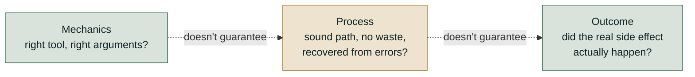
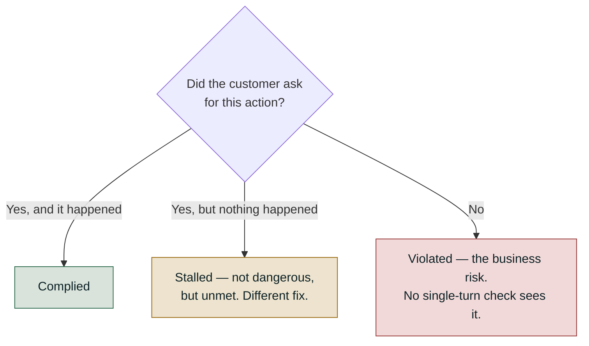

# Level 2 Explainer: Agents (tools, conversations, trajectories, outcomes)

*A plain-language walkthrough of everything Level 2 covers, pulled together from the four
notebooks, the field guide, the two interactive labs, and the interview question bank — with
nothing repeated twice. Level 0's five-layer map named "tool mechanics," "trajectory," and
"outcome" as three of the five things you can evaluate; this file is where each of those three
actually gets built out, plus the multi-turn axis Level 0 flagged but didn't cover.*

> **Who this is for.** You don't need to have read anything beyond Level 0 to follow this.
> Every technical term — including the DeepEval class names — is defined in plain words the
> first time it shows up.

---

## Why this level exists

Picture a customer-support agent with three tools: `search_orders`, `get_refund_policy`, and
`issue_refund`. A user writes: *"My order #4521 arrived broken, can I get a refund?"*

A single "was the final reply good?" check cannot tell you much here, because a lot can go
wrong on the way to that reply, and each kind of wrong needs a completely different fix:

- The wrong tool, or the right tool with a typo'd order ID.
- Every tool called correctly, and a refund $30 over the user's stated budget.
- Five steps for a three-step job — repeating a lookup that already succeeded, or retrying
  blindly instead of noticing its own mistake.
- *"Your refund of $45 has been issued"*, fluently, with no refund recorded anywhere.
- Every turn handled well in isolation and the conversation still ending somewhere it
  shouldn't — something forgotten three turns back, or an action never agreed to.

This level is about pulling those apart. The roadmap's own framing for it is **mechanics ≠
process ≠ outcome**: whether the tool calls were mechanically correct, whether the *path* the
agent took was sound, and whether the real-world result actually happened, are three separate
questions, and passing one tells you nothing about the other two. Everything below is built
around that one running refund-agent example, because it's the exact scenario the notebooks
use to exercise all of it in one trace.



---

## 1. Multi-turn conversational evaluation

Every check in Level 0 and Level 1 scored one request/response pair. Real chatbots hold a
**conversation** — a sequence of turns where earlier turns constrain what a later turn should
say. A system can pass every individual turn and still fail the conversation as a whole: by
forgetting what the user said three turns ago, drifting off-topic turn by turn, or taking an
action nobody actually asked for.

### Why "95% per turn" is not 95% conversation quality

This is the single most important piece of arithmetic in this level, and almost nobody does it
by default. If each turn independently passes at rate *p*, the probability that **all** *n*
turns in a conversation pass is *p* raised to the power *n* — because every turn has to go
right, not just most of them.

| Turn pass rate | 3 turns | 5 turns   | 10 turns |
| --------------- | ------- | --------- | -------- |
| 0.99             | 0.970   | 0.951     | 0.904    |
| **0.95**   | 0.857   | **0.774** | 0.599    |
| 0.90             | 0.729   | 0.590     | 0.349    |

At a healthy-looking **95% per turn**, a conversation is more likely failed than not by **turn
14**. And this is the *optimistic* version of the calculation — it assumes each turn fails
independently of the others, when in practice one bad turn tends to poison the context for
every turn that follows it, so real conversation-level rates land below the table, not on it.

**The practical rule: if you report a turn-level number, report the session-level number
beside it.** A dashboard showing "95% turn quality" and a customer saying "conversations fall
apart" are describing the exact same system — the dashboard is just reporting it in the wrong
unit. It also follows that **multi-turn systems need a conversation-level gate, not just a
turn-level one** — see [Level 6](06-the-release-gate-and-ci.md) for what a gate actually is.

### The three multi-turn metrics

DeepEval represents a whole dialogue as a `ConversationalTestCase` made of `Turn`s, and scores
it with three purpose-built metrics:

| Metric                        | What it checks                                                                                                          |
| ------------------------------ | ------------------------------------------------------------------------------------------------------------------------ |
| **`TurnRelevancyMetric`**      | For a sliding window of recent turns, is the last assistant turn actually relevant to what came before it in that window? |
| **`KnowledgeRetentionMetric`** | Does the assistant correctly remember and reuse information the user already supplied earlier in the conversation?        |
| **`ConversationalGEval`**      | Your own custom rubric (the multi-turn counterpart to single-turn `GEval`), applied across the whole conversation — e.g. "never diagnose, always recommend a doctor for serious concerns" for a medical chatbot |

Beyond hand-writing dialogues, DeepEval's `ConversationSimulator` (or simply prompting an LLM
to role-play "an angry customer" or "someone who keeps changing their mind") generates
dialogues from a defined goal and policy, including mid-conversation curveballs — which scales
conversational testing to far more scenarios than anyone would write by hand.

### Failures with no single-turn representation

Some failures genuinely cannot show up in any single-turn check, because what makes them wrong
happened in a *different* turn from where the problem is visible:

- **Acting without consent.** *"I've opened a ticket for you"* on turn one, unasked. Read
  alone the reply is helpful, on-topic, grounded and reports a completed action — every
  single-turn check passes it. The agreement that should have come first lives *between*
  turns, so there is nowhere for its absence to show up. Most write actions are gated by a
  prompt instruction rather than by the tool refusing, so this obedience must be *tested*.
- **Ignoring a refusal.** The user says "no, don't do that" on turn two, and it happens anyway
  on turn four.
- **Drift.** Every individual turn is fine, and the conversation as a whole ends somewhere it
  shouldn't.

**Score three outcomes here, not two:** *complied*, *violated*, and **stalled** — the customer
agreed and then nothing happened. Stalled isn't dangerous the way "violated" is, but the
customer asked for something and didn't get it, and it needs a different fix than either of the
other two.

One consequence worth stating precisely: **a conversation-level check run on a single-turn
interaction must report "not measured," never zero.** An unmeasured check and a genuinely
failed one must never be allowed to look identical on a dashboard.



---

## 2. Tool-use metrics: the mechanics layer

Tool use is where an agent's output stops being "just text." A travel bot that says *"Your
flight is booked!"* is useless if it never actually called the booking API — and the fluent,
confident sentence looks exactly the same whether the tool call succeeded, failed, or never
happened. This is why tool evaluation needs its own approach:

| \                                  | Standard LLM evaluation      | Tool-using agent evaluation                                        |
| ----------------------------------- | ----------------------------- | --------------------------------------------------------------------- |
| **What you score**            | One output against a reference | A sequence of decisions, *then* the output                           |
| **Where failure lives**       | In the text                   | Underneath it — which tool, what order, what arguments, how results were read |
| **What a good-looking reply proves** | Usually that it's good        | Nothing on its own — it could be describing a tool call that never happened |

DeepEval provides three dedicated metrics, each answering a different question at a different
granularity:

| Metric                          | Type                              | Needs                         | Best for                                                             |
| --------------------------------- | ------------------------------------ | -------------------------------- | ------------------------------------------------------------------------ |
| **`ToolCorrectnessMetric`**       | Reference-based, deterministic       | `expected_tools`                 | Regression and CI, where the correct tool behaviour is already known    |
| **`ArgumentCorrectnessMetric`**   | Referenceless, LLM-judged            | Tool descriptions only           | Dynamic workflows and production monitoring, where you can't pre-write correct argument values |
| **`ToolUseMetric`**               | Multi-turn, LLM-judged               | `available_tools` (required)     | Conversational agents, where tool use spans several exchanges. Final score = `min(`selection score, argument score`)` |

### Strict vs. loose tool-call matching: the same metric can score 1.00 or 0.00

Strictness lives in how you configure the metric, not in the agent's behaviour — and the
default is looser than it looks. One expected trajectory (`FlightSearch` NYC→London on
2026-03-13, then `WeatherCheck` for London that date) against six traces: an exact match, an
extra unrequested `CurrencyConvert`, the two calls in the wrong order, a missing flight-search
output, a transposed date (`03-31` for `03-13`), and a missing weather check. Five of the six
are broken in a way that should matter.

| Configuration                                                              | What it actually compares                                       | Mean score across the six traces | What it misses                                                               |
| ---------------------------------------------------------------------------- | ------------------------------------------------------------------ | ----------------------------------- | -------------------------------------------------------------------------------- |
| **A · names only** (the library default, `should_exact_match=False`)       | Is a tool with this *name* present anywhere in the list?           | **0.92**                            | Order, arguments, outputs, and extra calls are all invisible — 5 of 6 traces score 1.00, and 4 of those 5 are actually broken |
| **B · + `INPUT_PARAMETERS`**                                                | Names *and* arguments must match, still order-blind                | 0.83                                | Catches the wrong date (drops to 0.50). Still misses the extra call, the reversed order, and the dropped output |
| **C · + `OUTPUT`, `should_exact_match=True`**                              | Exact list equality — same tools, same arguments, same recorded outputs, same order | 0.17 (5 of 6 score exactly 0)      | Catches all five broken traces — and turns the metric binary: it either matches perfectly or it doesn't |

**Config A reading 0.92 is not measuring tool correctness — it's measuring whether the agent
knows the tools exist.** A dashboard built on the library default can look nearly perfect while
missing a reversed sequence, a silently dropped output, and a wrong travel date, all at once.

Both extremes of strictness are wrong in their own way, which is why this is a decision you
make deliberately rather than a setting you leave at its default:

- **Too strict** (exact tools, exact order, nothing extra) and an agent that harmlessly also
  checked the weather fails the whole run for a call that hurt nobody.
- **Too loose** (expected tools appear somewhere, extras ignored) and an agent that fires all
  eight of its tools on every question passes every time — it's spraying, and the metric
  applauds.

**Demand strict ordering only where the order genuinely *is* the requirement** — you cannot
book a flight before you've searched for one, so that ordering is real; whether the weather
check happened first or third usually isn't.

`ToolCorrectnessMetric` takes an optional `available_tools` list — every tool the agent *could*
have called. Left out, it compares `tools_called` to `expected_tools` mechanically; passed in,
an LLM judge also asks whether the agent picked the *best* tools available.

> **Turning it on escalates a pure code check into a partly-judged one** — Level 0's cost
> ladder, applied to a single metric.

### Argument correctness: cheap check first, judge second

"Were the arguments right?" is really two separate questions, and they don't cost the same:

1. **Is it even well-formed?** Does the `book_flight` call have a `date` field, and is
   `2026-02-31` a real date? **Plain code answers this** — free, instant, and it never wobbles.
2. **Does it make sense for what was asked?** The user wanted a morning flight to Delhi; did it
   book an evening flight to Dubai instead? **Only a judge can answer this.**

The pattern used throughout the notebooks: validate the schema deterministically first, and
only spend the LLM call if that passes.

```python
# A structurally malformed call is worth zero -- no point spending a judge call
# to have a model tell you the date field isn't a date.
valid, reason = validate_args(test_case.tools_called)
if not valid:
    print(f"Score: 0\nReason: {reason}")   # judge never runs -- free rejection
else:
    metric.measure(test_case)              # now spend the LLM call
```

### Combining sub-scores: the worst one, not the average

`ToolUseMetric`'s final score is `min(`tool selection score, argument correctness score`)`, and
that choice is deliberate. Suppose selection scores 1.0 — exactly the right tool was picked —
and arguments score 0.0 — it handed that tool nonsense. The **mean** would say 0.5, which reads
as "half working." Nothing was half working: the booking failed. The **minimum** says 0.0,
which is the truth. Averaging lets a healthy dimension cover for a broken one — exactly the
failure the metric exists to catch.

### Doing nothing is behaviour, and it needs scoring too

"What's your refund policy?" should produce **no tool call at all** — the agent should answer
from what it already knows and stop. That restraint is *correct*, and it deserves a passing
score, not silence.

Most eval suites only inspect the calls that actually happened, which leaves them blind in both
directions:

- **Should have stayed still, and moved.** It calls a tool it didn't need — wasted money, one
  more thing that can go wrong. Invisible if you only check whether the calls that *did* happen
  were correct, because they were.
- **Should have moved, and stayed still.** It says *"your flight is booked!"* without ever
  calling `book_flight`. Invisible, because there's no call to inspect.

So `expected_tools` has to be allowed to be an **empty set**, and an empty set needs to be
something you can pass or fail against, exactly like any other expected value.

---

## 3. Task completion and outcome verification

Everything in Section 2 judges **mechanics** — right tools, right arguments, right order. None
of it asks the question the user actually cares about: **did the agent get the job done?**

The gap is real in both directions. An agent can call every tool correctly and still book the
wrong hotel because it silently dropped a budget constraint the user stated. And a slightly
inefficient tool-calling sequence can still land on a perfectly satisfactory outcome. Tool-level
and outcome-level metrics are answering genuinely different questions, and a production suite
needs both.

### `TaskCompletionMetric`

DeepEval's dedicated metric for this: an LLM-judged, referenceless check that reads the
`input` (the user's goal), the `actual_output`, and — strongly recommended, though technically
optional — the `tools_called`, and asks whether the underlying task was actually accomplished.

The concrete case worth holding onto: an agent books a real, valid hotel reservation through
correctly-formed tool calls, but the price is $30/night over the user's stated $150 budget.
`ToolCorrectnessMetric` and `ArgumentCorrectnessMetric` would both score this run well — the
tools were right and the arguments were well-formed. `TaskCompletionMetric` is built to catch
that the actual requirement — staying under budget — was not met.

A few details worth knowing before reaching for it:

- Passing `tools_called` is what lets the judge see *how* the outcome was reached, not just
  what the agent claims happened in its final sentence.
- The `task` parameter is optional — if omitted, the metric infers the task from `input`
  itself. Pass it explicitly when the real task is broader than the literal wording (e.g. a
  constraint mentioned earlier in a conversation rather than in the final message).
- A full execution trace beats a flat `tools_called` list where one is available, because a
  trace also carries the agent's intermediate reasoning.

### Two escalations beyond the default metric

`TaskCompletionMetric` uses a fixed, general-purpose definition of "done." Two situations call
for going further:

1. **When "done" is domain-specific**, write a `GEval` rubric instead of the generic prompt —
   *"the summary must cite at least two sources"*, *"a refund response must never promise a
   dollar amount before policy lookup"*. It costs more to author and applies your bar.
2. **When the stakes are too high for a judge at all**, verify the side effect. Both
   `TaskCompletionMetric` and a custom `GEval` are still LLM-as-judge reading text. After a
   "book the hotel" task, query the booking system for a confirmed reservation matching the
   dates and budget.

> **A state-based check cannot be fooled by a fluent-but-wrong response.**

**In practice, combine them:** a deterministic state check as the pass/fail gate wherever a
checkable outcome exists, and `TaskCompletionMetric` (or a custom rubric) as a secondary
quality signal for the genuinely fuzzy parts — tone, or the completeness of an explanation.

### Why reading the database beats every judged metric, wherever a side effect exists

*"Your refund of $45 has been issued"* reads as confident and complete whether or not any
refund happened. The order database, the booking system, the ledger cannot be fooled that way —
they hold the event, not a *description* of it.

> **Wherever a real side effect exists to check, reading it is the strongest signal in this
> level** — and it is free and deterministic.

A tool can return a soft failure — `found: false`, an empty result, a 200 with an empty
payload — instead of raising. The model gets something that *looks* like data and fills the gap
with a plan and balance for an account that doesn't exist. Nothing crashes, nothing alerts.

> **Neither grounding nor task success reads the tool's own output**, which is the only place
> this failure is visible.

The fix is a deterministic check that reads the tool result and, on failure, asserts the
response doesn't state the facts that tool was meant to supply — plus making "I couldn't
retrieve that" an explicitly rewarded behaviour, since prompting alone doesn't fix it.

---

## 4. Agent trajectory evaluation: the nine trace-level checks

Given a **multi-step run**, was the *path* any good, independent of where it ended up? An
agent can reach the right answer in twice the steps, retry blindly instead of correcting, or
repeat an identical call for no new information.

> **Sections 2 and 3 see none of that.** They read the final `tools_called` list and
> `actual_output`, never the shape of the trace that produced them.

**The standard approach:** run the agent's loop to build a **trace** — a step-by-step record of
what was called, with what arguments, and what happened — then hand that trace to a *separate*
evaluation pass, scored against a **gold trajectory**: the sequence a human decided ahead of
time was correct. The agent never grades itself; a separate harness does.

### The refund-agent scenario, and the nine checks against it

The notebooks build one deliberately messy trace to exercise all nine metrics at once: the
customer-support agent from the running example above, working the order-#4521 refund. Its
five-step trace contains a typo'd order ID that fails, a corrected retry that succeeds, a
policy lookup, an identical *redundant* repeat of that same lookup, and finally the refund
itself — which really does mutate a mock order database, so end-state verification has
something real to check against.

| # | Check                              | What it catches                                                                          | Level in this trace |
| - | ------------------------------------ | -------------------------------------------------------------------------------------------- | ---------------------- |
| 1 | **Tool selection accuracy**          | Coverage only — does the called set include every tool in the gold set? Loosest of the nine — passes even with wrong order or extra calls | Outcome |
| 2 | **Argument correctness**             | Right tool, invalid or malformed arguments                                                  | Outcome |
| 3 | **Redundant calls**                  | A (tool, arguments) pair that already *succeeded* earlier in the same trace                 | Step |
| 4 | **Step-wise accuracy**               | Fraction of all steps that made real forward progress (succeeded *and* weren't redundant)   | Step |
| 5 | **Task success rate**                | The ground-truth outcome for this one run                                                    | Outcome |
| 6 | **Trajectory match (fuzzy)**         | Successful tool *set* vs. gold set, ignoring order and retries entirely                     | Outcome |
| 7 | **End-state verification**           | Reads the mutated system of record directly — not the agent's own claimed `final_answer`    | Outcome |
| 8 | **Recovery / self-correction rate**  | After an error, did a *later* step call the same tool and succeed?                          | Step |
| 9 | **Cost / efficiency proxy**          | Redundant calls and errors, treated as waste; `1 - wasted/total` (a stand-in for real token/latency cost) | Step |

### Five of these nine never move

This is the single most important reading of the scenario, and it's the reason the notebooks
insist on running step-level and outcome-level metrics *together*. Progressively cleaning the
same trace — first removing the redundant policy lookup, then also removing the typo'd call
that had to be retried, down to the three-step minimal path — shows exactly which metrics are
sensitive to waste and which aren't:

| Trace variant                       | Steps | Redundant (#3) | Step-wise (#4) | Recovery (#8) | Cost/efficiency (#9) |
| -------------------------------------- | ----- | ---------------- | ---------------- | ---------------- | ----------------------- |
| As actually traced                     | 5     | 1                 | 0.60              | 1.00              | 0.60                     |
| Without the redundant call              | 4     | 0                 | 0.75              | 1.00              | 0.75                     |
| Without the typo'd ID (nothing to recover from) | 4     | 1                 | 0.75              | n/a               | 0.75                     |
| Minimal clean path                     | 3     | 0                 | **1.00**          | n/a               | **1.00**                 |

Checks **1, 2, 5, 6 and 7** stay flat and passing across all four variants — the agent used
every tool it needed and the refund really was recorded, waste or no waste. **Step-wise
accuracy and cost/efficiency swing from 0.60 to 1.00** as the waste comes out.

> **Task success alone reports "pass" on the messiest version of the trace** and says nothing
> about the wasted policy lookup or the wrong order ID that cost 40% more calls than needed.

The two checks that cannot be fooled by a fluent sentence are worth seeing as code, because the
"read the real record, not the string" principle from Section 3 is exactly what they do:

```python
# 7 -- End-State Verification. Do NOT read result["final_answer"]; the agent
# wrote that string and it can be wrong. Read the system of record instead.
def end_state_verified(order_db_after, order_id, expected_amount):
    order = order_db_after[order_id]
    return order["refund_issued"] is True and order["refund_amount"] == expected_amount

# 8 -- Recovery. For every errored step, did a LATER step call the same tool
# and succeed? That is the difference between self-correction and blind retry.
def recovery_rate(trace):
    errors = [(i, s) for i, s in enumerate(trace) if s["status"] == "error"]
    if not errors:
        return None   # None, not 1.0 -- there was nothing to recover from
    recovered = sum(
        1 for i, s in errors
        if any(l["tool"] == s["tool"] and l["status"] == "ok" for l in trace[i + 1:])
    )
    return recovered / len(errors)
```

Notice `recovery_rate` returns `None`, never `1.0`, when there were no errors at all — the same
"unmeasured must never look like passed" rule from Section 1's stalled-consent case applies
here too.

### Three traps

- **The tool-selection scorer that scores 100% for calling everything.** The published version
  computes both missing and unexpected tools but bases the verdict only on the missing ones.
  **Fail both directions** — an unexpected account lookup on an unrelated request is a privacy
  problem, and a coverage-only check never sees it.
- **Exact-sequence matching as the default.** It fails on a mid-trace typo or a harmless extra
  lookup. Use fuzzy matching — the *successful* tool set against the gold set, order and
  retries ignored — and demand exact ordering only where order genuinely is the requirement.
- **Rewarding recovery on its own.** A high recovery rate is good news, but pair it with
  step-wise accuracy or you reward a system that generates errors to have something to recover
  from.

### From a hand-built trace to a live system

Hand-computing all nine from a toy `trace` list, the way the notebooks do it, is how you learn
what each one actually measures. On a running production system, the *questions* don't change —
only where the answer comes from:

| Question                          | Where the answer comes from in production                                                    |
| ------------------------------------ | -------------------------------------------------------------------------------------------------- |
| Did it call the tools it needed?      | Gold tool set stored beside the eval questions; called set read from tool spans tracing already captures |
| Were the arguments valid?            | Typed tool signatures reject a malformed call before it ever executes — the failure never reaches evaluation |
| Did it repeat itself?                | Query the trace store for duplicate (tool, arguments) spans inside one request — pure SQL, no judge needed |
| Did each step make progress?         | A per-step scorer walking each trace's spans, run as part of the eval job                          |
| Did the task succeed?                | An eval set of (task, expected outcome) pairs, run on a schedule, trended over time                |
| Was the path close to gold?          | Gold trajectories stored as structured data; a comparison function registered once                 |
| Did the real effect happen?          | A before/after diff of the system-of-record table, taken in the same run as the agent               |
| Did it recover?                      | Tracing marks error spans automatically; a job matches them against later successful spans in the same trace tree |
| What did it cost?                    | Tracing captures tokens and latency per span automatically — query the trace table                  |

**Instrumentation is the precondition underneath every row of that table, not an implementation
detail: an untraceable agent is unevaluable.** Every request needs a span per retrieval, per
model call, and per tool call, carrying tokens and latency, or none of these nine checks have
anything to read.

---

## Question-bank corner — the design-round follow-ups this level answers

*(From `QUESTION_BANK.md`, Part 7, "Multi-turn, tools and agency" — the part of the question
bank that's genuinely Level-2 material. Part 10.4 and 10.5 walk metric-specific drill questions
directly against this level's own notebooks and aren't repeated here since they're numbered
practice on content already covered above, not new material. Four items from Appendix D's
rapid-fire set are this level's own "you are done when you can" checks, spoken back as
one-liners — also not repeated in full here.)*

If you're using this material to prep for a design-style interview round, four questions in
Part 7 are where this level gets tested directly:

| Question | The trap in a weak answer | What a strong answer says instead |
| --- | --- | --- |
| **"Per-turn quality is 95%, but the customer says conversations fall apart. Both true?"** | Assumes the complaint must be about one hard category and proposes slicing by topic | Both are true, and it's arithmetic, not a mismatch — see Section 1's `p ** n` table. Even a uniform 95% fails a quarter of five-turn conversations, so track *where* conversations first break, not just the rate |
| **"What kind of failure can only be seen across turns?"** | "Multi-turn failures are mostly about memory, so I'd add a context-retention check" — names the most benign member of the family and stops | Acting without consent: the final reply can pass every single-turn check and still be wrong, because the missing agreement lived in an earlier turn. Score complied / violated / stalled, not pass / fail |
| **"How do you evaluate whether an agent took an efficient path, not just a correct one?"** | "I'd define the expected tool sequence per test case and score how closely the actual sequence matches it" — encodes one path when several are valid, and becomes a maintenance burden that gets loosened until it measures nothing | Assert *properties* of the path (recovery, redundancy, ordering) rather than prescribing one gold sequence — this is exactly Section 4's "fuzzy by default" rule, generalized |
| **"The agent has five tools. What new evaluation risks does that create?"** | "More tools means more combinations to test, so I'd expand the test set" — treats it as a coverage problem when the real risk is a check silently changing meaning | A check like "was a tool called when one was expected?" is correct for a one-tool agent and *passes a wrong-tool call* once there are five — nothing turns red, and the check is now certifying the failure. Scorers have a scope of validity a system can outgrow; audit them whenever the agent gains a capability |

The wrong-tool risk in that last row is worth carrying forward on its own: **wrong-tool is worse
than no-tool**, because it returns data that's genuine, irrelevant, and confidently presented —
which is far more convincing to a user, and to a judge, than a missing answer would be.

---

## References

All content above was drawn only from material already in this repository. Nothing here was
invented, and no external source was consulted.

**Notebook:**

- `courses/01-rag-agent-tool-evaluation/08_MultiTurn_Conversational_Evaluation.ipynb` — the
  `ConversationalTestCase`/`Turn` representation, `TurnRelevancyMetric`,
  `KnowledgeRetentionMetric`, `ConversationalGEval`, and the note on conversation simulation.
- `courses/01-rag-agent-tool-evaluation/09_Tool_Use_Evaluation.ipynb` — `ToolCorrectnessMetric`,
  `ArgumentCorrectnessMetric`, `ToolUseMetric`, the two-pass argument-validation pattern, and
  the `min()`-not-average design of `ToolUseMetric`.
- `courses/01-rag-agent-tool-evaluation/10_Task_Completion_Evaluation.ipynb` —
  `TaskCompletionMetric`, the budget-violation worked example, the custom-`GEval`-rubric
  escalation, and the case for state-based outcome verification.
- `courses/01-rag-agent-tool-evaluation/12_Agent_Trajectory_Evaluation.ipynb` — the full nine
  trajectory checks, Parts A–C (the mocked 2-tool loop, the flagship 3-tool refund scenario, and
  the real OpenAI tool-calling agent), the `end_state_verified`/`recovery_rate` functions, and
  the Databricks implementation-notes table.

**Docs:**

- `docs/concepts/rag-agent-tool-evaluation.md`, Part 2 (§2.1–2.4) and Part 3 (§3.1–3.3) — the
  multi-turn arithmetic and consent/stalled framing, the tool-use "four properties" (strict vs.
  loose matching, two-pass argument checks, min-not-average, scoring the absence of a call), the
  task-completion escalation ladder, the "polite tool failure" failure mode, the nine trajectory
  checks, the three traps, and the "from hand-built trace to live system" table.
- `docs/concepts/databricks-mlflow-evals.md`, Part 4 — the `p ** n` conversation-success table
  used in Section 1 (the field guide's Part 2 states the arithmetic; this table supplies the
  exact figures).
- `docs/interactive-labs/04-tool-use-evaluation.html` — the six-trace, three-configuration
  strictness comparison used in Section 2 (its numbers — 0.92 / 0.83 / 0.17 mean scores — were
  independently recomputed against the page's own scoring logic before use here).
- `docs/interactive-labs/05-agent-trajectory-evaluation.html` — the four-variant "progressively
  remove the waste" table used in Section 4, and the observation that five of the nine metrics
  never move across those variants (recomputed against the page's own metric functions).
- `docs/interview-prep/QUESTION_BANK.md`, Part 7 (Q26–Q29) — the question-bank corner above.
  Appendix D items 1, 9, 10, and 12 restate this level's own "you are done when you can" checks
  as rapid-fire drills and were judged out of scope for separate coverage here, as were Part
  10.4 and 10.5's per-notebook metric drills (practice questions on material already covered
  above, not new content).
- `docs/study-guide/evaluation-roadmap.md` — Level 2's topic list and goal statement, used to
  scope what this file needed to cover.
- `docs/study-guide/evaluation-topic-notebook-mapping.md` — Level 2's resource table.
- `labs/multiturn-and-tool-eval/README.md` — checked for anything not already distilled into
  the course notebooks above; it introduced no topic beyond what course 01 modules 2.1–2.4
  already cover, since those modules are explicitly the distilled version of this lab.

**Limitations.** This file was written by reading the repository's own material, not by running
any notebook or calling any API — no cost was incurred producing it, consistent with this
project's rule against executing anything that spends money without being asked. The percentage
figures in the tool-use strictness table (Section 2) and the trajectory-variant table (Section
4) were recomputed by hand against the scoring logic embedded in each interactive lab's own
source, not copied from a live DeepEval run. This file does not independently verify DeepEval's
own documentation; descriptions of its metrics above are this repository's characterization of
them, not a review of the vendor's docs.
