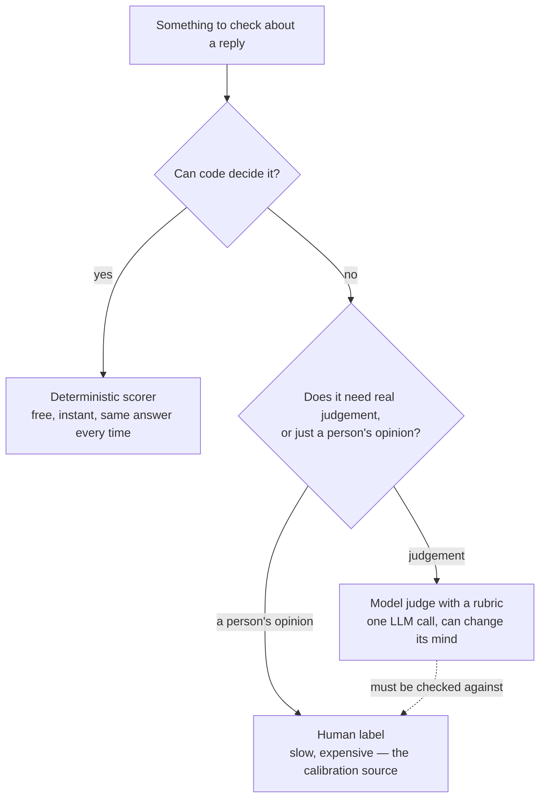

# Level 4: Judges, and the Humans Who Validate Them

> **Who this is for.** No prior tool knowledge is assumed. Every technical term is defined in
> plain language the first time it appears. If you have just finished Level 3 (ground truth),
> this level answers the question that leaves open: once you have a reference answer, or even
> when you don't, *who decides whether a reply is actually good?*

---

## Why this level exists

A customer asks, the agent answers, and somebody has to decide whether that was a good reply.
A person can read a handful; thousands a day don't scale. So teams use another large language
model to grade the replies. That grading model is a **judge**.

If a judge is just another model, why believe its number? It can be fooled by fluent, wrong
text, prefer whichever answer it sees first, and go easy on writing that reads like its own.

> **A judge is an instrument, not an oracle**, and every instrument is calibrated against
> something more trustworthy: a person.

Uncalibrated it is still internally consistent, so it detects **that something changed** — it
just cannot yet assert **that either version is good**. Earning that is the rest of this
level.

This level covers three things that all sit on top of that one idea:

1. **How to build a judge** — three different shapes, each with its own trade-off between
   flexibility and reproducibility.
2. **How a judge lies, and how to catch it** — the specific, testable ways a judge's verdict
   can be about something other than quality.
3. **The only thing that licenses trusting a judge** — comparing it against real human
   judgement, measured honestly, and using that comparison to make the judge better.

The running example is a **customer-support reply** — sometimes a telecom customer
(`TelcoAssist`), sometimes a ticket involving a refund. What matters is that a reply can be
graded on whether it answers the question, whether its claims are grounded, and whether it says
what happens next.

---

## 1. Building a judge, three ways

There is more than one way to turn "is this reply good?" into a number. Each of the three
common approaches makes a different trade between how expressive it is and how easy it is to
defend.

| | `GEval` | `DAGMetric` | Rubric scoring |
|---|---|---|---|
| You write | criteria in prose (or explicit steps) | an explicit decision tree | fixed level descriptions |
| Reproducibility | lowest | **highest** | high |
| Expresses nuance | **best** | only what you branched for | blunt at boundaries |
| "Why did this score X?" | a paragraph | **a path through the tree** | a level description |
| Cost to change | re-word and re-run | add a branch | re-word a level |
| Good for | exploration, fuzzy quality | compliance, auditability | stable regression scoring |

**`GEval`** takes criteria as prose or explicit steps and lets the judge work out how to apply
them — fastest to write, hardest to debug, because a wrong score has no branch to point at,
only a paragraph to re-word. An optional *rubric* of named score ranges ("0–3: wrong, or
confidently unsupported") reduces how much verdicts drift between runs.

**`DAGMetric`** asks the same question as a decision tree: *did the reply answer the question?
If yes, was every policy claim cited? If yes, did it say what happens next?* Every path ends at
a fixed score, so runs taking the same branches land on the same number. The trade-off: a tree
can't express a nuance you never anticipated, and adding one means adding a branch by hand.

**Rubric scoring** fixes a small number of levels (for example, three levels: bad, weak,
good) and writes a plain description of what separates them. It is stable across runs and
blunt exactly at the boundaries between levels — a reply that is "almost good" scores the same
as one that is "barely good."

### Reference-based versus reference-free — the split that decides what survives deployment

A rubric-based judge can be built two ways: one version is given the golden set's reference
answer to compare against (**reference-based**), and one version is given only the question
and the reply, with no answer key (**reference-free**).

**Only the reference-free kind runs in production**, because production traffic has no answer
key. Measuring the **reference gap** — both versions on the same replies — says how much signal
disappears when a judge runs without ground truth.

> **That gap is not zero, and it is the honest answer to "how much of my offline evaluation
> still applies once this ships?"**

### The cost ladder for a judged check

Building any of the three judges above is only worth it once you know a judged check is the
right rung to stand on in the first place. The failure modes below (§0.3 of this repo's field
guide) make this explicit:

- **Not an oracle.** It decides whether text *sounds* right — what a fluent, confident, wrong
  answer exploits.
- **A weaker judge produces noisier scores.** It should be at least as capable as the task it
  grades.
- **Two runs on the same input can disagree**, especially near a threshold. Never gate a
  release on one row.
- **A vague rubric produces a judge that disagrees with itself.** The specificity you write
  down is the specificity you get back.
- **Cost compounds.** Five judged dimensions over 500 cases is 2,500+ model calls.
- **Score direction is not a convention.** A hallucination score of 0.9 means a lot of
  hallucination. Check before wiring a threshold.

Going from an off-the-shelf judged check to a **custom rubric** changes the standard applied,
not the mechanism or the cost — climb it only because the generic "good" isn't specific to your
task. Going further, to a **trace-based judge** that reads the whole run, changes what evidence
the judge can see.

> **That second step is the expensive one**, worth making only when the answer genuinely is not
> present in the final output text.

### A judge doesn't have to return pass/fail — or even a number

A reply that leaves the customer with a partial answer is a different outcome from a failure,
not a lower score on the same scale. A **categorical** judge — named outcomes like
`fully_resolved`, `partially_resolved`, `unresolved` — preserves that instead of flattening it.

> **Say explicitly that a correct refusal or escalation counts as `fully_resolved`**, or the
> judge punishes an agent for following a policy it was told to follow.

### Iterating on a rubric cheaply, before spending on a full run

Re-running a full evaluation to find out whether one guideline is worded well is slow and
wasteful. A judge's decision logic can be called directly on a single example, so drafting a
rubric costs one model call and answers immediately.

---

## 2. Custom scorers: spend judgement where judgement is actually needed

Not every question about a reply needs a model to answer it. Some questions have a definite,
checkable answer — "was a specific tool called?", "how many words is this reply?", "does a
customer ID that isn't the requester's own appear in the text?" — and a judge is the wrong,
expensive way to answer them.

The same three-way choice, with rough cost and coverage attached to each:

| | Code | Model judge | Human |
|---|---|---|---|
| Cost per check | ~£0 | ~£0.001 | ~£1 |
| Same answer twice? | Always | Usually | Often not |
| Can judge "is this polite?" | No | Yes | Yes |
| Realistic to run on | 100% of traffic | 1–2% of traffic | ~50 cases, once |

> **Code runs on everything, a judge on a slice, a human on a small deliberately chosen
> sample.** Which is why Section 4 spends so much care on *which* cases reach that scarce human
> attention.

### The cost hierarchy of scorers

| Kind | Cost per row | Deterministic? | Use it when |
|---|---|---|---|
| **Deterministic scorer** (plain code) | free, instant | yes — same input, same verdict | The rule has a definite answer: was a tool called, how many words, does a regex match |
| **Class-based scorer** | free, instant | yes | The same deterministic check, but needed at several different settings at once |
| **Wrapped judge** (a judge call embedded inside a custom scorer) | one model call | no | A judge is genuinely needed, but with extra context it can't extract on its own |
| **Custom LLM judge** | one model call | no | The question needs real judgement: quality, tone, whether a resolution actually happened |
| **Trace-based judge** | one model call, large prompt | no | Judging *how* the agent worked, not just what it finally said |

- **Deterministic scorers are free**, so they run on every row; judged checks get rationed.
- **Deterministic scorers are reproducible in a way judges are not.** A deterministic metric
  moving means the system changed; a judged one moving might be the judge having a different
  day.

> **A custom scorer gets exactly what the agent's answer function returned — nothing
> normalises the shape first.** A scorer expecting a dictionary breaks on an agent returning a
> plain string. Check what your own agent returns before copying someone else's example.

### Why an *unexpected* tool call has to count as a failure too

A common published pattern for "did the agent call the right tools?" checks only which
*expected* tools were missing — and ignores which unexpected ones were called. Under that
rule, an agent that calls every tool available to it on every single request scores 100%: it
never misses an expected call, because it never misses *any* call.

| Expected a tool call? | Actually called one? | Verdict | What it means |
|---|---|---|---|
| yes | yes | pass | — |
| no | no | pass | — |
| yes | **no** | fail | Answered an account question without looking up the account — it made the answer up |
| no | **yes** | fail | Pulled customer data with no reason to — a privacy problem, not just an efficiency one |

That last row matters beyond tidiness: an agent that reflexively fetches account data on every
question is one prompt-injection attack away from putting that data somewhere it shouldn't go.
A correct tool-call scorer has to fail on *both* directions, not just the first.

### Deterministic and judged, on the same question, is not redundant

A privacy check like "did this reply disclose an account ID that isn't the requester's own?"
can be checked two ways at once, on purpose:

- A **regex** (a pattern-matching rule) catches a literal account ID like `CUST-1003`
  appearing in the text, every single time, for free — but it cannot catch a paraphrase like
  *"the other account owes $152.90"*, which contains no ID and slips straight through.
- A **judge** catches the paraphrase, but only probabilistically, and it costs a model call
  every time.

Cheap-and-certain plus expensive-and-general is a stronger combination than either alone, and
knowing exactly what a deterministic check does and doesn't cover is the whole value of having
one — its blind spot is documented, not hidden.

### Numeric scorers, and the aggregation that actually matters

Not every scorer returns pass/fail; a count aggregates across a run. There are exactly six
valid aggregations: **min, max, mean, median, variance, p90**.

> **The mean is the one people report and the p90 is the one worth watching.** A healthy
> average hides the tail of rambling replies that users actually complain about.

### Class-based scorers: the same check, several settings at once

A function-based scorer hardcodes its own threshold. A class-based scorer takes its settings
as configurable fields instead, so the identical logic can run twice in one evaluation at two
different settings — for example, a strict 80-word limit and a loose 250-word limit, reported
as two separate named metrics in the same run.

### Trace-based judges: judging *how*, not just *what*

A **trace-based judge** gets the whole execution trace — every step, every tool call, the order
— and judges the *path*, not the destination.

> **Two agents can produce the identical correct reply, one in two steps and one in nine.** Only
> a trace-based judge tells those runs apart.

---

## 3. Judge bias: the three specific ways a judge lies

A judge is a model, so it inherits the weaknesses of the thing it grades — including biases
that have nothing to do with the quality of the answer.

| Bias | What it is | The test |
|---|---|---|
| **Position bias** | The judge prefers whichever answer it saw first (or second) | Score the same pair in both orders (A,B) and (B,A) — the verdict should not flip |
| **Verbosity bias** | The judge prefers the longer answer, independent of whether it's actually better | Pad the *worse* answer until it's the longer one, and judge again |
| **Same-model bias** | A judge from the same model family as the one being graded rates that family's output generously | Score with a judge from a different model family and compare the *ranking*, not the raw numbers |

### Position bias

Ask a pairwise judge to choose between A and B, then ask again with the order swapped. **The
verdict should not change.** When it does, the judge is scoring which side of the screen an
answer appeared on — and every pairwise number it ever produced, including a rollback canary,
becomes suspect.

The analogy that makes this concrete: two wine judges, one of whom always prefers whichever
glass is handed over first, the other of whom always prefers whichever glass is fuller.
Neither one is actually tasting the wine.

### Verbosity bias — and why "no position bias" is not the same as "trustworthy"

> **Clearing a judge of position bias is necessary and not sufficient.** If the "worse" answer
> is also the shorter one, *"the better answer won"* and *"the longer answer won"* describe the
> same result, and swapping order can never tell them apart.

Two steps separate the two explanations:

1. **The length audit** (free — re-reads verdicts you already have) puts the length
   distribution next to the win rate. In one run the stronger reply won 12 of 12, winners
   averaging 25.2 words against 18.7 — 35% longer, every time. That alone cannot separate
   quality from word count.
2. **The length-controlled probe** (costs model calls) pads the *worse* reply with filler until
   it is the longer one, then judges again. Better reply still wins: length wasn't doing the
   work. Padded reply wins: the judge measures word count, and every pairwise number it
   produced — including any canary win rate gating a rollout — is suspect.

The practical takeaway: **a win rate published without the length distribution beside it is
partly a word count.**

### Same-model bias

A judge tends to recognise its own family's habits — phrasing, structure, hedging — and reads
that familiarity as quality. The test is to re-score the same replies with a judge from a
genuinely *different* model family (not just a bigger model in the same family) and compare.

Two judges rarely give the same score. The number that matters is **whether the ranking
survives**, measured by rank correlation.

- **High rank correlation, positive mean difference** — benign. One judge is more generous;
  they agree which reply is better, so a gate comparing two builds still works.
- **Low rank correlation** — serious. They don't agree which build is better, and neither can
  gate a release alone.

Bias can also live in a **stratum** rather than overall. One language scoring lower across
*every* judge means the agent is genuinely worse there; dropping for only *one* judge is a
property of the judge — commonly, scoring fluency in its own strongest language.

### A fourth failure mode, underneath all three: a rubric with room to improvise

Those three biases are failures of a judge given a *clear* question. Underneath them sits a
simpler one: an ambiguous question. A rubric whose levels overlap — "fairly good" against
"good," with no line between — leaves room to improvise, and improvisation does not reproduce.

> **The test is not "does the rubric sound reasonable" but "can two careful people apply it
> independently and agree"** — which is what Section 5's Cohen's kappa measures.

This is the most common way a working judge quietly stops working: somebody "clarifies" the
wording and removes the specificity that made it reproducible.

---

## 4. Human feedback: three kinds, and only one can calibrate a judge

The phrase "human feedback" gets used for three genuinely different things, and treating them
as interchangeable is why many feedback efforts produce nothing useful.

| Kind | Where | Volume | Biased? | Can calibrate a judge? |
|---|---|---|---|---|
| **Runtime approval** | Inside the agent, blocking a pending action | Low | N/A — it's a decision, not a rating | **No** |
| **End-user feedback** (thumbs) | In production, voluntary | High | Severely — only the angriest and the most delighted respond | **No** — a signal, never a label |
| **Expert annotation** | Offline, on a deliberately sampled set | Low | Only by your sampling choice | **Yes — the only one** |

A **runtime approval** is a single blocking decision about one specific pending action (should
this refund actually go out?). It isn't a rating of quality at all, so it cannot calibrate
anything — though the approval process itself needs to be evaluated, which Section 6 below covers.

**End-user thumbs** are abundant but self-selected: the people who click are disproportionately
the angriest and the most delighted, which is not a representative sample of how the system is
actually doing. Thumbs are a useful *signal* — something worth looking into — never a *label*
you can calibrate a judge against.

**Expert annotation**, a domain expert rating a deliberately sampled set of replies offline, is
the only one of the three that is both labelled and representative enough to calibrate a
judge, because the sampling choice is under your control.

### Choosing which cases to send a human

You cannot label everything, so the choice of *what* to send a human is the highest-leverage
decision in this step — "a random sample" is rarely the best answer.

| Strategy | What it gets you | What it costs you |
|---|---|---|
| Random | An unbiased estimate of overall quality | Mostly easy cases — little calibration signal |
| **Judge disagreement** | The cases where your judges are least reliable | A biased sample — never use it alone to estimate overall quality |
| Low judge score | Confirmation of known failures | Nothing about false negatives (things the judge wrongly passed) |
| Safety-adjacent | The cases most likely to hurt someone | A tiny, unrepresentative slice |

A practical default is **disagreement-first with a random tail**: the cases multiple judges
couldn't agree on, plus a smaller random sample so the labels still estimate overall agreement.

> **Tag the two groups separately.** Estimating overall agreement from the disagreement group
> alone understates the judge badly — you picked its worst cases on purpose.

The label schema itself matters as much as any tool used to collect it: a human's verdict
should be recorded on the **same scale** the judge uses (so the two are directly comparable
without inventing a mapping), and the time a reviewer took to decide is worth recording too —
it becomes the input to Section 6's rubber-stamp check.

---

## 5. Calibration: agreement, and agreement above chance

Once a judge score and a human score exist for the same cases, calibration asks how often they
agree — and then the harder, more honest question: **how often would they have agreed purely
by luck?**

|  | Human: good | Human: bad |
|---|---|---|
| **Judge: good** | *a* | *b* |
| **Judge: bad** | *c* | *d* |

- **Observed agreement** = (*a* + *d*) / total
- **Expected agreement by chance** = P(both happen to say "good") + P(both happen to say "bad")
- **Cohen's kappa** = (observed − expected) / (1 − expected)

> **Raw agreement flatters on a skewed dataset.** If 90% of replies are fine, a judge saying
> "good" on every row agrees 90% of the time and has learned nothing.

Kappa corrects for exactly this: that do-nothing judge scores **0**.

### When plain kappa still isn't enough: quadratic weighted kappa

On a 1–5 scale, plain Cohen's kappa treats *every* disagreement as equally bad — one point off
scores the same as wildly off. That is the wrong penalty for an ordinal scale, where one point
away is a near-miss and four points away is a different opinion.

**Quadratic weighted kappa** penalises a disagreement by the *square* of its distance. Against
the same ten human ratings, a judge **one point too generous** and a judge **uncorrelated with
the human** score identically on the first two measures — 0.00 exact agreement, −0.25 plain
kappa — and are worlds apart on the third: **+0.71** against **−0.82**.

> **Only the off-by-one judge is cheaply fixable.** Shift its scale; the uncorrelated one has
> to be rebuilt.

### Using labels to *set* a threshold, instead of guessing one

A pass/fail cutoff — *"score ≥ 0.7 counts as passing"* — starts as a guess. Once human labels
exist it needn't stay one: sweep
candidate thresholds, compute kappa at each, and take the one that maximises agreement with the
people whose judgement is meant to matter. A couple of hundred labels won't train anything, but
they will tell you the pass mark is 0.62 rather than 0.70.

> **Maximising kappa treats a false pass and a false block as equally costly, and they rarely
> are.** A false pass on a refund agent ships a broken release; a false block annoys an
> engineer. Weight the two before committing to a threshold.

### Direction matters more than rate

When a judge and a human disagree, *which way* they disagree is more informative than how
often:

- **Too generous** (judge passes, human fails it) — this is the direction that ships bad
  releases.
- **Too harsh** (judge fails, human passes it) — this is the direction that blocks good
  releases and gets the judge switched off by a frustrated team.

A kappa that is high overall but collapses within one stratum — say, high in English and near
zero in Hindi — is not "a judge with a Hindi problem" so much as it is a judge you simply
cannot use for a per-stratum release gate (covered in Level 5) in that language at all.

---

## 6. Judge alignment: turning expert disagreement into a better judge

Calibration (Section 5) tells you *whether* a judge agrees with your experts. **Alignment** is the
next step: using the pattern in where they disagreed to actually improve the judge.

One specific technique for this, referenced in this repo as **MemAlign**, reads a set of
traces that have both a judge score and an expert rating (with the expert's written comment,
not just a number), distils the pattern in the disagreements into explicit written guidelines,
and adds those guidelines into the judge's own instructions.

Three details make or break this process:

- **The label schema's name must exactly match the judge's name** — that is how ratings pair
  with scores. Get it wrong and alignment doesn't error; it finds no pairs and hands back the
  judge you started with.
- **Comments are not optional.** Alignment distils expert *reasoning* into guidelines, not
  expert *numbers*. A bare "2" says the judge was wrong; the comment becomes the guideline.
- **Set the retrieval embedding model explicitly.** Alignment embeds every labelled trace, and
  a default can silently send that traffic, and its bill, off-platform.

### The result you should expect — and how to read it correctly

Here is the counter-intuitive part, worth stating plainly because it's the single most common
way this result gets misread: **alignment usually makes the judge's average score go down, and
that is the success condition, not a regression.**

The unaligned judge was grading against generic best practice and inflating scores. The
aligned judge applies the stricter standard your own experts actually hold. The agent being
graded has not changed at all between the two runs — only the measurement has become honest.

Mean score fell 1.4 points between the unaligned and aligned judge while *every* agreement
measure rose: exact agreement 0.08 → 0.92, weighted kappa 0.29 → 0.96.

> **Read that table from the bottom up.** The unaligned judge rated this agent 4.3 out of 5
> while domain experts rated the same replies 2.8 — so every green light in an earlier gate was
> given on a number wrong by a point and a half.

That is the argument for this whole level: alignment does not improve the agent. It makes
every *other* number produced about that agent mean something.

An aligned judge replaces the unaligned one everywhere: the release gate (Level 6), the sampled
production monitor (Level 7), and the reward signal for prompt optimisation.

> **Optimising against an unaligned judge tunes the agent toward a standard nobody holds** —
> worse than not optimising, because it is confidently wrong.

---

## 7. Blinded preference testing, and why it needs a second rater

Everything in Sections 5 and 6 scores one reply at a time. A **preference test** asks a different
kind of question: shown two replies to the same request, which one do people actually pick?
It is the human counterpart to the pairwise judge covered in Section 3, and it is the thing a
production canary comparison is usually standing in for.

Three rules make a preference test worth running, and dropping any single one of them quietly
invalidates the result:

| Rule | Why it matters | What breaks without it |
|---|---|---|
| **Blind the arms** | The rater must not know which reply is the new build | People favour whatever they were told is "the improvement" |
| **Randomise the side** | Left and right must be coin-flipped per case, not fixed | Raters learn "the new one is always on the right" and start guessing the pattern instead of judging |
| **Use two raters** | One rater's taste is not a measurement | Agreement becomes unmeasurable — and Cohen's kappa needs two raters by definition |

Section 5's kappa measures agreement **between a judge and a human**. The same statistic
**between two humans** asks whether the rubric is *teachable* at all.

> **A judge disagreeing with a human is a judge problem. Two humans disagreeing with each other
> is a rubric problem** — no amount of judge tuning fixes it, because there is no single target
> to tune toward.

A blinding check is a cheap sanity test worth running alongside any preference panel: tally how
often the winning reply landed on the left side of the screen. It should come out close to 50%;
a number far from that means the randomisation itself is broken, independent of anything about
quality.

> **A small panel's kappa swings on which cases happened to be sampled.** The same two raters,
> identically reliable, can produce kappa anywhere from roughly 0.15 to 0.60 across different
> case sets — that panel is reporting a *range*, not a measurement.

---

## 8. The rubber-stamp signal: evaluating the human, not just the record

A runtime approval step is easy to check for *existence* — does every refund carry an approval
ID? — and that check passes completely while the approval step does nothing at all.

> **It is the part of an evaluation system most likely to be quietly broken and least likely to
> be checked.**

Three signals, all computable from an approvals log, tell the difference between a real
control and a rubber stamp:

| Signal | Healthy | Broken |
|---|---|---|
| Approval rate | Some real rejections happen | Close to 100% |
| Median decision time | Long enough to actually read the case | A second or two |
| Queue depth / age | Stable | Growing, or items quietly aging out unresolved |

> **A 99.8% approval rate with a 1.2-second median decision time is not a safety control — it
> is a latency cost with a compliance story attached.**

A genuine approver (≈86% approval, decisions in tens of seconds to minutes) and a
rubber-stamping one (≈99.9%, one to two seconds) both pass a check that verifies "every refund
has an approval ID attached" — because both do. A crude two-threshold rule catches it: approval
rate above ~98% **and** median decision time under ~5 seconds. The failure is not subtle, and a
subtler detector would only invite an argument about the cutoff.

**Judge drift** is the related danger. A judge drifting toward passing everything barely moves
raw agreement — most replies really were fine — while kappa collapses toward zero, because a
judge with one opinion carries no information.

> **Kappa, not raw agreement, belongs on a production dashboard.**

---

## Question-bank corner

This section deliberately does **not** re-draw the judge-comparison table from Section 1, the
bias-testing table from Section 3, or the three-kinds-of-feedback table from Section 4 — see those sections
for the underlying mechanics. What follows is how those same ideas get asked, and answered, in
an interview setting (Question Bank Part 4, Q14–Q17).

- **Q14 — "You're using an LLM to grade another LLM. Why should anyone believe the number?"**
  **They shouldn't, until it has been checked against a human and *agreement* — not average
  score — has been measured.** Expect the score to drop, and say so before it happens.

- **Q15 — "Your judge and your domain expert disagree on 20% of cases. What do you do?"**
  **Find out *which* 20% before touching anything.** Scattered across the range is an unreliable
  judge; bunched at the threshold is borderline cases and matters far less than the headline.
  Then check whether your experts agree with *each other* — if two disagree 15% of the time,
  20% is near the human ceiling and the work is deciding an open policy question, not tuning a
  model.

- **Q16 — "When would you not use an LLM judge?"** **Four situations:** code can decide the
  question outright (Section 2); the judge is what an optimiser is tuned against, so it cannot
  certify its own result; the humans haven't agreed the standard yet (Section 7); or volume is
  high enough that the judged-call bill exceeds the cost of serving the traffic.

- **Q17 — "The judge scores 0.9 and the customer says it's terrible. Who's wrong?"** **Usually
  neither — get three examples the customer calls bad, run them, read the traces.** All four
  likely explanations (the metric doesn't cover what they care about; the aggregate hides their
  slice; the judge was never calibrated; the golden set never had their kind of question) have
  the same fix. Either the metric scores them badly too, or it scores them well and you have
  found a dimension nobody measured. Both are progress; arguing from the dashboard is not.

---

## References

All content above was drawn only from material already in this repository. Nothing here was
invented, and no external source was consulted.

**Notebook:**

- `courses/03-agentic-eval-harness/08_building_custom_judges.ipynb` — the three judge shapes
  (`GEval`, `DAGMetric`, RAGAS rubrics), reference-based vs. reference-free scoring and the
  reference gap, the position-bias probe, the length audit and length-controlled verbosity
  probe, and the same-model-bias rank-correlation test.
- `courses/03-agentic-eval-harness/09_human_feedback_and_calibration.ipynb` — the three kinds
  of human feedback, the disagreement-first sampling strategy, Cohen's kappa derived by hand,
  using labels to set a threshold, blinded preference testing and inter-rater kappa, and the
  rubber-stamp detector for the approval gate.
- `courses/02-databricks-mlflow-evals/03_custom_scorers_and_judges.ipynb` — the cost hierarchy
  of scorers, the outputs-shape trap, the tool-call-correctness scorer and why an unexpected
  call must count as a failure, deterministic-plus-judge coverage for account-leak detection,
  numeric scorers and their six valid aggregations, class-based scorers, the categorical
  (not just numeric) judge output and why a correct refusal must count as fully resolved, the
  low-level judges API for cheaply testing one guideline before a full run, and trace-based
  `make_judge`.
- `courses/02-databricks-mlflow-evals/07_judge_alignment_memalign.ipynb` (plus its
  `alignment.py` module, read directly for the exact agreement/kappa/weighted-kappa figures
  quoted in Section 5) — why average score is the wrong metric for judge quality, the three agreement
  measures compared side by side, MemAlign alignment mechanics, and the before/after alignment
  result.

**Docs:**

- `docs/concepts/rag-agent-tool-evaluation.md`, §0.3 — the LLM-as-judge failure modes list
  (judge capability, non-determinism, rubric sensitivity, cost, "nobody validates the
  validator" and the change-vs-quality distinction, agreement vs. average, fluent-but-wrong,
  score direction) used throughout Section 1. §0.4 (the cost ladder) was read for context but is not
  quoted directly, since the notebook-mapping for this level cites only §0.3.
- `docs/guide-audits/openai-eval-guide-tutorial.md`, §4 (§4.1–§4.6) — the code-vs-judge-vs-human
  decision flowchart adapted into this file's Mermaid diagram in Section 2, the accompanying
  cost/reproducibility/coverage table also in Section 2, the three-bias framing and wine-judge analogy
  in Section 3, the 12-of-12 / 25.2-vs-18.7-words verbosity figures, and the "humans are the
  calibration source, not the throughput" framing plus the blinded-preference-testing rules in
  Sections 4 and 7.
- `docs/interview-prep/QUESTION_BANK.md`, Part 4 (Q14–Q17) — used for the Question-bank corner
  above; this is the exact range the roadmap's own "Rehearsal" pointer names for Level 4, so no
  other part of that file was drawn on for this level.
- `docs/study-guide/evaluation-roadmap.md` — used to scope this level's topic list and its
  "you are done when you can" checks, not quoted directly (that checklist already lives in this
  level's own `README.md` and is deliberately not duplicated here).
- `docs/study-guide/evaluation-topic-notebook-mapping.md` — used for the source list above and
  each source's cost tag, not quoted directly.

**Limitations.** This file was written by reading the repository's own material, not by
running any notebook or calling any API — no cost was incurred producing it, consistent with
this project's rule against executing anything that spends money without being asked. The
figures quoted for Cohen's kappa, quadratic weighted kappa, and exact agreement in Section 5 were
independently recomputed from the `off_by_one` / `uncorrelated` example already present in
`courses/02-databricks-mlflow-evals/alignment.py`, using that same module's own functions —
this is arithmetic on numbers already fixed in the repository, not a new judge call or any
paid API usage. This file does not independently verify any third-party tool's own
documentation (RAGAS, DeepEval, MLflow, MemAlign); descriptions of those tools are this
repository's own characterization, not a review of the vendors' docs.
