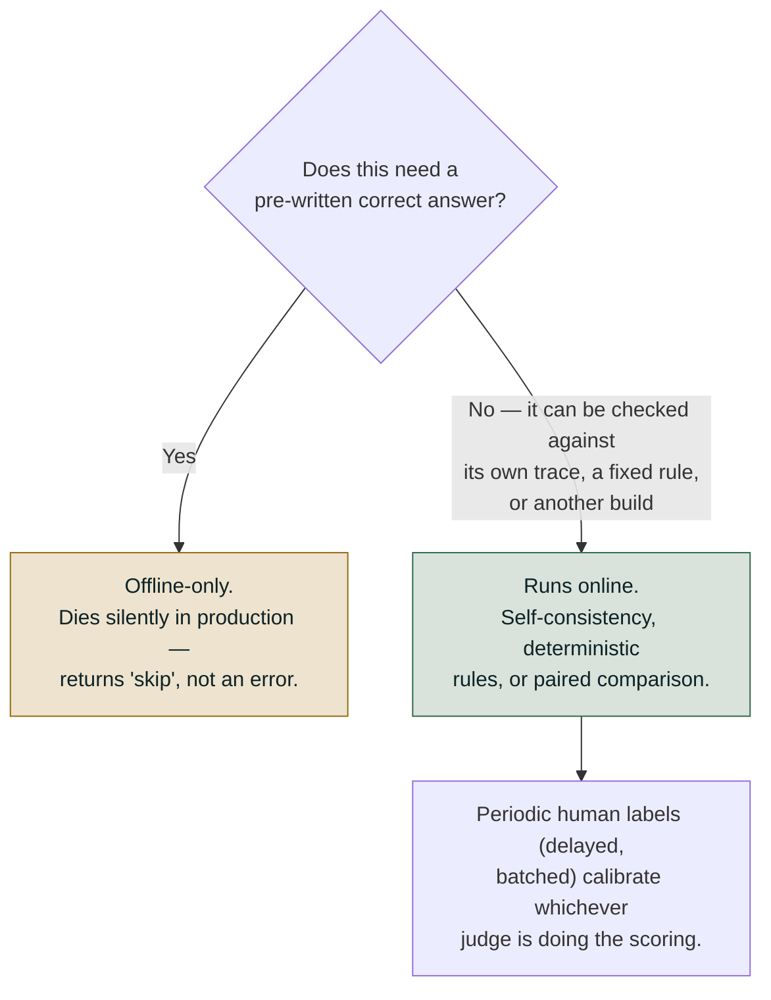
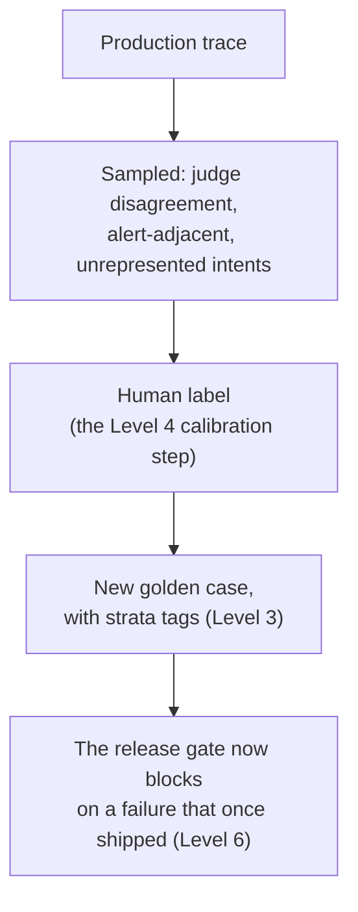

# Level 7 Explainer: Online evaluation and the loop

*A plain-language walkthrough of everything Level 7 covers, pulled together from the two
course notebooks, the field guide, the online-vs-offline concept doc, the RAG-vs-support
walkthrough, and the interview question bank — with nothing repeated twice.*

> **Who this is for.** You don't need to have run any of the notebooks named below to follow
> this. Every technical term is defined in plain words the first time it shows up, and this
> file assumes only what Levels 0–6 already covered: the five-layer taxonomy, the
> reference-based/referenceless split, judges and their failure modes, statistics and
> stratified reporting, and the release gate.

---

## Why this level exists

Level 6 ended with a gate: a build passes a fixed, curated set of test cases, or it doesn't
ship. That gate is powerful, but it has one structural limit, and it's the same limit every
offline test has — **it can only ever catch what someone thought to put in the dataset.**

Picture the same support agent from earlier levels, now actually live, answering real
customers. A question arrives that nobody wrote a golden case for. A knowledge-base rebuild
silently returns zero documents while still answering "200 OK". A tool starts retrying itself
in a loop that never shows up as an error. None of this was in the golden set, because the
golden set is, by definition, a claim about what you expected — and production is where you
find out what you didn't.

Level 7 is about the second half of a system's life: once a build ships, how do you keep
measuring it with **no answer key, ever**, and how do you make sure anything you learn there
doesn't just help once, but flows back into the gate so the next build is protected too.

Production differs from a golden set in three ways, and every technique here exists because of
one of them:

- **The traffic mix isn't your suite's mix.** Real traffic is mostly easy and repetitive; a
  golden set is deliberately hard.
- **There are no reference answers, ever.**
- **There is a long tail your dataset never represented** — the entire reason to do this.

> **Stop scoring correctness; start scoring consistency and shape.** You cannot ask "is this
> right?" without a reference, but you can ask "is this grounded in what it retrieved?" and
> "is this better than the build we shipped?"

---

## 1. The fact that decides everything: production has no ground truth

Nobody wrote the correct answer to a question a real customer asked thirty seconds ago, and
nobody ever will. That single fact is what splits your entire evaluation suite in two, and it
is worth stating as a mechanical test rather than a vibe:

> **Does this scorer read `expectations`** — an expected answer, an expected list of tool
> calls, an expected final state? **If yes, it is offline-only, however good it is.**

This bites in a specific, easy-to-miss way. `tool_call_correctness` — one of the most useful
scorers from Level 2 — reads `expectations["expects_tool_call"]`. Point it at live traffic and
it does not error. It returns `skip` on every single trace, silently, while looking perfectly
healthy on a dashboard. **You get a metric that quietly stopped having data, not an alarm.**
That is the failure mode to design against: a scorer going dark reads exactly like a scorer
reporting good news, unless someone is watching for it specifically.

Putting the test to work across a whole suite:

| | Runs online? | Why |
|---|---|---|
| Context recall, context precision | ❌ No | Needs the set of documents that *should* have been retrieved |
| Answer correctness vs. a reference | ❌ No | Needs a human-written right answer |
| Tool correctness (`expects_tool_call`) | ❌ No | Needs an expected tool-call list |
| Faithfulness / groundedness | ✅ Yes | Compares the answer to its **own** logged context — no reference needed |
| Goal accuracy (without-reference form) | ✅ Yes | A judge infers the goal from the conversation itself |
| Topic adherence | ✅ Yes | Scope comes from policy, not from a golden answer |
| Trajectory / safety assertions | ✅ Yes, **on 100%** | Deterministic, reads the trace directly, costs nothing |
| Paired canary comparison | ✅ Yes | Compares one build to another, not to an ideal — needs no reference either |

Notice the shape of it: **everything that needs an answer key dies at deployment**, however
well it worked in CI. A three-way split makes the same point from a different angle, useful
for a whiteboard:

| Offline-only | Runs in both | Online-only |
|---|---|---|
| Answer correctness vs. a written reference | Faithfulness / groundedness (context is its own reference) | Deflection rate, escalation rate, reformulation rate |
| Task/tool correctness vs. a known-correct action | Safety & trajectory assertions (approval, tenant isolation) | p95 latency, cost-per-success drift, queue depth |
| Anything scored against a human-authored "right answer" | Citation accuracy, contradiction disclosure | Tool status mix, cache hit rate, corpus/traffic drift |

The middle column is the one worth sitting with: it isn't a *weaker* version of the left
column, it's a different *kind* of check — one that never needed a reference in the first
place, offline or online. The right column is a different phenomenon again: metrics that
simply don't exist until real traffic exists to measure.

**One number worth naming explicitly: an offline resolution rate and an online resolution
rate are never comparable, and should never be plotted on the same axis.** A golden set is
deliberately hard; production is mostly easy. A gap between the two numbers is expected — what
matters is whether that gap *changes* over time, not its absolute size at any one moment.

---

## 2. Reference-free production metrics: three techniques, no answer key

If a check can't compare against a pre-written answer, what is an "online judge" actually
scoring? Not the same thing offline scoring does — production substitutes for a golden answer
in three different ways, and a fourth complementary technique validates the whole setup from
outside.

**Self-consistency — judging the answer against its own trajectory.** The judge doesn't
compare the answer to a golden reference; it compares the answer to the context *this exact
run just retrieved*, which production already logs as part of the trace. "Is every claim in
this answer entailed by the passages this run retrieved?" needs zero external ground truth,
because the reference travels with the run itself.

- RAG example: faithfulness, citation accuracy, contradiction-disclosure — all scored against
  the run's own retrieved context.
- Support example: "did the reply match what the tool actually returned" — scored against the
  tool's logged output, never a human-written answer key.

**Deterministic trajectory rules — no judge model needed at all.** Safety and policy checks
were never comparisons to a reference answer, offline or online. "Did it call the write-tool
without an approval step," "did it cross a tenant boundary" are pass/fail assertions read
directly off the logged trace. These run online exactly as they run in the gate, at full
volume, for free.

**Periodic human labels — calibration, not live scoring.** A small sample of production runs
goes to human reviewers, but on a delay, in a batch — never inline per request. That labeled
batch does two jobs: it measures how well the judge agrees with a human on the *same* case (a
kappa score, watched for drift — the calibration discipline from Level 4), and it becomes new
golden-set cases that keep the offline suite from describing last quarter's traffic. The judge
scores every live sample instantly and self-referentially; the human sample is what keeps
those scores honest.

**Paired canary comparison — relative, not absolute.** For an actual rollout, the question
isn't "is this answer correct" in isolation, it's "does the new build win, lose, or tie
against the old one on the same live input." A judge — or a real user signal — picks a winner
per pair. That's a relative verdict, and it needs no ground truth either, only two things to
compare. Section 6 below covers this technique in full, because it deserves its own worked
example.

In short: production substitutes the logged context for a golden answer wherever it can (most
of the time), falls back to rule-based assertions where no judgment call is needed at all, and
only reaches for real human-labeled ground truth in small, delayed samples used to keep the
judge honest and the offline suite fresh — never to score every request.

**Where each tool named across this roadmap actually helps here, briefly:**

| Tool | What it's genuinely good at online |
|---|---|
| RAGAS | RAG-specific metrics; its with/without-reference split is unusually explicit about which side of Section 1's line each metric falls on |
| DeepEval | Component-level metrics, `assert_test` in CI, tracing via `@observe` |
| Langfuse | Trace storage, annotation queues, user-feedback scores — the human-label loop this section describes |
| MLflow / LangSmith | Experiment tracking and trace comparison across builds |

**None of them ships the two things this level actually depends on: the final-state check
(Level 2) and the release gate (Level 6).** Those stay yours to build, because only you know
what your own system's database should look like afterward, and what "good enough to ship"
means for your own product.

---

## 3. Sampling: cheap checks on everything, judges see a slice

Once you know *which* checks can run online, the next question is *how much* of production
each one should see — and the honest answer is two different amounts.

**Never sample the free checks.** Deterministic rules cost nothing per call, so sampling one
just buys you a blind spot for no saving — it's pure loss. They run on 100% of traffic,
always. Sampling is a question that only applies to judge-based, model-scored metrics, because
those cost real money per call: at $0.0015 per judged conversation, scoring 100% of 2,000
daily conversations costs roughly $3/day: cheap for one agent, but the number that gets a
sampling policy approved once you're running dozens.

**A sampled rate is an estimate, and estimates have error bars.** This is where production
monitoring most often goes wrong, and it has nothing to do with which tool you're using. Grade
a 5% sample of 2,000 daily conversations — 100 traces — and the resulting pass rate can sit
about **±4.5 percentage points** either side of the truth, from sampling luck alone. Grade a
different 100 tomorrow, with nothing about the agent changed, and you can see a 2–3 point swing
that is pure noise.

> **The soup analogy.** Tasting a pot of soup: one spoonful tells you instantly if it's far
> too salty. It can never tell you whether today's pot is 2% saltier than yesterday's —
> especially when it's a different pot of soup every day, which is exactly what a day of
> production traffic is.

The practical consequence, worked out in numbers:

| Sample rate | Traces/day (at 2,000/day) | Resolution (95% CI half-width) | Smallest reliably detectable drop |
|---|---|---|---|
| 5% | 100 | ± 4.5 points | ~9 points |
| 30% | 600 | ± 1.8 points | ~2 points |
| 100% | 2,000 | ± 1.0 point | ~1 point — and if even this can't resolve it, the comparison belongs offline |

**The rule: pick the sample rate from the smallest regression you refuse to miss, not from a
round number that felt affordable.** Decide the drop you must catch (say, 2 points), look up
the sample size that resolves it (roughly 600 traces, ≈30% at this volume), then price it —
that's a real budget conversation, and it's better had before an incident than during one.

**An alert set tighter than your resolution fires on noise, and gets muted within a month.**
After that you have monitoring that looks healthy and tells nobody anything — arguably worse
than no monitoring, because it still *looks* like monitoring. This is also why an alert
threshold has to be paired with knowing what a delta even means: a metric named after the
failure it detects runs backwards (a "hallucination" score of 0.9 is very bad, not very good;
the direction-check habit from Level 0 still applies here).

**If a regression is too small to see even at 100% sampling, don't chase it online at all.**
Move that comparison offline, where every input in a fixed dataset gets scored and the
comparison is *paired* — the same inputs run against both builds, so traffic variation is
eliminated as a confound rather than averaged away.

**Sample rates aren't set once and left alone.** The usual pattern in practice: raise a
judge's sample rate temporarily while actively investigating a complaint, then lower it back
to the steady-state rate once the investigation is done; pause a monitor entirely during a
known-noisy event like a migration, without losing its configuration; delete one outright once
its scorer has been superseded. Monitoring configuration is a living thing, not a
set-and-forget deployment step.

**A gap worth naming honestly: cost and latency get measured here, but nothing above gates on
them.** Both show up on the dashboards this section builds, but neither blocks a release the
way a quality or safety floor does. In production, they should: a technically correct answer
that takes nine seconds to arrive is a different kind of failure from a wrong one, not a
success with a footnote.

---

## 4. The five standard alerts

Given that quality judges are sampled and slow, what should actually page someone? The
alerts below are deliberately **not** quality metrics — they're *shape* metrics, chosen
because shape is what you can measure without an answer key, cheaply, on all of production.

| Alert | Fires when | Catches |
|---|---|---|
| Cost spike | Cost per conversation exceeds 3× the trailing median | A verbose-prompt regression, a retry loop |
| Citation-free rate | Share of answers citing nothing exceeds a floor | A silently empty retrieval index, a retrieval outage |
| Tool status mix | The share of `empty`/`unavailable` tool results shifts materially | A data source going quietly stale |
| Approval decision time | The median falls below a floor | Rubber-stamping — the same signal Level 4 warned about in human review |
| Loop rate | An identical tool call repeats within one conversation | Retry storms, stuck agents |

**Your first alert shouldn't be a quality metric at all.** The most valuable early signal is
structural — trace volume, error-span rate, scorer-coverage rate — because those catch the
case where the monitoring pipeline *itself* silently stopped, which looks exactly like a
healthy system on every other dashboard.

**There's a wider list beyond these five, worth naming explicitly because a quality score is
the *least* sensitive thing on a dashboard.** A prompt change that makes an agent chattier and
more hedging can move like this:

| Signal | Before | After |
|---|---|---|
| Quality judge | 0.90 | 0.89 — barely moves |
| Tool-call rate | 62% | 31% — halved |
| Mean response length | 140 words | 310 words — doubled |
| Refusal rate | 3% | 11% — tripled |

Three of those four moved immediately and none is a quality score. Four categories are worth
watching, only one of them a quality number:

- **Quality on sampled traffic** — as a *trend*, never a gate.
- **Behavioural distributions** like tool-call rate.
- **Operational shape per step** — what turns "it got slower" into "retrieval latency doubled."
- **Failures and refusals.**

> **A rising refusal rate is a quality regression that most quality metrics score as a pass.**
> The refusal is well-written and safe, so nothing looks wrong to a judge reading one turn.

And the one people miss entirely: **a monitor that was configured but never switched on looks
exactly like a monitor reporting no problems.** Registering a scorer creates it; starting it is
what begins evaluating. A registered-but-never-started scorer evaluates nothing and is
indistinguishable, on every list view, from a healthy one. Verifying the pipeline is genuinely
running belongs on the launch checklist, not in the assumptions.

---

## 5. Incident drills: proving which alert catches what

An alert you've never *seen* fire is an alert you don't actually know is wired up. The way to
find out is to break production on purpose and watch which lights come on — and, just as
importantly, which ones stay dark.

**Drill 1 — a silently empty retrieval index.** A rebuild returns zero documents for every
query and the service still answers with a fluent 200 OK, so an error-rate dashboard sees
nothing. **Citation-free rate fires almost immediately** — a counting rule over data already
logged, so minutes old, not hours. **Resolution rate barely moves**: billing and account
questions still "succeed" with no documentation behind them.

> *"An index rebuild that returns zero rows still returns HTTP success, so error-rate
> monitoring stays green while quality collapses."*

**Drill 2 — a retry loop.** A tool starts calling itself repeatedly inside one conversation.
**Cost and loop-rate fire. Citation-free stays quiet. Resolution rate is unchanged** — customers
are helped correctly, repeatedly, at several times the price, and no quality dashboard shows it.

At larger scale: an upstream service returned HTTP 200 with an empty body during an outage, the
model retried with reworded arguments, and 70% of conversations hit the step ceiling for eleven
hours.

> **Latency and error rate both stayed green.** What caught the cause was the tool status mix
> shifting toward `empty`/`unavailable`.

Running every fault against every alert produces a coverage matrix, and the gaps are the
point, not an embarrassment to hide:

| Incident | Cost spike | Citation-free | Tool status mix | Approval time | Loop rate |
|---|---|---|---|---|---|
| Healthy day | — | — | — | — | — |
| Empty index | — | 🚨 | — | — | — |
| Retry loop | 🚨 | — | — | — | 🚨 |
| Verbose prompt | 🚨 | — | — | — | — |
| Tool source stale | — | — | 🚨 | — | — |

An alert that never fires in any drill isn't necessarily useless — the approval-time alert, for
instance, catches rubber-stamping, which none of the drills above simulate. But **an alert you
have never seen fire is an alert whose wiring you're only assuming is correct.** Run a drill for
every alert you own, on a schedule; an alert whose last confirmed firing was during its own
code review is decoration, not monitoring.

---

## 6. The canary: the only online question that's properly answerable

Without a reference, you cannot ask *"is this build good?"* You can ask a strictly easier
question that also happens to be the actual decision in front of you: **"is it better than the
one already running?"**

The mechanism is a paired comparison: route a slice of traffic to the new build, the same
slice's inputs to the old one, and count outcomes across four buckets — both succeeded, only
the old one succeeded, only the new one succeeded, both failed. The two "only one succeeded"
counts are exactly the paired cells McNemar's test (Level 5) was built for, which is not a
coincidence — it's the same statistical question about the same shape of paired data, just
asked about two live builds instead of two offline runs.

Three outcomes, not two:

- **Promote** — statistically significant, and the new build wins more often than it loses.
- **Roll back** — statistically significant, and the new build loses more often than it wins.
- **Keep watching** — not yet distinguishable from noise.

**"Keep watching" is a real answer, not a failure to decide.** With a small canary slice, most
genuine differences aren't resolvable yet, and the honest move is to let the canary keep
running rather than promote on what amounts to a coin flip. This is the same sample-size
discipline from Section 3, applied to a decision instead of a dashboard number: name the
regression you can't afford to miss, and don't call the race before the sample can actually
call it.

---

## 7. Closing the loop

Every technique above produces a signal. The signal only compounds if it turns into a
**permanently harder test suite** — otherwise a finding helps exactly once, and the next
incident starts from zero again.

**What gets selected for labeling is deliberately not a random sample of healthy traffic** —
that would be cheap to label and teach you nothing you don't already know from the golden set.
Instead, selection targets exactly where the suite is weakest: conversations from intents the
golden set has zero examples of, answers with no citation (the shape that precedes a
hallucination), and conversations where a tool returned something other than `ok`. Each bucket
is where the annotation cost is actually worth paying.

**A drift check keeps the gate honest about what it's protecting.** A golden set is a claim
about what traffic looks like; traffic moves. Comparing the golden set's stratum mix (say, by
language) against production's actual mix, using total variation distance, tells you whether
that claim still holds. When the two have drifted apart by more than a rough threshold, the
per-stratum floors from Level 6's gate are tuned for a traffic mix that no longer exists —
either rebalance the suite, or accept that a shrinking segment is being over-protected at the
expense of a growing one.

**The rule worth keeping: every incident ends by adding a golden case.** An incident that
doesn't change the suite will happen again — and the second time, nobody will remember the
first. **Online discovers; offline prevents recurrence.** A problem caught only by a live
dashboard gets fixed once; turned into a permanent offline test, it protects every release
after.

---

## 8. Live tracing in Phoenix, and two genuinely new ideas

Everything on this roadmap up to here builds and scores test cases by hand — a hand-rolled
trace list, a manually populated tool-call object. That's the right way to *learn* what each
check does, but it isn't how evaluation runs against a live, deployed system, where every LLM
call, tool call, and agent step needs to be captured automatically, as a span, not appended to
a list by hand.

**Real tracing changes what "the trace" even is.** Instrumentation — an `OpenAIInstrumentor`
auto-capturing every LLM call, plus explicit spans wrapped around a router loop and each tool
call — is the production version of a hand-rolled trace list: same underlying idea, a
structured record of what happened step by step, just captured by real infrastructure instead
of your own `.append()` call. Router and tool-selection checks (Level 2's territory) run
unchanged against this, just queried off real spans instead of a hand-populated object.

**Traces land as genuinely queryable data, which has no offline equivalent.** In a warehouse
(Unity Catalog trace tables, in the Databricks track) each span — retrieval, generation, a
tool call — is one row in a Delta table, joinable and SQL-able. That turns a vague complaint
into a specific diagnosis: **"it got slower" becomes "retrieval p95 doubled,"** because you can
query latency per span type rather than guessing which stage of the agent actually cost the
time.

Two ideas belong here because nothing earlier in the roadmap covers them:

**Skill evaluation — judging a tool's own output quality, in isolation.** Is the SQL a tool
generated actually correct? Does generated chart code actually run? A well-*chosen* tool that
does its job badly is invisible to every check covered so far: tool selection passes (the
right tool was picked), argument correctness passes (the arguments were valid), and the
output is still quietly wrong. This can be code-based (does the generated code execute
without error?) rather than judged, wherever the check allows it.

**Version comparison — re-running the same experiment against a changed system.** Every check
covered up to this point judges one run in isolation. Version comparison instead re-runs the
identical dataset/task/evaluator triple against a system with one deliberate change — a
different prompt — and compares the two runs directly. This is the honest answer to *"did my
prompt change actually help, or did it just feel better?"* — the same question a paired canary
answers in production (Section 6), but run offline, against a fixed dataset, before anything
ships.

The dataset/task/evaluator shape is what makes this generalize: instead of a one-off script
computed over a single hand-built trace, the same three objects — a dataset of examples, a
task that runs the agent, an evaluator that scores what came back — work for any agent and any
metric, which is the difference between a one-time analysis and a reusable experiment.

---

## Question-bank corner — offline → online

*(From `QUESTION_BANK.md`, Part 5 — Q18 through Q20, plus Case 15. Q21, "a metric dropped two
points this week," sits in the same Part but belongs to a later diagnostic skill than this
level's roadmap scope names, so it's deliberately not repeated here.)*

**Q18 — what can you measure in production that you can't measure offline, and vice versa?**
The difference isn't the environment, it's ground truth. Anything reference-free transfers to
production unchanged; anything that needs a written answer key is offline-only, and fails
*quietly* online rather than loudly (Section 1). Offline is total coverage of a narrow, fixed
world with a hard pass/fail bar; online is partial coverage of the real world with only a
trend. The loop between them is not optional — a production discovery becomes a permanent
offline test, or it only ever helps once.

**Q19 — you can't afford to judge every production request, so how do you sample?** Two
decisions, and the first is where people go wrong by treating everything as one pool: never
sample the free deterministic checks — sampling those buys a blind spot for no saving. Then
derive the judge sample rate from the smallest regression you must detect, not from a round,
affordable-sounding number — because a rate picked for affordability might be unable to detect
anything anyone would act on, which is the worst outcome, since it still looks like monitoring
(Section 3).

**Q20 — what does production monitoring look like beyond a quality score?** Four things, and
only one is a quality number: quality on sampled traffic as a trend; behavioral distributions
like tool-call rate, which drift long before quality does; per-step operational shape, which
turns "it got slower" into a diagnosis; and failures/refusals, since a rising refusal rate is a
quality regression most quality judges will happily score as a pass. The detail people miss
entirely: a monitor that was configured but never started looks exactly like a monitor
reporting no problems (Section 4).

**Case 15 — "set up production monitoring for a 2,000-conversation-a-day agent."** The same
reasoning as one design exercise: the mechanical eligibility test, sampling judges but never
deterministic checks, deriving the rate from the smallest detectable drop (≈30% to resolve 2
points at this volume), landing traces as queryable tables so "it got worse" becomes "retrieval
p95 doubled for tenant 14 starting Tuesday," and carrying every finding into a gated offline
test.

> *"An alert threshold finer than your sampling resolution is a noise generator."*

The silent failure it names is Section 4's: a registered-but-never-started monitor, verified by
checking each scorer has a live sampling config, not just a registration.

---

## References

All content above was drawn only from material already in this repository. Nothing here was
invented, and no external source was consulted.

**Notebook:**

- `courses/03-agentic-eval-harness/12_online_evaluation_and_the_loop.ipynb` — the traffic
  simulator, the which-metrics-survive table, the sampling arithmetic, the five alerts and
  their thresholds, both incident drills, the canary/McNemar verdict logic, the label-queue
  selection buckets, and the drift check by total variation distance.
- `courses/02-databricks-mlflow-evals/06_online_eval_production_monitoring.ipynb` — the
  mechanical `expectations`-reading eligibility test and its `classify_scorer` output, the
  register/start distinction and its silent-failure mode, the cost-of-monitoring and
  confidence-interval arithmetic (including the "not achievable even at 100%" case), traces
  as Unity Catalog Delta tables, and the per-span SQL that turns "it got slower" into
  "retrieval p95 doubled."
- `courses/01-rag-agent-tool-evaluation/13_Production_Grade_Agent_Eval_Overview.ipynb` — the
  bridge into the Arize Phoenix labs; contributed the two genuinely new ideas (skill
  evaluation and version comparison) and the dataset/task/evaluator generalization, described
  here without reproducing the labs' own code (left in place per the labs' own unmodified
  status, per `CLAUDE.md`).

**Docs:**

- `docs/concepts/online_vs_offline_evaluation.md` — the two-regimes table, the sampling
  resolution problem worked out at three sample rates, the soup analogy, and the flywheel
  connecting online discovery back to the offline suite.
- `docs/concepts/rag-agent-tool-evaluation.md`, Part 4 (§4.1–4.4) — the offline/online split
  as one line each, "your first alert shouldn't be a quality metric," and the two genuinely
  new ideas (skill evaluation, version comparison) cross-checked against the notebook 13
  bridge.
- `docs/concepts/rag-vs-support-eval-walkthrough.html` — the three reference-free techniques
  (self-consistency, deterministic rules, periodic human labels) plus the paired-canary
  technique, the offline/runs-in-both/online-only three-way metric split, and the two worked
  incident examples used in Section 5 (the silently empty RAG index; the support system's
  retry-storm caught by tool status mix, not latency or error rate).
- `docs/study-guide/evaluation-roadmap.md` — Level 7's topic list and goal statement, used to
  scope what this file needed to cover.
- `docs/study-guide/evaluation-topic-notebook-mapping.md` — Level 7's resource table, used to
  identify every source above and each one's cost tag.
- `docs/interview-prep/QUESTION_BANK.md`, Part 5 (Q18–Q20) and Case 15 — condensed in the
  question-bank corner above; Q21 was judged out of scope for this level per the
  notebook-mapping doc's own Level 7 resource list, which stops at Q20/Case 15.

**Limitations.** This file was written by reading the repository's own material, not by
running any notebook or calling any API — no cost was incurred producing it, consistent with
this project's rule against executing anything that spends money without being asked. It does
not independently verify DeepEval's, RAGAS's, MLflow's, Langfuse's, or Arize Phoenix's own
documentation; descriptions of those tools above are this repository's characterization of
them, not a review of the vendors' docs.
