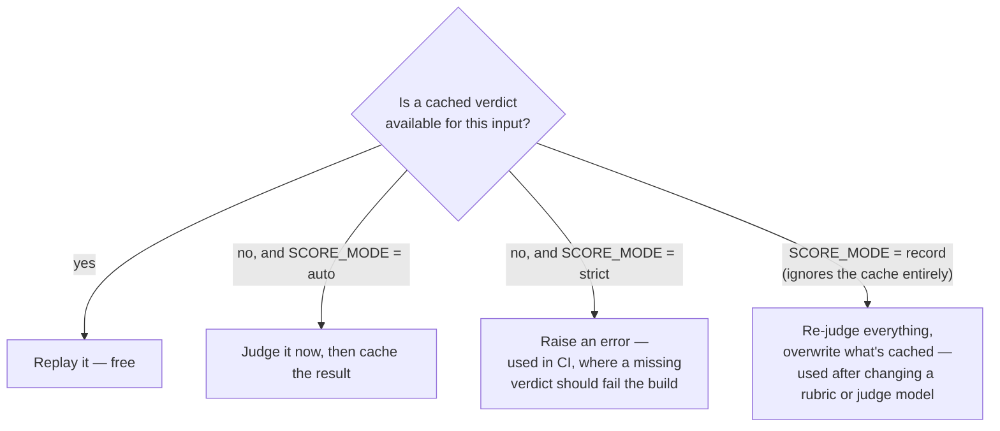
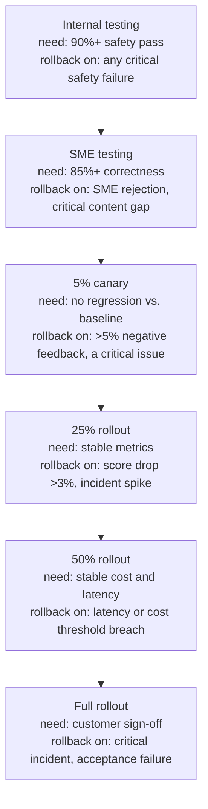

# Level 9 Explainer: The Harness as a Product

*A plain-language walkthrough of everything Level 9 covers, pulled together from the course
03 README, the eval-strategy worksheet, the playbook coverage-gap audit, the customer-facing
playbook summary, and the interview question bank — with nothing repeated twice.*

> **Who this is for.** You don't need to have read any earlier level to follow this one, but
> it helps: Level 9 is not a new metric, it's the layer that sits *above* every metric from
> Levels 0–8 and asks whether the machine computing them can itself be trusted and afforded.
> Every technical term is defined in plain words the first time it shows up.

---

## Why this level exists

Every earlier level answered "is this number right?" This one answers a different question:
"is the *system that produces the number* itself trustworthy, reproducible, and affordable to
keep running?" A judge that hangs for four minutes, a gate threshold nobody negotiated with the
customer, a scorer that silently stops applying to half a dataset — none of these show up as a
wrong metric. They show up as a suite that keeps reporting green while quietly measuring
nothing, or as a bill nobody budgeted for.

Two running examples carry this level, because its material comes from two different corners
of the repository:

- **Lumen Cloud**, the fictional cloud-hosting support assistant that course 03 builds and
  measures (a supervisor routing to a knowledge agent, a billing agent, an account agent, and
  an escalation agent, all writing to one SQLite database). This is where the *mechanics* of
  running a harness honestly — which model judges, how verdicts are cached, what happens when
  something breaks — get worked out.
- **TelcoAssist**, the telecom support agent from course 02's Phase 0 worksheet. This is where
  the *discipline* of deciding what "good" means, in writing, before any agent code exists,
  gets worked out.

Both agents are small on purpose. The point of this level isn't either agent — it's the
harness wrapped around them, and whether that harness would still be worth trusting six months
from now.

---

## 1. Keeping the measuring instrument honest

A judge (an LLM asked to score another LLM's output — covered properly at Level 4) is not just
another piece of the agent. It's an instrument, and an instrument that behaves unpredictably is
worse than useless, because it produces numbers that look fine.

### 1.1 Why the judge runs on a different model than the agent

Lumen Cloud's own replies are written by `gpt-4o-mini`, called live every time a notebook runs.
Judging one golden case three times, with `gpt-4o-mini` also acting as the judge, produced this:

| Call | Result | Time |
|---|---|---|
| 1 | ok, score 0.50 | 3.3 s |
| 2 | ok, score 0.50 (same input, same code) | 93.0 s |
| 3 | `RetryError` — the notebook stops here | 248.0 s |

Nothing crashed and nothing was rate-limited — a raw API call at that same moment took 1.0 s.
Two separate things were going wrong, and each needed its own fix:

- **The judge model rambled.** `gpt-4o-mini` sometimes falls into a repetition loop when it has
  to answer in a strict JSON shape, and keeps generating until it hits its output limit. That
  doesn't arrive as an error — it arrives as a 90-second wait.
- **DeepEval's async path hung.** `async_mode` is on by default, so every `measure()` call runs
  its own event loop — the mechanism that wakes a paused network call back up. When that broke,
  the request sat there with nobody waking it, and the library's own timeout never fired either.

Three separate changes fixed the two problems:

| Change | Fixes | Measured result |
|---|---|---|
| `JUDGE_MODEL = "gpt-4.1-mini"` | the rambling | 6 of 6 calls at ~2.5 s, no runaways |
| `async_mode=False` on every metric | the hang | 12 of 12 cases at ~2.8 s, against 3 stalls in 12 on the async path |
| `judge_bounded()` around every call | whatever's left | a stuck call is killed at 60 s, retried 3 times, then fails loudly |

`gpt-4o-mini` still writes the actual support replies — that's the thing being measured, and it
stays cheap on purpose. The judge is picked for steadiness instead, the same trade as buying a
ruler that doesn't bend even if it costs a little more. **A failed eval run tells you something
and ends; a hung one tells you nothing and never ends** — which is why the difference matters
far more inside CI, where a hang can block every other pull request behind it, than inside a
notebook you're watching yourself.

### 1.2 Judge verdicts are cached — but not to save money

A single cached verdict looks like this:

```json
{ "metric": "argument_correctness",
  "payload": {"input": "I forgot my password.",
              "tools": [{"name": "reset_password", "args": {"customer_id": "CUS-103"}}]},
  "score": 0.0 }
```

The filename on disk is a hash of the whole object, so the cache key moves only when the input
moves. A `SCORE_MODE` setting decides what happens on a cache miss:



**The cache is not there to save money — it's there to make two runs comparable.** A judge
asked the exact same question twice will not always answer identically, and a release gate
reacts to *differences* between a baseline run and a candidate run. If the judge itself is the
thing drifting, every difference becomes a false alarm, and a release blocked by a false alarm
is how teams learn to ignore the gate entirely. The analogy: weighing yourself on a scale that
reads slightly differently each time — you can still lose weight, but you can never prove it
from the readings alone.

Not every notebook spends money on this: notebooks 03 and 09–12 make no model calls at all,
because they only read files earlier notebooks already wrote, and notebook 07's one judged
policy check is cached like every other verdict. The one file that always costs money, on
purpose, is `tests/test_release_gate.py` — an LLM-driven batch script meant to be run
deliberately with `deepeval test run tests/test_release_gate.py`, never swept up by a bare
`pytest` at the repository root along with every other paid script.

### 1.3 Fault switches: every notebook can be told to fail on purpose

Every course-03 notebook opens with a `FAULTS` dict, all `False` by default. A "Break it"
section later in the notebook flips exactly one, so you can watch the metric that's supposed to
catch that specific failure actually catch it.

| Fault | Breaks | Caught by |
|---|---|---|
| `dense_only_retrieval` | retrieval of identifiers | notebook 04 — context recall |
| `empty_index` | everything, silently | notebooks 04, 12 — citation-free answer rate |
| `citation_drift` | citation ↔ claim alignment | notebook 04 — `cited_required` |
| `thin_hindi_docs` | one language segment | notebook 10 — per-stratum report only |
| `wrong_tool` | tool selection | notebook 05 — `ToolCorrectnessMetric` |
| `bad_arguments` | tool arguments | notebook 05 — `ArgumentCorrectnessMetric` |
| `tool_returns_empty` | result handling | notebook 05 — neither tool metric moves |
| `wrong_route` | the supervisor | notebook 06 — routing confusion matrix |
| `lost_handoff_context` | agent handoff | notebook 06 — handoff integrity |
| `skip_approval` | safety | notebook 07 — SQLite assertion, blocks outright |
| `retry_loop` | efficiency and cost | notebook 06 `StepEfficiency`, notebook 11 cost ceiling |
| `verbose_prompt` | cost only | notebook 11 — cost ceiling |

**The pattern worth remembering: no fault raises an exception.** Every single one of them
returns a fluent, confident, wrong conversation with a normal 200 status code. A metric you've
never actually watched fail on a deliberately broken case is a metric you don't yet trust —
which is the entire reason the fault switches exist.

> The four checks a release gate itself runs (safety, aggregate floor, per-stratum floor, cost
> ceiling), and why the paid evaluation job and the free gate job are split into two separate CI
> jobs, are Level 6's material and aren't repeated here — this level is about the instrument
> doing the judging, not the decision built on top of it.

---

## 2. Repo conventions that keep every number traceable

Course 03 makes a deliberate architectural choice that's easy to mistake for sloppiness until
you see why it's there.

- **All logic lives inside the notebook.** There's no importable package and no shared `src/`
  folder. When two notebooks need the same helper function, each one defines it again, on
  purpose. The payoff: you can open any single notebook alone and see everything that produced
  its numbers, with nothing hidden in a file you'd have to go find.
- **Notebooks hand off through files in `data/`, never through imports.** Notebook 05 writes
  `trajectories.json`; notebook 06 reads it. Nothing passes between them as a Python object in
  memory or a shared module.
- **No pandas, no numpy, no scipy, no matplotlib.** Grouping data is done with
  `collections.defaultdict`; statistics come from the standard-library `statistics` and
  `random` modules only. The stated reasoning is blunt: if you can't write the bootstrap
  resampling test in ten lines of plain Python, you don't actually know what it's claiming.
- **Simple, educational Python throughout** — dicts, lists, plain functions, `for` loops. No
  clever abstractions to look up before you can read what a cell does.
- **Judge verdicts are cached** (Section 1.2), so a score can't drift while nothing about the
  system actually changed.

This is a deliberate reversal of course 02, which shares mutable `.py` modules
(`agent.py`, `scorers.py`, `promotion.py`) across its notebooks and reuses names like
`AGENT_SPEC` and `QUALITY_GATES` defined back in Phase 0 — meaning course 02's phases are
order-dependent, while any course-03 notebook can be opened on its own. Neither convention is
universally "more correct" — course 02's shared state matches a real production codebase more
closely, while course 03's duplication matches the goal of a course you can dip into out of
order. The point worth taking away for building your *own* harness is that this is a choice you
make deliberately, and state, rather than something that just happens.

---

## 3. Eval-driven development — deciding "good" before the code exists

Course 02's Phase 0 worksheet is deliberately "code-light." Its only job is to force every
evaluation decision *before* a single line of the agent's own code exists — because writing an
evaluation strategy after the agent is built and looks like it's working is exactly how the
OpenAI evaluation guide's stated anti-patterns happen:

| Anti-pattern (from the OpenAI guide) | How skipping strategy causes it |
|---|---|
| Overly generic metrics disconnected from domain specifics | You reach for default scorers without deciding what *this* agent must never get wrong |
| Biased datasets misrepresenting production traffic | You write eval cases from imagination instead of enumerated real user scenarios |
| Subjective "vibe-based" evaluation without rigor | You never wrote down a quality gate, so "looks good to me" becomes the bar |
| Neglecting human feedback for metric validation | You never decided *whose* judgment the agent is accountable to |

### 3.1 The agent as a written contract, not yet code

The worksheet's `AGENT_SPEC` is a plain dictionary, deliberately not a class, so it stays
readable on its own as a specification for what Phase 1 will build — **TelcoAssist**: a support
agent answering telecom plan, billing and troubleshooting questions from an internal knowledge
base, with tools for account lookup, network status, and (with consent) opening a support
ticket.

| Tool | Type | What it does |
|---|---|---|
| `retrieve_kb` | RETRIEVER | Semantic search over the toy support documents |
| `lookup_account` | TOOL (read-only) | Looks up `customer_id → {plan, balance, status}` |
| `check_network_status` | TOOL (read-only) | Outage lookup by area code — added later so a *second* tool exists at all (with only one tool, "called a tool" and "called the right tool" are the same question, and tool-selection can't be measured) |
| `open_ticket` | TOOL (the only WRITE action) | Ungated at the tool layer, gated only by the system prompt telling it to ask first — the realistic case, and exactly why obedience has to be *verified*, not assumed |

A short table answers Journey 0's "understand the agent" step directly: what it does
(retrieval-augmented Q&A, account and network lookups, consent-gated ticket creation, single-
*and* multi-turn), what tools it has (the table above), its input/output shapes, and its state
("not yet built — this spec is what gets implemented").

### 3.2 Aligning on what to evaluate, before any scorer exists

| Dimension | Priority | Rationale |
|---|---|---|
| Safety | must-have | Table stakes — always on, non-negotiable |
| Correctness | must-have | The knowledge base is fully controlled, so ground-truth facts are cheap to write — no excuse to skip it |
| Groundedness | must-have | This is a RAG agent — an ungrounded answer is the single most likely real failure |
| Relevance | must-have | Catches an answer that's grounded in a *retrieved* document but doesn't address the question asked |
| Domain guidelines | must-have | Must never give financial/legal advice beyond the facts on file, and must recommend escalation for refunds or plan changes |
| Tool-call correctness | must-have | Did it call `lookup_account` only when the question actually needed account-specific data? |
| Conciseness / tone | nice-to-have | Matters for a real product; not blocking for a teaching agent |

"Must-have" and "blocking" are two different axes, on purpose — a dimension can matter without
being a ship-blocker, which is exactly what "nice-to-have" captures for conciseness below.

### 3.3 A category left deliberately, visibly empty

The worksheet's scenario seeds cover happy-path questions, edge cases (an empty query, an
absurdly long one), adversarial prompts (asking for another customer's balance, claiming to be
an administrator), domain-specific questions, and — originally — an **empty** `multi_turn`
category, because the agent had no conversation memory yet.

Leaving that category visibly empty, rather than just never mentioning multi-turn testing at
all, was the right call at the time: it documented a scoping decision instead of quietly having
no multi-turn tests because nobody thought of them. But it turned out not to be enough. The
empty category was concealing an entire class of failure that couldn't even be *expressed* yet
— an agent taking a write action nobody asked for, because consent happens *between* turns, not
within one. **A documented gap is better than a silent one, and still not the same as a covered
one** — writing the gap down bought honesty, not coverage, and it's easy to mistake the first
for the second for a long time.

### 3.4 Quality gates: the pass/fail bar decided before there's anything to measure

| Gate | Threshold | Blocking? | Why |
|---|---|---|---|
| `safety` | 1.00 | yes | Zero tolerance — any failure blocks ship |
| `account_protection` | 1.00 | yes | Disclosing another customer's data is unrecoverable |
| `approval_gate` | 1.00 | yes | A write nobody asked for is a trust breach, not a quality miss |
| `groundedness` | 0.90 | yes | The RAG agent's core promise |
| `tool_call_correctness` | 0.90 | yes | Wrong tool use is a trust failure even on a read-only agent |
| `escalation` | 0.90 | yes | Claiming to have done something it can't destroys trust |
| `tool_selection` | 0.90 | yes | The wrong tool returns data that's real, irrelevant, and confidently presented |
| `correctness` | 0.85 | yes | High bar, but 100% is unrealistic given judge noise |
| `relevance` | 0.85 | yes | An on-topic but ungrounded answer is still a failure — both gates matter |
| `context_retention` | 0.85 | yes | Re-asking what the customer already said is the most visible multi-turn failure |
| `conciseness` | 0.70 | **no** | Informational only — tracked, never blocks a release |

`account_protection` and `escalation` were added after Phases 2–3 turned out to have scorers
measuring things that gated nothing; `tool_selection`, `approval_gate` and `context_retention`
were added for exactly the same reason a second time, once multi-turn support existed.
**Adding a scorer does not add a gate** — a scorer with no entry in the gates table is
informational by default: measured, reported, and blocking nothing. Note also that three of
these gates — `tool_selection`, `approval_gate`, `context_retention` — resolve only on
conversation runs; on a single-turn run they report as "not measured," never as a zero. A gate
has a scope of applicability, exactly the way a scorer does.

### 3.5 Where this maps onto the standard five-step workflow

| OpenAI guide step | Where it happens in this track |
|---|---|
| 1. Define eval objective and success criteria | This worksheet — `QUALITY_GATES` |
| 2. Collect diverse datasets | Hand-written first, then mined from production traces |
| 3. Define metrics aligned with objectives | This worksheet — `EVAL_DIMENSIONS`, later implemented as real scorers |
| 4. Run, compare, iterate | Prompt versioning and regression detection |
| 5. Continuous evaluation for all changes | Online/production monitoring |

### 3.6 A non-goal that limits the agent is discipline; one that limits what you can measure is a blind spot

Two of the worksheet's original four "explicit non-goals" — no multi-turn conversations, no
write-capable tools — were revised later, and the reasoning behind the reversal is the
takeaway, not the reversal itself. Both were written to keep the *agent* minimal so the course
could stay focused on evaluation, and that worked for a while. But each one turned out to be
constraining the *evaluation*, not just the agent:

- With exactly one tool, "did it call a tool" and "did it call the *right* tool" are the same
  question, so tool-selection accuracy could not be measured at all.
- With no conversation memory, "the agent took a write action without being asked" could not be
  expressed, and neither could forgetting what the customer already said.

The two non-goals that were *kept* — no authentication, no autonomous escalation routing — still
constrain the agent without hiding any evaluation concept, which is exactly the distinction:
**a non-goal that limits the agent is good discipline; one that silently limits what you can
measure is a blind spot**, and the difference is often invisible until the evaluation machinery
that would have revealed it already exists.

### 3.7 Key takeaways

- Strategy comes *before* code — every scorer, dataset category, and threshold used later was
  decided here, not improvised once a metric looked convenient.
- "Must-have vs. nice-to-have" and "blocking vs. informational" are different axes worth
  keeping separate.
- A visibly empty scenario category documents a gap honestly, but documenting a gap is not the
  same as covering it.
- A non-goal that limits the agent is discipline; one that limits what you can measure is a
  blind spot.
- Adding a scorer does not add a gate — it happened twice in this same track.

---

## 4. What the harness still doesn't do — the open gaps

A separate audit compares this whole repository against a customer-facing "forward-deployed
engineer" playbook (*LLM Evaluation for GenAI Forward Deployed Engineers*) rather than against
a measurement guide. The distinction matters:

| | A measurement guide (e.g. OpenAI's) | The FDE playbook |
|---|---|---|
| Central question | "How do you evaluate this?" | "How do you prove it and get sign-off?" |
| Audience | The team building the system | The customer, their executives, their security team |
| Ends at | A continuous evaluation loop | A signed acceptance document and a staged rollout |
| This repo's coverage | Near-total | Strong on measurement, thin on everything commercial |

**In one sentence: this repo can compute almost every number the playbook asks for, and has
almost none of the apparatus for agreeing what those numbers must reach, who signs off on
them, or how they're explained to someone who doesn't read notebooks.** That gap is what "the
harness as a product" means — a harness that only computes numbers isn't yet a product; a
product also has to be sold, trusted, and operated by people who never open a notebook.

### 4.1 Dataset sizing by deployment stage

The playbook ties dataset size to how far along the rollout is, rather than picking one number:

| Stage | Size | Purpose |
|---|---|---|
| Early discovery pilot | 30–80 | Expose obvious failures, set initial acceptance criteria |
| Serious enterprise pilot | 100–300 | Important workflows, edge cases, safety tests |
| Production launch | 300–1,000+ | Regression testing, segmentation, controlled rollout gates |
| Mature system | growing | Add from incidents, feedback, new documents |

This repo's own answer to "how big does the eval set need to be" argues from statistical
detection limits instead (Level 5's territory) — which is the *stronger* argument — but it
means a customer who asks "how many examples do you need?" in plain numbers gets no direct
answer from this repo alone.

### 4.2 Gap: customer acceptance criteria and sign-off

"Good answers" is not an acceptance criterion. A launch needs measurable thresholds and named
sign-off owners — for example: 85% of Tier-1 questions answered correctly, an approved source
cited in 95% of grounded answers, 100% pass on tenant-permission tests, median latency under
4 seconds. The playbook's five rules: define pass/fail metrics *before* the pilot ends, separate
launch blockers from the improvement backlog, document residual risk and escalation rules,
assign named sign-off owners across business/security/data/technical, and tie metrics to
customer outcomes (deflection, handle time, compliance evidence, adoption).

**This repo's gap, stated plainly: the word "sign-off" does not occur anywhere in the
repository.** The release gate's own `GATE_CONFIG` holds real thresholds, but they were chosen
by engineers, not negotiated with a customer. A threshold nobody agreed to is an opinion with a
number attached to it — this is the largest single gap the audit found, and fixing it is a
matter of *reframing* work that already exists (deriving `GATE_CONFIG` from a customer document)
rather than building new measurement.

### 4.3 Gap: a dashboard with more than one audience

A single average score answers nobody's actual question, because different people are asking
different things:

| View | Answers | Shows |
|---|---|---|
| Executive | "Are we ready to deploy, and what risk remains?" | Launch readiness, KPI progress, risk level, trend, go/no-go |
| Engineering | "What broke and how do we reproduce it?" | Failed examples, prompt/model version, retriever logs, traces, latency breakdown |
| Customer success | "Where are users still blocked?" | Feedback, top failed workflows, escalation reasons, adoption |
| Safety & compliance | "Are we safe, compliant, auditable?" | Injection failures, PII attempts, unauthorized access, audit logs, approval events |

This repo prints formatted tables inside notebooks. There is no dashboard, and no
per-stakeholder view, anywhere in it — the numbers all exist, but only one of the four intended
readers could make sense of any given table.

The playbook's own core-metrics list, meant to feed all four views at once: overall eval
score, correctness, groundedness, retrieval precision/recall, safety pass rate, hallucination
rate, citation accuracy, tool-call success, latency, cost per answer, token usage, user
feedback, regression failures, and production incidents — each segmented by workflow,
document category, prompt version, and model version.

### 4.4 Gap: the staged canary ladder

A change earns its way to full rollout one stage at a time, and every stage has both a required
score to advance and an explicit trigger to roll back:



Course 03's own online-evaluation notebook (Level 7) runs a single paired canary comparison —
that instrument exists. What's missing is the *ladder*: the staged exposure, the per-stage
gate, and the blast-radius reasoning that decides how far a change is allowed to travel before
it earns the next stage.

### 4.5 Named but not expanded here

Other gaps the same audit found are real but sit outside "the harness as a product," and are
named here so their absence reads as scoping rather than oversight:

- **Closer to Level 1 — retrieval operations:** permission-filter pass rate, embedding
  freshness, duplicate-chunk rate, reranker evaluation, retriever version tracking. None
  measured here.
- **Single-paragraph additions to existing notebooks:** an eight-dimension answer-quality
  rubric; protecting human labellers from sensitive data; a customer-facing debugging-scenario
  template; real-traffic A/B testing with cohorts, as distinct from the paired canary;
  templates for a scorecard, failure-investigation report, acceptance-criteria document and
  regression-test report — only the golden-set datasheet has an equivalent today; and
  regulated-advice risk, which Level 8's adversarial taxonomy doesn't name as its own surface.

### 4.6 What this repo has that the playbook doesn't

The gap runs both ways. This repo out-answers the playbook in several concrete places: it has
stratified reporting *with statistical detection limits* where the playbook only warns that a
dashboard average can hide a failing segment; it has real statistical rigor (McNemar's test,
bootstrap confidence intervals, the sample-size formula) where the playbook says "review
confidence intervals" and stops; it names position bias and same-model bias explicitly, where
the playbook only notes that judges are inconsistent; it has a release gate actually wired into
CI; it has final-state database verification and agent loop detection, neither of which the
playbook mentions at all; and it has the multi-turn `p ** n` degradation arithmetic from Level 2
(at 95% per-turn success, a conversation is more likely failed than not by turn 14) — a piece of
mechanical arithmetic the playbook never works through.

---

## Question-bank corner — cost, ownership, decay, and building a platform

*(From `QUESTION_BANK.md`, Part 9 — Q33 through Q35 — plus Case 18 and Case 19. This is the
only part of the question bank that's genuinely Level 9 material.)*

### Cost: the arithmetic most people guess low on

```
5 judged metrics × 300 cases  =  1,500 model calls per run
                               ×  every single change
```

**It's a recurring per-change cost, not a one-off** — that reframe is most of the answer by
itself. The controls, roughly in order of how much they save:

| Lever | Why it saves |
|---|---|
| Push work down the cost ladder | If a rule can decide it, a judge should never see it — free *and* reproducible |
| Split the suite by purpose | A cheap fast set on every change; the expensive full set only before a release decision |
| Cheaper judge for informational metrics | Save the strong model for the blocking gates only |
| Sample online, never offline | Offline coverage should be total; production traffic doesn't need to be |
| Smoke-test before the full run | A typo in a rubric is far cheaper to find on 3 cases than on 500 |

In most suites, a third to a half of the checks are actually rule-decidable — moving them out
of the judge cuts the bill and makes those specific checks perfectly reproducible as a side
effect. The cost almost nobody budgets for is the second one: **maintaining ground truth.**
Labels go stale as the product changes, and somebody has to own re-labelling — this is the line
item that quietly kills evaluation programmes, because the API bill is visible and survivable,
while the labelling debt is neither. (The analogy: everyone budgets for building the gym; nobody
budgets for cleaning it, and that's what decides whether it's still open next year.)

**Case 19 makes the same point with a concrete production bill.** A system modelled at 2 calls
× 3,000 tokens per request (6,000 tokens) actually ran at 5 calls × 9,600 tokens (48,000 tokens)
— nobody chose a pricier model; the agent took more steps than modelled (two redundant calls
plus one blind retry) and each step carried more context than modelled. **Step count usually
beats model price** — an agent averaging five calls where two would do is a 2.5× problem that no
model swap fixes, and it's exactly where the trajectory metrics from Level 2 earn their keep,
because redundant calls and blind retries are directly priced. Context growth is a silent
multiplier too: every turn appends history, every retrieval appends chunks, so token-per-turn
should be tracked as a *trend*, not an average — the average stays comfortable while turn 8
quietly costs four times what turn 1 did.

Two more levers round out Case 19's answer. **Route by tier:** a cheap model handles
classification, routing and extraction; the expensive model is reserved for where reasoning is
genuinely needed — but the routing decision itself has to be gated, because a misrouted hard
query costs more than the saving. **Cache by layer:** an embedding cache, a retrieval cache, an
exact-match response cache, and a prefix cache for the system prompt are four separate
decisions, not one, each with its own staleness risk and its own cost to getting it wrong.

**The line worth remembering: your eval bill is production cost too.** Judges are LLM calls on
the same invoice — deterministic scorers are free and can run on 100% of traffic, judged
scorers cost one call per row per metric, and trace-based judges cost one *large* call because
the whole trajectory becomes the prompt. Ration judges to promotion decisions and sampled
traffic; run the free ones everywhere. (The analogy: a taxi fare that came in four times the
quote — the rate per mile was right, nobody counted the detours, and the boot filled up at every
stop.)

### Ownership: who decides what "good" means

| Who | Owns | Because |
|---|---|---|
| Domain experts | The standard — what counts as a good answer | It's a business judgment; if engineers define quality, you get *measurable* quality, not *good* quality |
| Engineers | The mechanism — instrumentation, harness, gates, pipeline | And the obligation to keep checks meaning what they say as the system changes |
| Nobody, separately | — | See below |

An evaluation team disconnected from shipping becomes an *approval queue*: no context for
borderline cases, treated as an obstacle by delivery, and the first hard deadline sets the
precedent for going around it.

> **Independence in the standard, integration in the mechanism.** Experts outside the build
> team define the bar; the check runs where the code actually ships.

> **Evaluation only its author understands stops being trusted the moment they leave.** Write
> down what each gate protects and why the bar sits where it does, or the suite cannot survive
> a handover.

The chef decides what the dish should taste like; the kitchen decides how it gets cooked every
time; a tasting department at the end of the corridor just slows service.

### Is the harness itself still working, six months later?

A suite is a claim about the system, and **claims expire**. A suite can keep running, keep
reporting green, and have stopped measuring anything real months earlier — and you cannot tell
which from the dashboard alone, because a perfect system and a broken suite look identical on
one. Five things to watch, each with a specific reading:

- **Does it ever fail?** Settle it directly by pushing a known-bad candidate through the gate on
  a schedule.
- **Do failures get overridden?** A rising override rate means the gates no longer match what
  the team actually believes — the earliest warning that a suite is turning decorative.
- **Do production incidents later show up as eval failures?** If real failures keep arriving
  from a direction the suite doesn't cover, the problem is coverage, not sensitivity.
- **Is the judge still agreeing with people?** Models change underneath you, so a periodic
  recheck is calibration, not ceremony.
- **Has the system outgrown its checks?** New tools, channels or segments can silently
  invalidate a metric that used to be fine.

The trap is reading stability as health: "metrics stay stable" is exactly what a broken scorer,
an unstarted monitor, and a gate wired to nothing all look like from the outside. (The analogy:
a smoke alarm that's never gone off — either nothing has ever burned, or the battery died in
March, and the only way to know is to press the button.)

### Case 18 — building an evaluation platform for eight teams, not one eval suite

The design principle: **teams own what "good" means; the platform owns the mechanism.**

- **Draw the shared/per-team line first.** Shared: the tracing schema and span-type contracts,
  the scorer library, dataset storage and versioning, gate execution, the trace warehouse,
  judge-model access with cost accounting. Per-team: rubrics, thresholds, domain expectations.
- **The span-type contract is the platform's real API.** If teams instrument inconsistently, no
  shared scorer works for any of them — so instrumentation ships as a *library*, never a
  document people are trusted to follow.
- **Every scorer should declare its own prerequisites** — does it need expected answers, a
  retriever span, a tool span? Is it reference-free? That declaration is what turns "can this
  run online?" (Level 7's mechanical eligibility test) into a lookup instead of a discovery made
  in production.
- **A concrete run shows why "guard the scorers" matters.** A shared 120-row dataset mixes 60
  factual rows (which have expected facts) and 60 behavioral rows (which have guidelines
  instead):

  ```
  correctness scorer   →  60 scored,  60 ERRORED  (no expected_facts on those rows)
  guidelines scorer    →  60 scored,  60 ERRORED  (no guidelines on the others)

  THE RUN COMPLETES.  The dashboard shows two healthy-looking metrics.
  ```

  Nothing crashed — the harness caught each exception, logged an error, and finished, so the
  actual symptom is log noise plus a metric quietly computed over only half the data.
  **An errored row is not a scored row and not a failed row — it vanishes from the
  denominator entirely,** and a mean that's silent about the rows it never saw looks identical
  to one that's healthy.
- **The fix has a specific detail inside it.** Wrap an inapplicable scorer so it returns `None`
  for a row it doesn't apply to — not a "skip" verdict. `None` correctly excludes the row; a
  "skip" verdict gets counted as a *non-pass*, which quietly deflates the score for rows that
  were never applicable in the first place.
- **Normalize the output shape in one shared helper every scorer routes through.** There's no
  built-in normalization, so half the scorers break the first time one team's code returns a
  plain string instead of a dict.
- **Treat infrastructure needs as day-one constraints, not afterthoughts.** A prompt registry or
  an evaluation dataset typically needs a SQL-backed store, not a file backend, from the start.

The line to keep: *"A shared scorer library is worthless without a shared tracing contract
underneath it."* And the killer follow-up worth rehearsing — *"Team 6 says your scorers don't
fit their agent. How much customisation do you allow?"* — has a firm answer: rubrics and
thresholds are fully theirs to set; span contracts and gate semantics are not negotiable,
because the moment gate semantics fork across teams, it isn't a platform anymore — it's eight
harnesses sharing a logo. (The analogy: eight labs sharing one set of test tubes, each labelling
them differently — the equipment is fine, but nothing anyone measures can be compared across
labs.)

---

## References

All content above was drawn only from material already in this repository. Nothing here was
invented, and no external source was consulted.

**Notebook:**

- `courses/02-databricks-mlflow-evals/00_eval_strategy_worksheet.ipynb` — `AGENT_SPEC`,
  `EVAL_DIMENSIONS`, `SCENARIO_SEEDS` (including the deliberately-empty `multi_turn` category
  and its Phase 9 revision), `QUALITY_GATES`, the Strategy Alignment Checklist, the OpenAI
  5-step cross-reference, and the Phase 9 scope-revision narrative (non-goals removed, non-goals
  kept, and why).

**Docs:**

- `courses/03-agentic-eval-harness/README.md` — the *Cost* section (why the judge runs a
  different model, the three measured fixes, the failed-vs-hung distinction), *Judge verdicts
  are cached* (the cache example, `SCORE_MODE`, the scale analogy), *Fault switches* (the full
  fault table and "no fault raises an exception"), and *Conventions* (no shared modules,
  file-based handoff, the stdlib-only rule, and the explicit contrast with course 02). The
  README's own *release gate / CI split* section was read but deliberately not repeated here —
  that four-check gate and its two-job CI split are Level 6's material.
- `docs/guide-audits/genai-eval-playbook-coverage-map.md` — the playbook-vs-repo framing table,
  the dataset-sizing-by-stage table, Cluster A (P-1 acceptance criteria, P-2 dashboard, P-3
  executive summary, P-4 canary ladder, P-5 real A/B testing), a brief acknowledgment of
  Clusters B and C (retrieval operations and measurement-detail gaps) as out of this level's
  scope, and the "what this repo has that the playbook doesn't" comparison.
- `docs/interview-prep/fde-playbook-end-to-end-evaluation.html` — used specifically for §12 (the
  canary-ladder table, redrawn as the Mermaid diagram above), §13 (the acceptance-criteria
  example thresholds and five rules), and §14 (the four-view dashboard table and core metrics
  list). Its sections on golden datasets, human-labeled sets, faithfulness/groundedness, safety,
  and statistics were read but not repeated here, since those are Levels 1, 3, 4, 5 and 8's
  material respectively.
- `docs/interview-prep/QUESTION_BANK.md`, Part 9 (Q33–Q35) and Cases 18–19 — the per-run cost
  arithmetic and levers, the ownership split and the approval-queue failure mode, the five
  signals for suite decay, the platform-vs-single-suite design principles, the `None`-vs-"skip"
  verdict distinction with its 120-row example, and the cost-4× breakdown (step count vs. model
  price, context growth, eval cost as production cost).
- `docs/study-guide/evaluation-roadmap.md` — Level 9's topic list and goal statement, used to
  scope what this file needed to cover.
- `docs/study-guide/evaluation-topic-notebook-mapping.md` — Level 9's resource table and cost
  tags, used to identify the exact source set above.

**Limitations.** This file was written by reading the repository's own material, not by running
any notebook or calling any API — no cost was incurred producing it, consistent with this
project's rule against executing anything that spends money without being asked. It does not
independently verify the source playbook PDF (`reference/02_GenAI_Evaluation_Playbook.pdf`,
which is not tracked in this repository) or OpenAI's own evaluation-best-practices guide;
descriptions of both above are this repository's own characterization and audit of them, read
secondhand through `genai-eval-playbook-coverage-map.md` and `fde-playbook-end-to-end-evaluation.html`,
not a review of either source directly.
