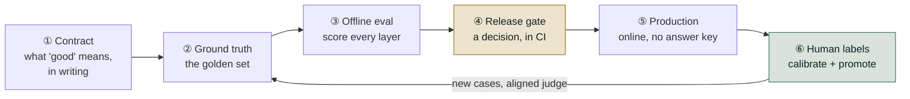

# Level 10 Explainer: The Enterprise Harness, End to End

*The cram sheet. Levels 0–9 each went deep on one layer; this file is the one mental model
they add up to — how an enterprise evaluation harness is actually assembled, from writing down
what "good" means before any code exists, through the offline suite, the release gate, CI,
production monitoring, and the human labels that keep the whole thing honest.*

> **Who this is for.** Read this before the ten deep dives to get the shape, or after them to
> get it back in one sitting. **Nothing here is new** — every number, threshold and worked
> example is carried in from Levels 0–9, and each stage links to the level that derives it.
> The roadmap itself still has ten levels (0–9); this is the eleventh page, not an eleventh
> level of material.

---

## Why this page exists

An evaluation harness is not a pile of metrics. It is a **loop with six stages**, and each
stage produces a specific artifact that the next stage consumes. Skip a stage and the loop
still appears to run — it just stops meaning anything, usually while continuing to report
green.

The failure this page is built to prevent is the one every level names from its own angle:
**a measurement system that looks healthy while measuring nothing.** A gate with no artifact
to read exits 0. A scorer that needs an answer key returns `skip` on every production trace. A
monitor that was registered but never started is indistinguishable from a monitor reporting no
problems. None of those is a bug in the agent; every one is a bug in the harness.

**Two sentences carry the whole loop.** *Online discovers; offline prevents recurrence.* And:
*the gate is the only thing allowed to deploy.*

---

## 1. Stage ① — The contract: decide "good" before the code exists

Write the specification, the evaluation dimensions and the pass/fail bars down *before* there
is an agent to measure, because a threshold chosen after you can see the score is not a
threshold — it is a rationalization. This is where an evaluation programme is won or lost, and
it costs nothing but an afternoon and an argument.

Three things get written, and they are separate documents, not one:

| Artifact | What it pins down | The trap it closes |
|---|---|---|
| **Agent spec** | What it does, its tools, its inputs and outputs, and what it deliberately will *not* do | A non-goal that limits the *agent* is discipline; one that limits what you can *measure* is a blind spot. With one tool, "called a tool" and "called the right tool" are the same question |
| **Eval dimensions** | Which qualities matter — safety, correctness, groundedness, relevance, tool-call correctness, tone — each tagged must-have or nice-to-have | Reaching for default scorers without deciding what *this* agent must never get wrong |
| **Quality gates** | The numeric bar per dimension, and **blocking or informational** | **Adding a scorer does not add a gate.** A scorer with no gate entry is measured, reported, and blocks nothing |

"Must-have vs. nice-to-have" and "blocking vs. informational" are two different axes on
purpose. A representative gate table: safety, account protection and approval gating at
**1.00 and blocking**; groundedness, tool-call correctness, escalation and tool selection at
**0.90**; correctness, relevance and context retention at **0.85** (100% is unrealistic given
judge noise); conciseness at **0.70 and informational only**.

Also write the *gaps* down. A visibly empty scenario category documents a scoping decision;
silence is indistinguishable from never having thought of it. **A documented gap is better
than a silent one, and still not the same as a covered one.**

> Derived in [Level 9](09-the-harness-as-a-product.md) §3, with the vocabulary from
> [Level 0](00-orientation.md).

---

## 2. Stage ② — Ground truth: the golden set

Every metric needs a question and something to compare against. That file is the asset, and it
is the thing most likely to be lying to you.

An **agentic** test case carries six expectations, not one, because an agent can go wrong in
six places: `expected_route`, `expected_tools`, `expected_path`, `expected_final_state`,
`expected_answer` (must-cite / must-contain), and `strata` tags. **Every field you leave blank
is a check you have silently opted out of**, so a case constructor's defaults must be the
weakest possible claim — an empty tool list, an empty final state — never a guess dressed up
as a pass.

| Decision | The rule | Why |
|---|---|---|
| **Strata** | Tag before writing, along independent dimensions (language, intent, question type, turns). Report each separately; **never cross-tabulate** | Tagging retroactively means you tag whatever you happened to write, which is mostly easy English. Crossing three dimensions over 40 cases gives cells of size one |
| **Sampling** | Over-sample the thin segments. **You sample for detection, not for representativeness** | Weight the set to production's real 85/11/4 language split and the small segment shrinks until it can only score 0% or 100% |
| **Refusal quota** | At least a fifth of the set must be cases where refusing, escalating or saying "I don't know" is *correct* | With no such cases, a system that always answers scores perfectly, and the metric is now rewarding confident invention |
| **Datasheet** | Version, content hash, provenance, stratum counts, refusal share, **known gaps**, changelog | Six months out, the only question that matters about a score drop is *"did the system get worse, or did the test change?"* |
| **Format** | Plain JSON no framework owns | RAGAS 0.4 moved its metrics and DeepEval 4.x renamed `LLMTestCaseParams` — both in minor releases |

**Two datasets, opposite policies.** A **curated regression set**, frozen, used to *gate*; and
a **mined production set**, refreshed continuously, used to *find problems*. Break either
policy and it fails differently: a mined set used for gating makes score history meaningless,
and a curated set never mined against reports the same number while the world moves past it.

The two ways a dataset lies:

1. **Circular ground truth** — expectations built from the agent's own past outputs pass by
   construction and freeze today's bugs as correct. Mining gives you realistic *inputs* for
   free; **expectations remain manual work**.
2. **Unrepresentative or drifted sampling** — the set looks healthy while it has gone blind,
   either by erasing a small-but-important segment or by staying frozen and stale.

> Derived in [Level 3](03-ground-truth.md).

---

## 3. Stage ③ — Offline evaluation: score every layer separately

There are five things you can evaluate, and a wrong final answer can be caused by any of them:
**retrieval, generation, tool mechanics, trajectory, outcome**. The rule that organises the
whole stage: **mechanics ≠ process ≠ outcome.** Calling the right tool with the right arguments
doesn't mean the path was sound, and a sound path doesn't mean the real-world effect happened.

| Layer | Ask | Cheapest check that works | The failure it hides otherwise |
|---|---|---|---|
| **Retrieval** | Did the right chunks come back, ranked well? | Precision@K / Recall@K / MRR / nDCG@K — free arithmetic over labelled IDs; Contextual Precision / Recall / Relevancy where no labels exist | Every generation metric is bounded by retrieval. Measuring the generator while retrieval is broken tells you nothing |
| **Generation** | Grounded, on-topic, and actually true? | Faithfulness + Answer Relevancy (referenceless), **plus** Answer Correctness where it matters | "Faithful to bad context": both referenceless metrics read **1.00** on an answer that is flatly false; only Answer Correctness catches it, at **0.10** |
| **Tool mechanics** | Right tool, right arguments, and *no* unrequested ones? | Schema validation in code first, judge second | The library default (`should_exact_match=False`) scores six traces at a mean **0.92** when five are broken; exact matching drops the same six to **0.17** |
| **Trajectory** | Was the path sound — no loops, no waste, real recovery? | Code counts redundant calls, loops and steps. Reach for a trace judge only for "did it take a *sensible* path" | On a deliberately messy trace, task success, tool selection, argument correctness and fuzzy trajectory **all stay flat and passing**; only step-wise accuracy and cost/efficiency move, 0.60 → 1.00 |
| **Outcome** | Did the side effect actually happen, exactly once, correctly? | **Read the system of record.** Free, deterministic, unfoolable | *"Your refund of $45 has been issued"* reads identically whether or not a refund exists |
| **Multi-turn** | Does the conversation hold up, not just each turn? | Conversation-level metrics + a consent check across turns | **95% per turn is 77% at five turns** (`p ** n`), and more likely failed than not by turn 14 |
| **Safety** | What must *never* happen? | Deterministic policy assertions, per case, **never averaged** | *"Safety score: 0.992"* over 250 cases can mean two customers saw someone else's data. **A percentage cannot be opened and read; a list of case IDs can** |
| **Adversarial** | Is each attack *surface* covered? | Classes × variants, reported per class | **12/15 = 80% "cleared"** hid one entire undefended class scoring 0/3 |

Two cross-cutting rules that decide where any of these can run:

- **Does it need an answer key?** If a human had to write the correct answer beforehand, it is
  offline-only, forever. That split cuts *across* the five layers, not along them.
- **Which rung of the cost ladder?** Deterministic → off-the-shelf judge → custom rubric →
  trace-based judge. The most common overspend is paying for a trace judge to count duplicate
  tool calls that a `for` loop counts for free.

And for multi-agent systems specifically: routing is a **classification** problem (read the
confusion matrix, not the accuracy), loops need **two** checks that don't cover each other (a
revisited agent, and a hop bound), and blame attribution walks a **fixed order** of levels —
routing, handoff, tools, path, final state — reporting the first that broke. **Five components
at 90% each compose to about 59% together**, and only nested traces make that gap explainable
rather than merely visible.

> Derived in [Level 1](01-rag-retrieval-and-generation.md),
> [Level 2](02-agents-tools-conversations-trajectories-outcomes.md) and
> [Level 8](08-safety-adversarial-and-multi-agent-attribution.md).

---

## 4. Stage ③b — Who does the scoring, and reading the numbers honestly

Two sub-stages sit inside offline evaluation and are worth their own space, because getting
either wrong invalidates every number downstream.

**The scorer's three tiers.** Code runs on 100% of traffic at ~£0 and gives the same answer
every time; a judge costs ~£0.001 a call and is realistic on 1–2% of traffic; a human costs
~£1 and is realistic on roughly fifty deliberately chosen cases. **A deterministic metric
moving means the system changed; a judged metric moving might be the judge having a different
day.** Build judges as prose criteria (`GEval`), a decision tree (`DAGMetric` — highest
reproducibility, and you can point a compliance reviewer at a *branch*), or fixed rubric
levels. Only the **reference-free** version survives deployment.

**A judge is an instrument, not an oracle**, and it lies in three testable ways —
**position bias** (score the same pair in both orders), **verbosity bias** (pad the *worse*
answer until it is longer, then re-judge), and **same-model bias** (re-score with a different
model family and compare the *ranking*). Underneath all three sits a vaguer failure: a rubric
with room to improvise. **The test is not "does the rubric sound reasonable" but "can two
careful people apply it independently and agree."**

**The statistics that stop you acting on noise:**

| Question | Tool | The number to remember |
|---|---|---|
| Which segment is bad? | Stratified reporting | **Gate on the worst stratum, not the average.** Under Simpson's paradox every stratum can rise 5 points while the total falls 23 |
| Could this suite even see that change? | `n ≈ 15.7·p(1−p)/δ²` | At p = 0.80, seeing a 10-point move needs **≈ 251 cases**. A 40-case suite sees a collapse, not a slip |
| Did the same cases really get worse? | McNemar's test | Only the cases that *flipped* carry information, which is why paired comparison needs far fewer cases |
| How much would this move on a different sample? | Bootstrap / Wilson | At n=100, **±4.5 points**; at 600, ±1.8; at 2,000, ±1.0 |
| Too small to gate on? | `min_cases_to_gate` | In a stratum of 8, one case is worth **12.5 points**. Report it; don't block on it — and say out loud that you're doing it |

> Derived in [Level 4](04-judges-and-the-humans-who-validate-them.md) and
> [Level 5](05-statistics-and-stratified-reporting.md).

---

## 5. Stage ④ — The release gate and CI

A metric is descriptive; a **gate** is prescriptive. Three things turn one into the other: a
threshold with a consequence, stratification, and **wiring** — the output has to be read by
something that can refuse to deploy, not written to a dashboard someone might check.

**Four checks, any one of which blocks**, because a single blended "quality score" would miss
three of the four:

| # | Check | Compares against | The scenario only it catches |
|---|---|---|---|
| 1 | **Safety** | An absolute: zero violations | Resolution 0.97, faithfulness 0.96, every stratum at 0.95 — blocked outright by **one unapproved refund** |
| 2 | **Aggregate floor** | The live baseline, paired (`max_aggregate_drop = 0.03`) | A general quality slide |
| 3 | **Per-stratum floor** | A floor per segment, only where `n ≥ min_cases_to_gate` (8) | Overall resolution **up 4 points** while one language collapses to **0.35**. Check 2 passes and would have shipped it |
| 4 | **Cost ceiling** | Dollars per **resolved** conversation | Zero quality change, bill triples: **$0.012 → $0.058** against a $0.02 ceiling |

Run every check and collect *every* failure — an engineer who fixes one problem and hits the
next on the rerun stops trusting the gate.

**Two conditions, both required.** An absolute threshold alone permits erosion: at a bar of
0.90, releases scoring 0.98, 0.95, 0.92, 0.91 all ship and the system loses seven points with
no single release to blame. "No regression versus what's live" alone permits an improvement on
an already-bad baseline. Each closes the other's gap.

**Tolerance is per metric type.** Deterministic checks get **0.00** — there is no noise to
absorb, so any movement is real behaviour change. Judged checks get a small budget (**0.02**),
sized from a measured run-to-run variance study, with a fixed judge model and version,
temperature zero, and a rerun policy at the boundary. **Never gate on a single row.**

**Split the CI jobs.** The paid `evaluate` job runs the judges on manual dispatch and cannot
block a merge; the free, standard-library-only `gate` job runs on every push and *can*.
*Score on demand, decide on every push.* But close the artifact trap: on a fresh checkout the
report is a gitignored run artifact, so the gate finds nothing, prints "nothing to gate," and
exits 0 — **the same exit code a passing run produces**. Make the absence of input its own
failure mode.

Then the boundaries, stated so the gate isn't over-trusted: it is **not** a substitute for
production monitoring, **not** static, and **not** a place for flaky tests — determinism here
is a safety property, not a convenience. **A gate that has never blocked a release is
unproven, not safe**; fire-alarm test it by deliberately shipping something that should fail.

> Derived in [Level 6](06-the-release-gate-and-ci.md).

---

## 6. Stage ⑤ — Production and online evaluation

The gate can only catch what someone thought to put in the dataset. Production is where you
find out what you didn't — under one hard constraint: **there is no ground truth, ever.**

The mechanical eligibility test: **does this scorer read `expectations`?** If yes, it is
offline-only however good it is — and it does not error online, it returns `skip` on every
trace, silently, while looking perfectly healthy. **A scorer going dark reads exactly like a
scorer reporting good news.**

What survives the move, and what replaces what didn't:

- **Self-consistency** — judge the answer against the context *this run just retrieved*.
  Faithfulness, citation accuracy, "did the reply match what the tool actually returned."
- **Deterministic trajectory and safety rules** — never comparisons to a reference in the
  first place. These run on **100%** of traffic, for free. **Never sample a free check**;
  sampling one buys a blind spot for no saving.
- **Paired canary** — not "is this build good?" but the strictly easier and more useful "does
  it beat the one already running?" Three outcomes: promote, roll back, **keep watching** — and
  keep watching is a real answer, not a failure to decide.

**Set the sample rate from the smallest regression you refuse to miss, not from a round number
that felt affordable.** At 2,000 conversations a day: 5% (100 traces) resolves ~9 points; 30%
(**≈606 traces**) resolves ~2; 100% resolves ~1. **An alert threshold finer than your sampling
resolution is a noise generator**, and a team paged for nothing learns to close the page
without looking.

**Five alerts, and not one of them is a quality score**, because shape is what you can measure
cheaply without an answer key: cost spike (>3× the trailing median), citation-free rate, tool
status mix, approval decision time, loop rate. Your *first* alert should be structural —
trace volume, error-span rate, scorer coverage — because that catches the monitoring pipeline
itself silently stopping.

**Drill them.** An index rebuild returning zero documents still answers 200 OK: citation-free
rate fires within minutes, resolution rate barely moves. A retry loop: cost and loop rate fire,
citation-free stays quiet, customers are helped correctly and repeatedly at several times the
price. **An alert you have never seen fire is an alert whose wiring you are only assuming.**

And the quiet one: **a monitor registered but never started looks exactly like a monitor
reporting no problems.**

> Derived in [Level 7](07-online-evaluation-and-the-loop.md).

---

## 7. Stage ⑥ — Human feedback, and closing the loop

Three things get called "human feedback" and only one of them can calibrate a judge:

| Kind | Volume | Can calibrate? |
|---|---|---|
| **Runtime approval** — a blocking decision on one pending action | Low | **No** — it's a decision, not a rating |
| **End-user thumbs** | High | **No** — self-selected to the angriest and the most delighted. A signal, never a label |
| **Expert annotation** on a deliberately sampled set | Low | **Yes — the only one** |

**Choose the cases deliberately.** A practical default is *disagreement-first with a random
tail*: the cases several judges couldn't agree on, plus a smaller random sample so the labels
still estimate overall agreement — **tagged separately**, because estimating overall agreement
from the disagreement group alone understates the judge badly. Record the label on the **same
scale** the judge uses, and record how long the reviewer took.

**Measure agreement above chance, not raw agreement.** On a dataset where 90% of replies are
fine, a judge saying "good" on every row agrees 90% of the time and has learned nothing;
Cohen's kappa scores that judge **0**. On an ordinal scale use quadratic weighted kappa, which
separates a judge that is merely one point too generous (**+0.71**, cheaply fixed by shifting
the scale) from one that is uncorrelated (**−0.82**, has to be rebuilt). **Kappa, not raw
agreement, belongs on a production dashboard.**

Then **align**: distil the pattern in the disagreements — the experts' written *comments*, not
their numbers — into explicit guidelines added to the judge's own instructions. Expect the
average score to **fall**, and read that as the success condition: in the worked run the mean
dropped 1.4 points while exact agreement went **0.08 → 0.92** and weighted kappa **0.29 →
0.96**. The agent never changed; the measurement became honest. The unaligned judge had been
rating 4.3 out of 5 where experts rated 2.8 — every green light in an earlier gate was given on
a number wrong by a point and a half.

**Then check the humans too.** A 99.8% approval rate with a 1.2-second median decision time is
not a safety control; it is a latency cost with a compliance story attached — and it passes any
check that merely verifies every refund carries an approval ID.

**Closing the loop is the only thing that makes any of this compound.** Every incident ends by
adding a golden case: sample the trace, get a human expectation with recorded provenance, tag
its strata, add the scorer if one didn't exist — **and add the `QUALITY_GATES` entry**, because
a scorer with no gate entry blocks nothing. A finding that stays in the mined set only ever
helps once.

> Derived in [Level 4](04-judges-and-the-humans-who-validate-them.md) §4–8 and
> [Level 7](07-online-evaluation-and-the-loop.md) §7, with provenance from
> [Level 3](03-ground-truth.md) §5.

---

## 8. The layer above: is the harness itself still working?

Everything above measures the agent. This measures the measuring instrument, and it is what
separates a harness from a product.

- **Judge on a different, steadier model than the agent.** A judge that hangs for 90 seconds
  and then raises is not a slow judge, it is no measurement at all. **A failed eval run tells
  you something and ends; a hung one tells you nothing and never ends** — which matters far
  more in CI, where a hang blocks every other pull request behind it.
- **Cache judge verdicts — not to save money, but to make two runs comparable.** If the judge
  is the thing drifting, every gate difference becomes a false alarm.
- **Cost is a recurring per-change bill.** Five judged metrics over 300 cases is 1,500 model
  calls, on **every** change. A third to a half of most suites is rule-decidable; moving those
  out of the judge cuts the bill *and* makes those checks reproducible. **Step count usually
  beats model price** — an agent averaging five calls where two would do is a 2.5× problem no
  model swap fixes. And the line item nobody budgets: **maintaining ground truth**, which is
  what quietly kills evaluation programmes.
- **Ownership: independence in the standard, integration in the mechanism.** Domain experts own
  what counts as a good answer; engineers own the harness, gates and pipeline. An evaluation
  team disconnected from shipping becomes an approval queue, and the first hard deadline sets
  the precedent for going around it.
- **Claims expire.** Watch five things: does the gate ever fail, are failures being overridden,
  do production incidents later show up as eval failures, is the judge still agreeing with
  people, and has the system outgrown its checks. **Reading stability as health is the trap** —
  a broken scorer, an unstarted monitor and a gate wired to nothing all look identical from
  outside.

> Derived in [Level 9](09-the-harness-as-a-product.md).

---

## 9. The traps, in one table

Each of these is a way the harness reports green while measuring nothing. They are the reason
the stages above exist, gathered here so they can be scanned in a minute.

| Trap | Where it bites | The guard |
|---|---|---|
| Scorer with no gate entry | Stage ① | Every scorer is informational until `QUALITY_GATES` says otherwise |
| Circular ground truth | Stage ② | Expectations come from a human or a document, never from the thing being measured |
| No refusal quota | Stage ② | A floor of ~20% passive cases, asserted in the build |
| Averaging a safety check | Stage ③ | Safety outputs a list of case IDs, never a rate |
| A flat adversarial list | Stage ③ | Classes × variants, reported per class |
| Library-default tool matching | Stage ③ | Decide strictness deliberately; demand order only where order is the requirement |
| Trusting a fluent final answer | Stage ③ | Read the system of record: it happened, exactly once, correctly |
| An unvalidated judge | Stage ③b | Measure kappa against a human before trusting any number |
| An average that buries a segment | Stage ③b | Gate on the worst stratum; print `n` beside every mean |
| Gate with nothing to read | Stage ④ | Make missing input its own failure, with a narrow bootstrap flag |
| One blanket tolerance | Stage ④ | 0.00 for deterministic, a measured band for judged |
| A reference-based scorer pointed at production | Stage ⑤ | The `expectations` eligibility test, and an explicit "not measured" state |
| Alert finer than the sample resolution | Stage ⑤ | Derive the sample rate from the smallest regression you refuse to miss |
| A registered-but-never-started monitor | Stage ⑤ | Verify a live sampling config, not just a registration |
| Thumbs used as labels | Stage ⑥ | Only expert annotation calibrates; thumbs are a signal |
| A rubber-stamp approval step | Stage ⑥ | Approval rate above ~98% **and** median decision time under ~5s |
| A finding that never becomes a test | Stage ⑥ | Every incident ends by adding a golden case *and* a gate entry |

---

## 10. Build order — what to do first

Do not build the loop in the order it runs. Build it in the order that makes the next piece
possible, and get something with teeth in front of real traffic early.

1. **Instrumentation.** A span per retrieval, model call and tool call, carrying tokens and
   latency. **An untraceable agent is unevaluable** — nothing else on this list has anything to
   read without it.
2. **The contract.** Spec, dimensions, quality gates, gaps. An afternoon.
3. **The deterministic floor.** Safety assertions, final-state checks, schema validation, loop
   and redundancy counting. Free, reproducible, and they run on 100% of traffic from day one.
4. **A small stratified golden set** with a refusal quota and a datasheet. Dozens of cases,
   covering every category and every must-never-happen class with more than one phrasing.
5. **The gate, wired to CI**, with the free/paid job split — even if it starts with only the
   deterministic checks in it.
6. **Judges, then calibration.** Add judged dimensions only where code genuinely cannot decide,
   and get ~50 expert labels before any judged number is allowed to block anything.
7. **Production monitoring**: free checks everywhere, judges on a rate derived from the smallest
   regression you refuse to miss, five shape alerts, and a drill for each.
8. **The loop home.** Mining, human labels with provenance, promotion into the frozen set.

If a launch deadline arrives before this is finished, the minimum that makes it defensible is
narrow and non-negotiable: must-never-happen checks even if crude, full tracing from the first
request, a rollback that has actually been run once, a narrowed blast radius — **and the
residual risk named out loud and written down**, rather than absorbed.

---

## 11. The one-page card

| Stage | The question | What it produces | What decides |
|---|---|---|---|
| ① Contract | What does "good" mean, in numbers, before any code? | Agent spec, eval dimensions, `QUALITY_GATES`, written gaps | Domain experts set the bar; engineers build the mechanism |
| ② Ground truth | Where do cases and labels come from, day one and month three? | A frozen curated set (gates) + a mined set (discovers), both with datasheets | Detection, not representativeness |
| ③ Offline eval | Which layer broke — retrieval, generation, mechanics, path, outcome? | A per-stratum score table, plus a safety violations **list** | Cheapest rung that answers the question; code before judge |
| ③b Scoring & stats | Do I believe this number, and can this suite even see the change? | Kappa against humans; CIs, McNemar, detection limits | Gate on the worst stratum, never on a single row |
| ④ Release gate | Is this build safe to expose? | `allowed` / blocked, with every failure listed | Four checks, any one blocks; absolute **and** no-regression |
| ⑤ Production | How is it doing with no answer key? | Reference-free scores, five shape alerts, a paired canary | Free checks on 100%; judge rate from the smallest detectable drop |
| ⑥ Human feedback | Is the measurement itself still honest? | Expert labels with provenance, an aligned judge, new golden cases | Expert annotation only; agreement above chance, not average |

---

## References

All content above was drawn only from material already in this repository. Nothing here was
invented, no external source was consulted, and **this file introduces no concept, number or
worked example that one of the ten level explainers does not already carry** — it is a
synthesis, and each section names the level it condenses.

**Docs:**

- `docs/roadmap-explainers/00-orientation.md` — the five-layer taxonomy, the reference-based /
  referenceless test, the scorer cost ladder, and the "code or a judge?" decision (Sections 3
  and 4 here).
- `docs/roadmap-explainers/01-rag-retrieval-and-generation.md` — the retrieval and generation
  metric families, and the "faithful to bad context" row (Section 3).
- `docs/roadmap-explainers/02-agents-tools-conversations-trajectories-outcomes.md` — mechanics
  ≠ process ≠ outcome, tool-matching strictness, the nine trajectory checks, the `p ** n`
  arithmetic, and the instrumentation precondition (Sections 3 and 10).
- `docs/roadmap-explainers/03-ground-truth.md` — case anatomy, strata, the refusal quota,
  datasheets, trace mining, provenance, and the two ways a dataset lies (Section 2).
- `docs/roadmap-explainers/04-judges-and-the-humans-who-validate-them.md` — the three judge
  shapes, the three biases, the three kinds of human feedback, kappa, alignment, and the
  rubber-stamp signal (Sections 4 and 7).
- `docs/roadmap-explainers/05-statistics-and-stratified-reporting.md` — stratified reporting,
  the sample-size formula, McNemar, bootstrap and Wilson, the small-stratum rule, and
  Simpson's paradox (Section 4).
- `docs/roadmap-explainers/06-the-release-gate-and-ci.md` — gate vs. metric, the four checks,
  the two-condition rule, tolerance by metric type, the free/paid CI split, and the artifact
  trap (Section 5).
- `docs/roadmap-explainers/07-online-evaluation-and-the-loop.md` — the `expectations`
  eligibility test, reference-free production techniques, sampling resolution, the five
  alerts, incident drills, the canary, and closing the loop (Sections 6 and 7).
- `docs/roadmap-explainers/08-safety-adversarial-and-multi-agent-attribution.md` — safety as a
  list not a rate, routing confusion matrices, loop detection, blame attribution, adversarial
  classes × variants, and consent across turns (Section 3).
- `docs/roadmap-explainers/09-the-harness-as-a-product.md` — the contract-first worksheet,
  judge stability and caching, cost arithmetic, ownership, and harness decay (Sections 1 and 8).
- `docs/study-guide/evaluation-roadmap.md` — used to keep this page's stage ordering consistent
  with the roadmap's own level ordering; not quoted directly.

**Limitations.** This file was written by reading the ten level explainers in this repository,
not by running any notebook or calling any API — no cost was incurred producing it, consistent
with this project's rule against executing anything that spends money without being asked. It
is a condensation, so every figure in it is second-hand from a level explainer, which in turn
cites the notebook, field-guide section or lab it came from; where a number matters to a
decision you are about to make, follow the link and read the derivation rather than trusting
the one-line version here. It does not independently verify DeepEval's, RAGAS's, MLflow's or
Phoenix's own documentation; descriptions of those tools are this repository's
characterization, not a review of the vendors' docs.
