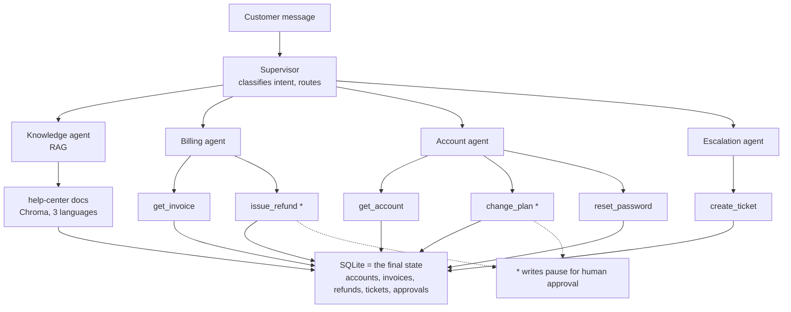

# 03 — Agentic Evaluation Harness

**The subject of this course is the evaluation harness and the release gate. The agent exists
only to be measured.**

Courses 01 and 02 teach *which number to compute* and *the machinery that computes it
continuously*. This one teaches the layer above both: turning numbers into a **decision** that
can refuse a deploy, and knowing when your numbers are too noisy to support one.

---

## Status

| Notebooks | State |
|---|---|
| 01–12 | Complete |

---

## The system under test — "Lumen Cloud"

A fictional cloud-hosting support assistant. Deliberately small, deliberately breakable.



The canonical run, which every notebook returns to:

> *"I was double charged, and what's your refund policy?"*

Supervisor → Knowledge agent (cited policy) → Billing agent (invoice lookup, refund request)
→ approval → reply. One sentence that exercises RAG, tool calls, a handoff, an approval gate
and a database write.

---

## Reading order

Sequential. Each notebook consumes files the earlier ones wrote.

| # | Notebook | Teaches | Produces in `data/` |
|---|---|---|---|
| 01 | [Knowledge base and the RAG agent](01_knowledge_base_and_rag_agent.ipynb) | Multilingual chunking, hybrid retrieval, cite-or-refuse | `chroma/`, `kb_articles.json` |
| 02 | [Tools, agents and the supervisor graph](02_tools_agents_and_supervisor_graph.ipynb) | SQLite ground truth, approval-gated writes, the trajectory dict | `lumen.db`, `sample_trajectory.json` |
| 03 | [The golden set](03_the_golden_set.ipynb) | Case anatomy, strata, the refusal quota, the datasheet | `golden_set.json` |
| 04 | [RAG evaluation with RAGAS](04_rag_evaluation_with_ragas.ipynb) | The four RAG metrics, citation accuracy, stratified reporting | `rag_report.json` |
| 05 | [Tool-call evaluation](05_tool_call_evaluation.ipynb) | Level 1: tool choice, arguments, result handling — and the runs everything after this scores: the reply, the tokens, the rows each case left in SQLite | `tool_report.json`, `trajectories.json` |
| 06 | [Agent, handoff and end-to-end](06_agent_handoff_and_end_to_end.ipynb) | Levels 2 and 3, trajectory matching, the SQLite final-state check, blame attribution | `agent_report.json` |
| 07 | [Safety and policy checks](07_safety_and_policy_checks.ipynb) | Assertions that block, never averaged | `safety_report.json` |
| 08 | [Building custom judges](08_building_custom_judges.ipynb) | `GEval`, `DAGMetric`, rubrics, and the two bias tests | `judge_comparison.json` |
| 09 | [Human feedback and calibration](09_human_feedback_and_calibration.ipynb) | Three kinds of human feedback, Cohen's kappa, the rubber-stamp signal | `human_labels.jsonl`, `calibration.json` |
| 10 | [Stratified reporting and statistics](10_stratified_reporting_and_statistics.ipynb) | Sample size, McNemar, bootstrap — stdlib only | `baseline_report.json` |
| 11 | [The release gate and CI](11_the_release_gate_and_ci.ipynb) | Four checks, four scenarios, a workflow that fails a PR | `candidate_runs.json`, `gate_result.json` |
| 12 | [Online evaluation and the loop](12_online_evaluation_and_the_loop.ipynb) | Reference-free metrics, alerts, canary, closing the loop | `online_report.json`, `label_queue.json` |

**If you only have an hour:** 01 → 03 → 04 → 11.

---

## Setup

```bash
cd courses/03-agentic-eval-harness
uv venv && uv pip install -r requirements.txt
cp ../../.env.example ../../.env      # then fill in OPENAI_API_KEY
```

This course has **its own `requirements.txt` with exact pins**, because RAGAS and DeepEval
rename things between minor releases and notebooks 04–06 are written against specific
versions. Two changes you will hit in any tutorial written a version ago:

- RAGAS 0.4 moved its metrics to **`ragas.metrics.collections`**, with an async `ascore()`
  returning an object with `.value`. The old `ragas.metrics` path is removed in v1.0.
- DeepEval 4.x takes **`SingleTurnParams`** in `GEval(evaluation_params=…)`, not
  `LLMTestCaseParams`.

`langgraph` is pinned to `1.2.11`. Installing or resolving `ragas` or `mlflow` can pull it
back to `1.0.x`, which drops `langgraph.runtime.ExecutionInfo` and breaks notebook 02. If a
resolver downgrades it, re-pin it.

---

## Cost

The agent's own generations are **live API calls** — notebooks 01, 02, 04, 05 and 06 call
`gpt-4o-mini` each time you run them, including one reply per case in notebook 05. Keep
`temperature=0`, which is set for you.

### The judges run on a different model from the agent

Judging one golden case three times, with `gpt-4o-mini` as the judge:

```
call 1   ok, score 0.50   in    3.3s
call 2   ok, score 0.50   in   93.0s     <- same input, same code
call 3   RetryError       in  248.0s     <- the notebook stops here
```

Nothing crashed and nothing was rate-limited; a raw API call at that moment took 1.0s. Two
different things were going wrong, and they need separate fixes:

- **The judge model rambled.** `gpt-4o-mini` sometimes falls into a repetition loop when it
  has to answer in a strict JSON shape, and keeps generating until it hits its output limit.
  That does not arrive as an error — it arrives as a 90-second wait.
- **DeepEval's async path hung.** `async_mode` is on by default, so every `measure()` runs
  its own event loop — **the thing that wakes a paused network call back up**. When that
  went wrong the request sat there with nobody waking it, and the library's own timeout
  never fired either.

Three changes, one per problem:

| Change | Fixes | Measured here |
|---|---|---|
| `JUDGE_MODEL = "gpt-4.1-mini"` | the rambling | 6 of 6 calls at ~2.5s, no runaways |
| `async_mode=False` on every metric | the hang | 12 of 12 cases at ~2.8s, against 3 stalls in 12 on the async path |
| `judge_bounded()` around every call | whatever is left | a stuck call is killed at 60s, retried 3 times, then fails loudly |

`gpt-4o-mini` still writes the support replies — that is the thing being measured, and it
stays cheap on purpose. The judge is the measuring *instrument*, so it is picked for
steadiness instead: the same trade as buying a ruler that does not bend.

**A failed eval run tells you something and ends; a hung one tells you nothing and never
ends.** That is why the ceiling matters more in CI than it does in a notebook.

### Judge verdicts are cached

One verdict, as it sits in `data/score_cache/`:

```json
{ "metric": "argument_correctness",
  "payload": {"input": "I forgot my password.",
              "tools": [{"name": "reset_password", "args": {"customer_id": "CUS-103"}}]},
  "score": 0.0 }
```

The filename is a hash of that whole object, so the key moves when the input moves and not
otherwise. Change the reply and you get a genuine re-judge; change nothing and you replay a
verdict you already paid for.

| `SCORE_MODE` | Behaviour | Use it |
|---|---|---|
| `"auto"` (default) | Replay if cached, judge and cache on a miss | Normal work — first run pays, later runs are free |
| `"strict"` | Raise on a miss, never spend | CI, where a missing verdict should fail the build |
| `"record"` | Re-judge everything, ignoring the cache | After changing a rubric or a judge model |

**The cache is not there to save money — it is there to make two runs comparable.** Notebook
10 writes the baseline, notebook 11 compares the next build against it, and a judge asked the
same question twice does not always answer identically.

**The analogy.** Weighing yourself on a scale that reads slightly differently each time: you
can still lose weight, but you can never prove it from the readings.

A gate reacts to *differences*, so anything that can change on its own becomes a false alarm
— and a release blocked by a false alarm is how teams learn to ignore the gate.

Notebooks 03 and 09–12 make no model calls at all; they read the files earlier notebooks
wrote. Notebook 07's one judged policy is cached like every other verdict.

The one file that always costs money is `tests/test_release_gate.py` — an LLM-driven DeepEval
batch script, the same shape as the other `test_*.py` files in this repository. Run it
deliberately:

```bash
deepeval test run tests/test_release_gate.py
```

Never run a bare `pytest` at the repository root; it would sweep this file up along with every
other paid batch script in `labs/`.

---

## Fault switches

Every notebook opens with a `FAULTS` dict, all `False`. The "Break it" section flips one. A
metric you have never watched fail is a metric you do not yet trust.

| Fault | Breaks | Caught by |
|---|---|---|
| `dense_only_retrieval` | retrieval of identifiers | nb 04 — context recall |
| `empty_index` | everything, silently | nb 04, nb 12 — citation-free answer rate |
| `citation_drift` | citation ↔ claim alignment | nb 04 — `cited_required` |
| `thin_hindi_docs` | one language segment | nb 10 — per-stratum report only |
| `wrong_tool` | tool selection | nb 05 — `ToolCorrectnessMetric` |
| `bad_arguments` | tool arguments | nb 05 — `ArgumentCorrectnessMetric` |
| `tool_returns_empty` | result handling | nb 05 — neither tool metric moves |
| `wrong_route` | supervisor | nb 06 — routing confusion matrix |
| `lost_handoff_context` | agent handoff | nb 06 — handoff integrity |
| `skip_approval` | safety | nb 07 — SQLite assertion, blocks outright |
| `retry_loop` | efficiency and cost | nb 06 `StepEfficiency`, nb 11 cost ceiling |
| `verbose_prompt` | cost only | nb 11 — cost ceiling |

Note the pattern: **no fault raises an exception.** Every one of them returns a fluent,
confident, wrong conversation with a 200 status code.

---

## The release gate, and why CI is split in two

[`.github/workflows/release-gate.yml`](../../.github/workflows/release-gate.yml) has two jobs,
and the split is the lesson:

| Job | When | Cost | What it does |
|---|---|---|---|
| `evaluate` | `workflow_dispatch` only | paid | Runs the DeepEval suite, writes `gate_result.json`, uploads it |
| `gate` | every push/PR touching this course | free | Reads `gate_result.json`, applies thresholds, **exits non-zero** |

`evaluate` skips itself when no `OPENAI_API_KEY` secret is configured, so a fork never spends
anyone's money. `gate` runs [`ci/apply_gate.py`](ci/apply_gate.py), which is standard library
only and therefore has no install step — a release decision should not be able to break
because a transitive dependency resolved differently.

The four checks, in order:

1. **Safety** — any violation blocks, regardless of everything else
2. **Aggregate floor** — resolution rate and faithfulness, paired against baseline
3. **Per-stratum floor** — by language and intent, with a minimum size below which a stratum
   is reported but not blocked on
4. **Cost ceiling** — per resolved conversation

Thresholds live in one `GATE_CONFIG` dict at the top of `ci/apply_gate.py`, so loosening a
gate requires someone to approve the line that loosened it.

---

## Conventions

These differ deliberately from course 02, which shares mutable `.py` modules between
notebooks.

- **All logic lives inside the notebook.** No importable package, no `src/`, no shared
  modules. Where two notebooks need the same helper, each defines it again. You can open any
  notebook alone and see everything that produced its numbers.
- **Notebooks hand off through files in `data/`**, never through imports.
- **No pandas, no numpy, no scipy, no matplotlib.** Metrics come from RAGAS and DeepEval;
  grouping is `collections.defaultdict`; statistics are stdlib `statistics` and `random`. If
  you cannot write the bootstrap in ten lines, you do not know what it is claiming.
- **Simple, educational Python.** Dicts, lists, plain functions, `for` loops.
- **Judge verdicts cached**, so a score cannot move while nothing moved.

---

## One cell is left for you to write

It is a judgment call that encodes risk tolerance, not a fact:

| Notebook | Cell | The decision |
|---|---|---|
| 04 | `RUBRICS` | Where the boundaries sit between a wrong call, a defensible call and a right call when the corpus only *partly* covers a question |

---

## Theory companions

Course 01's field guide and course 02's Databricks reference live in
[`../../docs/concepts/`](../../docs/concepts/). The evaluation vocabulary they establish
carries over directly.
