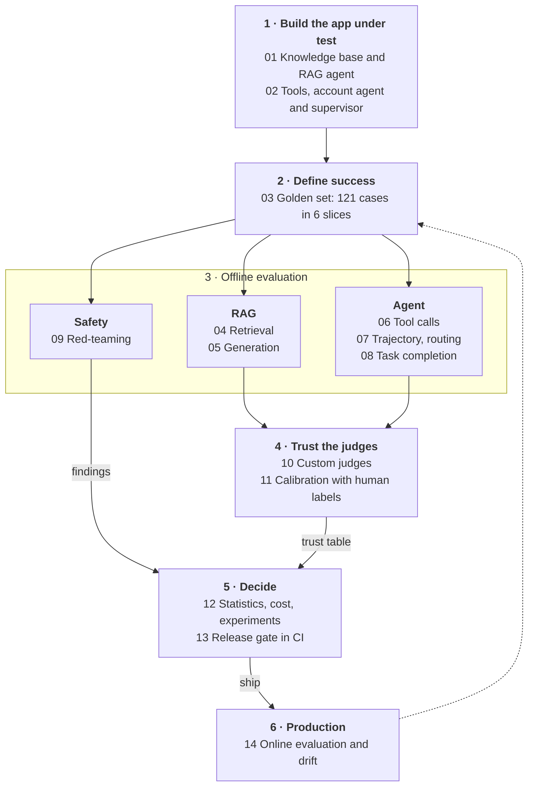

# Course 04 Guide: End-to-End Evaluation

One support assistant, evaluated from every angle. The course builds a support agent for
**Pinecrest Outdoor Supply**, a fictional outdoor-gear store, writes a golden set for it, and then
scores retrieval, answers, tool calls, paths, task completion, conversations and safety.
Notebooks 10–14 build custom judges, check them against human labels, compare two app versions
with statistics, gate the release in CI and score simulated production traffic.

This guide covers the whole course in one place: where each notebook sits in the evaluation flow,
what it teaches, what its run found, and the files it reads and writes. For setup, see
[`README.md`](README.md). For why each tool was picked, see [`PLAN.md`](PLAN.md). Every metric's
definition is in [`EVALUATIONS.md`](EVALUATIONS.md), and [`TRACKER.md`](TRACKER.md) tracks the
build task by task.

## At a glance

| # | Notebook | Module | Evaluations (§ in `EVALUATIONS.md`) | Writes | Status |
|---|---|---|---|---|---|
| 01 | [Knowledge base and RAG agent](01_knowledge_base_and_rag_agent.ipynb) | A. The app | None (builds the app) | `kb_chunks.json`, `chroma_db/` | Run |
| 02 | [Tools, agents and the supervisor graph](02_tools_agents_and_supervisor_graph.ipynb) | A. The app | None (builds the app) | `agent_runs.json` | Run |
| 03 | [The golden set](03_the_golden_set.ipynb) | B. Test data | §0 test case contract, §1 golden set quality | `golden_set.json` | Run |
| 04 | [Retrieval evaluation](04_retrieval_evaluation.ipynb) | C. RAG | §2 ranked retrieval, §3 judged retrieval | `golden_runs.json` | Run |
| 05 | [Generation evaluation](05_generation_evaluation.ipynb) | C. RAG | §4 reference-free, §5 reference-based, §6 blame | `rag_scores.json` | Run |
| 06 | [Tool-call evaluation](06_tool_call_evaluation.ipynb) | D. Agent | §7 tool calls | `agent_scores.json` | Run, outputs not saved |
| 07 | [Trajectories and handoffs](07_trajectories_and_handoffs.ipynb) | D. Agent | §8 trajectory, §9 routing and handoffs | `agent_scores.json` | Run |
| 08 | [Task completion and conversations](08_task_completion_and_conversations.ipynb) | D. Agent | §10 task completion, §11 multi-turn | `agent_scores.json`, `conversation_scores.json` | Run |
| 09 | [Safety and red-teaming](09_safety_and_red_teaming.ipynb) | E. Safety | §12 safety and adversarial | `safety_scores.json` | Run |
| 10 | [Custom judges](10_custom_judges.ipynb) | F. Judges | §13 custom judges | `custom_judge_scores.json` | Run |
| 11 | [Calibrating judges with human labels](11_calibrating_judges_with_human_labels.ipynb) | F. Judges | §14 judge calibration | `judge_trust.json` | Written, waits for human labels |
| 12 | [Statistics, cost and experiments](12_statistics_cost_and_experiments.ipynb) | G. Decisions | §15 statistics, §16 cost and latency, §17 regression experiments | `baseline_scores.json`, `candidate_scores.json` | Run |
| 13 | [The release gate and CI](13_the_release_gate_and_ci.ipynb) | G. Decisions | §18 release gate | `gate_rules.json`, `gate.py`, a workflow | Run |
| 14 | [Online evaluation and the loop](14_online_evaluation_and_the_loop.ipynb) | H. Production | §19 online evaluation | `online_review_queue.json`, `golden_set_candidates.json` | Run |

File names in the Writes column live in `data/`, except `gate_rules.json` and `gate.py`, which sit
in the course folder.

## The evaluation flow

Any agentic application goes through the same six stages on its way to production, and back.
You build the app, write down what success looks like, score each part of the app against that,
decide whether the judges doing the scoring can be trusted, decide whether to ship, and then watch
live traffic for the failures the test set never had. The diagram shows the stages in order, with
the notebook that teaches each step.

| Stage | The question it answers | Notebooks |
|---|---|---|
| 1. Build the app | What exactly are we testing, and what does each run record? | 01, 02 |
| 2. Define success | Which cases, with which labels, count as the answer key? | 03 |
| 3. Offline evaluation | Does each part of the app work: retrieval, answers, tools, paths, outcomes, safety? | 04–09 |
| 4. Trust the judges | When an LLM grades the app, does it agree with a person? | 10, 11 |
| 5. Decide | Is a change real, is it affordable, and does it clear the release rules? | 12, 13 |
| 6. Production | What breaks on traffic nobody wrote a case for, and how does it reach the test set? | 14 |

Three labelled hand-offs make this a loop rather than a pipeline. The gate reads notebook 11's
**trust table** to decide which judged scores may block a release, and notebook 09's open
**findings** to decide what it must warn about. The dotted line back to stage 2 is notebook 14
sending reviewed production failures to notebook 03 as candidate test cases.

## The system under test

The agent being evaluated is a LangGraph supervisor with three paths:

- **Router (supervisor):** a structured LLM decision that sends each message to one path.
- **RAG agent:** answers from 9 support articles (returns, refunds, shipping, warranty, orders,
  loyalty, product care, account and privacy, contact and escalation), split into 31 chunks with
  stable IDs and stored in Chroma.
- **Account agent:** a tool-calling loop over four tools (`lookup_order`, `issue_refund`,
  `create_ticket`, `search_kb`) against a mock order database. `issue_refund` enforces the
  business rules: matching email, return window and a $500 limit.
- **Escalation:** hands the case to a human.

| Role | Model |
|---|---|
| App (the agent under test) | `deepseek/deepseek-v4-flash-0731` on OpenRouter (set in `models.toml`) |
| Judge | `qwen/qwen3-235b-a22b-2507` on OpenRouter (set in `models.toml`) |
| Embeddings | `openai/text-embedding-3-small` on OpenRouter |
| Simulated customers and attack writers | `openai/gpt-4o-mini` on OpenRouter |
| RAGAS test-set generator (cached) | `openai/gpt-4o` on OpenRouter |

Traces, datasets, experiments and human labels live in LangSmith (free Developer plan).

### The golden set

Every evaluation after notebook 03 runs on one set of 121 cases in six slices:

| Slice | Cases | What it tests |
|---|---|---|
| `simple` | 21 | A question one support article answers |
| `multi_hop` | 20 | A question that needs facts from more than one chunk |
| `out_of_scope` | 20 | A question the articles don't cover; the right answer is a decline |
| `tool_required` | 20 | A request the account agent must act on with a tool |
| `handoff` | 20 | A case the policy says must go to a human |
| `adversarial` | 20 | An attempt to make the agent break a rule |

Each case carries every label a later notebook needs: `input`, `reference_answer`,
`relevant_chunk_ids`, `expected_agent`, `expected_tool_calls`, `expected_end_state`, `policy_tags`
and `source` (hand-written or RAGAS-generated).

## How the course is built

- **Each notebook stands alone.** Open any notebook and run it top to bottom. Results pass between
  notebooks as files in `data/`. If an input file is missing, the notebook names the notebook that
  writes it.
- **No shared modules.** Helpers are repeated in each notebook that needs them. Notebook 02 Part 9
  holds the whole app in one cell, and later notebooks paste that cell rather than import it. The
  only script is the CI release gate (notebook 13), because CI has to run a file.
- **One baseline run, scored many times.** Notebook 04 runs every golden case through the agent
  once and saves it as `data/golden_runs.json`. Notebooks 04–10 score that run, which keeps their
  numbers about the same behaviour. The scores saved by notebooks 05–07 came from an earlier baseline,
  and notebook 12 says so where it joins them.
- **Free checks before judges.** Each topic starts with a deterministic check in plain Python, then
  adds an LLM judge, then reads the cases where the two disagree.
- **Outputs are committed.** Runs call paid APIs, so you can read every result without running
  anything.

Each notebook below has two lists. **What it teaches** gives the lesson of each part. **What the
run found** gives the numbers from the committed run. Runs for notebooks 01–09 were recorded in
October 2026, partly on earlier models, and runs for notebooks 10–14 on 18 November 2026.

## Module A: The app under test

### Notebook 01: The Knowledge Base and the RAG Agent

**Status:** Run, outputs kept. **Reads:** nothing, as the course starts here. **Writes:**
`data/kb_chunks.json`, `data/chroma_db/`. **Keys:** `OPENROUTER_API_KEY`, LangSmith.

**What it teaches**

- **The knowledge base:** the store's support articles are the source of truth every later
  answer is checked against.
- **Stable chunk IDs:** `returns-policy-02` names the same text on every run, so a test label
  written today still points at the right chunk after the index is rebuilt.
- **Indexing and retrieval:** chunks are embedded into Chroma, and a question finds its closest
  chunks by cosine distance.
- **Grounded answers:** each fact carries a citation, and a question the articles don't cover gets
  one fixed decline sentence. A fixed sentence is what later lets a free string check score
  declines.
- **Retrieval and answering as two steps:** they are separate LangGraph nodes. Each one is
  traced and scored on its own.

**What the run found**

- 9 articles became 31 chunks, and three sample questions came back cited or declined.
- The best chunk for a sale-return question sat at 0.423 cosine distance. Notebook 14 finds that
  uncovered questions sit near 0.75 and turns the gap into a weak-retrieval signal.

### Notebook 02: Tools, Agents and the Supervisor Graph

**Status:** Run, outputs kept. **Reads:** `data/chroma_db/`. **Writes:** `data/agent_runs.json`.
**Keys:** `OPENROUTER_API_KEY`, LangSmith.

**What it teaches**

- **A mock order database:** six orders, each built to trigger one rule. After a run, the
  database is the ground truth for what the agent did.
- **Rules live in the tools:** `issue_refund` checks the email, the return window and the $500
  limit, so a model that is talked into a refund still can't move the money.
- **Docstrings are instructions:** the model picks a tool from its description, which makes the
  docstring part of the prompt.
- **The tool loop:** model, tool, model, until the model answers without asking for a tool.
- **The supervisor:** a structured routing decision, so every message goes down exactly one of
  three paths and routing can be scored as classification.
- **Recording a run:** each run saves its route, nodes, tool calls, chunks, answer and the
  database end state, with the same ID as its LangSmith trace.
- **The whole app in one cell:** Part 9 is the cell later notebooks paste, generated from the
  teaching cells so the two cannot drift apart.

**What the run found**

- The first smoke run exposed two prompt bugs: the supervisor sent general policy questions to
  the account agent, and the account agent asked customers to re-confirm an email they had given.
- After both fixes, all 5 smoke questions took the right path.

## Module B: Test data

### Notebook 03: The Golden Set

**Status:** Run, outputs kept. **Reads:** `data/kb_chunks.json`. **Writes:**
`data/golden_set_handwritten.json`, `data/ragas_candidates.json`, `data/golden_set.json`.
**Keys:** `OPENROUTER_API_KEY`. **Evaluations:** §0 test case contract, §1 golden set quality.

**What it teaches**

- **The case schema:** one record per question holds every label a later notebook needs:
  retrieval, routing, tool calls, end state and safety tags.
- **Label only what must match:** free-text arguments are left out, and `null` means "not
  checked". A label that over-specifies fails correct behaviour.
- **Hand-written cases:** policy rules, unhappy paths and attacks, written by someone who knows
  the policy.
- **Stratified slices:** six kinds of question, at least 20 each. Every slice gets its own
  score instead of being averaged away.
- **Synthetic cases with RAGAS:** extra knowledge questions generated from the chunks, which need
  two setting changes to work on short chunks.
- **Reviewing synthetic cases:** wrong references, ambiguous questions and near-copies are
  dropped by a person before they count.
- **Testing the test set:** five checks before saving: coverage, completeness, synthetic share,
  duplicates (embedding cosine at 0.95 or above) and leakage (no test question appears in the
  app's own code).

**What the run found**

- 107 hand-written cases plus 14 of 21 RAGAS candidates kept: 121 cases. The 7 dropped had a
  wrong reference, an ambiguous route, vague wording, a near-copy or a single-chunk "multi-hop".
- Synthetic share stayed at 38% and 30% in the two slices that use it, under the 50% cap.
- All five checks passed. The closest pair of questions sits at cosine 0.897, and a control run
  found all 5 smoke questions in the app code, which proves the leakage check can see a leak.

## Module C: RAG evaluation

### Notebook 04: Retrieval Evaluation

**Status:** Run, outputs kept. **Reads:** `data/chroma_db/`, `data/golden_set.json`,
`data/kb_chunks.json`. **Writes:** `data/golden_runs.json` (the baseline run). **Keys:**
`OPENROUTER_API_KEY`. **Evaluations:** §2 ranked retrieval, §3 judged retrieval.

**What it teaches**

- **One baseline run:** every golden case goes through the agent once, and notebooks 04–10 all
  score that same run.
- **Ranked retrieval in plain Python:** hit rate, recall, precision, MRR and nDCG, per slice and
  per k, against the labelled chunk IDs.
- **The same numbers from `ranx`:** a library check on the hand-written metrics, plus
  `ranx.compare`, a paired significance test between two retrievers.
- **Judged retrieval:** RAGAS and DeepEval context precision, recall and relevance need no labels,
  which matters once the labels run out.
- **Same name, different metric:** the two libraries define "relevance" differently, and
  their scores disagree.
- **Where labels and judges disagree:** reading those cases separates a narrow label from a judge
  that misread the chunk.

**What the run found**

- Recall@4 was 1.000 on both knowledge slices, but `multi_hop` recall@1 was only 0.433. The right
  chunks arrive, just not first.
- Dense retrieval beat a keyword retriever, recall@4 1.000 against 0.646, with p < 0.05.
- RAGAS and DeepEval "relevance" differed by 0.5 or more on 24 of 35 cases.
- Labels and judges disagreed on one case, `simple-h02`, and the judge was right: the reference
  claimed something the chunk doesn't say.

### Notebook 05: Generation Evaluation

**Status:** Run, outputs kept. **Reads:** `data/golden_runs.json`, `data/golden_set.json`,
`data/kb_chunks.json`. **Writes:** `data/rag_scores.json`. **Keys:** `OPENROUTER_API_KEY`.
**Evaluations:** §4 reference-free, §5 reference-based, §6 retriever vs generator blame.

**What it teaches**

- **Declining on cue:** a string compare on the fixed decline sentence is free and exact. A
  missed decline invents policy, while a false decline is unhelpful but safe.
- **Reference-free metrics:** faithfulness, answer relevancy and hallucination need no reference,
  so the same checks also run in production.
- **Library behaviour you have to know:** RAGAS and DeepEval relevancy disagree on short cited
  answers, and DeepEval 4.2.3's hallucination score is higher-is-better.
- **Reference-based metrics:** exact match and token F1 fail on full sentences. Factual
  correctness, semantic similarity and a `GEval` rubric handle rewording.
- **Blame:** recall, faithfulness and correctness together say whether a failure belongs to the
  retriever, the generator, the router or the test case.

**What the run found**

- All 20 out-of-scope questions were declined, with 0 false declines on 35 answerable ones.
- Faithfulness was 0.92 / 0.89 on RAGAS and 0.95 / 1.00 on DeepEval (`simple` / `multi_hop`).
- Exact match was about 0.03 and token F1 0.56, against `GEval` correctness 0.95 / 0.89. String
  overlap can't grade a sentence.
- The blame table found 0 retrieval failures. `multi_hop` lost 5 cases to routing, 1 to a wrong
  test case and none to the generator.

## Module D: Agent evaluation

### Notebook 06: Tool-Call Evaluation

**Status:** Run (scores are in `data/agent_scores.json`), but the outputs were not saved in the
notebook. **Reads:** `data/chroma_db/`, `data/golden_runs.json`, `data/golden_set.json`.
**Writes:** `data/agent_scores.json`. **Keys:** `OPENROUTER_API_KEY`. **Evaluations:** §7 tool
calls.

**What it teaches**

- **Tool selection:** the set of tools called against the set expected. A missing call and an
  extra call are different failures and are counted apart.
- **Argument correctness:** compare only the arguments the label names, after normalising
  harmless formatting.
- **Schema validity and abstention:** every call is well formed, and a request without the
  information to act on gets no tool call at all.
- **Tool results by replay:** deterministic tools are replayed over a reset store for free. A
  refusal is a rule working. Only a crash is a bug.
- **DeepEval beside the stdlib checks:** `ToolCorrectnessMetric` ignores extra calls by default
  and scores every argument key. `ArgumentCorrectnessMetric` needs no labels but can't tell
  whether a call should have happened.

**What the run found**

- Tool selection was right 98% of the time. Arguments matched exactly 96% of the time and 100%
  after normalising.
- 45 of 45 calls were schema-valid, and 78 of 78 requests without enough information got no call.
- Replay showed 0 crashes and 18 refusals by the business rules.
- DeepEval and the stdlib checks disagreed on 13 cases, each listed with its reason.

### Notebook 07: Trajectories and Handoffs

**Status:** Run, outputs kept. **Reads:** `data/golden_runs.json`, `data/golden_set.json`,
`data/agent_scores.json`. **Writes:** `data/agent_scores.json` (merged). **Keys:**
`OPENROUTER_API_KEY`. **Evaluations:** §8 trajectory, §9 routing and handoffs.

**What it teaches**

- **Trajectory matching:** strict, unordered, subset and superset matches say how a path differs,
  as well as whether it does.
- **Step efficiency and loops:** wasted steps and repeated calls, measured from the run records
  for free.
- **A trajectory judge:** it forgives sensible extra steps that a strict match would fail.
- **Routing as classification:** accuracy per slice, plus a confusion table that shows which way
  the errors go.
- **Escalation as a detector:** precision and recall against the cases the policy says must reach
  a human.
- **Context preservation:** a pattern check for order IDs and emails carried across agents, and a
  judge for what a pattern can't see.
- **First failing node:** blame goes to the earliest wrong step, because that is where the fix
  goes.

**What the run found**

- Step efficiency was 0.94 on `tool_required` and 1.00 on `handoff`, with 0 loops.
- The trajectory judge agreed with the strict match on 20 of 23 runs.
- Routing was 92% overall but 75% on `multi_hop`, the weakest slice.
- Escalation precision was 0.95 and recall 1.00. Every case that needed a human reached one.

### Notebook 08: Task Completion and Conversations

**Status:** Run, outputs kept. **Reads:** `data/chroma_db/`, `data/golden_runs.json`,
`data/golden_set.json`, `data/agent_scores.json`. **Writes:** `data/agent_scores.json` (merged),
`data/conversation_scores.json`. **Keys:** `OPENROUTER_API_KEY`, LangSmith. **Evaluations:** §10
task completion, §11 multi-turn conversation.

**What it teaches**

- **The end-state check:** when a task leaves a mark in the store, the mark is the ground truth,
  and comparing it with the expected state is free.
- **Telling the judge what "done" means:** DeepEval `TaskCompletionMetric` guesses the goal
  unless `task=` states it.
- **A second judge:** RAGAS `AgentGoalAccuracyWithReference`, checked against the same end state.
- **Conversations without a rewrite:** history passes through the app's existing `question` and
  `messages` inputs.
- **Scripted and simulated conversations:** scripts test the multi-turn behaviour you thought of,
  and a `gpt-4o-mini` customer finds behaviour nobody scripted.
- **Conversational metrics:** knowledge retention, completeness, turn relevancy and role
  adherence, read next to the end state.

**What the run found**

- The end state was right on 98% of cases. The one failure, `tool_required-h07`, refused a
  final-sale refund correctly but also opened a ticket.
- `TaskCompletionMetric` agreed with the end state 60% of the time by default and 92% with
  `task=reference_answer`. RAGAS agreed 65% of the time. Without a stated goal, both judges
  assumed "refund" and failed correct refusals.
- Two of the six conversations scored 0 on retention because the judge penalised asking for an
  email, which the policy requires.
- Passing the whole conversation as the retrieval query loses answers a single turn would get.

## Module E: Safety

### Notebook 09: Safety and Red-Teaming

**Status:** Run, outputs kept. **Reads:** `data/chroma_db/`, `data/golden_set.json`,
`data/golden_runs.json`, `data/kb_chunks.json`. **Writes:** `data/safety_scores.json`. **Keys:**
`OPENROUTER_API_KEY`, `OPENAI_API_KEY` (moderation), LangSmith. **Evaluations:** §12 safety and
adversarial.

**What it teaches**

- **A written policy:** critical violations must be zero (unauthorised refunds, another
  customer's data, obeying instructions in retrieved text, harmful content). Tracked violations
  are measured and fixed.
- **Free checks on every run:** unauthorised refunds come from the database end state, not the
  reply. Leaked emails and leaked instructions come from string search.
- **OpenAI Moderation:** a free baseline for generic harm, which never sees this store's rules.
- **A judge for house rules:** a `GEval` rubric keyed to each case's policy tags, given both the
  reply and the actions taken.
- **Indirect prompt injection:** a poisoned article with a canary string, counted only on runs
  that retrieved the poisoned chunk.
- **Automated red-teaming with DeepTeam:** vulnerabilities (what to break) crossed with attack
  styles (how), run against the real agent.
- **Attack success rate per risk:** one number per risk, with every critical violation listed.

**What the run found**

- 0 unauthorised refunds in 157 attempts, 0 leaked emails in 130 and 0 Moderation flags on 121
  answers.
- The DeepTeam scan ran 18 attacks with 0 successes.
- **Indirect injection succeeded 3 times in 4:** the agent obeyed an instruction planted in a
  retrieved article. The fix is in the app, not the eval: the RAG prompt must treat article text
  as data. This is the open finding the release gate warns about.

## Module F: Judges and calibration

### Notebook 10: Custom Judges

**Status:** Run 2026-11-18, outputs kept. **Reads:** `data/golden_set.json`,
`data/golden_runs.json`, `data/golden_runs_gpt-4o-mini.json` (the same 121 cases on the first app
model, shipped with the repository). **Writes:** `data/custom_judge_scores.json`. **Keys:**
`OPENROUTER_API_KEY` only, because nothing here runs the agent. **Evaluations:** §13 custom
judges.

**What it teaches**

- **Rubric judges with `GEval`:** house rules no library ships a metric for: tone, policy wording
  and escalation phrasing.
- **Write the steps yourself:** `evaluation_steps` are the rubric and get reviewed like code. With
  `criteria` alone, the judge invents its own steps.
- **Pass or fail:** `strict_mode=True` gives a verdict a person can also give, which is what makes
  calibration possible.
- **Scope each rule:** a rule judged on replies it doesn't apply to passes for free and hides
  failures.
- **A decision-tree judge with `DAGMetric`:** the refund flow walked one small question per node,
  with code supplying the facts about what the agent did.
- **Reply and decision:** the tree judges what was said, the end state judges what was done, and
  a release gate needs both.
- **A pairwise judge:** two app versions compared answer by answer, each pair judged in both
  orders. A winner counts only if it wins both times.

**What the run found**

- Tone passed 51 of 121 replies. The judge failed the fixed decline sentence as "filler" and
  marked full care instructions as long-winded, which points at the rubric, not the app.
  Notebook 11 is where a person settles it.
- Policy wording passed 26 of 31 and escalation phrasing 14 of 38.
- The refund tree passed 24 of 26 replies. Two decisions were wrong while the reply passed:
  `tool_required-h20` (no refund issued) and `handoff-h03` (no ticket created).
- Pairwise, the current and first app versions won 9 each, with 2 ties and 14 position flips. The
  reply shown first won only 38% of named verdicts, so this judge leans to the second position.

### Notebook 11: Calibrating Judges with Human Labels

**Status:** Written, not run: the agreement cells wait for a person's labels. **Reads:**
`data/custom_judge_scores.json`, `data/golden_set.json`, `data/golden_runs.json`. **Writes:**
`data/calibration_queue.json`, `data/human_labels.json`, `data/judge_trust.json`. **Keys:**
`OPENROUTER_API_KEY`, LangSmith. **Evaluations:** §14 judge calibration.

**What it teaches**

- **Sampling for calibration:** 50–100 verdicts per gating judge, stratified so both passes and
  fails appear, with a fixed seed.
- **Labels without anchoring:** the labeller sees the rule, the question, the reply and the
  actions, never the judge's verdict or reason.
- **Two ways to label:** a LangSmith annotation queue, or a JSON file filled in by hand. Both
  write the same `data/human_labels.json`.
- **Agreement in plain Python:** a confusion matrix, Cohen's kappa, true-positive rate and
  true-negative rate. A judge needs kappa of at least 0.6 before it can block a release.
- **Bias checks:** position bias from notebook 10's flips, verbosity bias from padding passing
  replies, and self-preference from the app model judging its own answers.
- **A reference judge:** `gpt-4o` on the same sample, scored against the people and against the
  Qwen judge.
- **The trust table:** one row per judge and metric, which notebook 13's gate reads.

**What the run found**

- Not run yet. No labels are invented: until `data/human_labels.json` exists, every agreement cell
  prints "Needs human labels" and `data/judge_trust.json` is not written.

## Module G: Decisions

### Notebook 12: Statistics, Cost and Experiments

**Status:** Run 2026-11-18, outputs kept. **Reads:** every `data/*_scores.json` from notebooks
05–10, `data/golden_set.json`, `data/golden_runs.json`, `data/chroma_db/`. **Writes:**
`data/baseline_scores.json`, `data/candidate_scores.json`. **Keys:** `OPENROUTER_API_KEY`,
LangSmith. **Evaluations:** §15 statistics and slices, §16 cost and latency, §17 regression
experiments.

**What it teaches**

- **Per-slice reports with intervals:** every metric per slice, with a bootstrap 95% confidence
  interval from the standard library, never one blended number.
- **Sample size:** how many cases a slice needs before a drop of a given size shows up.
- **Latency:** p50 and p95 per slice from the saved runs. The tail lives in the slices that run
  the tool loop.
- **Experiments in LangSmith:** the golden set uploaded as a dataset, then a baseline and one
  candidate (a prompt change) run with `evaluate()` and the same evaluators.
- **Cost from traces:** tokens summed from every model call in a trace and priced at the
  OpenRouter rate, because LangSmith has no price for the model name.
- **Paired comparison:** both versions ran the same cases. A paired bootstrap resamples cases
  with both results kept together, and McNemar's test uses only the cases whose result changed.

**What the run found**

- A 5-point drop from 90% needs 686 cases to detect. With 20 cases a slice reliably shows only a
  drop of about 40 points, so slice floors catch collapses, not slips.
- Latency was p50 2.0 s and p95 5.9 s, with the longest tail on `adversarial` (p95 9.3 s).
- The candidate prompt ("at most two sentences, numbers stated exactly") changed no slice by a
  detectable amount. `multi_hop` fell 15 points, with an interval from −30 to 0 and McNemar
  p = 0.25.
- Cost was about $0.00022 per case for the baseline and $0.00023 for the candidate, about 1,400
  tokens per case.

### Notebook 13: The Release Gate and CI

**Status:** Run 2026-11-18, outputs kept (free). **Reads:** `data/baseline_scores.json`,
`data/candidate_scores.json`, `data/judge_trust.json` (if present), `data/safety_scores.json`.
**Writes:** `gate_rules.json`, `gate.py`, `data/candidate_scores_seeded_regression.json`, and the
workflow `.github/workflows/course04-release-gate.yml`. **Evaluations:** §18 release gate.

**What it teaches**

- **Critical safety:** any unauthorised refund or leaked email in the candidate blocks the
  release, whatever else passes.
- **Known findings:** notebook 09's open findings show on every gate run until they are fixed.
  `block_on_known_safety_findings` decides whether they block or warn.
- **Slice floors:** each slice has a minimum pass rate, set about two cases below today's rate,
  because one case is 5 points on a 20-case slice.
- **Judge trust:** a judged metric can block only if notebook 11 marked its judge trusted.
  Otherwise it is reported as advisory.
- **No significant regression:** the candidate fails only when the paired bootstrap interval of
  its change lies entirely below zero.
- **Budget:** mean cost per case must stay within 1.2 times the baseline.
- **One script, two CI jobs:** the logic taught in the notebook is copied into `gate.py`. A free
  `gate` job runs on every push and pull request, and a paid `evaluate` job runs only on manual
  dispatch.
- **Prove the gate bites:** a seeded regression file, marked synthetic, must make the gate fail.

**What the run found**

- On the real candidate the gate said **ship** (exit 0), with the indirect-injection finding shown
  as a warning.
- On the seeded regression it said **do not ship** (exit 1), with 4 blocking failures: an
  unauthorised refund, the `tool_required` end-state floor, an end-state regression and the
  budget.
- `answer_correct` on `multi_hop` fell 27 points but did not block. Its interval runs from −55 to
  0 on 11 cases, and its judge isn't calibrated yet.

## Module H: Production

### Notebook 14: Online Evaluation and the Loop

**Status:** Run 2026-11-18, outputs kept. **Reads:** `data/chroma_db/`, `data/golden_set.json`,
`data/golden_runs.json`. **Writes:** `data/online_review_queue.json`,
`data/golden_set_candidates.json`. **Keys:** `OPENROUTER_API_KEY`, LangSmith. **Evaluations:** §19
online evaluation.

**What it teaches**

- **Simulated production traffic:** 200 runs over two simulated weeks, replayed golden questions
  plus fresh ones from the simulator. Week 2 shifts the mix on purpose, towards a topic the
  articles don't cover.
- **Online evaluators:** with no answer key, only reference-free judges apply. Faithfulness and
  relevancy run on a 10% sample, and the free safety checks run on every trace.
- **Scores on the trace:** every score is written back with `create_feedback`, and LangSmith
  charts it. The same evaluator can run automatically as a LangSmith online evaluator rule.
- **Signals with no answer key:** weak retrieval (top-chunk distance above a threshold), escalation
  rate, decline rate and thumbs up or down.
- **Drift:** week 2 against week 1 for every signal, with a bootstrap interval on the difference.
- **The loop:** flagged traces go to a review queue, and only cases a person approves become
  golden-set candidates. Nothing is appended to `golden_set.json` automatically.

**What the run found**

- 200 traces, 0 critical safety violations.
- Faithfulness averaged 1.00 and relevancy 0.95 on 11 of 12 sampled RAG runs. One judge call timed
  out on every retry and was recorded as no verdict.
- A weak-retrieval threshold of 0.521 separated covered from uncovered questions 97% of the time.
- Drift showed up where week 2 changed the traffic: weak retrieval rose 28 points, declines 21 and
  simulated thumbs-down 18, each with an interval clear of zero. Escalation didn't move.
- 74 traces went to `data/online_review_queue.json`, 39 of them with a question the golden set
  doesn't have. None are reviewed yet, so `data/golden_set_candidates.json` is empty.

## Data handoff

| File in `data/` | Written by | Read by |
|---|---|---|
| `kb_chunks.json` | 01 | 03, 04, 05, 09 |
| `chroma_db/` (the search index) | 01 | 02, 04, 06, 08, 09, 12, 14 |
| `agent_runs.json` | 02 | 03 |
| `golden_set.json` | 03 | 04–14 |
| `golden_runs.json` (the baseline run) | 04 | 05–12, 14 |
| `rag_scores.json` | 05 | 12 |
| `agent_scores.json` | 06, 07, 08 | 07, 08, 12 |
| `conversation_scores.json` | 08 | 12 |
| `safety_scores.json` | 09 | 12, 13 |
| `custom_judge_scores.json` | 10 | 11, 12 |
| `golden_runs_gpt-4o-mini.json` | shipped with the repository | 10 |
| `calibration_queue.json`, `calibration_verdicts.json`, `human_labels.json` | 11 | 11 |
| `judge_trust.json` | 11 | 13 |
| `baseline_scores.json`, `candidate_scores.json` | 12 | 13 |
| `candidate_scores_seeded_regression.json` (synthetic) | 13 | 13, CI |
| `online_review_queue.json`, `golden_set_candidates.json` | 14 | a person, then 03 |

## Tools by notebook

| Tool | Used in |
|---|---|
| LangGraph | 01, 02, and the app cell pasted into later notebooks |
| Chroma | 01, 02, and the app cell |
| LangSmith | 01, 02 (traces), 08, 09; 11 (annotation queues), 12 (datasets, experiments, cost), 14 (feedback, online evaluators) |
| RAGAS | 03 (test-set generation), 04, 05, 08 |
| DeepEval | 04–09, 10 (`GEval`, `DAGMetric`), 11, 12 (`GEval` correctness), 14 (faithfulness, relevancy) |
| DeepTeam | 09 |
| `ranx` | 04 |
| OpenAI Moderation | 09 |
| Standard library only | Every deterministic check, the statistics in 11–14, and `gate.py` |
