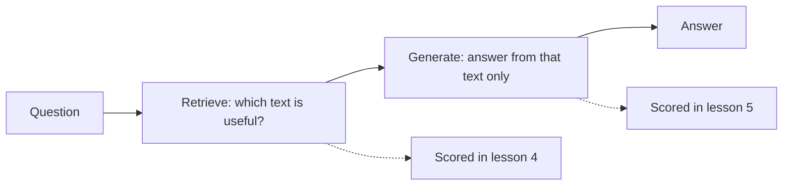
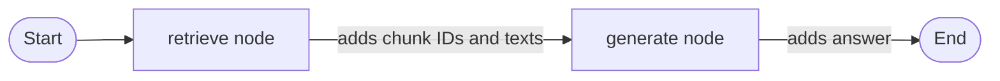

## Start with the thing we will test

This course tests one support assistant from every angle. It works for **Pinecrest Outdoor Supply**, a made-up shop that sells outdoor gear. Before we can test anything, we need the assistant itself.

This lesson builds the first half of it: the part that answers questions from the shop's help articles. It is a **RAG agent**. RAG stands for retrieval-augmented generation: first *find* the right text, then *write* an answer from that text only.

Nothing in this lesson is scored yet. The point is to build the agent so that every later score has something clear to read.

> **What you'll learn**
>
> - Explain why every piece of help text needs an ID that never changes.
> - Describe how a question finds the closest pieces of text in a search index.
> - Explain what a grounded answer is, and why "I don't know" can be the right answer.
> - Name what a trace records, and which later lesson reads each part.

## Two decisions, scored separately

A RAG agent makes two separate decisions. First, which pieces of text are useful for this question? Second, what should the answer say, using only those pieces?

*Figure 1: The two decisions of a RAG agent and the lessons that score them. Redrawn from the notebook's text diagram.*

Keeping the two apart is what makes a wrong answer easy to explain. If the search never found the right text, the writer had no chance. If the search found it and the answer still went wrong, the writer is to blame. One overall "right or wrong" score could not tell these apart.

## The knowledge base: nine help articles

The **knowledge base** is the set of documents the agent may answer from. Here it is 9 short help articles, one file each.

| Article | What it covers |
| --- | --- |
| Returns policy | Return window, sale items, items that cannot be returned |
| Refunds | When and how fast refunds are paid |
| Shipping | Prices, speeds, international delivery, tracking |
| Orders | Order statuses, changes, cancellations |
| Warranty | Standard and lifetime warranty, making a claim |
| Account and privacy | Identity checks, password reset, deleting data |
| Loyalty program | Earning, spending and expiry of points |
| Contacting a human agent | When the assistant hands over, support hours |
| Product care | Looking after tents, jackets and sleeping bags |

*Table 1: The nine articles in `data/kb/`.*

## Chunking with IDs that never change

An article is too long to hand over whole, and most of it is off topic for any one question. So each article is cut into **chunks**: small pieces that can be found on their own. Here the rule is simple. Every `##` section of an article becomes one chunk. The 9 articles give **31 chunks**.

Each chunk gets an ID made from its article name and its position, such as `returns-policy-02`: the second section of the returns policy. The chunk also keeps the article title and section heading in its text, so it still makes sense when read alone.

| Field | Example |
| --- | --- |
| ID | `returns-policy-02` |
| Heading | Returns Policy, Sale and clearance items |
| Text | Sale items can be returned within 14 days of delivery. After that they are final sale. |

*Table 2: One chunk, shortened. The full list is saved to `data/kb_chunks.json`.*

Why should the ID never change? Because of what happens later. Lesson 3 writes down, for every test question, which chunk IDs hold the answer. Lesson 4 then checks whether the search found those IDs. If the IDs shifted between runs, every one of those labels would quietly point at the wrong text, and every retrieval score would be wrong without any error message. We call this the **moving label** problem. A stable ID is the cure.

## Finding the closest chunks

How does a question find the right chunk? Through an **embedding**: a model that turns a piece of text into a long list of numbers, so that texts with similar meaning get similar numbers.

Every chunk is turned into numbers once and stored in a **vector store**, a search index built for lists of numbers. This course uses one called Chroma. To answer a question, the question is turned into numbers too, and the store returns the chunks whose numbers are closest.

Closeness is measured as **cosine distance**: 0 means the same meaning, and a bigger number means less related. The agent hands the **4 closest chunks** to the writer. That number matters later: lesson 4 checks whether the right chunk is among those 4.

Here is a real search from the notebook.

| Rank | Chunk | Distance |
| --- | --- | --- |
| 1 | `returns-policy-02` (sale items) | 0.423 |
| 2 | `returns-policy-01` (return window) | 0.484 |
| 3 | `refunds-01` | 0.574 |
| 4 | `returns-policy-03` | 0.585 |

*Table 3: Search results for "Can I return a sale item after three weeks?". The chunk about sale items came first.*

## Grounded answers that cite their source

Now the writer. A **grounded** answer uses only the text it was given. The instructions to the model say three things:

1. Answer using **only** the chunks below.
2. After each fact, cite the chunk it came from, such as `[returns-policy-02]`.
3. If the chunks do not hold the answer, reply with one fixed sentence: *"I'm sorry, I don't have information about that. I can connect you with a human agent."*

The citations let us check every fact against its source. The fixed decline sentence makes declining easy to spot.

Saying "I don't know" is a correct answer when the articles do not cover the question. A support assistant that makes up a refund rule does more harm than one that hands over to a person. The golden set in lesson 3 has a whole group of questions built to test exactly this.

The model runs with temperature 0, which makes its answers as repeatable as possible.

## The agent as a small graph

The two steps run as a **graph** built with LangGraph. Each step is a **node**. The nodes share a **state**: a small record that every node can read and add to.

*Figure 2: The RAG agent. Each node adds its result to the shared state.*

Why two nodes and not one function? So that each step shows up on its own in the record of a run, and later lessons can score each step separately. Every field in the state is there because some later lesson reads it.

| State field | What it holds | Scored in |
| --- | --- | --- |
| `question` | What the customer asked | |
| `retrieved_chunk_ids` | Which chunks the search found | Lesson 4: did it find the right ones? |
| `contexts` | The text of those chunks | Lesson 5: did the answer stay true to them? |
| `answer` | What the customer sees | Lesson 5: is the answer good? |

*Table 4: The state of the RAG agent and the lesson that reads each field.*

## One question, step by step

The walkthrough follows a real question from the notebook through the agent.

A customer asks: <em>"I bought a jacket on sale 20 days ago. Can I still return it?"</em> The answer needs two facts: the sale rule and the time window.

<button type="button" data-step="0" aria-pressed="false" aria-controls="rag-step-0">1. Question</button><button type="button" data-step="1" aria-pressed="false" aria-controls="rag-step-1">2. Retrieve</button><button type="button" data-step="2" aria-pressed="false" aria-controls="rag-step-2">3. Prompt</button><button type="button" data-step="3" aria-pressed="false" aria-controls="rag-step-3">4. Answer</button><button type="button" data-step="4" aria-pressed="false" aria-controls="rag-step-4">5. Trace</button>

<section id="rag-step-0" class="step-panel" aria-labelledby="rag-heading-0"><h4 id="rag-heading-0">1. The question enters the state</h4><dl><dt>State</dt><dd><code>question</code> is filled; every other field is empty</dd><dt>Next</dt><dd>The graph starts the retrieve node</dd></dl></section><section id="rag-step-1" class="step-panel" aria-labelledby="rag-heading-1"><h4 id="rag-heading-1">2. Retrieve: find the 4 closest chunks</h4><dl><dt>Found</dt><dd><code>returns-policy-02</code>, <code>returns-policy-01</code>, <code>refunds-01</code>, <code>product-care-02</code></dd><dt>State</dt><dd>Adds <code>retrieved_chunk_ids</code> and <code>contexts</code></dd><dt>Note</dt><dd>The sale rule came first. The jacket-care chunk most likely matched the word "jacket", not the question</dd></dl></section><section id="rag-step-2" class="step-panel" aria-labelledby="rag-heading-2"><h4 id="rag-heading-2">3. Build the prompt</h4><dl><dt>Contents</dt><dd>The rules (only these chunks, cite each fact, fixed decline sentence), then each chunk labelled with its ID</dd><dt>Why labels</dt><dd>The model can only cite an ID it can see</dd></dl></section><section id="rag-step-3" class="step-panel" aria-labelledby="rag-heading-3"><h4 id="rag-heading-3">4. Generate: write the answer</h4><dl><dt>Answer</dt><dd>Sale items can only be returned within 14 days of delivery [returns-policy-02]. 20 days is past that, so the jacket is final sale [returns-policy-02].</dd><dt>State</dt><dd>Adds <code>answer</code></dd></dl></section><section id="rag-step-4" class="step-panel" aria-labelledby="rag-heading-4"><h4 id="rag-heading-4">5. The trace records it all</h4><dl><dt>Saved</dt><dd>Both nodes with their inputs, outputs and time, and the model call with its prompt, tokens and cost</dd><dt>Later</dt><dd>Lessons 4, 5 and 12 score parts of this record</dd></dl></section>

<button type="button" data-walk="previous">Previous</button>

<button type="button" data-walk="next">Next</button>

## Three questions, three kinds of test

The notebook tries three questions. Each is a different kind of test, and each previews a **slice** of the golden set in lesson 3. A slice is a group of test questions of one kind. Every later score is reported per slice, because an average over all questions hides which kind fails.

| Question | Slice | Chunks found | Answer |
| --- | --- | --- | --- |
| How long does express shipping take? | Simple: one chunk answers it | `shipping-01` to `shipping-04` | 1 to 2 business days, citing `shipping-01` |
| I bought a jacket on sale 20 days ago. Can I still return it? | Multi-hop: needs two facts | `returns-policy-02`, `returns-policy-01`, `refunds-01`, `product-care-02` | No: past the 14-day sale window, citing `returns-policy-02` |
| Do you sell fishing licences? | Out of scope: should decline | Loyalty, warranty, shipping and returns chunks | The fixed decline sentence |

*Table 5: The three test questions and the agent's real answers, from the notebook's saved output.*

The third row shows something worth remembering. The search **always** returns 4 chunks, even when none of them is useful. It cannot say "nothing found". It is the writer's job to notice that the chunks do not answer the question and decline. Here it did.

## Traces: the raw material of evaluation

Every run of the agent is recorded in **LangSmith** as a **trace**: a record of each step, with its input, its output, its time and its cost. Open one trace and you see the two nodes, `retrieve` and `generate`, and inside `generate` the model call with its prompt, tokens and cost.

That record is what evaluation reads. Every score in this course measures something written down in a trace.

| Recorded in the trace | Read in |
| --- | --- |
| `retrieved_chunk_ids` | Lesson 4: did the search find the right chunks? |
| `contexts` and `answer` | Lesson 5: does the answer stay true to the chunks? |
| Tokens, cost and time | Lesson 12: what does each answer cost? |

*Table 6: What a trace records and which lesson reads it.*

## Limits of this evidence

- **Three questions are a demo, not a test.** They show the agent working; they prove nothing about how often it works. Lesson 3 builds the real test set.
- **One splitting rule.** One chunk per section suits these short, tidy articles. Long or messy documents would need a different chunking rule, and that choice would change every retrieval score.
- **Small knowledge base.** With only 31 chunks, the right one is easy to find. Lesson 4 comes back to this.
- **A small wording slip in the notebook.** A code comment calls the indexing step "one call to the OpenAI embeddings API", but `models.toml` now serves the embedding model through OpenRouter. The saved output matches the current setup.

## Key takeaways

- A RAG agent makes two decisions, retrieve and generate, and each is scored on its own.
- Chunk IDs must never change, or every test label quietly points at the wrong text.
- The search always returns 4 chunks; the writer must decline when none of them answers.
- A grounded answer cites a chunk for each fact, which makes checking it possible.
- Every field in the state and every trace exists because a later lesson reads it.

## References

1. [Notebook 01, the knowledge base and the RAG agent](https://github.com/Sourav692/Agent_Evaluation_Demystified/blob/main/courses/04-end-to-end-eval-tutorial/01_knowledge_base_and_rag_agent.ipynb), course 04, Agent Evaluation Demystified. All results are from its committed outputs and `data/kb_chunks.json`, not new runs.
2. [LangGraph documentation](https://langchain-ai.github.io/langgraph/), accessed 18 November 2026. Graphs, nodes and shared state.
3. [Chroma documentation](https://docs.trychroma.com/), accessed 18 November 2026. Collections, embeddings and queries.
4. [LangSmith documentation](https://docs.smith.langchain.com/), accessed 18 November 2026. Tracing runs.

## Run the notebook

This is where the course starts; no earlier notebook is needed. It needs `OPENROUTER_API_KEY` and a LangSmith key in the `.env` file at the repository root. Running it costs about a cent.

| Notebook | GitHub |
| --- | --- |
| 01 The knowledge base and RAG agent | [Open on GitHub](https://github.com/Sourav692/Agent_Evaluation_Demystified/blob/main/courses/04-end-to-end-eval-tutorial/01_knowledge_base_and_rag_agent.ipynb) |

## Check yourself

1. A teammate renames the chunk IDs to make them shorter. What breaks, and why might nobody notice?

The golden set labels each question with the chunk IDs that answer it. After the rename those labels point at nothing, so every retrieval score goes wrong. No error is raised, which is why it can go unnoticed: the moving label problem.

2. The agent answers wrongly. The retrieve node found the right chunk. Which step is to blame?

The generate step. The right text was in front of the writer, so the mistake happened while writing. Keeping the two steps as separate nodes is what lets you tell.

3. For "Do you sell fishing licences?" the search returned 4 chunks. Did retrieval fail?

No. The search always returns 4 chunks, useful or not, and no article covers fishing licences. The correct behaviour was for the writer to decline, and it did.

