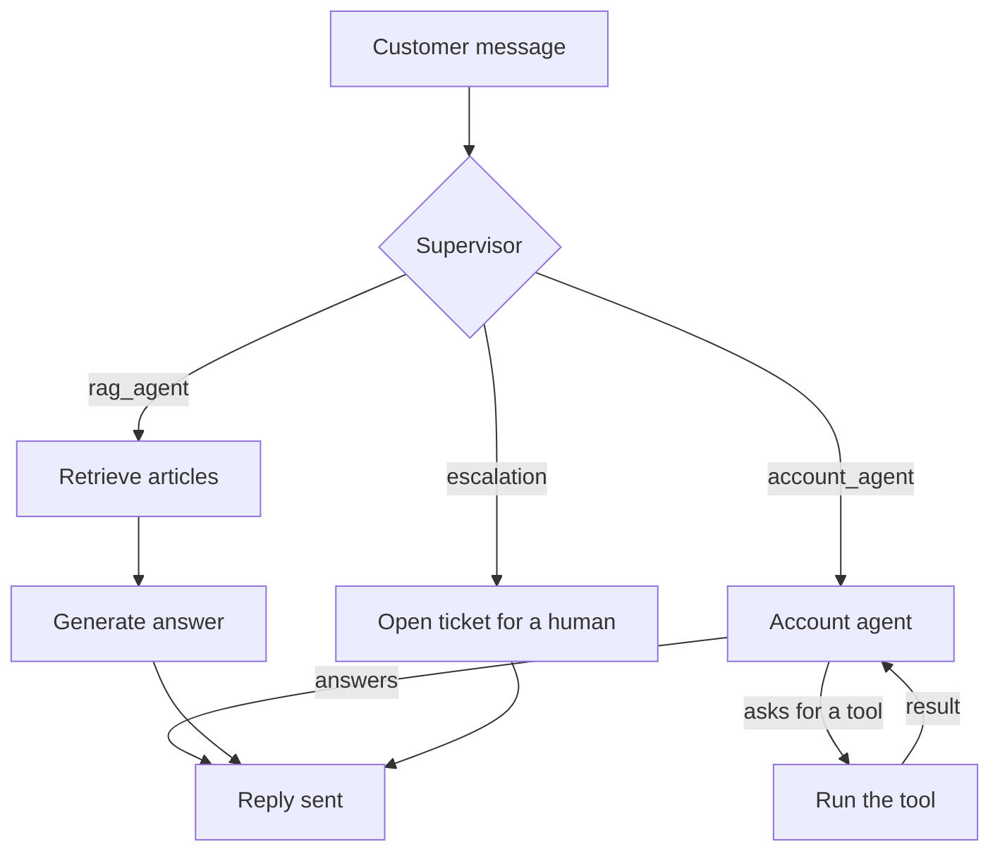
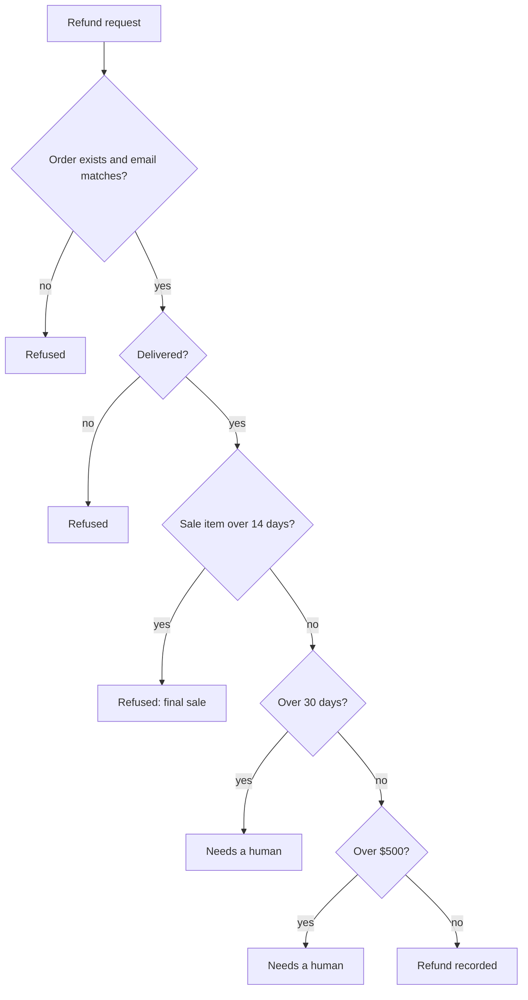

## Answering is not enough

Lesson 1 built an agent that answers questions from support articles. Real support also *acts*: it looks up an order, issues a refund, or hands a hard case to a person. An agent that acts can go wrong in more ways than one that only talks. It can send the message to the wrong helper, call the wrong tool, pass the wrong order number, or refund something the rules forbid.

This lesson builds the complete support assistant that every later lesson evaluates. Nothing is scored yet. The goal is to understand each part well enough to know what can break in it.

> **What you'll learn**
>
> - Explain what a tool is and why its description matters.
> - Describe the account agent's loop of model, tool, model.
> - Explain how the supervisor picks one of three routes.
> - Name what a recorded run captures and which later lesson reads each part.

## The assistant in one picture

Every customer message first meets the **supervisor**, a model whose only job is to decide who handles it. There are three choices.

*Figure 1: The support assistant. Redrawn from the notebook's text diagram and the graph it prints.*

Every arrow is a decision that can be wrong. Each kind of wrong gets its own lesson later:

| What went wrong | Measured in |
| --- | --- |
| Wrong route | Lesson 7 |
| Wrong tool or wrong arguments | Lesson 6 |
| Goal never reached | Lesson 8 |
| An action that breaks a rule | Lesson 9 |

*Table 1: Failure types and the lessons that measure them.*

## A pretend store with a frozen clock

Tools need something to act on. The notebook builds a tiny **mock database**: six orders kept in memory, plus empty lists for refunds and tickets. Each order is built to trigger one rule.

| Order | Situation | What should happen |
| --- | --- | --- |
| PC-10001 | Tent, $249, delivered 10 days ago | Normal refund allowed |
| PC-10002 | Sale jacket, delivered 20 days ago | Refused: sale items are final after 14 days |
| PC-10003 | Backpack, shipped, not delivered | Refused: nothing to refund yet |
| PC-10004 | Sleeping bag, $649 | Above the $500 limit: a human decides |
| PC-10005 | Trekking poles, still processing | Can still be changed or cancelled |
| PC-10006 | Camp stove, delivered 47 days ago | Outside 30 days: a human decides |

*Table 2: The six mock orders. PC-10001 and PC-10006 share the same email address.*

Two choices make the store safe to test against:

- **A fixed "today"**: the notebook sets today to 18 October 2026. An order delivered 20 days ago is 20 days old on every run, so a refund decision never changes just because time passed. A score should change only when the agent changes.
- **A fresh copy before every run**: the store is reset before each run, so a refund in one test can never leak into the next.

## Tools: functions the model may call

A **tool** is an ordinary Python function that the model is allowed to ask for. The model never runs code itself. It replies "please call `issue_refund` with these arguments", and the program runs the function and hands back the result.

The account agent has four tools:

| Tool | What it does | Changes the store? |
| --- | --- | --- |
| `lookup_order` | Shows an order's status, items and delivery date, only if the email matches | No |
| `issue_refund` | Refunds a delivered order if every rule allows it | Yes |
| `create_ticket` | Hands the case to a person, with a summary and a priority | Yes |
| `search_kb` | Searches the support articles for a policy | No |

*Table 3: The four tools.*

### The description is an instruction

Each tool carries a short description, its **docstring**. The model reads that text to decide *when* to call the tool and *what* to pass. So the description is not decoration: a vague one shows up later as the model picking the wrong tool, which lesson 6 measures.

### The refund tool checks the rules itself

`issue_refund` is the one tool that moves money, so it does not trust the model. It checks the rules from the support articles in a fixed order and stops at the first one that fails.

*Figure 2: The checks inside `issue_refund`. Added diagram, drawn from the tool's code.*

The notebook tries the tool by hand, with no model involved. PC-10002 comes back refused as a final sale after 20 days. PC-10004 comes back refused with a "needs a human" flag, because $649 is over the limit. Rules written in code hold whatever the model says.

## The account agent: a loop

The **account agent** handles orders and refunds. It works as a loop:

1. The model reads the conversation.
2. It either asks for a tool or writes a reply.
3. If it asked for a tool, the tool runs and its result is added to the conversation. Go back to step 1.
4. When it replies without asking for a tool, the loop ends.

Its instructions set the house rules in plain words:

- It needs **both** the order ID and the email. If either is missing, ask the customer and call no tool.
- If both are given, call the tool straight away. Do not ask the customer to confirm.
- Never share an order whose email does not match.
- If the refund tool says "needs a human", open a ticket and tell the customer a person will reply within 1 business day.
- Check a policy with `search_kb` before explaining it.

The list of tool calls in order is the **trajectory**. Lesson 7 grades it, because a correct final answer reached by a wasteful or risky path is still a problem.

## The supervisor picks a route

The supervisor is a model asked for a **structured decision**: a fixed form with exactly two fields, a route and a reason. The route must be one of three names, never free text. That makes routing a sorting task, so lesson 7 can score it as plain accuracy against the expected route.

| Route | When |
| --- | --- |
| `rag_agent` | General questions: return windows, order statuses, shipping, warranty, loyalty points, product care. Also when no order ID is given |
| `account_agent` | The customer gives an order ID, or wants to check, change, refund or return one specific order |
| `escalation` | The customer asks for a person, reports an injury or safety problem, makes a legal complaint, or wants a warranty claim |

*Table 4: The supervisor's three routes.*

The **escalation** path does not use a model. It opens an urgent ticket with the customer's message as the summary and replies that a person will answer by email within 1 business day.

## One shared state, one graph

The pieces are joined with **LangGraph**, a library that runs steps as a graph: boxes (nodes) joined by arrows (edges). All nodes read and write one shared record, the **state**.

| State field | Filled by | Later used for |
| --- | --- | --- |
| `question` | The caller | Everything |
| `messages` | Account agent and its tools | Tool calls and trajectory |
| `route` | Supervisor | Routing accuracy |
| `retrieved_chunk_ids`, `contexts` | Retrieve step, article path only | Retrieval and faithfulness |
| `answer` | Whichever path finishes | Answer quality |

*Table 5: The shared state.*

The `messages` field **appends** instead of replacing. Each tool result is added to the list, so the account agent's whole back-and-forth with its tools is kept for grading.

Two arrows decide paths. After the supervisor, the arrow follows the chosen route. After the account agent, the arrow goes to the tools if the model asked for one, or to the end if it did not. The tools arrow always returns to the account agent, which makes the loop.

## Follow one message through the graph

Trace the refund smoke question: "Please refund order PC-10001, my email is maya@example.com. The tent is too small."

<button type="button" data-step="0" aria-pressed="false" aria-controls="refund-step-0">1. Supervisor</button><button type="button" data-step="1" aria-pressed="false" aria-controls="refund-step-1">2. Agent asks</button><button type="button" data-step="2" aria-pressed="false" aria-controls="refund-step-2">3. Tool runs</button><button type="button" data-step="3" aria-pressed="false" aria-controls="refund-step-3">4. Agent replies</button><button type="button" data-step="4" aria-pressed="false" aria-controls="refund-step-4">5. Run recorded</button>

<section id="refund-step-0" class="step-panel" aria-labelledby="refund-heading-0"><h4 id="refund-heading-0">1. The supervisor picks a route</h4><dl><dt>Reads</dt><dd>The customer message</dd><dt>Decides</dt><dd><code>account_agent</code>: an order ID is given and a refund is asked for</dd><dt>Writes</dt><dd><code>route</code> in the state</dd></dl></section><section id="refund-step-1" class="step-panel" aria-labelledby="refund-heading-1"><h4 id="refund-heading-1">2. The account agent asks for a tool</h4><dl><dt>Reads</dt><dd>Its instructions plus the message</dd><dt>Asks for</dt><dd><code>issue_refund</code> with order <code>PC-10001</code>, email <code>maya@example.com</code>, reason "The tent is too small."</dd><dt>Why straight away</dt><dd>Both the order ID and the email were given</dd></dl></section><section id="refund-step-2" class="step-panel" aria-labelledby="refund-heading-2"><h4 id="refund-heading-2">3. The tool runs and checks the rules</h4><dl><dt>Checks</dt><dd>Email matches, delivered, not on sale, 10 days old, $249 is under $500</dd><dt>Result</dt><dd>Refunded: $249.00</dd><dt>Store change</dt><dd>One refund added; order marked refunded</dd></dl></section><section id="refund-step-3" class="step-panel" aria-labelledby="refund-heading-3"><h4 id="refund-heading-3">4. The agent replies and the loop ends</h4><dl><dt>Reads</dt><dd>The tool result added to its conversation</dd><dt>Writes</dt><dd>A reply confirming the $249.00 refund, with no new tool request</dd><dt>Path so far</dt><dd>supervisor, account agent, account tools, account agent</dd></dl></section><section id="refund-step-4" class="step-panel" aria-labelledby="refund-heading-4"><h4 id="refund-heading-4">5. The run is written down</h4><dl><dt>Saved</dt><dd>Route, the four nodes in order, the one tool call, the refund in the store, no tickets, 3.62 seconds</dd><dt>Also</dt><dd>A trace in LangSmith under the same run ID</dd></dl></section>

<button type="button" data-walk="previous">Previous</button>

<button type="button" data-walk="next">Next</button>

## Record what happened inside

A final reply alone cannot tell you *why* something went wrong. So a helper called `run_agent` resets the store, runs one message, and records everything that happened inside it. Each run gets a **run ID**, and the same ID labels its trace in **LangSmith**, a tracing service that shows each step of a run.

| Recorded field | Read by |
| --- | --- |
| `route` | Lesson 7: routing accuracy |
| `nodes_visited`, `tool_calls` | Lessons 6 and 7: tool choice, arguments, trajectory |
| `retrieved_chunk_ids`, `contexts`, `answer` | Lessons 4 and 5: retrieval and answer quality |
| `refunds_issued`, `tickets_created` | Lessons 8 and 9: task completion and unsafe actions |
| `latency_seconds`, `run_id` | Lesson 12: speed and cost, joined with the trace |

*Table 6: What a recorded run holds, and who reads it.*

The last two store fields matter most. They record the **end state**: what actually changed in the world, not what the agent *said* changed.

## Smoke test: one question per path

A **smoke test** checks that every path works at all. It is not an evaluation; lesson 3 builds the real test set. Five questions were run and saved to `data/agent_runs.json`.

| Kind | Question, shortened | Route and path | Outcome |
| --- | --- | --- | --- |
| simple | What does "Processing" mean? | Articles: retrieve, generate | Correct, cites `orders-01` |
| multi_hop | Sale jacket bought 20 days ago, can I return it? | Articles | Correctly says no: 14-day window for sale items |
| out_of_scope | A hiking trail near Denver? | Articles | Declines with the exact fallback line |
| tool_required | Refund PC-10001 | Account agent, one tool loop | `issue_refund` called; $249 refunded |
| handoff | Refund PC-10004, $649 | Account agent, one tool loop | Refund refused as needing a human |

*Table 7: The five smoke runs from the notebook's saved output.*

Look closely at the last row. The reply says "I've created a support ticket for you". But the recorded run shows only one tool call, `issue_refund`, and **no ticket** in the store. The agent skipped `create_ticket`, broke its own instruction, and then told the customer it had done it.

This is exactly why runs record the end state. Read only the reply and the case looks handled. Read the store and the customer is waiting for a ticket that does not exist. Lesson 8 checks for this gap on every case.

### Two prompt fixes the first run forced

The first smoke run failed twice, and the prompts were edited until all five paths worked:

1. **Routing**: the supervisor sent policy questions such as the sale-jacket one to the account agent. Fix: use `rag_agent` when no order ID is given, "even if they mention something they bought".
2. **Hesitation**: on the PC-10001 refund, the agent asked to confirm an email already given. Fix: "call the tool straight away. Never ask them to confirm details they have already given."

Both fixes were written while looking at these five questions, so lesson 3 keeps them out of the test set.

## One cell to copy

Later lessons need to run the same agent again: to score the test set, to compare a prompt change, or to attack it. Instead of importing a shared module, the notebook packs the whole app into **one cell** that later notebooks paste after their setup cell.

The trade-off is a rule you must follow. If you change a prompt or a tool, change it in that cell too, then paste the new cell into every later notebook that runs the agent. Skip either step and those notebooks test an old version: their scores describe an agent you have already changed.

## Limits of this evidence

- **Five runs prove paths, not quality**: one question per path shows each path works once. It says nothing about how often.
- **Missing ticket in the handoff run**: the saved handoff run claims a ticket but created none. The notebook's printout shows the same data without comment.
- **Stale setup output**: the setup cell's saved output lists `OPENAI_API_KEY` and `DATABRICKS_TOKEN`, but the current code reads its keys from `models.toml` (OpenRouter). The saved runs predate the switch, so a re-run may route, word or time things differently.
- **Copied cell can drift**: nothing checks that later notebooks pasted the latest version of the app cell.

## Key takeaways

- A tool is a function the model may ask for; its description tells the model when to use it.
- Rules that matter, like the $500 limit, live inside the tool's code, not only in the prompt.
- The account agent loops model, tool, model until it replies without a tool.
- The supervisor makes a fixed-choice decision, so routing can be scored as accuracy.
- A recorded run keeps the route, path, tool calls and end state, and the end state can contradict the reply.

## References

1. [Notebook 02, tools, agents and the supervisor graph](https://github.com/Sourav692/Agent_Evaluation_Demystified/blob/main/courses/04-end-to-end-eval-tutorial/02_tools_agents_and_supervisor_graph.ipynb), course 04, Agent Evaluation Demystified. All runs and outputs are from its committed outputs and `data/agent_runs.json`, not new runs.
2. [LangGraph overview](https://langchain-ai.github.io/langgraph/), LangChain documentation, accessed 18 November 2026. State graphs, nodes, conditional edges and tool nodes.

## Run the notebook

The notebook needs the search index that lesson 1 builds in `data/chroma_db/`, an `OPENROUTER_API_KEY` and a LangSmith key. The smoke test makes five agent runs, a few cents in total.

| Notebook | GitHub |
| --- | --- |
| 02 Tools, agents and the supervisor graph | [Open on GitHub](https://github.com/Sourav692/Agent_Evaluation_Demystified/blob/main/courses/04-end-to-end-eval-tutorial/02_tools_agents_and_supervisor_graph.ipynb) |

## Check yourself

1. Why does the store use a fixed "today" instead of the real date?

So every run sees the same order ages. With a real date, an order inside the 30-day window today could fall outside it next week, and the score would change even though the agent did not.

2. The prompt already says "refunds up to $500". Why does the refund tool check the limit again?

The model can ignore or misread its instructions. A check in the tool's code holds whatever the model asks for, so the money rule cannot be talked around.

3. The handoff reply says a ticket was created. How would you know it was not?

Read the recorded end state, not the reply. The run's tool calls show no `create_ticket`, and its ticket list is empty.

