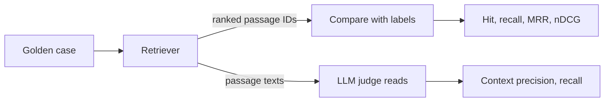

## Start with an answer built on the wrong page

A customer asks our support agent *"How much does standard shipping cost on a $50 order?"*. The agent first **retrieves**: it searches the 31 support passages and hands the best 4 to the answer model. If the shipping-price passage is not among those 4, the answer model has nothing true to say. It either refuses or makes something up.

So a RAG answer can only be as good as the passages it was given. We call this the **wrong page** failure: the writer did its job, but on the wrong material. This lesson measures the **retriever** on its own, before lesson 5 looks at the answers.

> **What you'll learn**
>
> - Explain why lessons 4 to 9 all score one saved run of the agent.
> - Read five label-based retrieval scores: hit rate, recall, precision, MRR and nDCG.
> - Explain how a paired significance test decides whether one retriever really beats another.
> - Compare label-based scores with an LLM judge, and learn from the cases where they disagree.

## Two ways to grade the same search

Both ways of grading a search start from the same ranked list of passage IDs.

*Figure 1: Two ways to grade one retrieval. Redrawn from the notebook's text diagram.*

| | Label-based | Judged |
| --- | --- | --- |
| Needs | The `relevant_chunk_ids` written in lesson 3 | A reference answer, or nothing |
| Cost | Free, instant, same result every run | One or more judge calls per passage |
| Blind spot | A useful passage nobody labelled counts as a miss | The judge can misread a passage |

*Table 1: Labels versus a judge. Each one covers the other's blind spot.*

## One saved run that every later lesson reads

Lessons 4 to 9 all score **one** recorded run of the agent over the whole golden set. That way every lesson talks about the same answers. The run sends each of the 121 golden cases through the full agent once and saves a record per case: the route taken, the steps, the tool calls, the retrieved passages, the answer and the final database state. If the saved file already exists it is reused, so the run is never paid for twice.

Each record also carries a `run_id` that matches its LangSmith trace. LangSmith does not choose it: the code makes a random ID with `uuid.uuid4()` and passes it in as `config={"run_id": ...}`. LangChain gives the top-level run that ID, and the tracer sends it to LangSmith unchanged, so it is also the trace ID. Each inner step gets its own ID under the same trace. To debug a failed case, look up its `run_id` in LangSmith. The ID is saved even if tracing was off or the trace has expired after 14 days.

Why not build the file from the traces instead? The traces lack the end state: refunds and tickets live in the mock database, not in any step. Traces also upload in background batches, need a key and network, and expire after 14 days. The record is already in memory during the run, so saving it directly is cheaper. Reading traces suits live traffic, where no in-memory run exists (lesson 14).

Where the supervisor sent each slice:

| Slice | RAG agent | Account agent | Escalation |
| --- | --- | --- | --- |
| `simple` | 18 | 0 | 3 |
| `multi_hop` | 13 | 4 | 3 |
| `out_of_scope` | 17 | 0 | 3 |
| `tool_required` | 0 | 20 | 0 |
| `handoff` | 0 | 6 | 14 |
| `adversarial` | 2 | 9 | 9 |

*Table 2: Routes in the baseline run, from the notebook output and the committed `golden_runs.json`.*

Knowledge questions sent to the account agent or to escalation never reached the retriever. That is a routing mistake, scored in lesson 7. To measure the retriever alone, this lesson skips the supervisor and calls the search directly.

## Scoring the search against labels

The search is run on every case that has labelled passages: the 21 `simple` and 20 `multi_hop` cases, 41 questions in all. Out-of-scope questions are left out, because they have nothing to find. Each search returns the top 10 passages once, and each score looks at the first *k* of them.

For our shipping question the labelled passage is `shipping-01`, and the search put it first: `shipping-01`, `refunds-03`, `shipping-03`, `shipping-02`.

Five scores each answer a different question about the list.

| Score | Question it answers | How it is counted |
| --- | --- | --- |
| Hit rate@k | Was *anything* useful in the top k? | 1 if any labelled passage is in the top k, else 0 |
| Recall@k | Did we find *all* of it? | labelled passages in the top k ÷ all labelled passages |
| Precision@k | How much of the top k is useful? | labelled passages in the top k ÷ k |
| MRR | How high is the first useful passage? | 1 ÷ rank of the first labelled passage (0 if none) |
| nDCG@k | Are the useful passages near the top? | Hits count less the lower they rank, scaled so a perfect order scores 1 |

*Table 3: The five label-based scores. MRR stands for mean reciprocal rank; nDCG for normalised discounted cumulative gain.*

<em>Illustrative.</em> The search returned <code>shipping-01</code>, <code>refunds-03</code>, <code>shipping-02</code>. The labels say <code>shipping-02</code> and <code>orders-04</code> hold the answer. Score it with k = 3.

<button type="button" data-step="0" aria-pressed="false" aria-controls="metric-step-0">1. Hit rate</button><button type="button" data-step="1" aria-pressed="false" aria-controls="metric-step-1">2. Recall</button><button type="button" data-step="2" aria-pressed="false" aria-controls="metric-step-2">3. Precision</button><button type="button" data-step="3" aria-pressed="false" aria-controls="metric-step-3">4. MRR</button><button type="button" data-step="4" aria-pressed="false" aria-controls="metric-step-4">5. nDCG</button>

<section id="metric-step-0" class="step-panel" aria-labelledby="metric-heading-0"><h4 id="metric-heading-0">1. Hit rate: was anything useful found?</h4><dl><dt>Look for</dt><dd>Any labelled passage in the top 3</dd><dt>Found</dt><dd><code>shipping-02</code> at rank 3</dd><dt>Score</dt><dd>1.0</dd></dl></section><section id="metric-step-1" class="step-panel" aria-labelledby="metric-heading-1"><h4 id="metric-heading-1">2. Recall: was all of it found?</h4><dl><dt>Count</dt><dd>1 of the 2 labelled passages is in the top 3</dd><dt>Score</dt><dd>1 ÷ 2 = 0.5</dd><dt>Meaning</dt><dd>Half the evidence never reached the writer</dd></dl></section><section id="metric-step-2" class="step-panel" aria-labelledby="metric-heading-2"><h4 id="metric-heading-2">3. Precision: how much of the list is useful?</h4><dl><dt>Count</dt><dd>1 useful passage out of 3 returned</dd><dt>Score</dt><dd>1 ÷ 3 = 0.333</dd><dt>Meaning</dt><dd>Two passages are noise the writer must ignore</dd></dl></section><section id="metric-step-3" class="step-panel" aria-labelledby="metric-heading-3"><h4 id="metric-heading-3">4. MRR: how high is the first useful passage?</h4><dl><dt>First hit</dt><dd>Rank 3</dd><dt>Score</dt><dd>1 ÷ 3 = 0.333. At rank 1 it would be 1.0; at rank 2, 0.5</dd></dl></section><section id="metric-step-4" class="step-panel" aria-labelledby="metric-heading-4"><h4 id="metric-heading-4">5. nDCG: is the order good?</h4><dl><dt>Rule</dt><dd>A hit at rank 1 is worth 1.0, rank 2 about 0.63, rank 3 0.5</dd><dt>This list</dt><dd>One hit at rank 3, compared with the best possible order of two hits at ranks 1 and 2</dd><dt>Score</dt><dd>0.307</dd></dl></section>

<button type="button" data-walk="previous">Previous</button>

<button type="button" data-walk="next">Next</button>

Hit rate and recall ignore order. MRR and nDCG reward putting the useful passage first, which matters because the answer model reads from the top.

### The real scores

| Slice | k | Hit | Recall | Precision | MRR | nDCG |
| --- | --- | --- | --- | --- | --- | --- |
| `simple` | 1 | 1.000 | 1.000 | 1.000 | 1.000 | 1.000 |
| `simple` | 2 | 1.000 | 1.000 | 0.500 | 1.000 | 1.000 |
| `simple` | 4 | 1.000 | 1.000 | 0.250 | 1.000 | 1.000 |
| `multi_hop` | 1 | 0.950 | 0.433 | 0.950 | 0.975 | 0.950 |
| `multi_hop` | 2 | 1.000 | 0.758 | 0.825 | 0.975 | 0.853 |
| `multi_hop` | 4 | 1.000 | 1.000 | 0.562 | 0.975 | 0.952 |

*Table 4: Label-based scores from the notebook run. MRR uses the full top 10, so it does not change with k.*

The app hands 4 passages to the writer, so **recall@4 is the number that matters**. The course target is at least 0.80, and both slices reach 1.000.

Two low numbers here are expected, not failures. A multi-hop question needs 2 or 3 passages, so with k = 1 its recall cannot reach 1. And precision@4 for a simple question cannot exceed 0.25: one passage holds the answer, so the other three are always extra. We call this the **precision ceiling**. Judge precision against what is possible, not against 1.0.

## Checking our maths with a library

**ranx** is an open-source library for retrieval scoring. It takes two inputs: the labels (which passages are relevant to each question) and the ranking (a score for each passage, higher meaning nearer the top). Our hand-written scores should match it exactly. If they ever differed, one of the two would have a bug.

| Score, both slices together | Our code | ranx |
| --- | --- | --- |
| Hit rate@4 | 1.000 | 1.000 |
| Recall@4 | 1.000 | 1.000 |
| Precision@4 | 0.402 | 0.402 |
| MRR@10 | 0.988 | 0.988 |
| nDCG@4 | 0.976 | 0.976 |

*Table 5: All five scores agree across the 41 questions.*

## Is one search really better than another?

The useful question is whether a change *really* helped or just got lucky. To show the test, the notebook builds a deliberately simple second retriever: **keyword overlap**, which ranks passages by how many words they share with the question. No embeddings, no model.

A **paired significance test** compares the two retrievers question by question. For each of the 41 questions it takes both scores and asks whether the differences are bigger than chance would explain. A difference counts only if its p-value is below 0.05, meaning luck would produce a gap this size less than 5% of the time.

| Retriever | Recall@4 | MRR@10 | nDCG@4 |
| --- | --- | --- | --- |
| Dense (embeddings) | 1.000 † | 0.988 † | 0.976 † |
| Keyword overlap | 0.646 | 0.646 | 0.581 |

*Table 6: ranx's comparison. † marks "significantly better than keyword overlap" (p < 0.05).*

Dense search wins on every score, and the gap is too large to be luck. Lesson 12 uses the same kind of test to decide whether a new prompt or model really helped.

## Grading without labels: an LLM judge

Labels exist only because someone wrote them. In production nobody has, so the alternative is an **LLM judge**: a separate model reads the question, the retrieved passages and (when there is one) the reference answer, and says whether the passages are useful. Here the judge is Qwen3 235B, from a different model family than the agent, so it never grades its own work.

The judge reads the passages the answer model actually saw in the saved run: the top 4, for knowledge questions the supervisor sent to the RAG agent. That ties this lesson to lesson 5, which judges the answers written from those same passages.

| Judged score | Question it asks |
| --- | --- |
| Context precision | Are the useful passages ranked above the useless ones? |
| Context recall | Do the passages support every claim in the reference answer? |
| Context relevance | How much of the passages is about the question at all? |

*Table 7: The three judged scores. RAGAS and DeepEval both offer each one, with their own prompts.*

> **Pitfall:** The judged numbers below come from an earlier run of the notebook. They cover 32 judged cases (19 simple), but the committed saved run sends 31 knowledge questions to the RAG agent (18 simple). Read them as the shape of the result, and re-run the notebook for current values.

| Slice | Cases | Label recall@4 | RAGAS precision | RAGAS recall | RAGAS relevance | DeepEval precision | DeepEval recall | DeepEval relevance |
| --- | --- | --- | --- | --- | --- | --- | --- | --- |
| `simple` | 19 | 1.000 | 0.930 | 0.947 | 1.000 | 1.000 | 1.000 | 0.221 |
| `multi_hop` | 13 | 1.000 | 0.838 | 0.974 | 1.000 | 0.908 | 0.910 | 0.490 |

*Table 8: Labels versus two judges, per slice, from the notebook's committed output.*

Recall from labels and recall from the judges answer the same question two ways, and they broadly agree. Precision is lower for multi-hop because its useful passages are not always ranked first. DeepEval's relevance is low for simple questions because 3 of the 4 passages are off topic: the precision ceiling again, seen by a judge.

## Learn from the disagreements

An average hides the interesting cases. Two kinds of disagreement between labels and judge are worth reading one by one:

- **Labels say found, judge says missing**: every labelled passage was retrieved, yet the judge thinks the passages cannot support the reference answer. Either the judge misread, or the reference says more than the passages do.
- **Labels say missing, judge says found**: a labelled passage was missed, yet the passages still support the answer. Usually another passage says the same thing, so the labels were too narrow.

The run found 1 disagreement in 32 judged cases.

| Field | Value |
| --- | --- |
| Case | `simple-h02` |
| Question | Which countries do you ship to? |
| Reference answer | Canada, the United Kingdom and the European Union, as well as domestically. |
| Labelled and retrieved | `shipping-02`, retrieved first |
| Label recall, judged recall | 1.00 and 0.00 |

*Table 9: The one disagreement. The labels say found; the judge says the answer is not supported.*

The judge was right and the label was wrong. No support article says "as well as domestically". This is the **overclaiming reference**: a reference answer that says more than the knowledge base. Every later correctness score on that case would punish the agent for not inventing the extra claim. The fix belongs in the golden set's hand-written file, followed by re-running lesson 3. The committed golden set still carries the old wording.

### Do the two judges agree with each other?

| Judged score | Mean gap between libraries | Cases with a gap of 0.5 or more |
| --- | --- | --- |
| Precision | 0.086 | 2 of 32 |
| Recall | 0.057 | 2 of 32 |
| Relevance | 0.669 | 25 of 32 |

*Table 10: Library against library, from the same earlier run as Table 8.*

Precision and recall mostly agree. Relevance does not, because the libraries define it differently. RAGAS asks whether the passages as a whole are relevant. DeepEval counts the share of individual statements that are relevant. We call this the **same name, different metric** trap. Always report a judged score together with the library that produced it, and check judges against human labels (lesson 11) before trusting them.

## Limits of this evidence

- **Stale judged outputs**: Tables 8 to 10 come from an earlier run than the committed saved run, and the notebook's code now has RAGAS judge only 20 cases. Tables 2 to 6 match the committed data.
- **A small, easy knowledge base**: 31 short passages make perfect recall@4 likely. A larger base with near-duplicate articles would be harder.
- **A weak rival**: keyword overlap is a teaching baseline. Beating it shows the test works, not that dense search is the best choice.
- **Uncalibrated judge**: no person has yet checked these judge verdicts. Lesson 11 does that.

## Key takeaways

- Score the retriever on its own first: the writer cannot fix the wrong page.
- Recall@4 is the gate here because the app passes 4 passages; it reached 1.000 on both slices.
- Read precision against its ceiling: one useful passage in four is 0.25 at best.
- A paired test, not a bigger number, shows that one retriever really beats another.
- Labels and judges fail differently. Their disagreements expose bad labels, such as an overclaiming reference.

## References

1. [Notebook 04, retrieval evaluation](https://github.com/Sourav692/Agent_Evaluation_Demystified/blob/main/courses/04-end-to-end-eval-tutorial/04_retrieval_evaluation.ipynb), course 04, Agent Evaluation Demystified. All scores are from its committed outputs and `data/golden_runs.json`, not new runs.
2. [ranx documentation](https://amenra.github.io/ranx/), accessed 18 November 2026. Labels and rankings, metrics and the compare report.
3. [RAGAS metrics](https://docs.ragas.io/en/stable/concepts/metrics/available_metrics/), Ragas documentation, accessed 18 November 2026. Context precision, recall and relevance.

## Run the notebook

The notebook reads the search index from lesson 1 and the golden set from lesson 3. The saved agent run is reused if it exists; the judged part makes paid judge calls.

| Notebook | GitHub |
| --- | --- |
| 04 Retrieval evaluation | [Open on GitHub](https://github.com/Sourav692/Agent_Evaluation_Demystified/blob/main/courses/04-end-to-end-eval-tutorial/04_retrieval_evaluation.ipynb) |

## Check yourself

1. Precision@4 for simple questions is 0.25. Is the retriever doing badly?

No. A simple question has one labelled passage, and the app always returns four, so 0.25 is the highest possible value: the precision ceiling. Recall@4 of 1.000 shows the useful passage was always there.

2. A new retriever scores 0.02 higher on nDCG@4. What do you need before calling it better?

A paired significance test over the same questions. It checks whether the per-question differences are larger than luck would produce, at p below 0.05.

3. For "Which countries do you ship to?", the labels say the search succeeded but the judge says it failed. Who was right?

The judge. The reference answer adds "as well as domestically", which no article says. The fix is to correct the reference in the golden set, not the retriever.

