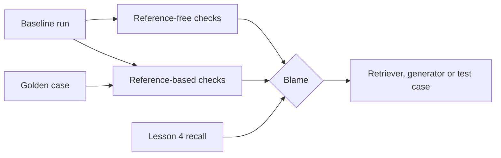
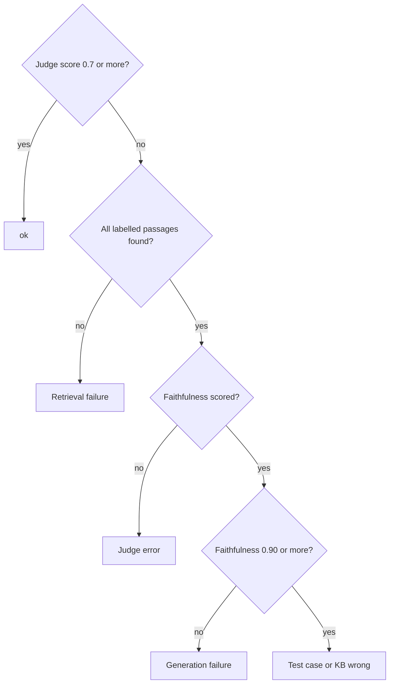

## Start with the right chunks and a wrong answer

Lesson 4 showed that the retriever finds the right passages almost every time. That is necessary, but it is not enough. The answer model can still ignore those passages, add things they do not say, or answer a different question.

We call this the **good search, bad answer** failure. Retrieval scores cannot see it, because they stop before the answer is written. This lesson grades the answers themselves.

> **What you'll learn**
>
> - Check whether the agent says "I don't know" exactly when it should.
> - Grade an answer without a reference: faithfulness, relevancy and hallucination.
> - Grade an answer against a reference, from exact match to an LLM judge.
> - Combine the scores to blame the retriever, the generator or the test case.

> **Pitfall:** The notebook's saved outputs come from two different baseline runs. Parts 1 and 2 match the current run file. The score tables in Parts 3 to 5 match an earlier run, saved in `data/rag_scores.json`. Both are quoted below and labelled. Re-run the notebook to get one consistent set, which the switch to OpenRouter models also requires.

## The plan in one picture

The notebook reads two things for each knowledge question. From the **baseline run** (lesson 4's saved run of the agent): the question, the passages it retrieved and its answer. From the **golden set** (lesson 3): the reference answer and the IDs of the passages that hold it.

*Figure 1: How the answers are graded. Redrawn from the notebook's text diagram.*

The two families of checks need different inputs, and that decides where each can run.

| Family | Needs | Runs in production | Metrics here |
| --- | --- | --- | --- |
| Reference-free | Question, retrieved passages, answer | Yes | Faithfulness, answer relevancy, hallucination |
| Reference-based | A written reference answer | No, only on the golden set | Exact match, token F1, factual correctness, semantic similarity, a correctness judge |

*Table 1: The two families. Live traffic has no reference answers, so only the first family works there (lesson 14).*

All model-graded checks use a **judge**: a second model that reads an answer and scores it. It comes from a different model family than the agent, so it never grades its own work.

## Decide which answers to grade

Answer quality only makes sense for answers the RAG agent wrote from retrieved passages. So the knowledge cases (`simple`, `multi_hop`, `out_of_scope`) are sorted into three groups first:

- **Answerable, reached the RAG agent**: graded with every metric.
- **Out of scope, reached the RAG agent**: graded on one thing, whether it declined.
- **Sent elsewhere by the supervisor**: there are no passages to grade against. This is a **routing failure**, scored in lesson 7 and only recorded here.

| Group | Current run (Parts 1 and 2) | Earlier run (Parts 3 to 5) |
| --- | --- | --- |
| Answerable, graded in full | 31 (18 simple, 13 multi-hop) | 35 (20 simple, 15 multi-hop) |
| Out of scope, decline check | 17 | 20 |
| Sent elsewhere | 13 | 6 |

*Table 2: The three groups in each run. The current run sent seven more knowledge questions to the wrong agent.*

In the current run, 13 knowledge questions went to escalation or the account agent. For example, *"Which stock should I buy this year?"* went to escalation instead of being declined by the RAG agent.

## Did it decline exactly when it should

The agent's instructions say: when the passages do not hold the answer, reply with one fixed sentence, *"I'm sorry, I don't have information about that. I can connect you with a human agent."* Because the sentence is fixed, checking it needs no judge. A plain text comparison is exact and free.

Two errors matter, and they point in opposite directions:

- **Missed decline**: an out-of-scope question got an invented answer. This is a hallucination, and the worse error, because the agent makes up policy.
- **False decline**: an answerable question got "I don't know". Unhelpful, but safe.

In the current run, all 17 out-of-scope questions were declined (100%). Three answerable questions were wrongly declined:

| Case | Question |
| --- | --- |
| `simple-h05` | Can I return a gift card? |
| `multi_hop-h09` | It's only been 20 days. Can I return worn socks and an opened fuel canister? |
| `multi_hop-r06` | What is the process for handling refunds above $500 and how does the support assistant facilitate this? |

*Table 3: The three false declines in the current run. Each one turned a customer away with an answer the passages contained.*

## Grade answers without a reference

These checks need only the question, the passages and the answer.

| Metric | The question it asks | Higher is |
| --- | --- | --- |
| Faithfulness | Is every claim in the answer supported by the retrieved passages? | Better |
| Answer relevancy | Does the answer address the question that was asked? | Better |
| Hallucination | Does the answer agree with the *correct* passages, the labelled ones? | Better |

*Table 4: The reference-free metrics. Faithfulness checks against what was retrieved; hallucination checks against what is known to be right.*

Two open-source libraries supply these. **DeepEval** scores every answer. **RAGAS** is set to score a 20-case subset, enough to compare two libraries that give the same metric name different numbers. The scores below came from the earlier run, when RAGAS scored all 35 answers.

> **Key distinction:** In the installed DeepEval version (4.2.3), the hallucination score is the share of correct passages the answer agrees with, so higher is better. Earlier versions scored contradictions, where lower was better. Check the version before reading the number.

| Metric | Simple (20) | Multi-hop (15) |
| --- | --- | --- |
| Faithfulness, RAGAS | 0.916 | 0.889 |
| Faithfulness, DeepEval | 0.950 | 1.000 |
| Answer relevancy, RAGAS | 0.839 | 0.766 |
| Answer relevancy, DeepEval | 0.863 | 0.909 |
| Hallucination, DeepEval | 0.850 | 0.922 |

*Table 5: Reference-free averages per slice, from the earlier run. The target for faithfulness is 0.90 or above.*

Faithfulness meets the 0.90 target in both slices on DeepEval. RAGAS multi-hop sits just under it, at 0.889.

RAGAS answer relevancy runs lower than DeepEval's. RAGAS writes questions back from the answer and compares them with the real question. Short answers full of passage citations like `[shipping-01]` rebuild poorly even when they are right. We call this **same name, different number**: a metric name alone does not tell you how the score was made.

## Grade answers against a reference

Next, each answer is compared with the golden set's reference answer. The checks run from the bluntest to the most forgiving. Citations are stripped first, because they are answer format, not content.

- **Exact match**: the cleaned answer equals the cleaned reference, word for word.
- **Token F1**: how many words the answer and reference share, balancing extra words against missing ones.
- **Factual correctness** (RAGAS): both texts are split into claims, and matching claims are counted.
- **Semantic similarity** (RAGAS): the two texts become embeddings, lists of numbers that capture meaning, and their closeness is measured.
- **Correctness judge** (DeepEval `GEval`): the judge follows four written steps. List the facts in the reference, check the answer states each one, punish contradictions heavily, and ignore citations and harmless extra detail. It scores 0 to 1.

| Metric | Simple (20) | Multi-hop (15) |
| --- | --- | --- |
| Exact match | 0.050 | 0.000 |
| Token F1 | 0.596 | 0.502 |
| Factual correctness | 0.704 | 0.760 |
| Semantic similarity | 0.768 | 0.809 |
| Correctness judge | 0.950 | 0.887 |

*Table 6: Reference-based averages per slice, from the earlier run. Across all 35 answers, exact match was 0.029 and token F1 0.556.*

The same answers get very different grades. Exact match is near zero, because a correct sentence almost never matches a reference word for word. Token F1 rewards shared words, not shared facts. Both suit only answers that are a single ID, date or number.

Semantic similarity is high for anything on topic, so it cannot tell right from nearly right. The claim-level check and the correctness judge can. For the judge, the written steps are the rubric, and writing them well is the real work.

The lowest judge scores show what "nearly right" looks like:

| Case | Judge | Factual | RAGAS faithfulness | What happened |
| --- | --- | --- | --- | --- |
| `multi_hop-r04` | 0.61 | 0.89 | 1.00 | Answer and reference read almost the same |
| `simple-r08` | 0.68 | 0.67 | 0.40 | Correct core fact, plus a claim about verifying the order |
| `multi_hop-r03` | 0.75 | 0.60 | 0.67 | Refund timing right; the rest is cut off in the output |
| `multi_hop-h02` | 0.75 | 0.67 | 1.00 | Points right (250); the value in dollars is cut off in the output |

*Table 7: The four lowest correctness-judge scores. The faithfulness column is RAGAS's; DeepEval gave all four 1.00. Answers are truncated in the notebook output.*

## Blame the retriever, the generator or the test case

A wrong answer has one of three causes, and each needs a different fix. Combining scores we already have tells them apart, with no new model calls.

*Figure 2: The blame rules in order. Each verdict points at a different fix.*

The thresholds are choices, and each is explained:

- **Correct** means the judge scored 0.7 or more. DeepEval's default pass mark of 0.5 lets "half right" through; 0.7 asks for "mostly right". Lesson 11 checks this against people.
- **Found** means every labelled passage was in the top 4 retrieved (label recall 1.0).
- **Faithful** means DeepEval faithfulness 0.90 or more.
- **Judge error** means the faithfulness judge failed to give a score. The agent is not blamed for something the judge could not measure.

The fixes follow the verdict: a **retrieval failure** points at the retriever, chunking or how many passages are fetched. A **generation failure** points at the prompt or model. **Test case or KB wrong** points at the golden set or the support articles.

Compare how the same rules reach different verdicts for the two failed answers.

<button type="button" data-mode="r08" aria-pressed="false" aria-controls="blame-r08">simple-r08</button>
<button type="button" data-mode="r04" aria-pressed="false" aria-controls="blame-r04">multi_hop-r04</button>

<section id="blame-r08" class="mode-panel" data-announcement="simple-r08 selected. Verdict: generation failure."><h4>simple-r08: generation failure</h4><ul><li>Question: what is the process for issuing refunds for returned items?</li><li>Judge 0.68: below 0.7, so not ok.</li><li>Every labelled passage found: retrieval is cleared.</li><li>RAGAS faithfulness 0.40: the answer says things its passages do not support. DeepEval gave 1.00.</li></ul>
Saved verdict: generation failure, made with RAGAS faithfulness. With today's DeepEval rule it would be test case or KB wrong. Two judges disagreeing is itself a finding.
</section>
<section id="blame-r04" class="mode-panel" data-announcement="multi_hop-r04 selected. Verdict: test case or KB wrong."><h4>multi_hop-r04: test case or KB wrong</h4><ul><li>Question: "Wht happens wen a human agent handover is done?"</li><li>Judge 0.61: below 0.7, so not ok.</li><li>Every labelled passage found: retrieval is cleared.</li><li>Faithfulness 1.00 on both libraries: the answer sticks to its passages.</li></ul>
Verdict: test case or KB wrong. The visible answer and reference read almost the same, so the low judge score itself deserves a person's reading.
</section>

> **Pitfall:** The saved verdicts were made by an earlier version of the rules that read RAGAS faithfulness. The current notebook reads DeepEval faithfulness. For `simple-r08` the two disagree: RAGAS gave 0.40, DeepEval 1.00. Under today's rule its verdict would be test case or KB wrong, not generation failure. A re-run settles it.

In the earlier run, 33 of 35 answers were ok:

| Slice | ok | Retrieval failure | Generation failure | Test case or KB wrong | Routing failure |
| --- | --- | --- | --- | --- | --- |
| Simple | 19 | 0 | 1 | 0 | 1 |
| Multi-hop | 14 | 0 | 0 | 1 | 5 |

*Table 8: The blame table from the earlier run. No judge errors occurred.*

Retrieval was near perfect, so the failures point at the generator, the test case or the supervisor. A verdict is a lead, not a conclusion. `multi_hop-r04` shows why: the rules blame the test case, but the judge may simply be harsh there. We call this **trusting the verdict blindly**, and reading each flagged case is the guard.

## Save the scores

Every knowledge case's scores are saved to `data/rag_scores.json`, 61 cases in the earlier run. Each record keeps the run ID that links it to its trace, so lesson 12 can compare slices and run statistics over the per-case numbers. Out-of-scope cases are saved as ok or missed decline, and misrouted ones as routing failure.

## Limits of this evidence

- **Mixed runs**: the saved outputs come from two baseline runs, labelled throughout. The DeepEval scoring cell has no saved output. Re-run the notebook for one consistent set.
- **Old models**: both runs used the previous model provider. The course now uses OpenRouter models, so every number will move.
- **Small slices**: 20 and 15 graded answers. One case changes a slice average by 5 to 7 points.
- **Rule changed after the run**: saved verdicts used RAGAS faithfulness; the code now uses DeepEval's.
- **One judge, untested**: the 0.7 and 0.90 thresholds are choices. Lesson 11 checks the judge against human labels.

## Key takeaways

- Good search does not guarantee a good answer, so answers need their own grades.
- A fixed decline sentence is checked by text comparison: free, exact, no judge.
- A missed decline invents policy; a false decline is unhelpful but safe.
- Reference-free metrics also run in production; reference-based metrics need the golden set.
- The same metric name can give different numbers in different libraries.
- Recall, faithfulness and correctness together split each failure between retriever, generator and test case.

## References

1. [Notebook 05, generation evaluation](https://github.com/Sourav692/Agent_Evaluation_Demystified/blob/main/courses/04-end-to-end-eval-tutorial/05_generation_evaluation.ipynb), course 04, Agent Evaluation Demystified. Numbers are from its committed outputs and `data/rag_scores.json`, not new runs.
2. [RAGAS metrics](https://docs.ragas.io/en/stable/concepts/metrics/available_metrics/), Ragas documentation, accessed 18 November 2026. Faithfulness, answer relevancy, factual correctness and semantic similarity.
3. [DeepEval G-Eval](https://deepeval.com/docs/metrics-llm-evals), DeepEval documentation, accessed 18 November 2026. Judges that follow written evaluation steps.

## Run the notebook

The notebook reads `data/golden_runs.json` from lesson 4 and never runs the agent. It makes paid judge calls for every graded answer.

| Notebook | GitHub |
| --- | --- |
| 05 Generation evaluation | [Open on GitHub](https://github.com/Sourav692/Agent_Evaluation_Demystified/blob/main/courses/04-end-to-end-eval-tutorial/05_generation_evaluation.ipynb) |

## Check yourself

1. An out-of-scope question gets a confident, invented answer. A different, answerable question gets the fixed decline sentence. Which error is worse, and why?

The invented answer is a missed decline, and it is worse because the agent made up policy a customer may act on. The false decline is unhelpful but safe.

2. Semantic similarity is 0.77 to 0.81 while exact match is near zero. Which better shows whether the answers are right?

Neither. Exact match fails on any rewording, and semantic similarity is high for anything on topic. The claim-level check and the correctness judge are built to tell right from nearly right.

3. An answer scores 0.68 on correctness, retrieval found every labelled passage, and faithfulness is 0.40. Who is to blame?

The generator. Retrieval delivered the right passages, but the answer says things those passages do not support. The fix belongs in the prompt or the model. For `simple-r08` that 0.40 came from RAGAS while DeepEval said 1.00, so a person should read the answer before acting.

