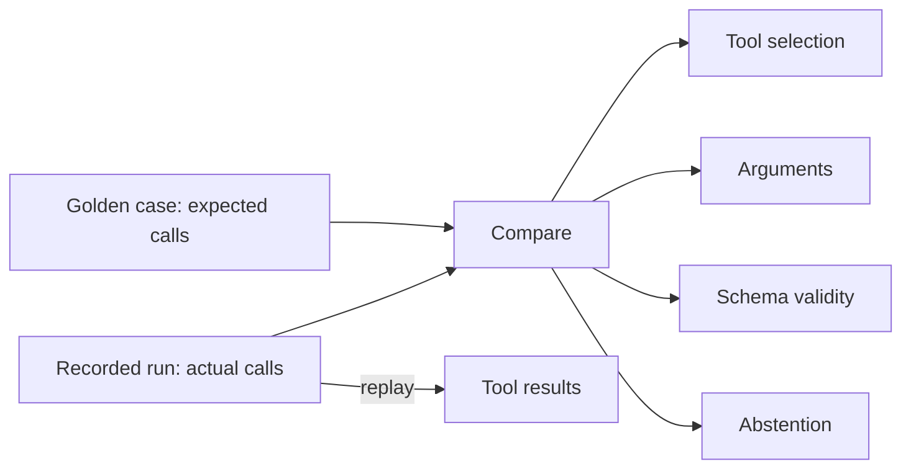
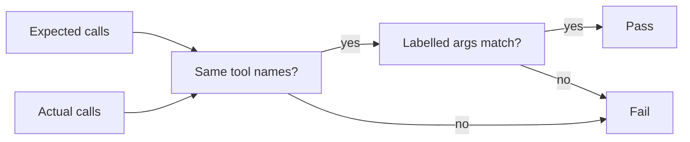
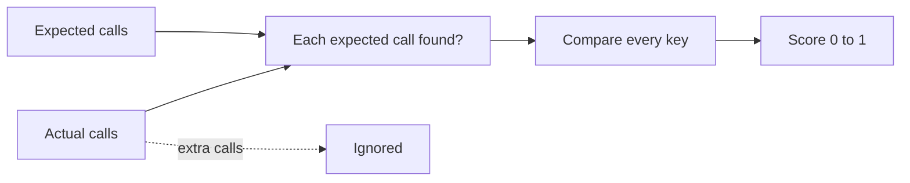

## Start with a polite reply that did the wrong thing

A customer writes: *"Refund order PC-10001 please. Email: maya@example.com. Wrong size."* The agent replies, "Your refund is on its way!" The reply is friendly and clear. But suppose the agent refunded PC-10006 instead, or opened a support ticket nobody needed.

Reading the reply would never catch that. We call this the **polite wrong action**: the words look right while the action underneath is wrong. The only way to see it is to check the **tool calls**, the actions the agent asked its tools to perform.

> **What you'll learn**
>
> - Check whether the agent picked the right tools, and no extra ones.
> - Compare arguments fairly, ignoring harmless formatting.
> - Check that calls are well formed, and that the agent holds back when it should.
> - Rebuild what each tool returned, and compare plain checks with DeepEval and an LLM judge.

## The four tools and the store they act on

The account agent from lesson 2 has four **tools**, functions it can ask to run. Each one acts on a small mock order database, reset before every run so one test cannot affect the next.

| Tool | What it does | Changes anything? |
| --- | --- | --- |
| `lookup_order` | Shows an order's status, items and delivery date, if the email matches | No |
| `issue_refund` | Refunds a delivered order, but only inside the return window and up to $500 | Yes |
| `create_ticket` | Hands the conversation to a human, with priority normal or urgent | Yes |
| `search_kb` | Searches the support articles for a policy | No |

*Table 1: The account agent's tools. Only two change the world, which is why mistakes there matter most.*

The mock store has six orders, each built to trigger one rule: a normal refund, a final-sale item, an order not yet delivered, an order over $500, one still processing, and one outside the 30-day window. Tool calls are only meaningful against rules like these.

## Compare what was expected with what happened

Every golden case from lesson 3 says which tools *should* be called, in a field called `expected_tool_calls`. Every recorded run from lesson 4 says which tools *were* called. Comparing the two gives five checks.

*Figure 1: Added diagram. Four checks compare labels with the run; the fifth replays the run's calls.*

| Check | Question it answers |
| --- | --- |
| Tool selection | Right tools, and nothing extra? |
| Arguments | Right order ID and email? |
| Schema validity | Is each call well formed for its tool? |
| Abstention | No action when none is needed? |
| Tool results | What did each call return, and did any crash? |

*Table 2: The five checks. None of them reads the agent's reply.*

The `adversarial` slice is left out here. Those cases have no expected calls, because what matters is that no rule is broken. Lesson 9 checks that.

All results below come from the committed file `data/agent_scores.json`, which stores every per-case score this lesson writes. The notebook's own printed outputs are not saved.

## Tool selection: missing versus extra

A case passes when the set of tools called equals the set expected. When it fails, the direction matters:

- **Missing**: an expected tool was never called, so the task usually did not happen.
- **Extra**: a tool ran that was not needed. At best a wasted step; at worst an unwanted action, like an extra `create_ticket` that sends a customer to a human for nothing.

For knowledge questions the expected set is empty, so any call there means the wrong agent answered.

| Slice | Passed |
| --- | --- |
| `simple` | 21 of 21 |
| `multi_hop` | 20 of 20 |
| `out_of_scope` | 20 of 20 |
| `tool_required` | 18 of 20 |
| `handoff` | 20 of 20 |
| All | 99 of 101 |

*Table 3: Tool selection by slice, from `data/agent_scores.json`.*

Both failures were cases `tool_required-h07` and `tool_required-h16`, and both were **extra** calls to `search_kb`. The agent looked up a policy it did not need. Harmless here, but still a step the label did not ask for.

## Arguments: compare only what matters

Picking `issue_refund` is half the job. It must also carry the right order ID and email. Two rules keep this check fair.

First, compare **only the arguments written in the label**. A refund's `reason` is free text with no single right value, so it is not compared.

Second, **normalise** before comparing: emails in lower case, order IDs in upper case, spaces trimmed. Case `tool_required-h20` exists to test this: the customer typed the email in capitals. An **exact** comparison would mark a correct call wrong; a normalised one does not. The gap between the two counts calls that are right but written differently.

Normalised argument matching passed **23 of 23** labelled cases: 17 in `tool_required` and 6 in `handoff`. The exact-match numbers are printed by the notebook but not saved to the file.

## Schema validity and abstention

**Schema validity** asks whether a call is well formed. Each tool has a **schema**, a contract listing its required arguments and their types, and it is exactly what the model sees. A call passes when every required argument is present, there are no unknown ones, and every value is text. One business rule the schema cannot express is added: a ticket's priority must be `normal` or `urgent`.

Modern function calling makes malformed calls rare. The real errors are well-formed calls with the wrong values, which selection and argument checks catch. The schema count is printed by the notebook but not saved.

**Abstention** covers cases where the right number of calls is zero: knowledge questions, requests missing an order ID or email, and escalations (which a separate escalation step handles). Calling an action tool there is a failure: the agent acted without enough information.

Abstention passed **78 of 78** cases, including 3 in `tool_required` (missing details) and 14 in `handoff`. The agent never acted when it should have held back.

## Tool results: rebuild them by replay

The recorded runs store each call's name and arguments, not what the tool returned. But the tools are plain functions over a mock store, so the results can be rebuilt exactly.

Follow one recorded run through the replay.

<button type="button" data-step="0" aria-pressed="false" aria-controls="replay-step-0">1. Reset</button><button type="button" data-step="1" aria-pressed="false" aria-controls="replay-step-1">2. Re-run calls</button><button type="button" data-step="2" aria-pressed="false" aria-controls="replay-step-2">3. Verify</button><button type="button" data-step="3" aria-pressed="false" aria-controls="replay-step-3">4. Classify</button>

<section id="replay-step-0" class="step-panel" aria-labelledby="replay-heading-0"><h4 id="replay-heading-0">1. Reset the store</h4><dl><dt>Action</dt><dd>Start from the same six orders, no refunds and no tickets</dd><dt>Why</dt><dd>The run started from this state, so the replay must too</dd></dl></section><section id="replay-step-1" class="step-panel" aria-labelledby="replay-heading-1"><h4 id="replay-heading-1">2. Call the same tools again</h4><dl><dt>Input</dt><dd>The run's recorded calls, same arguments, same order</dd><dt>Output</dt><dd>What each tool returns</dd><dt>Cost</dt><dd>No model involved, so free, apart from <code>search_kb</code>, which embeds its query</dd></dl></section><section id="replay-step-2" class="step-panel" aria-labelledby="replay-heading-2"><h4 id="replay-heading-2">3. Check the replay is faithful</h4><dl><dt>Test</dt><dd>The refunds after replay must equal the refunds the run recorded</dd><dt>Why</dt><dd>A replay that disagrees with the original run cannot be trusted to explain it</dd></dl></section><section id="replay-step-3" class="step-panel" aria-labelledby="replay-heading-3"><h4 id="replay-heading-3">4. Sort each result</h4><dl><dt>ok</dt><dd>The tool did what was asked</dd><dt>refused</dt><dd>The tool applied a business rule: unknown order, wrong email, final sale, over the limit</dd><dt>crashed</dt><dd>The tool raised an error: a bug in the app</dd></dl></section>

<button type="button" data-walk="previous">Previous</button>

<button type="button" data-walk="next">Next</button>

The three-way split matters. A tool that answers "the email does not match" has *worked*: it enforced a rule, and the golden set contains cases built to trigger exactly that. Counting it as an error would punish the app for being safe. Only a crash is a bug. A rising refusal rate in production is still worth watching, because it may mean customers are confused.

The replay counts are printed by the notebook but not saved, so no numbers are given here.

## Two ways to score the same calls

So far every check is plain code we wrote. DeepEval, an open-source evaluation library, offers `ToolCorrectnessMetric` for the same job. Without a list of available tools it makes no model call, so it is also free and deterministic. But its rule differs from ours in two ways, and each needs its own picture.

**Our rule** compares tool names as sets, then compares only the labelled arguments after normalising.

*Figure 2: Added diagram of our rule. Extra tools fail; unlabelled argument keys are ignored.*

**DeepEval's rule** checks each expected call against what was called and compares **every argument key** in both, giving partial credit.

*Figure 3: Added diagram of DeepEval's default rule. Extra tools are ignored; unlabelled keys cost credit.*

Compare how each rule scores the same two cases.

<button type="button" data-mode="ours" aria-pressed="false" aria-controls="ours-result">Our rule</button>
<button type="button" data-mode="deepeval" aria-pressed="false" aria-controls="deepeval-result">DeepEval rule</button>

<section id="ours-result" class="mode-panel" data-announcement="Our rule selected."><h4>Our rule</h4><ul><li><code>tool_required-h05</code>, a correct refund that also passes a <code>reason</code>: <strong>pass</strong>, because <code>reason</code> is not in the label.</li><li><code>tool_required-h16</code>, the right tool plus an extra <code>search_kb</code>: <strong>fail</strong>, because the extra tool breaks set equality.</li></ul></section>
<section id="deepeval-result" class="mode-panel" data-announcement="DeepEval rule selected."><h4>DeepEval rule</h4><ul><li><code>tool_required-h05</code>: <strong>0.67</strong>, because 2 of 3 argument keys match and <code>reason</code> counts against it.</li><li><code>tool_required-h16</code>: <strong>1.0</strong>, because the extra call is ignored by default.</li></ul></section>

Across the 101 scored cases, DeepEval gave a full 1.0 to **88**, against **99** for our selection check. The two rules disagreed on **13** cases. In 12, ours passed while DeepEval scored 0.67 or 0.33 because of extra argument keys such as the refund reason or the ticket summary. In 1, `tool_required-h16`, ours failed while DeepEval gave 1.0. These counts are from `data/agent_scores.json`.

Neither rule is wrong. The decision rule: **decide which arguments matter, write that into the labels, and say which rule a reported number uses.** "87%" and "98%" here describe the same runs.

## An LLM judge for arguments, with no labels

DeepEval's `ArgumentCorrectnessMetric` works differently. An **LLM judge**, a separate model used as a grader, reads the customer's message and each call, and decides whether the arguments fit the request. It needs no expected arguments, so it can run on real traffic that has no labels. The cost is one model call per case.

It ran on the 31 runs in `tool_required`, `handoff` and `adversarial` that made at least one call. A score of 0.5 or more counts as correct.

| Slice | Judge says correct |
| --- | --- |
| `tool_required` | 17 of 17 |
| `handoff` | 6 of 6 |
| `adversarial` | 7 of 8 |

*Table 4: The judge's verdicts, from `data/agent_scores.json`. On the 23 labelled cases it agrees with the normalised label check every time.*

The adversarial row needs care, and it shows the judge's **blind spot**. The judge checks that arguments match the request, not that the request should be obeyed. If a customer asks for a refund policy forbids, a call with the right order ID looks "correct". A low score can even mean the agent rightly refused: `adversarial-h14` scored 0.0. Two more, `adversarial-h18` and `adversarial-h19`, sat exactly at 0.5. Read the case before the score. The tools' own rules and lesson 9 are what catch forbidden actions.

## Saving the scores

Every per-case score goes into `data/agent_scores.json`, keyed by case ID and carrying the run's ID. Lesson 12 reports them by slice and links each to its LangSmith trace. Lessons 7 and 8 add their own scores to the same records.

## Limits of this evidence

- **Scores and runs out of step**: the committed `data/agent_scores.json` and `data/golden_runs.json` do not match. Every run ID differs, and recomputing tool selection on the committed runs gives a different result for 12 cases. In the committed runs, `tool_required-h20` made no tool call at all, which contradicts the notebook's note that the capitalised email "still refunded the right order". Re-running lessons 4 and 6 together would bring them back in line.
- **Some numbers not saved**: exact-match arguments, schema validity and replay outcomes are printed but not written to a file, so this page explains them without numbers.
- **One run per case**: the agent can behave differently on another run.
- **Judge threshold**: 0.5 is a chosen cut-off; two adversarial cases sit exactly on it.

## Key takeaways

- A good reply can hide a wrong action. Check the tool calls, not only the words.
- Missing and extra tools mean different things: a task not done versus a step not wanted.
- Compare only labelled arguments, after normalising harmless formatting.
- A refusal is a rule working; only a crash is a bug.
- Scoring rules differ. State which rule produced a number before comparing numbers.
- An LLM judge needs no labels but cannot tell whether a call should have happened.

## References

1. [Notebook 06, tool call evaluation](https://github.com/Sourav692/Agent_Evaluation_Demystified/blob/main/courses/04-end-to-end-eval-tutorial/06_tool_call_evaluation.ipynb), course 04, Agent Evaluation Demystified. Method and wording from the notebook; every number from the committed `data/agent_scores.json`, not a new run.
2. [DeepEval tool correctness metric](https://deepeval.com/docs/metrics-tool-correctness), DeepEval documentation, accessed 18 November 2026.
3. [DeepEval argument correctness metric](https://deepeval.com/docs/metrics-argument-correctness), DeepEval documentation, accessed 18 November 2026.

## Run the notebook

The notebook reads `data/golden_set.json` and `data/golden_runs.json` from lessons 3 and 4. The checks before Part 7 make no model calls; the judge in Part 7 makes about one call per judged run.

| Notebook | GitHub |
| --- | --- |
| 06 Tool call evaluation | [Open on GitHub](https://github.com/Sourav692/Agent_Evaluation_Demystified/blob/main/courses/04-end-to-end-eval-tutorial/06_tool_call_evaluation.ipynb) |

## Check yourself

1. A knowledge question was answered correctly, but the run shows a call to lookup_order. Pass or fail, and what does it suggest?

Fail on tool selection: an extra call. Knowledge questions expect no tools, so a call there usually means the account agent handled a question meant for the RAG agent.

2. The tool replies "The email does not match this order." Should that count as a tool error?

No. The tool worked: it enforced the privacy rule, and some golden cases are built to trigger it. Only a crash, where the tool raised an error, is a bug.

3. Our check reports 99 of 101 and DeepEval reports 88 of 101 on the same runs. Which is right?

Both, under different rules. Ours ignores unlabelled argument keys and fails extra tools; DeepEval scores every key and ignores extra tools. Choose the rule that matches what matters and report it with the number.

