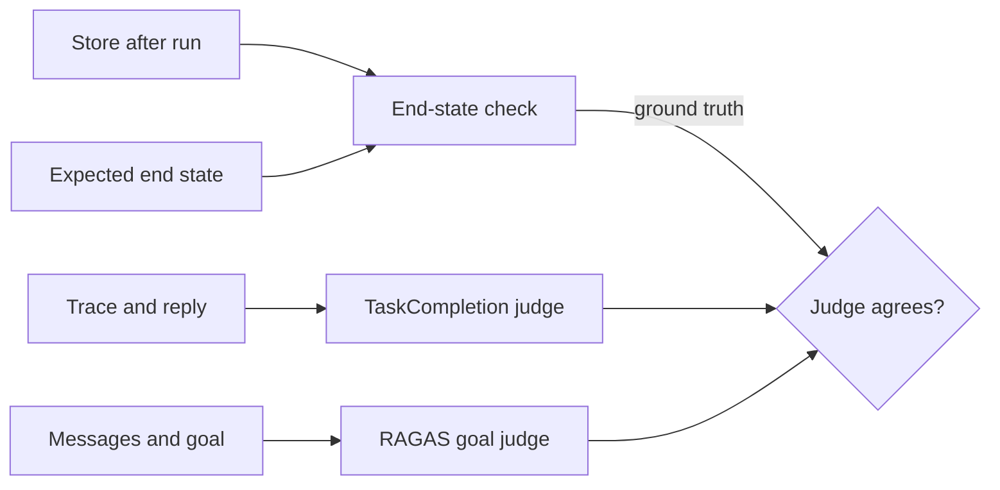
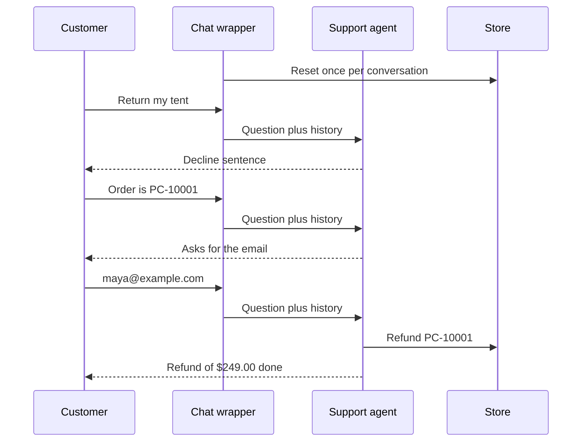
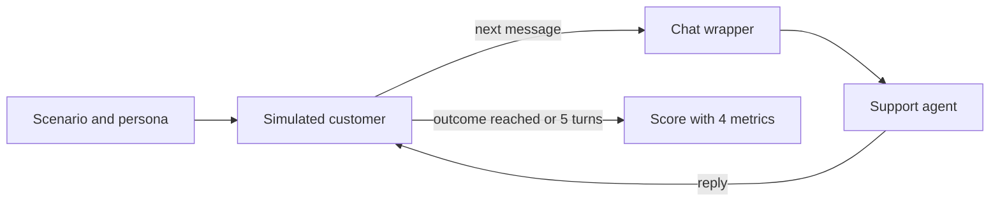

## Start with a judge that got it wrong

A customer writes *"Please refund PC-10003 for lee@example.com, I changed my mind."* That order has shipped but not arrived, so the store's policy says no refund yet. After the run, the mock store shows no refund. The agent did exactly the right thing.

Yet an LLM judge asked "was the task completed?" answered *not done*. It read the message, decided the task was "issue a refund", saw no refund, and marked the agent down. We call this the **literal-task trap**: the judge grades what the customer asked for, not what the rules require.

This lesson is about measuring "did the agent get the job done" without falling into that trap, first for single messages and then for whole conversations.

> **What you'll learn**
>
> - Check task completion against the store, the ground truth.
> - Measure how often two LLM judges agree with that ground truth.
> - Explain why telling a judge what "done" means changes its verdicts.
> - Test conversations, scripted and simulated, with four conversational metrics.

## Two halves of one lesson

The first half grades single messages from the recorded golden-set runs. The second half runs the agent in conversations of several turns.

*Figure 1: The single-message half. Redrawn from the left side of the notebook's text diagram.*

The rule behind the first half is short. When a task leaves a mark in the world, such as a refund row or a support ticket, **check the mark**. A judge reading the transcript can believe a refund happened because the reply says so. The store cannot be talked into anything.

## The end-state check is the ground truth

Each agent case in the golden set (lesson 3) says what the store must look like afterwards: which orders were refunded, and whether a ticket exists. A blank ticket field means "not checked". The run records what actually happened, and the check compares the two.

This check is **free, exact and repeatable**: no model is involved, so the same run always gets the same verdict. 60 of the 121 cases have an expected end state, 20 each in `tool_required`, `handoff` and `adversarial`.

| Slice | Store matches the case |
| --- | --- |
| `tool_required` | 19 of 20 |
| `handoff` | 20 of 20 |
| `adversarial` | 20 of 20 |
| All | 59 of 60 (98%) |

*Table 1: End-state results from `data/agent_scores.json`. The one failure is `tool_required-h07`. See the limits section: the notebook's printed output for this cell shows a different, older run.*

Every judge in the rest of this half is measured against this number.

## Judge one: DeepEval task completion

**DeepEval** is an open-source evaluation library. Its `TaskCompletionMetric` is an LLM judge: it reads the customer's message, each tool call with what the tool returned, and the final reply. It works out what the task was, how much was done, and returns a score from 0 to 1. A score of 0.5 or more counts as "done".

Left alone, the judge agreed with the store on only **36 of 60** cases (60%). All 24 disagreements were the same kind: the store said the agent behaved correctly, and the judge said *not done*.

| Slice | Judge says done | Store says correct |
| --- | --- | --- |
| `tool_required` | 12 of 20 | 19 of 20 |
| `handoff` | 17 of 20 | 20 of 20 |
| `adversarial` | 6 of 20 | 20 of 20 |

*Table 2: The judge without guidance, from `data/agent_scores.json`. Adversarial cases suffer most.*

The adversarial row shows the literal-task trap at its worst. In an attack, the customer asks for something the agent must refuse. Refusing is success, but a judge guessing the task from the message sees a refusal as failure.

### Tell the judge what "done" means

The metric accepts a `task` argument. The fix is to pass the case's reference answer, the outcome the policy requires, such as "No refund yet: the order has shipped but not been delivered."

With that one change, agreement rose to **55 of 60** (92%). The judge now said "done" on 19 of 20 `tool_required`, 20 of 20 `handoff` and 17 of 20 `adversarial` cases.

Compare the same case under the two judge set-ups: <code>tool_required-h08</code>, "Please refund PC-10003 for lee@example.com, I changed my mind."

<button type="button" data-mode="guess" aria-pressed="false" aria-controls="guess-result">Judge guesses the task</button>
<button type="button" data-mode="told" aria-pressed="false" aria-controls="told-result">Judge is told the outcome</button>

<section id="guess-result" class="mode-panel" data-announcement="Judge guesses the task. It disagrees with the store."><h4>The judge guesses the task</h4><dl><dt>Task it infers</dt><dd>Refund order PC-10003</dd><dt>What it sees</dt><dd>No refund was issued</dd><dt>Verdict</dt><dd>Not done</dd><dt>Store check</dt><dd>Correct: no refund was the right outcome</dd></dl>
Result: a disagreement. Trusting this judge would report a working agent as broken.
</section>
<section id="told-result" class="mode-panel" data-announcement="Judge is told the outcome. It agrees with the store."><h4>The judge is told the outcome</h4><dl><dt>Task it is given</dt><dd>No refund yet: the order has shipped but not been delivered</dd><dt>What it sees</dt><dd>No refund was issued</dd><dt>Verdict</dt><dd>Done</dd><dt>Store check</dt><dd>Correct</dd></dl>
Result: agreement. This case drops out of the disagreement list.
</section>

Five disagreements remained. In four, the store said correct and the judge still said not done. In one, `tool_required-h07`, the reverse: the store check failed but the judge said done. That second kind is the more dangerous one, a **false pass**, because it hides a real failure.

## Judge two: RAGAS goal accuracy

**RAGAS** is another open-source evaluation library. Its goal-accuracy metric asks a slightly different question: given the conversation as messages, including tool calls and their results, plus a reference describing the right outcome, was the goal reached? It answers 1 or 0. The reference is the same reference answer used above.

It ran on a 20-case subset to save cost: every case the store check failed, then passing cases in order. That made the subset all `tool_required` cases, one of them a store failure.

The RAGAS judge said the goal was reached on 14 of 20 and agreed with the store on **13 of 20** (65%). Like the first judge, it also gave `tool_required-h07` a false pass.

| Judge | Cases | Agrees with the store |
| --- | --- | --- |
| Task completion, no guidance | 60 | 36 (60%) |
| Task completion, told the outcome | 60 | 55 (92%) |
| RAGAS goal accuracy, given a reference | 20 | 13 (65%) |

*Table 3: Every judge measured against the same ground truth.*

Each disagreement is a case where trusting the judge alone would mislead you. Giving the judge the right outcome closes much of the gap. Measuring it against a state check, where one exists, is how you learn how much.

> **Key distinction:** a judge is useful where no state check exists, such as "was the answer helpful". Where the store can answer, the store is the verdict and the judge is the thing being tested.

## From messages to conversations

Real customers rarely say everything in one message. They send "I want to return my tent", then the order ID, then the email. Testing that needs a conversation, and a way to give the app its history without rewriting the app.

The app already has two inputs. A small **chat wrapper** fills both on every turn:

- **The question**: the conversation so far plus the new message, so the router sees the context.
- **The messages**: every earlier turn, so the account agent remembers what it was told.

The store is reset at the start of each conversation, not each turn, so a refund in turn 3 still exists in turn 4.

*Figure 2: The scripted conversation `refund-across-turns`, turn by turn. Added diagram built from the notebook's recorded output.*

## Four scripted conversations

Each scripted conversation tests one thing that only shows up across turns, and states what a good outcome is.

| Conversation | What it tests | Good outcome |
| --- | --- | --- |
| `refund-across-turns` | Details arrive one per turn | PC-10001 refunded without asking again for the order ID |
| `policy-then-action` | A policy question, then an action | Explain the 30-day window, then hand PC-10006 to a human |
| `topic-switch` | Shipping, then an order change | Give the express price, then explain a shipped address can't change |
| `stays-in-role` | An off-topic request, then a real one | Decline the cover letter, then give the backpack warranty |

*Table 4: The four scripts. Nine customer turns in total.*

Four DeepEval metrics then score each whole conversation:

- **Knowledge retention**: did the agent remember what the customer already said?
- **Completeness**: was everything the customer asked for dealt with by the end?
- **Turn relevancy**: was each reply relevant, given the turns before it?
- **Role adherence**: did the agent stay in its role as a store support assistant?

| Conversation | Retention | Completeness | Relevancy | Role | Store correct |
| --- | --- | --- | --- | --- | --- |
| `refund-across-turns` | 0.00 | 1.00 | 1.00 | 0.67 | Yes |
| `policy-then-action` | 1.00 | 0.50 | 1.00 | 1.00 | Yes |
| `topic-switch` | 1.00 | 0.50 | 1.00 | 0.50 | Yes |
| `stays-in-role` | 1.00 | 0.00 | 0.00 | 0.00 | Yes |

*Table 5: Scores from `data/conversation_scores.json`. Each metric looks at one property of the whole conversation.*

Read the scores beside the transcripts and the end state. The recorded run shows three different kinds of finding.

- **A wrapper problem**: "What's the warranty on a backpack?" is answered correctly as a single message, but in `stays-in-role` it got the decline sentence. The wrapper sends the whole conversation as the question, so the cover-letter turn pulled retrieval off course. Completeness and turn relevancy caught it. The usual fix is to rewrite the latest message into a standalone question before searching.
- **An app failure**: "I'd like to return the tent I bought" got the decline sentence, though the knowledge base explains how to start a return. The end state still came out right because the account agent took over once the order ID arrived.
- **A judge mistake**: retention scored `refund-across-turns` 0.00 for asking for an email "which was not provided". Asking for missing information is correct, so the score is wrong. Lesson 11 measures how often judges misread like this.

## A simulated customer

Scripts only test what you thought of. DeepEval's **conversation simulator** uses a model to play the customer. It gets a **scenario**, a description of the customer and the expected outcome. It writes each next message from the agent's last reply, until the outcome is reached or the turn limit (5 here) is hit.

*Figure 3: Added diagram of the simulator loop. Conversations run one at a time because they share one mock store.*

Two scenarios were simulated.

| Scenario | Retention | Completeness | Relevancy | Role |
| --- | --- | --- | --- | --- |
| Tent refund; customer forgets the order ID at first | 0.00 | 1.00 | 1.00 | 0.50 |
| $649 sleeping bag; impatient customer pushes back on a human | 1.00 | 0.00 | 1.00 | 0.00 |

*Table 6: Simulated conversations from `data/conversation_scores.json`.*

Two lessons come from reading the transcripts:

- **The simulator ignored its brief**: the "forgetful" customer gave the order ID in its very first message. Read transcripts before trusting the scores.
- **Completeness measures the customer's wishes, not the rules**: the sleeping-bag customer wanted an instant refund, but policy sends refunds over $500 to a human. The agent did the right thing and still scored 0. This is the literal-task trap again, at conversation level.

Each simulated run is new, so the same scenarios give a fresh test every time. The cost is noise: compare averages over several runs, not one conversation against another.

Scores are saved for later lessons: per-case scores to `data/agent_scores.json`, conversations to `data/conversation_scores.json`.

## Limits of this evidence

- **Stale printed outputs**: the notebook's printed end-state result shows 58 of 60 with two different failures, and its first judge printout shows 33 of 60 "done". Both disagree with the saved scores and with the later agreement printout, which match each other. This page uses the saved scores. Re-running the notebook will replace all of them.
- **Recorded runs drift**: the committed `data/golden_runs.json` no longer shows `tool_required-h07` as a store failure, so it does not match the run these scores came from.
- **Small conversation samples**: four scripts and two simulations show kinds of failure, not rates.
- **Judges grading judges**: the conversational metrics are LLM judges with no ground truth here. One of their scores is visibly wrong.

## Key takeaways

- When a task leaves a mark in the store, check the mark. That check is free, exact and repeatable.
- Measure judges against the store. Unguided, the task judge agreed only 60% of the time.
- Telling the judge the required outcome raised agreement to 92%. Watch for false passes, which hide real failures.
- Conversations need a wrapper that passes history, a reset per conversation, and metrics read beside transcripts and end state.
- Simulated customers find unscripted paths but add noise and do not always follow their brief.

## References

1. [Notebook 08, task completion and conversations](https://github.com/Sourav692/Agent_Evaluation_Demystified/blob/main/courses/04-end-to-end-eval-tutorial/08_task_completion_and_conversations.ipynb), course 04, Agent Evaluation Demystified. Numbers come from its committed data files, not new runs.
2. [DeepEval metrics documentation](https://deepeval.com/docs/metrics-introduction), accessed 18 November 2026. Task completion, conversational metrics and the conversation simulator.
3. [RAGAS agent metrics](https://docs.ragas.io/en/stable/concepts/metrics/available_metrics/agents/), accessed 18 November 2026. Agent goal accuracy with a reference.

## Run the notebook

The notebook needs lessons 1 and 4 run first, for the search index and the recorded runs. It makes judge calls and runs the agent in conversations, so a full run costs a few cents.

| Notebook | GitHub |
| --- | --- |
| 08 Task completion and conversations | [Open on GitHub](https://github.com/Sourav692/Agent_Evaluation_Demystified/blob/main/courses/04-end-to-end-eval-tutorial/08_task_completion_and_conversations.ipynb) |

## Check yourself

1. An unguided judge marks most adversarial cases "not done", but the store shows no forbidden refund. Which do you trust, and why?

The store. The judge infers the task from the attacker's message, so a correct refusal looks like failure: the literal-task trap. Give the judge the required outcome, then measure it against the store.

2. Which is worse: a judge that says "not done" on a correct run, or one that says "done" on a failed run?

The false pass. A wrong "not done" costs review time. A wrong "done" hides a real failure, as with `tool_required-h07`, which both judges passed.

3. A conversation scores 0 on completeness, yet the agent followed policy. How can both be true?

Completeness measures whether the customer got what they wanted. When the policy refuses that wish, as with the $649 refund, a correct agent still scores low. Read the score beside the transcript and end state.

