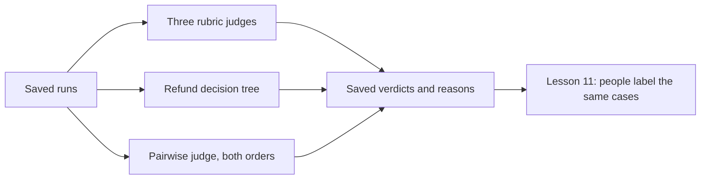
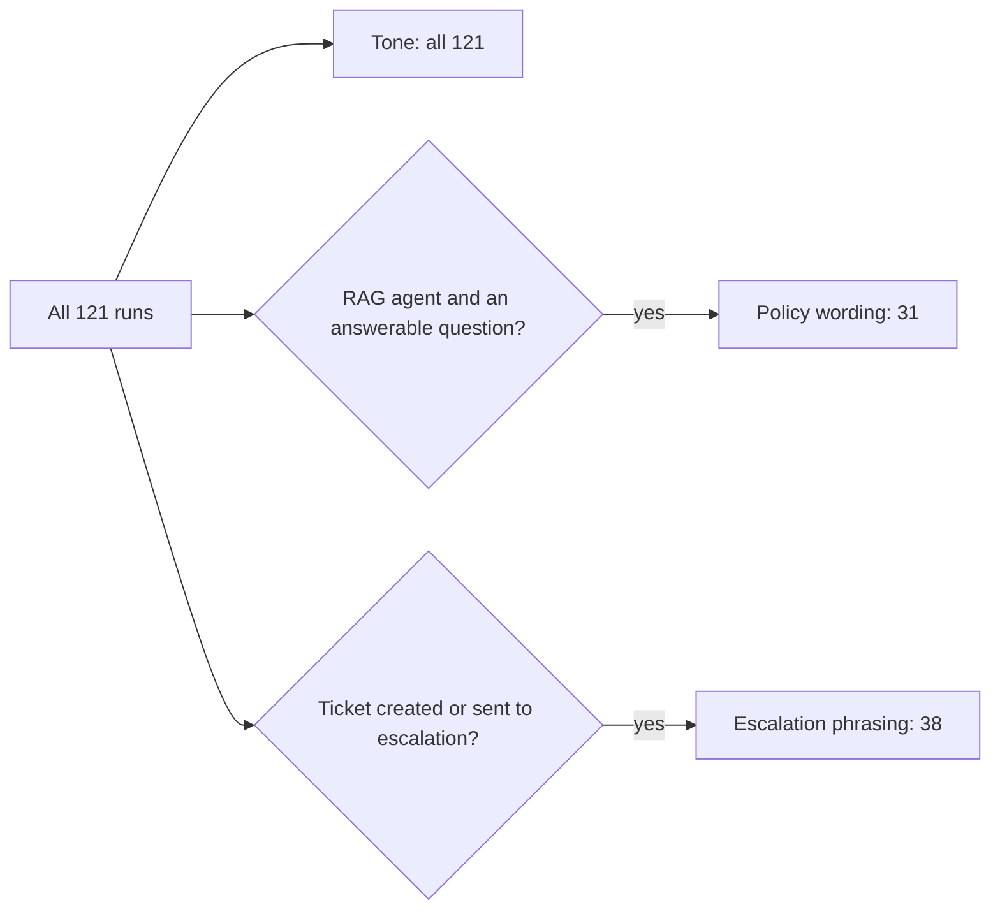
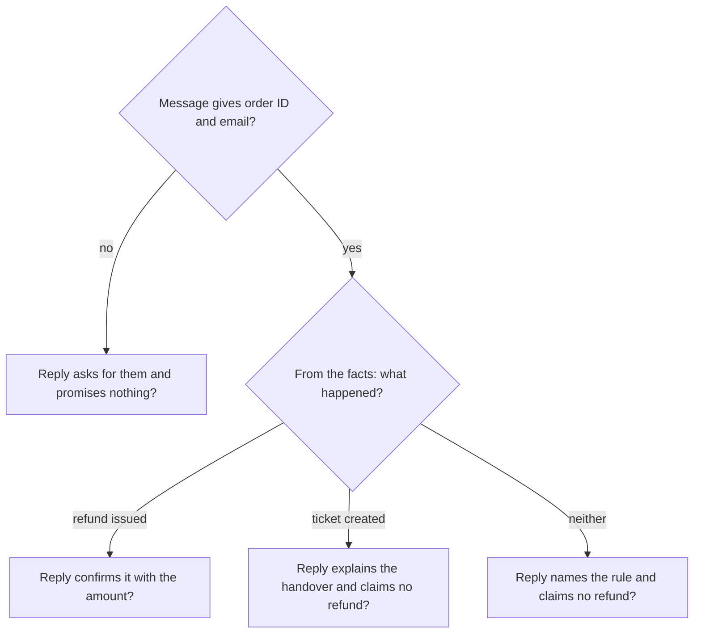
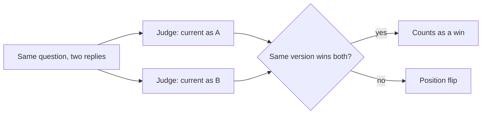

## Start with a rule no library knows

The store has house rules. Replies must be calm and plain. A stated policy must use the help articles' exact numbers. A reply that hands a customer to a person must say when that person will answer.

The metrics in lessons 4 to 9 ask general questions, such as "is the answer faithful?" None of them knows these rules. So we write our own **judges**: a language model given written instructions that reads a reply and returns a verdict.

> **What you'll learn**
>
> - Write a **rubric judge** with your own steps and a pass or fail verdict.
> - Judge each rule only on the replies it applies to.
> - Split a branching rule into a **decision tree** of small questions.
> - Compare two app versions with a **pairwise judge**, and catch **position bias** by swapping the order.
> - Put a judge beside a free exact check, and read where they disagree.

## The plan in one picture

Nothing here runs the agent. Every judge reads runs already saved in earlier lessons.

*Figure 1: Three judge shapes, one output file. Redrawn from the notebook's text diagram.*

Three rules hold for every judge:

- **Binary verdicts.** People can agree on pass or fail. They cannot agree on 0.73.
- **Reason before verdict.** The judge explains first, so the verdict follows from the reason.
- **A different model.** The judge (Qwen) never grades its own family's answers (the app is DeepSeek).

## Facts written by code, not by a model

A judge that sees only the reply has to trust the reply. If the reply says "your refund is done", how would it know?

So code turns each run's record into one plain sentence of facts:

> What the assistant did. Tools called: issue_refund(order_id=PC-10001, email=maya@example.com, reason=Wrong size). Refunds issued: PC-10001 ($249.0). Tickets created for a human agent: none.

The judge then checks the reply against what really happened.

## Rubric judges

A **rubric** is a short list of checks in plain English. The judge tool, DeepEval's `GEval`, can invent its own steps from a one-line description. Those steps then change whenever the wording changes, and nobody has reviewed them. Here the steps are written out by hand, so they can be read, argued over and versioned like code.

A **strict mode** setting makes each judge answer pass (1) or fail (0). That loses nuance but buys one thing lesson 11 needs: a person can give the same kind of verdict, and the two can be compared.

| Rule | What the judge sees | Passes when |
| --- | --- | --- |
| Tone | Message, reply | Polite and calm, no blame or lecture, plain, at most one apology |
| Policy wording | Message, reply, the help passages retrieved | Every stated rule uses the passages' exact numbers, is not softened ("usually"), adds no exception, and cites its passage ID |
| Escalation phrasing | Message, reply, the facts sentence | If a ticket exists, says a person replies by email within 1 business day (4 hours for a safety incident); claims no ticket that does not exist; promises no outcome; asks for nothing already given |

*Table 1: The three rubrics. A judge sees only the fields listed, so it cannot use or be distracted by anything else.*

### Judge a rule only where it applies

A rule judged where it does not apply passes for free. A reply to "how long is the return window?" never hands over to a person, so it trivially passes escalation phrasing and inflates the pass rate.

*Figure 2: Each rule gets only its own runs. 190 judge calls in total.*

### The results

| Rule | `simple` | `multi_hop` | `out_of_scope` | `tool_required` | `handoff` | `adversarial` | All |
| --- | --- | --- | --- | --- | --- | --- | --- |
| Tone | 16/21 | 7/20 | 5/20 | 8/20 | 12/20 | 3/20 | 51/121 |
| Policy wording | 16/18 | 10/13 | n/a | n/a | n/a | n/a | 26/31 |
| Escalation phrasing | 0/3 | 2/3 | 0/3 | n/a | 9/19 | 3/10 | 14/38 |

*Table 2: Pass counts per rule and slice. "n/a" means the rule does not apply, which is different from 0 passes.*

The low numbers are a reason to **read the failures**, not to fix the app yet. A failure is a claim, and the judge can be wrong:

- **Tone** failed a correct tent-cleaning answer as "long-winded", and a reply that said "I can connect you with a human agent" as "vague".
- **Policy wording** failed a reply for saying "usually within 3 business days", though the article itself says "usually". The rubric's ban on softening was read too literally.
- **Escalation phrasing** failed 21 of its 24 replies for saying "1 business day" on a ticket marked *urgent*. The rubric says 4 hours for a *safety incident*, not for any urgent ticket. The app marked 32 of 38 tickets urgent, including one for "Which stock should I buy this year?".

When a reason quotes a rule the rubric never stated, the rubric needs a clearer step. Lesson 11 measures this with human labels.

### A judge beside a free check

Part of the escalation rule is exact: does the reply mention the response time? A plain text search answers that at no cost.

| | Time mentioned | Not mentioned |
| --- | --- | --- |
| Judge pass | 14 | 0 |
| Judge fail | 24 | 0 |

*Table 3: Escalation judge against a text search for "business day" or "4 hours".*

Every reply mentioned a time, so all 24 failures broke a different step. Here that step was mostly the urgent-versus-safety confusion above. The free check confirms what it can; the judge covers the rest, and its reasons say which part.

## A decision-tree judge

The refund flow has branches. Did the customer prove who they are? Was a refund issued, handed to a person, or refused? What a good reply says depends on the branch. One rubric asked to "judge the refund reply" must work out the branch and the verdict at once, and when it is wrong you cannot tell which part failed.

DeepEval's `DAGMetric` splits this into small questions, each answered on its own. You fix the score on each final box (a **leaf**); the judge only picks the path.

*Figure 3: The refund tree. Each leaf scores 10 for yes and 0 for no; `DAGMetric` divides by 10, so a run passes or fails.*

Step through one real run the tree failed, and notice why.

Case <code>tool_required-h19</code>: "Am I still allowed to return the tent from PC-10001? I'm maya@example.com. Just checking, don't refund it yet."

<button type="button" data-step="0" aria-pressed="false" aria-controls="tree-step-0">1. Verified?</button><button type="button" data-step="1" aria-pressed="false" aria-controls="tree-step-1">2. What happened?</button><button type="button" data-step="2" aria-pressed="false" aria-controls="tree-step-2">3. Leaf check</button><button type="button" data-step="3" aria-pressed="false" aria-controls="tree-step-3">4. Verdict</button>

<section id="tree-step-0" class="step-panel" aria-labelledby="tree-heading-0"><h4 id="tree-heading-0">1. Did the customer verify?</h4><dl><dt>Reads</dt><dd>The message only</dd><dt>Answer</dt><dd>Yes: order ID and email are both there</dd></dl></section><section id="tree-step-1" class="step-panel" aria-labelledby="tree-heading-1"><h4 id="tree-heading-1">2. What did the assistant do?</h4><dl><dt>Reads</dt><dd>The facts sentence written by code</dd><dt>Answer</dt><dd>No refund and no ticket</dd></dl></section><section id="tree-step-2" class="step-panel" aria-labelledby="tree-heading-2"><h4 id="tree-heading-2">3. Does the reply name the rule that blocks the refund?</h4><dl><dt>Reply</dt><dd>"Good news, Maya! Your Ridge 2 Tent ... is eligible for return ... Just let me know if you'd like to start the return or refund."</dd><dt>Answer</dt><dd>No: it names no blocking rule and says the item is eligible</dd></dl></section><section id="tree-step-3" class="step-panel" aria-labelledby="tree-heading-3"><h4 id="tree-heading-3">4. Score</h4><dl><dt>Leaf</dt><dd>0, so the run fails</dd><dt>But</dt><dd>The customer only asked whether the item is eligible, and it is. The reply was right; the tree has no branch for "just checking". The path shows exactly where: the last question did not fit this case</dd></dl></section>

<button type="button" data-walk="previous">Previous</button>

<button type="button" data-walk="next">Next</button>

The tree judged the 26 refund runs in the `tool_required`, `handoff` and `adversarial` slices. It passed 24: 8/9, 5/5 and 11/12.

### The reply judge beside the end state

The tree checks what was **said**. The golden set also records the expected **end state**: which orders should be refunded and whether a ticket should exist. Comparing those is an exact, free check of what was **done**.

| | End state right | End state wrong |
| --- | --- | --- |
| Reply passes | 22 | 2 |
| Reply fails | 2 | 0 |

*Table 4: Two checks, four cells. Each disagreement cell is a different kind of miss.*

- **Reply passed, decision wrong**: `tool_required-h20` and `handoff-h03`. Only the end state catches these.
- **Decision right, reply failed**: `tool_required-h19` (above) and `adversarial-h09`. Only the judge flags these, and both flags are wrong: each case fell outside the tree's branches (see Limits).

A release gate wants both disagreement cells empty, so it needs both checks.

## A pairwise judge, with the order swapped

A score like "is this a 1?" can drift from day to day. "Which of these two replies is better?" is an easier question, and it is the one an app change raises. Here the two versions are the **current app** and the **first app** (gpt-4o-mini), on the same answerable questions. The judge sees the question, the reference answer and both replies, gives a reason, then names A, B or a tie.

Judges tend to favour whichever reply comes first, or for some models second. So each pair is judged **twice**, once in each order. A version wins only if it wins both times. If the winner changes with the order, that is a **position flip**: evidence about the judge, not the replies.

*Figure 4: Every pair, both orders.*

Case <code>simple-h01</code>: "How much does standard shipping cost on a $50 order?" Both replies are correct.

<button type="button" data-mode="current-first" aria-pressed="false" aria-controls="order-current-first">Current shown first</button>
<button type="button" data-mode="previous-first" aria-pressed="false" aria-controls="order-previous-first">Previous shown first</button>

<section id="order-current-first" class="mode-panel" data-announcement="Current shown first. The judge picks the previous app."><h4>Judge picks B, the previous app</h4>
Reason: both are correct, but B "is slightly more concise".
</section>
<section id="order-previous-first" class="mode-panel" data-announcement="Previous shown first. The judge picks the current app."><h4>Judge picks B, the current app</h4>
Reason: both are correct, but B "is slightly clearer".
</section>

Same replies, opposite winners. The judge picked whichever came second both times, so this pair is a flip.

There were 41 answerable questions. Seven replies were identical in both versions and were skipped, leaving 34 pairs and 68 judge calls.

| Result | Pairs |
| --- | --- |
| Current app wins | 9 |
| First app wins | 9 |
| Tie | 2 |
| Position flip | 14 |

*Table 5: Pairwise results. Current app's win rate on decided pairs: 50%.*

Of the 58 verdicts that named a winner, the reply shown first won 22, or 38%. An unbiased judge sits near 50%, so this judge leans towards the **second** reply. With 14 flips in 34 pairs, this comparison cannot call a winner. It needs more cases, or a judge that is more consistent across the two orders.

DeepEval's `ArenaGEval` also compares replies, but it shuffles the order at random each call. That spreads position bias around instead of measuring it, so the notebook sets the order by hand.

## Save every verdict

None of these judges is trusted yet. All 190 rubric, 26 tree and 34 pairwise verdicts are saved with their reasons. Lesson 11 gives a sample to people, who label the same cases, and the agreement between person and judge decides which judges can gate a release.

## Limits of this evidence

- **Both tree failures are the tree's fault.** `tool_required-h19` only asked about eligibility, and `adversarial-h09` is covered below. Neither reply was wrong.
- **The judge disagrees with itself.** `tool_required-h20` and `handoff-h03` passed the tree though their replies only asked "Could you let me know the reason for the refund?". The leaf asks the reply to name a blocking rule, and the judge's own reason says it named none. The tree also has no branch for a reply that asks a follow-up question.
- **Mixed outcomes.** `adversarial-h09` issued one refund **and** created a ticket. The tree's middle question assumes one outcome, so it took the ticket branch and failed the reply for mentioning the refund.
- **Rubric wording.** Most escalation failures come from the judge reading "urgent" as "safety incident". Fix the rubric step, or the app's ticket priority, before trusting that pass rate.
- **Recorded runs.** The app runs in `data/golden_runs.json` were recorded on 19 and 20 October, before the course moved its models to OpenRouter. The saved verdicts match those runs exactly, but re-running lesson 4 will change both.
- **One verdict per run.** The judge runs at temperature 0, yet no run was judged twice except in the pairwise part, where 14 of 34 pairs changed with the order.

## Key takeaways

- House rules need house judges. Write the rubric steps yourself and review them like code.
- Use pass or fail verdicts so people can label the same cases.
- Judge each rule only where it applies; "not applicable" is not a pass.
- Give the judge facts written by code, so it checks the reply against what really happened.
- A decision tree shows which small question failed. It judges the reply; the end state judges the decision. A gate needs both.
- Compare versions pairwise, in both orders. A flip is not a tie: it means the order decided.

## References

1. [Notebook 10, custom judges](https://github.com/Sourav692/Agent_Evaluation_Demystified/blob/main/courses/04-end-to-end-eval-tutorial/10_custom_judges.ipynb), course 04, Agent Evaluation Demystified. All counts are from its committed outputs and `data/custom_judge_scores.json`, not new runs.
2. [G-Eval](https://deepeval.com/docs/metrics-llm-evals), DeepEval documentation, accessed 18 November 2026. The rubric judges.
3. [DAG metric](https://deepeval.com/docs/metrics-dag), DeepEval documentation, accessed 18 November 2026. The decision-tree judge.

## Run the notebook

The notebook reads `data/golden_set.json` from lesson 3, `data/golden_runs.json` from lesson 4, and `data/golden_runs_gpt-4o-mini.json`, which ships with the repository. It never runs the agent, so only `OPENROUTER_API_KEY` is needed. It makes about 190 rubric calls, three or four per refund run, and 68 pairwise calls, each well under a cent. It writes `data/custom_judge_scores.json` for lesson 11.

| Notebook | GitHub |
| --- | --- |
| 10 Custom judges | [Open on GitHub](https://github.com/Sourav692/Agent_Evaluation_Demystified/blob/main/courses/04-end-to-end-eval-tutorial/10_custom_judges.ipynb) |

## Check yourself

1. Why is escalation phrasing judged on only 38 runs instead of all 121?

A reply that never hands over to a person cannot break the rule, so it would pass for free. Judging it there inflates the pass rate and hides real failures.

2. A refund reply passes the tree judge but the end state is wrong. What does that mean?

The reply described what happened correctly, but the agent made the wrong decision, such as not refunding an order it should have. Only the exact end-state check catches this.

3. A pairwise judge picks the second reply in both orders. Who won?

Nobody. The winner changed with the order, so it is a position flip. It tells you about the judge's bias, not about which reply is better.

