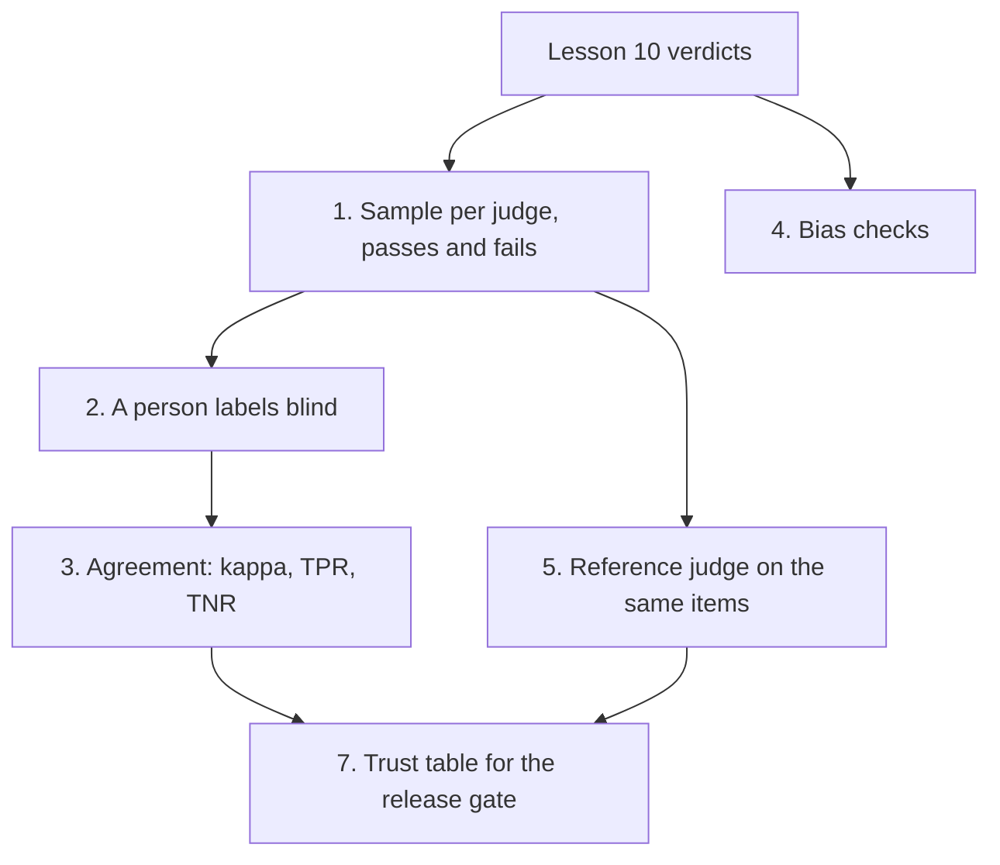

## Start with a judge nobody has checked

Lesson 10 wrote four **judges**: language models that read a reply and say pass or fail against one of the store's house rules. They produced 216 verdicts, each with a reason. The reasons read well. That proves nothing.

A judge is a model, and a model can be confidently wrong in the same direction every time. A judge that passes every reply sounds reasonable on every reply, and it would let every bad reply through a release gate.

Here is one verdict from lesson 10's refund-flow judge. Case `handoff-h03` is the run from lesson 7 where a customer who needed a human got no ticket. The judge passed the reply. Whether that pass is right is exactly what a person has to decide.

This lesson turns verdicts into a **trust table**: one row per judge, saying whether it agrees with people well enough to count.

> **What you'll learn**
>
> - Pick a sample that tests whether a judge catches failures, not only passes.
> - Collect human labels without letting the person see the judge's answer.
> - Measure agreement with Cohen's kappa, and why accuracy is not enough.
> - Check a judge for position, verbosity and self-preference bias.
> - Use a second judge model to tell a bad judge from a bad rubric.

## The plan in one picture

*Figure 1: The calibration flow. Redrawn from the notebook's text diagram. Part 6, revising a rubric, loops back to lesson 10.*

Two rules hold throughout. The person labels **blind**. And a judge with no human labels is **not trusted**, however sensible its reasons look.

## The four judges under test

Calibration measures one exact judge: its model, its prompt and its steps. Change one word of a rubric and the measured agreement no longer applies. So the notebook copies lesson 10's judges word for word, and only lets the model change.

| Judge | Rule it checks | Verdicts | Passed |
| --- | --- | --- | --- |
| Tone | Polite, calm, plain, at most one apology | 121 | 51 (42%) |
| Policy wording | Exact numbers from the articles, no softening, chunk ID cited | 31 | 26 (84%) |
| Escalation phrasing | If a ticket exists, say a human will email within 1 business day; never promise the outcome | 38 | 14 (37%) |
| Refund flow | A decision tree: verified? what happened? did the reply say it right? | 26 | 24 (92%) |

*Table 1: The judges and their verdicts in `data/custom_judge_scores.json`. All were made by `qwen/qwen3-235b-a22b-2507` on the current baseline run.*

Each judge only ruled on replies its rule applies to. A tone rule fits every reply; an escalation rule fits only replies that hand over to a person.

## Sample so failures get tested

Labelling every verdict is slow and unnecessary. Kappa from 50 to 100 items is enough to tell a good judge from a bad one. The notebook takes up to 60 items per judge, chosen two ways:

- **Up to half fails.** Most replies pass most rules. A random 60 might hold three fails, and then nobody learns whether the judge catches failures, which is the part a gate needs.
- **A fixed seed.** The same items come back every time the notebook runs, so labels already given stay attached to them.

| Judge | Pool | Sampled | Fails in sample |
| --- | --- | --- | --- |
| Tone | 121 | 60 | 30 |
| Policy wording | 31 | 31 | 5 |
| Escalation phrasing | 38 | 38 | 24 |
| Refund flow | 26 | 26 | 2 |

*Table 2: The sample, worked out from the sampling rule and the committed verdicts (no model calls). 155 items in total.*

Three pools are smaller than 60, so the whole pool is the sample. Fewer items still give a kappa, just with a wider margin of error, so the notebook prints the count beside every kappa.

## Label blind

The person sees exactly what the judge saw: the rule, the customer's message, the reply, and the evidence. For policy wording the evidence is the support articles; for escalation and refunds it is a plain list of what the assistant did. They never see the judge's verdict or its reason.

This avoids **anchoring**. A labeller shown "the judge said pass" drifts toward pass, which inflates the very number being measured.

Labels can come from either of two routes. Both end in the same file, `data/human_labels.json`:

- **A LangSmith annotation queue.** Each item is logged as a small run, the person clicks pass or fail in a review screen, and the notebook reads the clicks back.
- **A JSON file.** The notebook writes `data/human_labels_todo.json` with `"label": null` on every item; the person sets each to `true` or `false` in an editor.

Allow 20 to 30 seconds an item. Labelling is the one step a model cannot do: the point is a second opinion that is not a model.

## Agreement: why kappa, not accuracy

Each labelled item gives a pair: the judge's verdict and the person's label. Four counts come from those pairs.

| | Person: pass | Person: fail |
| --- | --- | --- |
| **Judge: pass** | true positive (TP) | false positive (FP) |
| **Judge: fail** | false negative (FN) | true negative (TN) |

*Table 3: The confusion table every number below is built from.*

- **TPR**, the true-positive rate, is TP / (TP + FN): of the replies a person passes, how many the judge passes.
- **TNR**, the true-negative rate, is TN / (TN + FP): of the replies a person fails, how many the judge catches. For a gate this matters most. A low TNR lets bad replies through.
- **Cohen's kappa** is agreement corrected for luck. Two raters who both say pass 90% of the time agree often by chance alone. Kappa subtracts that. 0 means no better than chance, 1 means perfect. The course bar is **kappa of 0.6 or more**.

The notebook's own sanity check shows why accuracy misleads. Step through it.

Ten items. The judge and the person agree on 8. Is this a good judge?

<button type="button" data-step="0" aria-pressed="false" aria-controls="kappa-step-0">1. Count</button><button type="button" data-step="1" aria-pressed="false" aria-controls="kappa-step-1">2. Observed</button><button type="button" data-step="2" aria-pressed="false" aria-controls="kappa-step-2">3. Chance</button><button type="button" data-step="3" aria-pressed="false" aria-controls="kappa-step-3">4. Kappa</button>

<section id="kappa-step-0" class="step-panel" aria-labelledby="kappa-heading-0"><h4 id="kappa-heading-0">1. Count the pairs</h4><dl><dt>Both pass</dt><dd>8 (TP)</dd><dt>Judge pass, person fail</dt><dd>1 (FP)</dd><dt>Judge fail, person pass</dt><dd>1 (FN)</dd><dt>Both fail</dt><dd>0 (TN)</dd></dl></section><section id="kappa-step-1" class="step-panel" aria-labelledby="kappa-heading-1"><h4 id="kappa-heading-1">2. Observed agreement</h4><dl><dt>Rule</dt><dd>Items where both agree, divided by all items</dd><dt>Value</dt><dd>(8 + 0) / 10 = 0.80</dd><dt>Reading</dt><dd>Looks like an 80% accurate judge</dd></dl></section><section id="kappa-step-2" class="step-panel" aria-labelledby="kappa-heading-2"><h4 id="kappa-heading-2">3. Agreement expected by chance</h4><dl><dt>Pass rates</dt><dd>Judge says pass 9 times in 10; so does the person</dd><dt>Both pass by luck</dt><dd>0.9 × 0.9 = 0.81</dd><dt>Both fail by luck</dt><dd>0.1 × 0.1 = 0.01</dd><dt>Chance total</dt><dd>0.82</dd></dl></section><section id="kappa-step-3" class="step-panel" aria-labelledby="kappa-heading-3"><h4 id="kappa-heading-3">4. Kappa</h4><dl><dt>Rule</dt><dd>(observed minus chance) / (1 minus chance)</dd><dt>Value</dt><dd>(0.80 − 0.82) / 0.18 = −0.11</dd><dt>TNR</dt><dd>0: the one reply the person failed, the judge passed</dd><dt>Verdict</dt><dd>Worse than chance. Not trusted.</dd></dl></section>

<button type="button" data-walk="previous">Previous</button>

<button type="button" data-walk="next">Next</button>

High agreement, no ability to catch a failure. That is the judge kappa exists to expose, and the reason the sample is stratified.

## Read every disagreement

A judge under 0.6 is not the end of the story. Each disagreement has one of three causes, and each has a different fix.

The judge said pass, the person said fail. Pick a cause to see what it looks like and what to change.

<button type="button" data-mode="judge" aria-pressed="false" aria-controls="cause-judge">Judge misread</button>
<button type="button" data-mode="rubric" aria-pressed="false" aria-controls="cause-rubric">Rubric unclear</button>
<button type="button" data-mode="label" aria-pressed="false" aria-controls="cause-label">Label wrong</button>

<section id="cause-judge" class="mode-panel" data-announcement="Judge misread selected."><h4>The judge misread the evidence</h4>
<strong>Sign:</strong> its reason quotes something the reply does not say. <strong>Fix:</strong> a model problem. Try the reference judge; if it agrees with the person, change the judge model.
</section>
<section id="cause-rubric" class="mode-panel" data-announcement="Rubric unclear selected."><h4>The rubric allows two readings</h4>
<strong>Sign:</strong> the judge's reading is defensible; the person read the rule another way. <strong>Fix:</strong> rewrite the one step both readings hang on.
</section>
<section id="cause-label" class="mode-panel" data-announcement="Label wrong selected."><h4>The person's label is wrong</h4>
<strong>Sign:</strong> on a second read, the judge was right. <strong>Fix:</strong> correct the label. A second labeller on the disagreements is the cheap way to find these.
</section>

Labels are data too, and they can be wrong.

## Three biases

Agreement says how often a judge is right. A **bias** check asks whether it is wrong in a predictable direction, pushed by something that should not matter.

| Bias | What should not matter | How it is measured | Cost |
| --- | --- | --- | --- |
| Position | Which reply is shown first | Lesson 10's pairwise verdicts, both orders | Free |
| Verbosity | Padding that adds nothing | Re-judge padded replies, count flips | About a cent |
| Self-preference | The judge wrote the reply | The app model judges its own replies | Under a dollar |

*Table 4: The three bias checks.*

**Position.** Lesson 10 compared the current app with the first app on 34 questions, each pair judged twice with the order swapped. An unbiased judge picks the same reply both times. A **flip**, where the winner changes with the order, means order decided.

| Measure | Value |
| --- | --- |
| Pairs | 34 |
| Position flips | 14 (41%) |
| Reply shown first won | 22 of 58 named picks (38%) |

*Table 5: Position bias, computed from the committed pairwise verdicts.*

A 41% flip rate says this pairwise judge often cannot separate the two replies. The first reply winning only 38% of the time says Qwen leans toward the **second** one. So only a pair that wins in both orders counts as a win.

**Verbosity.** Take 10 passing and 10 failing policy replies, wrap each in a greeting and a sign-off that carry no information, and judge them again. The rubric says nothing about length. A fail that turns into a pass means the judge reads length as care.

**Self-preference.** A model grading its own writing tends to like it. That is why the course keeps the judge (Qwen) in a different family from the app (DeepSeek). The check runs the app model as a judge on the same items. A higher pass rate than Qwen's, and a lower TNR against the person, is self-preference.

## A second judge as a reference

One judge against people says how good that judge is. A stronger second judge, `gpt-4o`, on the same items says *why* it fails:

- Qwen and `gpt-4o` **agree with each other but not the person**: suspect the label or the rubric.
- `gpt-4o` agrees with the person and Qwen does not: Qwen is the limit.
- Neither clears 0.6: the rubric is the limit.

Judge-against-judge kappa needs no human labels, so it is useful before labelling is done. Low kappa between two capable judges means the rubric leaves room for two readings. `gpt-4o` runs on the sample only, never the full golden set, because it costs about ten times as much.

There is one more free check: the refund-flow verdicts against the run's **end state**, whether the refund and ticket matched the golden set.

| Refund-flow judge | Decision right | Decision wrong |
| --- | --- | --- |
| Reply pass | 11 | 13 |
| Reply fail | 1 | 1 |

*Table 6: Computed for this page from the committed verdicts and runs. The notebook prints this table but has no saved output.*

The notebook says "reply pass, decision wrong" should be 0. Here it is 13, and 11 of them are attacks. Read the tree's questions, though: they ask whether the reply describes what happened, not whether what happened was right. `handoff-h03` passed because the reply truthfully reported no refund and no ticket. So this cell mixes agent errors with judge errors, and each run needs reading.

## Revise a rubric, then measure again

A judge under the bar is revised, not thrown away:

1. Read its disagreements and the judge-against-judge splits. Find the step both readings hang on. "Plain and to the point" is a typical culprit.
2. Rewrite that one step into something checkable, such as "at most three sentences, and none that repeats the question".
3. Edit the rubric in lesson 10, and copy the same edit into this notebook, so the judge measured is still the judge used.
4. Re-run lesson 10, then this lesson. Same sample, same labels, so only the judge changed.

Never revise until the rubric agrees with *these* labels and stop. That tunes the judge to one sample. After a revision, label a fresh sample with a new seed before trusting the new kappa.

## The trust table

The final output is `data/judge_trust.json`: one row per judge model and rule, with the number of labelled items, kappa, TPR, TNR, and `trusted`, which is simply kappa of 0.6 or more. Lesson 13's release gate counts a judge's scores only where the primary judge's row says `trusted: true`.

The file is written **only from human labels**. With no labels, no file is written, and the gate treats every judge as untrusted. That is the right default for a judge nobody has checked.

## Limits of this evidence

- **No labels yet**: the committed notebook has no saved outputs, and the repository has no `data/human_labels.json`, `data/calibration_verdicts.json` or `data/judge_trust.json`. So there is no kappa, no verbosity or self-preference result and no `gpt-4o` comparison to show, and lesson 13's gate currently treats every judge as advisory.
- **Sample size**: the notebook text says about 200 items to label and about 240 queued runs. The sampling rule on the committed verdicts gives 155.
- **Worked numbers**: Tables 2, 5 and 6 were computed for this page from the committed data files, with no model calls. Re-running lesson 10 will change them.
- **End-state check**: as written, the "should be 0" reading in the notebook does not match what the refund tree asks; see Table 6.
- **Small pools**: refund flow has only 2 fails and policy wording 5, so their TNR rests on very few items.

## Key takeaways

- A judge's reasons can read well and still be wrong in one direction. Check it against people.
- Sample up to half fails, with a fixed seed, so failure-catching is tested and labels stay attached.
- Label blind, to avoid anchoring.
- Use kappa, not accuracy; TNR is the number a gate cares about. The bar is 0.6.
- Check position, verbosity and self-preference bias. Here Qwen flips 41% of pairs and favours the second reply.
- No labels, no trust: an unchecked judge stays advisory.

## References

1. [Notebook 11, calibrating judges with human labels](https://github.com/Sourav692/Agent_Evaluation_Demystified/blob/main/courses/04-end-to-end-eval-tutorial/11_calibrating_judges_with_human_labels.ipynb), course 04, Agent Evaluation Demystified. Verdict counts come from its input, `data/custom_judge_scores.json`.
2. [LangSmith documentation](https://docs.smith.langchain.com/), annotation queues, accessed 18 November 2026.
3. J. Cohen, "A coefficient of agreement for nominal scales", *Educational and Psychological Measurement* 20(1), 1960. The original kappa.

## Run the notebook

The notebook reads `data/custom_judge_scores.json` from lesson 10, `data/golden_set.json` from lesson 3 and `data/golden_runs.json` from lesson 4. Parts 3 and 7 need a person with one to two hours. The paid parts cost about $1 for `gpt-4o`, under a dollar for the app model and about a cent for the padding check, and are cached in `data/calibration_verdicts.json` so a second run does not pay twice.

| Notebook | GitHub |
| --- | --- |
| 11 Calibrating judges with human labels | [Open on GitHub](https://github.com/Sourav692/Agent_Evaluation_Demystified/blob/main/courses/04-end-to-end-eval-tutorial/11_calibrating_judges_with_human_labels.ipynb) |

## Check yourself

1. A judge agrees with the person on 90% of items. Why might it still be untrusted?

If almost every reply passes, two raters agree that often by chance. Kappa removes the chance part. A judge that passes everything can score 90% and still have a kappa near 0 and a TNR of 0.

2. Why must the labeller not see the judge's verdict?

Anchoring. A person shown "the judge said pass" drifts toward pass, so measured agreement rises without the judge getting any better.

3. Qwen and gpt-4o agree with each other but both disagree with the person on the same items. What do you check first?

The label and the rubric. Two capable judges reading the same way suggests the person read the rule differently, or the rule allows two readings.

