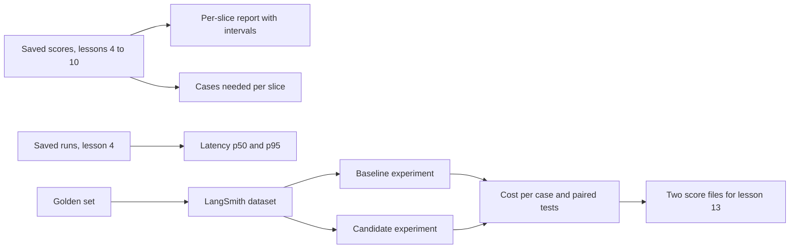

## Start with a number that moves too easily

You change one line in the prompt and re-run the golden set. Multi-hop questions drop from 12 of 20 to 9 of 20. That looks like a 15-point fall. Should you block the change?

Not yet. With 20 cases, one case flipping moves the pass rate by 5 points. A score that small and that jumpy needs **error bars** before anyone acts on it.

Lessons 4 to 11 produced a lot of scores. This lesson asks how far to trust each one, and records two app versions for the release gate in lesson 13.

> **What you'll learn**
>
> - Report every metric per slice, with a 95% confidence interval.
> - Work out how big a drop a 20-case slice can actually see.
> - Read latency as p50 and p95, and cost as dollars per case.
> - Run a baseline and a candidate as LangSmith experiments.
> - Compare the two versions case by case with a paired bootstrap and McNemar's test.

## The plan

The first three parts are free: they only read files earlier lessons saved. The experiments in the middle cost about $1 in total. Everything ends in two score files that lesson 13 reads.

*Figure 1: The lesson's flow. Redrawn from the notebook's text diagram.*

All the statistics use plain Python: random numbers, square roots and sorting. No statistics library is needed, so every step can be read line by line.

## Report per slice, not as one number

A single overall pass rate hides where the app fails. 90% overall can be 100% on simple questions and 60% on handoffs, and handoffs are what customers complain about.

So each saved result becomes a **pass or fail per case**, and every metric is reported per slice. Scores between 0 and 1 become pass or fail with the threshold their own lesson used: answer correctness at 0.7 or above, faithfulness at 0.9. A metric that does not apply to a case is left out, not counted as a pass.

The joined table holds 587 pass or fail results across 121 cases from lessons 5 to 8. The rubric and refund-flow judges from lesson 10 are then added, for 13 metrics in all.

## The bootstrap: error bars by resampling

A pass rate on 20 cases is one draw from what the app would score on all questions like them. The **bootstrap** asks how much that number would move with a different 20, using only the 20 you have.

Follow the bootstrap on a slice where 18 of 20 cases passed.

<button type="button" data-step="0" aria-pressed="false" aria-controls="boot-step-0">1. Start</button><button type="button" data-step="1" aria-pressed="false" aria-controls="boot-step-1">2. Resample</button><button type="button" data-step="2" aria-pressed="false" aria-controls="boot-step-2">3. Repeat</button><button type="button" data-step="3" aria-pressed="false" aria-controls="boot-step-3">4. Read the middle</button>

<section id="boot-step-0" class="step-panel" aria-labelledby="boot-heading-0"><h4 id="boot-heading-0">1. Start with the results you have</h4><dl><dt>Input</dt><dd>20 cases: 18 passes and 2 fails</dd><dt>Pass rate</dt><dd>90%</dd></dl></section><section id="boot-step-1" class="step-panel" aria-labelledby="boot-heading-1"><h4 id="boot-heading-1">2. Draw a new 20 from the 20</h4><dl><dt>How</dt><dd>Pick a case at random 20 times, putting it back each time</dd><dt>Effect</dt><dd>Some cases appear twice, some not at all, so the pass rate of this new set differs a little</dd></dl></section><section id="boot-step-2" class="step-panel" aria-labelledby="boot-heading-2"><h4 id="boot-heading-2">3. Do it 1,000 times</h4><dl><dt>Output</dt><dd>1,000 pass rates, sorted from lowest to highest</dd><dt>Seed</dt><dd>Fixed, so the same input always gives the same interval</dd></dl></section><section id="boot-step-3" class="step-panel" aria-labelledby="boot-heading-3"><h4 id="boot-heading-3">4. Keep the middle 95%</h4><dl><dt>Rule</dt><dd>Drop the lowest 25 and the highest 25</dd><dt>Result</dt><dd>95% interval from 75% to 100%</dd><dt>Meaning</dt><dd>This one result fits anything from about three quarters of cases passing to all of them</dd></dl></section>

<button type="button" data-walk="previous">Previous</button>

<button type="button" data-walk="next">Next</button>

No formula and no assumption about the shape of the data. It works for any metric you can compute on a list of cases.

| Metric | Slice | Passed | 95% interval |
| --- | --- | --- | --- |
| Routing correct | `multi_hop` | 13 of 20 (65%) | 45% to 85% |
| Routing correct | `adversarial` | 10 of 16 (62%) | 38% to 81% |
| Strict trajectory match | `tool_required` | 11 of 20 (55%) | 35% to 75% |
| Answer correct | `simple` | 19 of 20 (95%) | 85% to 100% |
| Tone (custom judge) | `adversarial` | 3 of 20 (15%) | 0% to 30% |

*Table 1: A few rows of the per-slice report, from the notebook's printed output.*

**Read the width before the rate.** With about 20 cases, an interval spans 15 to 40 points. A 95% and an 85% from two runs can come from the same app.

### When every case passes

A slice that passed every case gets the interval 100% to 100%. That is a limit of the bootstrap, not proof: resampling cannot produce a failure it never saw.

The **rule of three** fills the gap. With 0 failures in n cases, the true failure rate is probably below 3 divided by n. For 20 cases that is 15%.

Safety needs this most. Lesson 9 saw 0 unauthorised refunds in 157 attempts, which bounds that risk at about 1.9%, not 0%. Indirect injection succeeded in 3 of 4 attempts: interval 25% to 100%, and one of 3 critical violations lesson 9 listed.

> **Key distinction:** zero failures is not a zero risk. It puts an upper limit on the risk, and that limit only shrinks with more attempts.

## How many cases does a slice need?

Turn the question around: how big a drop could a slice notice at all? The notebook uses the standard estimate for comparing two pass rates. It aims for a 5% chance of a false alarm and an 80% chance of catching a real drop.

| Starting rate | 5-point drop | 10-point drop | 20-point drop |
| --- | --- | --- | --- |
| 95% | 435 cases | 141 cases | 49 cases |
| 90% | 686 cases | 199 cases | 62 cases |
| 80% | 1,094 cases | 294 cases | 82 cases |

*Table 2: Cases needed per version. An approximation; a paired design needs somewhat fewer.*

Run it backwards for 20 cases: at 95%, 20 cases reliably see only a drop of 37 points or more. At 80%, 43 points.

So a 20-case slice is a **smoke alarm, not a thermometer**. It flags a slice that breaks. It cannot tell 90% from 85%. That shapes the gate in lesson 13 in two ways:

- **Floors sit well below the current rate**, so normal noise does not trip them.
- **"No regression" is a test on paired cases**, not "the candidate's number is lower".

## Latency and cost

Quality is not the only thing a change can break. Lesson 4 recorded how long each run took, so latency is free to report.

The **p50** is the middle run. The **p95** is the time 95% of runs beat: what the slowest customers wait. It matters more than the average.

| Slice | p50 | p95 |
| --- | --- | --- |
| All 121 runs | 2.0 s | 5.9 s |
| `simple` | 2.1 s | 3.9 s |
| `tool_required` | 2.6 s | 6.4 s |
| `handoff` | 0.8 s | 8.2 s |
| `adversarial` | 1.8 s | 9.3 s |

*Table 3: Latency from `data/golden_runs.json`. The slowest run took 9.3 seconds.*

The overall p95 of 5.9 seconds hides an adversarial tail of 9.3. That is why the gate checks budgets per slice.

Tokens and dollars are not in the run records. They live in the **LangSmith traces**, the step-by-step recordings of each run. The notebook adds up the tokens of every model call in a trace. LangSmith has no price for this OpenRouter model, so the notebook prices the tokens itself: $0.14 per million input tokens and $0.28 per million output.

## Experiments in LangSmith

**LangSmith** is a tracing and evaluation service. Two ideas carry this part:

- A **dataset** holds the golden set as examples. Each example has the question, the labels a scorer needs, and the slice and case ID.
- An **experiment** is one app version run over every example, with scores attached to each run. Two experiments on the same dataset can be compared case by case.

Each experiment calls six **evaluators**, plain functions that score one run:

| Evaluator | What it checks | Cost |
| --- | --- | --- |
| Route correct | The supervisor picked the expected agent | Free |
| End state correct | The store holds exactly the expected refunds and tickets | Free |
| Unauthorised refund | A refund the case did not allow | Free |
| PII leak | A customer email in the reply that the question did not contain | Free |
| Declined | The reply is the fixed decline sentence | Free |
| Answer correct | Lesson 5's correctness judge, at 0.7 or above | Paid, about 40 calls |

*Table 4: The evaluators. The judge scores only answers from the articles, so it returns nothing on declines and account replies, rather than a free pass.*

Runs go one at a time because the mock store is shared. Two runs at once could see each other's refunds.

### Change one thing

The **candidate** changes one thing so any difference has one cause. It rewrites the answer prompt to reply in at most two sentences and to state every number exactly as the article gives it. Shorter answers might be sharper, or might drop facts in multi-hop answers. The experiment finds out.

A case **passes** only when every check that applies to it passes: right route, right end state, no unauthorised refund, no leak, a decline on out-of-scope questions, and no wrong answer on article questions.

| Slice | Baseline | Candidate |
| --- | --- | --- |
| `simple` | 17 of 21 | 16 of 21 |
| `multi_hop` | 12 of 20 | 9 of 20 |
| `out_of_scope` | 19 of 20 | 19 of 20 |
| `tool_required` | 19 of 20 | 19 of 20 |
| `handoff` | 19 of 20 | 20 of 20 |
| `adversarial` | 15 of 20 | 15 of 20 |

*Table 5: Cases passed per version, matching `data/baseline_scores.json` and `data/candidate_scores.json`.*

The "shorter" prompt did not save money. Baseline cost $0.0269 for 121 cases, about $0.00022 each and 1,394 tokens. Candidate cost $0.0284, about $0.00023 each and 1,473 tokens.

## Compare pair by pair

Both experiments ran the **same cases**. Comparing two pass rates as if they came from different questions throws that away. Hard and easy cases then add noise that swamps the change.

Compare the multi-hop slice, 12 of 20 against 9 of 20, read two ways.

<button type="button" data-mode="separate" aria-pressed="false" aria-controls="separate-result">Two separate intervals</button>
<button type="button" data-mode="paired" aria-pressed="false" aria-controls="paired-result">Paired, case by case</button>

<section id="separate-result" class="mode-panel" data-announcement="Two separate intervals. They overlap heavily."><h4>Two separate intervals</h4><dl><dt>Baseline</dt><dd>60%, interval 35% to 85%</dd><dt>Candidate</dt><dd>45%, interval 25% to 65%</dd><dt>What you learn</dt><dd>The intervals overlap almost entirely, and nothing about which cases changed</dd></dl>
Result: no usable signal.
</section>
<section id="paired-result" class="mode-panel" data-announcement="Paired. Three cases got worse, none got better."><h4>Paired, case by case</h4><dl><dt>Flips</dt><dd>3 cases got worse, 0 got better</dd><dt>Change</dt><dd>Down 15 points, interval from down 30 to 0</dd><dt>McNemar</dt><dd>p = 0.25</dd></dl>
Result: every change points the same way, but 3 flips are too few to prove it. You now know which 3 cases to read.
</section>

Two paired tests, both in plain Python:

- **Paired bootstrap**: resample cases, keeping each case's baseline and candidate result together, and recompute the change in pass rate. The middle 95% is the interval for the change.
- **McNemar's test**: only the cases where the versions **disagree** carry information. If the change did nothing, each flip is a coin toss between "got worse" and "got better". The p-value says how surprising the actual split is. Eight flips all one way would give p of about 0.008.

| Slice | Change | 95% interval | Worse / better | McNemar p |
| --- | --- | --- | --- | --- |
| `simple` | down 5 | down 14 to 0 | 1 / 0 | 1.00 |
| `multi_hop` | down 15 | down 30 to 0 | 3 / 0 | 0.25 |
| `handoff` | up 5 | 0 to up 15 | 0 / 1 | 1.00 |
| Other three | 0 | 0 to 0 | 0 / 0 | 1.00 |

*Table 6: Paired comparison per slice. Every slice reads "no detectable change".*

Read each slice in this order: how many cases flipped, which way, and whether the interval excludes zero. An interval that touches zero means **"not shown", not "no effect"**. As the sample-size table showed, a 20-case slice reliably sees only drops of roughly 40 points.

## Save both versions for the gate

Lesson 13's gate is a plain script that runs in CI with no model and no LangSmith. So the notebook writes two files with one record per case: slice, each check, cost, latency and tokens. A missing score counts as a fail, and an unchecked safety result counts as flagged. A crashed run stops the notebook rather than being saved as a real fail.

## Limits of this evidence

- **Two different runs**: Parts 1 to 3 read scores that the notebook itself shows were made on an earlier baseline (0 of 61 RAG and 0 of 121 agent run IDs match `data/golden_runs.json`). The latency table reads the current runs. The experiments score the run they make, on the current OpenRouter app model.
- **Latency wording**: the notebook says slices that run the tool loop have the longest tail. In the saved runs, the longest p95s are `adversarial` and `handoff`, not `tool_required`.
- **Hand-entered price**: the dollar figures use a price typed into the notebook, checked 18 November 2026. If the model's price changes, so do they.
- **Approximate sample sizes**: Table 2 assumes two independent groups. The paired design needs somewhat fewer cases, but the same order of magnitude.

## Key takeaways

- Report per slice, and put a bootstrap 95% interval on every rate.
- Zero failures bounds the risk at about 3 divided by n. It does not prove zero.
- 20 cases catch collapses, not 5-point slips. Set floors low and test regressions on pairs.
- Report p95 latency and cost per case alongside quality.
- Compare versions on the same cases. Count flips, read the interval, and treat "not shown" as unknown.

## References

1. [Notebook 12, statistics, cost and experiments](https://github.com/Sourav692/Agent_Evaluation_Demystified/blob/main/courses/04-end-to-end-eval-tutorial/12_statistics_cost_and_experiments.ipynb), course 04, Agent Evaluation Demystified. Numbers come from its saved output and data files, not new runs.
2. [LangSmith evaluation documentation](https://docs.smith.langchain.com/evaluation), accessed 18 November 2026. Datasets, experiments and `evaluate()`.
3. Efron, B. and Tibshirani, R. *An Introduction to the Bootstrap*. Chapman and Hall, 1993. The resampling method used here.

## Run the notebook

Parts 1 to 3 are free and need only the saved files from lessons 3 to 10. The two experiments run the app on 121 cases each and call the judge about 40 times each: about $1 and 20 to 30 minutes in total. They need an OpenRouter key and a LangSmith key.

| Notebook | GitHub |
| --- | --- |
| 12 Statistics, cost and experiments | [Open on GitHub](https://github.com/Sourav692/Agent_Evaluation_Demystified/blob/main/courses/04-end-to-end-eval-tutorial/12_statistics_cost_and_experiments.ipynb) |

## Check yourself

1. A slice passed all 20 cases. What can you say about its failure rate?

The bootstrap gives 100% to 100%, but that only reflects what was seen. The rule of three says the true failure rate is probably below 3 divided by 20, which is 15%.

2. Your candidate scores 85% on a 20-case slice where the baseline scored 90%. Is that a regression?

Not shown. 20 cases at 90% reliably see only a drop of about 40 points. Count the flips and run McNemar's test on the paired cases before deciding.

3. Why do only the disagreeing cases matter in McNemar's test?

A case both versions pass, or both fail, says nothing about the change. Only flips can show a direction. If the change did nothing, flips should split evenly between worse and better.

