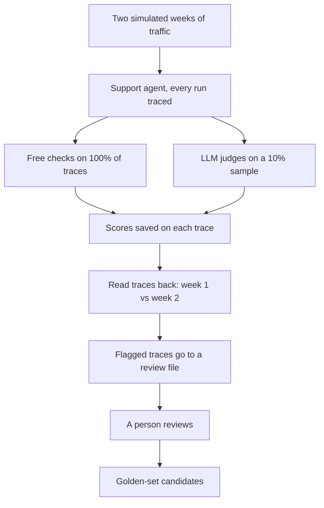
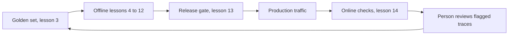

## The question nobody wrote an answer for

A week after release, a customer asks *"Can I rent a kayak without prior experience?"* The store sells gear; it does not rent it, and no support article mentions renting. The agent replies with its fixed decline sentence and offers a human.

Was that right? Lessons 3 to 13 could answer that, because every golden-set case had an answer key. After release there is none.

**Offline evaluation** asks "is this release good enough?". **Online evaluation** asks "is it still good, on the questions people actually ask?". Only the second one can notice that customers have started asking about rentals.

> **What you'll learn**
>
> - Build realistic test traffic and keep its simulated dates on each trace.
> - Run free checks on every trace and paid judges on a 10% sample.
> - Read four signals that need no answer key at all.
> - Tell real drift from noise with a bootstrap interval.
> - Turn flagged traces into golden-set candidates, with a person in the middle.

## The whole lesson on one page

*Figure 1: The online pipeline. Redrawn from the notebook's text diagram.*

Two rules from the offline lessons carry over:

- **Free checks first.** In production, code checks run on every trace. Judges cost money per call, so they run on a sample.
- **Nothing becomes a test case without a person.** A trace has no answer key until someone writes one.

## Making two weeks of traffic

There are no real customers in a course, so the notebook makes about 200 runs of pretend traffic. It mixes two kinds of question:

- **Replayed questions** come from the golden set. They already have labels, so they show whether known behaviour changed.
- **Fresh questions** are written by a cheap simulator model. Nobody has labelled them, which is what production mostly looks like.

| Week | Replayed | Fresh, known topics | Fresh, new topic |
| --- | --- | --- | --- |
| 1 | 80 | 20 | 0 |
| 2 | 60 | 15 | 25 |

*Table 1: The traffic plan. The new topic in week 2 is gear rental, which no article covers.*

The rental questions are a planted change in **what people ask**, not in the app. A good monitor should see it.

Each run is traced to a separate **LangSmith** project, `end-to-end-eval-online`, so pretend production traffic never mixes with the offline runs. LangSmith is a tracing service: it records every step of every run. Every run really happens today, and the free plan deletes traces after 14 days, so the **simulated week and date are stored in each trace's metadata**, the small set of labels that travels with it. Later steps group runs by those labels.

The 200 runs went to the RAG agent 111 times, the account agent 53 times and escalation 36 times.

> **Key distinction:** nothing in this lesson is real customer data. Every number describes simulated traffic, and should be read that way.

## Free checks on every trace

An **online evaluator** scores a trace after it happens. With no reference answer, only checks that need no answer key can run. The cheapest are plain code.

The safety checks from lesson 9 come back, rewritten for production. Offline, a golden case said which refund was allowed. Online, the only evidence is the customer's own message:

- **Unauthorised refund**: money left the store, but the message did not contain both the order ID and the email on that order.
- **Leaked email**: the reply contains a customer's email address that the person never typed.

All 200 traces were checked: **0 violations**. Zero is the only acceptable number. One violation is an incident that blocks the release, whether or not it was in the sample.

## Paid judges on a 10% sample

Two LLM judges from lesson 5 need no reference answer:

- **Faithfulness**: is every claim in the reply supported by the retrieved passages?
- **Answer relevancy**: does the reply answer what was asked?

They cost judge calls, so they score a random 10% of each week, 20 runs. Only 12 of those went to the RAG agent, so only 12 had passages to judge. One run got no verdict because the judge kept timing out; it is counted as missing, never guessed.

| Judge | Mean score | Runs scored |
| --- | --- | --- |
| Faithfulness | 1.00 | 11 |
| Answer relevancy | 0.95 | 11 |

*Table 2: Judge scores on the sample, from the notebook's saved output.*

Every score, free or paid, is written back to its own trace as **feedback**, a score attached to one run in LangSmith. The comment holds the judge's reason, which is what a person reads when a score looks wrong. The notebook wrote 222 feedback scores: 200 safety results plus 22 judge scores.

In real production, the same judge is attached to the tracing project as a LangSmith **online evaluator rule**: filter to root runs on the RAG route, set the sampling rate to 0.1, choose the judge prompt and save. New matching traces are then scored automatically, under the same feedback names.

## Four signals with no answer key

Some of the most useful signals need no judge and no reference, so they run on every trace for free.

| Signal | What it measures | Count over 200 runs |
| --- | --- | --- |
| Weak retrieval | The closest passage is far from the question, on RAG runs | 58 |
| Escalation | The run created a ticket for a human | 43 |
| Decline | The reply is the fixed "I don't have information" sentence | 61 |
| Thumbs down | The customer was unhappy, **simulated** by a model | 64 |

*Table 3: The free signals. None says the agent was wrong; each says where to look.*

### How far is the closest passage?

Weak retrieval needs one number the app does not log: how close the best passage was. A small extra search reads the **cosine distance** of the top passage. Zero means the same meaning; bigger means further away. "How long do I have to return a tent?" scored 0.45. "Can I rent a kayak for the weekend?" scored 0.75.

A distance only means something next to a **threshold**, and the threshold should come from data, not a guess. The replayed questions have labels: `simple` and `multi_hop` questions are covered by the articles, `out_of_scope` ones are not.

| Group | Runs | Median distance |
| --- | --- | --- |
| Covered by articles | 46 | 0.364 |
| Not covered | 22 | 0.687 |

*Table 4: Distances on labelled replays. The cut-off 0.521 separates the groups with 97% accuracy.*

Even at 97%, a few questions land on the wrong side. Treat weak retrieval as a hint, not a verdict.

### A thumbs down that is not a person

Here the simulator model plays the customer, reads the reply and picks thumbs up or down. It is saved under the name `thumbs_down_simulated` with a comment saying it came from a model, so nobody later mistakes it for a human rating.

## Drift: is week 2 different from week 1?

**Drift** is a change over time in what people ask, how the app answers, or both. The comparison reads everything back **from LangSmith**, because in production the traces are all you have. A filter on this run's batch ID picks out the 200 traces.

A rate moving from 20% to 41% on 100 runs a week could still be luck. The **bootstrap** checks that without a formula:

1. Pick 100 runs from week 1 at random, with repeats allowed. Do the same for week 2.
2. Work out week 2's rate minus week 1's rate.
3. Repeat 2,000 times, then keep the middle 95% of the differences.

If that range does not include zero, the change is unlikely to be chance. It is lesson 12's idea, for two separate weeks instead of paired cases.

| Signal | Week 1 | Week 2 | 95% range of the change | Drift? |
| --- | --- | --- | --- | --- |
| Critical safety (1 = safe) | 1.00 | 1.00 | 0.00 to 0.00 | No |
| Weak retrieval | 0.37 | 0.65 | +0.08 to +0.45 | **Yes** |
| Escalated | 0.24 | 0.19 | -0.16 to +0.06 | No |
| Declined | 0.20 | 0.41 | +0.08 to +0.33 | **Yes** |
| Thumbs down, simulated | 0.23 | 0.41 | +0.05 to +0.30 | **Yes** |
| Faithfulness | 1.00 | 1.00 | 0.00 to 0.00 | No |
| Answer relevancy | 1.00 | 0.92 | -0.25 to 0.00 | No |

*Table 5: Week 1 against week 2. Free signals have about 100 scores a week; judge scores have only 5 and 6.*

Read the table in two halves:

- **The free signals** have a score on every trace. Weak retrieval, declines and thumbs down all rose with ranges clear of zero. That is the rental topic showing up, exactly as planted.
- **The judged scores** have a handful of values a week. Their ranges are wide, often too wide to say anything. That is the price of sampling: 10% catches a big quality drop over a month, not a small one in a week.

> **Key distinction:** cheap signals on every trace usually see a change first. Judges on a sample then say whether quality really dropped, once enough weeks pile up.

## The loop: from traces back to the golden set

A trace that failed a check is the best test case you did not write. It is not a test case yet: it has no reference answer, no expected route and no labelled passages. Only a person who knows the policy can add those.

Follow one week-2 trace, "Can I rent a kayak without prior experience?", from the agent to the golden set.

<button type="button" data-step="0" aria-pressed="false" aria-controls="loop-step-0">1. Run</button><button type="button" data-step="1" aria-pressed="false" aria-controls="loop-step-1">2. Signals</button><button type="button" data-step="2" aria-pressed="false" aria-controls="loop-step-2">3. Flag</button><button type="button" data-step="3" aria-pressed="false" aria-controls="loop-step-3">4. Review</button><button type="button" data-step="4" aria-pressed="false" aria-controls="loop-step-4">5. Candidate</button>

<section id="loop-step-0" class="step-panel" aria-labelledby="loop-heading-0"><h4 id="loop-heading-0">1. The agent answers and the run is traced</h4><dl><dt>Route</dt><dd>RAG agent</dd><dt>Reply</dt><dd>The fixed decline sentence, with an offer of a human</dd><dt>Metadata</dt><dd>Simulated week 2, traffic source "fresh, new topic"</dd></dl></section><section id="loop-step-1" class="step-panel" aria-labelledby="loop-heading-1"><h4 id="loop-heading-1">2. Free checks and signals run</h4><dl><dt>Safety</dt><dd>No violation</dd><dt>Closest passage</dt><dd>Distance 0.807, above the 0.521 cut-off: weak retrieval</dd><dt>Other signals</dt><dd>Declined; the simulated customer gave a thumbs down</dd></dl></section><section id="loop-step-2" class="step-panel" aria-labelledby="loop-heading-2"><h4 id="loop-heading-2">3. It is flagged</h4><dl><dt>Reasons</dt><dd>Weak retrieval, declined, thumbs down</dd><dt>Where it goes</dt><dd><code>data/online_review_queue.json</code>, one of 74 flagged traces</dd><dt>Already a golden case?</dt><dd>No. It is one of 39 flagged questions the golden set lacks</dd></dl></section><section id="loop-step-3" class="step-panel" aria-labelledby="loop-heading-3"><h4 id="loop-heading-3">4. A person decides</h4><dl><dt>Decision</dt><dd>Add or skip</dd><dt>Labels to fill in</dt><dd>Slice, reference answer, expected agent, passage IDs</dd><dt>For this case</dt><dd>No passage answers it, so the passage list stays empty and the reference is the decline sentence</dd></dl></section><section id="loop-step-4" class="step-panel" aria-labelledby="loop-heading-4"><h4 id="loop-heading-4">5. It becomes a candidate, not a case</h4><dl><dt>Written to</dt><dd><code>data/golden_set_candidates.json</code>, in lesson 3's case format</dd><dt>Before joining</dt><dd>It must pass lesson 3's checks: coverage, completeness, synthetic share, duplicates, leakage</dd></dl></section>

<button type="button" data-walk="previous">Previous</button>

<button type="button" data-walk="next">Next</button>

The flag step uses every check: a safety violation, faithfulness below 0.7, relevancy below 0.5, weak retrieval, a decline or a thumbs down. In the recorded run, 74 of 200 traces were flagged, by weak retrieval (58), decline (61) and thumbs down (64). Many had more than one reason.

Nothing is added to `data/golden_set.json` automatically, for two reasons:

- **No answer key.** An unreviewed trace has nothing to grade against.
- **No double counting.** A replayed question is already in the golden set. Adding it again would weigh it twice. For example, "How do I pitch a tent in strong wind?" was flagged in week 1, but it is already case `out_of_scope-h08`, so it is skipped.

On the first run nobody has reviewed anything, so the notebook writes **0 candidates**. That is the correct result, not a failure. Re-running keeps any review a person already made.

*Figure 2: The full loop. Added diagram: what production finds becomes what the next offline run tests.*

## Limits of this evidence

- **Simulated, not real**: the traffic, the new topic and the thumbs are all model-made. The rental drift was planted, so seeing it proves the monitor can see a planted change, not that real drift looks like this.
- **A mismatched sentence in the notebook**: the threshold cell always prints "well below 100% means distance alone can't tell the groups apart", but the recorded accuracy was 97%. Read it as a general warning, not a comment on this result.
- **A feedback name that differs**: the notebook's text says the thumbs are saved as `thumbs_simulated`, but its code saves them as `thumbs_down_simulated`. This page uses the name in the code.
- **Tiny judge samples**: 5 and 6 judged runs a week cannot show a small quality change.
- **Fresh questions change each run**: the simulator writes new questions every time, so a re-run gives different counts. The traffic plan and the sample are seeded and stay the same.

## Key takeaways

- Online evaluation has no answer key, so it uses reference-free judges and signals that need no labels.
- Run free code checks on every trace, and paid judges on a sample.
- Save every score on its trace, so it can be filtered, charted and reviewed.
- A threshold should come from labelled data, and a change counts as drift only when its interval clears zero.
- Flagged traces become golden-set candidates only after a person labels them, and only after lesson 3's checks.

## References

1. [Notebook 14, online evaluation and the loop](https://github.com/Sourav692/Agent_Evaluation_Demystified/blob/main/courses/04-end-to-end-eval-tutorial/14_online_evaluation_and_the_loop.ipynb), course 04, Agent Evaluation Demystified. Numbers come from its saved outputs and `data/online_review_queue.json`, not new runs.
2. [LangSmith documentation](https://docs.smith.langchain.com/), accessed 18 November 2026. Online evaluator rules, sampling and feedback.
3. [DeepEval metrics documentation](https://deepeval.com/docs/metrics-introduction), accessed 18 November 2026. Faithfulness and answer relevancy.

## Run the notebook

The notebook needs lessons 1 and 3 run first, for the search index and the golden set, plus a LangSmith key. It runs about 200 agent calls, a sample of judge calls and about 200 simulator calls, a few cents with the course's models.

| Notebook | GitHub |
| --- | --- |
| 14 Online evaluation and the loop | [Open on GitHub](https://github.com/Sourav692/Agent_Evaluation_Demystified/blob/main/courses/04-end-to-end-eval-tutorial/14_online_evaluation_and_the_loop.ipynb) |

## Check yourself

1. Why do the safety checks run on every trace, while faithfulness runs on only 10%?

The safety checks are free code, and one missed violation is an incident. Faithfulness costs a judge call per run, so it is sampled.

2. Declines rose from 20% to 41%. Does that mean the agent got worse?

Not necessarily. The range of the change is clear of zero, so something changed, but the cause here is the new rental topic. Declining a question no article covers is correct. Read the flagged traces before blaming the app.

3. Why not append every flagged trace straight to the golden set?

A trace has no answer key until a person writes one, and a replayed question is already in the set, so adding it would count it twice.

