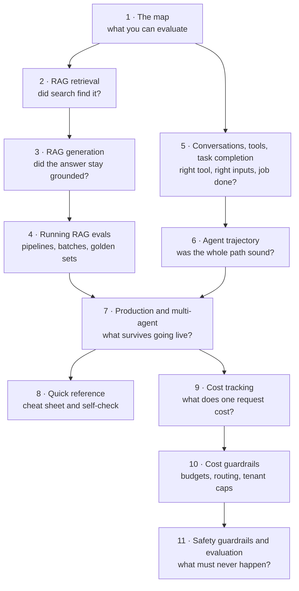

# Introduction to the Field Guide on RAG, Agent and Tool Evaluation

*Start here: this introduction sets up the eleven parts that explain how to check whether a RAG system or an agent works, and what it costs to run safely, one concept at a time.*

◷ 3 min read · Field guide part 0 of 11, the introduction

Companion to the 14 notebooks in [course 01](../../../courses/01-rag-agent-tool-evaluation/). The notebooks show how to express each idea in a
framework. This guide explains the idea itself, in plain language, before any code.

- **Who it is for.** You know what an LLM and a chatbot are, and you have never evaluated one. Every term is explained the first time it appears.
- **Tool-agnostic on purpose.** Framework APIs change often; the questions behind them don't. Framework names appear only where a part compares
  them or walks a lab.
- **One running example.** A support agent that searches a help centre and can issue refunds. The worked labs keep their own data, so the numbers
  match the notebooks and the [interactive labs](../../interactive-labs/README.md).
- **Read part 1 first.** It is the map, and every later part builds on its words. After that, jump to whatever you're working on.

The lessons that walk the same ground in order are [Level 1](../../roadmap-explainers/01-rag-retrieval-and-generation.md) (RAG) and
[Level 2](../../roadmap-explainers/02-agents-tools-conversations-trajectories-outcomes.md) (agents).

---

## The Eleven Parts

The diagram shows the reading order. Parts 2–4 follow a RAG system from search to answer; parts 5–6 follow an agent from one tool call to a whole
run; part 7 takes both into production. Parts 9–11 are a second track on the same system: what it costs to run, and the
guardrails that keep it affordable and safe.

| Part | What it answers |
|---|---|
| [1. The map](01-the-map.md) | What can be evaluated, which two questions sort every check, how LLM judges fail, and how to pick the cheapest check that works |
| [2. RAG retrieval](02-rag-retrieval.md) | Did the search step fetch the right chunks, with and without labelled answers? |
| [3. RAG generation](03-rag-generation.md) | Did the written answer stay faithful to its sources, answer the question, and match the truth? |
| [4. Running RAG evals](04-running-rag-evals.md) | How to run those checks inside a pipeline and in batch, build a golden dataset, and read the results |
| [5. Conversations, tools and task completion](05-conversations-tools-and-task-completion.md) | Did the agent keep the conversation straight, call the right tool with the right inputs, and finish the job? |
| [6. Agent trajectory](06-agent-trajectory.md) | Was the sequence of steps sensible, and what does each check look like on a live system? |
| [7. Production and multi-agent](07-production-and-multi-agent.md) | What changes once real users arrive, and how to find which agent in a team broke |
| [8. Quick reference](08-quick-reference.md) | The debugging loop, a question-to-measurement table and a one-page cheat sheet |
| [9. Cost tracking](09-cost-tracking.md) | What one request costs, traced per LLM call, retrieval step, tool and agent, and charged to the right tenant |
| [10. Cost guardrails](10-cost-guardrails.md) | How budgets, model routing and tenant caps stop the system overspending |
| [11. Safety guardrails and evaluation](11-safety-guardrails-and-evaluation.md) | The five places a guardrail sits, what happens when one fires, and how cost joins monitoring and the release gate |

**If you have ten minutes:** part 1, then the task completion section of part 5, then part 6.

---

## History

Until 2026-11-04 this guide was one 16,700-word page. That edition is kept whole in
[`archive/rag-agent-tool-evaluation-FIELD_GUIDE-single-file.md`](../../../archive/rag-agent-tool-evaluation-FIELD_GUIDE-single-file.md). Its
worked labs (old Part 6) now sit inside the parts they deepen.

---

**Next:** [The map: what you can evaluate](01-the-map.md)
