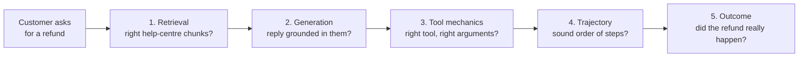
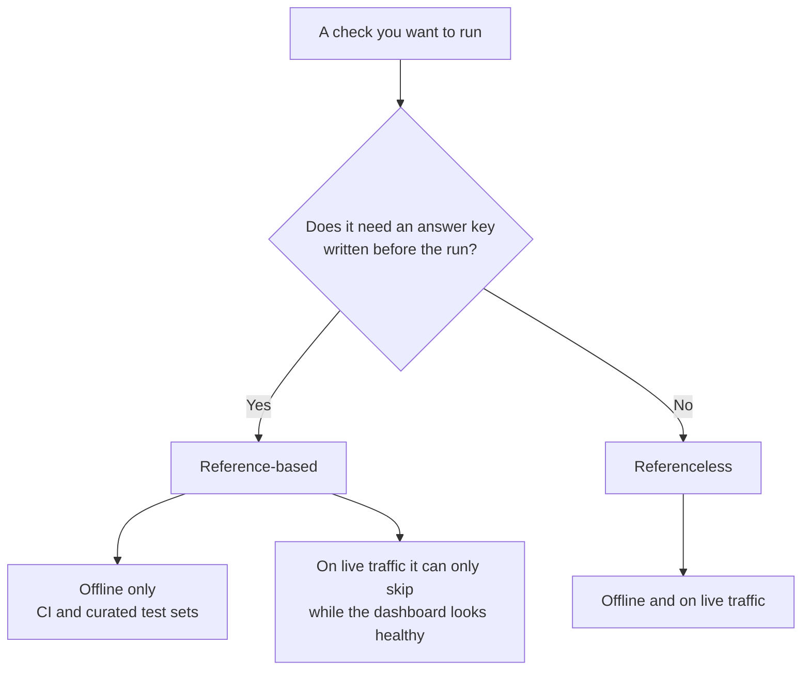
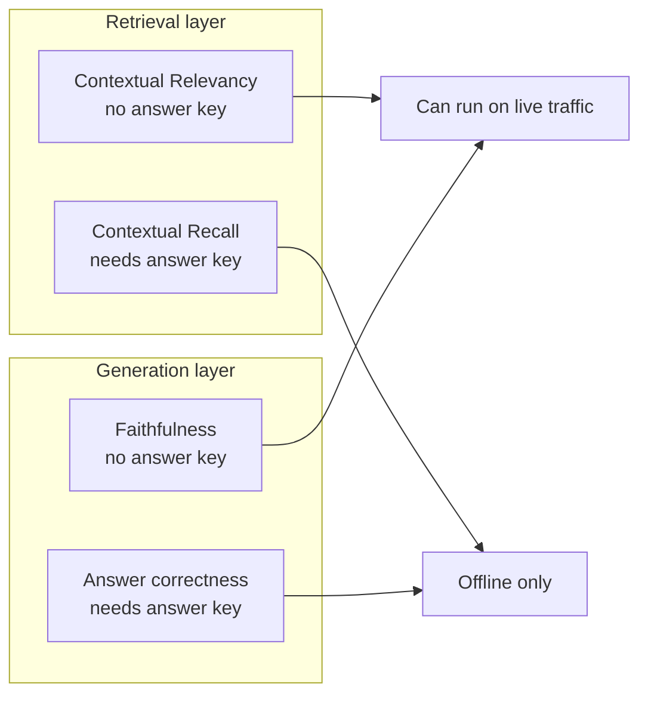
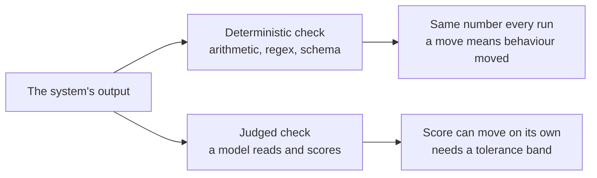
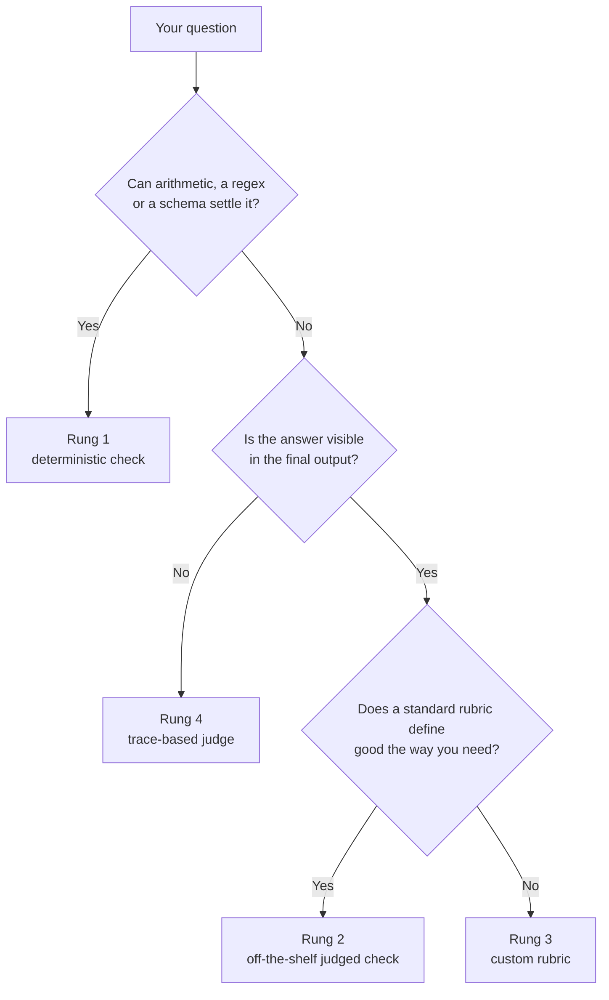

# The Map, What You Can Evaluate

*Name the layer that broke before you pick a check, because each layer fails for its own reasons and needs its own fix.*

◷ 24 min read · Field guide part 1 of 11 · [Introduction](00-introduction.md)

> **Before you start.** This part assumes nothing. If you know what an LLM and a chatbot are, you have enough. Every later part builds on the words defined here.

---

## 1. The Words You Need First

Every later part of this guide uses the terms below. Each one gets a plain definition, and most also get an everyday comparison and a line on how it shows up in the running example.

**The running example.** A support agent for an online shop. It searches the shop's help centre for policy articles, and it can look up orders and issue refunds.

### 1.1 Evaluation

- **Evaluation (eval)**: a repeatable check that measures whether a system's output is good enough, case by case, across a set of test cases.
- **Analogy.** A driving test. Same route, same checklist, same pass mark, so two candidates can be compared fairly.
- **In the example.** "Did the agent quote the current refund policy?", asked of a fixed set of prepared customer questions, is an eval.

### 1.2 The Parts of a RAG System

- **Retrieval-augmented generation (RAG)**: a system that first searches a collection of documents for relevant text, then has an LLM write an answer from that text.
  - Analogy: a student who looks the topic up in the textbook before writing an exam answer.
- **Chunk**: a small piece of a document, a few sentences or paragraphs long, stored so it can be searched on its own.
  - Analogy: one index card cut from a long book.
  - In the example: one paragraph of the help-centre article on refunds.
- **Retriever**: the part of a RAG system that takes the question and returns the chunks it thinks are relevant.
  - Analogy: a librarian who hears your question and brings back a few pages.
- **Generator**: the LLM that reads the question plus the retrieved chunks and writes the answer.
  - Analogy: the student writing the essay from the pages the librarian brought.

### 1.3 The Parts of an Agent

- **Agent**: an LLM system that decides for itself which actions to take, one step at a time, to reach a goal.
  - Analogy: a new employee given a task and a set of office tools, deciding the order to use them in.
- **Tool**: a function the agent is allowed to call, such as "look up order" or "issue refund".
- **Tool call**: one request from the agent to run a tool, with specific inputs.
- **Arguments**: the inputs passed in a tool call, such as the order ID handed to the refund tool.
- **Trajectory**: the whole sequence of steps and tool calls the agent made for one request.
  - Analogy: the route a delivery driver took, stop by stop, as well as whether the parcel arrived.
- **Trace**: a recorded log of every step one run took. Traces get their full treatment in [production and multi-agent systems](07-production-and-multi-agent.md).

### 1.4 Where and When Checks Run

- **Offline evaluation**: running checks on a prepared test set before a change ships.
- **Online evaluation**: running checks on real, live user traffic after the system is in production.
  - Analogy: a restaurant's tasting session before opening night versus reading diners' plates during service.
- **Continuous integration (CI)**: an automated run of tests every time someone changes the code.
  - Analogy: a spell-checker that runs every time you save the document.
- **Commit**: one saved change to the code. "Runs on every commit" means the check runs for each change.
- **Smoke set**: a small, fast subset of test cases, run often to catch obvious breakage.
- **System of record**: the real database or service where the actual outcome is stored, such as the payments system that records whether a refund was issued.
  - Analogy: your bank statement, which shows whether the money moved, whatever the shop's email says.

The five things you can evaluate in the support agent, in the order a request flows through it.



---

## 2. The Five Things You Can Evaluate

"Evaluate the RAG system" is never one question. It splits into five narrower ones, each with its own failures and its own checks:

- **Retrieval.** Did the system fetch the right chunks?
- **Generation.** Did it write a good answer from them?
- **Tool mechanics.** Did the agent call the right tool with the right arguments?
- **Trajectory.** Was the path of steps sound?
- **Outcome.** Was the user's goal met?

Name the layer before picking any check. A grounding failure and a retrieval failure look identical from outside, and the fixes are unrelated.

- **Layer (or surface)**: one stage of the system that you can check on its own.
  - Analogy: a car mechanic tests the battery, the starter and the fuel line separately, because "it won't start" could be any of them.
  - In the example: the agent quotes an old refund policy. Either retrieval fetched the old article, or the generator ignored the new one it was given.

### 2.1 RAG, Stage by Stage

A RAG system has four places to check, from the search step to the whole pipeline at once.

| Stage | Question | Failure it catches | How it's measured |
| --- | --- | --- | --- |
| **Retrieval** | Did we fetch the right chunks? | Irrelevant, missing, or badly-ranked context | Precision@K, Recall@K, MRR, nDCG with labels; judged contextual checks without |
| **Generation**, no answer key | Is the answer grounded in what we fetched? | Invented claims on top of correct context; answering a different question | Faithfulness, answer relevancy |
| **Generation**, against an answer key | Is the answer *correct*? | Grounded-but-wrong, because the context itself was wrong | Correctness against a written reference; semantic similarity as a cheap proxy |
| **End-to-end** | Does the pipeline hold up across many queries? | All of the above, in aggregate | Golden dataset + full suite, sliced by category |

Each metric named in this table is taught in a later part. One line each for now:

- **Precision@K, Recall@K, MRR, nDCG** are arithmetic scores for how well the top results matched known-correct chunks ([RAG retrieval](02-rag-retrieval.md)).
- **Judged contextual checks** have a model rate the retrieved chunks when no labels exist ([RAG retrieval](02-rag-retrieval.md)).
- **Faithfulness** asks whether every claim in the answer is backed by the retrieved chunks ([RAG generation](03-rag-generation.md)).
- **Answer relevancy** asks whether the answer addresses the question that was asked ([RAG generation](03-rag-generation.md)).
- **Correctness and semantic similarity** compare the answer to a written expected answer ([RAG generation](03-rag-generation.md)).
- **A golden dataset** is a curated set of test questions with known good answers ([running RAG evals](04-running-rag-evals.md)).
- **Sliced by category** means reporting the score per group of questions, such as refunds versus shipping, so one weak group can't hide in the average.

### 2.2 Agents, Behaviour by Behaviour

An agent adds five behaviours to check, from single tool calls up to whole conversations.

| Behaviour | Question | Failure it catches | How it's measured |
| --- | --- | --- | --- |
| **Tool selection** | Right tools? | Wrong tool, missing tool, tool called when none was needed | Comparison against an expected set; coverage over a trace |
| **Arguments** | Right arguments? | Right tool, malformed or wrong arguments | Schema validation, then judged appropriateness |
| **Trajectory** | Was the *path* sound? | Redundant calls, wasted steps, blind retries | Step-wise accuracy, redundancy, recovery rate, fuzzy match |
| **Task completion** | Did it get the job done? | Every call correct, one stated constraint silently dropped | Judged completion; end-state verification |
| **Conversation** | Does it hold up across turns? | Forgetting earlier turns, drift, acting without consent | Per-turn relevance, knowledge retention, whole-dialogue rubric |

Again, one line per measurement, with the part that teaches it:

- **Schema validation** checks that tool arguments have the right fields and types, like a form that rejects a date typed as text ([conversations, tools and task completion](05-conversations-tools-and-task-completion.md)).
- **Judged completion** has a model decide whether the user's request was fully done ([conversations, tools and task completion](05-conversations-tools-and-task-completion.md)).
- **Per-turn relevance, knowledge retention and the whole-dialogue rubric** score a multi-turn conversation ([conversations, tools and task completion](05-conversations-tools-and-task-completion.md)).
- **Step-wise accuracy, redundancy, recovery rate and fuzzy match** score the path an agent took ([agent trajectory](06-agent-trajectory.md)).
- **End-state verification** reads the system of record to confirm the real-world result happened ([agent trajectory](06-agent-trajectory.md)).

### 2.3 Mechanics, Process, Outcome

Group the agent behaviours into three levels, and check each one separately:

- **Mechanics.** Right tool, right arguments.
- **Process.** A sound sequence of steps.
- **Outcome.** The user's goal was met.

A pass at one level guarantees nothing at the next:

- **Right tool with right arguments** can still sit inside a bad sequence. In the example, the agent looks up the same order three times before acting.
- **A sound sequence** can still miss the goal. In the example, every call looks right, yet the customer's "refund only the damaged item" constraint is silently dropped.
- **Evaluate all three.**

---

## 3. What Breaks Where, the Triage Table

**Triage**: sorting problems by where they come from, so each goes to the right fix first.
Analogy: a hospital nurse deciding which department a patient needs before any treatment starts.

The table below has one column per surface. Each column gives the symptom that surface explains, the metric that catches it, what the check costs, what it needs, and how often it runs. Its five columns split retrieval in two (with and without labels) and fold the outcome check into the trajectory column.

| | Retrieval (det.) | Retrieval (judged) | Generation | Tool use | Trajectory |
|---|---|---|---|---|---|
| **Symptom** | "It hallucinated" | No chunk labels exist | Answer wrong, metrics green | "Your flight is booked!" | 99% success, cost tripling |
| **Key metric** | `recall@K` | Contextual Recall | Answer Correctness | Argument correctness | End-state verification |
| **Cost** | Free, ms | 1 judge call per metric | 1–3 judge calls per metric | Free (deterministic) or 1 call | Full graph run per case |
| **Needs** | Labelled chunk IDs | `expected_output` for 2 of 3 | `expected_output` for correctness | `expected_tools` or nothing | Trace + system of record |
| **Runs in CI?** | Every commit | Smoke set per commit | Nightly full suite | Every commit | Pre-release |

How to read each row:

- **Symptom.** What a user or a dashboard reports. The table files "It hallucinated" under retrieval, because the right chunk may never have arrived and left the generator nothing true to work from.
- **Key metric.** The one check to reach for first on that surface. Each is taught in its own part.
- **Cost.** "Free, ms" means plain arithmetic that runs in milliseconds. A **judge call** is one request to an LLM that does the scoring (section 5). "Full graph run per case" means running the whole agent end to end for every test case.
- **Needs.** The inputs the check cannot run without:
  - **Labelled chunk IDs** are a human's list of which chunks correctly answer each test question.
  - `expected_output` is the field that holds a written expected answer. Two of the three judged retrieval checks need it.
  - `expected_tools` is the field that holds the expected list of tool calls.
  - **Trace + system of record** means the log of the run plus the real database the outcome landed in.
- **Runs in CI?** How often the check is cheap and stable enough to run:
  - **Every commit**: free, deterministic checks.
  - **Smoke set per commit**: a small sample, because each case costs a judge call.
  - **Nightly full suite**: every case, once a night, because it costs more.
  - **Pre-release**: once, just before a new version ships, because it needs a full run per case.

The column headers use "det." for deterministic and "judged" for model-scored. Section 5 defines both.

---

## 4. Question One, Does the Check Need an Answer Key?

Two questions sort every check you will ever write. The first is whether the check needs a correct answer written down in advance.

### 4.1 References and Answer Keys

- **Reference (answer key, expected output)**: a correct answer that a person wrote down before the system ever ran. It can be an expected answer, an expected chunk list, or an expected tool list.
  - Analogy: the teacher's marking scheme, written before any student sits the exam.
  - In the example: the support team's written answer to the test question "Can I get a refund?"
- **Ground-truth labels**: the human-made markings of what is correct for each test case, such as which chunk IDs answer a question. Labels are one kind of reference.

Every check compares the output to something. The only question is where that something comes from.

| The check compares the output to… | It's called | Examples |
| --- | --- | --- |
| Something a **person wrote before the run** | **reference-based** | Recall@K needs a list of which chunks are the right ones. Tool-selection needs the expected tool list. Correctness needs the expected answer. |
| Something the **run itself produced** | **referenceless** | Faithfulness compares the answer to the context just retrieved. Answer relevancy compares the answer to the question. Nobody wrote anything ahead of time. |

### 4.2 What Each Side Costs and Buys

- **Gateable** means a check is reliable enough to block a release when it fails.
- **Reference-based checks** are precise and gateable, which makes them great for CI.
  - Someone has to write and maintain the answer key.
  - So they only scale to curated test sets.
- **Referenceless checks** scale to any traffic at zero labeling cost.
  - They are less precise.
  - They are only as good as the judge, the model doing the scoring (section 5).

### 4.3 Why This Decides Offline Versus Online

- **In production, nobody wrote an answer key.** A real user asks something nobody anticipated.
- **A reference-based check has nothing to read**, so it can only skip.
  - It reports skip on 100% of traffic.
  - On a dashboard it still looks perfectly healthy.
- **A referenceless check has everything it needs.** Both sides of its comparison came out of that same request: the question, the retrieved chunks and the answer.
- **The test is mechanical.** Ask: does it need an answer key? If yes, it can never go online, however good it is.
- **That one question sorts your whole suite** before you write a line of code.
- **Mature setups run both.** Reference-based checks run in CI, and referenceless checks run on live traffic.

This decision tree shows where a check is allowed to run.



### 4.4 The Split Cuts Across the Layers

- **Two checks on the same layer can land on opposite sides.** Both of these look at retrieval:
  - One compares the retrieved passages to the *question*. That is referenceless.
  - A close neighbour compares the same passages to the *expected answer*. That is reference-based.
- **So you ask two separate questions about every check.** "Which layer is this?" and "does it need a reference?" are independent.

### 4.5 Worked Example, One Context and Two Metrics

A user asks *"What is Apache Spark used for?"* and the retriever returns three chunks:

```python
retrieval_context = [
    "Apache Spark is a unified analytics engine for large-scale data processing.",  # relevant
    "Spark is widely used for real-time stream processing and analytics.",          # relevant
    "Spark was originally developed at UC Berkeley's AMPLab in 2009.",              # trivia
]
```

Point two metrics at those exact same three chunks. Both are DeepEval classes (DeepEval is one of the frameworks in section 8):

```python
ContextualRelevancyMetric()   # scores fine with just input + retrieval_context
ContextualRecallMetric()      # raises unless you also pass expected_output
```

One of them can run on production traffic tomorrow. The other can never run on production traffic at all.

What each one reads:

- **Contextual Relevancy** reads `input` + `retrieval_context`.
  - It asks: *"of these three chunks, how many are on topic for the question asked?"*
  - The AMPLab trivia drags the score down.
  - No answer key appears anywhere.
- **Contextual Recall** reads `expected_output` + `retrieval_context`.
  - It asks: *"does this context contain everything the ideal answer needed?"*
  - It cannot form that question without the answer key.
- Both metrics are taught in full in [RAG retrieval](02-rag-retrieval.md).

| | Contextual Relevancy | Contextual Recall |
|---|---|---|
| Layer | Retrieval | Retrieval |
| Reads the answer key? | No | Yes |
| Catches | Noise diluting the context | Missing information |
| Runs on live traffic? | Yes | No, production has no `expected_output` |

The same split appears one layer up, in generation:

- **Faithfulness** compares the answer to the retrieved chunks. It is referenceless.
- **Answer correctness** compares that same answer to the answer key. It is reference-based.
- Both are taught in [RAG generation](03-rag-generation.md).

**The analogy.** Two inspectors check the same delivery.

- One asks *"is everything in this box something the customer ordered?"* They only need the order form in their hand.
- The other asks *"is everything the customer ordered in this box?"* They need the warehouse's master list, which nobody handed them at the door.

**What each axis tells you.**

- The layer tells you *what broke*.
- The reference question tells you *where you are allowed to run the check*.
- Answer only the first, and you build a suite that works offline and goes dark the moment it meets real traffic.
- Every metric has a coordinate on each axis: its layer, and whether it needs an answer key written in advance.

This diagram places the four metrics from this example on both axes at once.



---

## 5. Question Two, Deterministic or Judged?

The second question is how the score gets computed: by fixed rules, or by a model reading the output.

### 5.1 The Two Kinds of Check

- **Deterministic check**: a check computed by arithmetic or a schema check, so the same input always gives the same score.
  - It is free, instant and reproducible.
  - Analogy: a kitchen scale. Weigh the same bag twice and you get the same number.
  - In the example: "did the refund tool receive an order ID in the right format?" is a schema check.
- **Judged check**: a check where a model reads the output and scores it.
  - It handles open-ended text that no rule can parse.
  - It costs a call each time it runs.
  - Its score moves on its own, even when nothing changed.
  - Analogy: a food critic. Two visits to the same meal can get different marks.
- **LLM-as-judge**: using one language model to read another model's output and score it against a written criterion. Most judged checks work this way.

### 5.2 Why Reproducibility Decides It

Reproducibility, more than cost, is the reason to prefer a deterministic check.

- **When a deterministic number moves, behaviour moved.** Nothing else can shift it.
- **A judged number needs a tolerance band**, a range of movement you treat as noise.
- **A judged number can never certify the thing it was used to optimise.** If you tuned the prompt until the judge was happy, the judge's approval no longer proves quality.
- **Threshold**: the pass mark a score must reach. Thresholds are covered in [RAG generation](03-rag-generation.md).

This diagram shows what each kind of check gives you back.



---

## 6. LLM as Judge, the Failure Modes

An LLM judge is the only practical way to score open-ended text. It is still no oracle, and treating it like one is a mistake.

**Oracle**: a source whose answer you accept as true without checking.
Analogy: a referee whose calls nobody ever checks on replay.

| Failure mode | What goes wrong | What to do |
| --- | --- | --- |
| **Judge capability** | A weaker judge produces noisier scores | Use a judge at least as capable as the task, sometimes more capable than the system it grades |
| **Non-determinism** | Two runs on the same input can disagree, especially near the threshold | Treat one score as a noisy estimate. Never gate on a single row |
| **Rubric sensitivity** | A vague criterion produces a judge that quietly disagrees with itself | Write the criterion precisely |
| **Cost compounds** | Five dimensions (qualities scored) over 500 cases is 2,500+ calls | Treat the answer-key question in section 4 as an operational decision as well as a conceptual one |
| **Nobody validates the validator** | An unchecked judge gives numbers that are internally consistent and externally unvalidated | Use an unchecked judge to detect *change*. Do not use it to assert *quality* |
| **Measure agreement, not average** | A judge that rates everything highly scores beautifully and is useless | Measure how often the judge agrees with humans |
| **Fluent-but-wrong fools it** | It reads text and decides whether it *sounds* right | Verify the real end state |
| **Score direction is not a convention** | A check named for the failure it detects runs backwards | Check the direction before wiring anything to a threshold |

Two of these, applied to the support agent:

- **Fluent-but-wrong.** The agent writes "Your refund has been issued." A judge reading that sentence can rate it well whether or not a refund exists. **End-state verification** reads the payments system of record instead ([agent trajectory](06-agent-trajectory.md)).
- **Score direction.** A hallucination score of 0.9 means *lots* of hallucination, not excellent grounding. The **hallucination metric** is taught in [RAG generation](03-rag-generation.md).

A **rubric** is the written description of what good looks like, which the judge scores against ([RAG generation](03-rag-generation.md)).

---

## 7. The Cost Ladder

**Cost ladder**: four kinds of check, ordered from cheapest to most expensive. You pick the cheapest one that answers your question.
Analogy: a doctor checks your temperature before ordering an MRI.

| # | Rung | Who writes the standard | What it reads | Cost |
| --- | --- | --- | --- | --- |
| 1 | **Deterministic check** | Nobody. It's arithmetic, a regex, a schema | The specific field it checks | Free, instant, reproducible |
| 2 | **Off-the-shelf judged check** | Someone else, as a standard rubric | The final output, plus the question and context | One call, small prompt |
| 3 | **Custom rubric** | You | The final output, plus the question and context | One call, small prompt + your authoring time |
| 4 | **Trace-based judge** | You | The **whole run**: every step, tool call, intermediate reasoning | One call, **big** prompt. A trace is many times the size of an answer |

- **Regex**: a text pattern a program can match, such as "an order ID is a fixed run of letters then digits".
- **Off-the-shelf**: ready-made by a framework, used as it ships.

### 7.1 What Separates the Judged Rungs

Rungs 2, 3 and 4 are all judged. Two different things separate them, and it helps to know which jump you're making.

- **Rung 2 to rung 3 changes the standard.** The mechanism stays the same: same evidence, same cost per call.
  - You climb only because the generic definition of "good" isn't yours.
  - A stock "is this complete?" can't know your answer needs a budget breakdown and a day-by-day itinerary.
- **Rung 3 to rung 4 changes the evidence, and it's the expensive jump.**
  - Make it only when the answer isn't in the output.
  - "Did it take a sensible path?", "did it recover from that error?", "did it ask before writing?": no rubric can extract those from the final text, however well written.
  - The judge has to see the run.

This decision tree walks the ladder from the bottom.



### 7.2 Stop at the First Rung That Answers

- **One overspend is rung 4 for a rung 1 question.**
  - Most trace questions need no judgment at all.
  - Redundant calls, cycles, step counts and error-then-retry patterns are all countable.
  - Paying a large-prompt judge to count duplicate calls wastes evaluation budget.
- **Rung 4 is for trace questions that need judgment**, such as whether a sequence was reasonable given an ambiguous request. Anything you could write a query for belongs lower down.
- **Another is rung 3 for a rung 1 question**: a judged check for something a regex settles.
- In the example: "did the agent look up the order more than once?" is a count over the trace, so rung 1.

---

## 8. A Note on Frameworks

**Evaluation framework**: a library or platform that runs checks for you and reports the scores.
Analogy: a set of kitchen measuring tools. Different brands, same cups and spoons.

Several evaluation frameworks appear across the notebooks. They come in two shapes:

- **Metric libraries.** Ready-made, named measurements.
  - Fast to start.
  - The naming does some thinking for you, right up until you need a check nobody shipped.
- **Platforms with primitives.** A scoring function, a custom judge, a trace to read.
  - More boilerplate and more flexibility.
  - Usually paired with versioned runs, a trace store and version comparison.
- **Primitive**: a basic building block you assemble checks from yourself.

Every concept here exists in all of them under some name.

### 8.1 The Four Frameworks in This Repo

- **DeepEval**: a Python metric library with a broad catalogue of named metrics, run under pytest.
- **RAGAS**: a Python metric library focused on RAG.
- **MLflow 3 GenAI**: the evaluation part of MLflow, a platform that tracks and versions experiment runs.
- **Arize Phoenix**: a platform that records traces from a live system and runs evaluators over them.

The table below sets them side by side. It is a lookup for moving between notebooks, and it recommends none of them. Names are checked against DeepEval 4.2.3, RAGAS 0.4.3 and MLflow 3.16.

| <br> | DeepEval | RAGAS | MLflow 3 GenAI | Arize Phoenix |
| --- | --- | --- | --- | --- |
| **Shape** | Metric library | Metric library, RAG-first | Platform with primitives, plus built-in scorers | Platform: tracing + experiments |
| **Really for** | Broad catalogue (retrieval, generation, tools, task, conversation) plus custom rubrics, run under pytest | A second opinion on RAG ([running RAG evals](04-running-rag-evals.md)) | Evaluation inside experiment tracking: every run versioned, logged, comparable | Instrument a live system, capture every span, run evaluators over the captured traces |
| **Unit of evaluation** | `LLMTestCase`; `ConversationalTestCase` for dialogues | `SingleTurnSample` (`user_input`, `response`, `retrieved_contexts`, `reference`) | A dataset row (`inputs` / `outputs` / `expectations`) plus the `Trace` captured for it | A captured span, or an experiment of dataset + task + evaluators |
| **Sync vs async** | `metric.measure()` sync, `a_measure()` async; `evaluate()` runs cases concurrently by default | Async-first: `await metric.ascore(...)`; `score()` is a sync wrapper that refuses to run inside an event loop | `mlflow.genai.evaluate()`, one blocking call | Tracing is continuous; experiments run as jobs |
| **The judge** | A `model=` string or model object | An explicit object: `llm_factory(model, client=...)` | Built into each scorer, or your own via `make_judge()` | Whatever model your evaluator calls |
| **Named classes** | Dozens: `ContextualPrecisionMetric`, `FaithfulnessMetric`, `ToolCorrectnessMetric`, `TaskCompletionMetric`; `GEval` for rubrics, its fields named by `SingleTurnParams` | `ragas.metrics.collections`: `ContextPrecisionWithoutReference`, `ContextRecall`, `Faithfulness`, `AnswerRelevancy`, `FactualCorrectness`, … | Built-in scorers (`RetrievalGroundedness`, `RetrievalRelevance`, `RetrievalSufficiency`, `Correctness`, `Guidelines`, `ToolCallCorrectness`), custom `@scorer` functions, `make_judge()` | Some ready-made judge templates; the centre of gravity is evaluators you run over captured spans |

Terms in the table:

- **Unit of evaluation**: the object one check scores, such as one test case or one captured span.
- **Sync vs async**: whether a call waits for its result before moving on (sync) or runs alongside other work (async).
- **Span**: one step inside a trace ([production and multi-agent systems](07-production-and-multi-agent.md)).

In one line each:

- **DeepEval and RAGAS** answer *"is this output good?"*
- **MLflow** answers it as part of an experiment history.
- **Phoenix** answers it with the full trace of how the output was produced.

---

## Key Takeaways

- Split "is it good?" into five layers: retrieval, generation, tool mechanics, trajectory and outcome. Name the layer before naming a metric.
- Give every check two coordinates: the layer it reads, and whether it needs an answer key written in advance. Only checks without one can run online.
- Prefer deterministic checks where they answer the question. When a deterministic number moves, behaviour moved.
- Treat an LLM judge as a noisy estimate. Measure its agreement with humans, and check its score direction before setting a threshold.
- Climb the cost ladder from the bottom, and stop at the first rung that answers the question. Counting duplicate calls is rung 1.
- Mechanics, process and outcome are separate. Score all three, and read the system of record wherever a real side effect exists.

## Check Yourself

1. You must monitor retrieval on live traffic, and you have no labels. Which of the three contextual metrics can you run?
   **Contextual Relevancy only. Precision and recall both need `expected_output`, and production has none.**
2. Faithfulness and answer correctness both score the same answer. Which one can run on production traffic, and why?
   **Faithfulness. It compares the answer to the retrieved chunks, which the same request produced. Answer correctness needs a written answer key, which live traffic does not have.**
3. A dashboard shows a hallucination score of 0.9. Is grounding good?
   **No. A check named for the failure it detects runs backwards, so 0.9 means lots of hallucination.**
4. You want to know whether the agent called the order-lookup tool twice in a row. Which rung of the cost ladder do you use?
   **Rung 1, a deterministic count over the trace. Paying a trace-based judge to count duplicate calls wastes evaluation budget.**
5. The agent replies "Your refund has been issued," and a judge rates it highly. What check settles whether the refund happened?
   **End-state verification: read the system of record. A judge decides whether text sounds right, so fluent-but-wrong prose can fool it.**

## References

- [Course 01](../../../courses/01-rag-agent-tool-evaluation/), the notebooks this field guide accompanies. [Notebook 00, Evaluation Landscape](../../../courses/01-rag-agent-tool-evaluation/00_Evaluation_Landscape.ipynb) runs the same map.
- [Explainer 00, Orientation](../../roadmap-explainers/00-orientation.md), the roadmap lesson that walks this ground in order.
- The [question bank](../../interview-prep/QUESTION_BANK.md), Part 0, for interview questions on the evaluation taxonomy.

---

**Next:** [RAG retrieval](02-rag-retrieval.md) · **Previous:** [Introduction](00-introduction.md)
