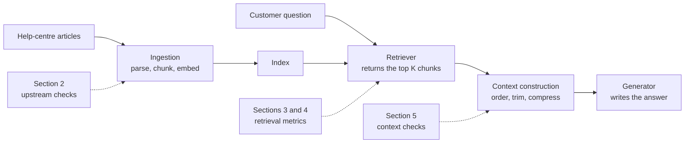
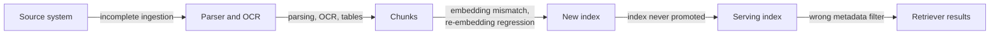
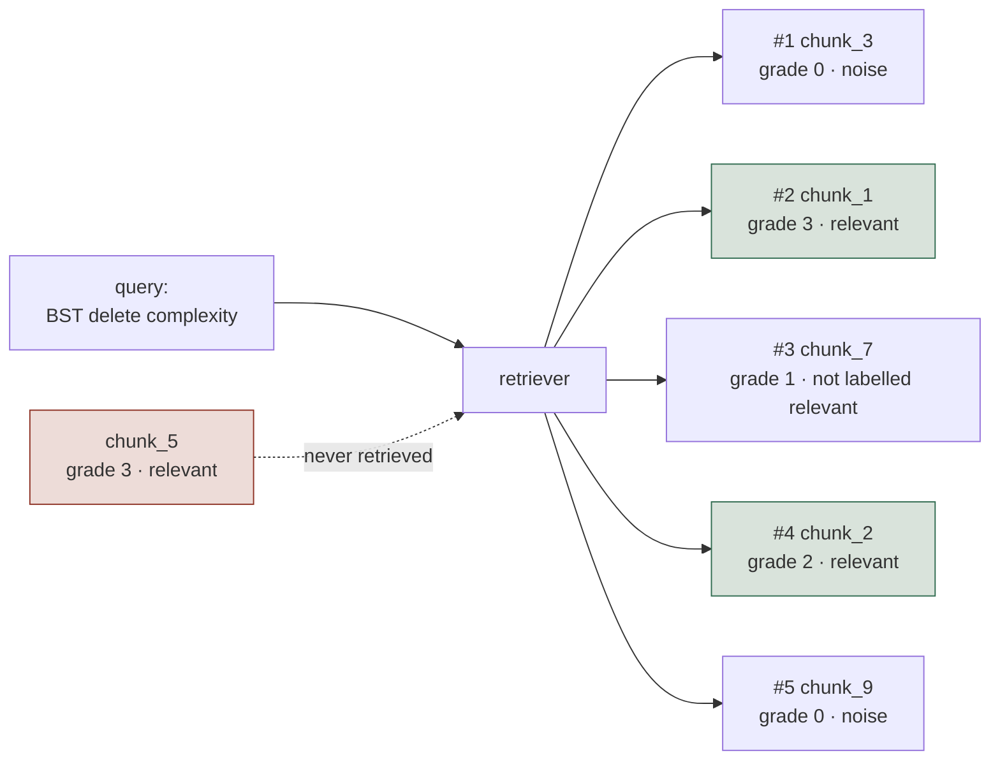
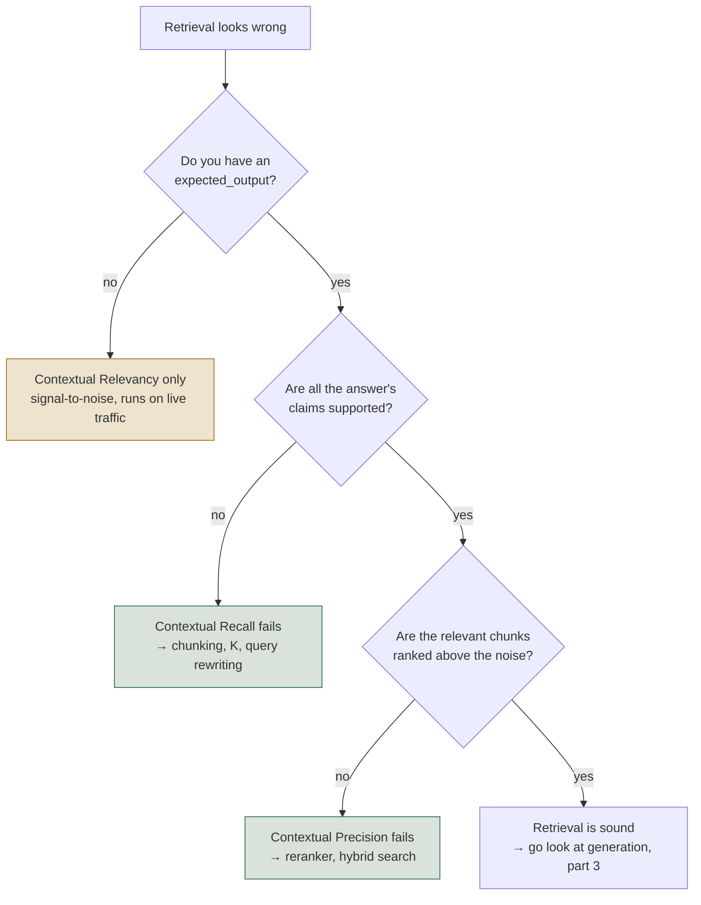
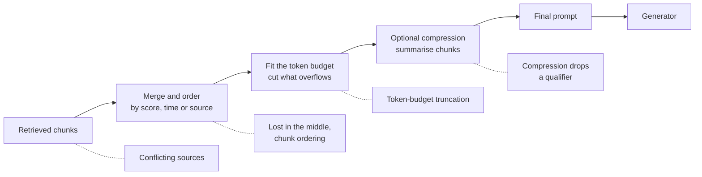

# RAG Retrieval

*Before you blame the model for a wrong answer, check with cheap arithmetic whether the right chunk ever reached the prompt.*

◷ 24 min read · Field guide part 2 of 11 · [Introduction](00-introduction.md)

> **Before you start.** This part assumes [the map](01-the-map.md): what a chunk, retriever, generator, judge and reference are. It covers the search half of a RAG system. [RAG generation](03-rag-generation.md) covers the half that writes the answer.

---

## 1. Where retrieval sits in the pipeline

A few reminders before the new terms:

- A **chunk** is a short passage cut from a document so it can be searched ([the map](01-the-map.md)).
- The **retriever** is the search step that picks chunks for a question ([the map](01-the-map.md)).
- The **generator** is the LLM that writes the answer from those chunks ([the map](01-the-map.md)).
- A **judge** is an LLM that scores another model's output ([the map](01-the-map.md)).
- A **reference** is a correct answer a person wrote before the system ran, the answer key ([the map](01-the-map.md)). DeepEval calls it `expected_output`.

### 1.1 The running example

Take a support agent that searches a help centre and can issue refunds.

- A customer asks: *"Can I get a refund on my annual plan?"*
- The help centre holds the refund policy, split into chunks.
- The answer can only be right if the current refund-policy chunk reaches the generator's prompt.

That chunk has to survive three steps on the way. Each step has its own checks, and each later check assumes the earlier step worked.

This diagram shows the path a help-centre article takes to the generator, and which section of this page checks each step.



---

## 2. Did the evidence ever reach the index?

Every retrieval metric in sections 3 and 4 assumes three things. The right document is in the index, it was parsed correctly, and it was embedded the same way the query is.

New terms for this section:

- **Ingestion**: the batch job that reads source documents, parses them, cuts them into chunks and loads them into the index.
- **Index**: the searchable store of chunks the retriever queries. For vector search it lives in a **vector store**.
- **Embedding**: a list of numbers that stands for a text's meaning. The retriever finds chunks whose embeddings sit close to the query's.
- **Parsing and OCR**: turning a file into plain text. OCR (optical character recognition) reads the text out of a scanned image.
- **Metadata filter**: a rule sent with the search, such as tenant, region or version, that limits which chunks can come back. A **tenant** is one customer account in a shared system.
- **Reranker**: a second model that re-sorts the retrieved chunks so the best ones come first.

Think of a library. A book that was never catalogued cannot be found by the best librarian in the building. The search then gets the blame for a cataloguing mistake.

When one of the three assumptions breaks:

- Retrieval metrics report a retrieval failure for a bug that happened in a batch job days earlier.
- No reranker will fix it.

### 2.1 Six ways evidence gets lost upstream

A few more terms the table uses:

- **Re-embedding**: rebuilding every chunk's embedding, usually after switching embedding model.
- **Promoting an index**: switching production traffic to a newly built index. **Staging** is the test copy.
- **Recall**: the share of the right chunks that came back. Section 3 defines it properly.

| Failure | What it looks like |
| --- | --- |
| **Incomplete ingestion** | New or updated documents never show up in answers. One tenant or file type fails more than the rest |
| **Parsing, OCR, table extraction** | The citation points at the right page, but the number, date or table cell the answer needed isn't in the chunk |
| **Embedding mismatch or drift** | Similarity scores cluster oddly. Rare terms or one language regress after a deploy |
| **Regression after re-embedding** | The migration "succeeded" and recall fell |
| **Index never promoted** | Ingestion reports done. Production still serves old chunks. Staging looks fine |
| **Missing or wrong metadata filters** | The right document exists, but a tenant, region or version filter drops it, or lets the wrong version through. Recall looks fine on unfiltered tests |

This diagram shows where along the ingestion path each of the six failures happens.



### 2.2 How to check each one without a judge

None of these checks needs a judge. Two more terms first:

- A **checksum** is a short fingerprint of a file. It changes when the content changes.
- A **dead-letter queue** holds the items a job failed to process.

The checks, one failure at a time:

- **Incomplete ingestion.**
  - Count documents in the source system against the serving index.
  - Watch the ingestion dead-letter queue and the parse-error rate.
  - Checksum each document, so a changed source behind an unchanged index entry shows up.
- **Parsing, OCR, table extraction.**
  - Sample parsed text beside the original page.
  - Track the empty-page rate and OCR confidence.
  - Keep parser regression cases for tables, scans and multi-column layouts.
- **Embedding mismatch or drift.**
  - Confirm query and document vectors come from the same model, dimension, normalisation and preprocessing.
  - Compare score distributions before and after any change.
- **Regression after re-embedding.**
  - Run the labelled retrieval set from section 3 against the old and new index before switching traffic.
  - Switch atomically, so a half-built index never serves.
- **Index never promoted.**
  - Query the serving index directly for the new document's ID.
- **Missing or wrong metadata filters.**
  - Measure metadata coverage (the null rate per field) against the source system.
  - Log the filter expression actually sent to the vector store.
  - Compare results with and without the filter.
  - Keep canary queries per tenant, region and version. A **canary query** is a fixed test search whose right result you already know.
  - Keep eval cases whose right answer depends on the filter.

### 2.3 Three rules for the upstream checks

- **These are rung-1 checks.** The **cost ladder** orders checks from cheapest to most expensive ([the map](01-the-map.md)). Counts, checksums and timestamps sit on the bottom rung. Run them on every ingestion, not only at eval time.
- **Tables and numbers need their own cases.** A **golden case** is a test question with a known right answer ([running RAG evals](04-running-rag-evals.md)).
  - Write golden cases whose answer is one table cell or one figure.
  - Check the value and its unit exactly. "5" from a column in thousands is a wrong answer that reads as right.
- **The shortcut.** If a manual search of the source finds the answer and the index can't, stop tuning retrieval. Go and look at the pipeline that feeds it.

---

## 3. Retrieval with labels

The cheapest retrieval checks need no judge, no API key and no API call. They are arithmetic over labels a person wrote in advance. They are the cheapest signal in the whole stack, and they cap everything downstream.

New terms for this section:

- **Ground-truth labels** are answers a person wrote down before the run ([the map](01-the-map.md)). Here, the label says which chunks are relevant to a query.
- **Labelled eval set**: a list of test queries, each with the IDs of its relevant chunks. In code these are `relevant_ids`, plus `relevance_grades` when relevance comes in degrees.
- **Top K**: the K highest-ranked chunks the retriever returns for one query. With K = 5 you score the first five.
- **Rank**: a chunk's position in that list, starting at 1.
- A **deterministic** check is plain code that gives the same answer on every run ([the map](01-the-map.md)).

Think of a teacher marking a multiple-choice paper against an answer sheet. The marking is fast, free and exact. Someone still had to write the answer sheet first.

Whenever you have labels, these checks are the right first move.

> **Put hard negatives in the eval set.** A **hard negative** is a near-duplicate, confusable document that looks right and isn't. Examples: last year's policy beside this year's, or a sibling product's manual. In the running example, last year's refund policy is a hard negative. Without some of these, the set only tests easy separations, and "high similarity, wrong context" never shows up as a failure.

- **Interactive lab:** [`docs/interactive-labs/01-deterministic-retrieval-metrics.html`](../../interactive-labs/01-deterministic-retrieval-metrics.html). Open it in a browser, drag `K`, and watch precision and recall pull in opposite directions while MRR refuses to move at all.
- **Source notebook:** [`courses/01-rag-agent-tool-evaluation/01_Retrieval_Metrics_Deterministic.ipynb`](../../../courses/01-rag-agent-tool-evaluation/01_Retrieval_Metrics_Deterministic.ipynb).

### 3.1 Why a wrong answer is not always a hallucination

Every RAG bug report arrives with the same diagnosis attached, "the model hallucinated", and that diagnosis is usually wrong. A **hallucination** is a claim the model made up ([RAG generation](03-rag-generation.md)).

- **The answer may not have been in the prompt.** If the relevant chunk never entered the prompt, the generator was not hallucinating in any meaningful sense. It answered faithfully from a context that didn't contain the answer.
- **Generation metrics are bounded by retrieval.** Faithfulness, answer relevancy and every other generation metric ([RAG generation](03-rag-generation.md)) depend on what was retrieved. Measuring them while recall sits at 0.67 tells you nothing about your generator.
- **The fixes are completely different.** Retrieval failures want chunking, hybrid search or reranking. Generation failures want prompt or model changes. Guessing wrong costs a sprint.
- **Labelled metrics tell the two apart.** A wrong answer can come from a broken retriever or a broken generator. These metrics tell you which, before you spend anything on a judge.

### 3.2 Four metrics, four questions

Four metrics score the same ranked list and answer four different questions. Reporting only one of them is how retrieval bugs hide.

- **Precision@K**: the share of the top K chunks that are relevant.
- **Recall@K**: the share of all relevant chunks that made it into the top K.
- **MRR** (mean reciprocal rank): 1 divided by the rank of the first relevant chunk.
- **nDCG@K** (normalised discounted cumulative gain): a ranking score that uses graded relevance and gives less credit to chunks further down the list.
- **Graded relevance**: a usefulness score per chunk, 0–3 in the lab, in place of a yes or no label.

Picture a fishing net. Precision asks how much of the catch is the fish you wanted. Recall asks how many of the fish you wanted ended up in the net.

| Measurement | What it checks | Use when |
| --- | --- | --- |
| **Precision@K** | Of K retrieved, how many are relevant | Noise in the retrieved set is the worry |
| **Recall@K** | Of all relevant chunks, how many made the top K | Missing evidence is the worry |
| **MRR** | 1 / rank of the first relevant hit | One correct chunk, and you care how early it lands |
| **nDCG** | Graded relevance, discounted by position | Relevance isn't binary and several relevant chunks coexist |

- **Needs:** pre-labelled ground truth (`relevant_ids`, `relevance_grades`). That is what makes the four metrics free and deterministic.
- **Misses:** anything on live traffic. You can't compute Precision@K on a query with no labels, so these metrics stay confined to curated eval sets.
- **Section 4 closes that gap** with judged metrics that need no chunk labels.

### 3.3 The four formulas

```text
Precision@K = (relevant chunks in top K) / K
Recall@K    = (relevant chunks in top K) / (total relevant chunks that exist)
MRR         = 1 / (rank of the FIRST relevant chunk)
nDCG@K      = DCG@K / IDCG@K,  where DCG = Σ  grade_i / log2(i + 2)
```

Each formula in plain words:

- **Precision@K asks "how much of what I paid for was useful?"** It penalises noise. It usually falls as `K` rises, but not always: it recovers when a relevant chunk enters the list (0.33 at K = 3, then 0.50 at K = 4 in the worked example).
- **Recall@K asks "did I find everything that mattered?"** It penalises misses. It rises with `K`, up to a ceiling set by what the retriever can reach at all.
- **MRR asks "is the best chunk at the top?"** It only looks at the first hit.
  - A retriever can have perfect recall and terrible MRR.
  - Then the model reads three pieces of noise before it reaches the answer.
- **nDCG@K asks "is the ranking good when relevance is a matter of degree?"** It uses graded relevance (0–3) and discounts by rank position.
  - **DCG** adds up each retrieved chunk's grade, divided by `log2(i + 2)`, where `i` is the position counted from 0.
  - That `log2(i + 2)` denominator is why rank 1 earns full credit and rank 5 earns about 39% of it.
  - **IDCG** is the DCG of the ideal ranking: every graded chunk, sorted best first.

The ideal ranking in IDCG includes chunks the retriever never returned. So when a relevant chunk is missing, nDCG stays capped below 1.0 in the lab no matter how you reorder what was retrieved.

### 3.4 Worked example, one query and five chunks

The lab uses one query, *"BST delete complexity"* (BST is a binary search tree), and a retriever that returns five chunks.

This diagram shows the five chunks in rank order, their grades, and the one relevant chunk the retriever missed.



`chunk_5` is the whole lesson.

- It is labelled relevant and graded 3.
- The retriever never returned it.
- So precision and MRR cannot see it.
- It is the single reason recall and nDCG are capped.

### 3.5 What the numbers do as K moves

| K | Precision@K    | Recall@K       | MRR            | nDCG@K         |
| - | -------------- | -------------- | -------------- | -------------- |
| 1 | 0.00           | 0.00           | 0.50           | 0.00           |
| 2 | 0.50           | 0.33           | 0.50           | 0.39           |
| 3 | 0.33           | 0.33           | 0.50           | 0.41           |
| 4 | 0.50           | 0.67           | 0.50           | 0.51           |
| 5 | **0.40** | **0.67** | **0.50** | **0.51** |

The K = 5 row as plain arithmetic:

- Precision: two relevant chunks in five retrieved, 2 / 5 = 0.40.
- Recall: two of the three relevant chunks were found, 2 / 3 = 0.67.
- MRR: the first relevant chunk sits at rank 2, so 1 / 2 = 0.50.

Three things to read off the table:

- **Precision is not monotonic.** It drops at K = 3, where a non-relevant chunk enters, and recovers at K = 4, where a relevant one does. A precision number without its K means nothing.
- **MRR is constant at 0.50 across every K.** The first relevant chunk sits at rank 2, and retrieving more cannot change that.
  - Flat, low MRR is a ranking problem.
  - The fix is a reranker or hybrid search. A bigger K won't help.
- **Recall and nDCG both flatline after K = 4.** That flatline is the signature of a chunk that isn't reachable at all. Raising K past a recall plateau buys tokens and latency and nothing else.

### 3.6 Reading the four together

A few fixes the triage table names:

- **Hybrid search**: combining keyword search with embedding search.
- **Query rewriting**: rephrasing the user's question before it is searched.
- **Cross-encoder**: a reranker that reads the query and each chunk together.
- **Dynamic K**: picking K per query.
- **Gold-context swap**: re-scoring a failing case with the labelled chunks in place of the retrieved ones.

| What you see | What it means | Where to look |
| --- | --- | --- |
| Low recall, any precision | The answer isn't in the prompt | Chunking, embedding model, hybrid search, query rewriting |
| Good recall, low MRR | It's in the prompt, buried | Reranker or cross-encoder |
| Good recall, falling precision | K is too large for this query | Dynamic K, or retrieve wide and rerank narrow |
| Good recall and MRR, low nDCG | Ranking ignores degrees of usefulness | Graded labels plus a ranking-aware retriever |
| Everything good, answer still wrong | Retrieval is fine, so look at generation | The faithfulness and correctness metrics in [RAG generation](03-rag-generation.md) |
| Answer wrong, unclear which half failed | Settle it with a gold-context swap | Right with gold, wrong with retrieved: retrieval or context construction (section 5). Wrong with both: generation |

### 3.7 When to use them and when not to

**Use deterministic retrieval metrics when:**

- **You are setting up evaluation for the first time.** This is the most valuable day of work available. No keys, no cost, and it runs on every commit.
- **You are comparing retrievers, chunk sizes or embedding models.** The comparison is exact and repeatable, with no judge variance in the way.
- **You need a CI gate that will not flake.** **CI** runs checks automatically on every code change ([the map](01-the-map.md)). An LLM-judged metric can disagree with itself across runs. This one cannot.

**Don't rely on them alone when:**

- **You have no labelled `relevant_ids` and can't produce them.** Hand-labelling doesn't scale to arbitrary production traffic. The judged contextual metrics in section 4 exist for this.
- **Relevance is fuzzy or depends on the query.** Binary in-or-out labels force a judgement someone has to make and keep current.
- **Your golden set was built once and never refreshed.** A stale eval set silently stops measuring your live query distribution. The metric stays green while quality drifts.

---

## 4. Retrieval without labels

Section 3 needs a hand-written `relevant_ids` list for every query. That does not scale past a curated eval set. DeepEval's three Contextual metrics ask the same "is retrieval working?" question with an LLM judge in place of hand-labelled IDs, and they ask it three separate times on purpose.

Reminders and new terms:

- **DeepEval** is one of the open-source eval libraries this guide uses ([the map](01-the-map.md)).
- A **claim** (or **statement**) is one checkable fact pulled out of a text ([RAG generation](03-rag-generation.md)).
- **Verdict**: the judge's yes or no label on one item, such as one chunk, one statement or one claim.
- **Contextual precision**: are the relevant chunks ranked above the irrelevant ones?
- **Contextual recall**: does the retrieved context cover everything the reference answer needs?
- **Contextual relevancy**: how much of what came back is on topic?
- A **referenceless** check needs no answer written in advance, so it can run on live traffic ([the map](01-the-map.md)).

Think of three inspectors at a warehouse. One checks the shelf order. One checks nothing on the order list is missing. One checks how much of the box is packing foam.

- **Interactive lab:** [`docs/interactive-labs/02-llm-judged-retrieval-metrics.html`](../../interactive-labs/02-llm-judged-retrieval-metrics.html). Open it in a browser, inject one failure at a time, and watch exactly which of the three numbers reacts.
- **Source notebook:** [`courses/01-rag-agent-tool-evaluation/02_Retrieval_Metrics_LLM_Judged.ipynb`](../../../courses/01-rag-agent-tool-evaluation/02_Retrieval_Metrics_LLM_Judged.ipynb).

### 4.1 Three checks for three failures

There are three checks because there are three different failures. That is why no single general "is retrieval good" score exists.

| Check | Question | Needs a reference? | Catches |
| --- | --- | --- | --- |
| **Contextual precision** | Are relevant chunks ranked above irrelevant ones? | Yes | A good chunk buried under noise |
| **Contextual recall** | Does the context cover everything the answer needs? | Yes | The retriever found something, but not enough |
| **Contextual relevancy** | How much of what came back is on-topic? | No | Noise diluting the context |

- **Each one watches a different property.** Precision cares about order. Recall cares about coverage. Relevancy cares about signal-to-noise.
- **They fail independently.** A retriever can fail any one while passing the other two.
- **Recall reads the reference answer.** It compares the context to the expected answer. Did retrieval fetch enough to support a full answer, whatever the generator used?
- **Only relevancy is referenceless.** Precision and recall need `expected_output`, which puts them in CI rather than production monitoring.

One blended "retrieval score" hides three bugs:

- **Averaging hides a ranking bug.** Precision halves, the average moves a little, and nobody investigates.
- **The three failures have completely different fixes.**
  - Bad ranking wants a reranker.
  - Thin coverage wants better chunking or a larger K.
  - Noise dilution wants a tighter retriever or a smaller K.
  - A blended score tells you none of that.
- **Without labels you run one metric.** With only production traffic, you are running relevancy alone. Know which blind spots that leaves.

### 4.2 Verdicts first, then arithmetic

The judge's only job is to label. The scoring after that is deterministic.

```text
Contextual Precision = Σ (precision@i for each position i holding a relevant chunk) / (number of relevant chunks)
Contextual Recall    = (claims in expected_output supported by the context) / (total claims)
Contextual Relevancy = (relevant statements) / (total statements, across every retrieved chunk)
```

- **Precision is rank-weighted.** A relevant chunk at position 1 contributes `1/1`. The same chunk at position 3 contributes at most `1/3`. That weighting is the whole reason reordering changes the score.
- **Recall compares the context to `expected_output`.** It ignores `actual_output`, the answer the system gave. It asks whether enough was fetched to support the full answer, independent of whether the generator used it. This trips people up constantly.
- **Relevancy is the simplest, and the only referenceless one.** No ground truth and no order sensitivity. It measures what fraction of what you retrieved was on topic.
- **Relevancy is judged per statement, not per chunk.**
  - The judge splits every retrieved chunk into statements and labels each one. The score pools all of them.
  - So chunk size is part of the metric.
  - A ten-sentence chunk holding one relevant sentence scores around 0.1.
  - A two-sentence chunk holding the same fact scores near 1.0.
  - Same retriever, same fact, different chunker.
- **The judge and the arithmetic explain different behaviour.** The same verdicts always give the same score. Two judge runs can still disagree, because the verdicts can differ.

The names overlap with section 3, and the computations differ:

- **Contextual relevancy looks like Precision@K.** Both are unweighted and order-blind (`relevant/total`). Relevancy counts relevant statements inside the chunks, while Precision@K counts relevant chunks.
- **The two agree only when every chunk is a single statement**, as with this lab's one-sentence chunks.
- **Contextual precision is a different, rank-weighted metric.** It is the new idea here, and it is why contextual precision and relevancy can diverge. In the bad-ranking row of section 4.4, relevancy doesn't move while precision drops from 1.00 to 0.58, a fall of more than 40%.

### 4.3 Which check to read first

This decision tree shows the order to read the three metrics when retrieval looks wrong.



Check coverage before ranking. There is no point tuning a reranker over a context that never contained the answer.

### 4.4 Worked example, four retrieval outcomes

The lab uses one query, *"What is Apache Spark used for?"*, and four retrieval outcomes.

| Scenario | Precision | Recall | Relevancy | What moved |
|---|---|---|---|---|
| Healthy retrieval | 1.00 | 1.00 | 0.67 | Baseline. Relevancy is already below 1.0 |
| **Bad ranking** (same chunks, reordered) | **0.58** | 1.00 | 0.67 | Precision alone |
| **Thin coverage** (one perfect chunk) | 1.00 | **0.50** | 1.00 | Recall alone |
| **Noise dilution** (1 relevant of 4) | **0.33** | 1.00 | **0.25** | Relevancy, dragging precision with it |

What the four rows show:

- **Reordering alone moves precision.** Three chunks reordered, nothing added and nothing removed, drops precision from 1.00 to 0.58. Recall and relevancy do not move at all.
- **Healthy retrieval scores 0.67 on relevancy.** That is no defect. Relevancy is a ratio, and a perfect 1.00 usually means K is too small, not that the retriever is flawless.
- **Thin coverage scores 1.00 on two of three metrics.** Run relevancy alone, the only option without labels, and this broken retriever looks perfect.
- **Relevancy and precision fail together under noise dilution.** Noise ranked above signal is a ranking failure and a signal-to-noise failure at once. The two metrics decouple under bad ranking instead.

### 4.5 The threshold trap

A **threshold** is the score a test case must reach to pass ([RAG generation](03-rag-generation.md)).

Thin coverage scores exactly 0.50 recall against DeepEval's default `threshold=0.5`. That test case sits on the pass or fail line, so:

- One flipped claim verdict on a re-run flips the whole test case.
- The judge is non-deterministic, so re-running the identical input can produce a different verdict.
- Read a score sitting on its threshold as a coin toss, not a pass.
- In CI, move the threshold away from where your scores cluster.
- Or run near-threshold cases several times and take the majority.

### 4.6 When to use them and when not to

**Use LLM-judged contextual metrics when:**

- **You have production traffic and no labelled chunk IDs.** Relevancy runs on anything.
- **Your golden set doesn't cover the query shapes users send**, and hand-labelling every new one is not realistic.
- **You want a reason alongside the score.** `include_reason=True` returns the judge's justification, which is often more actionable than the number.

**Stay with section 3's deterministic metrics when:**

- **You are gating CI on a hard pass or fail bar.** Judge non-determinism makes flaky gates.
- **You are comparing two retrievers head to head.** Deterministic metrics remove judge variance from the comparison entirely.
- **Cost matters at volume.** Three contextual metrics over 500 test cases is 1,500+ judge calls per run, before you have measured generation at all.

---

## 5. Retrieved is not the same as seen

Between the retriever and the generator sits a step most suites never score, building the prompt. The right chunk can be retrieved and still not be seen.

New terms for this section:

- **Context construction**: the step that turns retrieved chunks into the generator's prompt. It orders them, trims them to fit, and sometimes summarises them.
- **Token budget**: the most prompt text the system allows. A **token** is the word piece a model counts.
- **Truncation**: cutting off whatever doesn't fit the budget.
- **Compression**: a summarising step that shortens chunks before the generator sees them.
- **Precedence rule**: a written rule for which source wins when two disagree, such as source authority or effective date.
- **Faithfulness** checks that every claim in a text is supported by its source ([RAG generation](03-rag-generation.md)).

Think of a student handed the right page, stapled into the middle of a thick packet, with the last sheets torn off for weight. The page was handed over and can still go unread.

In the running example, the retriever might return this year's refund policy and last year's. Context construction decides their order, whether both fit, and whether a summary keeps the exception that applies to annual plans.

This diagram shows the steps between retrieval and the generator, and where each failure enters.



### 5.1 Five ways the right chunk goes unseen

| Failure | Mechanism |
| --- | --- |
| **Lost in the middle** | Models use evidence at the start and end of a long context more reliably than evidence in the middle |
| **Chunk ordering** | Merge logic orders by score, time or source and buries the decisive chunk |
| **Token-budget truncation** | Context overflows the budget and the cut lands on the evidence |
| **Compression** | A summarising step drops a qualifier, exception, date or unit before the generator sees it |
| **Conflicting sources** | Two retrieved documents disagree, such as old and new policy, or a general rule and its exception. The model blends them or silently picks one |

### 5.2 How to test each one

- **Lost in the middle.** Run the same case with the gold chunk placed first, middle and last. Compare accuracy by position.
- **Chunk ordering.** Log the final order. Test order sensitivity on known cases.
- **Token-budget truncation.**
  - Track truncation events.
  - Track the **chunk-inclusion rate**: chunks retrieved against chunks actually in the prompt.
  - Slice quality by context length.
- **Compression.** Score the compressed context for faithfulness to the original chunks. Rerun failures with compression off.
- **Conflicting sources.**
  - Seed cases with deliberate conflicts.
  - Pass means the answer applies the written precedence rule (source authority, effective date) or surfaces the conflict.
  - A quiet compromise fails.

### 5.3 Three rules for context construction

- **Score the final prompt as well as the retrieval result.** Every check in sections 3 and 4 reads what the retriever returned. None reads what the generator received.
- **Compression is itself a generation step.** It can hallucinate before the answer is written, so it needs its own faithfulness check.
- **Conflict handling is a behaviour to specify**, like refusal. Write down which source wins, then test that rule.

---

## Key Takeaways

- **Check upstream first.** Every retrieval metric assumes the right document reached the index. If a manual search of the source finds the answer and the index can't, fix the pipeline.
- **Four labelled metrics, four questions.** Precision catches noise, recall catches misses, MRR catches burial, nDCG catches bad ranking under graded relevance. Any one alone is a blind spot.
- **A recall plateau is a hard ceiling, and flat, low MRR calls for a reranker.** Past the plateau, a bigger K buys tokens and nothing else. No value of K can promote a chunk already retrieved.
- **Labelled metrics are free.** Run them on every commit. Save the judge calls for questions arithmetic cannot answer.
- **Three judged metrics, three failures, three fixes.** Order, coverage, signal-to-noise. Averaging them destroys the diagnosis. Reordering alone drops precision from 1.00 to 0.58, so a retrieval score that ignores ranking isn't measuring ranking.
- **Contextual relevancy is the only judged check that runs without labels.** That makes it the production metric, and the one with the biggest blind spot.
- **The judge labels and the arithmetic scores.** Validate the labelling before trusting the number, treat a score on its threshold as unresolved, and score the final prompt as well as the retrieval.

## Check Yourself

1. You must monitor retrieval on live traffic, and you have no labels. Which of the three contextual metrics can you run? **Contextual Relevancy only. Precision and recall both need `expected_output`, and production has none.**
2. MRR reads 0.50 at every K from 1 to 5. Do you raise K or change the ranking? **Change the ranking with a reranker or hybrid search. The first relevant chunk sits at rank 2, and retrieving more cannot move it.**
3. Recall@K climbs to 0.67 at K = 4 and stays there. What does the plateau tell you? **A relevant chunk is unreachable, like `chunk_5` in the lab. Raising K buys tokens and latency and nothing else. Look at chunking, the embedding model, hybrid search or query rewriting.**
4. A test case scores exactly 0.50 contextual recall against the default `threshold=0.5`. Is it a pass? **Treat it as a coin toss. One flipped verdict on a re-run flips the case. Move the threshold away from where scores cluster, or run the case several times and take the majority.**
5. The right chunk is in every retrieved set, yet the answers still miss the fact. Where do you look? **At context construction. Test the gold chunk's position, log the final order, track truncation and chunk-inclusion rate, and rerun with compression off.**

## References

- [`courses/01-rag-agent-tool-evaluation/01_Retrieval_Metrics_Deterministic.ipynb`](../../../courses/01-rag-agent-tool-evaluation/01_Retrieval_Metrics_Deterministic.ipynb): the source notebook for section 3.
- [`courses/01-rag-agent-tool-evaluation/02_Retrieval_Metrics_LLM_Judged.ipynb`](../../../courses/01-rag-agent-tool-evaluation/02_Retrieval_Metrics_LLM_Judged.ipynb): the source notebook for section 4.
- [Lab 01, deterministic retrieval metrics](../../interactive-labs/01-deterministic-retrieval-metrics.html) and [Lab 02, LLM-judged retrieval](../../interactive-labs/02-llm-judged-retrieval-metrics.html): the interactive labs behind the worked examples.
- [The six interactive labs](../../interactive-labs/README.md#interactive-labs): the index of every lab.
- [The question bank](../../interview-prep/QUESTION_BANK.md), Part 10, sections 10.1 and 10.2: the interview questions on these two labs.
- [Level 1 explainer, RAG retrieval and generation](../../roadmap-explainers/01-rag-retrieval-and-generation.md): the lesson that walks this ground in order.

---

**Next:** [RAG generation](03-rag-generation.md) · **Previous:** [The map: what you can evaluate](01-the-map.md)
