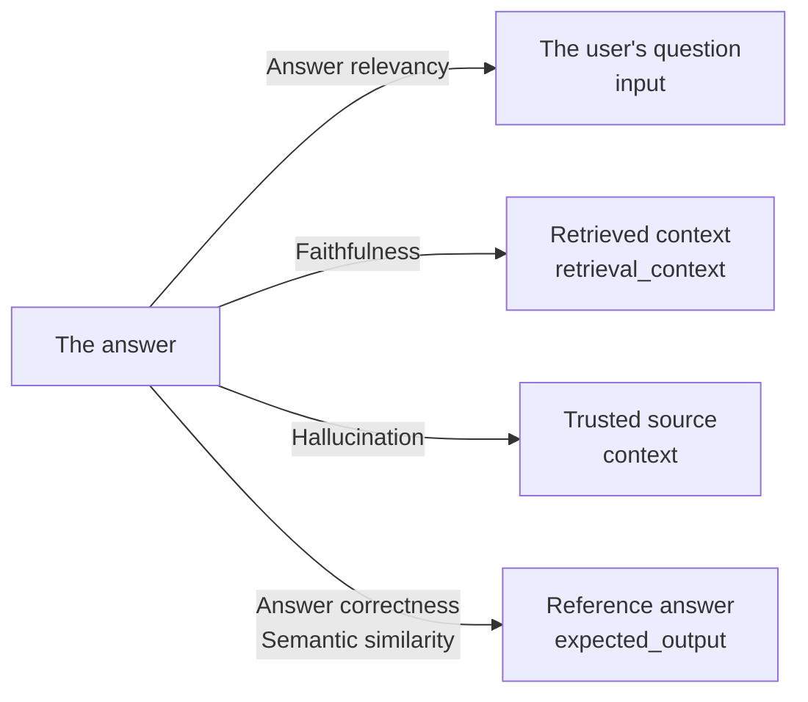
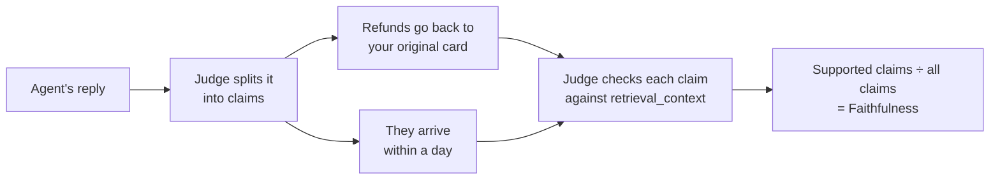
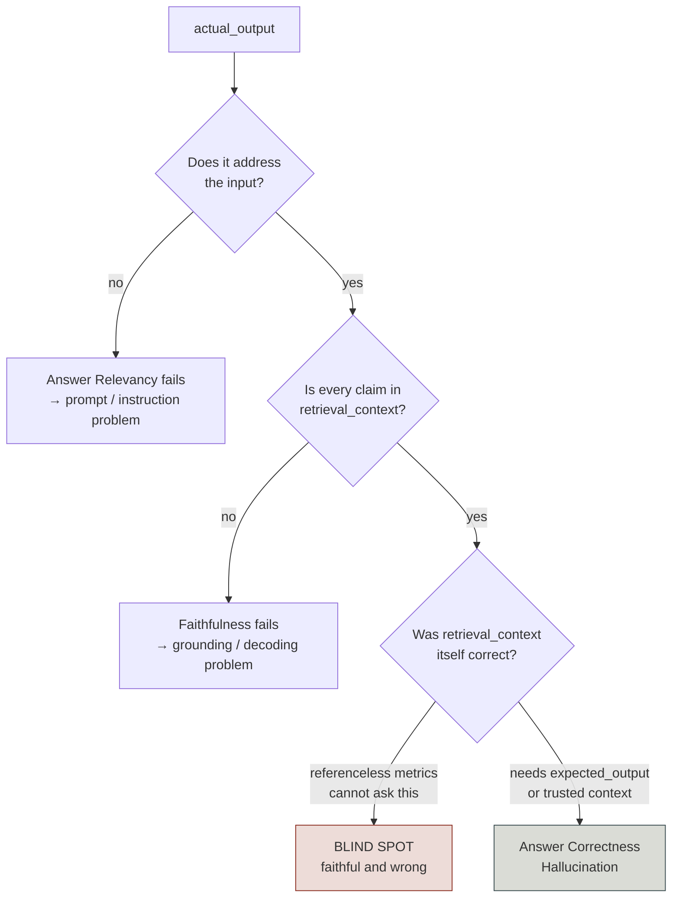
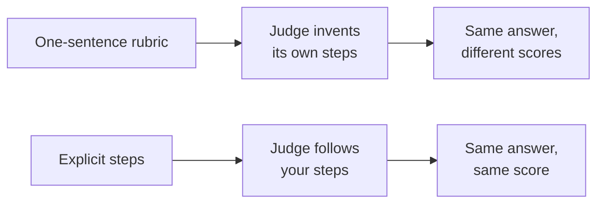
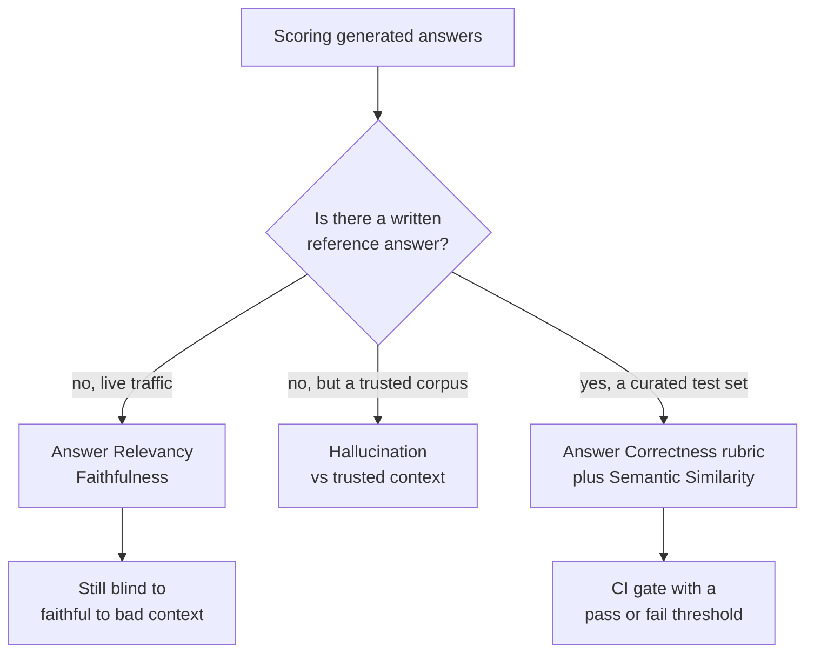

# RAG Generation

*An answer can be fully grounded in what retrieval fetched and still be false, so some check has to compare it against the truth.*

◷ 15 min read · Field guide part 3 of 8 · [Introduction](00-introduction.md)

> **Before you start.** This part assumes [the map](01-the-map.md) (judges, references, offline and online checks) and [RAG retrieval](02-rag-retrieval.md) (how the chunks reached the prompt). Retrieval asked whether the right chunks arrived. This part asks whether the answer built on top of them is any good.

---

## 1. What generation evaluation asks

A few reminders before the new terms:

- The **generator** is the model that writes the final answer from the retrieved chunks ([the map](01-the-map.md)).
- The **retrieved context** is the set of chunks the retriever fetched for this one question ([RAG retrieval](02-rag-retrieval.md)). DeepEval calls it `retrieval_context`.
- A **judge** is an LLM that scores another model's output ([the map](01-the-map.md)).
- A **reference** is a correct answer a person wrote before the system ran, the answer key ([the map](01-the-map.md)). DeepEval calls it `expected_output`.

Generation checks come in two families, sorted by whether they need that answer key:

- **Without a reference.** Given what was retrieved, is the answer any good, with no hand-written reference? These checks can run on production traffic. They are the **referenceless** checks ([the map](01-the-map.md)).
- **Against a reference.** Does the answer agree with the answer a person wrote in advance? These are the **reference-based** checks. They need a curated test set.

### 1.1 The running example

Take a support agent that searches a help centre and can issue refunds.

- A customer asks: *"Can I get a refund on my annual plan?"*
- The retriever fetches two help-centre articles about refunds.
- The generator writes a reply from those two articles.

Every check on this page scores that reply. Each one compares it against a different thing.

This diagram shows what each check holds the answer up against.

### 1.2 Four meanings of a wrong answer

From the outside, every failure looks the same: a user gets a bad answer. Inside, there are four different failures, each with its own metric and its own fix.

| What went wrong | Metric that sees it | Fix |
|---|---|---|
| It didn't answer the question | **Answer Relevancy** | Prompt work |
| It invented facts beyond the context | **Faithfulness** | Grounding constraints |
| It contradicts what we know to be true | **Hallucination** | Index repair |
| It faithfully repeated something false | Only **Answer Correctness** | Reference curation |

- These are the most confused metrics in the entire space, because they look identical from the user's side.
- Each one gets its own section below.

## 2. Claim decomposition

The judge does not score the answer as one blob. It breaks the answer into small pieces first, then judges each piece.

**Claim**: one factual assertion inside an answer, small enough to check on its own.

**Statement**: one unit of what the answer says, used to check whether it is on topic.

- Think of a teacher marking an essay sentence by sentence instead of giving one mark for the whole page.
- In the running example, *"Refunds go back to your original card"* is one claim. *"They arrive within a day"* is another.

This diagram shows faithfulness scored claim by claim on the running example.

The three referenceless metrics are all ratios over these pieces:

    Faithfulness    = (claims supported by retrieval_context) / (total claims)
    Answer Relevancy = (statements that address the input) / (total statements)
    Hallucination    = (claims contradicting the trusted context) / (total claims)

- **Two different splits.** Faithfulness and Answer Relevancy use different decompositions of the same text: factual claims versus statements.
- **They can disagree.** An answer can have three grounded claims and only one on-topic statement.
- **A separate source.** Hallucination checks a separately supplied `context`, not `retrieval_context`. That is the reason it can catch what Faithfulness cannot.
- **Same verdicts, same score.** All three are ratios over judge verdicts. The verdicts themselves are non-deterministic, so a rerun can move the score.

## 3. Checks that need no reference

These checks can run on live traffic, because both sides of each comparison come out of the same request.

| Check | What it compares against |
| --- | --- |
| **Answer relevancy** | The question only. Does it address what was asked? |
| **Faithfulness / groundedness** | The retrieved context. Any invented claims? |
| **Hallucination vs trusted context** | A separately supplied trusted source, regardless of retrieval |

### 3.1 Answer relevancy

**Answer relevancy**: the share of the answer's statements that address the question.

- It compares the answer to the `input`, the user's question, and nothing else.
- Like a teacher asking "did you answer the question I set?" before reading for accuracy.
- Running example: a reply that explains how to cancel a plan, when the customer asked about refunds, scores low.

### 3.2 Faithfulness

**Faithfulness** (also called **groundedness**): the share of the answer's claims that the retrieved context supports.

- It compares the answer to `retrieval_context`.
- Like a fact-checker who may only use the two articles on the desk.
- Running example: *"They arrive within a day"* fails if neither help-centre article says so.

### 3.3 Hallucination against trusted context

**Trusted context**: a curated source of truth you supply, kept separately from whatever retrieval fetched.

**Hallucination metric**: the share of the answer's claims that contradict the trusted context.

- It compares the answer to a separate `context`, never to `retrieval_context`.
- Like checking a witness against the official record instead of against their own notes.
- **The score runs inverted.** Higher means worse. Faithfulness and Answer Relevancy run the other way.
- Always check a metric's score direction rather than assuming it.

### 3.4 Three ways the answer goes wrong

An answer can go wrong in three ways that referenceless metrics have to sort out. They catch the first two and miss the third. Learn to tell them apart:

- **Faithful but irrelevant.** Perfectly grounded, answers a different question.
- **Relevant but unfaithful.** Addresses the question, invents facts.
- **Faithful to bad context.** Accurately reflects chunks that were themselves wrong. Faithfulness cannot catch this. Only a reference-based check (section 5) can.

Running example of the third case: the help centre still carries an outdated refund article. The agent repeats it word for word. Every claim is supported, the reply answers the question, and the customer still gets the wrong policy.

This decision tree shows where each metric can and cannot see.

- `actual_output` is DeepEval's name for the answer being scored.
- The blind spot comes from the definition, so no amount of tuning removes it. Faithfulness is defined relative to the retrieved context, so it cannot evaluate that context.

### 3.5 Faithfulness vs hallucination

People often confuse these two. Both look for invented facts, but they hold the answer against different baselines.

| | Faithfulness | Hallucination vs trusted context |
| --- | --- | --- |
| **Compares against** | `retrieval_context`, whatever *this* query's retriever happened to fetch | A separate curated `context` you supply, independent of retrieval |
| **Changes per query?** | Yes. The baseline moves with retrieval | No. The baseline is fixed |
| **Score direction** | Higher is better | Higher is worse |
| **Catches** | A generator inventing things beyond what it was given | An answer that contradicts known truth, however it got there |
| **Blind to** | Retrieved context that was itself wrong, so a wrong chunk faithfully repeated | Nothing retrieval-specific, since it never looks at retrieval. It misses anything outside your curated context |
| **Needs** | Nothing extra | A maintained trusted corpus |
| **Runs on production traffic** | Yes | Only where you have trusted context |
| **Reach for it when** | You want to police the generator | You have independent truth and want to police the answer |

- Use Faithfulness to catch a generator that goes beyond what it was given.
- Use Hallucination when you have an independent, trusted source and want to check against it regardless of what retrieval returned.

## 4. Splitting hallucination and scoring citations

### 4.1 Four kinds of hallucination

Split "hallucination" four ways before you measure it. Extract the answer's claims, check each one, and give every failing claim one label.

| Label | The claim is… | Who fixes it | Checked against |
| --- | --- | --- | --- |
| **Unsupported** | In no retrieved or trusted source | The generator, because it invented | The retrieved context |
| **Contradicted** | Opposed by a source the system had | The generator, or conflict handling ([RAG retrieval](02-rag-retrieval.md)) | The retrieved context or a trusted corpus |
| **Stale** | Supported by a source that is no longer valid | Index freshness, not the model | The source's effective and expiry dates |
| **Inaccessible** | Supported only by a source this user may not see | Access filtering. A security defect, not a quality one | The user's permissions |

Running example, one claim per label:

- **Unsupported.** *"Refunds arrive within a day"*, when no article mentions timing.
- **Contradicted.** *"You'll get store credit"*, when the article says refunds go to the original card.
- **Stale.** A claim drawn from last year's refund article, replaced since.
- **Inaccessible.** A claim drawn from an internal agents-only note on refund exceptions.

Two rules follow from the split:

- **One "hallucination rate" hides four owners.** Report the split, sliced by domain, source type, language and prompt/model version.
- **Stale and inaccessible claims pass faithfulness.** They are grounded. Only the label says which team owns the fix.

### 4.2 Citation accuracy

**Citation**: a pointer in the answer to the source passage that backs a claim.

**Citation accuracy**: supported citations ÷ all citations. Report it beside faithfulness.

Score citations claim by claim, not document by document:

- A citation is accurate only if the cited span supports *that exact claim*.
- The span must also have been in the context the generator actually saw.
- A citation to the right document but the wrong passage is a citation error.
- A citation to a document the reranker dropped is a citation error. A **reranker** reorders retrieved chunks and can cut some before the prompt is built ([RAG retrieval](02-rag-retrieval.md)).
- Count a document-level citation ("see Policy Manual") as unsupported. It lets the answer point vaguely at truth while asserting something the document never says.

## 5. Checks against a reference

These checks compare the answer to a written reference answer.

- **Needs:** a written reference answer. That is the cost side of the reference-based checks in [the map](01-the-map.md).
- References are precise, and only as scalable as your ability to keep them current.

### 5.1 Answer correctness

**Answer correctness**: whether the answer agrees with the reference on the facts that matter for your task.

- Like marking an exam against the answer sheet, where the teacher decides which points earn marks.
- There's rarely a generic correctness check you can drop in, and that's by design. What counts as "right" is specific to your task, so you write a rubric (section 6).
- **Answer Correctness has no DeepEval class.** The recommended pattern is a custom `GEval` rubric.
- **`GEval`**: DeepEval's class for a judged metric you define yourself. You write what to check, and a judge scores against it.
- You write it in one of two styles: `criteria` (one sentence) or `evaluation_steps` (an explicit procedure).

### 5.2 Semantic similarity

**Embedding**: a list of numbers that stands for a text's meaning, so texts on similar topics get nearby lists.

**Semantic similarity** (the lab calls it **Answer Semantic Similarity**): the embedding distance between the answer and the reference, scored as plain cosine similarity.

- No LLM call. It is fast and cheap.
- It measures *topical* closeness. It does not measure factual agreement.
- Two answers can be close and disagree on the number that matters.
- Running example: *"Refunds go to your original card"* and *"Refunds go to store credit"* are about the same topic, so they score as close.
- Pair it with a judged check. Don't substitute it for one.

## 6. Worked example, four answers to one question

*Interactive lab: [`03-generator-metrics.html`](../../interactive-labs/03-generator-metrics.html). Open it in a browser and change the inputs. It shows four answers to one question; the fourth scores 1.00 on both referenceless metrics while being flatly false.*

The lab uses its own question, kept verbatim so the numbers match the notebooks.

Question: *"What is the time complexity of deleting a node from a BST?"*

| Answer | Relevancy | Faithfulness | Hallucination ↓ | Correctness | Similarity |
|---|---|---|---|---|---|
| Grounded & relevant | 1.00 | 1.00 | 0.00 | 0.95 | 0.94 |
| Faithful but irrelevant | **0.33** | 1.00 | 0.00 | 0.35 | **0.78** |
| Relevant but unfaithful | 1.00 | **0.50** | 0.50 | 0.40 | **0.91** |
| **Faithful to bad context** | **1.00** | **1.00** | **1.00** | **0.10** | **0.83** |

`Hallucination ↓` marks the inverted score: lower is better.

How to read the last row:

- The retriever returned a chunk claiming BST deletion is O(1).
- The generator repeated it accurately.
- Every claim is supported by the context it was given, and the answer directly addresses the question.
- So both referenceless metrics report a perfect score, Faithfulness 1.00 and Answer Relevancy 1.00, on an answer that is simply false.
- No referenceless metric catches a corrupted knowledge base.
- Hallucination (1.00, the worst score) and Correctness (0.10) both flag it, because each holds the answer against a source of truth.

The Semantic Similarity column is its own warning:

- It gives **0.83** to an answer that says O(1) where the truth is O(h).
- Embeddings measure topic, and "constant time" and "logarithmic time" are topically adjacent.
- The relevant-but-unfaithful answer still scores 0.91 on similarity.

## 7. Writing a rubric that works

**Rubric**: the written instructions that tell a judge what to check and what should fail.

- It is the marking scheme you hand a grader.
- Hand five graders "mark this fairly" instead of a marking scheme and you get five different marks, every one of them defensible.

You are either writing the test, or letting the judge write it for you.

| You give it | What happens | Result |
| --- | --- | --- |
| **One sentence**, "check the answer is accurate" | The judge has to invent the steps, and invents different ones each run | Same answer, different scores |
| **Explicit steps**, "1. every figure appears in the context, 2. it answers the question asked, 3. no advice beyond the policy" | The judge follows yours | Same answer, same score |

This diagram shows why the two kinds of rubric give different stability.

- **When to write steps.** Write them whenever a one-liner doesn't pin down what should fail.
- **Several checks in one pass.** Steps let you check relevance, agreement with the reference and grounding at once.
- **A vague rubric never errors.** Nothing goes red. You get numbers that wobble, with no signal saying the rubric is the cause.
- **Specificity in, specificity out.** The specificity you put into a `GEval` rubric is the specificity you get back. One-line criteria produce one-line thinking.
- **The test.** If you can't say what would make it fail, neither can the judge.

Running example, written as steps: 1. every refund rule in the reply appears in the retrieved articles, 2. it answers the refund question asked, 3. it promises nothing beyond the refund policy.

## 8. When to use which

**Threshold**: the score a case must reach to pass, the line that turns a score into pass or fail.

This decision tree picks a family of checks from what you have to compare against.

**Referenceless metrics (Relevancy, Faithfulness) when:**

- You monitor production traffic where nobody is writing reference answers.
- You want to catch decoding-level failures: invention, over-claiming, drifting off the question.
- You need volume. They scale to any input with zero labelling cost.

**Reference-based metrics (Correctness, Similarity) when:**

- You gate CI, where you control the test set and want a hard pass/fail bar.
- The failure you fear is *wrongness*, not ungroundedness. That includes every index-corruption and stale-document scenario.
- You compare prompt or model versions, where a fixed reference makes the comparison meaningful.

**Watch out for:**

- **Semantic Similarity as a correctness proxy.** It will happily score a wrong number at 0.83. Pair it with a judged correctness check; never substitute it.
- **Vague `GEval` criteria.** See section 7.
- **Cost compounding.** Five judged metrics over 500 test cases is 2,500+ judge calls per run, before agents enter the picture.

## Key Takeaways

- Three referenceless metrics have three reference points. Relevancy sees the question, Faithfulness sees the retrieved context, Hallucination sees a trusted source. None of them sees whether the retrieved context was true.
- Faithful and wrong is a real, common state that referenceless metrics cannot see. It is the reason a mature suite runs reference-based metrics somewhere, even if only on a curated slice.
- Hallucination runs inverted. Check every metric's score direction before reading it.
- Split a failing claim into unsupported, contradicted, stale or inaccessible, because each has a different owner. Score citations claim by claim.
- Semantic similarity measures topic. A 0.83 for a factually opposite answer is what embeddings do, so never use it alone as a correctness check.
- Write the correctness rubric yourself, as explicit steps. There is no generic "is it right" class because "right" is a property of your task, not of language.

## Check Yourself

1. Faithfulness is 0.95, yet users report wrong answers. Which check do you add?
   **A reference-based correctness check: a custom rubric against a written expected answer. Faithfulness cannot catch an answer that is faithful to bad context.**
2. Between two runs, the Hallucination score goes up. Did the answers get better or worse?
   **Worse. Hallucination runs inverted: a higher score means more claims contradict the trusted context.**
3. An answer says BST deletion is O(1) and scores 0.83 on semantic similarity against a reference that says O(h). Why so high?
   **Semantic similarity is embedding closeness. It measures topic, and "constant time" and "logarithmic time" are topically adjacent, so it misses the factual disagreement.**
4. A claim comes from a refund article that was replaced last quarter. Does faithfulness flag it, and who fixes it?
   **No. The claim is grounded in what was retrieved, so it passes faithfulness. It is a stale claim, and index freshness owns the fix, not the model.**
5. Your correctness rubric reads "check the answer is accurate". Scores wobble across runs, but nothing errors. What is wrong?
   **The rubric is too vague, so the judge invents different steps each run. Write explicit steps that say what should fail.**

## References

- Notebooks: [`courses/01-rag-agent-tool-evaluation/03_Generator_Metrics_Referenceless.ipynb`](../../../courses/01-rag-agent-tool-evaluation/03_Generator_Metrics_Referenceless.ipynb) and [`courses/01-rag-agent-tool-evaluation/04_Generator_Metrics_Reference_Based.ipynb`](../../../courses/01-rag-agent-tool-evaluation/04_Generator_Metrics_Reference_Based.ipynb), the source modules for the worked example. Both are in [course 01](../../../courses/01-rag-agent-tool-evaluation/).
- Interactive lab: [`docs/interactive-labs/03-generator-metrics.html`](../../interactive-labs/03-generator-metrics.html), four answers to one question. It is one of the [six interactive labs](../../interactive-labs/README.md#interactive-labs).
- Interview questions: the [question bank](../../interview-prep/QUESTION_BANK.md), Part 10, holds the metric-level questions that once closed this lab section.

---

**Next:** [Running RAG evals](04-running-rag-evals.md) · **Previous:** [RAG retrieval](02-rag-retrieval.md)
