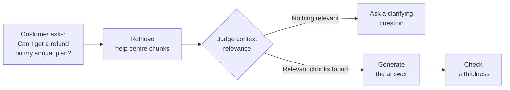
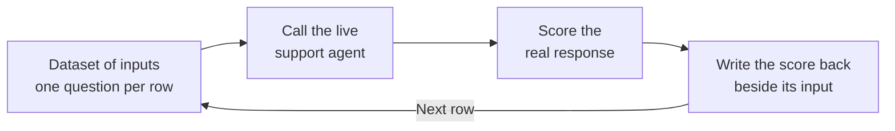
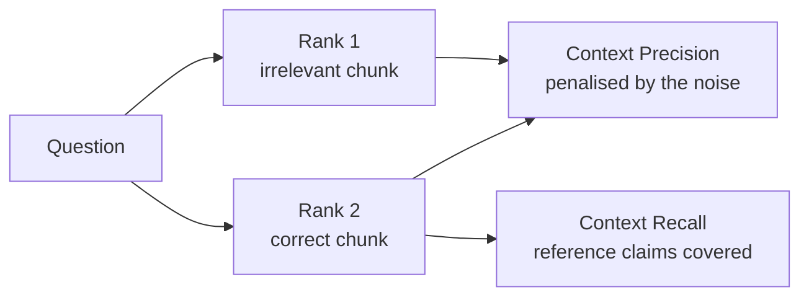
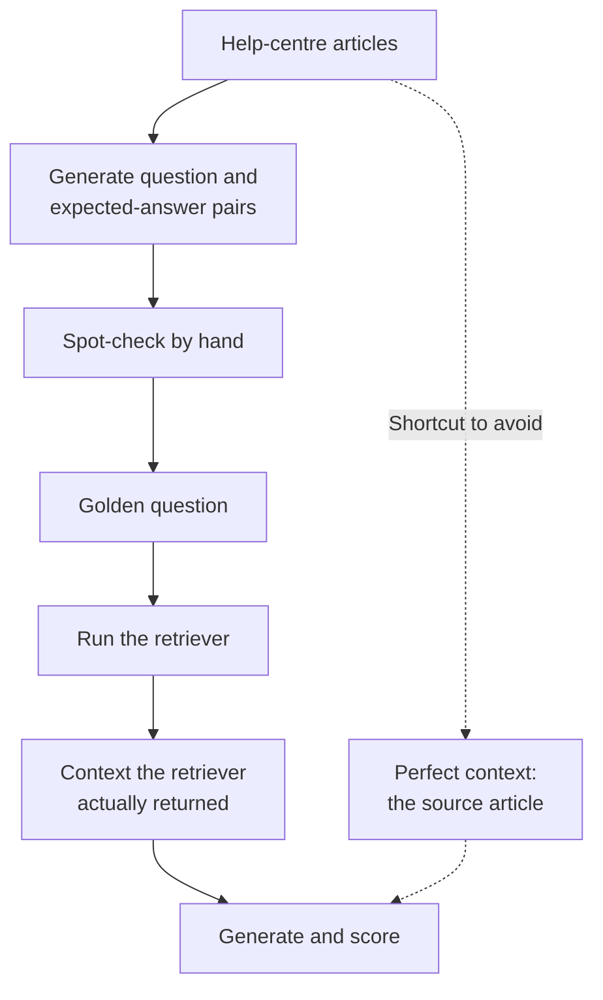
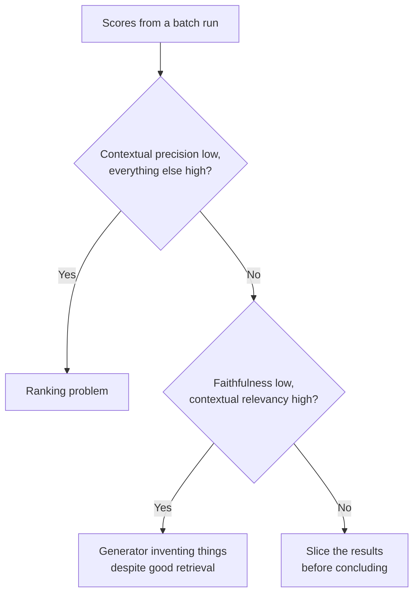

# Running RAG Evals

*Run the live system over many cases built from your own documents, keep each score beside its input, and read the scores by pattern and by slice.*

◷ 9 min read · Field guide part 4 of 8 · [Introduction](00-introduction.md)

> **Before you start.** This part assumes [the map](01-the-map.md), [RAG retrieval](02-rag-retrieval.md) and [RAG generation](03-rag-generation.md). It takes the metrics from those parts and shows how to run them on a real system.

---

## 1. Evaluation Inside the Pipeline

Parts 2 and 3 score an answer after the system has finished. The same relevance and grounding checks can also run while the answer is being built.

- **Evaluation inside the pipeline**: running a check as one step of the system itself, so its result can change what the system does next.
- Think of a cook who tastes the sauce before it leaves the kitchen. A food critic tastes it only after it reaches the table.

Three terms from earlier parts appear here:

- A **judge** is an LLM that scores another model's output ([the map](01-the-map.md)).
- **Context relevance** asks whether the retrieved chunks are on topic for the question ([RAG retrieval](02-rag-retrieval.md)).
- **Faithfulness** asks whether every claim in the answer is backed by the retrieved chunks ([RAG generation](03-rag-generation.md)).

The pipeline runs four steps in order: `retrieve → judge context relevance → generate → check faithfulness`. The diagram shows them for the support agent, with the branch that the first check makes possible.

There are three reasons to wire the checks in:

- **You can branch on the result.** If nothing relevant came back, the agent asks a clarifying question instead of generating a plausible answer from noise.
- **It shows what the checks do.** Build grounding out of raw judge calls once, and you see what a ready-made version is doing underneath.
- **Prototype against mocked judges first.**
  - **Mocked judge**: a stand-in function that returns a fixed verdict instead of calling a model.
  - It works like a fire drill: the same route out of the building, with no real fire.
  - The pipeline keeps the same structure, gives byte-identical output on every run, and costs nothing.
  - Swap in real judges once the shape is right.
  - That swap is where non-determinism becomes visible. **Non-determinism**: a real judge can give the same input a different score on a different run.

## 2. Running It in Batch

### 2.1 From One Example to the Whole System

One scored example teaches you what a check does. It says nothing about your system. The step between the two always has the same shape.

- **Batch run**: scoring many inputs in one go, one row at a time, and keeping every score.
- **Dataset**: a table of test inputs, one per row. For the support agent, each row is one customer question.
- **Live system**: the version that is actually deployed, the one customers talk to.
- A teacher marking a whole class writes each grade on the paper it belongs to. One graded paper tells you little about the class.

> dataset of inputs → call the **live** system once per row → score the real response → write the score back beside its input

The diagram shows that loop, one row per pass.

The pattern has four properties:

- **Every row hits the live system.** You test what is deployed, rather than a reconstruction of it.
- **Scores land next to inputs.** A bad number is one click from the input that caused it. That is what turns a dashboard into a diagnosis.
- **It re-runs on demand.** You need that before you can compare a change against what is live.
- **A standard test runner gets you this cheaply.**
  - **Test runner**: a tool that runs many small tests and reports which passed and which failed.
  - Parametrize over rows: write the test once and let the runner repeat it for every row.
  - You inherit batch execution, pass/fail reporting and CI.
  - **CI** (continuous integration) runs your checks automatically on every change ([the map](01-the-map.md)).

### 2.2 A Second Library as a Second Opinion

A patient who hears the same diagnosis from two doctors trusts it more. Scores work the same way.

- Two independent implementations of "faithfulness" that agree on a case are evidence.
- When they disagree, you have a judge question worth reading.
- DeepEval and RAGAS are two of the evaluation frameworks this guide uses ([the map](01-the-map.md)).

[`06_RAGAS_in_Practice.ipynb`](../../../courses/01-rag-agent-tool-evaluation/06_RAGAS_in_Practice.ipynb) scores the same ideas with RAGAS 0.4. The table maps its metrics onto the ones you already know.

| RAGAS (`ragas.metrics.collections`) | Mirrors | Note |
| --- | --- | --- |
| `ContextPrecisionWithoutReference` | Contextual precision, from [RAG retrieval](02-rag-retrieval.md) | Judges each chunk against the *response* instead of an answer key. `ContextPrecisionWithReference` is the reference-based sibling. The split between checks with and without an answer key ([the map](01-the-map.md)) sits in the class name |
| `ContextRecall` | Contextual recall, from [RAG retrieval](02-rag-retrieval.md) | Reads `reference`, the answer key |
| `Faithfulness` | Faithfulness, from [RAG generation](03-rag-generation.md) | Same claim-by-claim idea |

Both libraries wrap one test case in an object. The fields carry the same idea under different names.

| What the field holds | RAGAS `SingleTurnSample` | DeepEval `LLMTestCase` |
| --- | --- | --- |
| The user's question | `user_input` | `input` |
| The system's answer | `response` | `actual_output` |
| The chunks the retriever returned | `retrieved_contexts` | `retrieval_context` |
| The answer key | `reference` | `expected_output` |

Three more differences catch people out:

- **The sample is only a container.** In 0.4, each metric's `ascore()` takes the fields it reads as keyword arguments.
- **RAGAS is async-first.**
  - **Async** code starts a slow task and lets other work run while it waits, like getting a buzzer at a food counter.
  - `await metric.ascore(...)` waits for the result and returns a `MetricResult`. Read its `.value`.
  - DeepEval is synchronous by comparison: `metric.measure(case)`.
  - An **event loop** is the scheduler that runs async tasks. The sync `score()` wrapper refuses to run inside one, so a notebook cell uses `await` directly.
- **The judge is an object.**
  - Instead of naming a model in a string, you build it with `llm_factory("gpt-4o-mini", client=AsyncOpenAI())` and pass it as `llm=`.
  - Its `provider=` argument swaps in other vendors.
  - The 0.3 shape is deprecated: `LangchainLLMWrapper`, `single_turn_ascore`, and imports from `ragas.metrics`. Older tutorials still show it.

### 2.3 One Noise Chunk Splits Precision From Recall

The notebook ranks one irrelevant chunk above the correct one. The diagram shows how each metric reads that ranking.

- Context Precision comes back below Context Recall.
- Precision is penalised by noise sitting in the ranking.
- Recall only asks whether the reference's claims are covered, and they are.
- This is the bad-ranking signature from [RAG retrieval](02-rag-retrieval.md), read in a second library's vocabulary.

## 3. Golden Datasets

A **reference** is a correct answer a person wrote down before the system ran ([the map](01-the-map.md)). A golden dataset is a whole set of them.

- **Golden dataset**: a set of test questions, each paired with its expected answer, that serves as the answer key for the system.
- It is like the exam paper and marking scheme a school reuses every year.

Four rules for building one:

- **Hand-writing references doesn't scale** past a handful of examples.
- **Generate them from your own documents.**
  - Produce question and expected-answer pairs from the help-centre articles the agent searches.
  - Evolve them along dimensions you choose, such as multi-step reasoning or multi-chunk.
  - **Evolving** a question means rewriting a simple generated question into a harder variant along one chosen dimension.
  - A multi-chunk question for the support agent might need both the refund policy and the plan-change article.
- **Spot-check them.** Generated questions are only as good as the generation process.
- **Build each case's context by actually running the retriever** on the golden question.
  - Do not build it from the documents the golden came from.
  - That shortcut tests whether the generator works given perfect context, which nothing in production ever has.

The diagram shows the path to follow, and the shortcut to avoid as a dotted line.

## 4. Reading the Results

A batch run hands you a column of scores per metric. Three habits turn that into a diagnosis.

**Diagnose by pattern.** The headline number alone does not say what broke. Read the metrics against each other.

| Pattern | What it points to |
| --- | --- |
| Low contextual precision, high everything else | A ranking problem |
| Low faithfulness, high contextual relevancy | The generator inventing things despite good retrieval |

The decision tree below walks those two patterns in order.

**Aggregates hide the thing you need to see.**

- **Aggregate**: one number averaged over every case in the run.
- 85% with one category at zero and 85% spread evenly are different systems with the same score.
- For the support agent, the first could mean every refund question fails while everything else passes.

**Slice before you conclude.**

- **Slice**: the subset of results that share one property.
- Slice by query category, tenant, intent and document type.
- A **tenant** is one customer organisation sharing the same deployed system.

## Key Takeaways

- Relevance and grounding checks can run as pipeline steps, so the system can branch on them, for example by asking a clarifying question.
- Prototype in-pipeline checks against mocked judges; the swap to real judges is where non-determinism shows up.
- A batch run calls the live system once per row and writes each score beside its input, so a bad number leads straight to its cause.
- A second library is a second opinion: agreement is evidence, disagreement is a judge question worth reading.
- Generate golden datasets from your own documents, spot-check them, and build each case's context by running the retriever.
- Diagnose by the pattern across metrics, and slice before you conclude, because an aggregate can hide a category at zero.

## Check Yourself

1. Your golden dataset passes every faithfulness check, but each case's context was copied from the article its question was generated from. What are you actually testing? **Whether the generator works given perfect context, which nothing in production ever has. Build each case's context by running the retriever on the golden question.**
2. Contextual precision is low and every other metric is high. Where do you look? **At the ranking. That pattern points to a ranking problem.**
3. In the RAGAS notebook, Context Precision comes back below Context Recall. What happened to the retrieved chunks? **One irrelevant chunk was ranked above the correct one. Precision is penalised by the noise in the ranking; recall only asks whether the reference's claims are covered, and they are.**
4. Two systems both score 85%. Are they equally good? **Not necessarily. One can have a category at zero while the other is spread evenly. Slice by query category, tenant, intent and document type before you conclude.**
5. Why prototype in-pipeline checks against mocked judges? **Same structure, byte-identical output and zero cost. Swap in real judges once the shape is right, and expect non-determinism to show up at that swap.**

## References

- [`05_RAG_Eval_Inside_the_Pipeline.ipynb`](../../../courses/01-rag-agent-tool-evaluation/05_RAG_Eval_Inside_the_Pipeline.ipynb): evaluation wired in as pipeline steps, mocked judges first and then real ones.
- [`06_RAGAS_in_Practice.ipynb`](../../../courses/01-rag-agent-tool-evaluation/06_RAGAS_in_Practice.ipynb): the RAGAS 0.4 second opinion and the batch pattern.
- [`07_RAG_Capstone_Build_and_Evaluate.ipynb`](../../../courses/01-rag-agent-tool-evaluation/07_RAG_Capstone_Build_and_Evaluate.ipynb): a synthesized golden dataset run through the full metric suite.
- [Course 01](../../../courses/01-rag-agent-tool-evaluation/), the notebooks this field guide accompanies.

---

**Next:** [Conversations, tools and task completion](05-conversations-tools-and-task-completion.md) · **Previous:** [RAG generation](03-rag-generation.md)
