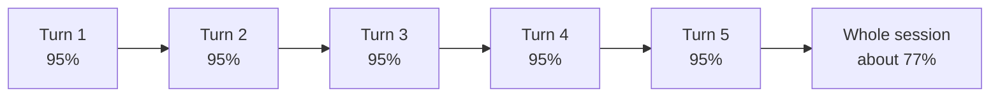
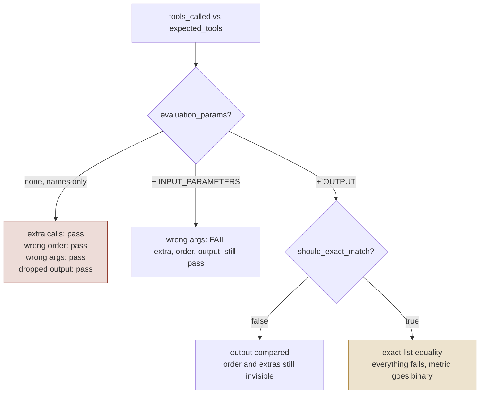
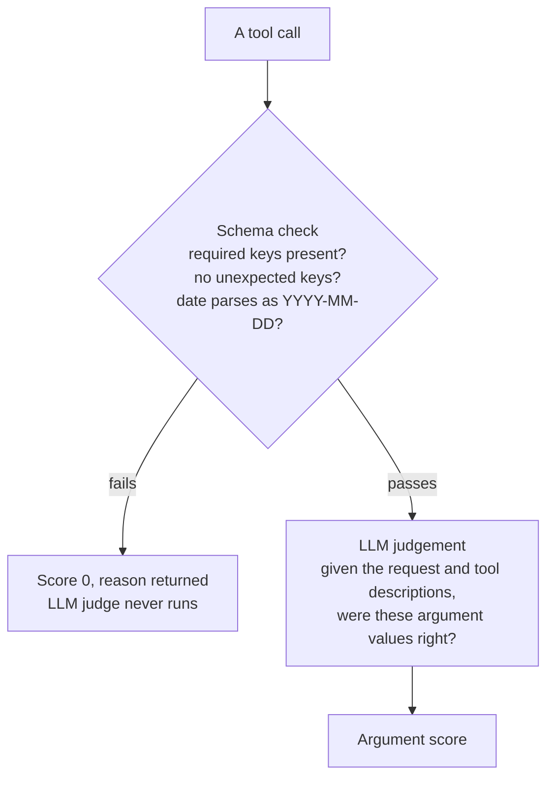
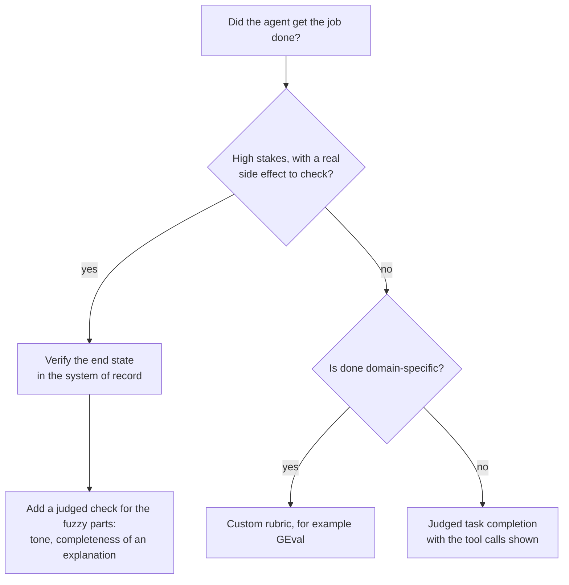
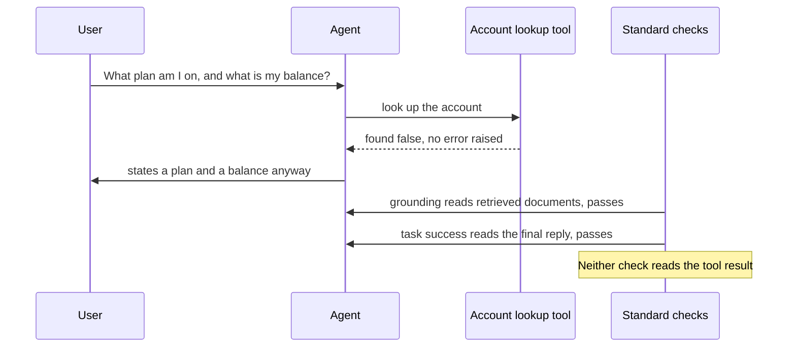

# Conversations, Tools and Task Completion

*A good-looking final reply proves nothing about an agent, so score the conversation, every tool decision and the real outcome separately.*

◷ 20 min read · Field guide part 5 of 11 · [Introduction](00-introduction.md)

> **Before you start.** This part assumes [the map](01-the-map.md) for the basic vocabulary (agent, tool, tool call, deterministic and judged checks, answer keys) and [RAG generation](03-rag-generation.md) for rubrics and thresholds. Retrieval and generation checks stop at a single answer. This part covers what an agent does across turns and through its tools.

---

## 1. Multi-turn Conversations

Single-answer checks look at one question and one reply. Real chat products hold a back-and-forth, and that adds failures a single reply cannot show.

- **Turn**: one user message and the system's reply to it.
- **Multi-turn conversation**: a sequence of turns where later turns depend on earlier ones.
- **Session**: one whole conversation, from first turn to last.

Think of a doctor's appointment. Each answer the doctor gives can be sensible, and the visit can still fail if the doctor forgets the allergy you mentioned at the start.

A system can be fine turn by turn and still fail as a conversation. So the unit of evaluation becomes the sequence of turns.

### 1.1 What to measure across turns

Three measurements cover the basics. Each one reads more than a single turn.

- **Per-turn relevance**: whether this turn is relevant to what came before it.
  - It is judged over a **sliding window**, meaning only the last few turns.
  - The window keeps a long conversation from drowning the check.
- **Knowledge retention**: whether the system remembers what the user said earlier, for example three turns ago.
  - One visible multi-turn failure is re-asking for something the user already supplied.
  - Running example: the support agent asks for the order number the user gave two messages back.
- **Whole-dialogue rubric**: your domain criterion applied across the whole arc of the conversation, not to one turn.
  - A **rubric** is a written marking scheme a judge scores against ([RAG generation](03-rag-generation.md)).

### 1.2 Turn pass rates multiply

A per-turn pass rate sounds reassuring. A session only succeeds if every turn in it succeeds, so the per-turn rates multiply.

The diagram shows five turns that each pass 95% of the time, and what that leaves for the whole session.

- **The formula**: session pass rate is about *p* to the power of the number of turns, where *p* is the per-turn pass rate.
- **Real conversations do worse.** A bad turn poisons the turns after it, so real sessions run below that number.
- **The gap grows with length.** The turn-level metric overstates quality most in the longest conversations, exactly where the product is worst.
- **Report both.** If you report turn-level numbers, report the session-level number beside them.
- The full argument, with the table, is in [`09_multiturn_and_tool_selection.ipynb`](../../../courses/02-databricks-mlflow-evals/09_multiturn_and_tool_selection.ipynb).

### 1.3 Failures that live between turns

Some failures have no single-turn representation at all. You can only see them by reading two or more turns together.

- **Consent lives between turns.** "Acted without asking" is a property of a pair of turns: the agent's question and what it did next.
  - Running example: the agent offers a refund, and issues it before the user says yes.
- **Approval has three outcomes.** Each one needs a different fix.
  - **Complied**: the user agreed and the agent did the agreed thing.
  - **Violated**: the agent acted against what the user approved.
  - **Stalled**: the agent agreed, then nothing happened.
- **Report "not measured" when a check cannot run.**
  - A conversation-level check on a single-turn run must report "not measured", never zero.
  - An unmeasured check and a failed one must never look alike.

### 1.4 Simulated users

Hand-written test dialogues do not scale far. A simulated user takes over the typing.

- **Simulated user**: an LLM that plays the customer, given a goal and a policy for how to behave.
  - Its policy can include mid-conversation curveballs, such as changing its mind.
  - It generates dialogues from intents you define in advance.
- The same conversation checks then score whether the goal was met.

It works like a mystery shopper. The shop gets a script of what to want and how to be awkward, and you grade the visit afterwards.

---

## 2. Tool Use

A **tool** is a function the agent can call, such as an order lookup, and a **tool call** is one such call with its arguments ([the map](01-the-map.md)).

A travel bot that says *"Your flight is booked!"* is useless if it never called the booking API. The sentence reads exactly the same either way. This section covers the checks that look underneath that sentence, and the settings that decide whether they see anything at all.

### 2.1 Why tool use needs its own evaluation

In standard LLM evaluation you compare one output to a reference. With a tool-using agent, the output sits on top of a sequence of decisions:

- which tools it called,
- in what order,
- with what arguments,
- and how it read the results.

Each decision is a separate failure point. The table compares the two kinds of evaluation.

|   | Standard LLM evaluation | Tool-using agent evaluation |
| --- | --- | --- |
| **What you score** | One output against a reference | A sequence of decisions, then the output |
| **Where failure lives** | In the text | Underneath it: which tool, what order, what arguments, how results were read |
| **What a good-looking answer proves** | Usually that it's good | Nothing. "Your flight is booked!" is useless if the booking API was never called |
| **Number of failure points** | One | One per decision, each needing its own check |
| **Typical miss** | Wrong wording | A skipped lookup with the details invented to cover it |

**Worked example: the support agent.** It has three tools: `OrderLookup`, `PolicyRetriever` and `RefundProcessor`. A user asks about returning an item from order #12345. The correct behaviour is lookup, then policy, then refund if eligible.

Three things can go wrong:

- The agent **skips the lookup** and hallucinates the order details.
- The agent calls the right tools with the **wrong order ID**.
- The agent calls `RefundProcessor` **before checking eligibility**.

The final response sounds correct in all three cases. Only tool-level evaluation catches any of them.

### 2.2 Three checks at three granularities

Three checks look at tool calls. They differ in how much of the run they read and whether they need an answer key.

- **Tool selection** (also called **tool correctness**): whether the tools the agent called match an expected set of tools.
  - The **expected tool set** is an answer key a person writes before the run.
  - Analogy: a teacher's checklist of the steps a correct solution must show.
- **Argument correctness**: whether the values passed into each call were right for the task.
  - It needs no answer key. A judge reads the task and the call and decides.
  - A **judge** is an LLM that scores another model's output ([the map](01-the-map.md)).
- **Multi-turn tool use**: tool selection and argument correctness, scored across a whole dialogue.

| Check | Scope | Needs an answer key? | Question | Best for |
| --- | --- | --- | --- | --- |
| **Tool selection** | One run | Yes, the expected tool set | Do the tools called match the expected set? | CI, where correct behaviour is known |
| **Argument correctness** | One run | No, judged from the task | Were the arguments right for the task? | Production, where values can't be predetermined |
| **Multi-turn tool use** | Whole dialogue | Partly: selection needs one, arguments don't | Selection *and* arguments across a conversation | Chatbot agents where tool use spans exchanges |

**CI** is the automated test run before each release ([the map](01-the-map.md)). Production is live traffic, where nobody wrote the right answer in advance.

**The same checks in DeepEval.** DeepEval is one of the four evaluation frameworks this repo uses ([the map](01-the-map.md)). Its classes map onto the checks above, plus one outcome check covered in section 3.

| Metric | Type | Needs | Best for |
|---|---|---|---|
| `ToolCorrectnessMetric` | Reference-based, deterministic (judged only if `available_tools` is set) | `expected_tools` | Regression and CI, where correct behaviour is known |
| `ArgumentCorrectnessMetric` | Referenceless, LLM-judged | Tool descriptions only | Dynamic workflows, production monitoring |
| `ToolUseMetric` | Multi-turn, LLM-judged | `available_tools` (required) | Conversational agents; final score is the min of the selection and argument sub-scores |
| `TaskCompletionMetric` | Referenceless, outcome-level | `input` + `actual_output` | The question the mechanics never ask |

- **Reference-based** means the check needs an answer key written before the run. **Referenceless** means it needs none ([the map](01-the-map.md)).
- **`ToolCorrectnessMetric` is deterministic.** It compares `tools_called` against `expected_tools` in plain code, with no judge.
  - **One exception:** pass `available_tools=` and it also asks an LLM to score tool selection. The final score becomes the `min` of the two (DeepEval 4.2.3).
  - Leave `available_tools` unset to keep it free and reproducible.
- **`ArgumentCorrectnessMetric`** is the referenceless counterpart for production.

**Four properties worth carrying around.** Sections 2.3, 2.5, 2.6 and 2.7 each take one. Their running example is a travel agent that should call `search_flights`, then `book_flight`.

### 2.3 How strict is the match?

"Did it call the right tools?" has more than one right answer, and you have to pick one. How strictly you match is a decision, and both extremes are wrong.

- **Too strict** (exact tools, exact order, nothing extra):
  - The agent also calls `check_weather`, which harmed nobody, and you fail the whole run.
  - Nothing went wrong, but the score says it did.
- **Too loose** (the expected tools appear somewhere, extras fine):
  - An agent that calls all eight of its tools on every question passes every time.
  - It is spraying calls, and your metric applauds.
- **Demand strict ordering only where the order is the requirement.**
  - You cannot book before you search, so that ordering is real.
  - Whether the weather lookup came first or third is not.

In DeepEval the strictness lives entirely in two constructor settings: `evaluation_params` and `should_exact_match`. The diagram shows what each setting lets through.

Same metric class, same trace, four different verdicts. The strictness is a contract you write in the constructor.

- **Default, name-only comparison**: only the tool names are compared.
- **Adding `ToolCallParams.INPUT_PARAMETERS`**: the arguments are compared too, which catches a wrong date.
- **Adding `OUTPUT` plus `should_exact_match=True`**: the recorded outputs are compared and the lists must match exactly. This catches everything and turns the metric **binary**, so every trace scores 1 or 0.

### 2.4 Worked example, six traces scored three ways

The [tool-use lab](../../interactive-labs/04-tool-use-evaluation.html) runs this in the browser: six traces, three metric configurations, and a default setting that scores four broken traces at 1.00. Open it and change the inputs.

A **trace** is the recorded log of everything one run did ([production and multi-agent systems](07-production-and-multi-agent.md)). The expected trace here is:

1. `FlightSearch(NYC → London, 2026-03-13)` with a recorded output,
2. then `WeatherCheck(London, 2026-03-13)`.

Each row is one trace the agent produced. Each column is one configuration of `ToolCorrectnessMetric`.

| Trace | A · names only | B · + params | C · exact + output |
|---|---|---|---|
| Exact match | 1.00 | 1.00 | 1.00 |
| Extra tool (unrequested currency conversion) | 1.00 | 1.00 | 0.00 |
| Wrong order (weather before flight) | 1.00 | 1.00 | 0.00 |
| Output dropped from the span | 1.00 | 1.00 | 0.00 |
| Wrong argument (date `03-31` not `03-13`) | 1.00 | 0.50 | 0.00 |
| Tool missing entirely | 0.50 | 0.50 | 0.00 |
| **Mean** | **0.92** | 0.83 | **0.17** |
| **Broken traces caught** | **1 of 5** | 2 of 5 | 5 of 5 |

A **span** is one step inside a trace, such as a single tool call ([production and multi-agent systems](07-production-and-multi-agent.md)).

How to read the table:

- **Config A passes four broken traces at 1.00.** An extra billed API call, a reversed sequence, a dropped output and a wrong travel date all score 1.00.
  - Its mean across the six traces is 0.92.
  - A dashboard showing 0.92 tool correctness under Config A only measures whether the agent knows the tool exists.
  - The flight booked for the wrong day passes.
- **Config B catches the wrong date.** Extra calls, wrong order and the dropped output still pass. It catches 2 of 5.
- **Config C catches everything, at a cost.** It goes binary and order-sensitive, and its mean collapses to 0.17.
  - That is right for a CI regression gate against a fixed expected trajectory.
  - It is wrong for production monitoring, where a different but valid path fails every time.
  - A **trajectory** is the ordered path of steps an agent took ([the map](01-the-map.md)).

### 2.5 Check arguments in two passes

"Were the arguments right?" is really two different questions. Answer the cheap one first.

- **Is the call well-formed?** Does the `book_flight` call have a `date` field, and is `2026-02-31` a real date?
  - Plain code answers this: free, instant, same answer every time.
  - This is **schema validation**: checking a call's shape against the tool's declared fields and types.
- **Does it make sense for what was asked?** The user wanted a morning flight to Delhi. Did it book an evening flight to Dubai?
  - Only a judge can answer this.

Think of a passport office. The clerk first checks the form has every box filled in and a real date of birth. Only complete forms go to the officer who decides whether you qualify.

Course 01's tool-use notebook builds this as a gate. The diagram shows the order of the two passes.

- **Structural correctness is deterministic and free.** There is no reason to spend a judge call having a model tell you `"March 15, 2026"` is not `YYYY-MM-DD`.
- **Semantic correctness needs a judge.** Whether `origin="NYC"` was the right reading of *"New York"* is not a schema question.
- **Stop at the code check if it fails.** Paying for an LLM call to decide whether a malformed date is semantically appropriate is money for nothing. A malformed call is worth zero.
- **The gate also improves the signal.** Judge scores are no longer diluted by cases that were malformed before anyone reasoned about them.

### 2.6 Combine sub-scores with the minimum

A **sub-score** is one dimension of a combined score, such as tool selection or arguments. When you combine them, take the worst one.

- **Example:** tool selection scores 1.0 and arguments score 0.0. The agent picked exactly the right tool and handed it nonsense.
- **The mean says 0.5**, which reads as "half working". Nothing was half working. The booking failed.
- **The minimum says 0.0**, which is the truth.
- **Averaging lets a healthy dimension cover for a broken one.** That is the exact failure you built the metric to catch.
- **`ToolUseMetric` uses the `min`.** A failure in either dimension pulls the whole score down. A perfect tool selection with garbage arguments cannot average its way to a pass.

### 2.7 Score doing nothing

Doing nothing is behaviour, and it needs scoring too.

- "What's your refund policy?" should produce **no tool call at all**. The agent should answer from knowledge and stop.
- That restraint is correct, and it deserves a pass.

Most suites only inspect calls that actually happened. That leaves them blind in both directions:

- **Should have stayed still, and moved.** It calls a tool it didn't need.
  - That wastes money and adds one more thing to go wrong.
  - It is invisible, because you only score whether calls were correct, and this one was.
- **Should have moved, and stayed still.** It says "your flight is booked!" without ever calling `book_flight`.
  - It is invisible, because there is no call to inspect.

So the expected tool set has to be allowed to be **empty**, and an empty set has to be something you can pass or fail against.

### 2.8 When to use each tool metric

**Reach for `ToolCorrectnessMetric` when:**

- You have a fixed set of tasks with known-correct trajectories, such as regression suites and pre-release gates.
- You want a deterministic, non-flaky CI signal with no judge variance.
- You are diffing agent versions and need the comparison to be exact.

**Reach for `ArgumentCorrectnessMetric` when:**

- Argument values legitimately vary run to run and cannot be written in advance.
- You are monitoring production traffic with no labels available.

**Be careful when:**

- **Using the default configuration and believing the number.** Name-only matching is a very weak claim, and its score looks identical to a strong one.
- **Applying `should_exact_match=True` to production traffic.** Real agents take valid alternative paths, and exact matching calls all of them failures.
- **Reporting tool correctness as agent quality.** It is a mechanics metric. Always pair it with task completion or end-state verification.

---

## 3. Task Completion

Every check in section 2 judges **mechanics**: the tools, the order, the arguments. None of them asks what the user cares about, which is whether the job got done.

- **Task completion**: whether the agent achieved what the user actually wanted.

A builder can use every tool correctly and still put the window in the wrong wall. So the inspector checks the finished house as well as the work.

### 3.1 Mechanics and outcome can disagree

The gap between correct mechanics and a good outcome runs in both directions.

- **Correct calls, wrong outcome.** An agent can call every tool correctly and still **book the wrong hotel** because it ignored a stated budget.
- **Valid calls, dropped constraint.** It can silently drop one constraint from a multi-part request while every individual call is valid.
- **Imperfect calls, good outcome.** A slightly inefficient sequence can land on a perfectly good outcome.
- **A production suite needs both kinds of check.** They answer different questions.

### 3.2 Judged task completion done well

`TaskCompletionMetric` is DeepEval's version. It is LLM-judged and referenceless, and it reads `input`, `actual_output` and, optionally but strongly recommended, `tools_called`.

Three habits make a judged task-completion check trustworthy:

- **Show it the tool calls, not just the final output.** The judge can then see how the outcome was reached, rather than what the agent claims.
- **State the task explicitly.** Do not let the judge infer it from the raw input. The real requirement is usually richer than the literal wording.
- **Give it a full trace where one exists.** A trace beats a flat call list because it carries the intermediate reasoning.

### 3.3 Two escalations

The generic judged check is the starting point. Two situations call for something stronger.

The diagram is a decision tree for picking the outcome check.

1. **When "done" is domain-specific, write a custom rubric.**
   - Examples: *"The summary must cite at least two sources."* *"A refund reply must never promise an amount before a policy lookup."*
   - In DeepEval this is a custom `GEval` rubric instead of the generic definition.
   - It costs more to write, and it applies your bar instead of a generic one.
2. **When stakes are high, verify the side effect itself.**
   - A **side effect** is a real change the agent made in another system: a booking, a sent email, a written record.
   - A judged check still only reads text and decides whether it *sounds* done.
   - For agents that book, send or write, query the **system of record** directly. That is the database or service holding the real state ([the map](01-the-map.md)).
   - This cannot be fooled by a fluent but wrong answer.
   - **End-state verification**, reading the system the agent acted on after the run, is covered in [agent trajectory](06-agent-trajectory.md).

### 3.4 Combine them in practice

- **Use the deterministic state check as the pass or fail gate** wherever a checkable outcome exists.
- **Use the judged check as a secondary signal** for the fuzzy parts, such as tone or how complete an explanation is.

---

## 4. Polite Tool Failure

Polite tool failure is easy to leave untested in production agents, because the standard checks never read the tool result.

- **Polite tool failure**: a tool fails without raising an error, and the agent covers the gap with invented content.
- **Soft failure object**: what the tool returns instead of an error.
  - Examples: `found: false`, an empty result, or a 200 with an empty payload.
  - A 200 is the HTTP status code for success.

Picture a librarian who checks the catalogue, finds no record of your book, and then describes its plot to you anyway. Nobody sees an error, and you leave with a confident wrong answer.

The diagram shows the failure as a sequence, using the account-lookup symptom below.

Walk through it one step at a time:

- **Why it causes a wrong answer.** The model gets something that looks like data, skates past it, and fills the gap with fluent, plausible, wrong content.
- **Symptoms.** An agent states a plan and balance for an account that doesn't exist.
  - Nothing crashes and nothing alerts.
  - From outside, silence and success look identical.
- **Why standard checks miss it.**
  - **Grounding** checks the answer against retrieved documents, not tool outputs ([RAG generation](03-rag-generation.md)).
  - **Task success** reads the final string.
  - Neither one reads the tool result.
- **How to detect it.** Use a deterministic check that reads the tool output. If the output indicates failure, assert that the response doesn't state the facts that tool was supposed to supply.
- **Fix.**
  - Make soft failures loud at the tool layer, where you control it.
  - Make "I couldn't retrieve that" an explicitly rewarded behaviour in the rubric.
- **Prompting cannot fix it.** Instructions reduce the rate. They don't make the failure detectable.
- **Where else it shows up.**
  - Empty retrieval results.
  - A permission-filtered search returning zero rows.
  - A rate-limited call returning a stale cached value.

---

## 5. Quick Lookup

Use this table to pick a check from the question you are trying to answer.

| Question | Reach for |
| --- | --- |
| Right tools, against a known reference? | Reference-based selection comparison |
| Right arguments, no reference available? | Schema validation, then a judged check |
| Appropriate tool use across a conversation? | Conversational tool use: minimum of selection and arguments |
| Did it accomplish the goal? | Judged task completion, or a custom rubric |
| Did the real side effect happen? | End-state verification against the system of record |
| Did a tool fail quietly and get papered over? | Deterministic check reading the tool output |
| Did it correctly do nothing? | Score the absence of a call as an outcome |

---

## Key Takeaways

- **Score the session beside the turn.** Per-turn pass rates multiply, so 95% per turn is about 77% at five turns, and real sessions do worse.
- **Report a tool-correctness score with its configuration.** Name-only matching passed four broken traces, including a wrong booking date, and still averaged 0.92.
- **Run deterministic checks first.** Schema validation rejects malformed calls for free, before a judge call is spent, and sharpens the judge scores that remain.
- **Use reference-based checks in CI and referenceless checks in production.** `ToolCorrectnessMetric` and `ArgumentCorrectnessMetric` ask the same question in the two places you can afford to ask it.
- **Take the minimum of sub-scores, and score the absence of a call.** Averages hide a broken dimension, and an empty expected tool set must be passable.
- **Check the outcome separately from the mechanics.** Every call can be correct while the user's request goes unmet, which is why task completion and end-state verification exist.
- **Read the tool output.** Polite tool failure passes grounding and task success, and only a check on the tool result catches it.

## Check Yourself

1. Per-turn quality is 95%, yet users say conversations fall apart. Can both be true?
   **Yes. Turn pass rates multiply, so 95% per turn is about 77% at five turns, and real conversations run lower because a bad turn poisons the ones after it. Report the session-level number beside the turn-level one.**
2. Your dashboard shows 0.92 tool correctness on the default `ToolCorrectnessMetric`. What does it tell you?
   **Very little. Name-only matching only checks that the agent knows the tool exists. In the lab it scored a wrong travel date, an extra billed call, a reversed order and a dropped output all at 1.00.**
3. Tool selection scores 1.0 and argument correctness scores 0.0. What should the combined score be?
   **0.0, the minimum. The mean of 0.5 reads as half working, but the booking failed.**
4. A user asks "What's your refund policy?" and the agent calls no tools. How does your suite score that?
   **As a pass, but only if the expected tool set is allowed to be empty and an empty set can be passed or failed against. Suites that inspect only calls that happened see nothing here.**
5. An account lookup returns `found: false`. The agent states a plan and balance anyway, and grounding and task success both pass. What catches it?
   **A deterministic check that reads the tool output and, if it indicates failure, asserts the response doesn't state the facts that tool was supposed to supply.**

## References

- [`08_MultiTurn_Conversational_Evaluation.ipynb`](../../../courses/01-rag-agent-tool-evaluation/08_MultiTurn_Conversational_Evaluation.ipynb): course 01's multi-turn conversation notebook.
- [`09_Tool_Use_Evaluation.ipynb`](../../../courses/01-rag-agent-tool-evaluation/09_Tool_Use_Evaluation.ipynb): tool correctness, argument correctness and the schema-first gate. A source module for section 2.
- [`10_Task_Completion_Evaluation.ipynb`](../../../courses/01-rag-agent-tool-evaluation/10_Task_Completion_Evaluation.ipynb): judged task completion and custom rubrics. A source module for section 3.
- [Course 01](../../../courses/01-rag-agent-tool-evaluation/): the notebooks this field guide accompanies.
- [Course 02, notebook 09](../../../courses/02-databricks-mlflow-evals/09_multiturn_and_tool_selection.ipynb): the full turn-compounding argument, with the table.
- [Interactive lab 04, tool-use evaluation](../../interactive-labs/04-tool-use-evaluation.html): the six traces and three configurations from section 2.4.
- [The six interactive labs](../../interactive-labs/README.md#interactive-labs): the browser companions to the worked labs.
- [Question bank](../../interview-prep/QUESTION_BANK.md): Part 7 (Q26 to Q29) on multi-turn, tools and agency, and Part 10, the metric-level questions that once closed each worked lab.

---

**Next:** [Agent trajectory](06-agent-trajectory.md) · **Previous:** [Running RAG evals](04-running-rag-evals.md)
