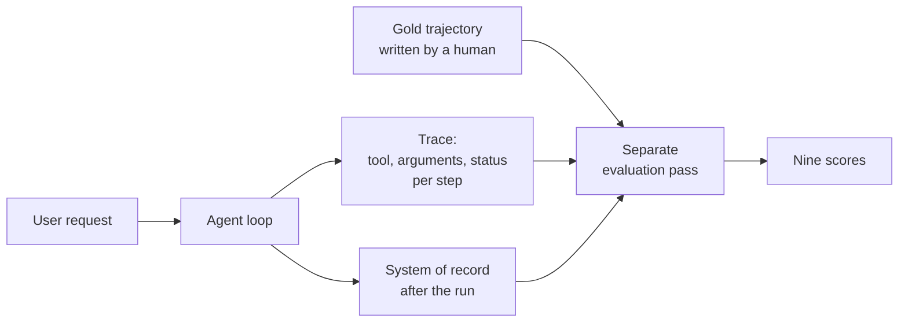
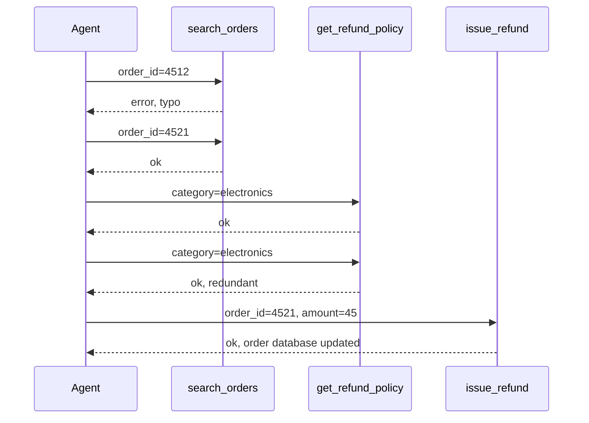
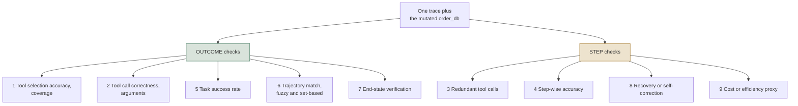
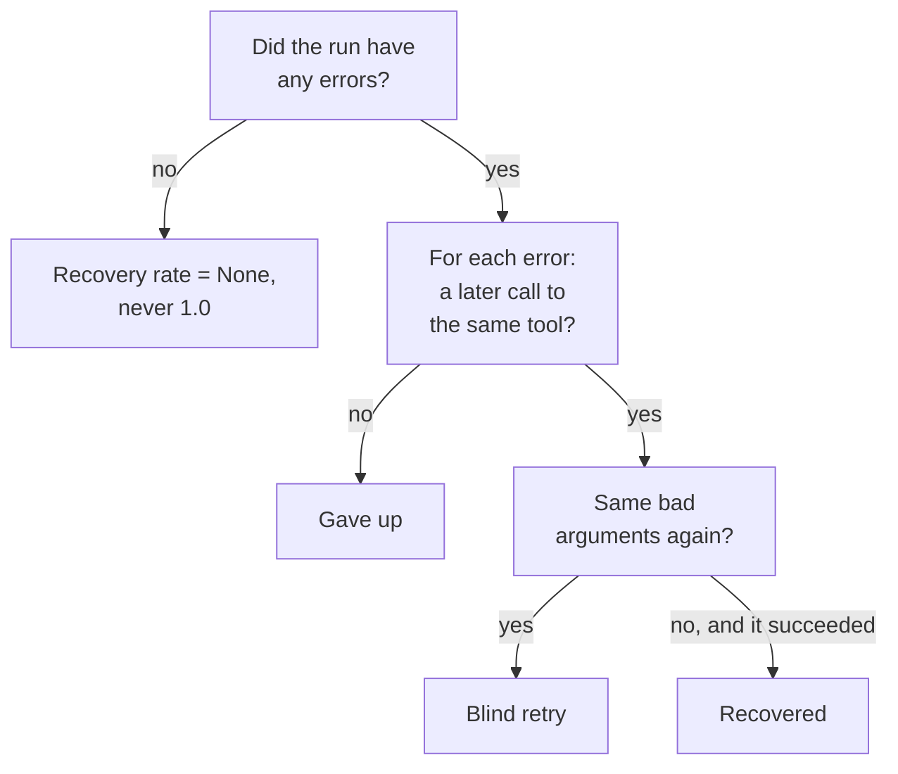
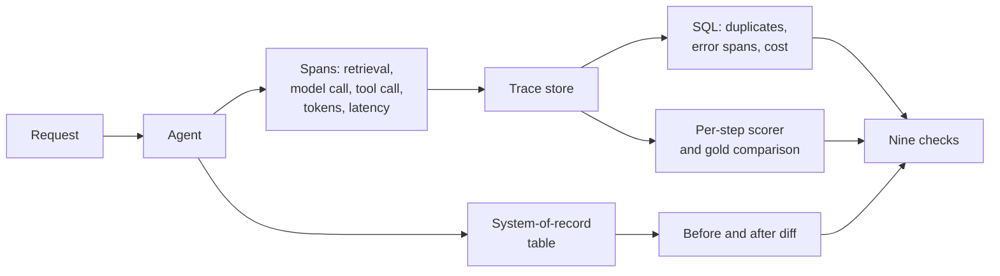

# Agent Trajectory

*An agent can end in the right place by a bad path, so score the steps as well as the outcome.*

◷ 15 min read · Field guide part 6 of 8 · [Introduction](00-introduction.md)

> **Before you start.** This part assumes [the map](01-the-map.md) and [conversations, tools and task completion](05-conversations-tools-and-task-completion.md). Part 5 scores a finished interaction. This part scores the path that produced it.

---

## 1. Why the Path Needs Its Own Score

A **trajectory** is the ordered list of steps an agent took to finish a task ([the map](01-the-map.md)). Think of a satnav route. Arriving at the right address says nothing about the detours on the way.

The checks in [part 5](05-conversations-tools-and-task-completion.md) ask one question. Given the tools called and the final answer, was it right? This part asks a second one. Given a **multi-step run**, was the path any good, apart from where it ended up?

### 1.1 A Trace Can Be Right and Still Be Bad

An agent can reach the correct final answer while doing any of these:

- **Taking twice as many steps as needed.** That costs money and time, and no outcome check sees it.
- **Retrying a failed call blindly** instead of fixing the input. It worked this time. It will not always.
- **Repeating an identical tool call** for no new information. On a read that is free. On a write it is an incident.
- **Getting lucky instead of being reliable.** The difference shows up when traffic scales.

None of the part 5 checks see any of this. They read only the final `tools_called` list and the `actual_output`, never the shape of the trace that produced them.

### 1.2 Trace, Gold Trajectory and a Separate Grader

A **trace** is a step-by-step record of what the agent called, with what arguments, and what happened ([production and multi-agent systems](07-production-and-multi-agent.md)).

**Gold trajectory**: the sequence of steps a human decided ahead of time was correct. It works like the worked solution at the back of a maths textbook. It shows the steps, as well as the final number.

*Gold* on this page always means "the human-authored correct version." It is the answer key from [the map](01-the-map.md), applied to a path instead of an answer.

The standard approach has three moves:

- **Run the agent's loop** and record a trace as it goes.
- **Hand that trace to a separate evaluation pass.** The agent does not grade itself.
- **Score the trace against the gold trajectory** and against the system it changed.

This diagram shows the flow from one agent run to its scores.

---

## 2. The Worked Example, One Refund Run

The running example is the support agent that searches a help centre and can issue refunds. In this lab it has three tools: `search_orders`, `get_refund_policy` and `issue_refund`.

A customer writes: *"My order #4521 arrived broken, can I get a refund?"*

### 2.1 The Trace

The trace is built on purpose to exercise every check at once.

| # | Step | Status |
|---|---|---|
| 0 | `search_orders(order_id=4512)` | **error**, typo'd ID |
| 1 | `search_orders(order_id=4521)` | ok, corrected |
| 2 | `get_refund_policy(category=electronics)` | ok |
| 3 | `get_refund_policy(category=electronics)` | ok, **redundant** |
| 4 | `issue_refund(order_id=4521, amount=45)` | ok, mutates the order database |

This sequence diagram shows the same five steps as calls between the agent and its tools.

### 2.2 Run Once, Score Many Ways

Every check reads from this one trace and the mutated database.

- **No new agent run is needed** to compute any of the nine scores.
- **A real harness works the same way.** Run once, score many ways.
- **This is what makes trace-level evaluation affordable.** Nine scores come from a single trace.

---

## 3. The Nine Checks

Each check catches one kind of failure. Three of them come from part 5 and keep their meaning here:

- **Tool selection** asks whether the agent picked the right tools ([part 5](05-conversations-tools-and-task-completion.md)).
- **Argument correctness** asks whether the right tool got valid inputs ([part 5](05-conversations-tools-and-task-completion.md)).
- **Task success** asks whether the run achieved the goal ([part 5](05-conversations-tools-and-task-completion.md)).

### 3.1 The Nine Checks Table

Section 4 walks these against the refund trace's real numbers.

| # | Check | What it catches |
| --- | --- | --- |
| 1 | **Tool selection accuracy** | Coverage only. Does the called set include the gold set? Loosest of the nine; passes with wrong order and extra calls |
| 2 | **Argument correctness** | Right tool, invalid arguments. The lab and its production table also call this tool call correctness |
| 3 | **Redundant calls** | A tool-and-arguments pair that already *succeeded* earlier in the same trace |
| 4 | **Step-wise accuracy** | Fraction of all steps that made real forward progress |
| 5 | **Task success rate** | The ground-truth outcome for the run |
| 6 | **Trajectory match, fuzzy** | Successful tool set vs gold set, ignoring order and retries |
| 7 | **End-state verification** | Read the mutated system of record directly |
| 8 | **Recovery rate** | After an error, did a later step call the same tool and succeed? |
| 9 | **Cost or efficiency proxy** | Redundant calls and errors treated as waste |

The checks this part owns, in plain words:

- **Redundant call**: a repeat of a call that already worked, same tool and same arguments. Like asking a librarian the same question twice and getting the same book.
- **Step-wise accuracy**: the share of steps that moved the task forward. Like a recipe where you count the steps that went into the dish, ignoring the spilled egg and the second trip to the fridge.
- **Recovery rate**: of the steps that failed, the share that a later call to the same tool fixed. Like a driver who misses a turn and reroutes, as opposed to one who keeps circling.
- **End-state verification**: checking the real record the agent changed, ignoring what the agent says it did. Like checking your bank statement instead of trusting the shop's receipt.
- **Cost or efficiency proxy**: a stand-in for spend that counts wasted steps. Like a taxi meter that ticks for every wrong turn.

The **system of record** is the database or system where the agent's real effect lands, here the order database ([the map](01-the-map.md)).

### 3.2 Outcome Checks and Step Checks

The nine split into two families.

- **Outcome checks** ask "did it work?"
- **Step checks** ask "at what price, and would it work again?"

This diagram sorts the nine checks into the two families, all reading from the same trace.

If you ship only the outcome branch, an agent's cost can triple without a single alert firing.

### 3.3 The Three Step Formulas

Three of the step checks are simple ratios over the trace.

    Step-wise accuracy = (steps that are ok AND not redundant) / (all steps)
    Cost efficiency    = 1 - (redundant + errors) / (all steps)
    Recovery rate      = (errors followed by a later success on the same tool) / (total errors)
                       = None when there were no errors at all

On the refund trace:

- **Step-wise accuracy is 0.60.** Steps 1, 2 and 4 count; step 0 errored and step 3 was redundant. That is 3 of 5.
- **Cost efficiency is 0.60.** One redundant call plus one error is 2 wasted steps out of 5.
- **Recovery rate is 1.00.** One error, and a later `search_orders` call succeeded.

---

## 4. Four Variants Side by Side

The lab removes waste from the refund trace one piece at a time. The table shows what each check reports.

| | as traced | no redundant call | no typo'd ID | minimal path |
|---|---|---|---|---|
| Steps | 5 | 4 | 4 | 3 |
| 1 · Tool selection | ✓ | ✓ | ✓ | ✓ |
| 2 · Argument correctness | ✓ | ✓ | ✓ | ✓ |
| 3 · Redundant calls | 1 | 0 | 1 | 0 |
| 4 · **Step-wise accuracy** | **0.60** | 0.75 | 0.75 | **1.00** |
| 5 · Task success | ✓ | ✓ | ✓ | ✓ |
| 6 · Trajectory match | ✓ | ✓ | ✓ | ✓ |
| 7 · End-state verified | ✓ | ✓ | ✓ | ✓ |
| 8 · Recovery rate | 1.00 | 1.00 | **n/a** | **n/a** |
| 9 · **Cost efficiency** | **0.60** | 0.75 | 0.75 | **1.00** |

What the table shows:

- **Rows 1, 2, 5, 6 and 7 are identical in every column.** Five of the nine checks never change across the four variants.
- **Those five cannot tell a five-step run with an error and a duplicate from a clean three-step run.**
- **The traced run passes on outcome.** Task success ✓, end-state verified ✓, trajectory match ✓.
- **The same run scores 0.60 on step-wise accuracy and 0.60 on cost efficiency.** Two of five steps were waste, 40% of the run.
- **The five flat checks are working as designed.** Coverage and outcome are exactly what they measure. They still cannot be reported alone.
- **Run the two families together.** Outcome alone would have said "pass" and missed the 40% waste.

---

## 5. Three Checks Worth a Closer Look

### 5.1 End State Verification

Do not read `result["final_answer"]`. The agent wrote that string. It can be wrong, made up, or a confident account of a tool call that failed.

Read the **system of record** instead:

- Was `refund_issued` actually set on the order?
- Does `refund_amount` match what the policy said it should be?

Why it carries the most weight:

- **It is the strongest signal available.** It reads the system of record, never the sentence the agent wrote about itself.
- **An LLM cannot talk its way past it.** It is the only check in the suite a fluent sentence cannot defeat.
- **High-stakes agents lean on it hardest** for that reason.

### 5.2 Recovery and Self Correction

For every errored step, check whether a *later* step called the *same tool* and succeeded. That separates three very different behaviours.

- **Recovered.** The agent noticed and corrected the input. Good.
- **Blind retry.** Same tool, same bad arguments, again and again. Bad, and it looks similar in aggregate logs.
- **Gave up.** No later attempt at all. Usually shows up as a silent quality drop.

This decision tree shows how one errored step is classified, and when the check returns nothing.

Return `None` when there were no errors.

- **A 1.0 on a run with zero errors looks the same as a 1.0 on a run that recovered from three.**
- **Averaging those together destroys the signal.** A dashboard that reports perfect recovery for a run with nothing to recover from repeats a false number.
- **`None` is a valid metric value.** Treating it as 1.0 poisons every average built on it.

### 5.3 Trajectory Match, Fuzzy on Purpose

The lab's trajectory match is **set-based**. Did the tools that ended in `ok` cover the gold set, ignoring order and retries?

- **An exact-sequence match would fail this trace** only because of the typo'd first call and the duplicate lookup, though the agent did the right things overall.
- **The looseness is a deliberate design choice.** It is the same trade-off part 5 made with `should_exact_match` ([part 5](05-conversations-tools-and-task-completion.md)).
- **Exact matching belongs in a regression suite** with canonical trajectories.
- **Fuzzy matching belongs in production,** where valid alternative paths exist.

---

## 6. Three Traps

Each trap below makes a score look better than the agent deserves.

- **The tool-selection scorer that scores 100% for calling everything.** The commonly published version computes both missing and unexpected tools, then bases the verdict only on the missing ones. **Fail both directions.** An unexpected account lookup is a privacy problem, which is worse than an inefficiency.
- **Exact-sequence matching as the default.** It fails on a mid-trace typo or a harmless extra lookup even when the agent did the right things. Use fuzzy by default, and exact only where order *is* the requirement.
- **Rewarding recovery on its own.** A high recovery rate is good. A system that catches and corrects an error differs from one that fails silently. Pair it with step-wise accuracy, or you reward a system that generates errors so it can recover from them.

---

## 7. What Each Check Looks Like on a Live System

Hand-computing these checks from a hand-built trace is how you learn them. The hand-rolled `trace` list in the notebook stands in for real tracing infrastructure. On a running system the questions stay the same. Only the source of each answer changes.

A **span** is one timed entry inside a trace, such as one tool call or one model call ([production and multi-agent systems](07-production-and-multi-agent.md)).

Take a **support agent that looks up an account, checks network status for a region, and opens a ticket**. The table pairs each question with where its answer comes from.

| Check | Question | Where the answer comes from |
| --- | --- | --- |
| Tool selection, trajectory match | Did it call the tools it needed? Was the path close to gold? | Gold tool sets in a table beside the eval questions, stored as structured data. Compared against the tool spans tracing autolog already captures, with a comparison function registered once |
| Tool call correctness | Were the arguments valid? | Typed tool signatures. A malformed call fails validation before it executes, so the failure never reaches evaluation |
| Redundant calls | Did it repeat itself? | Query the trace table for duplicate `(tool, inputs)` spans within one `request_id`. Pure SQL, no judge |
| Step-wise accuracy | Did each step make progress? | A custom per-step scorer passed to the evaluation harness, walking each trace's spans, run as part of the eval job |
| Task success | Did the task succeed? | An eval set of task and expected outcome, run on a schedule and trended |
| End-state verification | Did the real effect happen? | A before-and-after diff of the system-of-record table, in the same run as the agent. One way is a time-travel diff of the underlying table across the run |
| Recovery rate | Did it recover? | Tracing marks error spans automatically. A job pattern-matches them against later successful spans in the same tree |
| Cost or efficiency | What did it cost? | Tracing captures token usage and latency per span automatically. Query, don't instrument |

Terms in that table:

- **Tracing autolog**: tracing that records spans on its own, with no hand-written logging code.
- **Time-travel diff**: comparing a table's stored state from before the run with its state after.

This diagram shows where each answer comes from on a live system.

### 7.1 Three Lessons That Outrank Any Row

- **Instrumentation comes first.** An agent you cannot trace is an agent you cannot evaluate. Every request must emit a span per retrieval, per model call and per tool call, with tokens and latency.
- **Span type works as a contract.** A grounding check *hard-requires* a span typed as a retrieval. A span with the wrong type breaks the measurement outright, with no partial score.
- **Queryable traces change incident response.** "It got worse" becomes "retrieval p95 doubled for one tenant starting Tuesday." Here **p95** is the latency 95% of requests beat, and a **tenant** is one customer organisation on a shared system.

---

## 8. When to Run the Full Suite and When Not To

**Run the full trace-level suite when:**

- **The agent takes more than two or three steps,** so there is a path worth grading.
- **Tools have side effects.** End-state verification stops being optional once money or records move.
- **Cost or latency is drifting without a visible quality change.** That signature is almost always step-level waste.
- **You are comparing agent versions.** Outcome checks saturate quickly; step checks keep discriminating.

**Skip it when:**

- **The agent is single-shot with one tool.** There is no trajectory to evaluate.
- **You have no gold trajectories yet.** Start with the checks that need none (redundancy, step-wise accuracy, recovery, cost) and add coverage checks later.
- **You are still debugging retrieval or generation.** Trajectory checks assume the layers underneath are already measured. Grading a path through a broken system tells you nothing.

---

## Key Takeaways

- **Score the path as well as the outcome.** Nine checks split into outcome checks and step checks, and both run on the same trace.
- **Five of nine checks were identical across a five-step wasteful run and a three-step clean one.** Outcome checks saturate; step checks keep discriminating.
- **Read the system of record instead of the agent's summary.** End-state verification is the only check a fluent sentence cannot defeat.
- **`None` is a valid metric value.** Recovery rate on a run with no errors is not 1.0.
- **Run once, score many ways.** Nine scores from a single trace is what makes trace-level evaluation affordable.
- **Fail tool selection in both directions, match trajectories fuzzily by default, and pair recovery with step-wise accuracy.**
- **An agent you cannot trace cannot be evaluated.** Emit a span per retrieval, model call and tool call.

## Check Yourself

1. The refund run passes task success, end-state verification and trajectory match. What do step-wise accuracy and cost efficiency say?
   **Both are 0.60. Two of the five steps, the typo'd search and the duplicate policy lookup, were waste.**
2. A run had no errors at all. What should recovery rate report, and why?
   **`None`. A 1.0 there looks the same as a run that recovered from three errors, and averaging the two destroys the signal.**
3. Why does end-state verification carry the most weight in high-stakes agents?
   **It reads the system of record, such as whether `refund_issued` was set and `refund_amount` matches policy, so an LLM cannot talk its way past it.**
4. A tool-selection scorer reports 100% for an agent that calls every tool it has. What went wrong?
   **The scorer computed both missing and unexpected tools but based its verdict only on the missing ones. Fail both directions.**
5. Where does the redundant-call check get its answer on a live system?
   **A SQL query over the trace table for duplicate `(tool, inputs)` spans within one `request_id`. No judge is needed.**

## References

- [`12_Agent_Trajectory_Evaluation.ipynb`](../../../courses/01-rag-agent-tool-evaluation/12_Agent_Trajectory_Evaluation.ipynb), Part B. The source module for the refund scenario and the nine checks.
- [Lab 05, agent trajectory](../../interactive-labs/05-agent-trajectory-evaluation.html). Remove waste from the refund agent's trace one piece at a time and watch five of the nine checks refuse to move. Open it in a browser.
- [The six interactive labs](../../interactive-labs/README.md#interactive-labs). The labs this guide's worked examples walk through.
- [Question bank](../../interview-prep/QUESTION_BANK.md), Part 10. The interview questions that once closed each lab section.

---

**Next:** [Production and multi-agent systems](07-production-and-multi-agent.md) · **Previous:** [Conversations, tools and task completion](05-conversations-tools-and-task-completion.md)
