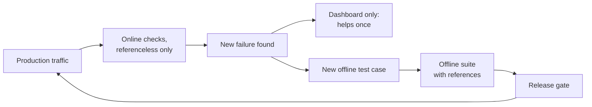
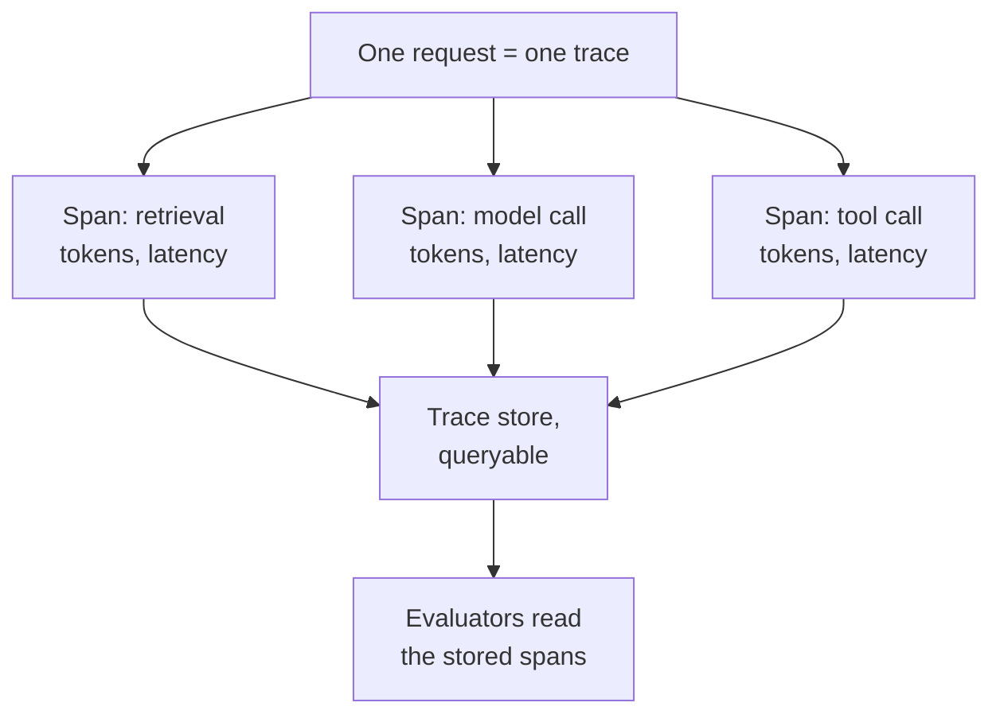
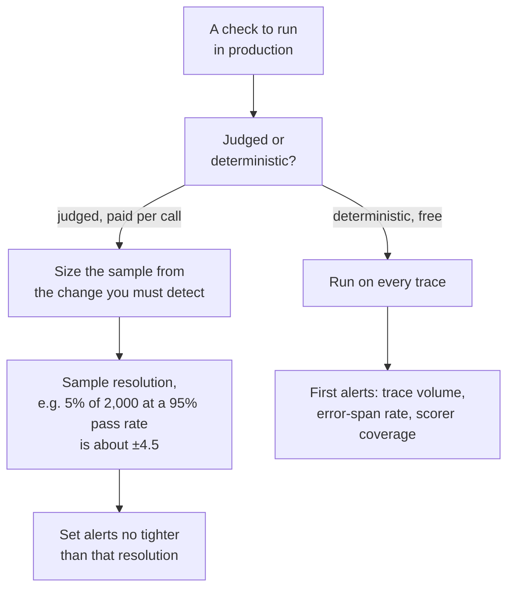
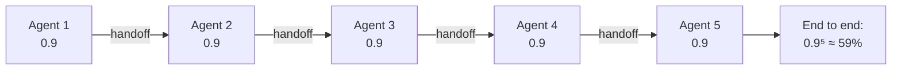
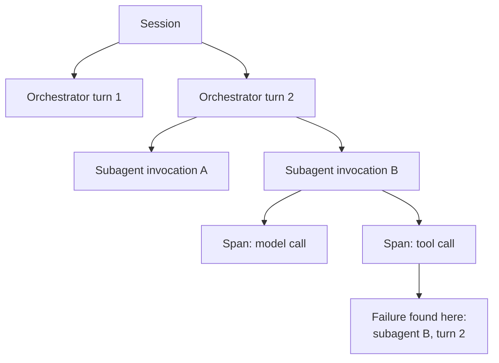

# Production and Multi-Agent Systems

*Online checks find the failures your dataset missed, offline tests stop them coming back, and in a multi-agent system the handoffs need a score of their own.*

◷ 8 min read · Field guide part 7 of 8 · [Introduction](00-introduction.md)

> **Before you start.** This part assumes [the map](01-the-map.md), [conversations, tools and task completion](05-conversations-tools-and-task-completion.md) and [agent trajectory](06-agent-trajectory.md). It moves the checks from those parts onto a running system.

---

## 1. Offline and Online Split Cleanly

**Offline** evaluation runs on a fixed dataset before release. **Online** evaluation runs on real traffic after release ([the map](01-the-map.md)).

The two do different jobs.

- **Offline catches what your dataset contains.** It is reproducible, it can use references, and it can gate a release. It is blind to anything nobody thought to include.
- **Online exists to find what the dataset didn't.** Real traffic has no answer key, so only referenceless checks run here at all. That is the test from [the map](01-the-map.md).
- **The loop is the point.** Online discovers, offline prevents recurrence.
- **A finding that stops at the dashboard helps once.** Carried into a gated offline test, it protects every release after.

A **reference** is the answer key a check compares against, and a **referenceless check** needs none ([the map](01-the-map.md)). A **gate** is a check that blocks a release when it fails.

This diagram shows the loop between the two.

Think of a restaurant. Complaints from diners are the online signal. Adding the dish to the kitchen's pre-service tasting list is the offline fix, so the next service catches it before a diner does.

---

## 2. Traces and Spans

Hand-built examples stop being enough once a system is live. Production needs a record of what really happened on every request.

**Trace**: the step-by-step record of one request, showing what was called, with what arguments, and what happened. Like a parcel's tracking history, with a line for every depot it passed through.

**Span**: one timed entry inside a trace, such as one retrieval, one model call or one tool call. Each span carries its tokens and latency. In the parcel analogy, a span is one depot scan.

**Tracing**: the production version of a hand-rolled trace list, captured by instrumentation. **Instrumentation** is code that records each step as it runs, so nobody writes the trace by hand.

This diagram shows one request's trace and the spans inside it.

### 2.1 What Tracing Adds That Handmade Examples Can't

- **Tracing.** The production version of a hand-rolled trace list, captured by instrumentation.
- **Router and tool evaluations.** The same questions as the tool-use checks in [part 5](05-conversations-tools-and-task-completion.md), computed from real spans. A **router** is the step that decides which tool or agent handles a request.
- **Path-efficiency experiments.** The same question as step-wise accuracy and the cost or efficiency proxy, checks 4 and 9 in [agent trajectory](06-agent-trajectory.md). Here they run through a reusable dataset-plus-evaluator setup that works for any agent, instead of a one-off script over one hand-built trace.

---

## 3. Sampling and Alerting

**Sampling**: scoring only a share of production traffic, such as 5% of traces. Like a factory inspector who pulls every twentieth bottle off the line.

**Alerting**: a rule that notifies someone when a number crosses a line. Like a smoke alarm, useful only if it does not go off every time you make toast.

A **judge** is an LLM that scores another model's output, and it costs money per call ([the map](01-the-map.md)). A **deterministic check** is plain code that always gives the same answer for the same input ([the map](01-the-map.md)).

The rules:

- **Sample judged checks; never sample deterministic ones.** Judges cost per call. Deterministic checks are free, so run them on everything.
- **Pick the sample rate from the change you must detect,** instead of a round number that felt affordable.
- **A small sample can only resolve a large change.** Sampling 5% of 2,000 daily traces gives 100 traces. For a pass rate near 95%, that pins the score to roughly ±4.5 points (a 95% Wilson interval, see [Level 5](../../roadmap-explainers/05-statistics-and-stratified-reporting.md)), so a 2-point drop is invisible in it. Lower pass rates wobble even more.
- **An alert set tighter than that resolution fires on noise.** It gets muted within a month, and you are left with monitoring that looks healthy and tells nobody anything.
- **Your first alert shouldn't be a quality metric.** Trace volume, error-span rate and scorer coverage catch the case where monitoring itself silently stopped.

This decision tree shows how each check gets its sample rate and its alert.

---

## 4. Two Ideas That Are New Here

- **Skill evaluation.** This judges a *tool's own output quality* in isolation. Is the generated SQL correct? Does the chart code run? A well-chosen tool that does its job badly is invisible to every check in [part 5](05-conversations-tools-and-task-completion.md) and [part 6](06-agent-trajectory.md). Selection passes, arguments pass, and the output is quietly wrong. Think of hiring the right plumber who then fits the pipe badly.
- **Version comparison.** This re-runs the same experiment against a system with one deliberate change. Every earlier check judges one run in isolation. Version comparison answers "did my prompt change actually help, or did it just feel better?"

---

## 5. Real Systems With Many Agents

Applying all of the above to a running multi-agent system surfaces what hand-built examples can't teach.

**Multi-agent system**: several narrow agents that hand work to each other, where one agent's output is the next one's input. Like a relay race, where the team's time depends on every runner and every baton pass.

**Handoff**: the moment one agent passes its work and context to the next. In the relay, it is the baton pass.

You are evaluating the *combined* output of a handoff chain.

### 5.1 Handoffs Are Where Quality Dies

Handoffs need their own measurement. Pass rates multiply along a chain, the same multiplication as multi-turn conversations in [part 5](05-conversations-tools-and-task-completion.md).

- **Five components each right 90% of the time** are all right together only 0.9⁵ ≈ 59% of the time.
- **That is before counting** routing errors and context lost at each boundary.
- **That is how every subagent scores above 0.9 while end-to-end scores 0.6.** Per-agent numbers will never explain the gap.

This diagram shows five steps at 0.9 each, multiplied into the end-to-end score.

### 5.2 Attribution Requires Nested Traces

**Attribution**: working out which part of the system caused a failure. Like a relay coach rewatching the race to find which baton pass was dropped.

**Nested trace**: a trace where each level sits inside the one above it. Session, then orchestrator turn, then subagent invocation, then spans. An **orchestrator** is the agent that routes work to the others, and a **subagent** is one of the narrow agents it calls.

- **Without nesting** you know quality dropped.
- **With nesting** you know *which subagent*, on *which turn*.

This diagram shows the nesting levels from session down to spans.

### 5.3 Score Routing Apart From the Parts

- **Score routing separately from the parts.** Handoff accuracy is usually the first thing to break when a subagent is added.
- **The rubric was written for N agents and now runs against N+1.** A **rubric** is the written scoring guide a judge follows ([RAG generation](03-rag-generation.md)).

### 5.4 Write the Task Description Explicitly

- **"A trip plan" can hide several requirements.** It might really mean top-3 interest matches, 5 attractions, a day-by-day itinerary, and budget guidance.
- **Spell each part out** so a check can test for it.

### 5.5 Know What Your Eval Script Can See

- **Mind the gap between "an eval script exists" and "it sees what it needs."**
- **A batch script calling a public API often has only the final output,** without the internal calls.
- **An approximated list beats none.** Name the gap instead of papering over it.

### 5.6 Every Measurement Expires Silently

- **Every measurement has a scope of validity, and it expires silently.**
- **A check correct for a one-tool agent misleads the moment a second tool arrives.**
- **Nothing errors.** The number stops meaning what it meant.

---

## Key Takeaways

- **Online discovers, offline prevents recurrence.** Carry every online finding into a gated offline test.
- **Sample judged checks, run deterministic ones on everything,** and size the sample from the change you must detect.
- **Don't alert tighter than your sample can resolve.** 5% of 2,000 daily traces at a 95% pass rate is about ±4.5 points, so a 2-point drop is invisible.
- **Make the first alerts about monitoring itself:** trace volume, error-span rate, scorer coverage.
- **Skill evaluation and version comparison** cover a tool's own output quality and whether one deliberate change helped.
- **Handoffs multiply errors.** Five parts at 90% give about 59% end to end, so score routing on its own.
- **Nested traces turn "quality dropped" into "which subagent, on which turn."**

## Check Yourself

1. You judge 5% of 2,000 daily traces and a score drops 2 points. Can you see it?
   **No. At a pass rate near 95%, that sample pins the score to roughly ±4.5 points, so a 2-point drop is invisible, and an alert set that tight fires on noise.**
2. Which checks should you never sample, and why?
   **Deterministic checks. They are free, so run them on every trace. Only judged checks, which cost per call, get sampled.**
3. Every subagent scores above 0.9, but the end-to-end score is 0.6. How can both be true?
   **Pass rates multiply across handoffs. Five components at 90% each are all right together only about 59% of the time, before routing errors and lost context.**
4. What does a nested trace let you say that a flat one does not?
   **Which subagent, on which turn, caused the drop. The levels are session, orchestrator turn, subagent invocation, spans.**
5. A tool is chosen correctly and called with valid arguments, but its SQL is wrong. Which check catches it?
   **Skill evaluation, which judges the tool's own output quality in isolation. Selection and argument checks both pass.**

## References

- [`13_Production_Grade_Agent_Eval_Overview.ipynb`](../../../courses/01-rag-agent-tool-evaluation/13_Production_Grade_Agent_Eval_Overview.ipynb). Tracing, router and skill evaluations, and experiments over stored spans with Arize Phoenix.
- [`14_Capstone_CrewAI_Travel_Planner_Eval.ipynb`](../../../courses/01-rag-agent-tool-evaluation/14_Capstone_CrewAI_Travel_Planner_Eval.ipynb). Evaluating the real output of a running multi-agent trip planner.
- [Course 01](../../../courses/01-rag-agent-tool-evaluation/). The notebooks this guide accompanies.
- [Question bank](../../interview-prep/QUESTION_BANK.md). Part 5 covers the move from offline to online evaluation.

---

**Next:** [Quick reference](08-quick-reference.md) · **Previous:** [Agent trajectory](06-agent-trajectory.md)
