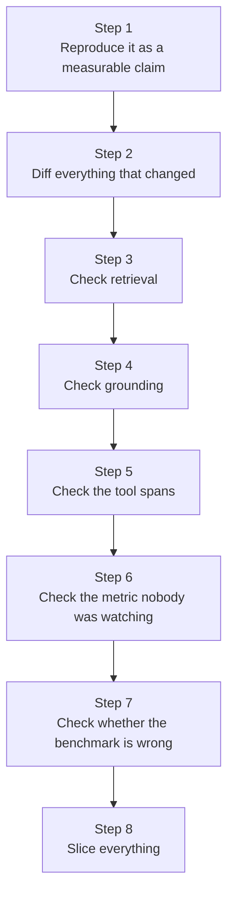
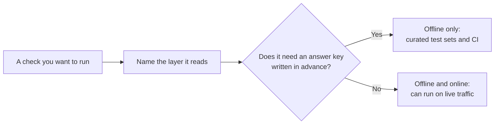
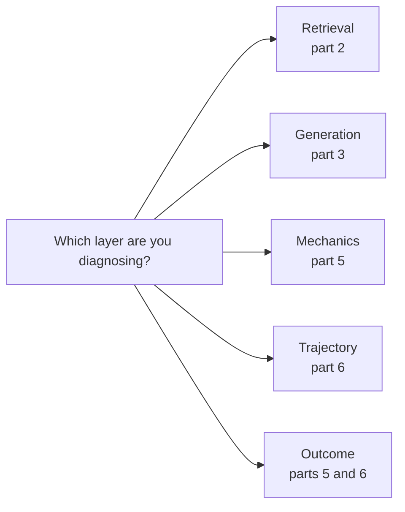
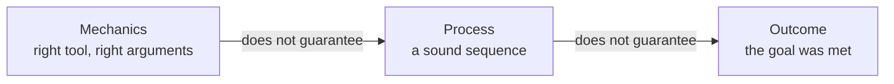

# Quick Reference

*When a score looks wrong, work the layers in order, place every check by its layer and its need for an answer key, and slice before you conclude.*

◷ 8 min read · Field guide part 8 of 11 · [Introduction](00-introduction.md)

> **Before you start.** This page assumes parts 1 to 7: [the map](01-the-map.md), [RAG retrieval](02-rag-retrieval.md), [RAG generation](03-rag-generation.md), [running RAG evals](04-running-rag-evals.md), [conversations, tools and task completion](05-conversations-tools-and-task-completion.md), [agent trajectory](06-agent-trajectory.md) and [production and multi-agent systems](07-production-and-multi-agent.md). It defines nothing new. Every row links to the part that explains it.

---

## 1. The Evaluation Debugging Loop

When someone says "the answers got worse," work the layers in order rather than guessing. The diagram shows the eight steps in the order you take them.

| Step | What to do | Explained in |
| --- | --- | --- |
| 1. **Reproduce it as a measurable claim** | "Worse" is not a metric. Get 20 specific flagged conversations | This page |
| 2. **Diff everything that changed** | Model version, prompt, tool schemas, retrieval index, truncation behaviour, temperature | This page; truncation in [RAG retrieval](02-rag-retrieval.md) |
| 3. **Check retrieval first** | Did the right chunk come back at all? If the evidence never arrived, nothing downstream matters | [RAG retrieval](02-rag-retrieval.md) |
| 4. **Check grounding** | Right chunk retrieved, answer ignores it. That is a different bug with a different fix | [RAG generation](03-rag-generation.md) |
| 5. **Check the tool spans** | Soft failures live here and show up nowhere else | [Conversations, tools and task completion](05-conversations-tools-and-task-completion.md); spans in [production and multi-agent systems](07-production-and-multi-agent.md) |
| 6. **Check the metric nobody was watching** | For example, a requested metric rose while three others collapsed | This page |
| 7. **Check whether the benchmark is what's wrong** | A benchmark improving while users complain means its distribution doesn't match traffic | This page; stale eval sets in [RAG retrieval](02-rag-retrieval.md) |
| 8. **Slice everything** | Aggregates hide the thing you need to see | [Running RAG evals](04-running-rag-evals.md) |

## 2. Question to Measurement

Every check has two coordinates: the layer it reads, and whether it needs an answer key written in advance. The diagram shows how the second coordinate decides where a check may run.

Find your question in the left column, then open the part on the right.

| If you're asking... | Reach for | Explained in |
| --- | --- | --- |
| Did the document ever reach the index intact? | Source-vs-index counts, checksums, parse and embedding checks | [RAG retrieval](02-rag-retrieval.md) |
| Retrieval quality, with labels | Precision@K, Recall@K, MRR, nDCG | [RAG retrieval](02-rag-retrieval.md) |
| Retrieved, but did the generator see it? | Position, truncation, compression and conflict tests on the final prompt | [RAG retrieval](02-rag-retrieval.md) |
| Retrieval quality, without labels | Judged contextual precision / recall / relevancy | [RAG retrieval](02-rag-retrieval.md) |
| Is the answer grounded, no reference available? | Answer relevancy, faithfulness, trusted-context check | [RAG generation](03-rag-generation.md) |
| Is the answer *correct*? | A custom correctness rubric; similarity as a proxy | [RAG generation](03-rag-generation.md) |
| Should the check run inside the pipeline? | In-pipeline relevance and grounding you can branch on | [Running RAG evals](04-running-rag-evals.md) |
| From one example to a verdict on the system? | The batch pattern | [Running RAG evals](04-running-rag-evals.md) |
| Full pipeline, many queries | Golden dataset + full suite, sliced | [Running RAG evals](04-running-rag-evals.md) |
| Does the conversation hold up? | Per-turn relevance, retention, whole-dialogue rubric, and the session-level number beside the turn-level one | [Conversations, tools and task completion](05-conversations-tools-and-task-completion.md) |
| Right tools, right arguments? | Selection comparison, schema validation, judged check | [Conversations, tools and task completion](05-conversations-tools-and-task-completion.md) |
| Did it get the job done? | Judged completion, custom rubric, or end-state verification | [Conversations, tools and task completion](05-conversations-tools-and-task-completion.md) |
| Did a tool fail quietly? | Deterministic check reading the tool output | [Conversations, tools and task completion](05-conversations-tools-and-task-completion.md) |
| Was the *path* efficient? | The nine trajectory checks | [Agent trajectory](06-agent-trajectory.md) |
| How would I measure this on a live system? | Spans from tracing; the trace store as a queryable table | [Agent trajectory](06-agent-trajectory.md) |
| Which checks can run in production? | Any that doesn't need an answer key written in advance | [The map](01-the-map.md) |
| Did my change help? | Version comparison: same dataset, one deliberate change | [Production and multi-agent systems](07-production-and-multi-agent.md) |
| Why is end-to-end worse than every component? | Composition across handoffs; nested traces to attribute it | [Production and multi-agent systems](07-production-and-multi-agent.md) |

## 3. One-Page Cheat Sheet

Fourteen rules, one line each, with the part that argues for each one.

| Rule | Explained in |
| --- | --- |
| Name the layer before naming a metric. | [The map](01-the-map.md) |
| Ask whether the check needs an answer key written in advance. That decides offline vs online. | [The map](01-the-map.md) |
| Climb the cost ladder from the bottom, and stop at the rung that answers the question. | [The map](01-the-map.md) |
| Deterministic where you can, judged where you must, and never gate on a judge you haven't checked against humans. | [The map](01-the-map.md) |
| Measure judge agreement rather than judge average. | [The map](01-the-map.md) |
| Mechanics ≠ process ≠ outcome. Score all three. | [Conversations, tools and task completion](05-conversations-tools-and-task-completion.md), [agent trajectory](06-agent-trajectory.md) |
| Read the tool span as well as the final string. | [Conversations, tools and task completion](05-conversations-tools-and-task-completion.md) |
| Score the absence of a call as an outcome. | [Conversations, tools and task completion](05-conversations-tools-and-task-completion.md) |
| Fail unexpected tools as well as missing ones. | [Agent trajectory](06-agent-trajectory.md) |
| Combine sub-scores with the minimum rather than the mean. | [Conversations, tools and task completion](05-conversations-tools-and-task-completion.md) |
| Report session-level numbers beside turn-level ones. | [Conversations, tools and task completion](05-conversations-tools-and-task-completion.md) |
| Distinguish "not measured" from "failed", always. | [Conversations, tools and task completion](05-conversations-tools-and-task-completion.md), [agent trajectory](06-agent-trajectory.md) |
| Verify the system of record wherever a real side effect exists. | [Agent trajectory](06-agent-trajectory.md) |
| Slice before you conclude. | [Running RAG evals](04-running-rag-evals.md) |

## 4. The Five That Matter Most

The first rule says to know your layer before you pick a metric. The diagram maps each layer to the part that covers it.

1. **Taxonomy first.** Know whether you're diagnosing retrieval, generation, mechanics, trajectory, or outcome before picking anything. See [the map](01-the-map.md).
2. **Reference-based vs referenceless is a cost decision.** The mechanical test, *does it need an answer key written in advance?*, tells you which is which, and which can go online. See [the map](01-the-map.md).
3. **LLM-as-judge is a tool with known failure modes, and no oracle.** Unvalidated, it measures change rather than quality. See [the map](01-the-map.md).
4. **Mechanics ≠ process ≠ outcome.** Right tool and right arguments don't mean a sound sequence. A sound sequence doesn't mean the goal was met. See [conversations, tools and task completion](05-conversations-tools-and-task-completion.md) and [agent trajectory](06-agent-trajectory.md).
5. **The strongest signal is the real system of record.** End-state verification beats every judged measurement, because it cannot be fooled by a confident sentence. See [agent trajectory](06-agent-trajectory.md).

The diagram shows why rule 4 asks for three separate scores: each layer can pass while the next one fails.

Across all five layers, aggregates hide the thing you need to see ([running RAG evals](04-running-rag-evals.md)).

## Key Takeaways

These are the takeaways for the whole field guide.

- Give every check two coordinates: the layer it reads, and whether it needs an answer key written in advance. Only checks without one can run online ([the map](01-the-map.md)).
- Treat an LLM judge as a noisy estimate rather than an oracle, and stop at the cheapest rung of the cost ladder that answers the question ([the map](01-the-map.md)).
- Check retrieval before generation, because faithfulness cannot catch an answer that is faithful to bad context ([RAG generation](03-rag-generation.md)).
- Score mechanics, process and outcome separately: take the minimum of sub-scores, score the absence of a call, and read the tool output ([conversations, tools and task completion](05-conversations-tools-and-task-completion.md)).
- Verify the system of record wherever a real side effect exists. It is the one signal a fluent sentence cannot defeat ([agent trajectory](06-agent-trajectory.md)).
- Let online checks find what the dataset missed and offline gates stop it recurring. Across agent handoffs, use nested traces to find which subagent broke ([production and multi-agent systems](07-production-and-multi-agent.md)).
- Read every score with its configuration and its slice: name-only tool correctness passed four broken traces, and aggregates hide the thing you need to see ([conversations, tools and task completion](05-conversations-tools-and-task-completion.md), [running RAG evals](04-running-rag-evals.md)).

## Check Yourself

1. Faithfulness is 0.95, yet users report wrong answers. Which check do you add? **A reference-based correctness check: a custom rubric against a written expected answer. Faithfulness cannot catch an answer that is faithful to bad context. See [RAG generation](03-rag-generation.md).**
2. You must monitor retrieval on live traffic, and you have no labels. Which of the three contextual metrics can you run? **Contextual Relevancy only. Precision and recall both need `expected_output`, and production has none. See [RAG retrieval](02-rag-retrieval.md).**
3. An account lookup returns `found: false`. The agent states a plan and balance anyway, and grounding and task success both pass. What catches it? **A deterministic check that reads the tool output and, if it indicates failure, asserts the response doesn't state the facts that tool was supposed to supply. See [conversations, tools and task completion](05-conversations-tools-and-task-completion.md).**
4. Your dashboard shows a recovery rate of 1.0 for a run with no errors. What is wrong? **The run had nothing to recover from, so recovery rate returns `None`, not 1.0. A 1.0 on an error-free run is indistinguishable from a 1.0 on a run that recovered from three errors. See [agent trajectory](06-agent-trajectory.md).**
5. You sample 5% of 2,000 daily traces for a judged check. Can it detect a 2-point drop? **No. At a pass rate near 95%, that sample of 100 pins a score to roughly ±4.5 points. A 2-point drop is invisible in it. Pick the sample rate from the change you must detect. See [production and multi-agent systems](07-production-and-multi-agent.md).**

## References

This page draws only on material in this repository. It cites no external source.

- [Course 01](../../../courses/01-rag-agent-tool-evaluation/), the notebooks this field guide accompanies.
- The [interactive labs](../../interactive-labs/README.md), where you change the inputs and watch the metrics move, for parts 2, 3, 5 and 6.
- The [question bank](../../interview-prep/QUESTION_BANK.md), for interview questions on every part.

---

**Next:** [Cost tracking](09-cost-tracking.md) · **Previous:** [Production and multi-agent systems](07-production-and-multi-agent.md)
