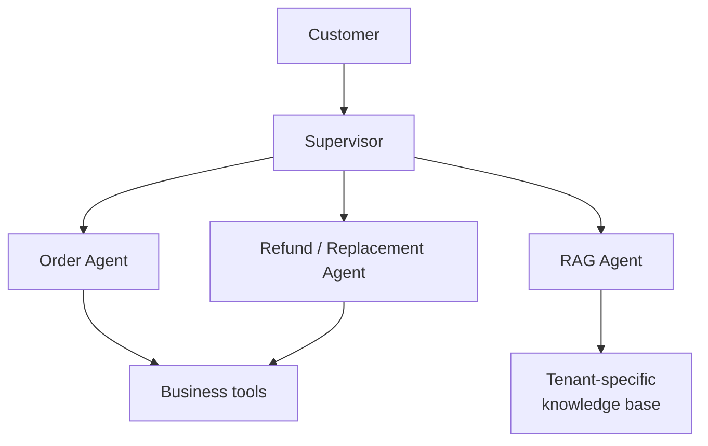
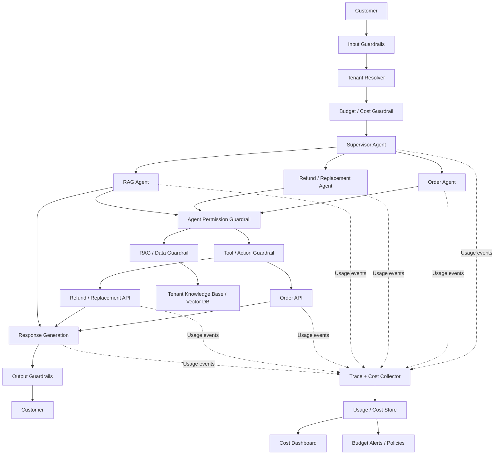
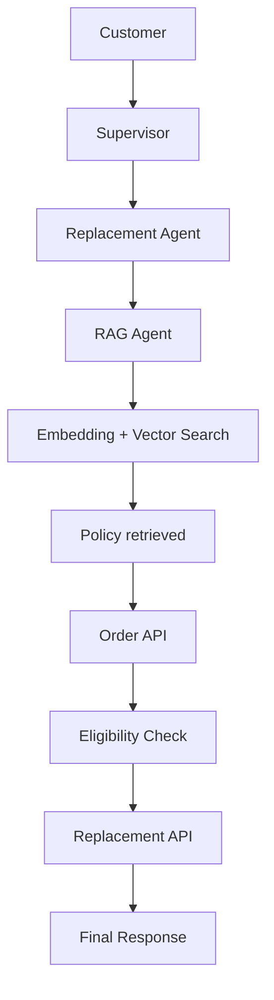
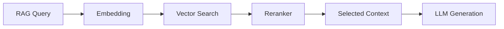
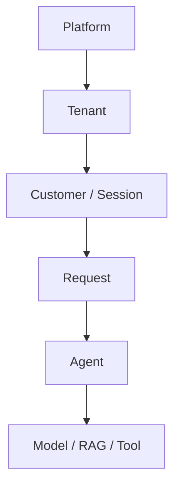

# Cost Tracking

*Give every customer request one trace ID, record the cost of every step under it, and you can add the money up by agent, by tenant or for the whole platform.*

◷ 12 min read · Field guide part 9 of 11 · [Introduction](00-introduction.md)

> **Before you start.** This part assumes [the map](01-the-map.md) and [production and multi-agent systems](07-production-and-multi-agent.md). It reuses their words for agent, tool, trace, span and attribution.

Parts 9 to 11 are a second track, on running the same system affordably and safely. The quality side of this system (every stage's checks, the release gate and the online signals) is in the [support-system case study](../customer-support-multi-agent-case-study.md), which describes the same platform.

---

## 1. One System, Many Tenants

The running example here is the same multi-tenant customer-support platform, one system that many businesses share.

**Multi-tenant platform**: one system that serves many separate customer businesses at once, keeping each one's data and rules apart.
Analogy: an office building where many companies rent floors. They share the lifts and the heating, and each has its own keys.

**Tenant**: one of those businesses. In the examples below, Acme, Globex and Contoso are tenants.

Each tenant has its own:

- customers
- orders
- refund and replacement policies
- knowledge base
- permissions
- business rules
- AI usage budget

An **agent** is an LLM system that decides its own next step, and a **tool** is a function it may call ([the map](01-the-map.md)). The platform has several agents. A **supervisor** is the agent that reads the request and routes it to the others, the role [part 7](07-production-and-multi-agent.md) calls the orchestrator.

This diagram shows the agents and what each one reaches.



- **Agents can call business tools,** such as an order lookup or a replacement service.
- **The RAG Agent retrieves tenant-specific information** from that tenant's knowledge base.

### 1.1 One Request Fans Out

A single customer request can trigger many internal operations, in this order:

1. Supervisor LLM
2. Replacement Agent LLM
3. RAG Agent
4. Embedding
5. Vector Search
6. RAG Generation LLM
7. Order API
8. Replacement API
9. Final Response LLM

So the platform needs two production capabilities.

1. **Cost tracking.** Understand exactly where money is being spent.
2. **Guardrails.** Stop unsafe, unauthorized, incorrect, or excessively expensive behavior.

**Cost tracking**: recording what every step of a request used and what it cost, so the totals can be added up later.

A **guardrail** is a check that can stop or change a risky step before it happens. [Cost guardrails](10-cost-guardrails.md) defines it fully.

The simple mental model:

> **Cost tracking observes every step. Guardrails control every risky boundary.**

---

## 2. Where Cost Tracking Sits

The architecture diagram shows guardrails standing on the request's path and a cost collector to one side.

- **Solid arrows** are the request moving through the system.
- **Dotted arrows** are usage events. A **usage event** is a small record a step sends out saying what it used: tokens, calls, time.
- **The Trace + Cost Collector** gathers those events. A store keeps them, and a dashboard and budget alerts read from the store.



The two halves behave differently.

- **Guardrails are generally in the execution path.** The request has to pass through them, because they may allow, block, retry, downgrade, or escalate an operation.
- **Cost tracking mainly observes the execution and records usage.** It watches from the side and leaves the request alone.
- **Analogy.** A toll booth sits on the road and can stop a car. A traffic counter beside the road only counts the cars.

An **alert** is a rule that notifies someone when a number crosses a line ([production and multi-agent systems](07-production-and-multi-agent.md)). Budget alerts are alerts on cost.

---

## 3. One Real Request

Tenant: **Acme Electronics**

Customer asks:

> "My headphones arrived damaged yesterday. Can you replace them?"

This diagram shows one possible execution of that request.



- **One simple customer request** has already caused multiple model, retrieval and tool operations.
- **The number worth knowing is the total cost of the customer request.** The cost of one LLM call on its own leaves out the retrieval and the tools.

---

## 4. The Request-Level Cost Trace

A **trace** is the step-by-step record of one request, and a **span** is one timed entry inside it, such as one model call ([production and multi-agent systems](07-production-and-multi-agent.md)).

**Request-level cost trace**: one trace per customer request, where every step it caused carries the same ID and its own cost.
Analogy: a restaurant bill for one table. Every dish that table ordered lands on the same bill, and the bill's total is that table's total.

Create one trace for every customer request. Example:

```text
Request ID : req_7821
Tenant     : acme_123
Customer   : customer_9812
```

Everything caused by this request carries the same request/trace ID. The trace for `req_7821` looks like this:

```text
req_7821

├── Supervisor
│     └── LLM call
│
├── Replacement Agent
│     ├── LLM call
│     │
│     ├── RAG Agent
│     │    ├── Embedding
│     │    ├── Vector Search
│     │    ├── Reranker
│     │    └── LLM generation
│     │
│     ├── Order API
│     └── Replacement API
│
└── Final Response
      └── LLM call
```

- **Each leaf is a span** with its own cost.
- **Summing every span under `req_7821`** gives the true cost of that request.

---

## 5. LLM Cost

Model calls are priced in tokens.

### 5.1 Tokens and Prices

- **Token**: a short piece of text, often part of a word, that a model reads or writes. Models count, and bill, their work in tokens.
  - Analogy: a taxi meter that ticks once per stretch of road.
- **Input tokens**: everything the model reads on a call, such as the instructions, the question and any retrieved context.
- **Output tokens**: everything the model writes back.
- **Price per token**: what the model provider charges for each token. Tokens times price gives the cost of the call.
- **Cached tokens**: input tokens served from a cache of earlier calls. The formula below subtracts them as cache savings.
- **Latency**: how long a step took to answer.
- **Retry count**: how many times a step was attempted again after a failure. Each retry is another paid call.

The formula prices input and output tokens separately, then takes off the cache savings.

```text
LLM Cost
   =
Input Token Cost
   +
Output Token Cost
   -
Cache Savings
```

### 5.2 What to Record per Model Call

For every model call, record:

- tenant
- request / trace ID
- agent
- model
- input tokens
- output tokens
- cached tokens
- latency
- retry count
- estimated cost

### 5.3 Worked Example, One Request's Model Calls

| Agent | Input tokens | Output tokens | Cost |
|---|--:|--:|--:|
| Supervisor | 800 | 50 | \$0.002 |
| Replacement Agent | 2,000 | 300 | \$0.006 |
| RAG Agent | 1,500 | 200 | \$0.004 |
| RAG Generation | 4,000 | 400 | \$0.011 |
| Final Response | 2,500 | 250 | \$0.007 |

```text
Total LLM Cost = $0.030
```

- **The table names the biggest contributor at a glance.** Here it is RAG Generation, at \$0.011 of the \$0.030.
- **RAG Generation also reads the most input tokens,** 4,000, because the retrieved context goes into its prompt.

---

## 6. RAG Cost

**RAG** searches documents and then has an LLM answer from what it found ([the map](01-the-map.md)). An **embedding** is a list of numbers that stands for a text's meaning, **vector search** finds the chunks whose embeddings sit closest to the query's, and a **reranker** re-sorts the retrieved chunks so the best come first ([RAG retrieval](02-rag-retrieval.md)).

RAG has multiple cost components. This diagram shows them in the order a query passes through them.



Track each independently. Example:

| RAG component | Cost |
|---|--:|
| Embedding | \$0.0002 |
| Vector Search | \$0.0005 |
| Reranking | \$0.0010 |
| LLM Generation | \$0.0110 |
| **RAG Total** | **\$0.0127** |

### 6.1 When a Setting Changes the Bill

Per-component tracking pays off when the configuration changes. **Top-K** is how many chunks the retriever returns ([RAG retrieval](02-rag-retrieval.md)).

Changing Top-K 5 to Top-K 50 may cause, in turn:

1. More retrieved context
2. More input tokens
3. Higher latency
4. Higher cost

**Telemetry**: the measurements a running system sends out about itself, such as the usage events above.

- **Cost telemetry should make this visible.** Without per-component numbers, the jump shows up as one bigger bill with no cause attached.

---

## 7. Tool Cost

Some tools may also have direct or indirect cost. Examples:

- external search
- SMS
- translation
- OCR, which reads text out of images
- CRM APIs, which read and write customer records
- payment services

For every tool call, record:

- Tool
- Request ID
- Tenant
- Number of calls
- Latency
- Success / failure
- Retries
- Estimated cost

Example. The first two rows are the tools `req_7821` calls. The last three are other tools the platform offers, shown for comparison:

| Tool | Cost | In `req_7821`? |
|---|--:|---|
| Order API | \$0 | Yes |
| Replacement API | \$0.002 | Yes |
| RAG Search | \$0.001 | No |
| External Search | \$0.005 | No |
| SMS Notification | \$0.008 | No |

- **Some tools are free per call.** The Order API here costs \$0.
- **The paid ones can outweigh a model call.** One SMS Notification at \$0.008 costs more than the Final Response LLM call at \$0.007.

---

## 8. Agent-Level Cost

Aggregate model, RAG, and tool costs by agent. Each agent's cost includes everything it calls, so the request total adds the RAG pipeline
and tool costs on top of the model calls from section 5.

```text
Customer Request
       │
       ▼
Supervisor                 $0.0020
       │
       ▼
Replacement Agent          $0.0247   (own LLM call $0.0060 + RAG Agent + Tools)
       │
       ├── RAG Agent       $0.0167   (own LLM call $0.0040 + RAG pipeline $0.0127)
       │
       └── Tools           $0.0020   (Order API $0 + Replacement API $0.002)
       │
       ▼
Final Response             $0.0070
```

```text
Total Request Cost = $0.0020 + $0.0247 + $0.0070 = $0.0337  (about $0.034)
                   = LLM calls $0.030 + RAG pipeline outside the LLM $0.0017 + tools $0.002
```

Grouping by agent helps identify inefficient agent behavior. For example, a rising cost can trace back like this:

1. Replacement Agent cost increased
2. RAG calls increased
3. Same policy retrieved 3 times
4. Unnecessary repeated retrieval

- **Cost observability can expose an agent-quality problem** as well as a financial one. Here the agent fetched the same policy three times when once would do.
- **Analogy.** A rising grocery bill can mean prices went up, or that someone keeps buying milk that is already in the fridge.

---

## 9. Tenant-Level Cost Attribution

**Attribution** is working out which part of the system caused a failure ([production and multi-agent systems](07-production-and-multi-agent.md)). Cost has its own version.

**Cost attribution**: assigning every cent spent to whoever or whatever caused it, such as a tenant, a request, an agent or a tool.

**Cost per request**: total cost divided by the number of requests. It lets a tenant with 50K requests be compared with one with 200K.

For a multi-tenant platform, aggregate cost by tenant.

| Tenant | Requests | Total cost | Cost / request |
|---|--:|--:|--:|
| Acme | 100K | \$2,900 | \$0.029 |
| Globex | 50K | \$2,100 | \$0.042 |
| Contoso | 200K | \$4,000 | \$0.020 |

- **Contoso has the largest total,** \$4,000, but the lowest cost per request, \$0.020.
- **Globex has unusually high cost/request,** \$0.042. Drill down:
  1. Globex
  2. Refund Workflow
  3. RAG Agent
  4. Large retrieved context
  5. High token consumption

This diagram shows a useful attribution hierarchy, from the whole platform down to one model, RAG or tool call.



This allows us to answer:

- What is total AI cost?
- What does each tenant cost?
- What is cost per request?
- Which workflow is expensive?
- Which agent is expensive?
- Which model is expensive?
- Which tools are expensive?
- Which requests produce abnormal cost?

---

## Key Takeaways

- Create one trace per customer request and give every step it causes the same ID. Summing those spans gives the true cost of the request, as with `req_7821`.
- Guardrails sit in the execution path and can allow, block, retry, downgrade or escalate. Cost tracking observes from the side and records usage.
- For every model call, record tenant, trace ID, agent, model, input, output and cached tokens, latency, retry count and estimated cost.
- Track each RAG component on its own. A change such as Top-K 5 to Top-K 50 brings more context, more input tokens, higher latency and higher cost.
- Model calls alone undercount. In the example, model calls total \$0.030 and the whole request \$0.0337 (about \$0.034) once the RAG pipeline and tools are added.
- Rising agent cost can be a quality problem, such as the same policy retrieved 3 times.
- Compare tenants by cost per request, then drill down the hierarchy from platform to tenant, request, agent and model, RAG or tool.

## Check Yourself

1. Why give every step of a customer request the same request ID?
   **So every model, retrieval and tool cost it caused can be summed into the true cost of that one request, such as `req_7821`.**
2. Which one sits in the execution path, a guardrail or cost tracking?
   **The guardrail. It may allow, block, retry, downgrade or escalate an operation. Cost tracking mainly observes and records usage.**
3. A team raises Top-K from 5 to 50. What should cost telemetry show?
   **More retrieved context, so more input tokens, higher latency and higher cost.**
4. The Replacement Agent's cost rises. What might the trace reveal?
   **RAG calls increased because the same policy was retrieved 3 times: unnecessary repeated retrieval, an agent-quality problem.**
5. Globex costs \$0.042 per request against Contoso's \$0.020. How do you find out why?
   **Drill down the attribution hierarchy. For Globex the trail runs through the Refund Workflow to the RAG Agent, where a large retrieved context drives high token consumption.**

## References

This page draws only on material in this repository. It cites no external source.

- [Support-system case study](../customer-support-multi-agent-case-study.md). The same multi-tenant platform from the quality side: every stage's checks, the release gate and the online signals.
- [Production and multi-agent systems](07-production-and-multi-agent.md). Traces, spans, alerting and attribution, which this page applies to cost.
- [RAG retrieval](02-rag-retrieval.md). Embeddings, vector search, rerankers and Top-K.

---

**Next:** [Cost guardrails](10-cost-guardrails.md) · **Previous:** [Quick reference](08-quick-reference.md)
