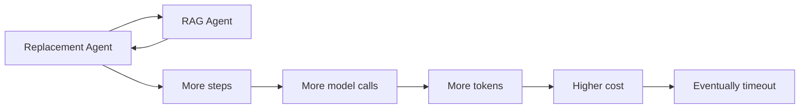
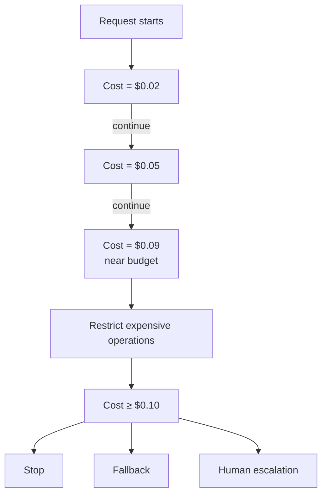
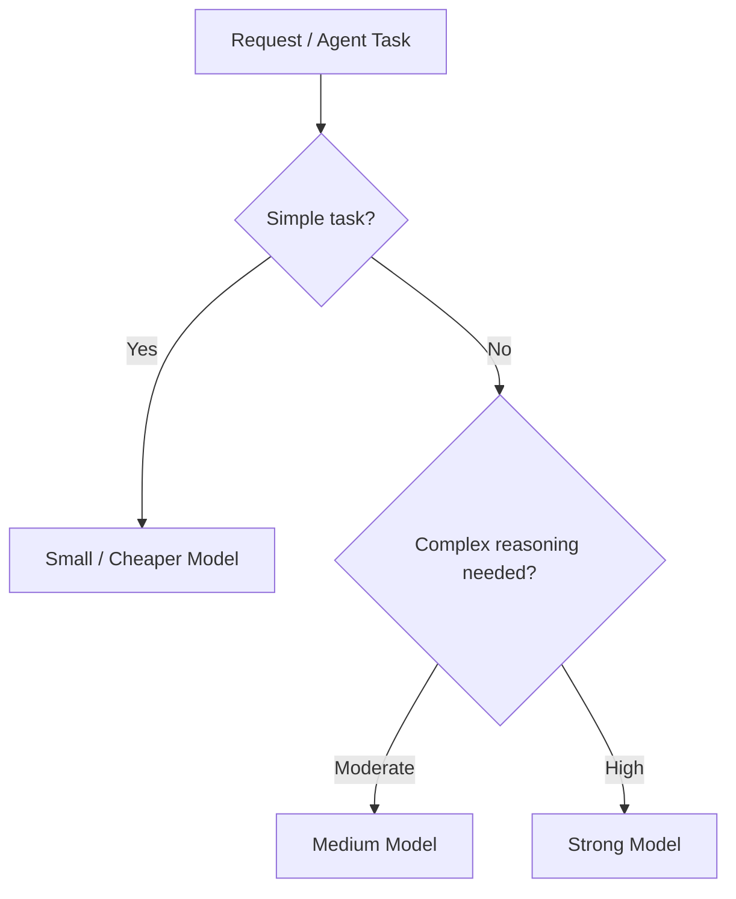
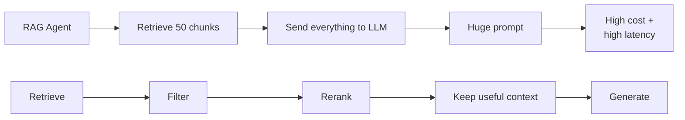
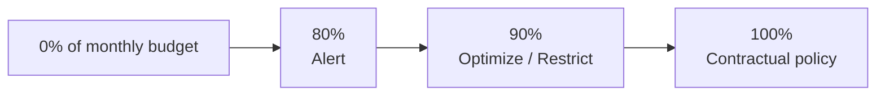

# Cost Guardrails

*Tracking tells you what a request spent; a cost guardrail sets how much it may spend and stops it, during the run, when it gets there.*

◷ 8 min read · Field guide part 10 of 11 · [Introduction](00-introduction.md)

> **Before you start.** This part assumes [cost tracking](09-cost-tracking.md), which shows how one request's spend is traced and charged to a tenant. It also uses a few terms from [the map](01-the-map.md) and [RAG retrieval](02-rag-retrieval.md), each reminded where it appears.

The running example is the same multi-tenant support platform as part 9. A supervisor routes each customer request to an order agent, a refund or replacement agent, or a RAG agent that searches the tenant's knowledge base.

- A **token** is a short piece of text, often part of a word, that a model reads or writes and bills by ([cost tracking](09-cost-tracking.md)).
- A **tenant** is one of the separate customer businesses the platform serves, such as Acme or Globex ([cost tracking](09-cost-tracking.md)).
- **Cost attribution** assigns every cent spent to whoever or whatever caused it, such as a tenant, a request, an agent or a tool ([cost tracking](09-cost-tracking.md)).

---

## 1. Guardrails and Cost Guardrails

**Guardrail**: a rule that sits in the execution path and can allow, block, retry, downgrade or escalate an operation before it happens. Like the barrier on a mountain road, it works while you are still driving.

Cost tracking only watches and records. A guardrail can change what the system does next.

**Cost guardrail**: a guardrail on spending. It enforces a budget while the request is still running.

The two answer different questions.

| Capability | Question it answers | Everyday version |
|---|---|---|
| Cost tracking | **What did we spend?** | The receipt |
| Cost guardrails | **How much are we willing to spend?** | The spending limit on the card |

### 1.1 What an Accidental Loop Costs

**Agent loop**: two agents keep handing the same request back and forth and never finish. Here the replacement agent calls the RAG agent, which hands back to the replacement agent, and so on.

This diagram shows the loop and what it does to cost when nothing limits it.

- **Without limits,** every extra step adds model calls, every call adds tokens, and the bill climbs until the request times out.
- **So budgets are enforced during execution.** A budget checked after the run could only report the damage.
- [Agent trajectory](06-agent-trajectory.md) counts redundant calls as waste when you score a finished run. A cost guardrail cuts the run short while it is happening.

---

## 2. Per-Request Budget

**Per-request budget**: a set of limits that every single request gets for its run. Like a prepaid travel card loaded for one trip: when it hits zero, spending stops.

Example limits:

| Limit | Value |
|---|--:|
| Maximum LLM calls | 10 |
| Maximum agent steps | 15 |
| Maximum RAG calls | 3 |
| Maximum tool calls | 8 |
| Maximum tokens | 30K |
| Maximum request cost | $0.10 |
| Maximum runtime | 30 sec |

Three outcomes sit at the end of the budget.

- **Stop**: end the run there.
- **Fallback**: switch to a cheaper backup path, such as a fallback model.
- **Human escalation**: hand the request to a person.

This diagram shows one request's cost rising against the $0.10 limit.

- **Near the budget,** the request keeps running but loses access to its expensive operations.
- **At the budget,** it stops, falls back or escalates.
- **One abnormal request can no longer consume unlimited resources.**

---

## 3. Dynamic Cost Budgets

**Dynamic budget**: a budget whose size depends on the request, chosen before the run starts. Like a hospital that books a short slot for a check-up and a long one for surgery.

Not every request needs the same budget.

- **Simple request:** "What is your return policy?" This could have a small budget.
- **Complex request:** "I was charged twice for three orders and one refund is missing." This may legitimately need more agents and tools.

The budget can depend on five things together:

- Tenant
- Workflow
- Customer tier
- Risk level
- Task complexity

A **deterministic** rule is plain code that gives the same answer for the same input every time ([the map](01-the-map.md)).

- **Choosing the budget can be flexible.** The five factors above decide its size.
- **Enforcing it should stay deterministic** once it is chosen. Code checks the limit the same way every time.

---

## 4. Model Routing for Cost Control

**Model routing**: sending each task to the cheapest model that can do it well. Like a clinic where a nurse handles routine checks and the specialist sees only the hard cases.

Not every task needs the strongest model. This diagram shows the routing decision.

On the support platform:

| Task | Model |
|---|---|
| Supervisor classification | Small model |
| Simple FAQ RAG | Medium model |
| Complex refund reasoning | Strong model |

- **Routing is usually better** than sending every internal agent operation to the most expensive model.

---

## 5. RAG Cost Guardrails

**RAG cost guardrail**: a set of limits on the retrieval step itself, so search cannot flood the model with text. Like a library that lets you borrow ten books at a time.

A few retrieval terms first.

- A **chunk** is a small piece of a document, stored so it can be searched on its own ([the map](01-the-map.md)).
- **Top K** is the K highest-ranked chunks the retriever returns for one query ([RAG retrieval](02-rag-retrieval.md)).
- A **reranker** is a second model that re-sorts the retrieved chunks so the best come first ([RAG retrieval](02-rag-retrieval.md)).
- **Context tokens** are the tokens of retrieved text placed into the model's prompt.

RAG should have its own limits. Examples:

| Limit | Value |
|---|--:|
| Maximum Top-K | 10 |
| Maximum context chunks | 8 |
| Maximum context tokens | 12K |
| Maximum retrieval attempts | 2 |
| Maximum reranking calls | 1 |

This diagram compares an unlimited RAG agent with the preferred pipeline.

- **Without limits** (top row), the agent retrieves 50 chunks and sends everything to the LLM. The huge prompt brings high cost and high latency.
- **Prefer the bottom row.** Retrieve, filter, rerank, keep only the useful context, then generate.

---

## 6. Tenant-Level Budget Guardrails

**Tenant budget**: a spending limit for one tenant over a period, set by its usage agreement. Like a household's monthly phone plan, with warnings before the cap and a fixed rule at it.

Different tenants may have different usage agreements.

| Tenant | Monthly AI budget |
|---|--:|
| Acme | $10,000 |
| Globex | $5,000 |

A simple budget policy acts at three points of the month's spend. This diagram shows them.

- **At 80%:** alert the operations or account team.
- **At 90%:**
  - Prefer cheaper models.
  - Reduce optional expensive operations.
  - Apply the configured usage policy.
- **At the contractual limit:** apply the tenant's configured behaviour. **Throttling** means slowing or capping how many requests are served. The options include:
  - throttling
  - fallback models
  - disabling optional expensive features
  - requiring an account-level decision

---

## Key Takeaways

- Cost tracking answers "What did we spend?"; cost guardrails answer "How much are we willing to spend?" and act during the run.
- Give every request a budget on LLM calls, agent steps, RAG calls, tool calls, tokens, cost and runtime, so one abnormal request cannot consume unlimited resources.
- Near the budget, restrict expensive operations; at it, stop, fall back or escalate to a human.
- Size budgets by tenant, workflow, customer tier, risk level and task complexity, then enforce them deterministically.
- Route each task to the cheapest model that can do it, and cap RAG's top K, chunks, context tokens, retrieval attempts and reranking calls.
- Tenant budgets alert at 80%, restrict at 90%, and apply the contract's configured behaviour at the limit.

## Check Yourself

1. The replacement agent and the RAG agent keep handing a request to each other. What stops the bill from climbing until timeout?
   **A per-request budget enforced during execution. Limits on agent steps, LLM calls, RAG calls, tokens, cost and runtime end the run before it consumes unlimited resources.**
2. A request has spent $0.09 against a $0.10 limit. What happens now, and what happens at $0.10?
   **Near the budget, expensive operations are restricted. At $0.10 the request stops, falls back or goes to human escalation.**
3. "What is your return policy?" and "I was charged twice for three orders and one refund is missing." Should they get the same budget?
   **No. The first could have a small budget; the second may legitimately need more agents and tools. The budget can vary, but once chosen it is enforced deterministically.**
4. Which model should handle supervisor classification, and which should handle complex refund reasoning?
   **A small model for supervisor classification, a strong model for complex refund reasoning. Simple FAQ RAG sits in between on a medium model.**
5. Globex has used 90% of its $5,000 monthly AI budget. What does the policy do?
   **It prefers cheaper models, reduces optional expensive operations and applies the configured usage policy. The account team was already alerted at 80%.**

## References

- [Cost tracking](09-cost-tracking.md). Tokens, the request-level cost trace and tenant cost attribution that these budgets are enforced against.
- [Safety guardrails and evaluation](11-safety-guardrails-and-evaluation.md). The other guardrail boundaries, and how cost joins monitoring and the release gate.
- [Support-system case study](../customer-support-multi-agent-case-study.md). The same system's quality side: every stage's checks, the release gate and the online signals.

---

**Next:** [Safety guardrails and evaluation](11-safety-guardrails-and-evaluation.md) · **Previous:** [Cost tracking](09-cost-tracking.md)
