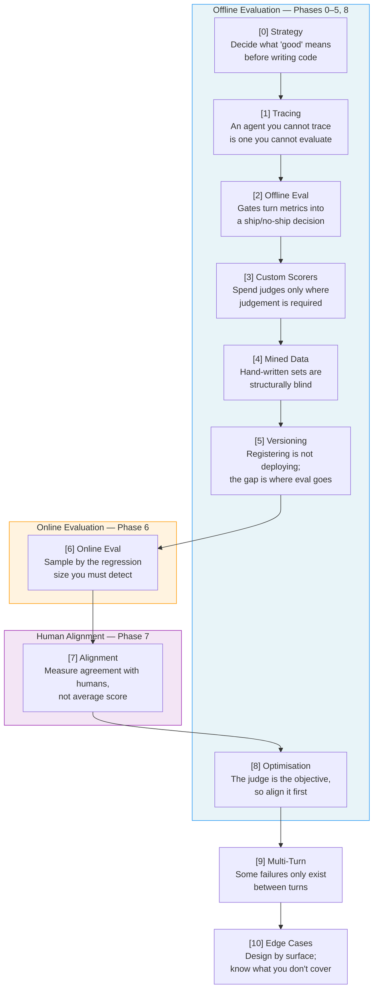
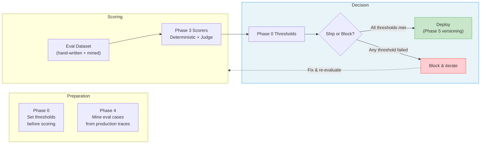
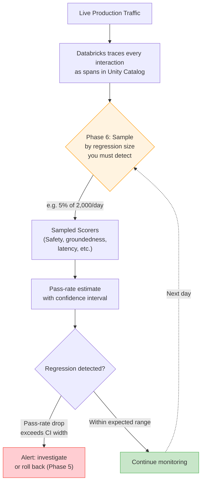
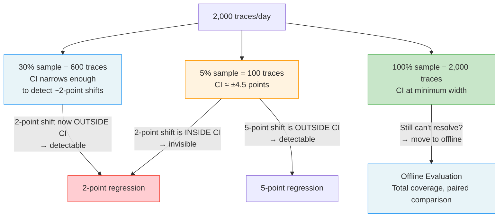
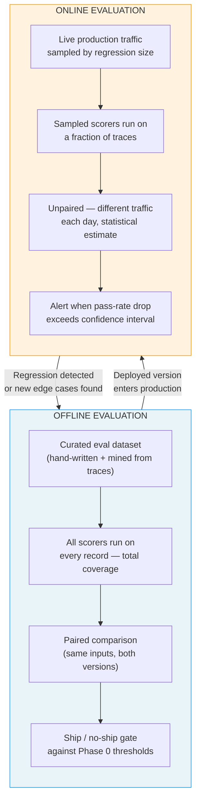
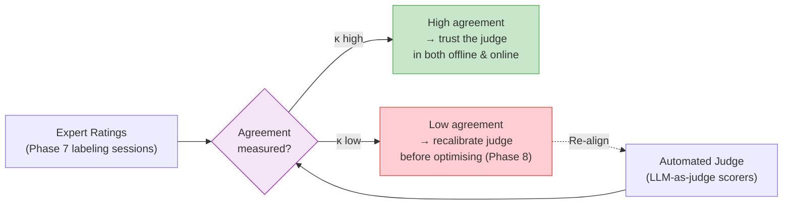
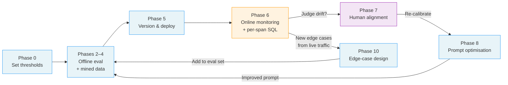

# Online vs. Offline Evaluation in Databricks

> **An evaluation suite is a claim about what you would notice**, and every phase of the
> evaluation track is about widening that set. This document explains how online and
> offline evaluation differ — and how they complement each other — strictly within the
> framework of the 10-phase MLflow evaluation track.

---

## 1. The Two Regimes at a Glance

| Dimension | Offline Evaluation | Online Evaluation |
|---|---|---|
| **When it runs** | Before a release, on a curated eval dataset | Continuously in production, on live traffic |
| **Phase(s)** | Phases 0–5, 8 | Phase 6 |
| **Data** | Hand-written + mined eval records | Sampled production traces |
| **Coverage** | Total — every record is scored | Statistical — limited by sample size |
| **Comparison** | Paired (same inputs across model versions) | Unpaired (different traffic each day) |
| **Purpose** | Gate a ship/no-ship decision | Detect regressions the gate missed |
| **Output** | Pass/fail against pre-set thresholds | Pass-rate estimate with a confidence interval |

---

## 2. The Full Evaluation Track

The track runs from strategy (Phase 0) through edge-case design (Phase 10). Offline and
online are not alternatives — they are **stages in a pipeline**, and the output of one feeds
the input of the next.



---

## 3. How Offline Evaluation Works

Offline evaluation runs **before** a model or prompt change reaches production. The
inputs are a fixed set of eval records — some hand-written, some mined from production
traces (Phase 4). Every record is scored; the results are compared against pre-set
thresholds (Phase 0) to produce a **ship/no-ship decision** (Phase 2).

Key properties drawn from the track:

- **Thresholds are written before any score exists** (Phase 0). This prevents
  post-hoc rationalisation of whatever the numbers happen to be.
- **Custom scorers come first, judges only where needed** (Phase 3). Deterministic
  scorers are cheaper and reproducible; LLM-as-judge is reserved for cases that require
  genuine judgement (e.g. trajectory correctness, groundedness vs. relevance).
- **Hand-written sets are structurally blind** (Phase 4). Mining eval cases from
  production traces closes the novelty gap that hand-authored datasets cannot see.
- **Registering is not deploying** (Phase 5). Versioning, aliases, and tagged runs
  create the rollback surface — the gap between a registered model and a deployed one
  is exactly where evaluation must sit.
- **Coverage is total.** Every record in the eval set is scored. The comparison across
  model versions is **paired**: the same inputs run against both versions, so the
  difference is attributable to the model change, not to traffic variation.



---

## 4. How Online Evaluation Works in Databricks

Once a version is deployed, online evaluation takes over. The agent serves live traffic;
Databricks captures every interaction as a trace in Unity Catalog. Phase 6 runs **sampled
scorers** on those traces to estimate a pass rate and detect regressions the offline gate
missed.

The critical insight from Phase 6 is the **sampling tradeoff**: you sample by the regression
size you must detect. A small sample has a wide confidence interval; a two-point
regression is invisible inside that interval, and an alert set at two points fires on
noise, not signal.



### Per-Span SQL Over UC Trace Tables

A key capability: per-span SQL over Unity Catalog trace tables turns vague concerns like
*"it got slower"* into specific diagnoses like *"retrieval p95 doubled"*. Each span —
retrieval, generation, tool call — is a row, so you can attribute a regression to a
specific component rather than the agent as a whole.

```mermaid
flowchart LR
    SPAN1["Retrieval Span"]
    SPAN2["Generation Span"]
    SPAN3["Tool Call Span"]
    UC["Unity Catalog<br/>Trace Tables"]
    SQL["Per-Span SQL Queries"]
    DIAG["Diagnosis"]

    SPAN1 --> UC
    SPAN2 --> UC
    SPAN3 --> UC
    UC --> SQL
    SQL --> DIAG

    DIAG --> R1[""'retrieval p95 doubled'"<br/>instead of 'it got slower'"]
    DIAG --> R2[""'generation quality dropped'"<br/>instead of 'answers are worse'"]
    DIAG --> R3[""'tool selection regressed'"<br/>instead of 'it broke'"]

    style DIAG fill:#fff3e0,stroke:#FF9800
```

---

## 5. The Sampling Resolution Problem

This is the core quantitative argument from Phase 6, and it is the single most important
thing to understand about why online evaluation is *not* a substitute for offline
evaluation:

> *At 2,000 traces a day, a 5% sample resolves a pass rate to about ±4.5 points. So a
> two-point regression is invisible — an alert set there fires on noise. Catching two
> points needs roughly 30% sampling, and if the delta can't be resolved even at 100%,
> it belongs in offline evaluation where coverage is total and the comparison is paired.*

### 5.1 In Plain English

**The setup.** Your agent handles 2,000 conversations a day. Asking an LLM judge to grade
every one costs real money, so you grade 100 of them — 5% — and assume the other 1,900 look
about the same.

**What you are really doing is guessing the day from a handful.** And the guess wobbles:

```
Day 1:  you grade 100 conversations → 95 pass → you report 95%
Day 2:  you grade a different 100    → 92 pass → you report 92%

Nothing changed. Same agent, same code, same prompt.
Only WHICH 100 you happened to grade changed.
```

That 3-point swing is luck, not a regression. **"±4.5 points" is just the size of that
luck**: with 100 graded conversations, your reported number can sit about 4.5 points either
side of the truth without anything being wrong.

**So whether you can see a problem depends on how big the problem is:**

| The drop you are hunting | The wobble from grading 100 | Can you see it? |
|---|---|---|
| 10 points (95% → 85%) | ±4.5 | Yes — far bigger than the wobble |
| 5 points (95% → 90%) | ±4.5 | Probably |
| **2 points (95% → 93%)** | ±4.5 | **No — smaller than the wobble** |

**And an alert set at 2 points is worse than no alert.** Two ordinary days can differ by
several points from luck alone, so the alert fires on days when nothing broke — and a team
that gets paged for nothing learns to close the page without looking.

**Fix one: grade more conversations.** The wobble shrinks as the number you grade grows.

| Graded per day | Wobble | Smallest drop you can trust |
|---|---|---|
| 100 (5%) | ±4.5 points | ~9 points |
| 600 (30%) | ±1.8 points | ~2 points |
| 2,000 (100%) | ±1.0 point | ~1 point |

**Fix two, for when even grading all 2,000 is not enough.** Production traffic is *different
questions every day* — Monday's conversations are genuinely harder or easier than Tuesday's,
and that difference never averages away. Offline evaluation removes it by asking the **same
fixed set of questions** of the old build and the new one, so the only thing left between the
two numbers is the build.

**The analogy.** Tasting a pot of soup. One spoonful tells you instantly if it is far too
salty; it can never tell you whether today's pot is 2% saltier than yesterday's — especially
when it is a different pot of soup every day.

**The decision this leaves you with.** Name the smallest regression you refuse to miss first,
then buy the sample rate that can see it — and if no sample rate can, that comparison belongs
offline, not on a dashboard.



**The rule:**

| Sample Rate | Traces/Day | CI Width | Detectable Regression |
|---|---|---|---|
| 5% | 100 | ±4.5 points | ~9-point shifts or larger |
| 30% | 600 | ±1.8 points | ~2-point shifts |
| 100% | 2,000 | ±1.0 points | Smaller shifts — but if still
| | | | unresolvable, use offline |

If a regression is too small to detect even at 100% sampling online, the right answer is
**not more sampling** — it is to move the comparison to offline evaluation, where every
input is scored and the comparison is paired (same inputs across versions), eliminating
traffic variation as a confound.

---

## 6. Offline vs. Online: Side-by-Side



### What flows between them

- **Offline → Online:** A version that passes the offline gate is deployed. The
  thresholds and scorers calibrated offline become the **alert thresholds** online.
- **Online → Offline:** Regressions detected online (or new edge cases surfaced by
  live traffic) are added back to the eval dataset. Phase 4's mining step exists
  precisely for this — production traces reveal novelty that hand-written sets miss.

---

## 7. Where Human Alignment Fits (Phase 7)

Phase 7 sits between online and optimisation. It does not belong to either regime alone —
it **calibrates** the automated metrics used in both.

The key principle: **measure agreement with humans, not average score.** A judge that
scores everything 4/5 can have a high average score and zero agreement with a human
labeler. The signal is the agreement rate (e.g. Cohen's kappa), not the mean.



This matters because Phase 8 (optimisation via GEPA) uses the judge as its objective
function. If the judge is misaligned, optimisation makes the prompt better at satisfying a
broken metric — which is worse than no optimisation at all.

---

## 8. What Each Phase Contributes to the Online/Offline Distinction

| Phase | Role | Offline or Online? |
|---|---|---|
| **0** Strategy | Set thresholds before any score exists | Offline (foundational) |
| **1** Tracing | Agent must be traceable to be evaluable | Both (traces enable both) |
| **2** Offline Eval | Gates turn metrics into ship/no-ship | Offline |
| **3** Custom Scorers | Deterministic first, judges only where needed | Both (scorers used in both) |
| **4** Mined Data | Hand-written sets are structurally blind | Offline (data from online traces) |
| **5** Versioning | Registering ≠ deploying; rollback surface | Offline (enables online rollback) |
| **6** Online Eval | Sample by regression size you must detect | Online |
| **7** Alignment | Measure agreement with humans, not average | Both (calibrates scorers for both) |
| **8** Optimisation | Judge is the objective; align it first | Offline (improves the prompt) |
| **9** Multi-Turn | Some failures only exist between turns | Both |
| **10** Edge Cases | Design by attack surface; know gaps | Both |

---

## 9. Key Takeaways

- **Offline and online are stages, not alternatives.** Offline gates the release; online
  catches what the gate missed. The output of each feeds the other.
- **Online evaluation is a statistical estimate, not a complete answer.** The sample
  size determines the confidence interval, and the CI width determines the smallest
  regression you can detect. An alert set below the CI width fires on noise.
- **If a regression is too small for online sampling to resolve, move it offline.**
  Offline evaluation has total coverage and paired comparison — the same inputs across
  versions — which eliminates traffic variation as a confound.
- **Per-span SQL over UC trace tables attributes regressions to components.** "It got
  slower" becomes "retrieval p95 doubled," which is actionable.
- **The judge is the objective function.** Phase 8 optimises the prompt against the
  judge; Phase 7 ensures the judge agrees with humans first. Optimising against a
  misaligned judge is worse than no optimisation.
- **Cost and latency are measured but not yet gated.** Both are measured in Phase 6,
  but neither blocks a release. In production they should — a correct answer that takes
  nine seconds is a different failure, not a success.

---

## 10. The Flywheel



The flywheel is the whole point: online evaluation discovers what the offline suite missed,
those discoveries flow back into the eval dataset, the next offline run covers them, and the
suite widens — **widening the set of things you would notice.**
