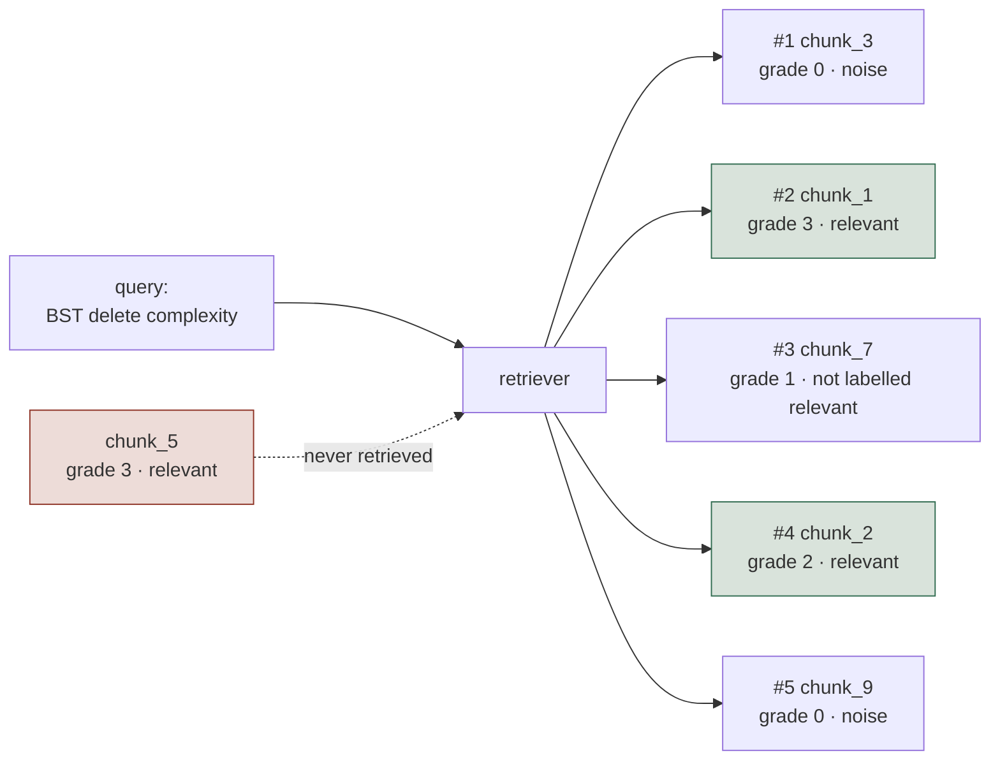
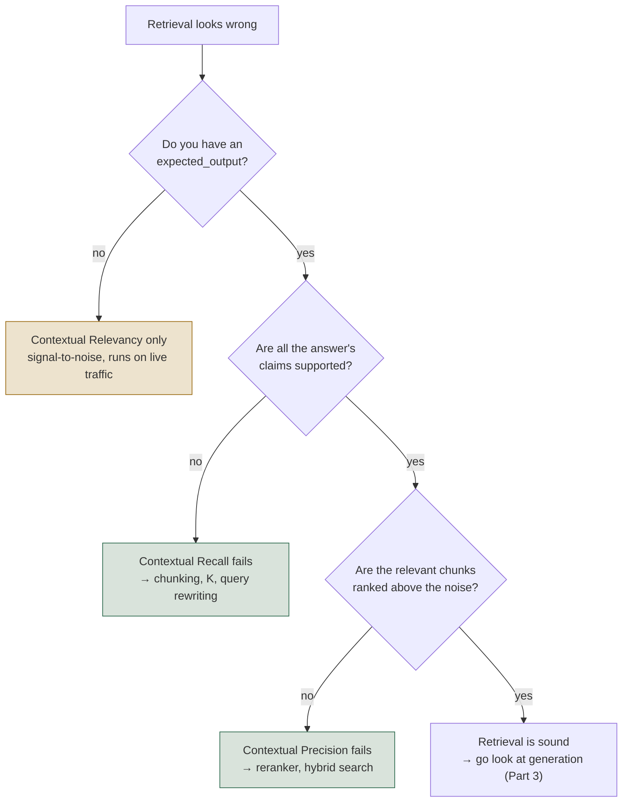
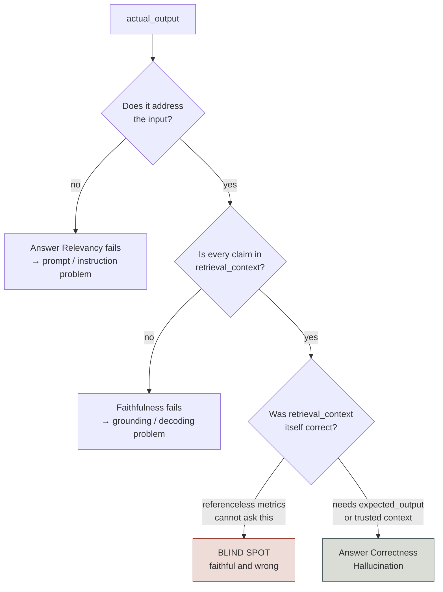
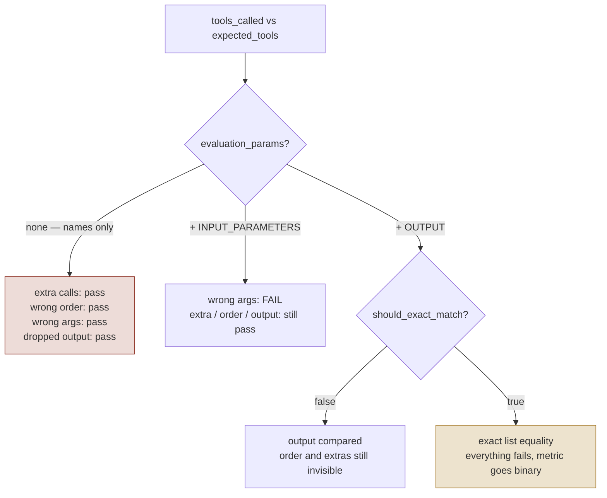
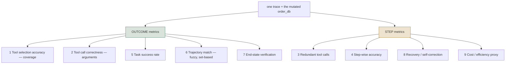

# RAG, Agent & Tool Evaluation — Field Guide

Companion to the 14 notebooks in [course 01](../../courses/01-rag-agent-tool-evaluation/). The notebooks show how to express each idea in a framework; this covers the idea.

- **Tool-agnostic on purpose.** No class names, no constructor arguments. Framework APIs churn; the questions don't.
- **Built for recall under pressure.** Bullets and tables over prose. Each check is framed the same way — what it catches, what it misses, what it needs, when to reach for it.
- **Read Part 0 first.** It's the map. After that, jump to whatever you're working through.

**If you have ten minutes:** 0.1, 0.2, 0.3, then 2.3 and Part 3.

---

# Part 0 — The Map

## 0.1 What you can evaluate

"Evaluate the RAG system" is never one question. It's five narrower ones — **retrieval, generation, tool mechanics, trajectory, outcome** — each with its own failures and its own checks. Name the layer before picking anything: a grounding failure and a retrieval failure look identical from outside, and the fixes are unrelated.

**RAG, by pipeline stage:**

| Stage | Question | Failure it catches | How it's measured |
| --- | --- | --- | --- |
| **Retrieval** | Did we fetch the right chunks? | Irrelevant, missing, or badly-ranked context | Precision@K, Recall@K, MRR, nDCG with labels; judged contextual checks without |
| **Generation**, no answer key | Is the answer grounded in what we fetched? | Invented claims on top of correct context; answering a different question | Faithfulness, answer relevancy |
| **Generation**, against an answer key | Is the answer *correct*? | Grounded-but-wrong, because the context itself was wrong | Correctness against a written reference; semantic similarity as a cheap proxy |
| **End-to-end** | Does the pipeline hold up across many queries? | All of the above, in aggregate | Golden dataset + full suite, sliced by category |

**Agents, by behaviour:**

| Behaviour | Question | Failure it catches | How it's measured |
| --- | --- | --- | --- |
| **Tool selection** | Right tools? | Wrong tool, missing tool, tool called when none was needed | Comparison against an expected set; coverage over a trace |
| **Arguments** | Right arguments? | Right tool, malformed or wrong arguments | Schema validation, then judged appropriateness |
| **Trajectory** | Was the *path* sound? | Redundant calls, wasted steps, blind retries | Step-wise accuracy, redundancy, recovery rate, fuzzy match |
| **Task completion** | Did it get the job done? | Every call correct, one stated constraint silently dropped | Judged completion; end-state verification |
| **Conversation** | Does it hold up across turns? | Forgetting earlier turns, drift, acting without consent | Per-turn relevance, knowledge retention, whole-dialogue rubric |

**The shape to remember:** mechanics → process → outcome. Right tool with right arguments doesn't mean a sound sequence; a sound sequence doesn't mean the user's goal was met. Evaluate all three.

## 0.1b What breaks where — the triage table

One row per surface: the symptom it explains, the metric that catches it, what it costs and what it needs.

| | ① Retrieval (det.) | ② Retrieval (judged) | ③ Generation | ④ Tool use | ⑤ Trajectory |
|---|---|---|---|---|---|
| **Symptom** | "It hallucinated" | No chunk labels exist | Answer wrong, metrics green | "Your flight is booked!" | 99% success, cost tripling |
| **Key metric** | `recall@K` | Contextual Recall | Answer Correctness | Argument correctness | End-state verification |
| **Cost** | Free, ms | 1 judge call per metric | 1–3 judge calls per metric | Free (deterministic) or 1 call | Full graph run per case |
| **Needs** | Labelled chunk IDs | `expected_output` for 2 of 3 | `expected_output` for correctness | `expected_tools` or nothing | Trace + system of record |
| **Runs in CI?** | Every commit | Smoke set per commit | Nightly full suite | Every commit | Pre-release |

## 0.2 The two questions that decide everything

**Question 1 — to run this check, do I need an answer key written in advance?**

A *reference* is a correct answer a human wrote down before the system ever ran — an expected answer, an expected chunk list, an expected tool list. Every check compares the output to something; the only question is where that something comes from.

| The check compares the output to… | It's called | Examples |
| --- | --- | --- |
| Something a **person wrote before the run** | **reference-based** | Recall@K needs a list of which chunks are the right ones. Tool-selection needs the expected tool list. Correctness needs the expected answer. |
| Something the **run itself produced** | **referenceless** | Faithfulness compares the answer to the context just retrieved. Answer relevancy compares the answer to the question. Nobody wrote anything ahead of time. |

- **Reference-based** — precise, gateable, great for CI. Someone has to write and maintain the answer key, so it only scales to curated test sets.
- **Referenceless** — scales to any traffic at zero labeling cost. Less precise, and only as good as the judge.
- **Why this decides offline vs online:** in production a real user asks something nobody anticipated, so no answer key exists for it. A reference-based check has nothing to read and can only **skip** — reporting skip on 100% of traffic while looking perfectly healthy on a dashboard. A referenceless check has everything it needs, because both sides of its comparison came out of that same request.
- **So the test is mechanical:** does it need an answer key? If yes, it can never go online, however good it is. That one question sorts your whole suite before you write a line of code.
- **Mature setups run both** — reference-based in CI, referenceless on live traffic. Not a choice between them.

**This split cuts across the five layers, not along them.** Two checks that both look at
retrieval can land on opposite sides: one compares the retrieved passages to the *question*
(referenceless), while a close neighbour compares the same passages to the *expected answer*
(reference-based). Same chunks, opposite sides of the line — so *"which layer is this?"* and
*"does it need a reference?"* are two independent questions, not one.

> **In plain English.** A user asks *"What is Apache Spark used for?"* and the retriever
> returns three chunks:
>
> ```python
> retrieval_context = [
>     "Apache Spark is a unified analytics engine for large-scale data processing.",  # relevant
>     "Spark is widely used for real-time stream processing and analytics.",          # relevant
>     "Spark was originally developed at UC Berkeley's AMPLab in 2009.",              # trivia
> ]
> ```
>
> Point two metrics at those exact same three chunks:
>
> ```python
> ContextualRelevancyMetric()   # scores fine with just input + retrieval_context
> ContextualRecallMetric()      # raises unless you also pass expected_output
> ```
>
> One of them can run on production traffic tomorrow. The other can never run on production
> traffic at all.
>
> **What each one is actually reading:**
>
> - **Contextual Relevancy** reads `input` + `retrieval_context` — *"of these three chunks,
>   how many are on topic for the question asked?"* The AMPLab trivia drags the score down.
>   No answer key anywhere.
> - **Contextual Recall** reads `expected_output` + `retrieval_context` — *"does this context
>   contain everything the ideal answer needed?"* It cannot form the question without the
>   answer key.
>
> | | Contextual Relevancy | Contextual Recall |
> |---|---|---|
> | Layer | Retrieval | Retrieval |
> | Reads the answer key? | No | Yes |
> | Catches | Noise diluting the context | Missing information |
> | Runs on live traffic? | Yes | No — production has no `expected_output` |
>
> The same split appears one layer up, in generation: **faithfulness** compares the answer to
> the retrieved chunks (referenceless); **answer correctness** compares that same answer to the
> answer key (reference-based).
>
> **The analogy.** Two inspectors check the same delivery. One asks *"is everything in this box
> something the customer ordered?"* — they only need the order form in their hand. The other
> asks *"is everything the customer ordered in this box?"* — they need the warehouse's master
> list, which nobody handed them at the door.
>
> **Why it matters.** The layer tells you *what broke*; the reference question tells you *where
> you are allowed to run the check*. Answer only the first and you build a suite that works
> beautifully offline and goes dark the moment it meets real traffic.
>
> **The line worth keeping:** *which layer* and *does it need an answer key* are two
> independent axes — every metric has a coordinate on each.

**Question 2 — deterministic or judged?**

- **Deterministic** = arithmetic or a schema check. Free, instant, reproducible.
- **Judged** = a model reads the output and scores it. Handles open-ended text; costs a call; moves on its own.
- **Reproducibility is the reason, not cost.** When a deterministic number moves, behaviour moved. A judged number needs a tolerance band and can never certify the thing it was used to optimise.

## 0.3 LLM-as-judge — the failure modes

The only practical way to score open-ended text. Not an oracle. Treating it like one is the most common mistake in eval work.

- **Judge capability** — a weaker judge produces noisier scores. It must be at least as capable as the task, sometimes more than the system it grades.
- **Non-determinism** — two runs on the same input can disagree, especially near the threshold. Treat one score as a noisy estimate, not a fact. Never gate on a single row.
- **Rubric sensitivity** — a vague criterion produces a judge that quietly disagrees with itself. The specificity you write down is the specificity you get back.
- **Cost compounds** — five dimensions over 500 cases is 2,500+ calls. This is why the answer-key question in 0.2 is an operational decision, not just a conceptual one.
- **Nobody validates the validator** — an unchecked judge gives numbers that are internally consistent and externally unvalidated. Useful for detecting *change*, not for asserting *quality*.
- **Measure agreement, not average** — a judge that rates everything highly scores beautifully and is useless.
- **Fluent-but-wrong fools it** — it reads text and decides whether it *sounds* right. This is the whole argument for end-state verification.
- **Score direction is not a convention** — a check named for the failure it detects runs backwards: a hallucination score of 0.9 means *lots* of hallucination, not excellent grounding. Check the direction before wiring anything to a threshold.

## 0.4 The cost ladder — pick the cheapest thing that answers the question

| # | Rung | Who writes the standard | What it reads | Cost |
| --- | --- | --- | --- | --- |
| 1 | **Deterministic check** | Nobody — it's arithmetic, a regex, a schema | The specific field it checks | Free, instant, reproducible |
| 2 | **Off-the-shelf judged check** | Someone else — a standard rubric | The final output, plus the question and context | One call, small prompt |
| 3 | **Custom rubric** | You | The final output, plus the question and context | One call, small prompt + your authoring time |
| 4 | **Trace-based judge** | You | The **whole run** — every step, tool call, intermediate reasoning | One call, **big** prompt. A trace is many times the size of an answer |

**Rungs 2, 3 and 4 are all judged.** What separates them is two different things, and it's worth knowing which jump you're making:

- **2 → 3 changes the standard, not the mechanism.** Same evidence, same cost per call. You climb only because the generic definition of "good" isn't yours — a stock "is this complete?" can't know your answer needs a budget breakdown and a day-by-day itinerary.
- **3 → 4 changes the evidence, and it's the expensive jump.** Make it only when **the answer isn't in the output**. "Did it take a sensible path?", "did it recover from that error?", "did it ask before writing?" — no rubric can extract those from the final text, however well written. The judge has to see the run.

**Stop at the first rung that answers your question.**

- **The common overspend is rung 4 for a rung 1 question.** Most trace questions need no judgment at all: redundant calls, cycles, step counts, error-then-retry patterns are all countable. Paying a large-prompt judge to count duplicate calls is the most common way teams waste evaluation budget.
- **Rung 4 is for trace questions that genuinely need judgment** — whether a sequence was reasonable given an ambiguous request, say. Not for anything you could write a query for.
- **The other common overspend is rung 3 for a rung 1 question** — a judged check for something a regex settles.

## 0.5 A note on frameworks

Several evaluation frameworks appear across the notebooks. The only durable fact about them is that they come in two shapes:

- **Metric libraries** — ready-made, named measurements. Fast to start; the naming does some thinking for you, right up until you need a check nobody shipped.
- **Platforms with primitives** — a scoring function, a custom judge, a trace to read. More boilerplate, more flexibility, and usually paired with versioned runs, a trace store, and version comparison.

Every concept here exists in all of them under some name. None of them lets you skip deciding which question you're asking.

---

# Part 1 — RAG Evaluation

## 1.1 Retrieval, with labels (deterministic)

> **Worked lab:** §6.1 walks this against real numbers.

Needs a labeled eval set — query → relevant chunk IDs — and arithmetic. No judge, no API call. The right first move whenever you have labels.

| Measurement | What it checks | Use when |
| --- | --- | --- |
| **Precision@K** | Of K retrieved, how many are relevant | Noise in the retrieved set is the worry |
| **Recall@K** | Of all relevant chunks, how many made the top K | Missing evidence is the worry |
| **MRR** | 1 / rank of the first relevant hit | One correct chunk, and you care how early it lands |
| **nDCG** | Graded relevance, discounted by position | Relevance isn't binary and several relevant chunks coexist |

- **Needs:** pre-labeled ground truth.
- **Misses:** anything on live traffic — you can't compute Precision@K on a query with no labels.
- **That gap is what 1.2 exists to close.**

## 1.2 Retrieval, without labels (judged)

> **Worked lab:** §6.2 walks this against real numbers.

Same question as 1.1, judged instead of labeled. Three checks, three different failures — which is why one general "is retrieval good" score doesn't exist.

| Check | Question | Needs a reference? | Catches |
| --- | --- | --- | --- |
| **Contextual precision** | Are relevant chunks ranked above irrelevant ones? | Yes | A good chunk buried under noise |
| **Contextual recall** | Does the context cover everything the answer needs? | Yes | The retriever found *something*, not *enough* |
| **Contextual relevancy** | How much of what came back is on-topic? | No | Noise diluting the context |

- **Precision cares about order. Recall cares about coverage. Relevancy cares about signal-to-noise.** A retriever can fail one and pass the other two.
- **Note:** contextual recall checks against the *expected* answer, not the generated one — did retrieval fetch enough to support a full answer, regardless of what the generator used.

## 1.3 Generation, without a reference

Given what was retrieved, is the answer any good — with no hand-written reference. These are the checks that can run on production traffic.

| Check | What it compares against |
| --- | --- |
| **Answer relevancy** | The question only — does it address what was asked? |
| **Faithfulness / groundedness** | The retrieved context — any invented claims? |
| **Hallucination vs trusted context** | A separately-supplied trusted source, regardless of retrieval |

**The three ways "the answer is wrong" can happen — learn to tell them apart:**

- **Faithful but irrelevant** — perfectly grounded, answers a different question.
- **Relevant but unfaithful** — addresses the question, invents facts.
- **Faithful to bad context** — accurately reflects chunks that were themselves wrong. **Faithfulness cannot catch this.** Only 1.4 can.

**Faithfulness vs hallucination — the distinction people get wrong:**

| <br> | Faithfulness | Hallucination vs trusted context |
| --- | --- | --- |
| **Compares against** | Whatever *this* query's retriever happened to fetch | A curated trusted source, independent of retrieval |
| **Changes per query?** | Yes — the baseline moves with retrieval | No — the baseline is fixed |
| **Catches** | A generator inventing things beyond what it was given | An answer that contradicts known truth, however it got there |
| **Blind to** | Retrieved context that was itself wrong | Nothing retrieval-specific — it never looks at retrieval |
| **Needs** | Nothing extra; runs on live traffic | A maintained trusted corpus |
| **Reach for it when** | You want to police the generator | You have independent truth and want to police the answer |

## 1.4 Generation, against a reference

> **Worked lab:** §6.3 walks this against real numbers.

- **There's rarely a generic correctness check you can drop in**, and that's not an oversight — what counts as "right" is specific to your task. Write a rubric (1.5).
- **Semantic similarity** (embedding distance to the reference) is cheap and fast, but measures *topical* closeness, not *factual* agreement. Two answers can be close and disagree on the number that matters. Pair it with a judged check; don't substitute it.
- **Needs:** a written reference answer. That's the cost side of 0.2 — precise, and only as scalable as your ability to keep references current.

## 1.5 Writing a rubric that works

**You are either writing the test, or letting the judge write it for you.**

| You give it | What happens | Result |
| --- | --- | --- |
| **One sentence** — "check the answer is accurate" | The judge has to invent the steps, and invents different ones each run | Same answer, different scores |
| **Explicit steps** — "1. every figure appears in the context, 2. it answers the question asked, 3. no advice beyond the policy" | The judge follows yours | Same answer, same score |

- **Write the steps whenever a one-liner doesn't pin down what should fail.** Steps also let you check several things at once — relevance, agreement with the reference, and grounding — in one pass.
- **A vague rubric never errors.** Nothing goes red. You just get numbers that wobble, with no signal saying the rubric is the cause.
- **The test:** if you can't say what would make it fail, neither can the judge.

Same idea as handing a grader "mark this fairly" instead of a marking scheme. Five graders, five different marks, every one of them defensible.

## 1.6 Evaluation inside the pipeline

Everything above scores after the fact. Relevance and grounding can also run *as pipeline steps*: `retrieve → judge context relevance → generate → check faithfulness`.

- **You can branch on it.** Nothing relevant retrieved? Ask a clarifying question instead of generating a plausible answer from noise.
- **It de-mystifies the checks.** Building grounding out of raw judge calls once makes it obvious what a ready-made version is doing underneath.
- **Prototype against mocked judges first.** Same structure, byte-identical output, zero cost. Swap in real judges once the shape is right — and that swap is where non-determinism becomes visible.

## 1.7 Running it in batch

One scored example teaches you what a check does. It says nothing about your system. The step between is always the same shape:

> dataset of inputs → call the **live** system once per row → score the real response → write the score back beside its input

- **Every row hits the live system** — you're testing what's deployed, not a reconstruction.
- **Scores land next to inputs** — a bad number is one click from the input that caused it. That's the difference between a dashboard and a diagnosis.
- **It re-runs on demand** — the prerequisite for comparing a change against what's live.
- **A standard test runner gets you this cheaply** — parametrize over rows and inherit batch execution, pass/fail reporting, and CI.

## 1.8 Golden datasets

- **Hand-writing references doesn't scale** past a handful of examples.
- **Generate them from your own documents** — question/expected-answer pairs, evolved along dimensions you choose (multi-step reasoning, multi-chunk).
- **Spot-check them.** Generated questions are only as good as the generation process.
- **Build each case's context by actually running the retriever** on the golden question — not from the documents the golden came from. Otherwise you're testing whether the generator works given perfect context, which nothing in production ever has.

## 1.9 Reading the results

- **Diagnose by pattern, not by the headline number.** Low contextual precision, high everything else → a ranking problem. Low faithfulness, high contextual relevancy → the generator inventing things despite good retrieval.
- **Aggregates hide the thing you need to see.** 85% with one category at zero and 85% spread evenly are different systems with the same score.
- **Slice before you conclude** — by query category, tenant, intent, document type.

---

# Part 2 — Conversation, Tools & Task

## 2.1 Multi-turn conversation

A system can be fine turn-by-turn and fail as a conversation. The unit of evaluation becomes the sequence.

**What to measure:**

- **Per-turn relevance** — is this turn relevant to what came before it? Judged over a sliding window (the last few turns) rather than the whole dialogue, so a long conversation doesn't drown the check.
- **Knowledge retention** — does it remember what the user said three turns ago? The most visible multi-turn failure is re-asking for something already supplied.
- **Whole-dialogue rubric** — your domain criterion applied across the arc, not one turn.

**The arithmetic nobody does:**

- **Turn pass rates multiply.** If each turn independently passes 95% of the time, a 5-turn conversation passes 0.95 × 0.95 × 0.95 × 0.95 × 0.95 — that is, *p* to the power of the number of turns.
- **So 95% per turn is 77% conversation success**, not 95%.
- The overstatement grows with length — so the metric looks best exactly where the product is worst.
- **If you report turn-level numbers, report the session-level number beside them.**

**Failures with no single-turn representation:**

- **Consent lives between turns.** "Acted without asking" is a property of a pair, not a turn.
- **Approval has three outcomes, not two** — complied, violated, and *stalled* (agreed, then nothing happened). Different fixes.
- **A conversation-level check on a single-turn run must report "not measured", never zero.** An unmeasured check and a failed one must never look alike.

**Scaling past hand-written dialogues:** a simulated user with a goal and a policy — including mid-conversation curveballs — generates dialogues from defined intents, and the same checks score whether the goal was met.

## 2.2 Tool use

> **Worked lab:** §6.4 walks this against real numbers.

**Why it's different from standard evaluation:**

| <br> | Standard LLM evaluation | Tool-using agent evaluation |
| --- | --- | --- |
| **What you score** | One output against a reference | A sequence of decisions, then the output |
| **Where failure lives** | In the text | Underneath it — which tool, what order, what arguments, how results were read |
| **What a good-looking answer proves** | Usually that it's good | Nothing. "Your flight is booked!" is useless if the booking API was never called |
| **Number of failure points** | One | One per decision, each needing its own check |
| **Typical miss** | Wrong wording | A skipped lookup with the details invented to cover it |

**Three checks, three granularities:**

| Check | Scope | Needs an answer key? | Question | Best for |
| --- | --- | --- | --- | --- |
| **Tool selection** | One run | Yes — the expected tool set | Do the tools called match the expected set? | CI, where correct behaviour is known |
| **Argument correctness** | One run | No — judged from the task | Were the arguments right for the task? | Production, where values can't be predetermined |
| **Multi-turn tool use** | Whole dialogue | Partly — selection needs one, arguments don't | Selection *and* arguments across a conversation | Chatbot agents where tool use spans exchanges |

**Four properties worth carrying around.** Running example: a travel agent that should call
`search_flights`, then `book_flight`.

**1. "Did it call the right tools?" has more than one right answer — and you have to pick one.**

How strictly you match is a decision, and both extremes are wrong:

- *Too strict* (exact tools, exact order, nothing extra): the agent also calls `check_weather`,
  which harmed nobody, and you fail the whole run. Nothing went wrong but the score says it did.
- *Too loose* (the expected tools appear somewhere, extras fine): an agent that calls all eight
  of its tools on every question passes every time. It is spraying, and your metric applauds.

Demand strict ordering only where the order genuinely *is* the requirement. You cannot book
before you search, so that ordering is real. Whether the weather lookup came first or third is not.

**2. Check arguments in two passes, cheap one first.**

"Were the arguments right?" is really two different questions:

- *Is it even well-formed?* Does the `book_flight` call have a `date` field, and is `2026-02-31`
  a real date? **Plain code answers this** — free, instant, same answer every time.
- *Does it make sense for what was asked?* The user wanted a morning flight to Delhi; did it
  book an evening flight to Dubai? **Only a judge can answer this.**

Run the code check first and stop there if it fails. Paying for an LLM call to decide whether a
malformed date is *semantically appropriate* is money for nothing.

**3. Combining sub-scores: take the worst one, not the average.**

Suppose tool selection scores 1.0 and arguments score 0.0 — it picked exactly the right tool and
handed it nonsense. The mean says **0.5**, which reads as "half working". Nothing was half
working: the booking failed. The minimum says **0.0**, which is the truth.

Averaging lets a healthy dimension cover for a broken one — precisely the failure you built the
metric to catch.

**4. Doing nothing is behaviour, and it needs scoring too.**

"What's your refund policy?" should produce **no tool call at all** — answer from knowledge and
stop. That restraint is correct, and it deserves a pass.

Most suites only inspect calls that actually happened, which leaves them blind in both directions:

- **Should have stayed still, and moved.** It calls a tool it didn't need — wasted money, one more
  thing to go wrong. Invisible, because you only score whether calls were *correct*, and it was.
- **Should have moved, and stayed still.** It says "your flight is booked!" without ever calling
  `book_flight`. Invisible, because there is no call to inspect.

So the expected tool set has to be allowed to be **empty**, and an empty set has to be something
you can pass or fail against.

## 2.3 Task completion

The checks above judge **mechanics**. None of them ask what the user cares about: **did it get the job done?**

- **The gap is real.** An agent can call every tool correctly and book the wrong hotel because it ignored a stated budget.
- **It runs the other way too.** A slightly inefficient sequence can land on a perfectly good outcome.
- **A production suite needs both.** They answer different questions.

**Judged task completion — how to get it right:**

- **Show it the tool calls**, not just the final output. That's what lets the judge see *how* the outcome was reached rather than what the agent claims.
- **State the task explicitly** rather than letting it be inferred from the raw input. The real requirement is usually richer than the literal wording.
- **A full trace beats a flat call list** where one exists — it carries intermediate reasoning.

**Two escalations:**

1. **When "done" is domain-specific** → custom rubric. "The summary must cite two sources." "A refund response must never promise an amount before a policy lookup." Costs more to write; applies your bar instead of a generic one.
2. **When stakes are high** → **verify the side effect, don't judge the text.** A judged check still only reads text and decides whether it *sounds* done. For agents that book, send, or write, query the system of record directly. This cannot be fooled by a fluent-but-wrong answer.

**In practice, combine them:** deterministic state check as the pass/fail gate wherever a checkable outcome exists; judged check as a secondary signal for the fuzzy parts (tone, completeness of an explanation).

## 2.4 Failure mode — polite tool failure

The single most under-tested failure in production agents, and the one worth being able to walk through end to end:

- **What it means:** a tool returns a soft failure object — `found: false`, an empty result, a 200 with an empty payload — instead of raising.
- **Why it causes a wrong answer:** the model gets something that *looks* like data, skates past it, and fills the gap with fluent, plausible, wrong content.
- **Symptoms:** an agent states a plan and balance for an account that doesn't exist. Nothing crashes. Nothing alerts. Silence and success look identical.
- **Why standard checks miss it:** grounding compares the answer to *retrieved documents*, not tool outputs. Task success reads the final string. **Neither one reads the tool result.**
- **How to detect it:** a deterministic check that reads the tool output and, if it indicates failure, asserts the response doesn't state the facts that tool was supposed to supply.
- **Fix:** make soft failures loud at the tool layer where you control it, and make "I couldn't retrieve that" an explicitly rewarded behaviour in the rubric.
- **Not fixable by prompting.** Instructions reduce the rate; they don't make it detectable.
- **Where else it shows up:** empty retrieval results, a permission-filtered search returning zero rows, a rate-limited call returning a stale cached value.

## Part 2 quick lookup

| Question | Reach for |
| --- | --- |
| Right tools, against a known reference? | Reference-based selection comparison |
| Right arguments, no reference available? | Schema validation, then a judged check |
| Appropriate tool use across a conversation? | Conversational tool use — minimum of selection and arguments |
| Did it accomplish the goal? | Judged task completion, or a custom rubric |
| Did the real side effect happen? | End-state verification against the system of record |
| Did a tool fail quietly and get papered over? | Deterministic check reading the tool output |
| Did it correctly do nothing? | Score the absence of a call as an outcome |

---

# Part 3 — Trajectory

Part 2 scores a **finished** interaction. This asks whether the *path* was any good. An agent can reach the right answer in twice the steps, retry blindly instead of correcting, or repeat an identical call for nothing — and no Part 2 check sees any of it.

**The standard approach:** run the agent's loop to build a **trace** — a step-by-step record of what was called, with what arguments, and what happened — then hand that trace to a **separate** evaluation pass, scored against a **gold trajectory**: the sequence a human decided ahead of time was correct. The agent doesn't grade itself.

*Gold* throughout this part means "the human-authored correct version" — the answer key of 0.2, applied to a path instead of an answer.

## 3.1 The nine checks

> **Worked lab:** §6.5 walks this against real numbers.

| # | Check | What it catches |
| --- | --- | --- |
| 1 | **Tool selection accuracy** | Coverage only — does the called set include the gold set? Loosest of the nine; passes with wrong order and extra calls |
| 2 | **Argument correctness** | Right tool, invalid arguments |
| 3 | **Redundant calls** | A tool-and-arguments pair that already *succeeded* earlier in the same trace |
| 4 | **Step-wise accuracy** | Fraction of all steps that made real forward progress |
| 5 | **Task success rate** | The ground-truth outcome for the run |
| 6 | **Trajectory match (fuzzy)** | Successful tool set vs gold set, ignoring order and retries |
| 7 | **End-state verification** | Read the mutated system of record directly |
| 8 | **Recovery rate** | After an error, did a later step call the same tool and succeed? |
| 9 | **Cost / efficiency proxy** | Redundant calls and errors treated as waste |

## 3.2 Three traps

- **The tool-selection scorer that scores 100% for calling everything.** The commonly published version computes both missing and unexpected tools, then bases the verdict only on the missing ones. **Fail both directions** — an unexpected account lookup is a privacy problem, not an inefficiency.
- **Exact-sequence matching as the default.** It fails on a mid-trace typo or a harmless extra lookup even when the agent did the right things. Fuzzy by default; exact only where order *is* the requirement.
- **Rewarding recovery on its own.** A high recovery rate is genuinely good — an error caught and corrected is a different system from one that fails silently. But pair it with step-wise accuracy, or you're rewarding a system that generates errors so it can recover from them.

## 3.3 What each check looks like on a live system

Hand-computing these from a hand-built trace is how you learn them. On a running system the questions don't change — only where the answer comes from. Take a **support agent that looks up an account, checks network status for a region, and opens a ticket**:

| Question | Where the answer comes from |
| --- | --- |
| Did it call the tools it needed? | Gold set in a table beside the eval questions; called set from tool spans tracing already captures |
| Were the arguments valid? | Typed tool signatures reject malformed calls before execution — the failure never reaches evaluation |
| Did it repeat itself? | Query the trace store for duplicate tool-and-input spans inside one request. Pure SQL, no judge |
| Did each step make progress? | A per-step scorer walking each trace's spans, run as part of the eval job |
| Did the task succeed? | An eval set of task and expected outcome, run on a schedule, trended |
| Was the path close to gold? | Gold trajectories stored as structured data; a comparison function registered once |
| Did the real effect happen? | Before/after diff of the system-of-record table, same run as the agent |
| Did it recover? | Tracing marks error spans; a job matches them against later successful spans in the same tree |
| What did it cost? | Tracing captures tokens and latency per span automatically |

**Three lessons that outrank any row:**

- **Instrumentation is a precondition, not a detail.** An untraceable agent is unevaluable. Every request must emit a span per retrieval, per model call, per tool call, with tokens and latency.
- **Span type is a contract, not a label.** A grounding check *hard-requires* a span typed as a retrieval. Wrong type doesn't degrade the measurement — it breaks it.
- **Queryable traces change incident response.** "It got worse" becomes "retrieval p95 doubled for one tenant starting Tuesday."

---

# Part 4 — Production

## 4.1 Offline and online split cleanly

- **Offline catches what your dataset contains.** Reproducible, can use references, can gate a release. Structurally blind to anything nobody thought to include.
- **Online exists to find what the dataset didn't.** Real traffic has no answer key, so only referenceless checks run here at all (the test from 0.2).
- **The loop is the point: online discovers, offline prevents recurrence.** A finding that stops at the dashboard helps once. Carried into a gated offline test, it protects every release after.

## 4.2 Sampling and alerting

- **Sample judged checks; never sample deterministic ones.** Judges cost per call. Deterministic checks are free — run them on everything.
- **Pick the sample rate from the change you must detect**, not from a round number that felt affordable. A small sample can only resolve a large change: sampling 5% of 2,000 daily traces pins a score to roughly ±4.5 points, so a 2-point drop is invisible in it.
- **An alert set tighter than that resolution fires on noise**, gets muted within a month, and leaves you with monitoring that looks healthy and tells nobody anything.
- **Your first alert shouldn't be a quality metric.** Trace volume, error-span rate, scorer coverage — those catch the case where monitoring itself silently stopped.

## 4.3 What tracing adds that hand-built examples can't

- **Tracing** — the production version of a hand-rolled trace list, captured by instrumentation.
- **Router and tool evaluations** — the same questions as 2.2, computed from real spans.
- **Path-efficiency experiments** — the same question as checks 4 and 9 in 3.1, but run through a reusable dataset-plus-evaluator setup that generalizes to any agent, instead of a one-off script over one hand-built trace.

## 4.4 Two ideas that are genuinely new

- **Skill evaluation** — judging a *tool's own output quality* in isolation. Is the generated SQL correct? Does the chart code run? A well-chosen tool that does its job badly is invisible to every check in Parts 2 and 3: selection passes, arguments pass, output is quietly wrong.
- **Version comparison** — re-running the same experiment against a system with one deliberate change. Everything earlier judges one run in isolation. This is the answer to "did my prompt change actually help, or did it just feel better?"

---

# Part 5 — Real Multi-Agent Systems

Applying all of the above to a running multi-agent system surfaces what hand-built examples can't teach.

- **A multi-agent system is a different shape.** Several narrow agents hand work to each other; one's output is the next one's input. You're evaluating the *combined* output of a handoff chain.
- **Handoffs are where quality dies, and they need their own measurement.** The same multiplication as 2.1: five components each right 90% of the time are all right together only 0.9⁵ ≈ 59% of the time — before counting routing errors and context lost at each boundary. **That's how every subagent scores above 0.9 while end-to-end scores 0.6**, and why per-agent numbers will never explain it.
- **Attribution requires nested traces.** Session → orchestrator turn → subagent invocation → spans. Without nesting you know quality dropped; with it you know *which subagent*, on *which turn*.
- **Score routing separately from the parts.** Handoff accuracy is usually the first thing to break when a subagent is added — the rubric was written for N agents and now runs against N+1.
- **Write the task description explicitly.** "A trip plan" might really mean top-3 interest matches, 5 attractions, a day-by-day itinerary, and budget guidance.
- **Mind the gap between "an eval script exists" and "it sees what it needs."** A batch script calling a public API often has only the final output, not the internal calls. An approximated list beats none — but name the gap instead of papering over it.
- **Every measurement has a scope of validity, and it expires silently.** A check correct for a one-tool agent misleads the moment a second tool arrives. Nothing errors. The number just stops meaning what it meant.

---

# Part 6 — The worked labs

Parts 0–5 are the compressed reference. This part is the same five surfaces walked through slowly against real numbers — the narrative companions to the six interactive labs in [`docs/interactive-labs/`](../interactive-labs/). Each one states the problem, derives the mechanism, walks the lab's own data, and says when not to reach for it. The interview questions that used to close each of these live in [`docs/interview-prep/QUESTION_BANK.md`](../interview-prep/QUESTION_BANK.md) Part 10.

## 6.1 Deterministic retrieval metrics: four numbers that are supposed to disagree

*Interactive lab: [`01-deterministic-retrieval-metrics.html`](../interactive-labs/01-deterministic-retrieval-metrics.html) — open it in a browser and manipulate the inputs. Reference version above: §1.1.*

Before any judge model, any API key, or any cost, there is a layer of retrieval evaluation that is pure arithmetic over labelled ground truth. It is the cheapest signal in the entire stack and it caps everything downstream — so it is where the tutorial starts.

**Companion lab:** `docs/interactive-labs/01-deterministic-retrieval-metrics.html` — drag `K` and watch precision and recall pull in opposite directions while MRR refuses to move at all.

**Source module:** `courses/01-rag-agent-tool-evaluation/01_Retrieval_Metrics_Deterministic.ipynb`

> **Naming note:** Part 2 reuses "Precision" and "Recall" for its LLM-judged Contextual metrics, but the computations differ. Contextual Relevancy turns out to be the *same* unweighted `relevant/total` formula as Precision@K here; Contextual Precision is a different, rank-weighted metric. See Part 2's Core Mechanism section for the exact formulas.

---

### TL;DR

- Four metrics — **Precision@K, Recall@K, MRR, nDCG@K** — score the same ranked list and answer four different questions. Reporting one of them is how retrieval bugs hide.
- All four need **pre-labelled ground truth** (`relevant_ids`, `relevance_grades`). That's what makes them free and deterministic, and also what confines them to curated eval sets rather than production traffic.
- In the tutorial's toy set, no value of `K` fixes the problem: the most useful chunk was **never retrieved**, so recall stalls at 0.67 and MRR is pinned at 0.50 forever.
- A wrong answer can come from a broken retriever *or* a broken generator. These metrics are how you tell which, before spending anything on a judge.

---

### The Problem: "The Model Hallucinated"

Every RAG bug report arrives with the same diagnosis attached, and it is usually wrong.

- If the relevant chunk never entered the prompt, the generator was **not** hallucinating in any meaningful sense — it answered faithfully from a context that didn't contain the answer.
- Faithfulness, answer relevancy, and every other generation metric are **bounded by retrieval**. Measuring them while recall sits at 0.67 tells you nothing about your generator.
- The fix is completely different in each case. Retrieval failures want chunking, hybrid search, or reranking. Generation failures want prompt or model changes. Guessing wrong costs a sprint.

---

### Core Mechanism: The Four Formulas

    Precision@K = (relevant chunks in top K) / K
    Recall@K    = (relevant chunks in top K) / (total relevant chunks that exist)
    MRR         = 1 / (rank of the FIRST relevant chunk)
    nDCG@K      = DCG@K / IDCG@K,  where DCG = Σ  grade_i / log2(i + 2)

Unpacking each:

- **Precision@K** — *"how much of what I paid for was useful?"* Penalises noise. Falls as `K` rises, always.
- **Recall@K** — *"did I find everything that mattered?"* Penalises misses. Rises with `K`, up to a ceiling set by what the retriever can reach at all.
- **MRR** — *"is the best chunk at the top?"* Only looks at the first hit. A retriever can have perfect recall and terrible MRR, which means the model reads three pieces of noise before it reaches the answer.
- **nDCG@K** — *"is the ranking good when relevance is a matter of degree?"* Uses graded relevance (0–3) rather than a binary in/out, and discounts by rank position. The `log2(i + 2)` denominator is why rank 1 is worth full credit and rank 5 is worth about 39% of it.

The critical detail in nDCG: **IDCG is computed over the ideal ranking of all graded chunks, including ones the retriever never returned.** That is why it stays capped below 1.0 in the lab no matter how you reorder what *was* retrieved.

---

### The Eval Set, and Why It's Built This Way



`chunk_5` is the whole lesson. It is labelled relevant, graded 3, and the retriever never returned it — so it is invisible to precision and MRR, and it is the single reason recall and nDCG are capped.

---

### What the Numbers Actually Do as K Moves

| K | Precision@K    | Recall@K       | MRR            | nDCG@K         |
| - | -------------- | -------------- | -------------- | -------------- |
| 1 | 0.00           | 0.00           | 0.50           | 0.00           |
| 2 | 0.50           | 0.33           | 0.50           | 0.39           |
| 3 | 0.33           | 0.33           | 0.50           | 0.41           |
| 4 | 0.50           | 0.67           | 0.50           | 0.51           |
| 5 | **0.40** | **0.67** | **0.50** | **0.51** |

Three things worth noticing:

- **Precision is not monotonic.** It drops at K=3 (a non-relevant chunk enters) and recovers at K=4 (a relevant one does). A single precision number without its K is meaningless.
- **MRR is constant at 0.50 across every K.** The first relevant chunk sits at rank 2 and no amount of retrieving more can change that. When MRR is flat and low, you have a *ranking* problem, and the fix is a reranker or hybrid search — not a bigger K.
- **Recall and nDCG both flatline after K=4.** That flatline is the signature of a chunk that isn't reachable at all. Raising K past a recall plateau buys tokens and latency and nothing else.

---

### Reading the Four Together — a Triage Table

| What you see                        | What it means                              | Where to look                                             |
| ----------------------------------- | ------------------------------------------ | --------------------------------------------------------- |
| Low recall, any precision           | The answer isn't in the prompt             | Chunking, embedding model, hybrid search, query rewriting |
| Good recall, low MRR                | It's in the prompt, buried                 | Reranker / cross-encoder                                  |
| Good recall, falling precision      | K is too large for this query              | Dynamic K, or retrieve wide and rerank narrow             |
| Good recall and MRR, low nDCG       | Ranking ignores degrees of usefulness      | Graded labels + a ranking-aware retriever                 |
| Everything good, answer still wrong | Retrieval is fine — go look at generation | Part 3's faithfulness and correctness metrics             |

---

### When to Use It — and When Not To

**Use deterministic retrieval metrics when:**

- You are setting up evaluation for the first time. This is the highest-leverage day of work available: no keys, no cost, runs on every commit.
- You are comparing retrievers, chunk sizes, or embedding models. The comparison is exact and repeatable, with no judge variance in the way.
- You need a CI gate that will not flake. An LLM-judged metric can disagree with itself across runs; this cannot.

**Don't rely on them alone when:**

- You have no labelled `relevant_ids` and can't produce them. Hand-labelling doesn't scale to arbitrary production traffic — that's what Part 2's LLM-judged contextual metrics exist for.
- Relevance is genuinely fuzzy or query-dependent. Binary in/out labels force a judgement someone has to make and keep current.
- Your golden set was built once and never refreshed. A stale eval set silently stops measuring your live query distribution, and the metric stays green while quality drifts.

---

### Key Takeaways

- **Four metrics, four questions.** Precision catches noise, recall catches misses, MRR catches burial, nDCG catches bad ranking under graded relevance. Any one alone is a blind spot.
- **A recall plateau is a hard ceiling.** When recall stops moving as K rises, the missing chunk is unreachable — raising K past that point buys tokens and nothing else.
- **Flat, low MRR means reranking, not more retrieval.** No value of K can promote a chunk that is already retrieved.
- **These metrics are free, and that is the point.** Run them on every commit. Save the judge calls for the questions arithmetic genuinely cannot answer.

---

## 6.2 LLM-judged retrieval: three metrics because there are three failures

*Interactive lab: [`02-llm-judged-retrieval-metrics.html`](../interactive-labs/02-llm-judged-retrieval-metrics.html) — open it in a browser and manipulate the inputs. Reference version above: §1.2.*

Part 1's metrics need a hand-written `relevant_ids` list for every query. That does not scale past a curated eval set. DeepEval's three **Contextual** metrics answer the same "is retrieval working" question using an LLM judge instead of hand-labelled IDs — and they answer it three separate times, on purpose.

**Companion lab:** `docs/interactive-labs/02-llm-judged-retrieval-metrics.html` — inject one failure at a time and watch exactly which of the three numbers reacts.

**Source module:** `courses/01-rag-agent-tool-evaluation/02_Retrieval_Metrics_LLM_Judged.ipynb`

---

### TL;DR

- **Contextual Precision** cares about **order**, **Contextual Recall** cares about **coverage**, **Contextual Relevancy** cares about **signal-to-noise**. A retriever can fail any one while passing the other two.
- Reordering three chunks — adding nothing, removing nothing — drops precision from **1.00 to 0.58** while recall and relevancy do not move at all.
- Only **Relevancy** is referenceless. The other two need `expected_output`, which puts them in CI rather than production monitoring.
- The judge produces **verdicts**; the score is arithmetic over those verdicts. That split is why the same verdicts always give the same score, and why two judge runs can still disagree.

---

### The Problem: One "Retrieval Score" Hides Three Bugs

- Averaging the three into a single number is the fastest way to make a ranking bug invisible: precision halves, the average moves a little, nobody investigates.
- The three failures have **completely different fixes**. Bad ranking wants a reranker. Thin coverage wants better chunking or a larger K. Noise dilution wants a tighter retriever or a smaller K. A blended score tells you none of that.
- Two of the three need a reference answer. If you only have production traffic and no labels, you are running one metric, not three — and you should know which blind spots that leaves.

---

### Core Mechanism: Verdicts, Then Arithmetic

The judge's only job is to label. The scoring is deterministic:

    Contextual Precision = Σ (precision@i for each position i holding a relevant chunk) / (number of relevant chunks)
    Contextual Recall    = (claims in expected_output supported by the context) / (total claims)
    Contextual Relevancy = (relevant chunks) / (total chunks retrieved)

- **Precision is rank-weighted.** A relevant chunk at position 1 contributes `1/1`; the same chunk at position 3 contributes at most `1/3`. That weighting is the entire reason reordering changes the score.
- **Recall compares context to `expected_output`, not `actual_output`.** It asks whether enough was *fetched to support* the full answer, independent of whether the generator used it. This trips people up constantly.
- **Relevancy is the simplest and the only referenceless one.** No ground truth, no order sensitivity — just what fraction of what you retrieved was on topic.
- **Relevancy's formula is identical to Part 1's Precision@K** (`relevant/total`, unweighted, order-blind) — same math, different name. What's genuinely new here is Contextual *Precision*, which is the rank-weighted version of that same idea, which is why it and Relevancy can diverge (see the "bad ranking" row below, where Relevancy doesn't move but Precision drops by a third).

---

### The Three Metrics as a Decision Tree



The order matters. Coverage before ranking: there is no point tuning a reranker over a context that never contained the answer.

---

### The Lab's Four Scenarios

One query — *"What is Apache Spark used for?"* — and four retrieval outcomes:

| Scenario | Precision | Recall | Relevancy | What moved |
|---|---|---|---|---|
| Healthy retrieval | 1.00 | 1.00 | 0.67 | Baseline — relevancy is *already* below 1.0 |
| **Bad ranking** (same chunks, reordered) | **0.58** | 1.00 | 0.67 | Precision alone |
| **Thin coverage** (one perfect chunk) | 1.00 | **0.50** | 1.00 | Recall alone |
| **Noise dilution** (1 relevant of 4) | **0.33** | 1.00 | **0.25** | Relevancy, dragging precision with it |

Three observations that are easy to miss:

- **Healthy retrieval scores 0.67 on relevancy.** That is not a defect. Relevancy is a ratio, and a perfect 1.00 usually means K is too small rather than the retriever being flawless.
- **Thin coverage scores 1.00 on two of three metrics.** If you are running relevancy alone — the only option without labels — this broken retriever looks perfect.
- **Relevancy and precision fail together under noise dilution.** They decouple under bad ranking, not here: noise ranked *above* signal is simultaneously a ranking failure and a signal-to-noise failure.

---

### The Threshold Trap

Thin coverage scores exactly **0.50** recall against DeepEval's default `threshold=0.5`. That test case sits precisely on the pass/fail line, which means:

- One flipped claim verdict on a re-run flips the whole test case.
- The judge is non-deterministic, so re-running the identical input can genuinely produce a different verdict.
- A score sitting on its threshold should be read as a coin toss, not a pass. In CI, either move the threshold away from where your scores cluster, or run near-threshold cases multiple times and take a majority.

---

### When to Use It — and When Not To

**Use LLM-judged contextual metrics when:**

- You have production traffic and no labelled chunk IDs. Relevancy runs on anything.
- Your golden set exists but does not cover the query shapes users actually send, and hand-labelling every new one is not realistic.
- You want a reason string alongside the score. `include_reason=True` gives you the judge's justification, which is often more actionable than the number.

**Stay with Part 1's deterministic metrics when:**

- You are gating CI on a hard pass/fail bar. Judge non-determinism makes flaky gates.
- You are comparing two retrievers head to head. Deterministic metrics remove judge variance from the comparison entirely.
- Cost matters at volume. Three contextual metrics over 500 test cases is 1,500+ judge calls per run, before you have measured generation at all.

---

### Key Takeaways

- **Three metrics, three failure modes, three different fixes.** Order, coverage, signal-to-noise. Averaging them destroys the diagnostic value that justifies running them.
- **Reordering alone moves precision by a third.** If your retrieval score doesn't respond to ranking, it isn't measuring ranking.
- **Relevancy is the only one you can run without labels** — which makes it the production metric and the one with the biggest blind spot.
- **The judge labels; the arithmetic scores.** Validate the labelling before trusting the number, and treat any score sitting on its threshold as unresolved.

---
*Previous: Part 1 — Deterministic Retrieval Metrics. Next: Part 3 — Generator Metrics: Referenceless vs Reference-Based.*

---

## 6.3 Generator metrics: faithful, relevant, and completely wrong

*Interactive lab: [`03-generator-metrics.html`](../interactive-labs/03-generator-metrics.html) — open it in a browser and manipulate the inputs. Reference version above: §1.3 / 1.4.*

Parts 1 and 2 asked whether the right chunks reached the prompt. This part asks whether the answer built on top of them is any good — and finds one failure that no referenceless metric can see, however many of them you run.

**Companion lab:** `docs/interactive-labs/03-generator-metrics.html` — four answers to one question; the fourth scores 1.00 on both referenceless metrics while being flatly false.

**Source modules:** `courses/01-rag-agent-tool-evaluation/03_Generator_Metrics_Referenceless.ipynb`, `courses/01-rag-agent-tool-evaluation/04_Generator_Metrics_Reference_Based.ipynb`

---

### TL;DR

- **Answer Relevancy** compares to the `input`. **Faithfulness** compares to the `retrieval_context`. **Hallucination** compares to a separate trusted `context`. Three different reference points, three different failures.
- An answer can be **faithful but irrelevant** (grounded, doesn't answer the question), **relevant but unfaithful** (answers it, invents facts), or **faithful to bad context** (perfectly grounded in a chunk that was wrong).
- That third case scores **Faithfulness 1.00 and Answer Relevancy 1.00**. No referenceless metric catches a corrupted knowledge base.
- **Hallucination runs inverted** — higher means worse. Always check a metric's score direction rather than assuming.
- **Answer Correctness has no DeepEval class.** "Correct" is task-specific, so the recommended pattern is a custom `GEval` rubric.

---

### The Problem: "The Answer Is Wrong" Has Four Meanings

- It didn't answer the question → **Answer Relevancy**
- It invented facts beyond the context → **Faithfulness**
- It contradicts what we know to be true → **Hallucination**
- It faithfully repeated something false → **only Answer Correctness**

These are the most confused metrics in the entire space, because from the outside all four look identical: a user gets a bad answer. From the inside they have entirely different fixes — prompt work, grounding constraints, index repair, and reference curation respectively.

---

### Core Mechanism: Claim Decomposition, Then Ratios

The judge does not score the answer as one blob. It decomposes first:

    Faithfulness    = (claims supported by retrieval_context) / (total claims)
    Answer Relevancy = (statements that address the input) / (total statements)
    Hallucination    = (claims contradicting the trusted context) / (total claims)

- Faithfulness and Answer Relevancy use **different decompositions of the same text** — factual claims versus statements. An answer can have three grounded claims and only one on-topic statement.
- Hallucination checks a **separately supplied `context`**, not `retrieval_context`. That distinction is the entire reason it can catch what Faithfulness cannot.
- All three are ratios over judge verdicts. Same verdicts, same score — but the verdicts themselves are non-deterministic.

Reference-based metrics work differently:

- **Answer Correctness** is a custom `GEval`, written by you, in either `criteria` (one sentence) or `evaluation_steps` (an explicit procedure) style.
- **Answer Semantic Similarity** is plain embedding cosine similarity. No LLM call, fast and cheap — and it measures *topical* closeness, not factual agreement.

---

### The Four Answers, Scored

Question: *"What is the time complexity of deleting a node from a BST?"*

| Answer | Relevancy | Faithfulness | Hallucination ↓ | Correctness | Similarity |
|---|---|---|---|---|---|
| Grounded & relevant | 1.00 | 1.00 | 0.00 | 0.95 | 0.94 |
| Faithful but irrelevant | **0.33** | 1.00 | 0.00 | 0.35 | **0.78** |
| Relevant but unfaithful | 1.00 | **0.50** | 0.50 | 0.40 | **0.91** |
| **Faithful to bad context** | **1.00** | **1.00** | **1.00** | **0.10** | **0.83** |

Read the last row carefully. The retriever returned a chunk claiming BST deletion is O(1). The generator repeated it accurately. Every claim is supported by the context it was given, and the answer directly addresses the question — so both referenceless metrics report a perfect score on an answer that is simply false.

The Semantic Similarity column is its own warning: **0.83** for an answer that says O(1) where the truth is O(h). Embeddings measure topic, and "constant time" and "logarithmic time" are topically adjacent.

---

### Where Each Metric Can and Cannot See



The blind spot is structural, not a tuning problem. Faithfulness is defined relative to the retrieved context, so it cannot evaluate that context.

---

### Faithfulness vs Hallucination — the Distinction That Matters

| | Faithfulness | Hallucination |
|---|---|---|
| Compares against | `retrieval_context` — whatever *this* query fetched | a separate curated `context` you supply |
| Score direction | Higher is better | **Higher is worse** |
| Catches | The generator inventing beyond its input | The answer contradicting known truth |
| Misses | A wrong chunk faithfully repeated | Anything outside your curated context |
| Runs on production traffic | Yes | Only where you have trusted context |

Use Faithfulness to catch a generator that goes beyond what it was given. Use Hallucination when you have an independent, trusted source and want to check against it regardless of what retrieval returned.

---

### When to Use It — and When Not To

**Referenceless metrics (Relevancy, Faithfulness) when:**

- Monitoring production traffic where nobody is writing reference answers.
- Catching decoding-level failures — invention, over-claiming, drifting off the question.
- You need volume: they scale to any input with zero labelling cost.

**Reference-based metrics (Correctness, Similarity) when:**

- Gating CI, where you control the test set and want a hard pass/fail bar.
- The failure you fear is *wrongness*, not ungroundedness — which includes every index-corruption and stale-document scenario.
- Comparing prompt or model versions, where a fixed reference makes the comparison meaningful.

**Watch out for:**

- **Semantic Similarity as a correctness proxy.** It will happily score a wrong number at 0.83. Pair it with a judged correctness check; never substitute it.
- **Vague `GEval` criteria.** The specificity you put into the rubric is the specificity you get back. One-line criteria produce one-line thinking.
- **Cost compounding.** Five judged metrics over 500 test cases is 2,500+ judge calls per run, before agents enter the picture.

---

### Key Takeaways

- **Three referenceless metrics, three reference points.** Relevancy sees the question, Faithfulness sees the retrieved context, Hallucination sees a trusted source. None of them sees whether the retrieved context was true.
- **Faithful and wrong is a real, common, invisible state.** It is the reason a mature suite runs reference-based metrics somewhere, even if only on a curated slice.
- **Semantic similarity measures topic, not truth.** 0.83 for a factually opposite answer is not an edge case; it is what embeddings do.
- **Write the correctness rubric yourself.** There is no generic "is it right" class because "right" is a property of your task, not of language.

---
*Previous: Part 2 — LLM-Judged Retrieval. Next: Part 4 — Tool-Use Evaluation.*

---

## 6.4 Tool use: the metric is only as strict as its constructor

*Interactive lab: [`04-tool-use-evaluation.html`](../interactive-labs/04-tool-use-evaluation.html) — open it in a browser and manipulate the inputs. Reference version above: §2.2.*

Tool use is where agents actually fail. A travel bot that says *"Your flight is booked!"* is useless if it never called the booking API — and the sentence reads exactly the same either way. This part covers the metrics that look underneath the sentence, and the configuration decisions that determine whether they see anything at all.

**Companion lab:** `docs/interactive-labs/04-tool-use-evaluation.html` — six traces, three metric configurations, and a default setting that scores four broken traces at 1.00.

**Source modules:** `courses/01-rag-agent-tool-evaluation/09_Tool_Use_Evaluation.ipynb`, `courses/01-rag-agent-tool-evaluation/10_Task_Completion_Evaluation.ipynb`

---

### TL;DR

- **`ToolCorrectnessMetric` is deterministic, not judged** — it compares `tools_called` against `expected_tools`. Its strictness lives entirely in `evaluation_params` and `should_exact_match`. **One exception:** pass `available_tools=` and it also asks an LLM to score tool *selection*, and the final score becomes the `min` of the two (DeepEval 4.2.3). Leave `available_tools` unset to keep it free and reproducible.
- With the **default name-only comparison**, an extra billed API call, a reversed sequence, a dropped output and a **wrong travel date** all score 1.00. Mean across six traces: **0.92**.
- Adding `ToolCallParams.INPUT_PARAMETERS` catches the wrong date. Adding `OUTPUT` plus `should_exact_match=True` catches everything and turns the metric **binary** — mean collapses to **0.17**.
- `ArgumentCorrectnessMetric` is the referenceless counterpart for production. `TaskCompletionMetric` asks the question none of them ask: **did the user actually get what they wanted?**
- Validate schemas **deterministically first**. A malformed call is worth zero without spending a judge call to discover that.

---

### The Problem: The Output Is the Tip of the Iceberg

In standard LLM evaluation you compare an output to a reference. With tool-using agents, the output sits on top of a sequence of decisions — which tools, in what order, with what arguments, and how the results were interpreted. Each is a separate failure point.

Take a support agent with `OrderLookup`, `PolicyRetriever`, and `RefundProcessor`. A user asks about returning an item from order #12345. The correct behaviour is lookup → policy → refund if eligible. What can go wrong:

- The agent **skips the lookup** and hallucinates the order details.
- The agent calls the right tools with the **wrong order ID**.
- The agent calls `RefundProcessor` **before checking eligibility**.

The final response sounds correct in all three cases. Only tool-level evaluation catches any of them.

---

### Core Mechanism: Three Metrics at Three Granularities

| Metric | Type | Needs | Best for |
|---|---|---|---|
| `ToolCorrectnessMetric` | Reference-based, **deterministic** (judged only if `available_tools` is set) | `expected_tools` | Regression and CI, where correct behaviour is known |
| `ArgumentCorrectnessMetric` | Referenceless, **LLM-judged** | Tool descriptions only | Dynamic workflows, production monitoring |
| `ToolUseMetric` | Multi-turn, LLM-judged | `available_tools` (required) | Conversational agents; final score is the **min** of the selection and argument sub-scores |
| `TaskCompletionMetric` | Referenceless, outcome-level | `input` + `actual_output` | The question the mechanics never ask |

The `min` in `ToolUseMetric` is worth internalising: a failure in either dimension pulls the whole score down, so a perfect tool selection with garbage arguments does not average its way to a pass.

---

### The Configuration Is the Metric



Same metric class, same trace, four different verdicts. The strictness is not a property of the metric — it is a contract you write in the constructor.

---

### The Six Traces, Scored Three Ways

Expected: `FlightSearch(NYC → London, 2026-03-13)` with a recorded output, then `WeatherCheck(London, 2026-03-13)`.

| Trace | A · names only | B · + params | C · exact + output |
|---|---|---|---|
| Exact match | 1.00 | 1.00 | 1.00 |
| Extra tool (unrequested currency conversion) | **1.00** | **1.00** | 0.00 |
| Wrong order (weather before flight) | **1.00** | **1.00** | 0.00 |
| Output dropped from the span | **1.00** | **1.00** | 0.00 |
| **Wrong argument** (date `03-31` not `03-13`) | **1.00** | 0.50 | 0.00 |
| Tool missing entirely | 0.50 | 0.50 | 0.00 |
| **Mean** | **0.92** | 0.83 | **0.17** |
| **Broken traces caught** | **1 of 5** | 2 of 5 | 5 of 5 |

Config A is the one worth staring at. A dashboard reporting **0.92 tool correctness** is not measuring tool correctness — it is measuring whether the agent knows the tool exists. The flight booked for the wrong day passes.

Config C catches everything, and the cost is that it goes binary and order-sensitive. That is right for a CI regression gate against a fixed expected trajectory, and wrong for production monitoring, where a legitimately different-but-valid path fails every time.

---

### Validate Deterministically, Then Judge

The notebook's pattern separates two kinds of correctness and gets the cheap one for free:

    1. Schema check   — required keys present? no unexpected keys? date parses as YYYY-MM-DD?
       → fails: score 0, reason returned, LLM judge never runs
    2. LLM judgement  — given the user's request and the tool descriptions,
       were these argument *values* the right ones?

- **Structural correctness is deterministic and free.** There is no reason to spend a judge call having a model tell you `"March 15, 2026"` is not `YYYY-MM-DD`.
- **Semantic correctness needs a judge.** Whether `origin="NYC"` was the right interpretation of *"New York"* is not a schema question.
- The gate also improves signal: judge scores are no longer diluted by cases that were malformed before anyone reasoned about them.

---

### Tool Mechanics Are Not Task Success

Every metric above scores mechanics. None of them asks whether the job got done.

- An agent can call every tool correctly and still **book the wrong hotel** because it ignored a stated budget.
- It can silently **drop one constraint** from a multi-part request while every individual call is valid.
- Conversely, a slightly inefficient sequence can land on a perfectly satisfactory outcome.

`TaskCompletionMetric` covers this: LLM-judged, referenceless, reading `input`, `actual_output` and (optionally but strongly recommended) `tools_called`. When "done" is domain-specific — *"the summary must cite at least two sources"*, *"a refund reply must never promise an amount before policy lookup"* — write it as a custom `GEval` rubric instead of relying on the generic definition.

And when the stakes are high enough that an LLM judge is not enough, verify the **end state directly**: read the system the agent acted on. That is Part 5.

---

### When to Use It — and When Not To

**Reach for `ToolCorrectnessMetric` when:**

- You have a fixed set of tasks with known-correct trajectories — regression suites, pre-release gates.
- You want a deterministic, non-flaky CI signal with no judge variance.
- You are diffing agent versions and need the comparison to be exact.

**Reach for `ArgumentCorrectnessMetric` when:**

- Argument values legitimately vary run to run and cannot be pre-written.
- You are monitoring production traffic with no labels available.

**Be careful when:**

- **Using the default configuration and believing the number.** Name-only matching is a very weak claim, and the score looks identical to a strong one.
- **Applying `should_exact_match=True` to production traffic.** Real agents take valid alternative paths; exact matching calls all of them failures.
- **Reporting tool correctness as agent quality.** It is a mechanics metric. Pair it with task completion or end-state verification, always.

---

### Key Takeaways

- **A tool-correctness score without its configuration is not a number, it's a mood.** Name-only matching passed four broken traces including a wrong booking date.
- **Deterministic checks come first and cost nothing.** Schema validation rejects malformed calls before a judge call is spent, and improves the signal of the judge scores that remain.
- **Reference-based for CI, referenceless for production.** `ToolCorrectnessMetric` and `ArgumentCorrectnessMetric` are the same question asked in the two places you can afford to ask it.
- **Mechanics are not success.** Every call can be correct while the user's actual request goes unmet — which is why task completion and end-state verification exist.

---
*Previous: Part 3 — Generator Metrics. Next: Part 5 — Agent Trajectory Evaluation.*

---

## 6.5 Agent trajectory: task success is not enough

*Interactive lab: [`05-agent-trajectory-evaluation.html`](../interactive-labs/05-agent-trajectory-evaluation.html) — open it in a browser and manipulate the inputs. Reference version above: §3.1–3.3.*

Part 4's metrics score a finished interaction: given the tools called and the final answer, was it right? This part asks a different question. Given a **multi-step run**, was the *path* any good — not just where it ended up?

**Companion lab:** `docs/interactive-labs/05-agent-trajectory-evaluation.html` — remove waste from a refund agent's trace one piece at a time and watch five of the nine metrics refuse to move.

**Source module:** `courses/01-rag-agent-tool-evaluation/12_Agent_Trajectory_Evaluation.ipynb` (Part B)

---

### TL;DR

- Nine trace-level metrics, split into **outcome** metrics and **step** metrics. In the lab's refund scenario, **five of the nine never change** across four trace variants.
- The traced run reports task success ✓, end-state verified ✓, trajectory match ✓ — while **step-wise accuracy is 0.60** and **cost efficiency is 0.60**. Two of five steps were waste.
- **End-State Verification is the strongest signal available**, because it reads the system of record instead of the string the agent wrote about itself.
- **Recovery rate returns `None` when there were no errors**, not 1.0. Reporting a perfect recovery score for a run with nothing to recover from is a lie your dashboard will repeat.
- Run step-level and outcome-level metrics **together**. Outcome alone would have reported "pass" and told you nothing about the 40% waste.

---

### The Problem: A Trace Can Be Right and Still Be Bad

An agent can reach the correct final answer while:

- Taking twice as many steps as necessary — a cost and latency problem invisible to any outcome check.
- Retrying a failed call blindly instead of correcting the input — it worked this time; it will not always.
- Repeating an identical tool call for no new information — free on a read, an incident on a write.
- Getting lucky rather than being reliable — the distinction that matters when traffic scales.

None of Part 4's metrics see any of this, because they look only at the final `tools_called` list and `actual_output`, not the shape of the trace that produced them.

---

### Core Mechanism: One Run, Nine Scores

The scenario is a customer-support agent with three tools — `search_orders`, `get_refund_policy`, `issue_refund` — handling *"My order #4521 arrived broken, can I get a refund?"* The trace is deliberately built to exercise every metric at once:

| # | Step | Status |
|---|---|---|
| 0 | `search_orders(order_id=4512)` | **error** — typo'd ID |
| 1 | `search_orders(order_id=4521)` | ok — corrected |
| 2 | `get_refund_policy(category=electronics)` | ok |
| 3 | `get_refund_policy(category=electronics)` | ok, **redundant** |
| 4 | `issue_refund(order_id=4521, amount=45)` | ok — mutates the order database |

Every metric reads from this trace and the mutated database. Nothing needs a new agent run — which is exactly how a real harness works: **run once, score many ways.**

    Step-wise accuracy = (steps that are ok AND not redundant) / (all steps)
    Cost efficiency    = 1 - (redundant + errors) / (all steps)
    Recovery rate      = (errors followed by a later success on the same tool) / (total errors)
                       = None when there were no errors at all

---

### Outcome Metrics vs Step Metrics



The left branch answers *"did it work?"*. The right branch answers *"at what price, and would it work again?"*. Shipping only the left branch is how an agent's cost triples without a single alert firing.

---

### The Four Variants, Side by Side

| | as traced | no redundant call | no typo'd ID | minimal path |
|---|---|---|---|---|
| Steps | 5 | 4 | 4 | 3 |
| 1 · Tool selection | ✓ | ✓ | ✓ | ✓ |
| 2 · Argument correctness | ✓ | ✓ | ✓ | ✓ |
| 3 · Redundant calls | 1 | 0 | 1 | 0 |
| 4 · **Step-wise accuracy** | **0.60** | 0.75 | 0.75 | **1.00** |
| 5 · Task success | ✓ | ✓ | ✓ | ✓ |
| 6 · Trajectory match | ✓ | ✓ | ✓ | ✓ |
| 7 · End-state verified | ✓ | ✓ | ✓ | ✓ |
| 8 · Recovery rate | 1.00 | 1.00 | **n/a** | **n/a** |
| 9 · **Cost efficiency** | **0.60** | 0.75 | 0.75 | **1.00** |

Rows 1, 2, 5, 6 and 7 are identical in every column. **Five of nine metrics cannot distinguish a five-step run with an error and a duplicate from a clean three-step run.** That is not a defect in those metrics — coverage and outcome are exactly what they measure — but it is a complete argument against reporting them alone.

---

### Three Metrics Worth Dwelling On

#### 7 · End-State Verification

Do not read `result["final_answer"]`. The agent wrote that string and it can be wrong, fabricated, or a confident misrepresentation of a tool call that failed. Read the **system of record**:

- Was `refund_issued` actually set on the order?
- Does `refund_amount` match what the policy said it should be?

This is the only metric in the suite that an LLM cannot talk its way past, which is why it carries the most weight in high-stakes agents.

#### 8 · Recovery / Self-Correction

For every errored step, check whether a *later* step called the *same tool* and succeeded. That distinguishes three very different behaviours:

- **Recovered** — the agent noticed and corrected the input. Good.
- **Blind retry** — same tool, same bad arguments, repeatedly. Bad, and it looks similar in aggregate logs.
- **Gave up** — no later attempt at all. Usually shows up as a silent quality drop.

Return `None` when there were no errors. A `1.0` on a run with zero errors is indistinguishable from a `1.0` on a run that recovered from three, and averaging those together destroys the signal.

#### 6 · Trajectory Match — Fuzzy on Purpose

The lab's match is set-based: did the tools that ended in `ok` cover the gold set, ignoring order and retries? An **exact-sequence** match would fail this trace purely because of the typo'd first call and the duplicate lookup, even though the agent did the right things overall.

That looseness is a deliberate design decision, and it is the same trade-off Part 4 made with `should_exact_match`. Exact matching belongs in a regression suite with canonical trajectories; fuzzy matching belongs in production, where valid alternative paths exist.

---

### Where These Come From in Production

The hand-rolled `trace` list in the notebook stands in for real tracing infrastructure. In a production stack:

| Metric | Where the data lives |
|---|---|
| Tool selection, trajectory match | Gold tool sets in a table, compared against tool spans from tracing autolog |
| Tool call correctness | Typed function signatures — a malformed call fails validation before executing |
| Redundant calls | Query the trace table for duplicate `(tool, inputs)` spans within one `request_id` |
| Step-wise accuracy | A custom per-step scorer passed to the evaluation harness, iterating spans |
| End-state verification | A time-travel diff of the underlying table across the agent run |
| Recovery rate | Error-status spans are marked automatically; pattern-match against later successes |
| Cost / efficiency | Token usage and latency are captured per span — query, don't instrument |

---

### When to Use It — and When Not To

**Run the full trace-level suite when:**

- The agent takes more than two or three steps, so there is a path worth grading.
- Tools have side effects. End-state verification is not optional once money or records move.
- Cost or latency is drifting without a visible quality change — that signature is almost always step-level waste.
- You are comparing agent versions. Outcome metrics saturate quickly; step metrics keep discriminating.

**Don't bother when:**

- The agent is single-shot with one tool. There is no trajectory to evaluate.
- You have no gold trajectories yet — start with the metrics that need none (redundancy, step-wise accuracy, recovery, cost) and add coverage checks later.
- You are still debugging retrieval or generation. Trajectory metrics assume the layers underneath are already measured; grading a path through a broken system tells you nothing.

---

### Key Takeaways

- **Five of nine metrics were identical across a five-step wasteful run and a three-step clean one.** Outcome metrics saturate; step metrics keep discriminating.
- **Read the system of record, not the agent's summary.** End-state verification is the only check a fluent sentence cannot defeat.
- **`None` is a valid metric value.** Recovery rate on a run with no errors is not 1.0, and pretending otherwise poisons every average built on it.
- **Run once, score many ways.** Nine metrics computed from a single trace is what makes trace-level evaluation affordable at all.

---
*Previous: Part 4 — Tool-Use Evaluation. Series start: Part 1 — Deterministic Retrieval Metrics.*

# Quick Reference

## The evaluation debugging loop

When someone says "the answers got worse," work the layers in order rather than guessing:

1. **Reproduce it as a measurable claim.** "Worse" is not a metric. Get 20 specific flagged conversations.
2. **Diff everything that changed** — model version, prompt, tool schemas, retrieval index, truncation behaviour, temperature.
3. **Check retrieval first.** Did the right chunk come back at all? If the evidence never arrived, nothing downstream matters.
4. **Check grounding.** Right chunk retrieved, answer ignores it — a different bug with a different fix.
5. **Check the tool spans.** Soft failures (2.4) live here and show up nowhere else.
6. **Check the metric nobody was watching.** The classic: the requested metric rose and three others collapsed.
7. **Check whether the benchmark is what's wrong.** A benchmark improving while users complain means its distribution doesn't match traffic.
8. **Slice everything.** Aggregates hide the thing you need to see.

## Question → measurement

| If you're asking... | Reach for |
| --- | --- |
| Retrieval quality, with labels | Precision@K, Recall@K, MRR, nDCG (1.1) |
| Retrieval quality, without labels | Judged contextual precision / recall / relevancy (1.2) |
| Is the answer grounded, no reference available? | Answer relevancy, faithfulness, trusted-context check (1.3) |
| Is the answer *correct*? | A custom correctness rubric; similarity as a proxy (1.4) |
| Should the check run inside the pipeline? | In-pipeline relevance and grounding you can branch on (1.6) |
| From one example to a verdict on the system? | The batch pattern (1.7) |
| Full pipeline, many queries | Golden dataset + full suite, sliced (1.8, 1.9) |
| Does the conversation hold up? | Per-turn relevance, retention, whole-dialogue rubric — and the session-level number, not just the turn-level one (2.1) |
| Right tools, right arguments? | Selection comparison, schema validation, judged check (2.2) |
| Did it get the job done? | Judged completion, custom rubric, or end-state verification (2.3) |
| Did a tool fail quietly? | Deterministic check reading the tool output (2.4) |
| Was the *path* efficient? | The nine trajectory checks (3.1) |
| How would I measure this on a live system? | Spans from tracing; the trace store as a queryable table (3.3) |
| Which checks can run in production? | Any that doesn't need an answer key written in advance (0.2) |
| Did my change help? | Version comparison — same dataset, one deliberate change (4.4) |
| Why is end-to-end worse than every component? | Composition across handoffs; nested traces to attribute it (Part 5) |

## One-page cheat sheet

- Name the layer before naming a metric.
- Ask whether the check needs an answer key written in advance — that decides offline vs online.
- Climb the cost ladder from the bottom; stop at the rung that answers the question.
- Deterministic where you can, judged where you must, and never gate on a judge you haven't checked against humans.
- Measure judge agreement, not judge average.
- Mechanics ≠ process ≠ outcome. Score all three.
- Read the tool span, not just the final string.
- Score the absence of a call as an outcome.
- Fail unexpected tools as well as missing ones.
- Combine sub-scores with minimum, not mean.
- Report session-level numbers beside turn-level ones.
- Distinguish "not measured" from "failed", always.
- Verify the system of record wherever a real side effect exists.
- Slice before you conclude.

## The five that matter most

1. **Taxonomy first.** Know whether you're diagnosing retrieval, generation, mechanics, trajectory, or outcome before picking anything.
2. **Reference-based vs referenceless is a cost decision.** The mechanical test — *does it need an answer key written in advance?* — tells you which is which, and which can go online.
3. **LLM-as-judge is a tool with known failure modes, not an oracle.** Unvalidated, it measures change, not quality.
4. **Mechanics ≠ process ≠ outcome.** Right tool and right arguments doesn't mean a sound sequence; a sound sequence doesn't mean the goal was met.
5. **The strongest signal is the real system of record.** End-state verification beats every judged measurement — it cannot be fooled by a confident sentence.

**And cutting across all five:** aggregates hide the thing you need to see.
