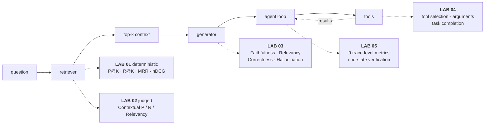

# Interactive labs

Six standalone HTML pages. Open the file in a browser — no build step, no server, no API key,
nothing to install. Each one lets you change the inputs and watch the metrics move, which is
the part a static document cannot do.

## The five surfaces, and which lab covers each

**Verify left to right, then look underneath.** Faithfulness scores are meaningless while recall is broken. Trajectory metrics are meaningless while the tools underneath are returning nothing usable.

---

## The labs

[`00-evaluation-index.html`](00-evaluation-index.html) is the interactive version of the map above.

### 1 — Deterministic Retrieval Metrics

[`01-deterministic-retrieval-metrics.html`](./01-deterministic-retrieval-metrics.html)

Precision@K, Recall@K, MRR and nDCG@K over the notebook's exact toy eval set. No LLM, no API key, no cost.

- **In the lab:** drag K from 1 to 5. Precision moves non-monotonically, recall stalls at **0.67**, and MRR is pinned at **0.50** at every value of K.
- **The payoff:** one relevant chunk was never retrieved, so three of the four metrics are structurally capped. No value of K fixes a retriever that cannot reach the chunk.

### 2 — LLM-Judged Retrieval

[`02-llm-judged-retrieval-metrics.html`](./02-llm-judged-retrieval-metrics.html)

The same question without hand-labelled chunk IDs. Contextual Precision cares about order, Recall about coverage, Relevancy about signal-to-noise.

- **In the lab:** inject one failure at a time and watch exactly which score reacts. Reordering three chunks — adding nothing, removing nothing — drops precision from **1.00 to 0.58** while the other two stay flat.
- **The payoff:** the "thin coverage" case scores **1.00 on precision and relevancy** and 0.50 on recall — a broken retriever that looks perfect if you only run the referenceless metric.

### 3 — Generator Metrics

[`03-generator-metrics.html`](./03-generator-metrics.html)

Faithfulness, Answer Relevancy, Hallucination, Answer Correctness (`GEval`) and Answer Semantic Similarity on four answers to one question.

- **In the lab:** switch between grounded, faithful-but-irrelevant, relevant-but-unfaithful, and faithful-to-bad-context.
- **The payoff:** the fourth answer scores **Faithfulness 1.00 and Answer Relevancy 1.00** while being flatly false. No referenceless metric can detect a corrupted knowledge base.

### 4 — Tool-Use Evaluation

[`04-tool-use-evaluation.html`](./04-tool-use-evaluation.html)

`ToolCorrectnessMetric` scored across six traces under three configurations.

- **In the lab:** with the default name-only comparison, an extra billed call, a reversed sequence, a dropped output and a **wrong booking date** all score 1.00. Mean: **0.92**.
- **The payoff:** adding `should_exact_match=True` catches all five broken traces and collapses the mean to **0.17**. The metric didn't change — the contract you asked it to enforce did.

### 5 — Agent Trajectory Evaluation

[`05-agent-trajectory-evaluation.html`](./05-agent-trajectory-evaluation.html)

Nine trace-level metrics on a refund agent with one error, one recovery and one redundant call.

- **In the lab:** remove waste one piece at a time across four trace variants.
- **The payoff:** **five of the nine metrics never move.** Task success, end-state and trajectory match all report a clean pass on a run where 40% of steps were waste.

---

## The written versions

The prose companions that used to sit beside each lab now live in one place:
[`docs/concepts/rag-agent-tool-evaluation.md`](../concepts/rag-agent-tool-evaluation.md).
Parts 0–5 are the compressed reference; **Part 6** is the worked narrative for each lab above,
in the same order. The interview questions that closed each companion moved to
[`docs/interview-prep/QUESTION_BANK.md`](../interview-prep/QUESTION_BANK.md) Part 10.

## Where each lab comes from

Built from course 01's notebooks. The mapping:

| Notebook | Covers | Lab |
|---|---|---|
| `00_Evaluation_Landscape` | Taxonomy, reference-based vs referenceless, judge failure modes, code-vs-judge scorer choice, tooling map | this README |
| `01_Retrieval_Metrics_Deterministic` | Precision@K, Recall@K, MRR, nDCG | **01** |
| `02_Retrieval_Metrics_LLM_Judged` | Contextual Precision / Recall / Relevancy | **02** |
| `03_Generator_Metrics_Referenceless` | Faithfulness, Answer Relevancy, Hallucination | **03** |
| `04_Generator_Metrics_Reference_Based` | Answer Correctness via `GEval`, Semantic Similarity | **03** |
| `05_RAG_Eval_Inside_the_Pipeline` | Evaluation as LangGraph nodes — gates, not after-the-fact scoring | 03 · 05 |
| `06_RAGAS_in_Practice` | RAGAS quickstart, multi-metric, the pytest/CI pattern | 03 |
| `07_RAG_Capstone_Build_and_Evaluate` | Build a RAG system, synthesize a golden dataset, run the full suite | 01 · 02 · 03 |
| `08_MultiTurn_Conversational_Evaluation` | `ConversationalGEval`, turn relevancy, knowledge retention | — |
| `09_Tool_Use_Evaluation` | `ToolCorrectnessMetric`, `ArgumentCorrectnessMetric`, `ToolUseMetric` | **04** |
| `10_Task_Completion_Evaluation` | `TaskCompletionMetric`, custom rubrics, outcome verification | **04** |
| `11_Same_Evals_with_MLflow` | The same questions via `mlflow.genai.evaluate()` scorers over traces | 04 · 05 |
| `12_Agent_Trajectory_Evaluation` | The 9-metric trace-level suite on a refund-agent scenario | **05** |
| `13_Production_Grade_Agent_Eval_Overview` | Live tracing + offline experiments (Arize Phoenix) | 05 |
| `14_Capstone_CrewAI_Travel_Planner_Eval` | Task completion against a real running 3-agent app | 04 · 05 |

Multi-turn conversational evaluation (`08`) is the one module without a lab in this series — it is a distinct enough surface to deserve its own.

## The four tools, and what each is actually for

The labs and the notebooks behind them deliberately keep four tools in view rather than picking
one, because you will meet systems built on each.

| Tool | What it's really for |
|---|---|
| **DeepEval** | The general-purpose metric library — retrieval, generation, tool use, task completion, conversational, plus `GEval` for custom rubrics. Pytest-friendly, good for CI. |
| **RAGAS** | RAG-specific, older and narrower, a common ecosystem default. Useful as a second opinion on the same test case. |
| **MLflow** | Evaluation inside an experiment-tracking platform — the same metrics, versioned and comparable across runs. |
| **Arize Phoenix** | Production tracing plus an offline experiment framework. The only one built around live traces rather than one-off test cases. |

None is "the right one." DeepEval and RAGAS answer *is this output good*; MLflow answers *is it
good, tracked against my experiment history*; Phoenix answers *is it good, and here is the full
trace of how it got there*. The field guide deliberately stays tool-agnostic
([`§0.5`](../concepts/rag-agent-tool-evaluation.md)) — this table is the concrete version.

## Suggested order

Straight through, **01 → 05** — each lab assumes the previous one's vocabulary:

- **01** — get deterministic retrieval metrics into CI. Free, fast, highest leverage available.
- **02** — add judged retrieval where labels don't exist, and validate the judge before trusting it.
- **03** — measure generation, and understand exactly which failure your referenceless metrics cannot see.
- **04** — check your `ToolCorrectnessMetric` configuration before believing its score.
- **05** — only once the layers above are measured. Instrument every step, then grade the path.

**If you only have an hour:** the map above → **02** → **04** → **05**.
