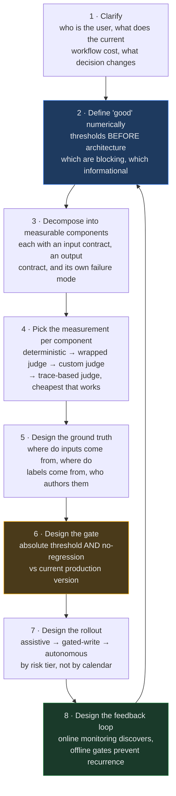

# Agentic AI System Design ও Decomposition — Case-Study প্রশ্নব্যাংক (বাংলা সংস্করণ)

> এটি [`Agentic_AI_Evaluation_Decomposition_Case_Studies.md`](Agentic_AI_Evaluation_Decomposition_Case_Studies.md)-এর বাংলা রূপান্তর। **প্রযুক্তিগত শব্দ (keyword, metric-এর নাম, API-র নাম) ইচ্ছাকৃতভাবে ইংরেজিতে রাখা হয়েছে** — কারণ ইন্টারভিউয়ে এগুলো ইংরেজিতেই বলতে হবে। ব্যাখ্যা, যুক্তি আর সূক্ষ্মতাগুলো বাংলায়।

**উৎস-উপকরণ (Source material):** `labs/`, `labs/ (আগে 07_Advanced_Agentic_Systems/Deep_Agents_and_Harness_Engineering/`, এবং `17_OpenAI_Applied_Engineer_Preparation/` — [AI-ENGINEERING-DEMYSTIFIED](https://github.com/Sourav692/AI-ENGINEERING-DEMYSTIFIED) থেকে।

**যে রাউন্ডগুলোর জন্য (Target rounds):** Agentic AI system design / problem decomposition — OpenAI (Applied AI Engineer), Anthropic (Applied AI / Forward Deployed), Google (Applied AI Engineer, Vertex Agents), Microsoft (Copilot Applied Science / Cloud Solution Architect - AI)।

**কীভাবে ব্যবহার করবেন:** নিচের কেসগুলো **অনুশীলনের জন্য বানানো, কোনো ফাঁস হওয়া প্রশ্ন নয়**। প্রতিটি পরিস্থিতিই এমন, যেটার মুখোমুখি একজন applied AI engineer বা FDE বাস্তব customer engagement-এ সত্যিই হন। প্রতিটি কেস এমনভাবে লেখা, যাতে ৩০–৪৫ মিনিট ধরে মুখে মুখে উত্তর দেওয়া যায় — আর ইন্টারভিউয়ার মাঝখানে পাল্টা চাপ দিতে থাকবেন।

---

## Section 0 — এই রাউন্ডে আসলে কী মাপা হয়

Decomposition রাউন্ড কোনো জ্ঞানের কুইজ নয়। উপরের চারটি কোম্পানিরই ইন্টারভিউয়াররা মোটামুটি একই পাঁচটি axis-এ নম্বর দেন:

| Axis | দুর্বল উত্তর দেখতে কেমন | শক্তিশালী উত্তর দেখতে কেমন |
|---|---|---|
| **Ambiguity handling** | দ্বিতীয় মিনিটেই RAG-এর diagram আঁকা শুরু করে দেয় | প্রথম ৫–৮ মিনিট খরচ করে ঠিক করে — user কে, বর্তমান workflow-এর খরচ কত, আর "good" মানে সংখ্যায় কী |
| **Decomposition** | একটাই বিশাল ব্লক — "agent-টা X করে" | নাম-দেওয়া component, প্রত্যেকটির স্পষ্ট contract, প্রত্যেকটি আলাদাভাবে measurable এবং আলাদাভাবে fail করতে সক্ষম |
| **Measurement discipline** | "আমরা RAGAS ব্যবহার করব" | retrieval / generation / tool-mechanics / trajectory / outcome — আলাদা করে ভাগ করে, আর বলে দেয় কোনটা *blocking* আর কোনটা *informational* |
| **Failure reasoning** | ধরে নেয় সবকিছু happy path-এ চলবে | প্রতিটি ভুল সিদ্ধান্তের blast radius নাম ধরে বলে, আর সিস্টেমটা এমনভাবে ডিজাইন করে যাতে model-এর ভুল করার অনুমতি থাকে |
| **Judgment under constraint** | ব্যবসার চাওয়াকে সরাসরি "হ্যাঁ" বলে দেয় | কারণসহ পাল্টা যুক্তি দেয়, আর বিকল্প ধাপক্রম (sequencing) প্রস্তাব করে |

**সবচেয়ে বেশি signal দেয় যে আচরণটি:** evaluation-কে একটা *design input* হিসেবে ধরা — build শেষ হওয়ার পরের একটা ধাপ হিসেবে নয়। কোনো component কীভাবে মাপবেন সেটা যদি বলতে না পারেন, তাহলে সেই component-এর ডিজাইনই এখনো শেষ হয়নি।

---

## Section 1 — The Decomposition Spine (মূল কাঠামো)

এই ডকুমেন্টের প্রতিটি কেসের মেরুদণ্ড হিসেবে এটাই ব্যবহার করুন। এটি ইচ্ছাকৃতভাবে eval-first।

**ধাপগুলো বাংলায়:**

1. **Clarify** — user কে, বর্তমান workflow-এর খরচ কত, কোন সিদ্ধান্তটা বদলাবে।
2. **"Good"-এর সংজ্ঞা সংখ্যায়** — architecture আঁকার *আগেই* threshold ঠিক করুন; কোনগুলো blocking, কোনগুলো informational।
3. **Measurable component-এ ভাঙুন** — প্রত্যেকটির input contract, output contract আর নিজস্ব failure mode থাকবে।
4. **প্রতি component-এ measurement বাছুন** — deterministic → wrapped judge → custom judge → trace-based judge; যেটা সবচেয়ে সস্তায় কাজ করে সেটাই।
5. **Ground truth ডিজাইন করুন** — input কোথা থেকে আসবে, label কোথা থেকে আসবে, কে লিখবে।
6. **Gate ডিজাইন করুন** — absolute threshold **এবং** বর্তমান production version-এর তুলনায় no-regression।
7. **Rollout ডিজাইন করুন** — assistive → gated-write → autonomous; ক্যালেন্ডার ধরে নয়, risk tier ধরে।
8. **Feedback loop ডিজাইন করুন** — online monitoring খুঁজে বার করে, offline gate পুনরাবৃত্তি ঠেকায়।

**এই diagram আঁকার সময় দুটো কথা মুখে বলবেন:**

- **Online discovers; offline prevents recurrence.** যে finding শুধু monitoring dashboard পর্যন্ত গিয়ে থেমে যায়, সেটা একবারই কাজে লাগে। সেটাকে একটা gated offline test-এ তুলে আনলে সেটা এরপরের প্রতিটি release-কে রক্ষা করে।
- **একমাত্র gate-ই deploy করাতে পারে।** মানুষের লেখা prompt আর মেশিনের optimise-করা prompt — দুটোই হুবহু একই check-এর ভেতর দিয়ে যাবে। auto-generated বলে কিছুই ছাড় পাবে না — বরং বেশি খুঁটিয়ে দেখা দরকার, কারণ সেটা এমন একটা metric-এর বিরুদ্ধে optimise করা হয়েছে যেটা gate-এর *ভেতরেই* বসে আছে।

---

## Section 2 — যে Evaluation Taxonomy আপনাকে এঁকে দেখাতে পারতে হবে

এই রাউন্ডের প্রায় প্রতিটি follow-up আসলে ছদ্মবেশে একই প্রশ্ন — *"আপনি আসলে কোন layer-টা মাপছেন?"* এটা তৈরি রাখুন।

```mermaid
flowchart LR
    subgraph L1["Retrieval"]
        R1["deterministic<br/>precision@k, recall@k, MRR, NDCG"]
        R2["LLM-judged<br/>contextual relevancy / precision / recall"]
    end
    subgraph L2["Generation"]
        G1["referenceless<br/>faithfulness, answer relevancy"]
        G2["reference-based<br/>correctness, expected_facts"]
    end
    subgraph L3["Tool mechanics"]
        T1["tool selection accuracy"]
        T2["argument correctness"]
        T3["redundant / unexpected calls"]
    end
    subgraph L4["Trajectory"]
        J1["step-wise accuracy"]
        J2["trajectory match"]
        J3["recovery / self-correction rate"]
        J4["cost & efficiency proxy"]
    end
    subgraph L5["Outcome"]
        O1["task success rate"]
        O2["END-STATE VERIFICATION<br/>read the system of record"]
    end

    L1 --> L2 --> L3 --> L4 --> L5
    style O2 fill:#1a3a2a,stroke:#137333,color:#e8eaed
```

পাঁচটি layer: **Retrieval** (ঠিক chunk এসেছে কি না) → **Generation** (উত্তর ওই chunk-এ grounded কি না) → **Tool mechanics** (ঠিক tool, ঠিক argument) → **Trajectory** (পুরো ধাপক্রমটা যুক্তিসঙ্গত কি না) → **Outcome** (user-এর কাজটা আদৌ হলো কি না)।

**Mechanics ≠ process ≠ outcome.** ঠিক tool-কে ঠিক argument দিয়ে ডাকলেই ধাপক্রম ঠিক হয়ে যায় না, আর ঠিক ধাপক্রম মানেই user-এর উদ্দেশ্য পূরণ হওয়া নয়। তিনটেই মাপুন — শুধু যেটা মাপা সবচেয়ে সস্তা সেটা নয়।

**সবচেয়ে জোরালো signal সবসময় end-state verification.** যেখানেই একটা বাস্তব, যাচাইযোগ্য side effect আছে — database-এর একটা row, একটা booking, পাঠানো একটা message, তৈরি হওয়া একটা ticket — সেখানে system of record সরাসরি পড়ে দেখাটা যেকোনো LLM-judged metric-কে হারিয়ে দেয়। আত্মবিশ্বাসী ভাষায় লেখা ভুল বাক্য এটাকে বোকা বানাতে পারে না।

---

# Tier A — শূন্য থেকে Evaluation Strategy তৈরি করা

## Case 1 — "আমাদের agent production-এ চলছে, কিন্তু সেটা ভালো কি না জানি না"

> একটি telecom customer-এর LLM support agent চার মাস ধরে live। সেটা internal knowledge base থেকে উত্তর দেয়, account দেখতে পারে, network status চেক করতে পারে, ticket খুলতে পারে। কোনো eval নেই। Leadership জানতে চায় আরও তিনটি business unit-এ ছড়ানো উচিত কি না। আপনার হাতে দুই সপ্তাহ। কী করবেন?

**যা পরীক্ষা করা হচ্ছে:** আপনি নিজে বানাননি এমন একটা সিস্টেমে, সেটাকে বন্ধ না করে, measurement দাঁড় করাতে পারেন কি না।

**যেভাবে ভাঙবেন:**

- **আগে instrumentation।** যে agent-কে trace করা যায় না, তাকে evaluate করাও যায় না। কোনো metric তৈরির আগেই নিশ্চিত করুন প্রতিটি request থেকে বেরোচ্ছে: একটা retriever span, প্রতি LLM call-এ একটা chat-model span, আর প্রতি tool call-এ একটা tool span — token count আর latency সহ।
- **Span type একটা contract, নিছক label নয়।** একটা groundedness scorer-এর জন্য RETRIEVER টাইপের span *বাধ্যতামূলক*। ভুল span type দিয়ে trace করা retrieval function eval-কে একটু দুর্বল করে না — একেবারে ভেঙে দেয়।
- **মাপার আগেই ঠিক করুন "good" মানে কী।** ৫–৭টা dimension-এর নাম দিন (groundedness, correctness, tool-selection, safety, escalation-appropriateness, latency, cost) এবং প্রত্যেকটির একটা threshold ও blocking/informational flag দিন।
- **Dataset বাস্তব traffic থেকে mine করুন, হাতে লিখবেন না।** হাতে লেখা set গঠনগতভাবেই অন্ধ: তাতে শুধু লেখকের কল্পনার জিনিসই থাকে, আর বাস্তবতার সঙ্গে ফারাকটা ভেতর থেকে দেখাই যায় না।
- **Mining input দেয়, label দেয় না।** Trace আপনাকে *distribution* দেয় — অনুমান করা সবচেয়ে কঠিন অর্ধেকটা। কিন্তু expectation এখনো মানুষকেই লিখতে হবে, আর প্রতিটি label-এর provenance লিখে রাখতে হবে।
- **Sample-কে stratify করুন।** Random sampling আপনাকে সেই head-টাই ফিরিয়ে দেবে যেটা আপনি এমনিতেই বোঝেন। Novelty-targeted selection — ইতিমধ্যেই set-এ থাকা জিনিস থেকে embedding distance, বা low-confidence / high-latency / tool-error trace — সেটাই tail খুঁজে বার করে।

**ফাঁদ (The trap):** agent-এর নিজের পুরোনো output-কেই expectation হিসেবে ব্যবহার করা। এটা **circular ground truth** — agent গঠনগতভাবেই pass করবে, আর আজকের bug গুলো "সঠিক" হিসেবে জমাট বেঁধে যাবে। কেউ শর্টকাট হিসেবে এটা প্রস্তাব করলে নাম ধরে ধরিয়ে দিন।

**Killer follow-ups:**
- *"আপনার কাছে labelled data নেই, আর তিন সপ্তাহ কোনো SME-র সময়ও নেই। প্রথম সপ্তাহে কী ship করবেন?"* → শুধু referenceless scorer (faithfulness, safety, format, deterministic input/output check)। এগুলোর ground truth লাগে না, আর live traffic-এ সঙ্গে সঙ্গে চালানো যায়।
- *"আপনার eval বলছে ৯১% pass। agent কি ভালো?"* → এখনো বলা যাচ্ছে না। *কোন distribution*-এর ৯১%, *কার* মানদণ্ডে, আর judge-টা তো যাচাইই করা হয়নি। Category slice ছাড়া আর judge calibration ছাড়া aggregate pass rate একটা সংখ্যা মাত্র, প্রমাণ নয়।

**শক্তিশালী উত্তরের ইঙ্গিত:** আপনি মুখে বলবেন — যে eval একটা সিদ্ধান্তে গিয়ে শেষ হয় না, সেটা eval-ই নয়। দুই সপ্তাহের engagement-এর ফল হওয়া উচিত *expand / don't expand / শুধু এই দুটো intent-এর জন্য expand* — একটা dashboard নয়।

---

## Case 2 — "System ডিজাইনের আগে eval ডিজাইন করুন"

> একটি ব্যাংক চায় এমন একটা agent, যেটা relationship manager-দের client portfolio সংক্রান্ত প্রশ্নের উত্তর দেবে — একটা document store আর একটা transactions warehouse থেকে টেনে। কিছুই এখনো তৈরি নয়। ইন্টারভিউয়ারের প্রথম প্রশ্ন: কোনো architecture আঁকার আগে বলুন, আপনি কীভাবে বুঝবেন এটা কাজ করছে?

**যা পরীক্ষা করা হচ্ছে:** Eval-driven development আপনার কাছে সত্যিকারের একটা পদ্ধতি, নাকি নিছক একটা স্লোগান।

**যেভাবে ভাঙবেন:**

- **উদ্দেশ্য — এক বাক্যে, একটা সংখ্যাসহ।** "RM-দের portfolio-prep-এর সময় ৪০ মিনিট থেকে ১০ মিনিটের নিচে নামানো, এবং শূন্যসংখ্যক বানানো holdings figure" — এটা একটা objective। "Productivity বাড়ানো" — এটা নয়।
- **একটা gate মানে: metric-এর নাম + threshold + blocking flag।** Gate table-টা *সবার আগে* লিখুন। সেটাই architecture-এর requirements document হয়ে যাবে।
- **Blocking বনাম informational আর "dimension-টা গুরুত্বপূর্ণ কি না" — দুটো আলাদা প্রশ্ন।** Tone গুরুত্বপূর্ণ, কিন্তু সম্ভবত release আটকানো উচিত নয়। বানানো figure গুরুত্বপূর্ণ, এবং সেটা অবশ্যই আটকাবে।
- **Measurability-র *জন্যই* নেওয়া architectural সিদ্ধান্ত।** সবচেয়ে বড়টা: retrieval-কে একটা fixed pipeline step বানান, model যেটা এড়িয়ে যেতে পারে এমন tool নয়। তাহলে প্রতিটি trace-এ retriever span থাকবেই, ফলে groundedness সবসময় score করা যাবে। অন্যদিকে account lookup-কে model-এর বাছাই করা tool হিসেবেই রাখুন — ঠিক এই কারণেই যে "ওটা কি ডাকা উচিত ছিল?" প্রশ্নটাই আপনি score করতে চান।
- **Scorer-এর খরচের ক্রমবিন্যাস।** Deterministic (ফ্রি, তাৎক্ষণিক) → scorer হিসেবে মোড়ানো built-in judge → rubric সহ custom judge → পুরো trajectory পড়া trace-based judge। প্রশ্নের উত্তর দেয় এমন সবচেয়ে সস্তা layer-টাই বাছুন।
- **খরচের চেয়ে বড় কারণ হলো determinism।** Deterministic scorer *reproducible*। সেটা নড়লে বুঝতে হবে আচরণ সত্যিই বদলেছে। Judge তো নিজে নিজেই নড়ে।

**ফাঁদ:** একটাই mega-judge প্রস্তাব করা যেটা "overall quality 1-5" রেটিং দেয়। এটা পাঁচটা স্বাধীন failure mode-কে একটা সংখ্যায় চেপে দেয় — যা দিয়ে কিছু diagnose-ও করা যায় না, নির্দিষ্ট কিছু gate-ও করা যায় না।

**Killer follow-ups:**
- *"আপনার কোন gate গুলো প্রথম দিনে blocking করবেন, আর কোনগুলো নব্বইতম দিনে?"*
- *"একই row-তে একটা deterministic regex scorer আর একটা LLM judge একমত হচ্ছে না। কে জিতবে?"* → কেউই না। ওরা পরিপূরক: regex স্পষ্ট কেসটা সবসময় ধরে, paraphrase কখনোই ধরে না; judge-এর ব্যাপারটা ঠিক উল্টো। দুটোই চালান, আর যেসব row-তে ওরা দ্বিমত সেগুলোকেই সবচেয়ে মূল্যবান review queue হিসেবে ধরুন।

---

## Case 3 — "প্রমাণ করুন copilot থেকে autonomous-এ যাওয়াটা যথেষ্ট নিরাপদ"

> একটি বিমা কোম্পানির AI claims assistant assistive mode-এ চলছে — সে খসড়া বানায়, মানুষ সিদ্ধান্ত নেয়। ব্যবসা চায় দুই কোয়ার্টারের মধ্যে কম-মূল্যের claim-গুলোর automated adjudication। সেটা অনুমোদনের আগে আপনি কী প্রমাণ চাইবেন, আর সেই প্রমাণ কীভাবে তৈরি করবেন?

**যা পরীক্ষা করা হচ্ছে:** Risk-tiered rollout, আর আপনি "না" বলার সঙ্গে একটা পরিকল্পনা জুড়ে দিতে পারেন কি না।

**যেভাবে ভাঙবেন:**

- **Action গুলোকে blast radius অনুযায়ী tier করুন**, claim-এর টাকার অঙ্ক অনুযায়ী নয়: read-only extraction → triage/routing → missing-info detection → recommendation → adjudication। প্রতিটি tier আলাদাভাবে autonomy অর্জন করবে।
- **Assistive mode আসলে একটা বিনামূল্যের labelling factory.** মানুষের প্রতিটি override হলো নিখুঁত provenance সহ একটা ground-truth label। override-টাকেই instrument করুন — agent কী প্রস্তাব করেছিল, মানুষ কী বেছে নিল, আর কেন — তাহলেই autonomous phase-এর eval set আপনার হাতে।
- **Gold file-এর বিরুদ্ধে accuracy নয়, মানুষ adjudicator-দের সঙ্গে agreement মাপুন।** আর সেই agreement-কে chance-এর জন্য সংশোধন করে নিন, কারণ skewed distribution-এ (বেশিরভাগ claim অনুমোদিত) raw agreement ভয়ানকভাবে ভালো দেখায়।
- **Automation-এর পথ ঠিক করার আগে reversal-এর পথ ঠিক করুন।** একটা ভুল auto-adjudication-এর খরচ কত, কীভাবে সেটা ধরা পড়বে, ধরা পড়তে কত সময় লাগবে, আর সেটা ফেরানো যাবে কি না?
- **Shadow mode-ই gate।** N সপ্তাহ ধরে autonomous সিদ্ধান্তগুলো মানুষের পাশাপাশি চালান, আর promotion আটকে রাখুন দুটো শর্তে — একটা absolute agreement threshold *এবং* assistive baseline-এর তুলনায় no regression।

**ফাঁদ:** প্রশ্নটার যেভাবে জিজ্ঞাসা হয়েছে ঠিক সেভাবেই উত্তর দেওয়া। "প্রমাণ করুন এটা নিরাপদ" কথাটা একটা একক সংখ্যার দিকে টানে। সঠিক পদক্ষেপ হলো প্রশ্নটাকে নতুন করে সাজানো: safety একটা threshold নয়, এটা claim-type ভিত্তিক সিদ্ধান্ত — আলাদা threshold, আলাদা human-review rate।

**Killer follow-ups:**
- *"ব্যবসা বলছে governance review-তে ছয় সপ্তাহ লাগবে, তাই MVP-র জন্য ওটা বাদ দিতে চায়। কী করবেন?"* → control কমানোর প্রস্তাব নয়, scope কমানোর প্রস্তাব দিন। read-only extraction-এর MVP-র জন্য adjudication governance লাগেই না।
- *"আপনার agreement ৯৪%। বাকি ৬% — কীভাবে জানবেন ওগুলো একটাই claim type-এ জমাট বাঁধেনি?"* → জানবেন না, যদি না slice করেন। Aggregate ঠিক সেই জিনিসটাই লুকিয়ে রাখে যেটা আপনার দেখা দরকার।

---

# Tier B — Production-এ ভেঙে পড়া সিস্টেম diagnose করা

## Case 4 — "Model upgrade করার পর quality পড়ে গেছে"

> একজন customer নতুন model-এ upgrade করেছে। Offline benchmark উন্নত হয়েছে। User-রা বলছে quality খারাপ হয়েছে। আপনার তদন্তের ধাপগুলো বলুন।

**যা পরীক্ষা করা হচ্ছে:** আপনি *model quality* আর *application quality* আলাদা করতে পারেন কি না — এই পরিবারের সবচেয়ে নিয়মিত জিজ্ঞাসিত প্রশ্ন।

**যেভাবে ভাঙবেন:**

- **অভিযোগটাকে একটা measurable দাবিতে রূপান্তর করুন।** "খারাপ" কোনো metric নয়। user-রা flag করেছে এমন ২০টা নির্দিষ্ট conversation জোগাড় করুন।
- **শুধু model নয়, যা যা বদলেছে সবকিছুর diff নিন।** Model version, prompt template, tool schema, retrieval index, context-window truncation behaviour, temperature, structured-output mode।
- **Prompt sensitivity দেখুন।** পুরোনো model-এর খুঁতের সঙ্গে মানিয়ে tune করা prompt নতুন model-এ খারাপ করতে পারে, কারণ নতুনটা নির্দেশ আরও আক্ষরিকভাবে মানে। সাধারণত প্রথমে ভাঙে format compliance আর tool-argument-এর গঠন।
- **যে metric-টা কেউ দেখছিল না, সেটা দেখুন।** ক্লাসিক ঘটনা: যে metric উন্নত করতে বলা হয়েছিল সেটা উঠেছে, আর তিনটে ভেঙে পড়েছে। Conciseness বেড়েছে; groundedness আর escalation-appropriateness পড়ে গেছে।
- **Benchmark-টাই ভুল কি না দেখুন।** Benchmark উন্নত হচ্ছে অথচ user অভিযোগ করছে — এটাই প্রমাণ যে benchmark-এর distribution production traffic-এর সঙ্গে মেলে না।

**ফাঁদ:** সিদ্ধান্তে আসা যে "নতুন model খারাপ।" সাধারণত তা নয়। Application-টাই পুরোনো model-এর উপর overfit হয়ে ছিল।

**Killer follow-ups:**
- *"Offline benchmark উন্নত, অথচ user-রা একমত নয়। তিনটে ব্যাখ্যা দিন।"* → (১) benchmark distribution ≠ traffic distribution; (২) benchmark এমন dimension মাপে যা user-এর কাছে গুরুত্বপূর্ণ নয়, আর যেগুলো গুরুত্বপূর্ণ সেগুলো বাদ দেয়; (৩) benchmark-এর judge unaligned, আর সেটা নতুন model-কে ফুলিয়ে দেখাচ্ছিল।
- *"পরের বার এটা কীভাবে আটকাবেন?"* → দুই-শর্তের regression gate: absolute threshold *এবং* বর্তমান production version-এর তুলনায় no regression — পুরো scorer set জুড়ে, শুধু যে metric-টা optimise করা হচ্ছে সেটায় নয়।

---

## Case 5 — "Agent আত্মবিশ্বাসের সঙ্গে customer-কে এমন কিছু বলেছে যার অস্তিত্বই নেই"

> Agent একজন customer-কে তার account plan আর balance বলে দিয়েছে। Account number-টার অস্তিত্বই ছিল না। Tool ফেরত দিয়েছিল `{"found": false}`। কোনো error ওঠেনি, কিছু crash করেনি, কোনো alert যায়নি। এটা কীভাবে ঘটল, আর কীভাবে থামাবেন?

**যা পরীক্ষা করা হচ্ছে:** **polite tool failure** চিনতে পারা — production agent-এ সবচেয়ে কম পরীক্ষিত failure mode।

**যেভাবে ভাঙবেন:**

- **কীভাবে ঘটে।** যে tool exception না তুলে একটা soft failure object ফেরত দেয়, সেটা model-কে এমন কিছু দেয় যা দেখতে data-র মতো। Model সেটা পাশ কাটিয়ে ফাঁকটা ভরে দেয় সাবলীল, বিশ্বাসযোগ্য, ভুল কথা দিয়ে।
- **সাধারণ scorer কেন এটা ধরে না।** Groundedness উত্তরকে মেলায় *retrieved document*-এর সঙ্গে, *tool output*-এর সঙ্গে নয়। Task-success শুধু চূড়ান্ত string দেখে। কেউই tool span পড়ে না।
- **সমাধান একটা deterministic scorer, ভালো prompt নয়।** TOOL span-এর output পড়ুন; সেটা failure নির্দেশ করলে assert করুন যে response-এ ওই tool-এর সরবরাহ করার কথা ছিল এমন fact নেই। Deterministic — কারণ আপনি এটাকে reproducible আর ফ্রি চান।
- **দ্বিতীয় স্তরের সমাধান:** যেখানে tool layer আপনার নিয়ন্ত্রণে, সেখানে soft failure-কে সশব্দ করুন, আর "ওটা আমি আনতে পারিনি" বলাটাকে rubric-এ স্পষ্টভাবে পুরস্কৃত আচরণ বানান।
- **অনুপস্থিতিও একটা আচরণ।** যে প্রশ্নে সঠিকভাবেই *কোনো* tool call হয় না, সেটা একটা সঠিক outcome এবং score করার যোগ্য — signal-এর অভাব নয়।

**ফাঁদ:** শুধু prompt engineering দিয়ে এটা সারানোর প্রস্তাব দেওয়া। নির্দেশ হার কমায়; ধরা পড়ার ব্যবস্থা করে না।

**Killer follow-ups:**
- *"এই প্যাটার্ন আর কোথায় দেখা যায়?"* → খালি retrieval result, permission-filtered search-এ শূন্য row, downstream API যেটা খালি payload নিয়ে 200 ফেরত দেয়, rate-limited call যেটা cache-করা বাসি value ফেরত দেয়।
- *"Monitoring-এ এটা কীভাবে ধরা পড়ত?"* → পড়ত না, আর সেটাই মূল কথা। নীরবতা আর সাফল্য দেখতে হুবহু এক।

---

## Case 6 — "Response ধীর হয়ে গেছে, শুধু peak সময়ে"

> একটি enterprise জানাচ্ছে p95 latency তিন গুণ হয়েছে। শুধু অফিস-সময়ে। তদন্ত করুন।

**যা পরীক্ষা করা হচ্ছে:** পুরো সিস্টেমকে একটা বাক্স হিসেবে না দেখে, agentic trace জুড়ে latency ভাঙতে পারেন কি না।

**যেভাবে ভাঙবেন:**

- **Latency per-span, per-request নয়।** ভাগ করুন: input assembly → retrieval (embed + search + rerank) → প্রথম LLM call → tool round-trip → পরবর্তী LLM call → output streaming। যে agent loop দুটো অতিরিক্ত turn নিচ্ছে, সেটা আসলে একটা *behavioural* regression যা latency-র ছদ্মবেশে দেখা দিচ্ছে।
- **Trace-কে queryable table হিসেবে দেখুন।** Production trace একবার warehouse-এ পৌঁছলে "ধীর হয়ে গেছে" রূপান্তরিত হয় "retrieval p95 দ্বিগুণ হয়েছে অথচ chat-model p95 অপরিবর্তিত"-তে। trace store-এর পুরো মূল্যই এটুকু।
- **শুধু peak-এ হওয়াটা দ্রুত সংকুচিত করে দেয়।** সম্ভাব্য কারণ: provider rate limiting ও retry backoff, concurrency-র চাপে vector index cache eviction, connection-pool ফুরিয়ে যাওয়া, খারাপভাবে batch করা reranker, কিংবা একটা noisy-neighbour tenant।
- **শুধু step-এর সময়কাল নয়, step-এর সংখ্যা বদলেছে কি না দেখুন।** Peak-এ প্রতি request-এ বেশি tool call মানে হতে পারে traffic-এর মিশ্রণ বদলেছে, সিস্টেম ধীর হয়নি।
- **সাধারণত মাত্র ছয়টা aggregation পাওয়া যায়** — min, max, mean, median, variance, p90। p99 লাগলে সেটা raw trace table থেকে নিজেকেই বার করতে হবে।

**Killer follow-up:** *"p50-এ latency ঠিক আছে, p90-এ ভয়াবহ। কোনটা optimise করবেন আর কেন?"* → সম্পূর্ণ নির্ভর করে tail-টা কোনো user segment বা intent class-এর সঙ্গে জড়িত কি না। Optimise করার আগে slice করুন।

---

# Tier C — Trajectory ও Multi-Agent Evaluation

## Case 7 — "Agent ঠিক উত্তরই দেয়, কিন্তু ছয় ধাপে"

> একটা research agent নির্ভরযোগ্যভাবে সঠিক চূড়ান্ত উত্তর দেয়। পাশাপাশি সে অপ্রয়োজনীয় tool call করে, ব্যর্থ call অন্ধভাবে retry করে, আর বাজেটের ৪ গুণ খরচ করে। Task success ৯৬%। এমন evaluation ডিজাইন করুন যেটা এটা ধরে ফেলত।

**যা পরীক্ষা করা হচ্ছে:** এটা বোঝা যে **outcome metric process-এর ব্যর্থতা লুকিয়ে রাখে** — এবং দুটোই দরকার।

**নয়টি trajectory-level metric-এ ভাঙুন:**

| # | Metric | কী ধরে |
|---|---|---|
| 1 | **Tool selection accuracy** | যে tool গুলো ডাকা হয়েছে সেগুলো gold set-কে কভার করেছে কি? নয়টির মধ্যে সবচেয়ে ঢিলেঢালা — ভুল ক্রম আর অতিরিক্ত call থাকলেও pass করে |
| 2 | **Tool call correctness (arguments)** | ঠিক tool, কিন্তু বিকৃত argument |
| 3 | **Redundant / unnecessary calls** | একই trace-এ আগেই *সফল* হয়েছে এমন `(tool, args)` জোড়া |
| 4 | **Step-wise accuracy** | মোট ধাপের কত ভগ্নাংশ সত্যিকারের অগ্রগতি এনেছে |
| 5 | **Task success rate** | ওই run-এর ground-truth outcome |
| 6 | **Trajectory match (fuzzy/set-based)** | সফল tool set বনাম gold set — ক্রম ও retry উপেক্ষা করে |
| 7 | **End-state verification** | পরিবর্তিত system of record সরাসরি পড়া |
| 8 | **Recovery / self-correction rate** | error-এর পর কোনো পরবর্তী ধাপ কি একই tool ডেকে সফল হয়েছে? |
| 9 | **Cost / efficiency proxy** | redundant call + error-কে অপচয় হিসেবে ধরা |

**প্রচলিত প্যাটার্নের ফাঁদ:** সচরাচর যে tool-selection scorer প্রকাশিত হয়, সেটা *missing* আর *unexpected* দুই ধরনের tool-ই হিসাব করে, অথচ verdict দেয় শুধু missing-এর ভিত্তিতে। ফলে যে agent **প্রতিটি request-এ প্রতিটি tool ডাকে সে ১০০% পায়**। দুই দিকেই fail করান — একটা অপ্রত্যাশিত account lookup অদক্ষতা নয়, সেটা privacy সমস্যা।

**Killer follow-ups:**
- *"উঁচু recovery rate ভালো না খারাপ?"* → একা দেখলে সত্যিই ভালো। মাঝপথে ধরা পড়ে শুধরে নেওয়া error সেই সিস্টেম থেকে সম্পূর্ণ আলাদা যেটা নীরবে fail করে বা একই খারাপ input নিয়ে অন্ধভাবে retry করে। তবে এটাকে step-wise accuracy-র সঙ্গে জোড়া লাগান, নইলে আপনি এমন সিস্টেমকে পুরস্কৃত করছেন যে error তৈরি করে যাতে সেটা থেকে recover করতে পারে।
- *"সক্ষম model এমনিতেই সাধারণত সবচেয়ে ছোট trajectory বেছে নেয়। তাহলে harness বানাবেন কেন?"* → কারণ "সাধারণত"-ই সমস্যা। Harness-এর কাজ ওই ambiguous query আর edge-case run গুলো ধরা যেখানে সে বেছে নেয় না — আর ঠিক সেগুলোই কেউ রিপোর্ট করে না।
- *"Exact sequence match না fuzzy set match?"* → default-এ fuzzy। Exact-sequence মাঝপথে একটা typo বা একটা নিরীহ বাড়তি lookup-এও fail করে, যদিও agent ঠিক কাজই করেছে। Exact match তুলে রাখুন সেই regulated workflow-এর জন্য যেখানে ক্রমটাই requirement।

---

## Case 8 — "Multi-agent system, আর কোন agent ভুল করছে বোঝা যাচ্ছে না"

> একটা deep-agent orchestrator বিশেষায়িত subagent-দের কাছে route করে — একটা research agent, একটা code writer, একটা code reviewer, একটা memory manager, আর আলাদা data domain-এর উপর চারটে domain analytics agent। End-to-end quality অসংগত। Evaluation ডিজাইন করুন।

**যা পরীক্ষা করা হচ্ছে:** Attribution — এমন সিস্টেমে যেখানে ব্যর্থতা আর উপসর্গ দুটো আলাদা component-এ।

**যেভাবে ভাঙবেন:**

- **Trace nesting-ই attribution সম্ভব করে।** Session → orchestrator turn → subagent invocation → span। Nesting ছাড়া আপনি শুধু বলতে পারবেন quality পড়েছে; nesting থাকলে বলতে পারবেন *কোন subagent*, *কোন turn*-এ।
- **তিনটে স্তরে evaluate করুন।** Routing/handoff accuracy (orchestrator কি ঠিক subagent বেছেছে?), per-subagent specialisation quality (research agent কি সত্যিই গবেষণায় ভালো?), আর end-to-end outcome।
- **Handoff accuracy নিজেই একটা metric** — আর নতুন subagent যোগ হলে সাধারণত এটাই প্রথম ভাঙে: routing rubric লেখা হয়েছিল N-টা agent-এর জন্য, চলছে এখন N+1 নিয়ে।
- **Scope of validity.** এক-tool-এর agent-এর জন্য সঠিক ছিল এমন scorer দ্বিতীয় tool যোগ হলেই বিভ্রান্তিকর হয়ে যায়। Router rubric-এর ক্ষেত্রেও তাই। প্রতিটি measurement-এর একটা scope of validity আছে, আর নিচের সিস্টেম বদলে গেলে সেটা নীরবে অসত্য হয়ে যায়।
- **Cross-domain query-ই কঠিন কেস।** যখন একটা প্রশ্নের জন্য দুটো analytics subagent আর research agent লাগে, তখন সংজ্ঞা দিন — আংশিক coverage কি সাফল্য? আর প্রতিটি অংশ থেকে আলাদা করে *composition*-কেও score করুন।
- **Memory একটা evaluable component।** Cross-thread persistence-এর নিজস্ব test দরকার: সংরক্ষিত fact নতুন thread-এ ঠিকমতো recall হয় কি; forget নির্দেশ সত্যিই মুছে দেয় কি; memory এক user থেকে আরেক user-এ leak করে কি না।

**Killer follow-ups:**
- *"প্রতিটি subagent ০.৯-এর উপরে স্কোর করছে, অথচ end-to-end ০.৬। ব্যাখ্যা করুন।"* → Composition। p হারে চলা n-টি স্বাধীন component মিলে হয় p^n; তার উপরে routing error আর handoff সীমানায় context হারানো — যেগুলো কোনো per-agent metric দেখতেই পায় না।
- *"Circular handoff — agent A route করে B-তে, B আবার A-তে। কীভাবে ধরবেন আর evaluate করবেন?"* → cycle ধরার জন্য একটা deterministic trace scorer, সঙ্গে একটা step-budget gate। সস্তা, reproducible — আর এই শ্রেণির failure-এ LLM judge কিছুই যোগ করে না।

---

## Case 9 — "প্রতিটি turn pass করছে, তবু conversation-টা fail করছে"

> একটা multi-turn assistant-এর turn-level pass rate ৯৫%। User-রা বলছে এটা বিরক্তিকর। দুটো মেলান।

**যা পরীক্ষা করা হচ্ছে:** Session-level বনাম turn-level চিন্তা, আর প্রাথমিক composition-এর পাটিগণিত।

**যেভাবে ভাঙবেন:**

- **পাটিগণিতটা।** p হারে চলা স্বাধীন turn গুলো মিলে conversation-এর হার হয় p^n। প্রতি turn ৯৫% আর ৫ turn হলে **conversation success ৭৭%** — আর conversation যত লম্বা, অতিরঞ্জন তত বেশি। অর্থাৎ metric ঠিক সেখানেই সবচেয়ে ভালো দেখায় যেখানে product সবচেয়ে খারাপ।
- **যেসব failure-এর কোনো single-turn রূপ নেইই:**
  - **Context retention** — user যা আগেই দিয়েছে সেটা আবার চাওয়া। সবচেয়ে চোখে পড়া multi-turn failure।
  - **Consent, যেটা turn-এর মাঝখানে থাকে।** "না জিজ্ঞেস করেই কাজ করে ফেলেছে" — এটা কোনো একটা turn-এর বৈশিষ্ট্য হিসেবে প্রকাশই করা যায় না।
  - **Approval-এর ফলাফল দুটো নয়, তিনটে:** compliant, violation, আর *stalled* (রাজি হয়েছে অথচ কিছুই হয়নি)। তিনটের সমাধান আলাদা।
- **Gate by prompt, verify by evaluation.** বেশিরভাগ agent write-action নির্দেশ দিয়ে আটকানো, API দিয়ে নয়। Tool-কে ডাকলেই সে খুশিমনে প্রতিবার লিখে দেবে। তাই আনুগত্য কোড নিশ্চিত করে না — evaluation-কেই সেটা *যাচাই* করতে হয়।
- **First-failing-turn-এর distribution।** Turn 1-এ failure মানে মৌলিক দক্ষতার সমস্যা। Turn 4-এ failure মানে context handling-এর সমস্যা। একই aggregate, সম্পূর্ণ আলাদা সমাধান।
- **Gate scope.** একটা conversation gate single-turn run-এ মাপাই যায় না। তখন সেটাকে **"not measured"** রিপোর্ট করতে হবে, কখনোই 0 নয় — অমাপা gate আর fail-করা gate কখনোই দেখতে এক হওয়া চলবে না।

**Harness-এর ফাঁদ:** user identity শুধু turn 1-এ প্রয়োগ করা। তখন agent turn 2 থেকে ভুলে যায় সে কার সঙ্গে কথা বলছে, আর নিছক plumbing-এর কারণে প্রতিটি conversation context-retention-এ fail করে। তখন আপনি agent নয়, নিজের harness-ই মাপছেন।

**Off-by-one ফাঁদ:** consent যে turn-এ এসেছে *সেই একই* turn-এর write-কে অকালপক্ব ধরা। Consent আসে turn-এর শুরুতে user-এর message-এ; write ঘটে ওই turn-এর ভেতরেই agent-এর response-এ। Same-turn সঠিক — আর এটা ভুল বুঝলে সঠিক আচরণ করার জন্যই agent fail হবে।

**Killer follow-up:** *"Tool selection আর tool use — একই জিনিস?"* → একটা মাত্র tool থাকলে দুটো মিলে একটাই প্রশ্ন হয়ে যায়। দুটো tool হলেই আলাদা হয়ে যায়, আর ভুল-tool no-tool-এর চেয়ে খারাপ: সেটা এমন data ফেরত দেয় যা আসল, অপ্রাসঙ্গিক, এবং আত্মবিশ্বাসের সঙ্গে পরিবেশিত।

---

# Tier D — Judge ও Human Calibration

## Case 10 — "Validator-কে validate করবে কে?"

> আপনার eval suite তিন মাস ধরে চলছে। তার প্রতিটি quality সংখ্যা এসেছে একটা LLM judge থেকে, যাকে কেউ কোনোদিন মানুষের বিচারের সঙ্গে মিলিয়ে দেখেনি। একজন VP জিজ্ঞেস করলেন সংখ্যাগুলোর আদৌ কোনো মানে আছে কি না। আপনার উত্তর কী, আর এরপর কী করবেন?

**যা পরীক্ষা করা হচ্ছে:** আপনি LLM-as-judge-কে পরিচিত failure mode সহ একটা যন্ত্র হিসেবে দেখেন, নাকি একটা অভ্রান্ত oracle হিসেবে।

**যেভাবে ভাঙবেন:**

- **প্রথমে সৎ উত্তরটা:** সংখ্যাগুলো অভ্যন্তরীণভাবে সংগতিপূর্ণ, কিন্তু বাইরে থেকে যাচাই করা হয়নি। ওগুলো *পরিবর্তন* ধরার কাজে লাগে, *quality* সম্পর্কে দাবি করার কাজে নয়।
- **একই trace-এ মানুষের label সংগ্রহ করুন।** ছোট (১০০–২০০ row), সত্যিকারের domain expert-দের কাছ থেকে, judge যে rating schema ব্যবহার করে ঠিক সেটাতেই।
- **গড় score নয়, agreement মাপুন।** গড় আসলে উদারতা মাপে। যে judge সবকিছুকে 5/5 দেয় সে দুর্দান্ত score করে এবং সম্পূর্ণ অকেজো।
- **Raw agreement ভালো দেখায়।** Skewed rating distribution-এ দুজন rater নেহাত ভাগ্যেই প্রায়ই একমত হয়ে যান। এক ঘটনায় ৮৫% raw agreement-এর Cohen's kappa ছিল মাত্র **০.২০**।
- **Ordinal scale-এ weighted রূপটা ব্যবহার করুন।** সাধারণ kappa 4-বনাম-5 আর 1-বনাম-5-কে একই মাপের ভুল ধরে। *একই* exact agreement আর *একই* plain kappa পাওয়া দুটো judge quadratic weighted kappa-তে স্কোর করতে পারে **+০.৭১ আর −০.৮২**।
- **Alignment-এর পর score পড়ে যাওয়াটাই সাফল্যের লক্ষণ।** Agent বদলায়নি। Measurement-টা আর ফুলিয়ে দেখাচ্ছে না। VP "আপনি তো আরও খারাপ করে দিলেন" বলার *আগেই* কথাটা বলে দিন।
- **Alignment-এর আসল ফসল হলো distilled guidelines** — আপনার expert-দের অনুচ্চারিত মানদণ্ড, অবশেষে লিখিত রূপে। ওই artifact-টা judge model-এর চেয়েও বেশিদিন টিকবে।

**নীরব ব্যর্থতা:** human label schema-র নাম আর judge-এর নাম না মিললে alignment কোনো error ছাড়াই শেষ হয়ে যায় এবং কিছুই শেখে না। Aligned judge base-এর সঙ্গে byte-by-byte অভিন্ন থাকে। নামটা একবার একটা variable-এ সংজ্ঞায়িত করুন আর দুই জায়গাতেই সেটাই ব্যবহার করুন।

**Killer follow-ups:**
- *"আপনার expert-রা নিজেরাই একমত নন। এখন?"* → আগে inter-annotator agreement মাপুন। মানুষই যদি একমত না হতে পারে, তাহলে rubric অসম্পূর্ণভাবে সংজ্ঞায়িত, আর কোনো judge-কেই তার সঙ্গে align করা যাবে না। Rubric সারান, judge নয়।
- *"একটা judge দিয়ে আরেকটা judge-কে যাচাই করা যায়?"* → triage আর দ্বিমত সামনে আনার জন্য, হ্যাঁ। Ground truth হিসেবে, না — তাহলে আপনি অযাচাইকৃত স্তরটাকে শুধু এক ধাপ উপরে সরিয়ে দিলেন।

---

## Case 11 — "Automated prompt optimisation score বাড়িয়ে দিয়েছে। Ship করব?"

> একটা automated optimiser আপনার judge-ভিত্তিক objective-এর বিরুদ্ধে চলে এমন একটা candidate prompt বানিয়েছে যেটা ১২ পয়েন্ট বেশি স্কোর করে। টিম শুক্রবারে deploy করতে চায়।

**যা পরীক্ষা করা হচ্ছে:** Overfitting নিয়ে যুক্তি, আর optimiser আসলে কী maximise করছে সেটা আপনি বোঝেন কি না।

**যেভাবে ভাঙবেন:**

- **Judge-ই objective।** Judge যা পুরস্কৃত করে optimiser সেদিকেই এগোয়। Unaligned judge শুধু optimisation-কে অকেজো করে না — সেটা **সক্রিয়ভাবে ক্ষতিকর**, কারণ আপনি এখন পদ্ধতিগতভাবে সিস্টেমটাকে একটা ভুল-ক্যালিব্রেটেড মানদণ্ডের দিকে চালাচ্ছেন।
- **উঁচু optimisation score ship করার অনুমতি নয়।** সংজ্ঞা অনুযায়ীই ওটা সেই metric যেটা maximise করা হচ্ছে: গোটা বিল্ডিংয়ে সবচেয়ে বেশি overfit সংখ্যা।
- **মেশিনের লেখা prompt মানুষের লেখা prompt-এর মতো হুবহু একই gate পেরোবে** — এবং সেটা মাপা হবে optimisation objective-এর চেয়ে *কঠোরভাবে বড়* একটা scorer set-এর বিরুদ্ধে। ওই superset-টাই overfitting ধরে।
- **Optimisation dataset আর eval dataset এক নয়।** Optimisation-এর জন্য *প্রতিটি* row-তে প্রত্যাশিত আচরণের expectation লাগে; eval set ইচ্ছাকৃতভাবে এমন row ধরে রাখে যা optimiser কোনোদিন দেখেনি।
- **Register করা মানেই deploy করা নয়।** একটা prompt version তৈরি করা আর production traffic-কে সেদিকে তাক করা — দুটো আলাদা কাজ, আর evaluation-এর জায়গা ঠিক এই দুটোর মাঝখানে।

**Killer follow-ups:**
- *"কী দেখলে আপনি ship করতে রাজি হতেন?"* → পুরো scorer set-এ absolute threshold পার করলে, বর্তমান production version-এর তুলনায় কোনো metric-এ regression না থাকলে, এবং optimiser কখনো ছোঁয়নি এমন একটা held-out slice-এও ফলটা টিকলে।
- *"Optimiser পুরো budget খরচ করে ফেলল অথচ prompt প্রায় বদলায়নি। সমস্যা কী?"* → প্রায় সবসময়ই prediction function একটা fixed prompt string-এর উপর closure করে ফেলেছে, প্রতিবার registry থেকে লোড করেনি — ফলে প্রতিটি candidate একই পুরোনো লেখার বিরুদ্ধে চলেছে।

---

## Case 12 — "Human evaluation programme দাঁড় করান"

> Leadership একটা agent-এর জন্য domain-expert review-এর সময় বরাদ্দ করতে রাজি হয়েছে, কিন্তু কেউ আগে এটা করেনি। তারা জানতে চায়: কতজন reviewer, তারা কী review করবে, কত ঘনঘন, আর review গুলো নিজেই ভালো কি না সেটা আপনি কীভাবে বুঝবেন। Programme-টা ডিজাইন করুন।

**যা পরীক্ষা করা হচ্ছে:** আপনি human evaluation-কে নিজস্ব failure mode সহ একটা engineered system হিসেবে দেখেন, নাকি "কয়েকজন expert-কে জিজ্ঞেস করি কী মনে হয়" হিসেবে। eval stack-এর বাকি সবকিছু এই স্তরটার উপর দাঁড়িয়ে — আর candidate-রা এটাকেই সবচেয়ে বেশি এড়িয়ে যান।

**যেভাবে ভাঙবেন:**

- **Human eval একটা dataset generator, scorer নয়।** এটা CI-তে চলে না, আর সরাসরি release আটকায় না। এর output তিনটে: (ক) judge calibrate করার label, (খ) আপনার expert-রা আগে যা ভাষায় আনতে পারতেন না সেই distilled rubric, আর (গ) automated stack drift করেছে কি না তার পর্যায়ক্রমিক ground-truth যাচাই। তিনটেই ব্যয়বহুল, আর একটাও ধারাবাহিক নয়।
- **Protocol বাছুন প্রশ্ন দেখে, সুবিধা দেখে নয়।**

| Protocol | কখন ব্যবহার করবেন | প্রতি বিচারে খরচ | প্রধান বিপদ |
|---|---|---|---|
| **Blinded pairwise (A vs B)** | দুটো candidate তুলনা — model, prompt, retrieval config | কম; "কোনটা ভালো" বলতে মানুষ দ্রুত | Position bias, length bias, tie |
| **Single-answer absolute rating** | Judge align করার জন্য labelled set তৈরি, বা সময়ের সঙ্গে quality ট্র্যাক করা | মাঝারি | Scale drift, anchoring, উদারতা |
| **Reference-guided rating** | যে domain-এ gold answer আছে (policy lookup, হিসাব) | মাঝারি | ভিন্ন ভাষায় লেখা সঠিক উত্তরকে শাস্তি দেয় |
| **Critique / error annotation** | Failure mode গুলো আসলে কী, সেটাই এখনো জানেন না | বেশি | অসংগঠিত output, যা aggregate করা যায় না |

- **Blinding কাঠামোগতভাবে জরুরি, আর সেটা সত্যিকারের হতে হবে।** Model-এর নাম সরান, কোন arm থেকে response এসেছে তা বোঝায় এমন সব কিছু সরান, আর প্রতি row-তে A/B-র ক্রম randomise করুন। তারপর *মেপে দেখুন* ক্রমটা আদৌ প্রভাব ফেলল কি না: balanced set-এ যদি position A উল্লেখযোগ্যভাবে বেশি জেতে, তাহলে আপনার pairwise সংখ্যায় শুধু quality signal নয়, একটা bias term-ও ঢুকে আছে।
- **Length-ই সেই confound যেটার জন্য কেউ সংশোধন করে না।** লম্বা উত্তর pairwise তুলনায় quality-নিরপেক্ষভাবেই বেশি জেতে। প্রতি arm-এর length distribution সহ win rate রিপোর্ট করুন, নইলে আপনি বাচালতা ship করে সেটাকে উন্নতি বলে ডাকবেন।
- **Rating-কে বিশ্বাস করার আগে rater-দের validate করুন।** Inter-annotator agreement হলো প্রথমে গোনার সংখ্যা, শেষে নয়। মানুষ যদি নিজেদের মধ্যেই একমত না হয়, rubric অসম্পূর্ণ আর **কোনো judge-কেই তার সঙ্গে align করা যাবে না** — তখন rubric সারাবেন, judge নয়।
  - দুজন rater, ordinal scale → **quadratic weighted kappa**।
  - তিন বা তার বেশি rater → **Fleiss' kappa** বা **Krippendorff's alpha**।
  - Raw agreement-ও রিপোর্ট করুন, কিন্তু কখনো একা নয়: skewed distribution-এ দুজন rater নেহাত ভাগ্যেই প্রায়ই একমত হন।
- **Consensus-এর নিয়ম আগেভাগে ঠিক করতে হবে।** Majority vote সস্তা default, আর সেটা পদ্ধতিগত দ্বিমত লুকিয়ে রাখে — একটা claim category-তে বারবার ২-১ ভাগ হওয়া মানে rubric-এর ত্রুটি, যেটা "মীমাংসিত" লেবেল পরে ঘুরে বেড়াচ্ছে। বরং করুন: সাধারণ ক্ষেত্রে majority, agreement threshold-এর নিচে নামলেই একজন senior reviewer-এর বাধ্যতামূলক adjudication, আর adjudicated কেসগুলোর একটা চলমান log যা rubric-এ ফেরত যায়।
- **প্রতিটি label-এ provenance লিখে রাখুন।** কে লিখেছে, মানুষ না script, কোন rubric version, কোন তারিখ। পরে এটাই নির্ণায়ক হয়ে ওঠে, যখন ওই label দিয়ে judge train হবে আর আপনার জানা দরকার কোনগুলো rubric বদলানোর আগেকার।
- **Annotator drift-এর বিরুদ্ধে ডিজাইন করুন।** কয়েক সপ্তাহেই মানদণ্ড সরে যায়। প্রতিটি batch-এ ৫–১০% আগে-label-করা gold row মিশিয়ে দিন আর প্রতিটি rater-এর নিজের অতীত সিদ্ধান্তের সঙ্গে agreement ট্র্যাক করুন। যার self-agreement পড়ছে তাকে বদলাতে হবে না, recalibrate করতে হবে।
- **যারা rubric লিখেছেন আর যারা সেটা প্রয়োগ করছেন তাদের আলাদা করুন** — অন্তত validation batch-এর জন্য। লেখকরা নিজেদের rubric অন্য যে কারও চেয়ে অনেক বেশি সংগতিপূর্ণভাবে প্রয়োগ করেন, ফলে agreement চমৎকার দেখায় আর generalisation ঠিক আছে বলে মনে হয় — ঠিক যতক্ষণ না সেটা আর ঠিক থাকে না।
- **Programme-এর আকার ঠিক করুন সেটা কী সিদ্ধান্ত নেবে তা থেকে।** ১০০টা comparison-এ ৫৫% pairwise win rate আর tie-র মধ্যে পার্থক্য করা যায় না। আপনার যত ছোট পার্থক্য ধরা দরকার, সেখান থেকে পিছন দিকে হিসাব করুন — production sample rate-এর মতোই যুক্তি, শুধু traffic-এর বদলে মানুষের উপর প্রয়োগ করা।

**ফাঁদ:** মানুষের label-কে ground truth ভাবা, অথচ সেটা আসলে একটা নির্দিষ্ট annotator population থেকে, একটা নির্দিষ্ট rubric version-এ, একটা নির্দিষ্ট সময়ে নেওয়া sample। ওটাই সবচেয়ে ভালো signal, আর তবুও error bar সহ একটা estimate মাত্র। অন্য কেউ বলার আগে আপনিই কথাটা বলুন।

**দ্বিতীয় ফাঁদ:** human eval ক্রমাগত চালানো। এটাই আপনার সবচেয়ে ব্যয়বহুল measurement, আর blocking বানালে এর throughput-ই আপনার release cadence আটকে দেবে। একে তিনটে মুহূর্তে সীমিত রাখুন — judge alignment, বড় model বা architecture পরিবর্তন, আর নির্ধারিত drift check।

**Killer follow-ups:**

- *"আপনার expert-রা ৩০% ক্ষেত্রে দ্বিমত। Programme কি ভেঙে পড়েছে?"* → অগত্যা নয় — আগে দেখুন দ্বিমতটা *কোথায়*। একটাই claim category-তে জমাট দ্বিমত মানে rubric-এর ফাঁক, যেটা সারানো যায়। সমানভাবে ছড়ানো দ্বিমত মানে কাজটা সত্যিই subjective, আর তখন সৎ পদক্ষেপ হলো সংখ্যাটা উন্নত হবে ভান না করে বরং তাদের কী rate করতে বলছেন সেটাই সংকুচিত করা।
- *"Judge align হয়ে গেলে human eval পুরোপুরি বাদ দেওয়া যায়?"* → না। Judge align হয়েছে একটা নির্দিষ্ট মুহূর্তের expert মানদণ্ডের সঙ্গে, একটা rubric-এ, একটা traffic distribution-এ। তিনটেই নড়ে। পর্যায়ক্রমিক human batch-ই আপনাকে জানায় judge drift করেছে; ওটা ছাড়া আপনার হাতে থাকে একটা আত্মবিশ্বাসী সংখ্যা আর সেটা কবে অর্থহীন হয়ে গেছে জানার কোনো উপায় নেই।
- *"বছরে ২০০ expert-hour-এর বাজেট আছে। খরচ করুন।"* → মোটামুটি: শুরুতে একটা বড় alignment batch (সর্বোচ্চ leverage-এর খরচ, কারণ সেটা এমন একটা automated judge-এ রূপান্তরিত হয় যা অসীমবার চলে), তারপর ত্রৈমাসিক drift batch, আর adjudication ও online monitoring-এ ধরা পড়া অপ্রত্যাশিত failure mode-এর জন্য কিছুটা সংরক্ষিত রাখা।
- *"Pairwise বলছে নতুন prompt ৫৮-৪২-এ জিতছে। Ship করব?"* → এখনো নয়। ওই sample size-এ confidence interval দেখুন, position balance দেখুন, length distribution দেখুন, আর দেখুন ৪২% হার একটাই intent category-তে জমাট বেঁধেছে কি না। Win rate একটা aggregate, আর aggregate ঠিক সেই জিনিসটাই লুকোয় যেটা আপনার দেখা দরকার।

**শক্তিশালী উত্তরের ইঙ্গিত:** আপনি inter-annotator agreement-কে *প্রথম* মাপার জিনিস হিসেবে নাম দেন, আর programme-টাকে সামনের দিকে জুড়ে দেন — এর ফল কোনো quality-রায় নয়, বরং সেই calibrated judge আর লিখিত rubric, যার জোরে প্রতিটি release-এ human review-এর পিছনে টাকা ঢালা বন্ধ করা যায়।

---

# Tier E — Release Gating ও CI

## Case 13 — "একটা agent-এর জন্য CI gate ডিজাইন করুন"

> একটি platform team চায় প্রতিটি prompt পরিবর্তন, tool-schema পরিবর্তন আর model upgrade production-এ পৌঁছানোর আগে একটা automated gate পার করুক। ডিজাইন করুন।

**যা পরীক্ষা করা হচ্ছে:** আপনি measurement-কে enforcement-এ রূপান্তর করতে পারেন কি না — আর দুটোর পার্থক্য জানেন কি না।

**যেভাবে ভাঙবেন:**

- **Scorer ≠ gate.** একটা scorer যোগ করলে measurement যোগ হয়, enforcement নয়। Scorer default-এ informational। Gate ছাড়া scorer কিছুই আটকায় না।
- **দুই-শর্তের promotion.** Absolute threshold *এবং* বর্তমান production version-এর তুলনায় no regression। একটা একা যথেষ্ট নয়।
- **শুধু threshold-এর gate ক্ষয় হতে দেয়।** ০.৯৮ → ০.৯১ এখনো ০.৯০-এর বার পেরোয়। এটা তিনবার হলে আপনি মেঝেতে বসে আছেন — অথচ প্রতিটা gate pass করেছেন।
- **Metric-type অনুযায়ী আলাদা tolerance।** Deterministic metric-এ শূন্য tolerance — সেখানে শুষে নেওয়ার মতো কোনো noise নেই, তাই যেকোনো নড়াচড়াই আসল। Judged metric-এ সামান্য budget, কারণ ওরা নিজে থেকেই নড়ে।
- **Regression report একটা রোগনির্ণয়, নিছক রায় নয়।** সেটা শুধু FAIL না বলে কোন prompt clause সারাতে হবে সেটা বলা উচিত।
- **Alias-ই indirection।** Production একটা alias-এর দিকে তাক করা থাকে, কোনো version-এর দিকে নয়। তখন rollback মানে একটা pointer সরানো, revert-and-redeploy নয়।
- **Gate resolve করুন run আসলে যে key গুলো তৈরি করেছে তার বিরুদ্ধে।** ভুল বানানের metric নাম কিছুই খুঁজে পায় না, default-এ 0 হয়ে যায়, আর একটা ভয়াবহভাবে ভাঙা agent হিসেবে রিপোর্ট করে। Unmatched gate-কে failure থেকে আলাদা করে **"not measured"** রিপোর্ট করতেই হবে।
- **Fixed আর current dataset — দুটোই দরকার।** Curated regression set-টা drift করা *চলবে না*, নইলে আগে/পরের তুলনা অর্থহীন। আর mined set-কে তাজা থাকতেই হবে, নইলে সেটা নতুন কিছু আবিষ্কার করা বন্ধ করে দেয়।

**যে ব্যর্থতাটা বারবার ফেরে, নাম ধরে বলুন:** scorer যোগ হয়েছে কিন্তু তার সঙ্গে gate entry যোগ হয়নি। যারা এটা জানেন তাদেরও বারবার হয় — একটা agent কারও না চাওয়া support ticket খুলে দিচ্ছিল, সেটা মাপা হয়েছিল এবং release-ও হয়েছিল, কারণ scorer ছিল আর gate ছিল না।

**Killer follow-ups:**
- *"Judged metric non-deterministic। Flaky CI ছাড়া ওগুলোতে gate করবেন কীভাবে?"* → নির্দিষ্ট judge model ও version, যেখানে সম্ভব temperature 0, run-to-run variance মেপে তার মাপে একটা tolerance band, আর সীমানায় পড়লে rerun করার নীতি। কখনো একটামাত্র row-তে gate করবেন না।
- *"Gate-টা কতক্ষণ নেওয়া উচিত?"* → যতক্ষণে সেটা merge path-এ টিকে থাকে। ৪০ মিনিটের gate মানুষ পাশ কাটিয়ে যায়। Tier করুন: প্রতিটি commit-এ deterministic scorer, main-এ merge-এর সময় পুরো judged suite।

---

## Case 14 — "যে metric নিয়ে প্রশ্ন ছিল সেটার score বেড়েছে"

> কেউ একজন আরও সংক্ষিপ্ত উত্তর চেয়েছিলেন। পরের release-এ: conciseness বেড়েছে, ship অনুমোদিত। দুই সপ্তাহ পর অভিযোগ। কী হয়েছিল?

**যা পরীক্ষা করা হচ্ছে:** বাস্তব জগতের সবচেয়ে সাধারণ eval failure — এক বাক্যে।

**যেভাবে ভাঙবেন:**

- যে metric উন্নত করতে বলা হয়েছিল সেটা উঠেছে। আর যে তিনটে কেউ দেখছিল না সেগুলো ভেঙে পড়েছে — সাধারণত groundedness (ছোট উত্তরে citation কমে), escalation-appropriateness (সাবধানী ভাষার জায়গা কমে), আর completeness।
- **no-regression শর্তটা ঠিক এই কারণেই আছে।** যে gate শুধু target metric দেখে, সেটা একটা dimension-কে optimise করতে গিয়ে বাকিগুলোকে মাটিতে মিশিয়ে দেয়।
- **কাঁচা numeric metric-এর কোনো দিক থাকে না।** Word count কমলে সরল check-এর কাছে সেটা regression মনে হয়। শুধুমাত্র verdict-ফেরত-দেওয়া scorer-ই উদ্দেশ্যটা encode করে — gate করার আগে numeric metric-কে মুড়ে নিন।
- **Boolean নয়, distribution রিপোর্ট করুন।** বাচাল উত্তর লুকিয়ে থাকে p90-এ; কেটে যাওয়া উত্তর p10-এ।

**Killer follow-up:** *"Release-এর পরে নয়, আগেই এটা কীভাবে ধরতেন?"* → প্রতিটি candidate-এ পুরো scorer set দিয়ে evaluation, per-metric regression tolerance সহ, আর সঙ্গে category slice। Aggregate ঠিক সেই জিনিসটাই লুকোয় যেটা আপনার দেখা দরকার — আর সবচেয়ে নিশ্চিতভাবে লুকোয় তখনই, যখন একটা সংখ্যা কারও চাওয়া দিকেই নড়ছে।

---

# Tier F — Online Monitoring ও পরিসংখ্যান

## Case 15 — "Agent-এর জন্য production monitoring দাঁড় করান"

> Agent দিনে মোটামুটি ২,০০০ conversation সামলায়। Online evaluation আর alerting ডিজাইন করুন।

**যা পরীক্ষা করা হচ্ছে:** কোন scorer আদৌ production-এ চলতে পারে সেটা জানা, আর sample statistics নিয়ে যুক্তি দিতে পারা।

**যেভাবে ভাঙবেন:**

- **Offline ধরে আপনার dataset-এ যা আছে। Online-এর অস্তিত্বই যা ছিল না তা খুঁজে বার করার জন্য।** দুটোই, সবসময়।
- **Production-এ কোনো ground truth নেই।** যে scorer expectation পড়ে, সেটা যত ভালোই হোক, গঠনগতভাবেই offline-only। পরীক্ষাটা যান্ত্রিক: এটা কি expectation পড়ে? পড়লে, সেটা online-এ যেতে পারে না।
- **Reference-free scorer গুলো স্থানান্তরযোগ্য:** safety, relevance, groundedness, guideline adherence, আর সব deterministic input/output check।
- **Judge-কে sample করুন; deterministic scorer-কে কখনো নয়।** প্রথমটায় প্রতি call-এ টাকা লাগে। দ্বিতীয়টা ফ্রি — ১০০% traffic-এ চালান।
- **Sample rate বাছুন আপনাকে যে delta ধরতেই হবে সেটা থেকে**, সাশ্রয়ী মনে হওয়া কোনো গোলগাল সংখ্যা থেকে নয়। দিনে ২,০০০ trace হলে ৫% sample-এর resolution মোটামুটি **±৪.৫ পয়েন্ট**। ২ পয়েন্টের পতন noise থেকে আলাদা করাই যায় না; সেটা নির্ভরযোগ্যভাবে ধরতে প্রায় ৩০% sampling লাগবে।
- **Sampling resolution-এর নিচে সেট করা alert noise-এই বাজে** এবং এক মাসের মধ্যেই mute হয়ে যায় — তখন আপনার হাতে থাকে এমন monitoring যা দেখতে সুস্থ অথচ কাউকে কিছু জানায় না।
- **Trace-কে warehouse table হিসেবে দেখুন।** Production behaviour একবার SQL-queryable হলে incident response-এর চরিত্রই বদলে যায়: "খারাপ হয়ে গেছে" হয়ে ওঠে "মঙ্গলবার থেকে tenant 14-এর retrieval p95 দ্বিগুণ হয়েছে"।
- **প্রতিটি finding-কে একটা gated offline test-এ তুলে আনুন।** যে finding dashboard-এ থেমে যায়, সেটা একবারই কাজে লাগে।

**নীরব ব্যর্থতা:** registered-কিন্তু-কখনো-start-না-করা monitor। Registration scorer-টা তৈরি করে; start করলে তবেই evaluation শুরু হয়। যে scorer register হয়েছে কিন্তু start হয়নি সেটা কিছুই evaluate করে না, অথচ যেকোনো list view-তে কর্মক্ষম scorer-এর মতোই দেখায়। প্রতিটি scorer-এর একটা live sampling config আছে কি না দেখে যাচাই করুন।

**Killer follow-ups:**
- *"আপনার সবচেয়ে ভালো offline scorer হলো tool-call correctness। সেটা কি online চলতে পারে?"* → না। সেটা expected tool call-এর সঙ্গে মেলায়, আর production traffic-এ ওটা থাকে না। সেটা ১০০% trace-এ skip রিপোর্ট করবে অথচ দেখতে পুরোপুরি সুস্থ লাগবে।
- *"আপনার প্রথম alert কোনটা?"* → কোনো quality metric নয়। একটা কাঠামোগত alert — trace volume, error-span rate, আর scorer-coverage rate — কারণ ওগুলোই সেই অবস্থাটা ধরে যেখানে monitoring নিজেই নীরবে বন্ধ হয়ে গেছে।

---

# Tier G — Adversarial ও Edge-Case Evaluation

## Case 16 — "আমরা ১৫টা jailbreak string পরীক্ষা করেছি, ১২টায় pass করেছি"

> একটি security team তাদের adversarial test-এর ফল দিল: একগুচ্ছ prompt-injection string-এ ৮০% pass rate। তারা মনে করছে সিস্টেম ছাড়পত্র পেয়ে গেছে। আপনি একমত?

**যা পরীক্ষা করা হচ্ছে:** Eval-set *ডিজাইন*-এর শৃঙ্খলা — যা metric বাছাই থেকে সম্পূর্ণ আলাদা দক্ষতা।

**যেভাবে ভাঙবেন:**

- **উদাহরণ ধরে নয়, attack surface ধরে ডিজাইন করুন।** একগাদা string-এর সমতল তালিকা pass করলে আপনাকে কিছুই জানায় না — আপনি জানলেন ওই ১৫টা string ব্যর্থ হয়েছে, surface-টা সুরক্ষিত সেটা নয়।
- **Classes × variants হিসেবে সাজান।** শ্রেণিগুলোর নাম দিন: direct instruction override, role-play framing, **channel confusion** (এমনভাবে সাজানো content যা system text বা tool output-এর মতো দেখায়), retrieved document-এর মাধ্যমে injection, tool response-এর মাধ্যমে injection, encoding/obfuscation, আর multi-turn ধীরে ধীরে escalation। প্রতি শ্রেণিতে একাধিক ভাষ্য রাখলে একটা ভাগ্যবান string গোটা surface-এর প্রতিনিধিত্ব করে বসে না।
- **প্রতি শ্রেণি ধরে রিপোর্ট করুন, কখনো aggregate-এ নয়।** বাস্তব একটা ঘটনা: **সব মিলিয়ে ৮০%, অথচ একটা গোটা শ্রেণিতে ০%।** Aggregate-ই জিনিসটা লুকিয়ে রেখেছিল।
- **Retrieved content অবিশ্বস্ত input।** RAG সিস্টেমে document corpus *নিজেই* একটা injection channel — আর ঠিক এটাই বেশিরভাগ টিম কখনো test করে না।
- **Edge-case row দাবি করে কী *ঘটা চলবে না*,** একটা gold answer নয়। Gold text নয়, আচরণগত সীমানা।
- **অতিরিক্ত কড়া expectation ভালো agent-কেও fail করায়।** সত্যিকারের ambiguous input-এ একাধিক আচরণই গ্রহণযোগ্য; একটা নির্দিষ্ট response দাবি করা মানে সঠিক আচরণকে শাস্তি দেওয়া।
- **নথিভুক্ত ফাঁক ≠ ঢাকা ফাঁক।** ফাঁকটা লিখে রাখলে সততা আসে, coverage আসে না — আর দুটো অনেকদিন গুলিয়ে ফেলা সহজ। নীরব না থেকে কারণসহ "not measured" বলুন: নীরবতা আর ব্যাপারটা পুরোপুরি মিস করে যাওয়া দেখতে এক।

**Killer follow-ups:**
- *"Write-ক্ষমতাসম্পন্ন tool আছে এমন একটা banking agent-এর adversarial eval set ডিজাইন করুন।"* → শ্রেণিতে অবশ্যই থাকবে: কথোপকথনের মোড়কে privilege escalation, transaction-description field দিয়ে injection, tool-argument manipulation, consent-forgery ("আগেই তো বলেছিলাম, এগিয়ে যান"), আর cross-customer data চাওয়া।
- *"Over-refusal কীভাবে এড়াবেন?"* → দুই দিকেই test করুন। *নিরীহ* input-এ একটা refusal-rate scorer ঠিক ততটাই দরকার যতটা শত্রুভাবাপন্ন input-এ jailbreak scorer। যে সিস্টেম সবকিছুতেই না বলে, সে safety-তে পুরো নম্বর পায়।

---

## Case 17 — "Agent কখনোই X করতে পারবে না"

> একজন regulated customer একটা কঠিন শর্ত দিলেন: agent কখনোই অন্য customer-এর data প্রকাশ করবে না, কখনোই কোনো দামে প্রতিষ্ঠানকে বাঁধবে না, আর স্পষ্ট confirmation ছাড়া কখনোই write action নেবে না। Enforcement আর evaluation — দুটোই ডিজাইন করুন।

**যা পরীক্ষা করা হচ্ছে:** আপনি *enforcement* আর *evaluation* আলাদা করেন কি না, আর প্রত্যেকটাকে তার জায়গায় বসাতে পারেন কি না।

**যেভাবে ভাঙবেন:**

- **যেখানে পারেন কোডে enforce করুন, যেখানে পারেন না সেখানে evaluate করুন।** Cross-customer data access retrieval layer-এই enforce করা যায় — model কোনো row দেখার আগেই identity দিয়ে filter করুন। এটাকে কখনোই prompt-এর নির্দেশ বানাবেন না।
- **API নয়, নির্দেশ দিয়ে আটকানো সবকিছুকেই evaluation দিয়ে যাচাই করতে হবে।** বেশিরভাগ agent write-action এই দলে পড়ে। Tool-কে ডাকলেই সে প্রতিবার লিখে দেয়; আনুগত্য একটা আচরণ, আর আচরণ test করা হয়।
- **তিনটে স্তর, নাম ধরে:** কোডে hard constraint (ACL-filtered retrieval, বিকৃত argument প্রত্যাখ্যান করা typed tool signature, allowlist করা write scope), prompt-এ soft constraint, আর দুটোরই verification eval harness-এ।
- **Permission freshness নিজেই আলাদা সমস্যা।** যার আজ access আছে আর কাল প্রত্যাহার হলো, সে যেন বাসি index বা cached embedding থেকে কিছু না তোলে। ঠিক করুন আপনি query time-এ filter করবেন না re-index করবেন, আর staleness window নিয়ে স্পষ্ট থাকুন।
- **Blast-radius ডিজাইন।** ধরে নিন model মাঝে মাঝে ভুল সিদ্ধান্ত নেবেই। একটা ভুল সিদ্ধান্ত কতদূর পৌঁছাতে পারে সেটা সীমিত করুন: default-এ read-only, সংকীর্ণ ও ফেরানো-যায় এমন write scope, ডলার/row-count cap, idempotency key, আর কী প্রস্তাব হয়েছিল বনাম কী কার্যকর হলো তার audit record।
- **End-state verification loop-টা বন্ধ করে।** Agent দাবি করছে সে confirmation চেয়েছিল — সেটা বিশ্বাস করবেন না; আসল write log পড়ুন আর consent turn গুলোর সঙ্গে মিলিয়ে দেখুন।

**Killer follow-up:** *"Agent একটা refund দিতে চায়। সেটা কি স্বয়ংক্রিয়ভাবে করতে দেওয়া উচিত?"* → একটা মূল্যসীমার নিচে — reversal window, idempotency key, দৈনিক cap আর ১০০% end-state verification সহ — হ্যাঁ। তার উপরে হলে propose-and-confirm। প্রশ্নটা কখনোই "autonomous নাকি নয়" নয়, প্রশ্নটা "কোন সীমাবদ্ধ, ফেরানো-যায় এমন খামের ভেতরে autonomous"।

---

# Tier H — Harness ও Platform Engineering

## Case 18 — "eval নয়, eval platform বানান"

> একটি enterprise চায় এমন একটা পুনর্ব্যবহারযোগ্য evaluation capability, যেটা আটটা product team নিজেদের agent-এর জন্য ব্যবহার করতে পারবে। ডিজাইন করুন।

**যা পরীক্ষা করা হচ্ছে:** Platform-চিন্তা — FDE থেকে product-engineering-এ উত্তরণ।

**যেভাবে ভাঙবেন:**

- **কী ভাগ করা, আর কী প্রতি-team-এর।** ভাগ করা: tracing schema আর span-type contract, scorer library, dataset storage ও versioning, gate execution, trace warehouse, judge-model access আর cost accounting। প্রতি team-এর নিজস্ব: rubric, threshold, domain expectation।
- **span-type contract-ই platform-এর আসল API।** Team গুলো অসংগতভাবে instrument করলে কোনো shared scorer-ই কাজ করবে না। Instrumentation-কে document হিসেবে নয়, library হিসেবে ship করুন।
- **ঘোষিত prerequisite সহ scorer registry।** প্রতিটি scorer ঘোষণা করবে তার কী লাগে (expected facts, একটা retriever span, একটা tool span) আর সেটা reference-free কি না। ওই ঘোষণাটাই online-eligibility স্বয়ংক্রিয়ভাবে যাচাইযোগ্য করে — production-এ গিয়ে আবিষ্কার করার বদলে।
- **মিশ্র dataset-এ scorer-দের guard করুন।** Built-in correctness আর guideline scorer এমন row-তে *exception তোলে* যা তাদের ধরনের নয় — তাদের কোনো "not applicable" verdict নেই। যে dataset ইচ্ছাকৃতভাবে factual আর behavioural row মেশায়, সেখানে প্রতিটি scorer অন্য ধরনের প্রতিটি row-তে error দেবে। এমনভাবে মুড়ে দিন যাতে null ফেরে, তাহলে অপ্রযোজ্য row skip হবে, error হবে না। "skip" verdict নয়, null-ই ফেরান: pass rate "skip"-কে non-pass হিসেবে গোনে আর নীরবে নেমে যায়।
- **Error-হওয়া row কোনো score-হওয়া row নয়।** Harness exception ধরে ফেলে, একটা error assessment লিখে রাখে, আর run শেষ হয়ে যায় — ফলে উপসর্গ হলো কিছু log noise আর result থেকে নীরবে উধাও হয়ে যাওয়া একটা metric, কোনো crash নয়। সপ্তাহের পর সপ্তাহ চোখ এড়িয়ে যাওয়া সহজ।
- **Output-এর আকার ঠিক যা prediction function ফেরত দিয়েছে।** কোনো normalisation ধাপ নেই। একটাই helper-এ normalise করুন যার ভেতর দিয়ে প্রতিটি scorer যাবে, নইলে প্রথম যে team dict-এর বদলে string ফেরত দেবে, তাতেই আপনার অর্ধেক scorer ভেঙে পড়বে।
- **Infrastructure prerequisite-ও আসল design constraint।** Prompt registry আর evaluation dataset-এর জন্য সাধারণত file backend নয়, SQL-backed tracking store লাগে। এটা প্রথম দিনেই ঠিক করুন; দুটো feature এর উপর নির্ভর করে।

**Killer follow-up:** *"Team 6 বলছে আপনার scorer গুলো তাদের agent-এ খাটে না। কতটা customisation অনুমোদন করবেন?"* → Rubric আর threshold: পুরোপুরি তাদের। Span contract আর gate semantics: আলোচনার বাইরে। যে মুহূর্তে gate semantics আলাদা হয়ে যায়, আপনার আর platform থাকে না — থাকে একটা যৌথ লোগো-সহ আটটা harness।

---

## Case 19 — "খরচ অনুমানের ৪ গুণ"

> Production-এ চলা একটা agentic system যা মডেল করা হয়েছিল তার চার গুণ খরচ করছে। Customer চায় quality না হারিয়ে সস্তা করতে। কোথায় দেখবেন?

**যা পরীক্ষা করা হচ্ছে:** খরচকে প্রথম-শ্রেণির design dimension হিসেবে দেখা — eval-এর খরচসহ, যেটা বেশিরভাগ candidate পুরোপুরি ভুলে যান।

**যেভাবে ভাঙবেন:**

- **খরচ latency-র মতোই ভাঙে।** Per-span token count, ভাগ করুন: context assembly (retrieved chunk, conversation history), প্রতি request-এ model call, আরও call ডেকে আনা tool round-trip, retry, আর output-এর দৈর্ঘ্য।
- **সাধারণত model-এর দাম নয়, step-এর সংখ্যাই বড় কারণ।** যে agent গড়ে ৫টা LLM call করে যেখানে ২টাতেই হয়ে যেত, সেটা ২.৫ গুণের সমস্যা — model বদলে যেটার সমাধান হয় না। এখানেই trajectory metric গুলো নিজেদের মূল্য প্রমাণ করে — redundant call আর অন্ধ retry-র সরাসরি দাম আছে।
- **Context-এর বৃদ্ধিই নীরব গুণক।** প্রতিটি turn history জুড়ে দেয়; প্রতিটি retrieval chunk জুড়ে দেয়। Tokens-per-turn-কে গড় হিসেবে নয়, একটা প্রবণতা হিসেবে মাপুন।
- **Tiered model routing.** Classification, routing আর extraction-এর জন্য সস্তা model; দামিটা শুধু সেখানেই যেখানে সত্যিই reasoning লাগে। Routing সিদ্ধান্তটাকেও gate করুন — ভুল route হওয়া একটা কঠিন query বাঁচানো খরচের চেয়ে খারাপ।
- **Eval-এর খরচও production খরচ।** Judge মানেই LLM call। Sampling rate, judge-model-এর পছন্দ, আর trace-based judge (যারা বিশাল prompt বয়ে নেয়) — সবই বিলে দেখা যায়। Judge-দের সীমিত রাখুন promotion সিদ্ধান্ত আর sampled production traffic-এ; deterministic scorer সব জায়গায় চালান।
- **Layer ধরে caching:** embedding cache, retrieval cache, exact-match response cache, system prompt-এর জন্য prefix cache। প্রত্যেকটির staleness-এর ঝুঁকি আলাদা, আর correctness-এর দামও আলাদা।

**Killer follow-up:** *"Quality regression ছাড়া খরচ ৬০% কমান। প্রথম পদক্ষেপ?"* → কিছু ছোঁয়ার আগে token distribution মাপুন, কারণ ওই ৬০% প্রায় কখনোই সেখানে থাকে না যেখানে team ভাবে। তারপর: context pruning, step-count কমানো, আর tiered routing — এই ক্রমেই, আর প্রত্যেকটাই পুরো scorer set দিয়ে gate করা, যাতে "quality regression ছাড়া" কথাটা আশা না থেকে একটা যাচাইযোগ্য দাবি হয়।

---

# Appendix A — নীরব ব্যর্থতার তালিকা (The Silent-Failure Catalogue)

এগুলো এমন ব্যর্থতা, যেগুলোর নাম না জিজ্ঞেস করলেও বলা উচিত। প্রত্যেকটাই কিছু রিপোর্ট করে না আর দেখতে ঠিকঠাক লাগে। উত্তরের মধ্যে এর দুই-তিনটে ফেলে দেওয়াই দ্রুততম উপায় বোঝানোর যে আপনি সিস্টেম নিয়ে পড়েননি, চালিয়েছেন।

| # | উপসর্গ | কারণ | সমাধান |
|---|---|---|---|
| 1 | একটা metric regress করেছে, তবু ship হয়ে গেছে | Scorer যোগ হয়েছে, gate entry হয়নি। Scorer default-এ informational | যখনই scorer যোগ করবেন, একটা gate-ও যোগ করুন |
| 2 | Gate ০.০০০-এ fail করছে, দেখে মনে হচ্ছে agent ভেঙে পড়েছে | Metric-এর নাম ভুল বানান; lookup ব্যর্থ হয়ে default 0 | Run যে key গুলো তৈরি করেছে তার বিরুদ্ধে gate resolve করুন; unmatched-কে **not measured** বলুন |
| 3 | Monitoring dashboard চুপচাপ, সব সুস্থ দেখাচ্ছে | Scorer register হয়েছে কিন্তু কখনো start হয়নি | Register *এবং* start করুন; sampling config আছে কি না যাচাই করুন |
| 4 | Judge alignment শেষ হয়, aligned judge base-এর সঙ্গে অভিন্ন | Label schema-র নাম ≠ judge-এর নাম | নামটা একবার সংজ্ঞায়িত করুন, দুই জায়গাতেই ওই variable ব্যবহার করুন |
| 5 | Production scorer ১০০% trace-এ skip রিপোর্ট করছে | সেটা expectation পড়ে; production-এ ground truth নেই | Register করার আগে reference-freeness যাচাই করুন |
| 6 | Optimiser পুরো budget পোড়ায়, prompt প্রায় নড়ে না | Prediction function একটা fixed prompt string-এ closure করেছে | Prediction function-এর ভেতরেই registry থেকে prompt লোড করুন |
| 7 | "১৫-এ ১২টা jailbreak pass" অথচ একটা শ্রেণি ০% | Taxonomy ছাড়া নিছক উদাহরণ | Classes × variants, আর প্রতি শ্রেণি ধরে রিপোর্ট |
| 8 | অস্তিত্বহীন account-এর plan আর balance বলে দেয় | Tool একটা soft failure দিয়েছিল; model সেটা পাশ কাটিয়ে গেছে | Tool span পড়ে এমন deterministic scorer |
| 9 | একটা metric নীরবে result থেকে উধাও | Built-in scorer তার ধরনের নয় এমন row-তে exception তুলেছে | অপ্রযোজ্য row-তে null ফেরত দিতে মুড়ে দিন |
| 10 | প্রতিটি tool ডাকা agent-এর tool-selection scorer ১০০% দেখায় | Verdict শুধু missing tool-এর ভিত্তিতে, unexpected-এর নয় | দুই দিকেই fail করান |
| 11 | Annotator agreement চমৎকার, judge generalise করে খারাপ | যারা rubric লিখেছেন তারাই validation rater ছিলেন | যারা rubric লেখেননি তাদের দিয়ে validate করুন |

---

# Appendix B — যেসব ভুল পাঠ শুনতে অন্তর্দৃষ্টির মতো লাগে

| দাবি | কেন ভুল |
|---|---|
| "Aligned judge কম স্কোর দিল, তার মানে agent regress করেছে" | Agent বদলায়নি। Unaligned judge ফুলিয়ে দেখাচ্ছিল। Alignment-এর পর score পড়াটাই সাফল্যের শর্ত — গড় নয়, agreement পড়ুন |
| "Raw agreement ৮৫%, judge ঠিকই আছে" | Skewed distribution-এ rater-রা ভাগ্যেই একমত হয়। ওই একই data-র Cohen's kappa ছিল ০.২০ |
| "Plain kappa বলছে দুটো judge-ই সমান খারাপ" | Plain kappa 4-বনাম-5 আর 1-বনাম-5-কে একই ভুল ধরে। Quadratic weighted kappa-তে ওই একই দুই judge পেয়েছিল +০.৭১ আর −০.৮২ |
| "৫% sample-এ ২ পয়েন্ট পতন দেখাচ্ছে — কাউকে ডাকো" | দিনে ২,০০০ trace-এ ৫% sample-এর resolution ±৪.৫ পয়েন্ট। Noise থেকে আলাদা করা যায় না |
| "৯৫% turn pass করছে, assistant ভালো অবস্থায় আছে" | পাঁচ turn-এ সেটা ৭৭% conversation success। Product যেখানে সবচেয়ে খারাপ, metric সেখানেই সবচেয়ে ভালো দেখায় |
| "Word count কমেছে, এটা একটা regression" | কাঁচা numeric metric কোনো দিক বহন করে না। Gate করার আগে verdict-ফেরত-দেওয়া scorer-এ মুড়ে নিন |
| "Conciseness বেড়েছে, ship করে দাও" | যে metric দেখা হচ্ছিল সেটা উঠেছে; যেগুলো দেখা হচ্ছিল না সেগুলো ভেঙে পড়ে থাকতে পারে |
| "আমরা coverage gap-টা নথিভুক্ত করেছি" | নথিভুক্ত ≠ ঢাকা। ওটা সততা, coverage নয় |
| "নতুন prompt blinded pairwise-এ ৫৮-৪২ জিতছে" | ওই sample size-এ interval দেখুন, A/B position balance দেখুন, প্রতি arm-এর length distribution দেখুন — লম্বা উত্তর quality নির্বিশেষে জেতে |
| "আমাদের expert-রা label করেছেন, তাই এটাই ground truth" | এটা একটা annotator population থেকে, একটা rubric version-এ, একটা নির্দিষ্ট সময়ে নেওয়া sample। এখনো error bar সহ একটা estimate |

---

# Appendix C — কোম্পানি-ভিত্তিক বৈশিষ্ট্য

মূল decomposition সব জায়গাতেই এক। পার্থক্য হলো কোন follow-up-এ আপনাকে সবচেয়ে বেশি চাপ দেওয়া হবে।

| কোম্পানি | রাউন্ড যেদিকে ঝোঁকে | যে শব্দভাণ্ডার তৈরি রাখবেন | যে follow-up আশা করবেন |
|---|---|---|---|
| **OpenAI** | Ambiguity → scoped use case → architecture → eval → production, এই ক্রমেই। Eval-কে QA কার্যক্রম নয়, একটা product surface হিসেবে দেখা হয় | Responses API, Agents SDK, `Agent` / `Handoff` / `Guardrail` / `Session`, built-in tools (file search, web search, code interpreter, computer use), structured outputs | "আপনার কোনো labelled data নেই। প্রথম সপ্তাহে কী ship করবেন?" আর "সবচেয়ে ছোট কোন জিনিসটা launch করলে একটা measurable business number পাওয়া যাবে?" |
| **Anthropic** | Safety আর human oversight-কে review-ধাপ নয়, design input হিসেবে দেখা। Refusal calibration *দুই দিকেই* | Harm taxonomy, eval-set design হিসেবে red-teaming, over-refusal, human-in-the-loop escalation design, tool-use safety, model-written evals | "সিস্টেম *অতিরিক্ত* সাবধানী হয়ে পড়েছে কি না কীভাবে বুঝবেন?" আর "মানুষ ছাড়া একে কাজ করতে দেওয়ার আগে আপনার কী দেখা দরকার?" |
| **Google** | Scale, multi-tenancy আর পরিসংখ্যানগত কঠোরতা। Sampling, significance আর infrastructure-এর অর্থনীতি নিয়ে চাপ আসবে | Vertex AI Agent Builder, grounding, per-tenant isolation, batch বনাম online eval, data lineage, p50/p90/p99 trace analysis | "এখন per-tenant quality SLA সহ ১০০টা tenant সামলান। কী বদলাবে?" আর "আপনার sample rate-কে পরিসংখ্যানগতভাবে ন্যায্যতা দিন" |
| **Microsoft** | Enterprise governance, identity, আর বিদ্যমান workflow surface-এ integration। Compliance এখানে পাদটীকা নয়, কাঠামোগত | Copilot extensibility, Graph/M365 permission trimming, ACL-aware retrieval, Azure AI Foundry evaluations, content safety, data residency | "একজন user আজ একটা document-এর access হারাল। কাল বাসি permission দিয়ে retrieval আটকাবেন কীভাবে?" আর "একজন regulator যে audit trail চাইবেন, সেটা দেখান" |

---

# Appendix D — দ্রুত অনুশীলনের প্রশ্নমালা (Rapid-Fire Drill Set)

এগুলো মুখে উত্তর দেওয়ার drill হিসেবে ব্যবহার করুন। প্রতিটির লক্ষ্য ৬০–৯০ সেকেন্ড।

1. Task-success metric দেখতে পায় না এমন তিনটে জিনিস বলুন।
2. আপনার কোন scorer গুলো production-এ চলতে পারে, আর তার যান্ত্রিক পরীক্ষাটা কী?
3. কখন আপনি LLM judge ব্যবহার *করবেন না*?
4. আপনার judge আর regex scorer দ্বিমত করছে। ওই row নিয়ে কী করবেন?
5. এই ডিজাইনে retrieval একটা fixed pipeline step কেন, tool কেন নয়?
6. Scorer আর gate-এর পার্থক্য কী?
7. শুধু threshold-ভিত্তিক promotion gate-এর সমস্যা কী?
8. একটা অমাপা (unmeasured) gate একটা fail-করা gate-এর চেয়ে বেশি বিপজ্জনক কেন?
9. এমন একটা সঠিক agent আচরণের নাম বলুন যেটায় কোনো tool call হয় না।
10. ভুল-tool no-tool-এর চেয়ে খারাপ কেন?
11. Production output-কে expectation হিসেবে ব্যবহার করার failure mode কী?
12. Exact-sequence trajectory match কখন সঠিক পছন্দ?
13. যখন কোনো একটাই সঠিক summary নেই, তখন একটা summary কীভাবে evaluate করবেন?
14. Judge alignment-এর পর score পড়ে যাওয়া মানে কেন জিনিসটা কাজ করছে?
15. এক-tool-এর agent দ্বিতীয় tool পেলে কী ভেঙে যায়?
16. দুটো subagent-এর মধ্যে circular handoff কীভাবে ধরবেন?
17. আপনার conversation-level gate একটা single-turn run-এ 0 রিপোর্ট করছে। সমস্যা কী?
18. Production agent-এ আপনার প্রথম alert কী হবে, আর সেটা কেন কোনো quality metric নয়?
19. Agent over-refuse করছে না — এটা কীভাবে test করবেন?
20. Customer ছয় মাসে ৮০% autonomous resolution চায়। আপনি কী নিয়ে প্রশ্ন তুলবেন?
21. আপনার annotator-রা ৭০% ক্ষেত্রে একমত। আপনি কী সারাবেন — rubric না annotator?
22. ৫৮-৪২ pairwise win rate এখনো সিদ্ধান্ত নয় কেন?
23. Judge একবার align হয়ে গেলে human review-এর পিছনে আর টাকা খরচ করবেন কেন?

---

## শেষ কথা

উনিশটা কেস জুড়ে একটাই সুতো: **task success একা কখনোই যথেষ্ট নয়, আর aggregate ঠিক সেই জিনিসটাই লুকিয়ে রাখে যেটা আপনার দেখা দরকার।** একটা trace সঠিক চূড়ান্ত উত্তরে পৌঁছেও অদক্ষ, অনিরাপদ, কিংবা নির্ভরযোগ্য না হয়ে নেহাত ভাগ্যবান হতে পারে। একটা dashboard সবুজ থাকতে পারে যখন একটা গোটা attack class শূন্যে পড়ে আছে, একটা গোটা customer segment fail করছে, কিংবা monitor নিজেই তিন সপ্তাহ আগে বন্ধ হয়ে গেছে।

রাউন্ডে কথাটা মুখে বলুন, তারপর সেই decomposition-টা দেখান যেটা এটা ধরে ফেলত।
