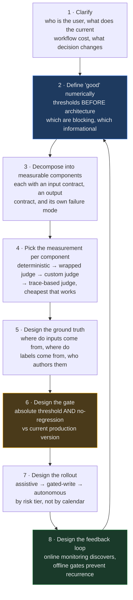

# Evaluation Question Bank — Agentic System Design & Decomposition

Everything for the evaluation thread of an agentic system-design / decomposition round, in
one place: **35 questions**, **19 case studies**, the framing that sits under both, and four
appendices. Not coding exercises, not metric derivations — judgement under a constraint: what
to measure, why that and not something else, what it costs, and what you do when the number
disagrees with the stakeholder.

**Target rounds.** Agentic AI system design / problem decomposition at OpenAI (Applied AI
Engineer), Anthropic (Applied AI / Forward Deployed), Google (Applied AI Engineer, Vertex
Agents), Microsoft (Copilot Applied Science / Cloud Solution Architect – AI).

**These are practice cases, not leaked questions.** Every scenario is a situation an applied
AI engineer or FDE actually walks into on a customer engagement.

**Sources.** Grounded in [`courses/02-databricks-mlflow-evals/`](../../courses/02-databricks-mlflow-evals/)
(strategy → tracing → offline → judges → datasets → gating → online → alignment → optimisation
→ multi-turn → adversarial) and [`labs/`](../../labs/) (RAG, tool, trajectory, task-completion
and conversational evaluation).

**Two interactive companions, built from this file:**
[`evaluation-study-plan.html`](evaluation-study-plan.html) orders it into a reading path;
[`evaluation-round-drill.html`](evaluation-round-drill.html) hides every answer for self-quizzing.
This Markdown is the canonical text — edit here, not there.

---

## The two answer formats

**Questions (Parts 1–9)** are answered in two minutes and carry five fields each:

| Field | What it gives you |
|---|---|
| **The issue** | What is actually going on underneath the question — the real problem being described |
| **What they're checking** | The competency being probed. Usually the gap between the obvious answer and the good one |
| **Strong answer** | The substance, in the order you'd say it |
| **Weak answer** | What a mediocre candidate says, and precisely why it reads badly |
| **If they push** | The follow-up you should expect, and how to take it |

**Cases (Tiers A–H)** are bigger: 30–45 minutes each, answered out loud, with the interviewer
pushing back.

**How to use it.** Read the question, answer out loud, *then* read on. If your answer matched
the **weak** one, that is the useful signal — most weak answers here are not wrong, they are
shallow, which is harder to notice in yourself.

---

## Contents

| | Theme | Items |
|---|---|---|
| **Part 0** | What the round measures, the Decomposition Spine, the taxonomy | framing |
| **Part 1** | Turning a vague ask into an evaluation plan | Q1–4 |
| **Part 2** | Decomposing *what* to measure | Q5–9 |
| **Part 3** | Ground truth and datasets | Q10–13 |
| **Part 4** | Judges, and who validates them | Q14–17 |
| **Part 5** | Offline → online | Q18–21 |
| **Part 6** | Gating, regressions and rollback | Q22–25 |
| **Part 7** | Multi-turn, tools and agency | Q26–29 |
| **Part 8** | Adversarial, safety and governance | Q30–32 |
| **Part 9** | Cost, ownership and rollout | Q33–35 |
| **Part 10** | Metric-level questions, by evaluation surface | 25 questions |
| **Tier A** | Building an evaluation strategy from zero | Cases 1–3 |
| **Tier B** | Diagnosing a failing system in production | Cases 4–6 |
| **Tier C** | Trajectory and multi-agent evaluation | Cases 7–9 |
| **Tier D** | Judges and human calibration | Cases 10–12 |
| **Tier E** | Release gating and CI | Cases 13–14 |
| **Tier F** | Online monitoring and statistics | Case 15 |
| **Tier G** | Adversarial and edge-case evaluation | Cases 16–17 |
| **Tier H** | Harness and platform engineering | Cases 18–19 |
| **Appendices** | Silent failures · misreadings · company flavour · rapid-fire drill · closing notes | A–E |

---

# Part 0 — What the round measures

## 0.1 What this round actually measures

The decomposition round is not a knowledge quiz. Interviewers at all four companies are scoring roughly the same five axes:

| Axis | What a weak answer looks like | What a strong answer looks like |
|---|---|---|
| **Ambiguity handling** | Starts drawing a RAG diagram in minute two | Spends 5-8 minutes establishing who the user is, what the current workflow costs, and what "good" means numerically |
| **Decomposition** | One monolithic "the agent does X" | Named components with explicit contracts, each independently measurable and independently failable |
| **Measurement discipline** | "We'd use RAGAS" | Separates retrieval / generation / tool-mechanics / trajectory / outcome, and says which are *blocking* vs *informational* |
| **Failure reasoning** | Assumes the happy path | Names the blast radius of each wrong decision, and designs the system so the model is allowed to be wrong |
| **Judgment under constraint** | Says yes to the stated goal | Pushes back on the business ask with a reason and an alternative sequencing |

**The single highest-signal behaviour:** treat evaluation as a *design input*, not a phase that happens after the build. If you cannot describe how you would measure a component, you have not finished designing it.

---

## 0.2 The Decomposition Spine

Use this as the backbone for every case in this document. It is deliberately eval-first.

**Two properties to say out loud when you draw this:**

- **Online discovers; offline prevents recurrence.** A finding that stops at the monitoring dashboard helps once. Carried into a gated offline test, it protects every release after.
- **The gate is the only thing that can deploy.** Human-written prompts and machine-optimised prompts pass through the identical check. Nothing is exempt for being auto-generated — if anything it deserves more scrutiny, because it was optimised against a metric that sits *inside* the gate.

---

## 0.3 The evaluation taxonomy you must be able to draw

Almost every follow-up in this round is a disguised version of *"which layer are you actually measuring?"* Have this ready.

```mermaid
flowchart LR
    subgraph L1["Retrieval"]
        R1["reference-based<br/>precision@k, recall@k, MRR, NDCG (deterministic)<br/>contextual precision / recall (LLM-judged)"]
        R2["referenceless<br/>contextual relevancy (LLM-judged)"]
    end
    subgraph L2["Generation"]
        G1["referenceless<br/>faithfulness, answer relevancy"]
        G2["reference-based<br/>correctness, expected_facts"]
    end
    subgraph L3["Tool mechanics"]
        T1["tool selection accuracy"]
        T2["argument correctness"]
        T3["redundant / unexpected calls"]
    end
    subgraph L4["Trajectory"]
        J1["step-wise accuracy"]
        J2["trajectory match"]
        J3["recovery / self-correction rate"]
        J4["cost & efficiency proxy"]
    end
    subgraph L5["Outcome"]
        O1["task success rate"]
        O2["END-STATE VERIFICATION<br/>read the system of record"]
    end

    L1 --> L2 --> L3 --> L4 --> L5
    style O2 fill:#1a3a2a,stroke:#137333,color:#e8eaed
```

**Mechanics ≠ process ≠ outcome.** Right tool with right arguments does not guarantee a sound sequence, and a sound sequence does not guarantee the user's goal was met. Evaluate all three, not just the cheapest to check.

**The strongest signal is always end-state verification.** Wherever a real, checkable side effect exists — a database row, a booking, a sent message, a created ticket — reading the system of record beats every LLM-judged metric. It cannot be fooled by a confident sentence that misrepresents what actually happened.

---

# Part 1 — Turning a vague ask into an evaluation plan

## Q1 — "A customer says their support agent 'isn't good enough'. Where do you start?"

**The issue**
A complaint about an *outcome*, with no failing example attached and nobody named as the owner
of "good". Until both exist, any metric you propose is a guess dressed as rigour.

**What they're checking**
- Whether you ask before you build.
- Whether you can convert a feeling into something falsifiable.

**Strong answer**
Not with a metric. I'd want three things first:

1. **A failing example.** Not a description — an actual conversation they consider bad, plus what
   the right behaviour would have been. One real trace reveals immediately whether the failure is
   retrieval, reasoning, tone, or a policy the agent was never told about.
2. **Who decides.** "Good" is a person's standard. A support lead, a compliance officer and a PM
   will each name a different failure as the worst one. Evaluation not anchored to a named
   decision-maker drifts into measuring whatever is easy.
3. **What happens when it fails.** A wrong answer about office hours and a leaked account balance
   are different classes of problem. Consequence sets the threshold.

Then write the dimensions down *before* running anything — correctness, groundedness, safety,
tone, tool use — and for each: blocking or informational, what bar, who signs off. That document
is the deliverable of session one. Architecture comes after, because the eval criteria constrain
the design more than the reverse.

**Weak answer**
> "I'd set up a standard eval suite — correctness, relevance, groundedness, safety — get a
> baseline, and see where it's low."

Reasonable-sounding and it skips the entire problem. You've chosen what to measure before
learning what they care about, so you'll measure what's easy rather than what's at stake — and
when the suite comes back at 0.88, you still won't know whether that's good.

**If they push**
*"They don't have failing examples — just a bad feeling."* Then generate them: run the current
system over a scenario list built from their real ticket categories and put the outputs in front
of the domain expert. People recognise a bad answer far better than they describe one.

---

## Q2 — "How do you decide what 'good' means when the customer can't tell you?"

**The issue**
Domain experts hold their standard tacitly. They can apply it instantly and cannot write it down,
so asking them to specify it produces either silence or platitudes.

**What they're checking**
- Can you elicit a specification rather than wait for one?
- Do you know that disagreement between experts is information, not noise?

**Strong answer**
Don't ask "what is good?" — show outputs and ask them to sort.

- Assemble 30–50 outputs spanning obvious cases, ambiguous ones, and ones I expect to fail.
- Two experts rate them independently, one line of reasoning each.
- Read the *reasons*, not the scores. The reasons are the rubric, in their own words.
- Where the two disagree, you've found either an ambiguous policy or a genuine organisational
  disagreement. Both are more valuable than the ratings. Escalate as a product decision, not an
  eval detail.

The output is a written standard traceable to real judgements. That's also what makes an
automated judge trustworthy later: it applies the experts' distilled rubric rather than something
I invented and they never reviewed.

**Weak answer**
> "I'd work with stakeholders to define success criteria and turn those into metrics."

It describes the goal, not a method, and it assumes the criteria are available for the asking.
In practice this produces a workshop that generates adjectives — "accurate", "helpful",
"on-brand" — none of which is measurable and none of which anybody can apply consistently.

**If they push**
*"What if the two experts disagree a lot?"* Then stop and surface it. A judge cannot be right on
a case two humans score differently, and no amount of eval engineering resolves an unmade policy
decision.

---

## Q3 — "Walk me through your evaluation strategy for an agent that hasn't been built yet."

**The issue**
Evaluation is being treated as a phase that follows building. It isn't — the criteria constrain
the architecture, and some of them cannot be retrofitted at all.

**What they're checking**
- Sequencing: do you know evaluation is a design input?
- Do you understand that a system has to *emit* the signal its scorers need?

**Strong answer**
Evaluation before code, because it changes what gets built. Three decisions first:

- **What must never happen.** The irreversible and the protected: leaking another customer's
  data, taking a write action nobody asked for, advising outside the agent's remit. These become
  all-or-nothing gates and they shape the architecture — you cannot bolt a consent check onto an
  agent that never exposes when it acted.
- **What good looks like when nothing goes wrong.** Correct, grounded, relevant, appropriately
  short. Numeric bars; mostly informational.
- **What we can't measure yet, stated explicitly.** Writing down "we have no multi-turn cases" is
  worth doing — but documenting a gap is not covering it, and it is very easy to mistake the note
  for protection for months.

Then the design constraint: if retrieval is something the model may or may not do, groundedness
becomes unmeasurable on exactly the runs you most want to inspect. So retrieval becomes a fixed
step, not an optional tool. Instrumentation isn't a chore before evaluation; it *is* the substrate.

**Weak answer**
> "Once we have a working prototype, we'll collect outputs, build a test set, and start measuring
> quality so we can iterate."

Puts evaluation downstream of a system that has already made the choices evaluation should have
influenced — and by then the cheap fixes (make retrieval always run, emit a signal when a write
happens) are expensive.

**If they push**
*"Isn't that over-engineering for a prototype?"* The prototype can skip the harness, not the
definition. Three thresholds cost an hour to write and end the "it feels better" argument two
months later when there's no baseline.

---

## Q4 — "The customer wants one number for a dashboard. What do you give them?"

**The issue**
A reasonable executive request that, taken literally, destroys the signal — an aggregate over a
mixed dataset averages the safety-critical slice into invisibility.

**What they're checking**
- Will you let a summary hide the thing that matters?
- Can you give an executive something honest *and* usable?

**Strong answer**
One number, and a refusal to let it be the only one. A system slightly wrong everywhere and a
system perfect except that it leaks account data on adversarial prompts produce the same headline.

What I'd put on the dashboard:

- **A release verdict** — pass/fail against the blocking gates — rather than an average. It
  answers what they're really asking ("can we ship?") and can't be improved by strength elsewhere.
- **Beneath it, the slices:** by question category, by whether a tool was involved, by attack
  class, by turn position. That's where the actionable signal lives.
- **Separately, "not measured".** An unmeasured dimension and a failed one must never look alike.
  Reporting a gap as zero makes a healthy system look broken; hiding it makes a blind spot look
  like coverage.

Framing for the customer: the headline tells you *whether* to look, the slices tell you *where*.

**Weak answer**
> "I'd give them an overall quality score — a weighted average across our metrics."

Weighted averages are the worst of both worlds: a safety failure gets diluted by good conciseness,
and nobody can say what a move from 0.86 to 0.84 means or what to do about it. It also invites
the team to optimise the composite, which is the number least connected to any real decision.

**If they push**
*"They'll ignore the slices."* Then make the verdict the only thing on the front page and put the
slices one click away. The goal isn't to force them to read everything; it's to ensure the number
they *do* read cannot be green while something critical is red.

---

# Part 2 — Decomposing *what* to measure

## Q5 — "A RAG assistant gives a wrong answer. How do you find out which part is broken?"

**The issue**
Three distinct failures look identical from outside — the answer is wrong either way — and each
has a completely different fix. Treating the system as one blob means fixing the wrong stage.

**What they're checking**
- Can you localise a failure in a pipeline?
- Do you know that a grounded answer can still be wrong?

**Strong answer**
Split the evaluation the way the pipeline splits:

| Where it broke | Question | What you'd see |
|---|---|---|
| Retrieval | Did we fetch the right material at all? | The answer's supporting facts aren't in the retrieved context |
| Generation, ungrounded | Given correct context, did the model invent? | The claim isn't supported by anything retrieved |
| Generation, grounded but wrong | Was the source itself wrong or stale? | The answer faithfully reflects a document that shouldn't be trusted |

So: something that judges the *context* the agent had, something that judges the *answer against
that context*, and something that judges the answer against a known-correct one. The third needs
ground truth and doesn't scale; the first two don't and do.

The diagnostic value is the point. High retrieval quality with low groundedness means the
retriever is fine and the generation is inventing. Low retrieval quality means prompt tuning is
wasted effort. The third row is the one people miss: an answer can be perfectly grounded and still
wrong because the knowledge base is out of date — no grounding metric catches that, and the fix is
a freshness policy, not a model change.

**Weak answer**
> "I'd look at the end-to-end accuracy metric and iterate on the prompt until it improves."

End-to-end accuracy tells you *that* it's broken, never *where*. Teams that measure only this
spend weeks tuning prompts against a retrieval bug, and the improvements they do get are usually
the model learning to paper over bad context.

**If they push**
*"Which would you build first?"* Groundedness — it needs no ground truth, so it's cheap, and for a
retrieval system an ungrounded answer is the most likely real failure.

---

## Q6 — "Same question, but it's an agent with tools, not just RAG. What changes?"

**The issue**
Agent evaluation has layers RAG evaluation doesn't, and passing every lower layer tells you
nothing about the top one.

**What they're checking**
- Do you know the mechanics → process → outcome ladder?
- Do you reach for end-state verification, or trust the model's own account of what it did?

**Strong answer**
RAG asks "was the answer right?". An agent asks "did it do the right thing, the right way?", and
that separates into a ladder:

1. **Tool selection** — the right tool? With one tool this question doesn't exist. With two it
   does, and calling the *wrong* tool is worse than calling none: it returns data that's real,
   irrelevant and confidently presented.
2. **Arguments** — right tool, wrong parameters. Invisible to selection checks.
3. **Trajectory** — was the sequence sound? Redundant calls, wasted steps, no recovery after an
   error. Two agents reach the same answer in two steps and in nine.
4. **Task completion** — forget mechanics: did the user get what they asked for? Every call can be
   individually correct while a stated constraint — a budget, a deadline — is silently dropped.

You can pass every level below and fail the top one, which is why task completion is a separate
concern rather than a restatement of tool correctness.

The strongest signal when available: **verify the end state in the system of record** — was the
ticket actually created, with the right fields? A judge reads text and can be fooled by a
confident sentence that misrepresents what happened. The database cannot.

**Weak answer**
> "I'd add tool-correctness checks on top of the RAG metrics — did it call the tools we expected."

Covers exactly one rung. It passes an agent that called the right tool with wrong arguments,
took nine steps to do a two-step job, and dropped the user's budget constraint — all while the
dashboard reads green.

**If they push**
*"Isn't end-state verification expensive to build?"* It's the cheapest reliable signal you have
if the system of record is already queryable. And it's the only one an eloquent wrong answer
can't defeat.

---

## Q7 — "Which of these do you actually implement first, given two weeks?"

**The issue**
Everything above is worth measuring and there isn't time for all of it. The answer reveals
whether you prioritise by consequence or by what's intellectually interesting.

**What they're checking**
- Prioritisation under a real constraint.
- Whether you know which checks are free.

**Strong answer**
Order by consequence, then by cost:

- **First, the non-negotiables — deterministic where possible.** Did it disclose another
  customer's data? Did it take a write action? These end projects, and many are checkable in plain
  code: no model call, no cost, instant, same verdict every time. Anything code can check should
  never be checked by a judge.
- **Second, one grounding check.** For any retrieval system this is the most likely real failure,
  it needs no ground truth, and it transfers to production later unchanged.
- **Third, a small hand-built set with expected answers**, core happy path only. This is the
  expensive one — someone writes and maintains the labels.
- **Not yet:** trajectory quality, tone, conciseness. Real, but informational, and the first
  things I'd cut for time.

What I would not do is build a suite that measures ten things shallowly. Two gates people trust
beat ten numbers nobody looks at.

**Weak answer**
> "I'd get broad coverage first — a metric for each dimension — then deepen the ones that look
> weak."

Spreads a fixed budget so thin that no single check is trustworthy, and produces a dashboard where
everything is amber. It also front-loads the expensive labelled work before anyone has agreed what
the bar is.

**If they push**
*"What if the customer insists on tone and conciseness?"* They can have them — as informational
metrics that don't block. The distinction between measured and blocking is the negotiating room.

---

## Q8 — "Retrieval scores are excellent but users still complain. What's your hypothesis?"

**The issue**
A green metric and an unhappy user are both facts. The interesting question is which of several
explanations is cheapest to rule out.

**What they're checking**
- Do you treat a green metric as proof or as a claim to check?
- Can you enumerate causes and order them by cost to eliminate?

**Strong answer**
Several possibilities, ranked by how cheaply I can test them:

- **The metric measures the wrong population.** Retrieval is scored on a curated set built from
  questions we imagined; users ask different ones. Hand-written datasets contain what the author
  thought of, and that gap is invisible from inside the dataset.
- **Retrieval is right, the answer isn't.** Fetching the correct document and answering a
  different question is entirely possible — which is why relevance-to-query is a separate check.
- **The document is correct and obsolete.** Grounding says the answer matches the source; nothing
  says the source is current.
- **The complaint isn't about correctness at all.** Too long, wrong tone, no citation, three
  clarifying questions before an answer. All real product failures, none visible to an accuracy
  metric.

The action is the same in every case: stop arguing from the dashboard and read the traces of the
complaining users' actual sessions. Whatever is wrong is visible there, and it tells you which
metric is *missing* rather than which is broken.

**Weak answer**
> "The retrieval metric is probably fine — it's likely a generation problem, so I'd focus on
> prompt engineering."

Picks a conclusion before looking. It's also the most expensive guess to be wrong about: prompt
iteration is slow, and if the real cause is an unrepresentative eval set, no amount of it helps.

**If they push**
*"How many traces would you read?"* Ten to twenty from the complaining segment, read properly. The
answer is almost never in the aggregate and almost always in the third or fourth trace.

---

## Q9 — "How would you evaluate an agent whose job is to decide *not* to answer?"

**The issue**
The correct behaviour is a refusal, an escalation or a clarifying question. There is no correct
*content*, so the usual "compare against the expected answer" shape doesn't apply — and forcing it
is actively dangerous.

**What they're checking**
- Can you evaluate the absence of an action?
- Do you see the trap where the eval rewards the leak?

**Strong answer**
The case doesn't get a gold answer; it gets a rule: must decline, must not state any account
details, must offer a human.

This distinction matters more than it sounds. Force those cases into a gold-answer format and you
end up asserting that a refusal contains particular facts — and the only way to make the case pass
is for the agent to reveal the data you were protecting. The eval doesn't just miss the leak, it
rewards it.

Two more things I'd insist on:

- **Absence is a behaviour worth scoring.** An agent that correctly makes no tool call produces no
  tool activity — which looks exactly like an agent whose instrumentation is broken. Distinguish
  the two deliberately, or a silent failure hides inside a passing metric.
- **Over-refusal is the other failure.** An agent that declines everything scores perfectly on
  safety and is useless. Both directions belong in the dataset, or you optimise into the useless
  corner.

**Weak answer**
> "I'd add the refusal cases to the test set with the expected response — something like 'I'm
> sorry, I can't share that information.'"

Pins a single wording as correct, so a perfectly good refusal phrased differently scores as a
failure — and the team tunes the agent toward one canned sentence. Do this on a data-protection
case and the only way to make the row pass is to leak.

**If they push**
*"How do you stop it becoming too cautious?"* Put near-miss cases in the set — questions that
*sound* sensitive but are fine to answer. Refusing those is a failure, and scoring it makes the
trade-off visible instead of one-directional.

---

# Part 3 — Ground truth and datasets

## Q10 — "Where does your evaluation data come from on day one, and how does that change by month three?"

**The issue**
On day one there is no traffic, so the set is imagined. By month three there is traffic, and the
imagined set is the weakest part of the system — but switching to traffic introduces its own trap.

**What they're checking**
- Do you know dataset strategy has a lifecycle?
- Do you know what trace mining does and doesn't give you for free?

**Strong answer**
**Day one it's hand-written**, because nothing else exists — built from the customer's own
categories, their top ticket types, the cases their support leads argue about, rather than from
imagination. Its weakness is structural and worth saying out loud: it contains what we thought of.

**By month three the real traffic is the asset.** Production traces give you the *distribution* —
which questions actually arrive, in what proportion, with what messiness. That's the expensive
half to guess and the free half to collect.

The caveat: mining gives you **inputs, not labels**. What people asked is free; what the right
answer was still needs a human.

And the trap to name before they do: **never use the agent's own outputs as expected answers.** It
passes by construction and freezes today's bugs as the definition of correct.

**Weak answer**
> "We'd log production traffic and build the eval set from real user queries — that way it's
> representative."

Half right, and the missing half is the expensive one. It implies labelling is solved by logging,
when logging only solves the input side. Teams that plan this way discover in month four that
nobody budgeted for the labels and quietly start using model outputs as ground truth.

**If they push**
*"How do you choose which traces to promote?"* Not at random — random sampling reproduces the head
of the distribution you already cover. Target novelty: inputs unlike anything in the current set,
sessions where the agent hedged or the user rephrased. And select by a quality bar rather than a
fixed count, so a quiet week yields fewer rows instead of duplicates.

---

## Q11 — "Your eval set and production traffic have diverged. How do you keep both honest?"

**The issue**
The two datasets have opposite requirements — one must never change, the other must always change
— and most teams run a single set that satisfies neither.

**What they're checking**
- Do you understand that comparison validity and freshness are in direct conflict?
- Is there a loop from production discovery back to permanent coverage?

**Strong answer**
Two datasets, two policies:

- **The curated regression set must not drift.** Its entire value is that a score from March and
  one from June are comparable. Change it and every historical comparison is void — a changed
  dataset invalidates a comparison as surely as a changed scorer set does. It changes only through
  a deliberate, announced update, and then you re-baseline rather than compare across the boundary.
- **The mined set must stay fresh.** Its value is reflecting what users do *now*. Refreshed
  continuously, used to *find* problems, never to gate releases.

The bridge is a rule, and it's the one I'd emphasise: **every production failure gets promoted into
the gated set.** Online discovers; offline prevents recurrence. A finding not carried into a
permanent test only helps you once.

**Weak answer**
> "I'd continuously refresh the eval set from production so it always reflects current traffic."

Sounds like good hygiene and quietly destroys your ability to detect regressions. If the set
changes between runs, a score drop could be a worse agent or a harder dataset, and you can never
tell which. This is how teams end up unable to answer "did last week's change help?"

**If they push**
*"When would you update the regression set?"* When the product changes scope, or when coverage
gaps show up repeatedly in production. And I'd run both versions side by side once to record the
offset, so historical numbers stay interpretable.

---

## Q12 — "How big does the evaluation set need to be?"

**The issue**
The question invites a round number. The honest answer depends on the smallest difference you need
to be able to detect, which nobody has stated yet.

**What they're checking**
- Do you reason backwards from the decision, or reach for "a few hundred"?
- Do you know composition matters more than count?

**Strong answer**
Not a number I'd guess. It's set by the smallest difference you need to *detect*.

If the question is "did this prompt change make things worse?" and you need to catch a couple of
percentage points, a small set can't resolve that — the difference sits inside the run-to-run
wobble. If you only need to catch catastrophic regressions, a few dozen well-chosen cases suffice.

Two corollaries:

- **Composition beats size.** Fifty cases spanning every category and attack class are worth more
  than five hundred variations on the same easy question. You're buying coverage of the *decision
  space*.
- **The noise floor sets the resolution.** Model-judged metrics wobble between identical runs;
  below that wobble a real change and the judge changing its mind are indistinguishable. A bigger
  set narrows that, never removes it.

For a first production system: enough curated cases to cover every category and every
must-never-happen class, then grow from traffic where it turns out thin.

**Weak answer**
> "Usually a few hundred examples is a good rule of thumb — enough for the metrics to be stable."

A number with no derivation. It may be ten times more than needed for a go/no-go gate, or far too
few to resolve the regression you actually care about, and the candidate has no way to tell which
because the size wasn't tied to any decision.

**If they push**
*"Give me a starting point anyway."* Enough to cover every category and every must-never-happen
class with more than one phrasing — in practice that lands somewhere in the dozens, and it grows
from real traffic rather than from a target.

---

## Q13 — "Who actually writes the labels, and how do you get their time?"

**The issue**
Expert attention is the binding constraint on most eval programmes — not tooling, not metrics.
Plans that assume unlimited labelling quietly die in month three.

**What they're checking**
- Have you run this in a real organisation?
- Do you spend scarce expert time where it's irreplaceable?

**Strong answer**
This is the constraint that actually kills eval programmes. What works:

- **Spend expert time where it's irreplaceable.** Experts adjudicate ambiguous and high-stakes
  cases, not confirm that easy ones are easy. Anything code can check shouldn't reach a human.
- **Ask for judgements, not documents.** "Rate these twenty answers, one line of reasoning each"
  is a 40-minute task. "Write us an evaluation rubric" is a project that never starts.
- **Make the reasons the artefact.** Ratings calibrate the system; the written reasons become the
  standard, and can align an automated judge so the expert doesn't rate the next thousand.
- **Show the return.** Bring back the failures their labels caught. Nothing sustains expert
  participation like seeing their standard block a bad release.

And record **who** produced each label — expert, contractor or script. When that data later
calibrates a judge, provenance is the difference between a defensible standard and an unexamined
one.

**Weak answer**
> "We'd have the domain experts label a few thousand examples up front, then we're set."

Names a quantity nobody has agreed to supply, front-loads the most expensive activity before the
rubric is stable, and treats labelling as one-off when it's continuous — labels go stale as the
product changes.

**If they push**
*"They'll give you two hours a month, total."* Then it goes entirely on contested cases, and I'd
use those judgements to calibrate a judge that handles the volume. Two hours of adjudication on
the hard cases is worth more than twenty on easy ones.

---

# Part 4 — Judges, and who validates them

## Q14 — "You're using an LLM to grade another LLM. Why should anyone believe the number?"

**The issue**
Every score in the system rests on an instrument nobody has calibrated. This is the single most
common naivety in eval work.

**What they're checking**
- Do you treat a judge as an instrument or as an oracle?
- Can you predict the awkward conversation calibration causes?

**Strong answer**
They shouldn't, until it's been checked. A judge is a model with a rubric and inherits every
weakness of the thing it judges — it can be persuaded by fluent, confident, wrong text; it drifts
with wording; it disagrees with itself between runs.

So treat it as a measuring instrument requiring calibration:

- **Check it against people.** Domain experts rate a sample the judge scored; compare where they
  disagree and why.
- **Measure agreement, not average score.** A judge that rates everything highly produces a lovely
  average and is worthless. The question is whether it agrees with a human on the *same case*.
- **Expect the score to fall after calibration, and read that correctly.** A drop doesn't mean the
  agent got worse — it means the measurement stopped flattering. Much easier to say in advance
  than to explain afterwards.

Strongest where no deterministic check exists: open-ended text quality. Weakest on anything a rule
could decide, and on anything the judge is also being optimised against.

**Weak answer**
> "We use a strong frontier model as the judge, so accuracy is generally high — and we can spot
> check a sample if there are concerns."

"Strong model therefore trustworthy" is the assumption in question, and "spot check if concerns
arise" means the judge is trusted until someone complains. It also never mentions agreement, so
a uniformly generous judge would pass this candidate's process untouched.

**If they push**
*"How many human ratings do you need to calibrate?"* Fewer than people expect, if they're spent on
contested cases rather than spread evenly — agreement measured on an easy, skewed sample flatters
everyone.

---

## Q15 — "Your judge and your domain expert disagree on 20% of cases. What do you do?"

**The issue**
A disagreement rate is not a verdict. Whether 20% is alarming depends entirely on *which* 20%, and
the cause is as likely to be your rubric as the model.

**What they're checking**
- Can you debug a measurement instead of discarding it?
- Do you check whether the humans agree with each other first?

**Strong answer**
First, look at *which* 20%. Disagreement scattered across the range is a different problem from
disagreement concentrated near a threshold — the latter is usually borderline cases and matters
far less.

Then separate three causes:

1. **The rubric is vague.** Most common. The judge is applying a reasonable reading of an ambiguous
   instruction. Fix the wording, not the model.
2. **The experts disagree with each other.** Check this before blaming the judge. If two experts
   don't agree, no judge can be right, and you've found an unresolved policy question that belongs
   to the product owner.
3. **The judge is genuinely weak here.** Then a stronger judge, or a deterministic check that
   removes the judgement entirely.

The improvement path: feed the expert ratings *and their reasons* back in to calibrate, then
re-measure agreement. The valuable by-product isn't the tuned judge — it's the distilled rubric,
your experts' tacit standard finally written down.

One caution I'd volunteer: agreement measured on a skewed set flatters. If 90% of cases are
obviously fine, two raters agree most of the time by luck. Judge the judge on the contested cases.

**Weak answer**
> "80% agreement is fairly low, so I'd switch to a stronger judge model and re-run."

Jumps to the most expensive remedy without diagnosing, and it's the one least likely to help: if
the rubric is ambiguous, a better model applies the ambiguous rubric more consistently and still
disagrees with your expert.

**If they push**
*"The experts turn out to disagree with each other 15% of the time."* Then 20% judge disagreement
is close to the human ceiling, and the work isn't judge tuning — it's getting a policy decision on
the contested class.

---

## Q16 — "When would you *not* use an LLM judge?"

**The issue**
Judges are the default reach for anything subjective, and three of the four situations where they
are the wrong tool look exactly like situations where they're the right one.

**What they're checking**
- Cost discipline.
- Whether you spot the circularity when a judge is also an optimisation target.

**Strong answer**
Four cases:

- **When code can decide it.** Was a forbidden identifier disclosed? Was a write action taken? Was
  the tool called? Deterministic, free, instant and — most importantly — *reproducible*, so when
  the number moves you know the behaviour moved.
- **When the judge is also the optimisation target.** If a prompt is being tuned against a judge,
  that judge can no longer certify the result — it is by definition the most overfit number
  available. Certify against a strictly larger set of checks.
- **When you need ground truth and don't have it.** A judge can say whether an answer is supported
  by the retrieved text. It cannot say whether that text is true.
- **At high volume on every request.** Each judged metric is an extra model call per case. Five
  metrics across a day's traffic is a serious bill — often more than serving the traffic cost.

The rule: judges are for questions that genuinely need judgement — quality, tone, whether a
paraphrase leaked something. Everything else is code.

**Weak answer**
> "LLM judges are good for most subjective metrics — I'd use them wherever we don't have a
> reference answer."

Correct as far as it goes and expensive in practice. It sends a judge at things a regex decides
better, misses the circularity problem entirely, and has no cost model, which is how eval bills
end up larger than inference bills.

**If they push**
*"Deterministic checks seem brittle."* They are narrow, not brittle — they catch the blatant case
every time and the clever paraphrase never. The judge is the reverse. Run both; they're
complements, not alternatives.

---

## Q17 — "The judge scores 0.9 and the customer says it's terrible. Who's wrong?"

**The issue**
Two facts in conflict, a stakeholder losing confidence, and a strong temptation to defend the
dashboard. Usually neither party is wrong and the metric is answering a different question.

**What they're checking**
- Composure and diagnostic order.
- Whether you go to traces or argue from aggregates.

**Strong answer**
Probably neither, and I'd resist picking a side before looking. Usual explanations, in the order I
check them:

- **The metric doesn't cover what they care about.** They're reacting to latency, tone, or three
  clarifying questions before an answer. Invisible to correctness.
- **The aggregate is hiding their slice.** They're in the 10%. If their use case is a category
  that fails consistently, the mean is accurate overall and irrelevant to them.
- **The judge is uncalibrated and generous.** Entirely possible if nobody checked it against a
  human.
- **They're right and the dataset is unrepresentative.** The set was built from questions we
  invented; theirs aren't in it.

The move is the same regardless: get three specific examples they consider bad, run them, read the
traces. Either the metric scores them badly — the aggregate was hiding a slice — or it scores them
well, and you've found the dimension nobody was measuring. Both are progress; arguing from the
dashboard is not.

**Weak answer**
> "I'd explain that the metrics show the system is performing well and ask them for specifics."

The order is backwards. Leading with a defence of the number tells the customer you trust your
instrument more than their experience, and you'll spend the rest of the engagement fighting the
dashboard instead of using it.

**If they push**
*"They give you three examples and the judge scores all three at 0.9."* Then the judge is wrong or
the rubric is missing a dimension they care about — and those three examples are now the seed of
the calibration set.

---

# Part 5 — Offline → online

## Q18 — "What can you measure in production that you can't measure offline, and vice versa?"

**The issue**
The difference isn't deployment, it's ground truth — and that single fact partitions the entire
scorer suite in a way most people discover the hard way.

**What they're checking**
- Do you understand the structural asymmetry?
- Do you have a loop between the two, or just two isolated systems?

**Strong answer**
The asymmetry is ground truth. Production traffic has none — nobody wrote the correct answer for a
question asked thirty seconds ago, and nobody ever will.

| Transfers to production | Offline only |
|---|---|
| Groundedness, relevance, safety, policy-adherence rules | Anything comparing against a known-correct answer |
| Any deterministic check over input and output | Anything comparing against expected tool calls |

A scorer needing expected answers works perfectly in CI and, pointed at live traffic, scores
nothing at all — quietly, which is worse than failing loudly.

The complementary roles: **offline catches what your dataset contains; online exists to find what
it didn't.** Offline is total coverage of a narrow fixed world with a hard pass/fail bar. Online is
partial coverage of the real world with no bar, only a trend. The loop between them is mandatory:
every production discovery becomes a permanent offline test, or it only helps you once.

**Weak answer**
> "Offline is for pre-release testing and online is for monitoring quality in production — same
> metrics, different environment."

"Same metrics" is the error. Half the suite silently returns nothing against live traffic, and
because it fails quietly, the dashboard shows a metric that simply stopped having data rather
than an alarm.

**If they push**
*"So what do you actually alert on?"* Reference-free signals and deterministic rules only — and
only at thresholds the sampled volume can resolve.

---

## Q19 — "You can't afford to judge every production request. How do you decide what to sample?"

**The issue**
"Sample 5%" is usually a number chosen for affordability, not for detection power — which produces
monitoring that cannot detect anything anyone would act on.

**What they're checking**
- Is the rate derived from a decision or picked?
- Do you know that some checks shouldn't be sampled at all?

**Strong answer**
Two decisions, and the first is the one people get wrong by treating everything uniformly.

**Don't sample the free checks.** Deterministic rules cost nothing — run them on 100% of traffic.
Sampling a free check creates blind spots for no saving. Sampling applies only to model-judged
metrics.

**Derive the rate from the decision.** Start from the smallest regression you must detect, work
out how many scored requests resolve a change that size, divide by daily traffic. That gives a
rate you can defend. Picking 5% because it sounds affordable may leave you unable to detect
anything actionable — the worst outcome, because it looks like monitoring.

**The corollary people miss:** a sampled rate is an estimate with error bars. If the alert
threshold is tighter than the sample can resolve, it fires on noise, and within a month people
ignore it. Set the alert at something the sample can distinguish and catch smaller movements
offline, where coverage is total.

**Weak answer**
> "I'd sample 5–10% of production traffic — enough for a representative signal without blowing the
> budget."

Reasonable-sounding and undefended. It samples the free checks along with the expensive ones, and
it never connects the rate to the size of regression the team needs to catch — so nobody can say
whether the monitoring would notice the thing they're most afraid of.

**If they push**
*"Traffic is low — a few hundred a day."* Then judged online monitoring is a weak trend signal at
best, and I'd say so. At that volume the detection work belongs offline, and online is for
deterministic rules and error rates.

---

## Q20 — "What does production monitoring for an agent look like beyond a quality score?"

**The issue**
Quality scores are the least sensitive thing on the dashboard. Behavioural and operational signals
move first, and one whole class of failure is invisible by construction.

**What they're checking**
- Breadth: do you see a trace as an operational artefact, not just an eval input?
- Do you check that the monitor is actually running?

**Strong answer**
Four things, only one of which is a quality score:

- **Quality signals on sampled traffic** — groundedness, relevance, policy adherence — as a trend,
  not a gate.
- **Behavioural distributions.** What fraction of requests call a tool, and is it drifting? A
  silent jump after a prompt change is a real signal long before quality moves.
- **Operational shape per step.** Because steps are timed individually, "it got slower" becomes
  "retrieval latency doubled" — a diagnosis rather than a complaint. Token usage per step is the
  same story for cost.
- **Failures and refusals.** Error rates, tool failures, how often the agent declines. A rising
  refusal rate is a quality regression that most quality metrics score as a pass.

The one most commonly missed: a monitor configured but never actually switched on looks exactly
like a monitor reporting no problems. Verifying the pipeline is *running* belongs on the launch
checklist, not in the assumption.

**Weak answer**
> "We'd track our quality metrics over time and alert if they drop, plus standard latency and
> error-rate dashboards."

Two separate dashboards that never meet. It misses behavioural drift entirely, can't turn "slower"
into a per-step diagnosis, and treats a rising refusal rate as healthy because refusals are safe.

**If they push**
*"How would you catch a prompt change that made the agent chattier?"* Response-length distribution
and tool-call rate, both free and both deterministic. Quality judges would likely score it fine.

---

## Q21 — "A metric dropped two points this week. Walk me through what you do."

**The issue**
A small movement in a noisy measurement, with organisational pressure to react. Reacting to noise
trains the team to ignore alerts, which costs more than the drop.

**What they're checking**
- Can you resist reacting before establishing the move is real?
- Do you separate causes systematically?

**Strong answer**
First question: **can this sample even resolve two points?** If daily scored volume is small and
the metric is model-judged, two points may be entirely within the noise. Paging someone teaches
the team to ignore the alert.

If it's real, separate three things that could have changed:

1. **Us.** A prompt, a model version, a retrieval config, a tool. Check the deployment timeline
   first — cheapest to confirm or eliminate.
2. **Them.** Traffic mix shifted: new segment, product launch, seasonality. The agent is the same;
   the questions are harder. Slice by category and see whether the drop is uniform or concentrated.
3. **The measurement.** A judge model upgraded underneath you, or the scored population changed.
   Rare, infuriating when missed — the system never moved at all.

Then reproduce it offline, where the comparison is controlled and paired. Confirm, fix, and leave
those traces behind as permanent test cases.

**Weak answer**
> "I'd investigate the recent changes, roll back the most likely culprit, and see if the metric
> recovers."

Assumes the cause is a deployment and treats rollback as a diagnostic. If the real cause was a
traffic shift, you've reverted a good change, the metric doesn't recover, and you've now got two
unknowns instead of one.

**If they push**
*"The business wants an answer today."* Then say what's known: whether the move exceeds the noise
floor, whether it's uniform or concentrated, and what's been eliminated. That's a real update. A
guessed root cause is not.

---

# Part 6 — Gating, regressions and rollback

## Q22 — "How do you decide whether a new prompt version is safe to ship?"

**The issue**
A threshold alone is not a gate. It permits a system to degrade release by release without any
single release ever failing.

**What they're checking**
- Do you know both conditions and why each alone is insufficient?
- Do you separate registering a version from serving it?

**Strong answer**
Two conditions, both must hold:

1. **Absolute.** Every blocking dimension clears its bar.
2. **No regression.** No blocking metric has fallen meaningfully below the version currently
   serving traffic.

Each alone fails differently. Threshold-only permits slow erosion: a score sliding
0.98 → 0.95 → 0.92 → 0.91 clears a 0.90 bar at every step, and three "passing" releases
later you're on the floor with no single release to blame. Regression-only lets a candidate that improved on a bad baseline ship while
still being bad.

Two supporting details:

- **"Meaningfully" is defined per metric type.** A deterministic check has no noise, so any
  movement is real. A judged metric wobbles on its own, so a tolerance below that wobble blocks
  good releases for no reason — and a gate people learn to override is worse than no gate.
- **Registering a version is not deploying it.** Keep those separate with evaluation in the gap.
  Rollback is then moving a pointer back, not an emergency revert-and-redeploy, and the rejected
  candidate stays as evidence of what was tried.

**Weak answer**
> "If it beats the current version on our metrics and clears the quality thresholds, we ship it."

This is actually close — but "beats on our metrics" glosses the hard part. Beats by how much? On
which metrics, and what about the ones it lost on? Without a per-metric-type tolerance the team
argues about noise every release, and eventually stops arguing and just ships.

**If they push**
*"It improved on five metrics and dropped on one."* Depends entirely on whether the one is
blocking and whether the drop exceeds its tolerance. An improvement elsewhere never buys down a
blocking regression — that's what "blocking" means.

---

## Q23 — "An automated prompt-optimisation tool produced a version that scores higher. Ship it?"

**The issue**
The score being cited is the objective that was maximised. It is the least informative number in
the system, and the setup is circular unless something outside the loop certifies the result.

**What they're checking**
- Do you recognise an overfit number?
- Do you know that an uncalibrated judge makes automated optimisation actively harmful?

**Strong answer**
Not on that evidence. The optimiser maximised a specific objective, so a high score against it is
the thing being maximised, not evidence of quality.

Before shipping I'd require:

- **Evaluation against a strictly larger set of checks than it optimised against.** The extra
  checks reveal the overfitting: a prompt tuned for correctness may have become longer, more
  confident, and quietly worse at declining.
- **The same release gate as a human-written prompt.** No exemption for provenance.
- **A read of the prompt itself.** Machine-written prompts drift toward instructions that game the
  judge rather than serve the user — visible on inspection, invisible in the score.

And the prerequisite, which is the real answer: **if the judge driving optimisation was never
calibrated against humans, the whole exercise is harmful rather than merely unreliable.** You've
automated the pursuit of an unvalidated standard, at speed. Aligning the judge comes before
automating anything against it.

**Weak answer**
> "If it scores higher on our eval suite, that's what the suite is for — I'd ship it and monitor."

Treats the optimisation target and the acceptance criterion as the same thing, which removes the
only check that could have caught the overfitting. "Monitor afterwards" doesn't rescue it: the
failure modes introduced here — over-confidence, reduced refusal — are exactly the ones production
monitoring scores as passes.

**If they push**
*"What if there's no time to build a larger check set?"* Then read the prompt and test it on the
adversarial cases specifically. Those are where a correctness-optimised prompt degrades first.

---

## Q24 — "How do you keep a green dashboard from being wrong?"

**The issue**
Every failure in this class produces the same visual result as health. Green means "nothing
reported", and the gap between that and "nothing wrong" is where incidents live.

**What they're checking**
- Have you been burned by silent failures?
- Do you test the alarm, or trust it?

**Strong answer**
By assuming green means "nothing reported" and checking the difference deliberately. The false
greens all look identical to health:

- **A metric measured but not gated.** Adding a scorer does not add a gate. Most dashboards have
  at least one metric faithfully computed, visibly reported, and blocking nothing — a regression
  in it ships.
- **A check that never ran.** A monitor configured but not started; a scorer erroring on every row
  and dropping out of the results. Absence of a number reads as absence of a problem.
- **A metric name that doesn't exist.** A gate looking up a mistyped name gets nothing, which
  renders as zero or as a pass depending on the plumbing.
- **A dimension nobody wrote a check for.** The most common, and the only fix is periodically
  asking what isn't on the board.

Countermeasures: assert that each gate matched a metric the run actually produced, and report
unmatched gates as **not measured** in their own section — never as zero, never silently. And test
the alarm: deliberately ship something that should fail and confirm the gate stops it. An untested
gate is a belief.

**Weak answer**
> "We'd have good test coverage of the eval pipeline and review the dashboard regularly in
> standup."

Unit tests confirm the pipeline computes what it was told to; they can't tell you a whole
dimension is missing or that a gate was never wired to anything. And reviewing a green dashboard
is exactly the activity that these failures survive.

**If they push**
*"How often would you test the gates?"* Every time one is added or its threshold changes, plus a
periodic deliberate failure — the same logic as a fire drill.

---

## Q25 — "Something got through. How do you run the post-mortem?"

**The issue**
The instinct is to fix the instance. The valuable output is a class of cases and a new gate — and
an honest answer about whether this had been happening unnoticed.

**What they're checking**
- Do failures improve the system or just get patched?
- Will you ask the uncomfortable question about prior undetected occurrences?

**Strong answer**
The fix is the smaller half. The questions that matter:

- **Which check should have caught this, and why didn't it?** Usually: the dimension was never
  measured; it was measured but not blocking; or it was blocking and the dataset contained nothing
  resembling this case.
- **Was it measurable in principle?** Some failures are only visible across turns, or only in the
  end state of a real system. If the instrumentation couldn't express the failure, the fix is
  instrumentation, not another rule.
- **What's the class, not the instance?** Patching the exact input that leaked is theatre. The
  useful output is a class with several phrasings, added permanently to the gated set.

Then the loop closes: incident → test → gate → blocked next time. A post-mortem ending in a code
change and no new test has converted an outage into nothing.

I'd also ask the uncomfortable one: **had this been happening silently before we noticed?** If the
answer is "we can't tell", that's the finding — retention or slicing wasn't good enough to answer
a basic question about your own system.

**Weak answer**
> "We'd root-cause it, fix the prompt, and add the failing example to the regression set."

The last clause is right and too narrow. Adding the one string that failed protects against that
string; the next phrasing of the same attack passes. And it never asks whether the failure was
detectable at all, so a systemic instrumentation gap survives the post-mortem intact.

**If they push**
*"The fix is a one-line prompt change — is a post-mortem proportionate?"* The size of the fix says
nothing about the size of the gap. A one-line fix for something that reached a customer means the
detection failed, and that's what's being reviewed.

---

# Part 7 — Multi-turn, tools and agency

## Q26 — "Your per-turn quality is 95%. The customer says conversations fall apart. Both true?"

**The issue**
A healthy per-step number and a failing product, with compounding as the explanation. The metric
looks best precisely where the product is worst.

**What they're checking**
- Do you see that turns compound?
- Do you evaluate at the level the user experiences?

**Strong answer**
Yes, both true, and compounding is the reason. If each turn must go right for the conversation to
succeed, a 95% per-turn rate is roughly 77% over five turns and under 60% over ten.

And that's the *optimistic* model. It assumes turns fail independently, when in reality a bad turn
poisons the context for every turn after it. Real conversation-level rates run below what
compounding predicts, not at it.

Two consequences for the design:

- **Multi-turn systems need conversation-level gates**, not just turn-level ones. A conversation is
  a unit of success; a turn is not.
- **Any "95% per-step" claim is close to meaningless** until you multiply by typical conversation
  depth. It's the single best argument for evaluating where the user actually lives.

I'd also track **where** conversations first break. Failures on turn one point at basic competence;
failures on later turns point at context handling. Different fixes, and an aggregate can't tell
them apart.

**Weak answer**
> "95% is strong — the complaints are probably about a specific hard category, so I'd slice the
> metric by topic."

Slicing is a good instinct aimed at the wrong axis. The problem isn't that some turns are harder,
it's that the measurement unit is wrong: even if every category sits at 95%, five-turn
conversations still fail a quarter of the time.

**If they push**
*"What's the conversation-level metric?"* Whether the conversation achieved what the user came
for, plus the things only visible across turns — context retained, consent respected, no drift.

---

## Q27 — "What kind of failure can only be seen across turns?"

**The issue**
Some failures have no single-turn representation at all — the individual reply is exemplary, and
what makes it wrong happened in a different turn.

**What they're checking**
- Can you name a failure invisible to every single-turn check?
- Do you know that instruction-gated actions must be verified, not assumed?

**Strong answer**
The clearest is acting without consent. The agent says *"I've opened a ticket for you"* on turn
one, when nobody asked. Evaluate the final reply alone and it's helpful, on-topic, grounded, safe
and reports a completed action — every single-turn check passes it. What makes it wrong is that no
agreement preceded it, and agreement lives *between* turns.

Others in the same family:

- **Context loss.** Re-asking for an account number given two turns ago. Perfectly reasonable in
  isolation.
- **Ignoring a refusal.** The customer says "no, don't do that", and it happens anyway. The refusal
  is in turn two; the consequence is in the execution record.
- **Drift.** Each turn individually fine, the conversation ends somewhere it shouldn't.

Two design implications:

- **Gate write actions in the instructions, then verify by evaluation.** Most agent write actions
  are governed by a prompt, not by the API refusing — which makes obedience something evaluation
  must test rather than something the code guarantees.
- **Three outcomes, not two:** complied, violated, and *stalled* — the customer agreed and nothing
  happened. Not dangerous, but they asked and didn't get it, and it needs a different fix.

**Weak answer**
> "Multi-turn failures are mostly about memory — the agent forgetting earlier context — so I'd add
> a context-retention check."

Names the most benign member of the family and stops. Context loss is annoying; acting without
consent is a business risk, and no retention check detects it.

**If they push**
*"How do you evaluate consent if the tool has no consent check?"* By relating what the agent did
to what the customer said before it — the sequence is the evidence. Which is only possible if the
execution record shows which turn the action happened on.

---

## Q28 — "How do you evaluate whether an agent took an efficient path, not just a correct one?"

**The issue**
Two agents reach the same right answer, one in two steps and one in nine. Outcome evaluation
scores them identically, and the difference is real cost, latency and risk.

**What they're checking**
- Can you evaluate process, not only outcome?
- Do you know when trajectory work is over-engineering?

**Strong answer**
The path is visible in the execution record, so checks operate on the sequence rather than the
final text: redundant repeated calls, steps contributing nothing, whether it recovered after a
failure or gave up, whether the order made sense.

What I'd measure, in priority order:

1. **Recovery.** Did a failed tool call lead to a sensible alternative or to a confident
   fabrication? The one with real user impact.
2. **Redundancy.** The same call repeated with the same arguments is pure cost and latency.
3. **Ordering.** Acting before gathering, or an order producing wrong results.

I'd be honest about the trade-off: strict path-matching against a gold trajectory is usually the
wrong tool, because many valid paths reach a correct outcome and enforcing one makes the eval
brittle and expensive to maintain. Assert *properties* of the path rather than prescribe the path.

**When it earns its cost:** when steps are expensive, slow, or have side effects. For a two-step
read-only agent, outcome evaluation is enough and trajectory work is over-engineering.

**Weak answer**
> "I'd define the expected sequence of tool calls for each test case and score how closely the
> agent's actual sequence matches it."

Encodes one correct path when several exist, so genuinely good runs fail. It also becomes a
maintenance burden — every legitimate change to the agent's approach means rewriting gold
trajectories — and teams respond by loosening it until it measures nothing.

**If they push**
*"Give me one trajectory check you'd always include."* Recovery after a failed tool call. A polite
failure the agent skates past produces the most dangerous output in the system: specific,
plausible, and about the customer's own data.

---

## Q29 — "The agent has five tools. What new evaluation risks does that create?"

**The issue**
An existing check quietly stops meaning what it meant. Nothing breaks, nothing turns red, and the
suite now certifies the failure.

**What they're checking**
- Do you know that scorers have a scope of validity a system can outgrow?
- Do you treat eval-suite maintenance as an obligation?

**Strong answer**
The headline risk is that an existing metric silently changes meaning. A check asking "was a tool
called when one was expected?" was correct for a one-tool agent. With five tools it passes an agent
that calls the billing lookup for a network outage question — a tool *was* called, one *was*
expected. The check now certifies the failure.

On adding tools I'd re-examine:

- **Selection, not just usage.** Which tool, not whether any.
- **The wrong-tool failure mode specifically.** It returns data that's genuine, irrelevant and
  confidently presented — far more convincing to a user, and to a judge, than a missing answer.
- **Arguments.** More tools means more parameter surface; right-tool-wrong-arguments is invisible
  to selection checks.
- **Interactions.** Tools called in the wrong order, or one whose output poisons the next.

The general lesson: **when an agent gains a capability, audit which existing scorers still mean
what they meant.** Skipping that is how a suite becomes decorative — every check green, none still
measuring what its name says.

**Weak answer**
> "More tools means more combinations to test, so I'd expand the test set to cover each tool and
> the common pairings."

Treats it as a coverage problem only. Expanding cases doesn't help if the scorer scoring them has
become wrong — you'd be adding rows evaluated by a check that now passes the exact failure you're
worried about.

**If they push**
*"How would you have caught the stale scorer?"* A case where the wrong tool is called deliberately.
If both the old and new checks pass it, the old one is no longer measuring anything.

---

# Part 8 — Adversarial, safety and governance

## Q30 — "How do you build an adversarial test set that's worth having?"

**The issue**
A flat list of jailbreak strings passes, everyone relaxes, and nothing has been learned — you know
those strings fail, not that the surface is covered.

**What they're checking**
- Do you design by attack surface or collect examples?
- Do you know that injection can arrive through content, not just from the user?

**Strong answer**
Enumerate the *classes* of attack the design exposes, and cover each:

- Direct instruction override ("ignore your instructions").
- False authority ("as the system administrator...").
- Access to data belonging to someone else.
- Injection through content the agent ingests — a retrieved document or tool output formatted to
  look like a system instruction. Frequently missed, because the attacker isn't the user.
- Requests to act beyond the agent's remit.

Then **several phrasings per class**, so one lucky string doesn't stand in for the surface.
Coverage is measured over classes and results read per class — the aggregate is exactly the wrong
view here, because one class at zero is the whole story and a mean hides it.

Each case asserts a boundary — must not disclose, must not claim to have acted — rather than a gold
answer. And I'd state the limit honestly: this measures the surfaces we thought of. It's a floor,
not a guarantee, and it sits alongside red-teaming rather than replacing it.

**Weak answer**
> "I'd pull a set of known jailbreak prompts and prompt-injection examples and add them as test
> cases."

Borrowed strings test someone else's threat model. They also miss the surface specific to *this*
system — retrieved content carrying instructions, cross-account data access — and when they all
pass, the team concludes it's safe, which is the worst possible outcome of a passing test.

**If they push**
*"How do you know when you have enough classes?"* You don't, which is why coverage is reported as
classes covered rather than as a pass rate, and why it's paired with red-teaming by people who
didn't design the system.

---

## Q31 — "Regulated industry — legal asks what evidence you have that the system is safe. What do you show them?"

**The issue**
Engineering-grade evidence and audit-grade evidence differ. What convinces a team that a system
works is not what demonstrates to a reviewer that it was governed.

**What they're checking**
- Is your eval output auditable?
- Do you recognise the trace store as a security surface in its own right?

**Strong answer**
Four things, and the fourth is the one engineers forget:

1. **The written standard** — what the system must never do, who approved it, when.
2. **The gate results per release** — which checks blocked, which passed, what decision followed.
   The value is that criteria were fixed *before* the results existed, which separates a standard
   from a rationalisation.
3. **The record of what the system actually did** — retained execution traces, so a specific
   interaction can be reconstructed months later.
4. **The known gaps, stated.** What isn't covered and why. "We don't evaluate X, here's why,
   here's the compensating control" is far stronger than silence — silence is indistinguishable
   from not having considered it.

One point that cuts the other way: **a trace store is itself a security surface.** It captures
whatever flowed through the system, including customer data. Log what the checks need and redact
what they don't — the boundary is "needed for scoring", not "everything that happened to pass
through". That's usually the first question a serious reviewer asks.

**Weak answer**
> "I'd show them our evaluation results and the safety metrics — we have high scores on the safety
> suite and full test coverage."

Shows outputs without provenance. A reviewer's question isn't "what did you score?" but "who
decided that was the bar, when, and can you show me what the system did on 14 March?" Scores
without the standard, the approval and the retained record are unauditable.

**If they push**
*"They want to see the failures too."* Good — show them. A record that includes blocked releases
is far more credible than one where everything always passed.

---

## Q32 — "The customer wants to launch next week and evaluation isn't ready. What do you say?"

**The issue**
A real deadline against incomplete assurance. Blocking reads as process-worship; waving it through
reads as negligence. The answer is neither.

**What they're checking**
- Pragmatism versus process-worship.
- Can you make a risk explicit rather than absorb it silently?

**Strong answer**
I wouldn't block on a complete harness. I'd insist on the minimum that makes the launch reversible
and its failures visible:

- **The must-never-happen checks**, even if crude and deterministic. About consequence, not polish.
- **Full tracing from the first request.** Non-negotiable and cheap. Without it the launch produces
  no evidence and every later question is unanswerable.
- **A rollback that works** — tested once before launch, not a plan, an actual exercise.
- **A narrowed blast radius.** One segment, one category, internal users first. Scoping exposure
  buys more safety than any metric.

Then name the risk plainly: what we can't currently detect, and how we'd find out. "We have no way
to tell if it's giving wrong advice about X; we'll be reading traces manually for the first week"
is a legitimate position, honestly stated.

What I wouldn't do is claim the launch is safe because a number looked fine. And if they overrule a
must-never-happen gap, that's their call — but it gets written down.

**Weak answer**
> "I'd push back — launching without evaluation is too risky, and we should delay until the suite
> is ready."

Offers the customer one option, which they'll reject, and then the launch happens without you.
It's also not the real trade-off: tracing plus a narrow rollout plus a working rollback buys most
of the safety in days, and refusing to engage with that forfeits the influence you had.

**If they push**
*"They're launching to everyone regardless."* Then tracing and rollback matter more, not less — and
the manual trace review for week one becomes a staffed commitment, not a good intention.

---

# Part 9 — Cost, ownership and rollout

## Q33 — "What does evaluation cost, and how do you keep it from getting out of hand?"

**The issue**
Judged evaluation is a recurring per-change cost that routinely exceeds what people expect, and
the second cost — maintaining labels — is almost never budgeted at all.

**What they're checking**
- Have you run this at scale or only read about it?
- Do you know the cheapest lever?

**Strong answer**
It's recurring, not one-off. Every judged check is at least one model call per case per metric — a
suite of five across a few hundred cases is thousands of calls per run, and runs happen on every
change.

Controls, in order of effect:

- **Push work down the cost ladder.** If a rule can decide it, a judge should never see it.
  Deterministic checks are free and reproducible. Biggest lever, and free.
- **Split the suite by purpose.** A cheap fast set on every change; the expensive full set before a
  release decision. Not every commit needs the full judgement.
- **Cheaper judge for informational metrics**, strong judge for blocking gates.
- **Sample online, never offline.** Offline coverage should be total.
- **Smoke-test before the full run.** A typo in a rubric is cheaper to find on three cases than on
  five hundred.

The second cost, larger and never budgeted: **maintaining ground truth.** Labels go stale as the
product changes, and someone has to own that.

**Weak answer**
> "It's mostly API costs for the judge calls — manageable, and it scales with how often we run the
> suite."

True and incurious. No lever is named, the deterministic-vs-judged split — the one that actually
controls the bill — never comes up, and the labelling cost is absent entirely, which is the line
item that stops eval programmes.

**If they push**
*"Give me the one change with the biggest saving."* Move everything rule-decidable out of the
judge. In most suites that's a third to a half of the checks, and it makes those checks
reproducible as a bonus.

---

## Q34 — "Who owns evaluation — the engineers, the domain experts, or a separate team?"

**The issue**
Ownership determines what gets measured. Put it in the wrong place and you get quality that's
convenient to measure, or a gate that delivery routes around.

**What they're checking**
- Organisational realism.
- Do you see the failure mode of a separate eval team?

**Strong answer**
Split by what each group is uniquely able to do:

- **Domain experts own the standard.** What counts as a good answer is a business judgement, not an
  engineering one. If engineers define quality, you get quality that's convenient to measure.
- **Engineers own the mechanism** — instrumentation, harness, gates, pipeline — and the obligation
  to keep checks meaning what they say as the system changes.
- **Nobody should own it *separately* from shipping.** An eval team disconnected from delivery
  becomes an approval queue, and approval queues get routed around under deadline pressure. The
  gate belongs in the release path, not in a meeting.

The failure mode I'd name: evaluation only the person who built it understands. When they move on,
the suite keeps running and slowly stops being trusted, because nobody can say what a failing check
means. Write down what each gate protects and why the bar is where it is — that document is what
makes the suite survivable.

**Weak answer**
> "Ideally a dedicated evaluation team owns it, so there's independence from the people building
> the system."

Independence sounds like rigour and produces a queue. The reviewing team lacks the context to judge
borderline cases, delivery teams treat the gate as an obstacle, and the first hard deadline
establishes the precedent for going around it.

**If they push**
*"So no independence at all?"* Independence in the *standard* — experts outside the build team
define it — and integration in the *mechanism*. That gets you the check without the queue.

---

## Q35 — "Six months in, how do you know the evaluation system itself is still working?"

**The issue**
The suite is a claim about the system, and claims expire. A suite can keep running, keep reporting
green, and have stopped measuring anything real months earlier.

**What they're checking**
- Do you think of the eval suite as something that also decays?
- Would you notice a suite that had become decorative?

**Strong answer**
Signals I'd watch:

- **Does it ever fail?** A suite that hasn't blocked anything in months is either protecting a
  perfect system or measuring nothing. The second is more likely — prove it either way by putting a
  known-bad candidate through.
- **Do failures get overridden?** A rising override rate means the gates no longer match what the
  team believes, usually a mis-set threshold or a check that has outlived its validity. Overrides
  are the earliest warning that the suite is drifting into decoration.
- **Do production incidents show up as eval failures afterwards?** If real failures keep arriving
  from a direction the suite doesn't cover, coverage is the problem, not sensitivity.
- **Is the judge still agreeing with people?** Models change underneath you. Periodic re-checking
  is calibration, not ceremony.
- **Has the system outgrown its checks?** New tools, channels, segments — each can silently
  invalidate an existing metric.

One line: **an evaluation suite is a claim about the system, and claims expire.** Re-testing it on a
schedule is the difference between a safety net and a decorative one.

**Weak answer**
> "As long as the suite runs in CI and the metrics stay stable, it's working — and we'd add new
> tests as we find new failure modes."

"Metrics stay stable" is exactly what a suite that has stopped measuring anything looks like.
Stability is being read as health when it's equally consistent with a broken scorer, an unstarted
monitor, or a gate wired to nothing.

**If they push**
*"What would you schedule?"* A deliberate known-bad candidate through the full gate each quarter,
and a judge-versus-human re-check on the contested cases. Both are cheap; both catch decay nothing
else catches.

---

# Part 10 — Metric-level questions from the labs

Narrower than Parts 1–9: these start from a *number* rather than a situation, and are the ones asked when an interviewer has your metrics dashboard on screen. Grouped by evaluation surface. Each is answered in a minute or two — the fuller treatment of the metric itself is in [`docs/concepts/rag-agent-tool-evaluation.md`](../concepts/rag-agent-tool-evaluation.md) Part 6.

## 10.1 Deterministic retrieval metrics: four numbers that are supposed to disagree

*Production, real-time framing — the kind asked at OpenAI-, Anthropic-, and Google-caliber interviews.*

#### Q1 — Your support RAG serves 30k queries/day. Leadership asks for "one number" for retrieval quality on the exec dashboard. What do you put there, and what do you say about the request?

**What a strong answer covers:**

- Picks recall@K as the single number if forced, because it is the ceiling on everything downstream and its failure mode is the most severe
- Explains what that single number hides — a good recall figure is compatible with the answer sitting at rank 8 under seven pieces of noise
- Proposes recall@K on the dashboard with precision@K and MRR one click away, rather than refusing the request outright
- Notes that the number is only meaningful against a golden set that tracks the live query distribution, and commits to a refresh cadence

#### Q2 — Retrieval recall@5 is 0.94 on your eval set, but users keep reporting wrong answers for queries containing product SKUs like `SKU-88213`. Walk through the diagnosis.

**What a strong answer covers:**

- Immediately suspects the eval set's query distribution rather than the metric — a 0.94 average can hide a segment at 0.2
- Segments recall by query type (natural language vs. exact identifier) before touching the retriever
- Names the likely mechanism: dense embeddings blur rare literal tokens, so exact-ID queries need a sparse/BM25 channel
- Proposes adding the failing query shape to the golden set permanently, so the fix is regression-protected

#### Q3 — Your team wants to raise K from 5 to 20 "to be safe." Argue for or against, with the specific evidence you'd collect first.

**What a strong answer covers:**

- Requires the recall-vs-K curve first: if recall has plateaued, the extra 15 chunks add cost and latency for zero recall
- Quantifies the cost side concretely — tokens per query times query volume, plus the latency impact on p95
- Raises the quality risk, not just the cost: long noisy contexts make the generator likelier to ground on the wrong chunk
- Offers the alternative that usually wins — retrieve wide, rerank, and pass a small K to the model

#### Q4 — How would you know your retrieval eval set has gone stale, without waiting for a customer to complain?

**What a strong answer covers:**

- Compares the distribution of production queries against the eval set's queries on some cheap signal (embedding clusters, intent labels, length)
- Watches for divergence between offline metrics and online proxies like click-through, thumbs-down rate, or escalation rate
- Treats the golden set as versioned infrastructure alongside the index, refreshed from sampled real logs on a schedule
- Notes the specific trap: metrics that never move are more often a dead eval set than a stable system

#### Q5 — MRR is 0.50 and flat across every K you try. What is that telling you, and what would you change?

**What a strong answer covers:**

- Reads it correctly as a ranking problem, not a coverage problem — the right chunk is retrieved but never first
- Explains why K is structurally incapable of fixing it: MRR only looks at the first relevant hit's position
- Proposes a cross-encoder reranker over a wide candidate set as the standard fix, and names the latency cost it adds
- Points out the downstream consequence — a low-MRR context makes the generator read noise first, which shows up later as a faithfulness failure

---

## 10.2 LLM-judged retrieval: three metrics because there are three failures

*Production, real-time framing — the kind asked at OpenAI-, Anthropic-, and Google-caliber interviews.*

#### Q1 — You're standing up retrieval evaluation for a customer-facing KB assistant with no labelled data and a launch in three days. Which of the three contextual metrics do you ship, and what do you tell the team you can't see?

**What a strong answer covers:**
- Ships Contextual Relevancy first, because it's the only one that needs no `expected_output` and can run over real traffic immediately
- States the blind spot explicitly: relevancy cannot detect missing coverage, so a retriever returning one perfectly on-topic chunk scores 1.00 while the answer is unwriteable
- Proposes hand-labelling a small set (30–50 queries) in parallel to unlock precision and recall for CI, rather than treating labels as all-or-nothing
- Names a cheap compensating signal for coverage in the meantime — abstention rate, or answer length collapse

#### Q2 — Contextual Precision drops from 0.91 to 0.62 after a release. Recall and relevancy are unchanged. What shipped?

**What a strong answer covers:**
- Reads the signature correctly: same chunks retrieved, different order — so the retrieval set is intact and the *ranking* changed
- Suspects a reranker change, a scoring/fusion weight change, or a switch in how ties are broken, not an embedding or chunking change
- Notes what recall being flat rules out: nothing was lost from the candidate set
- Proposes diffing the ranked lists for the same queries pre- and post-release as the fastest confirmation

#### Q3 — Your Contextual Recall scores cluster tightly around 0.5, the default threshold. Why is that dangerous, and what would you do?

**What a strong answer covers:**
- Identifies the flakiness: LLM judges are non-deterministic, so cases at the threshold flip between runs and CI becomes unreliable
- Distinguishes the two possible causes — a genuinely mediocre retriever, versus a threshold placed where the score distribution happens to pile up
- Proposes plotting the score distribution and setting the threshold in a sparse region, or requiring N-of-M runs for near-threshold cases
- Connects it back to a broader rule: never treat `metric.score` as an exact value; treat it as a noisy estimate

#### Q4 — How do you validate that the judge itself is any good, before you let it gate a deploy?

**What a strong answer covers:**
- Treats the judge as a classifier: hand-label a set, then measure the judge's own precision and recall against those human labels
- Checks agreement at the *verdict* level (is this chunk relevant?) rather than only at the final score, since verdicts are what the judge actually produces
- Tests judge-model sensitivity by running the same cases through a weaker and a stronger model and comparing
- Notes that a judge weaker than the task will be systematically noisy, and that the reason strings are the fastest way to spot a miscalibrated rubric

#### Q5 — A stakeholder wants "one retrieval health number" for a weekly report. What do you give them?

**What a strong answer covers:**
- Resists the straight average, and explains concretely what it hides — the reordering case where precision halves and the mean barely moves
- Offers a min or a worst-of-three instead, so the reported number degrades when any single dimension does
- Alternatively reports pass rates per metric against thresholds, which is more interpretable than an averaged score
- Keeps the three sub-scores one click away, since the fix depends entirely on *which* one failed

---

## 10.3 Generator metrics: faithful, relevant, and completely wrong

*Production, real-time framing — the kind asked at OpenAI-, Anthropic-, and Google-caliber interviews.*

#### Q1 — Your production RAG monitors Faithfulness and Answer Relevancy on live traffic. Both sit above 0.95 for a month. Then a customer proves the assistant has been giving wrong compliance guidance the whole time. How is that possible, and what do you add?

**What a strong answer covers:**
- Identifies the mechanism precisely: both metrics are referenceless, so a document that is itself wrong produces a perfectly faithful, perfectly relevant, wrong answer
- Points out that no threshold on either metric could have caught this — it is a structural blind spot, not a calibration failure
- Proposes reference-based coverage for the high-stakes slice: a curated golden set for compliance queries, checked with Answer Correctness
- Adds the upstream fix too — index freshness monitoring and source-level review, since the root cause is the knowledge base, not the model

#### Q2 — Faithfulness is 0.62 and Answer Relevancy is 0.97 on a set of failing cases. Where do you look first?

**What a strong answer covers:**
- Reads it as a grounding problem, not a retrieval or prompt-comprehension problem: the model is answering the right question and inventing while it does
- Checks whether the retrieved context is thin — a model handed insufficient context often fills gaps rather than abstaining
- Looks at decoding and prompt constraints: temperature, explicit "answer only from the context" instruction, and whether abstention is even an allowed output
- Uses the per-claim verdicts rather than the aggregate score, since the unsupported claims name the failure directly

#### Q3 — A teammate proposes replacing your LLM-judged Answer Correctness with embedding cosine similarity to cut cost by 90%. Make the case either way.

**What a strong answer covers:**
- Names the specific weakness with a concrete example: an answer saying O(1) where the truth is O(h) scores ~0.83 because the two are topically adjacent
- Concedes where similarity genuinely works — catching answers that are off-topic entirely, and as a cheap pre-filter before the expensive judge
- Proposes the tiered design rather than the swap: similarity on everything, judged correctness on the cases similarity flags plus a random sample
- Quantifies what "90% cheaper" is actually buying, and whether the failure it lets through is one the product can absorb

#### Q4 — How would you design an Answer Correctness rubric for a medical Q&A assistant, and what makes `evaluation_steps` better than `criteria` here?

**What a strong answer covers:**
- Writes explicit, ordered steps rather than one sentence, so the judge's procedure is auditable and reviewable by a domain expert
- Weights failures asymmetrically — a wrong dosage is not the same class of error as different phrasing of the same advice
- Combines multiple test-case fields in one rubric: agreement with `expected_output` *and* grounding in `retrieval_context`
- Notes that a vague criteria string produces a vague judge, and that in a regulated domain the rubric is itself a reviewable artifact

#### Q5 — Your Hallucination metric jumps from 0.05 to 0.40 and the team celebrates the improvement. What went wrong?

**What a strong answer covers:**
- Catches the score-direction trap immediately: Hallucination is inverted, so 0.40 is four times worse, not better
- Generalises the lesson — always verify a new metric's direction from its documentation rather than assuming higher is better
- Suggests guarding against it operationally: name dashboard panels with the direction, or normalise all metrics to higher-is-better before display
- Then actually investigates the regression: what changed in the trusted context, the retriever, or the generator to quadruple contradictions

---

## 10.4 Tool use: the metric is only as strict as its constructor

*Production, real-time framing — the kind asked at OpenAI-, Anthropic-, and Google-caliber interviews.*

#### Q1 — Your travel agent reports 0.92 tool correctness in CI. A customer's flight was booked for the wrong date and the test suite was green. Explain how, and what you change.

**What a strong answer covers:**
- Identifies the likely cause immediately: the metric was configured with name-only matching, so argument values were never compared
- Names the one-line fix — add `ToolCallParams.INPUT_PARAMETERS` — and shows what it now catches
- Goes further than the fix: adds a deterministic schema validator so a malformed or out-of-range date fails before execution, not after
- Points out the general lesson — a metric score is meaningless without its configuration attached, so the config belongs in the report

#### Q2 — You're monitoring a production agent with no expected trajectories. What tool-level signal can you actually get?

**What a strong answer covers:**
- Rules out `ToolCorrectnessMetric` correctly: it is reference-based and there is nothing to compare against
- Reaches for `ArgumentCorrectnessMetric`, which judges arguments against the user's request and the tool descriptions with no labels
- Adds the free deterministic layer regardless: schema validation, duplicate-call detection, error-rate per tool — none of which need a reference
- Notes that end-state verification is the strongest available signal in production, because it cannot be fooled by a fluent output

#### Q3 — Would you set `should_exact_match=True`? Argue both sides with a concrete scenario.

**What a strong answer covers:**
- For CI against a fixed regression suite: yes — order and completeness matter, and a deviation is a real change worth failing on
- For production monitoring: no — valid alternative paths exist, and exact matching produces an alert stream nobody reads
- Raises the middle ground: exact matching only for the subset of tasks with genuinely canonical trajectories, looser matching elsewhere
- Mentions the consequence of the binary output — you lose the gradient, so you can no longer tell a near-miss from a total failure

#### Q4 — Your agent scores 1.00 on tool correctness and 0.45 on task completion. What's happening?

**What a strong answer covers:**
- Reads it as the mechanics being right while the outcome is wrong — every call valid, the user's actual goal unmet
- Names the usual culprits: a dropped constraint from a multi-part request, a stated budget or deadline ignored, the right tool called on the wrong entity
- Proposes reading the `tools_called` list alongside the original request to find which requirement has no corresponding call
- Suggests a custom `GEval` rubric that enumerates the product's specific constraints, since the generic task-completion prompt won't encode them

#### Q5 — How would you catch an agent that calls a payment tool twice for the same request?

**What a strong answer covers:**
- Deterministic duplicate detection on `(tool, arguments)` pairs within a single trace — no judge needed, catches it instantly
- Distinguishes read from write tools: a duplicate read is a cost problem, a duplicate payment is an incident
- Argues for idempotency keys at the tool boundary as the real fix, since evaluation catches it after the fact and the money has already moved
- Adds end-state verification against the payment system of record, because the agent's own summary will report one charge either way

---

## 10.5 Agent trajectory: task success is not enough

*Production, real-time framing — the kind asked at OpenAI-, Anthropic-, and Google-caliber interviews.*

#### Q1 — Your refund agent reports 99.2% task success and per-request cost has tripled in six weeks. Quality complaints are flat. Where do you look?

**What a strong answer covers:**
- Recognises immediately that outcome metrics are saturated and structurally blind to the change — success rate cannot move when the task still completes
- Goes to step-level data: steps per run, redundant-call rate, error-and-retry rate, all trending over the six weeks
- Names plausible causes that preserve success while inflating cost — a prompt change that encourages re-verification, a tool whose error rate rose so retries increased, a new tool the model reaches for speculatively
- Proposes step-wise accuracy and cost efficiency as standing dashboard metrics, since success rate alone will never alert

#### Q2 — Would you use exact-sequence trajectory matching or fuzzy set matching for a production support agent? Defend it.

**What a strong answer covers:**
- Chooses fuzzy for production and explains why with the lab's own case: a typo'd first call plus a duplicate lookup would fail an exact match on a run that did the right things
- Concedes where exact matching wins — a regression suite with canonical trajectories, where any deviation is a change worth investigating
- Notes what fuzzy matching gives up: order-dependent bugs, like issuing a refund before checking eligibility, pass a set-based check
- Proposes covering that gap explicitly with an ordering constraint on the specific tool pairs where sequence is safety-critical, rather than making the whole match strict

#### Q3 — An agent reports "I've issued your refund of $45." How do you verify that without trusting the sentence?

**What a strong answer covers:**
- Goes straight to end-state verification against the system of record — read the order row, check `refund_issued` and `refund_amount`
- Explains why the trace alone is insufficient: a tool call can appear in the trace and still have failed, or succeeded with different values than the summary claims
- Proposes a before/after diff of the underlying table scoped to the agent run, so the check is independent of both the agent and the tool wrapper
- Notes this is the one metric an LLM cannot talk its way past, which is why it should carry the most weight in any agent that moves money

#### Q4 — Recovery rate on your dashboard reads 1.00 and has for months. Is that good?

**What a strong answer covers:**
- Questions the denominator first: if there were no errors, the correct value is `None`/`n/a`, and a displayed 1.00 means the metric is being computed wrongly
- Points out the aggregation trap — averaging runs with no errors against runs that recovered inflates the number and hides real degradation
- Proposes reporting error count alongside recovery rate, so the two are never read apart
- Distinguishes the failure modes it should be separating: genuine self-correction versus blind retry with identical bad arguments

#### Q5 — You have no gold trajectories and no budget to write them. What can you still measure?

**What a strong answer covers:**
- Lists the reference-free step metrics that need nothing: redundant-call detection, step-wise accuracy, recovery rate, cost proxy, per-tool error rate
- Adds end-state verification wherever a system of record exists, since it needs no gold trajectory — only a definition of the desired outcome
- Notes what stays unavailable without references: tool selection accuracy and trajectory match both require a gold set by definition
- Proposes bootstrapping gold trajectories cheaply from the traces of runs already verified correct by end-state, rather than writing them from scratch

---

---

# Tier A — Building an Evaluation Strategy From Zero

## Case 1 — "We have an agent in production and no idea if it's any good"

> A telecom customer has had an LLM support agent live for four months. It answers from an internal knowledge base and can look up accounts, check network status, and open tickets. There are no evals. Leadership wants to know whether to expand it to three more business units. You have two weeks. What do you do?

**What's being tested:** Whether you can bootstrap measurement on a system you didn't build, without stopping it.

**Decompose into:**

- **Instrumentation first.** An untraceable agent is unevaluable. Before any metric exists, confirm every request emits: a retriever span, a chat-model span per LLM call, and a tool span per tool call, with token counts and latency.
- **Span type is a contract, not a label.** A groundedness scorer *hard-requires* a span typed RETRIEVER. A retrieval function traced without the correct span type doesn't degrade the eval, it breaks it.
- **Decide what "good" means before you measure.** Name 5-7 dimensions (groundedness, correctness, tool-selection, safety, escalation-appropriateness, latency, cost) and give each a threshold and a blocking/informational flag.
- **Mine the dataset from real traffic, don't hand-write it.** Hand-written sets are structurally blind: they contain what the author imagined, and the gap from reality is invisible from inside.
- **Mining gives inputs, not labels.** Traces hand you the *distribution* — the expensive half to guess. Expectations still have to be authored by a human, and provenance of each label needs recording.
- **Stratify the sample.** Random sampling reproduces the head you already understand. Novelty-targeted selection — embedding distance from what's already in the set, or low-confidence/high-latency/tool-error traces — finds the tail.

**The trap:** Using the agent's own historical outputs as expectations. This is **circular ground truth** — the agent passes by construction, and today's bugs get frozen as correct. If someone proposes it as a shortcut, name it.

**Killer follow-ups:**
- *"You have no labelled data and no SME time for three weeks. What do you ship in week one?"* → Referenceless scorers only (faithfulness, safety, format, deterministic input/output checks). They need no ground truth and can run on live traffic immediately.
- *"Your eval says 91% pass. Is the agent good?"* → Not answerable yet. 91% of *what distribution*, against *whose* standard, with an unvalidated judge. Aggregate pass rate with no category slices and no judge calibration is a number, not evidence.

**Strong-answer signal:** You say out loud that an eval which doesn't end in a decision isn't an eval. The output of a two-week engagement should be *expand / don't expand / expand only for these two intents*, not a dashboard.

---

## Case 2 — "Design the eval before you design the system"

> A bank wants an agent that answers relationship managers' questions about client portfolios, pulling from a document store and a transactions warehouse. Nothing is built. The first thing your interviewer asks is: before you draw any architecture, tell me how you'd know it works.

**What's being tested:** Eval-driven development as a genuine method, not a slogan.

**Decompose into:**

- **The objective, in one sentence with a number.** "Reduce RM portfolio-prep time from 40 minutes to under 10, with zero fabricated holdings figures" is an objective. "Improve productivity" is not.
- **A gate is a named metric + a threshold + a blocking flag.** Write the gate table *first*. It becomes the architecture's requirements document.
- **Blocking vs informational is orthogonal to whether the dimension matters.** Tone matters and probably shouldn't block a release. Fabricated figures matter and must.
- **Architectural decisions made *for* measurability.** The big one: make retrieval a fixed pipeline step rather than a tool the model may skip. That guarantees every trace carries a retriever span, so groundedness is always scoreable. Keep account lookup as a model-chosen tool precisely *because* "should it have called that?" is itself something you want to score.
- **Scorer cost hierarchy.** Deterministic (free, instant) → built-in judge wrapped as a scorer → custom judge with a rubric → trace-based judge reading the whole trajectory. Pick the cheapest layer that answers the question.
- **Determinism beats cost as the reason.** Deterministic scorers are *reproducible*. When one moves, behaviour really changed. Judges move on their own.

**The trap:** Proposing one mega-judge that rates "overall quality 1-5." It compresses five independent failure modes into one number that can't diagnose anything and can't gate anything specific.

**Killer follow-ups:**
- *"Which of your gates would you make blocking on day one, and which on day ninety?"*
- *"A deterministic regex scorer and an LLM judge disagree on the same row. Who wins?"* → Neither. They're complements: regex catches the blatant case always and the paraphrase never; the judge is the reverse. Run both, and treat the disagreement set as your highest-value review queue.

---

## Case 3 — "Prove it's safe enough to go from copilot to autonomous"

> An insurer runs an AI claims assistant in assistive mode — it drafts, a human decides. The business wants automated adjudication for low-value claims within two quarters. What evidence would you require before allowing that, and how would you generate it?

**What's being tested:** Risk-tiered rollout, and whether you can say no with a plan attached.

**Decompose into:**

- **Tier the actions by blast radius**, not by claim value: read-only extraction → triage/routing → missing-info detection → recommendation → adjudication. Each tier earns autonomy independently.
- **Assistive mode is a free labelling factory.** Every human override is a ground-truth label with perfect provenance. Instrument the override itself — what the agent proposed, what the human chose, and why — and you have your eval set for the autonomous phase.
- **Agreement with human adjudicators, not accuracy against a gold file.** And measure agreement corrected for chance, because on a skewed distribution (most claims approved) raw agreement flatters badly.
- **Define the reversal path before the automation path.** What does an incorrect auto-adjudication cost, how is it detected, how long until it's caught, and can it be reversed?
- **Shadow mode as the gate.** Run autonomous decisions in parallel with humans for N weeks, gate promotion on both an absolute agreement threshold *and* no regression against the assistive baseline.

**The trap:** Answering the question as asked. "Prove it's safe" invites a single number. The right move is to reframe: safety isn't one threshold, it's a per-claim-type decision with different thresholds and different human-review rates.

**Killer follow-ups:**
- *"The business says the governance review will take six weeks and they want to skip it for the MVP. What do you do?"* → Offer a scope reduction, not a control reduction. MVP on read-only extraction needs no adjudication governance.
- *"Your agreement number is 94%. The remaining 6% — how do you know they're not concentrated in one claim type?"* → You don't, unless you sliced. Aggregates hide the thing you need to see.

---

# Tier B — Diagnosing a Failing System in Production

## Case 4 — "Quality dropped after we upgraded the model"

> A customer upgraded to a newer model. Offline benchmarks improved. Users say quality got worse. Walk me through your investigation.

**What's being tested:** Whether you can separate *model quality* from *application quality* — the most reliably asked question in this family.

**Decompose into:**

- **Reproduce the complaint as a measurable claim.** "Worse" is not a metric. Get 20 specific conversations users flagged.
- **Diff everything that changed, not just the model.** Model version, prompt template, tool schemas, retrieval index, context-window truncation behaviour, temperature, structured-output mode.
- **Check prompt sensitivity.** A prompt tuned against the old model's quirks can degrade on a new one that follows instructions more literally. Format compliance and tool-argument shape are the usual casualties.
- **Check the metric that nobody was watching.** The classic: the metric someone asked about improving went up, and three others collapsed. Conciseness improves; groundedness and escalation-appropriateness fall.
- **Check whether the benchmark is the thing that's wrong.** A benchmark that improves while users complain is evidence that the benchmark's distribution doesn't match production traffic.

**The trap:** Concluding "the new model is worse." It usually isn't. The application was overfit to the old one.

**Killer follow-ups:**
- *"The offline benchmark improved but users disagree. Give me three explanations."* → (1) benchmark distribution ≠ traffic distribution; (2) the benchmark measures dimensions users don't care about and misses ones they do; (3) the benchmark's judge is unaligned and was inflating the new model.
- *"How do you prevent this next time?"* → A regression gate that is two-condition: absolute thresholds *and* no regression versus the current production version, across the full scorer set — not just the metric being optimised.

---

## Case 5 — "The agent confidently told a customer something that doesn't exist"

> An agent told a customer their account plan and balance. The account number didn't exist. The tool returned `{"found": false}`. No error was raised, nothing crashed, nothing alerted. How did this happen and how do you stop it?

**What's being tested:** Recognising **polite tool failure** — the single most under-tested failure mode in production agents.

**Decompose into:**

- **The mechanism.** Tools that return a soft failure object rather than raising give the model something that looks like data. The model skates past it and fills the gap with fluent, plausible, wrong content.
- **Why standard scorers miss it.** Groundedness checks the answer against *retrieved documents*, not against *tool outputs*. Task-success checks the final string. Neither reads the tool span.
- **The fix is a deterministic scorer, not a better prompt.** Read the TOOL span output; if it indicates failure, assert that the response does not state the facts that tool was supposed to supply. Deterministic because you want it reproducible and free.
- **Second-order fix:** make soft failures loud at the tool layer where you control it, and make "I couldn't retrieve that" an explicitly rewarded behaviour in the rubric.
- **Absence is behaviour.** A question that correctly produces *no* tool call is a correct outcome worth scoring, not an absence of signal.

**The trap:** Proposing to fix this with prompt engineering alone. Instructions reduce the rate; they don't make it detectable.

**Killer follow-ups:**
- *"Where else does this pattern appear?"* → Empty retrieval results, a permission-filtered search returning zero rows, a downstream API returning 200 with an empty payload, a rate-limited call returning a cached stale value.
- *"How would this have surfaced in monitoring?"* → It wouldn't have, and that's the point. Silence and success look identical.

---

## Case 6 — "Responses got slow, and only during peak"

> An enterprise reports p95 latency tripled. It only happens during business hours. Investigate.

**What's being tested:** Whether you can decompose latency across an agentic trace rather than treating the system as one box.

**Decompose into:**

- **Latency is per-span, not per-request.** Break it down: input assembly → retrieval (embed + search + rerank) → first LLM call → tool round-trips → subsequent LLM calls → output streaming. An agent loop that takes two extra turns is a *behavioural* regression showing up as a latency one.
- **Traces as queryable tables.** Once production traces land in a warehouse, "it got slower" becomes "retrieval p95 doubled while chat-model p95 was flat." That's the whole value of the trace store.
- **Peak-only narrows it fast.** Candidates: provider rate limiting and retry backoff, vector index cache eviction under concurrency, connection-pool exhaustion, a reranker that batches poorly, a noisy-neighbour tenant.
- **Check whether step count changed, not just step duration.** More tool calls per request during peak can mean a different traffic mix, not a slower system.
- **Only six aggregations are usually available** — min, max, mean, median, variance, p90. If you need p99, you need to compute it from the raw trace table yourself.

**Killer follow-up:** *"Latency is fine at p50 and terrible at p90. Which do you optimise and why?"* → Depends entirely on whether the tail correlates with a user segment or an intent class. Slice before you optimise.

---

# Tier C — Trajectory and Multi-Agent Evaluation

## Case 7 — "The agent gets the right answer but takes six steps to do it"

> A research agent reliably produces correct final answers. It also makes redundant tool calls, retries failed calls blindly, and costs 4x what was budgeted. Task success is 96%. Design the evaluation that would have caught this.

**What's being tested:** Understanding that **outcome metrics hide process failures** — and that you need both.

**Decompose into the nine trajectory-level metrics:**

| # | Metric | What it catches |
|---|---|---|
| 1 | **Tool selection accuracy** | Did the called set cover the gold set? Loosest of the nine — passes with wrong order and extra calls |
| 2 | **Tool call correctness (arguments)** | Right tool, malformed arguments |
| 3 | **Redundant / unnecessary calls** | A `(tool, args)` pair that already *succeeded* earlier in the same trace |
| 4 | **Step-wise accuracy** | Fraction of all steps that made real forward progress |
| 5 | **Task success rate** | Ground-truth outcome for the run |
| 6 | **Trajectory match (fuzzy/set-based)** | Successful tool set vs gold set, ignoring order and retries |
| 7 | **End-state verification** | Read the mutated system of record directly |
| 8 | **Recovery / self-correction rate** | After an error, did a later step call the same tool and succeed? |
| 9 | **Cost / efficiency proxy** | Redundant calls + errors treated as waste |

**The trap in the standard pattern:** The commonly published tool-selection scorer computes both *missing* and *unexpected* tools, then bases the verdict only on the missing ones. An agent that calls **every tool on every request scores 100%**. Fail both directions — an unexpected account lookup is a privacy problem, not an inefficiency.

**Killer follow-ups:**
- *"Is a high recovery rate good or bad?"* → Genuinely good on its own. An error caught and corrected mid-run is a very different system from one that fails silently or retries blindly with the same bad input. But pair it with step-wise accuracy, or you're rewarding a system that generates errors so it can recover from them.
- *"A capable model usually picks a minimal trajectory anyway. Why build the harness?"* → Because "usually" is the problem. The harness exists to catch the ambiguous-query and edge-case runs where it doesn't, and those are exactly the runs nobody reports.
- *"Exact sequence match or fuzzy set match?"* → Fuzzy by default. Exact-sequence fails on a mid-trace typo or a harmless extra lookup even when the agent did the right things. Reserve exact match for regulated workflows where order is the requirement.

---

## Case 8 — "Multi-agent system, and we can't tell which agent is wrong"

> A deep-agent orchestrator routes to specialised subagents — a research agent, a code writer, a code reviewer, a memory manager, and four domain analytics agents over separate data domains. End-to-end quality is inconsistent. Design the evaluation.

**What's being tested:** Attribution in a system where the failure and the symptom are in different components.

**Decompose into:**

- **Trace nesting enables attribution.** Session → orchestrator turn → subagent invocation → spans. Without nesting you can say quality dropped; with it you can say *which subagent*, on *which turn*.
- **Evaluate at three levels.** Routing/handoff accuracy (did the orchestrator pick the right subagent?), per-subagent specialisation quality (is the research agent good at research?), and end-to-end outcome.
- **Handoff accuracy is its own metric** and usually the first thing to break when a new subagent is added — the routing rubric was written for N agents and is now running with N+1.
- **Scope of validity.** A scorer that was correct for a one-tool agent becomes misleading when the agent gains a second tool. The same is true of a router rubric. Every measurement has a scope of validity, and it silently stops being true when the system changes underneath it.
- **Cross-domain queries are the hard case.** When a question requires two analytics subagents plus the research agent, define whether partial coverage counts as success, and score the *composition* separately from each part.
- **Memory as an evaluable component.** Cross-thread persistence needs its own tests: does a saved fact recall correctly in a new thread, does a forget instruction actually remove it, does memory leak between users.

**Killer follow-ups:**
- *"Every subagent scores above 0.9 and the end-to-end system scores 0.6. Explain."* → Composition. Independent components at rate p compose to p^n; plus routing errors and context loss at handoff boundaries, which no per-agent metric sees.
- *"Circular handoffs — agent A routes to B, B routes back to A. How do you detect and evaluate this?"* → A deterministic trace scorer for cycles, with a step-budget gate. It's cheap, reproducible, and this is a class of failure where an LLM judge adds nothing.

---

## Case 9 — "The conversation fails even though every turn passes"

> A multi-turn assistant reports 95% turn-level pass rate. Users say it's frustrating. Reconcile these.

**What's being tested:** Session-level vs turn-level reasoning, and basic composition arithmetic.

**Decompose into:**

- **The arithmetic.** Independent turns at rate p give p^n for the conversation. At 95% per turn and 5 turns, that's a **77% conversation success rate** — and the overstatement grows with length, so the metric looks best exactly where the product is worst.
- **Failures that have no single-turn representation at all:**
  - **Context retention** — re-asking for something the user already supplied. The most visible multi-turn failure.
  - **Consent, which lives between turns.** "Acted without asking" cannot be expressed as a property of one turn.
  - **Three approval outcomes, not two:** compliant, violation, and *stalled* (agreed but nothing happened). They need different fixes.
- **Gate by prompt, verify by evaluation.** Most agent write-actions are gated by instructions, not by APIs. The tool will happily write every time it's called. So obedience is something evaluation has to *verify*, not something the code guarantees.
- **First-failing-turn distribution.** Failures on turn 1 mean basic competence problems. Failures on turn 4 mean context handling. Same aggregate, completely different fix.
- **Gate scope.** A conversation gate is unmeasurable on a single-turn run. It must report **"not measured"**, never 0 — an unmeasured gate and a failed gate must never look alike.

**The harness trap:** Applying the user identity only to turn 1. The agent loses track of who it's talking to from turn 2 onward, and every conversation fails context-retention for a plumbing reason. You'd be measuring your harness, not the agent.

**The off-by-one trap:** Treating a write on the *same* turn consent arrived as premature. Consent arrives in the user's message at the start of a turn; the write happens in the agent's response within that turn. Same-turn is correct — and getting this wrong fails the agent for behaving correctly.

**Killer follow-up:** *"Tool selection vs tool use — same thing?"* → With one tool they collapse into one question. With two they separate, and wrong-tool is worse than no-tool: it returns data that is real, irrelevant, and confidently presented.
---

# Tier D — Judges and Human Calibration

## Case 10 — "Who validates the validator?"

> Your eval suite has been running for three months. Every quality number in it came from an LLM judge that nobody ever checked against a human. A VP asks whether the numbers mean anything. What's your answer, and what do you do next?

**What's being tested:** Whether you treat LLM-as-judge as a tool with known failure modes or as an oracle.

**Decompose into:**

- **The honest answer first:** the numbers are internally consistent and externally unvalidated. They're useful for detecting *change*, not for asserting *quality*.
- **Collect human labels on the same traces.** Small (100-200 rows), from actual domain experts, on the same rating schema the judge uses.
- **Measure agreement, not average score.** Average measures generosity. A judge that rates everything 5/5 scores beautifully and is useless.
- **Raw agreement flatters.** On a skewed rating distribution two raters agree often by luck. A case with 85% raw agreement had a Cohen's kappa of **0.20**.
- **Use the weighted form on ordinal scales.** Plain kappa treats 4-vs-5 and 1-vs-5 as the same error. Two judges with *identical* exact agreement and *identical* plain kappa can score **+0.71 and −0.82** under quadratic weighted kappa.
- **A falling score after alignment is the success condition.** The agent didn't change. The measurement stopped inflating. Say this before the VP says "you made it worse."
- **The real output of alignment is the distilled guidelines** — your experts' tacit standard, finally written down. That artifact outlives the judge model.

**The silent failure:** If the human label schema name doesn't match the judge name, alignment completes without error and learns nothing. The aligned judge is byte-identical to the base. Define the name once as a variable and use it in both places.

**Killer follow-ups:**
- *"Your experts disagree with each other. Now what?"* → Measure inter-annotator agreement first. If humans can't agree, the rubric is underspecified and no judge can be aligned to it. Fix the rubric, don't fix the judge.
- *"Can you use a judge to grade a judge?"* → For triage and disagreement-surfacing, yes. As the ground truth, no — you've just moved the unvalidated layer one level up.

---

## Case 11 — "Automated prompt optimisation made the score go up. Ship it?"

> An automated optimiser ran against your judge-based objective and produced a candidate prompt scoring 12 points higher. The team wants to deploy it Friday.

**What's being tested:** Overfitting reasoning, and whether you understand what an optimiser is actually maximising.

**Decompose into:**

- **The judge is the objective.** The optimiser moves toward whatever the judge rewards. An unaligned judge doesn't just make optimisation useless — it makes it **actively harmful**, because you're now systematically steering the system toward a miscalibrated standard.
- **A higher optimisation score is not permission to ship.** It is by definition the metric being maximised: the most overfit number available in the building.
- **Machine-written prompts pass the identical gate as human-written ones**, evaluated against a scorer set *strictly larger* than the optimisation objective. That superset is what catches the overfitting.
- **The optimisation dataset is not the eval dataset.** Optimisation needs expectations on *every* row describing required behaviour; the eval set deliberately holds rows the optimiser never saw.
- **Registering is not deploying.** Creating a prompt version and pointing production traffic at it are separate operations, and evaluation belongs in the gap between them.

**Killer follow-ups:**
- *"What would convince you to ship it?"* → It clears absolute thresholds on the full scorer set, shows no regression on any metric versus the current production version, and holds on a held-out slice the optimiser never touched.
- *"The optimiser ran its whole budget and the prompt barely changed. What's wrong?"* → Almost always the prediction function closed over a fixed prompt string instead of re-loading from the registry each call — so every candidate ran against the same old text.

---

---

## Case 12 — "Stand up the human evaluation programme"

> Leadership has agreed to fund domain-expert review time for an agent, but nobody has done this before. They want to know: how many reviewers, reviewing what, how often, and how you'd know the reviews themselves are any good. Design the programme.

**What's being tested:** Whether you treat human evaluation as an engineered system with its own failure modes, or as "ask some experts what they think." This is the layer everything else in the eval stack rests on — and the one candidates most often wave at.

**Decompose into:**

- **Human eval is a dataset generator, not a scorer.** It doesn't run in CI and it doesn't gate releases directly. Its outputs are (a) labels that calibrate judges, (b) the distilled rubric your experts couldn't previously articulate, and (c) a periodic ground-truth check on whether the automated stack has drifted. Every one of those is expensive and none of them is continuous.
- **Pick the protocol from the question, not from convenience.**

| Protocol | Use when | Cost per judgement | Main hazard |
|---|---|---|---|
| **Blinded pairwise (A vs B)** | Comparing two candidates — model, prompt, retrieval config | Low; humans are fast at "which is better" | Position bias, length bias, ties |
| **Single-answer absolute rating** | Building a labelled set to align a judge, or tracking quality over time | Medium | Scale drift, anchoring, generosity |
| **Reference-guided rating** | Domain where a gold answer exists (policy lookup, calculation) | Medium | Penalises correct answers phrased differently |
| **Critique / error annotation** | You don't yet know what the failure modes *are* | High | Unstructured output that doesn't aggregate |

- **Blinding is load-bearing, and it has to be real.** Strip model names, strip anything that identifies which arm a response came from, and randomise A/B order per row. Then *measure* whether order mattered: if position A wins meaningfully more often across a balanced set, your pairwise numbers include a bias term, not just a quality signal.
- **Length is the confound nobody controls for.** Longer answers win pairwise comparisons at a rate unrelated to quality. Report win rate alongside a length distribution per arm, or you'll ship verbosity and call it improvement.
- **Validate the raters before you trust the ratings.** Inter-annotator agreement is the first number to compute, not the last. If humans can't agree with each other, the rubric is underspecified and **no judge can be aligned to it** — you fix the rubric, not the judge.
  - Two raters, ordinal scale → **quadratic weighted kappa**.
  - Three or more raters → **Fleiss' kappa** or **Krippendorff's alpha**.
  - Report raw agreement too, but never alone: on a skewed distribution two raters agree often by luck.
- **Consensus rules must be decided in advance.** Majority vote is the cheap default and it hides systematic disagreement — a persistent 2-1 split on one claim category is a rubric defect wearing a resolved label. Prefer: majority for the bulk, mandatory adjudication by a senior reviewer wherever agreement falls below threshold, and a standing log of adjudicated cases that feeds back into the rubric.
- **Record provenance on every label.** Who authored it, human or script, which rubric version, which date. This becomes decisive later, when those labels train a judge and you need to know which ones predate a rubric change.
- **Design against annotator drift.** Standards move over weeks. Seed 5-10% of every batch with previously-labelled gold rows and track each rater's agreement with their own past self. A rater whose self-agreement is falling needs recalibration, not replacement.
- **Separate the people who wrote the rubric from the people applying it**, at least for the validation batch. Authors score their own rubric far more consistently than anyone else can, which makes agreement look excellent and generalisation look fine right up until it isn't.
- **Size the programme from what it has to decide.** A pairwise win rate of 55% is not distinguishable from a tie on 100 comparisons. Work backwards from the smallest difference you need to detect — same reasoning as production sample rates, applied to people instead of traffic.

**The trap:** Treating human labels as ground truth rather than as a sample from one population of annotators, taken under one rubric version, at one point in time. They're the best signal available and they are still an estimate with error bars. State that before someone else does.

**The second trap:** Running human eval continuously. It's the most expensive measurement you have and its throughput caps your release cadence if you make it blocking. Ration it to the three moments that justify it — judge alignment, major model or architecture changes, and a scheduled drift check.

**Killer follow-ups:**

- *"Your experts disagree 30% of the time. Is the programme broken?"* → Not necessarily — first find out *where*. Disagreement concentrated in one claim category is a rubric gap and it's fixable. Disagreement spread evenly means the task is genuinely subjective, and the honest move is to narrow what you're asking them to rate rather than pretend the number will improve.
- *"Can you replace human eval entirely once the judge is aligned?"* → No. The judge is aligned to a snapshot of expert standards under one rubric on one traffic distribution. All three move. A periodic human batch is what tells you the judge has drifted, and without it you have a confident number and no way to know it stopped meaning anything.
- *"You have budget for 200 expert-hours a year. Spend it."* → Roughly: one large alignment batch up front (the highest-leverage spend, because it converts into an automated judge that runs unlimited times), quarterly drift batches, and reserve for adjudication and for whichever failure mode online monitoring surfaces that nobody anticipated.
- *"Pairwise says the new prompt wins 58-42. Ship it?"* → Not yet. Check the confidence interval at that sample size, check position balance, check the length distributions, and check whether the 42% losses cluster in one intent category. A win rate is an aggregate, and aggregates hide the thing you need to see.

**Strong-answer signal:** You name inter-annotator agreement as the *first* thing you'd measure, and you connect the programme forward — its output isn't a quality verdict, it's the calibrated judge and the written-down rubric that let you stop paying for human review on every release.

# Tier E — Release Gating and CI

## Case 13 — "Design the CI gate for an agent"

> A platform team wants every prompt change, tool-schema change, and model upgrade to pass an automated gate before reaching production. Design it.

**What's being tested:** Whether you can turn measurement into enforcement — and whether you know the difference.

**Decompose into:**

- **Scorer ≠ gate.** Adding a scorer adds measurement, not enforcement. Scorers are informational by default. An ungated scorer blocks nothing.
- **Two-condition promotion.** Absolute thresholds *and* no regression versus the current production version. Either alone is insufficient.
- **Threshold-only gates permit erosion.** 0.98 → 0.95 → 0.92 → 0.91 all clear a 0.90 bar. Three drops and you are sitting on the floor, having passed every gate.
- **Per-metric-type tolerance.** Zero tolerance for deterministic metrics — there is no noise to absorb, so any movement is real. A small budget for judged ones, because they move on their own.
- **A regression report is a diagnosis, not a verdict.** It should name the prompt clause to fix, not just say FAIL.
- **Alias as indirection.** Production points at an alias, not a version. Rollback is moving a pointer, not a revert-and-redeploy.
- **Resolve gates against the keys the run actually produced.** A mistyped metric name looks up nothing, defaults to 0, and reports as a catastrophically broken agent. Unmatched gates must report **"not measured"**, separately from failures.
- **Fixed vs current datasets, and you need both.** The curated regression set must *not* drift, or before/after comparisons are invalid. The mined set must stay fresh, or it stops discovering anything.

**The recurring failure to name:** a scorer added without a corresponding gate entry. This happens repeatedly even to teams who know about it — an agent opening a support ticket nobody asked for was measured and released, because the scorer existed and the gate didn't.

**Killer follow-ups:**
- *"Judged metrics are non-deterministic. How do you gate on them without flaky CI?"* → Fixed judge model and version, temperature 0 where available, a tolerance band sized from a measured run-to-run variance study, and a rerun-on-boundary policy. Never gate on a single row.
- *"How long should the gate take?"* → Whatever keeps it in the merge path. A 40-minute gate gets bypassed. Tier it: deterministic scorers on every commit, full judged suite on merge to main.

---

## Case 14 — "Score went up on the metric we asked about"

> Someone asked for more concise answers. The next release: conciseness up, ship approved. Two weeks later, complaints. What happened?

**What's being tested:** The most common real-world eval failure in one sentence.

**Decompose into:**

- The metric someone asked about improving rose. Three that nobody was watching collapsed — typically groundedness (shorter answers drop citations), escalation-appropriateness (less room to hedge), and completeness.
- **This is exactly what the no-regression condition exists for.** A gate that checks only the target metric is a gate that optimises one dimension into the ground.
- **Raw numeric metrics carry no direction.** Word count falling reads as a regression to a naive check. Only a verdict-returning scorer encodes intent — wrap numeric metrics before gating on them.
- **Report distributions, not booleans.** The p90 is where rambling answers hide; the p10 is where truncated ones do.

**Killer follow-up:** *"How would you have caught this before release, not after?"* → Full-scorer-set evaluation on every candidate, with per-metric regression tolerance, plus category slices. Aggregates hide the thing you need to see — and they hide it most reliably when one number is moving in the direction someone wanted.

---

# Tier F — Online Monitoring and Statistics

## Case 15 — "Set up production monitoring for the agent"

> The agent serves roughly 2,000 conversations a day. Design online evaluation and alerting.

**What's being tested:** Knowing which scorers can even run in production, and whether you can reason about sample statistics.

**Decompose into:**

- **Offline catches what your dataset contains. Online exists to find what it didn't.** Both, always.
- **Production has no ground truth.** Any scorer that reads expectations is structurally offline-only, however good it is. The test is mechanical: does it read expectations? If yes, it cannot go online.
- **Reference-free scorers transfer:** safety, relevance, groundedness, guideline adherence, and all deterministic input/output checks.
- **Sample judges; never sample deterministic scorers.** The first cost money per call. The second are free — run them on 100% of traffic.
- **Choose the sample rate from the delta you must detect**, not from a round number that felt affordable. At 2,000 traces/day, a 5% sample resolves to roughly **±4.5 points**. A 2-point drop is indistinguishable from noise; detecting it reliably needs around 30% sampling.
- **Alerts set below the sampling resolution fire on noise** and get muted within a month — at which point you have monitoring that looks healthy and alerts nobody.
- **Traces as warehouse tables.** Once production behaviour is SQL-queryable, incident response changes character: "it got worse" becomes "retrieval p95 doubled for tenant 14 starting Tuesday."
- **Carry every finding into a gated offline test.** A finding that stops at the dashboard helps once.

**The silent failure:** A registered-but-never-started monitor. Registration creates the scorer; starting it begins evaluating. A registered scorer that was never started evaluates nothing and looks identical to a working one on every list view. Verify by checking each scorer has a live sampling config.

**Killer follow-ups:**
- *"Your best offline scorer is tool-call correctness. Can it run online?"* → No. It compares against expected tool calls, which production traffic doesn't have. It will report skip on 100% of traces while appearing perfectly healthy.
- *"What's your first alert?"* → Not a quality metric. A structural one — trace volume, error-span rate, and scorer-coverage rate — because those catch the case where monitoring itself has silently stopped.

---

# Tier G — Adversarial and Edge-Case Evaluation

## Case 16 — "We tested 15 jailbreak strings and passed 12"

> A security team hands you their adversarial test results: 80% pass rate on a list of prompt-injection strings. They consider the system cleared. Do you agree?

**What's being tested:** Eval-set *design* discipline, which is a different skill from metric selection.

**Decompose into:**

- **Design by attack surface, not by example.** A flat list of strings tells you nothing when it passes — you learn that those 15 strings failed, not that the surface is defended.
- **Structure as classes × variants.** Name the classes: direct instruction override, role-play framing, **channel confusion** (content formatted to look like system text or tool output), injection via retrieved documents, injection via tool responses, encoding/obfuscation, multi-turn gradual escalation. Multiple phrasings per class stop one lucky string standing in for a whole surface.
- **Report per class, never in aggregate.** A real case: **80% overall with one entire class at 0%.** The aggregate was the thing hiding it.
- **Retrieved content is untrusted input.** In a RAG system the document corpus *is* an injection channel, and it's the one most teams never test.
- **Edge-case rows assert what must not happen**, not one gold answer. Behavioural boundaries, not gold text.
- **Over-constrained expectations fail good agents.** For genuinely ambiguous input several behaviours are acceptable; asserting one specific response penalises correct handling.
- **Documented gap ≠ covered gap.** Writing a gap down buys honesty, not coverage — and the two are easy to confuse for a long time. Say "not measured," with a reason, rather than leaving silence: silence is indistinguishable from having missed it.

**Killer follow-ups:**
- *"Design the adversarial eval set for a banking agent with a write-capable tool."* → Classes must include: privilege escalation through conversational framing, injection via the transaction-description field, tool-argument manipulation, consent-forgery ("as I said earlier, go ahead"), and cross-customer data requests.
- *"How do you avoid over-refusal?"* → Test both directions. A refusal-rate scorer on *benign* inputs is as necessary as a jailbreak scorer on hostile ones. A system that refuses everything scores perfectly on safety.

---

## Case 17 — "The agent must never do X"

> A regulated customer gives you a hard constraint: the agent must never disclose another customer's data, never commit the firm to a price, and never take a write action without explicit confirmation. Design the enforcement and the evaluation.

**What's being tested:** Whether you distinguish *enforcement* from *evaluation*, and put each where it belongs.

**Decompose into:**

- **Enforce in code where you can, evaluate where you can't.** Cross-customer data access is enforceable at the retrieval layer — filter by identity before the model ever sees a row. Never make that a prompt instruction.
- **Everything gated by instructions rather than APIs must be verified by evaluation.** Most agent write-actions fall here. The tool writes every time it's called; obedience is a behaviour, and behaviours get tested.
- **Three layers, named:** hard constraints in code (ACL-filtered retrieval, typed tool signatures rejecting malformed arguments, allowlisted write scopes), soft constraints in the prompt, and verification in the eval harness for both.
- **Permission freshness is its own problem.** A user with access today and revoked access tomorrow must not retrieve from a stale index or a cached embedding. Decide whether you filter at query time or re-index, and be explicit about the staleness window.
- **Blast-radius design.** Assume the model will occasionally decide wrongly. Limit what a wrong decision can reach: read-only by default, write scopes narrow and reversible, dollar/row-count caps, idempotency keys, and an audit record of what was proposed versus what executed.
- **End-state verification closes the loop.** Don't trust the agent's claim that it asked for confirmation — read the actual write log and reconcile it against the consent turns.

**Killer follow-up:** *"The agent wants to issue a refund. Should it be allowed to do so automatically?"* → Under a value threshold, with a reversal window, an idempotency key, a daily cap, and 100% end-state verification — yes. Above it, propose-and-confirm. The question is never "autonomous or not," it's "autonomous within what bounded, reversible envelope."

---

# Tier H — Harness and Platform Engineering

## Case 18 — "Build the eval platform, not the eval"

> An enterprise wants a reusable evaluation capability that eight product teams can use for their own agents. Design it.

**What's being tested:** Platform thinking — the FDE-to-product-engineering transition.

**Decompose into:**

- **What's shared vs what's per-team.** Shared: tracing schema and span-type contracts, scorer library, dataset storage and versioning, gate execution, the trace warehouse, judge-model access and cost accounting. Per-team: the rubrics, the thresholds, the domain expectations.
- **The span-type contract is the platform's actual API.** If teams instrument inconsistently, no shared scorer works. Ship instrumentation as a library, not a document.
- **Scorer registry with declared prerequisites.** Every scorer declares what it needs (expected facts, a retriever span, a tool span) and whether it's reference-free. That declaration is what makes online-eligibility checkable automatically instead of discovered in production.
- **Guard scorers on mixed datasets.** Built-in correctness and guideline scorers *raise* on rows that aren't theirs — they have no "not applicable" verdict. On a dataset that deliberately mixes factual and behavioural rows, each scorer errors on every row belonging to the other kind. Wrap them to return null so an inapplicable row is skipped, not errored. Return null rather than a "skip" verdict: a pass rate counts "skip" as a non-pass and quietly deflates.
- **An errored row is not a scored row.** The harness catches the exception, records an error assessment, and the run completes — so the symptom is log noise plus a metric that quietly vanished from the results, not a crash. Easy to scroll past for weeks.
- **The output shape is whatever the prediction function returned.** There's no normalisation step. Normalise in one helper every scorer routes through, or half your scorers break on the first team that returns a string instead of a dict.
- **Infrastructure prerequisites are real design constraints.** Prompt registries and evaluation datasets typically require a SQL-backed tracking store, not a file backend. Decide that on day one; two features depend on it.

**Killer follow-up:** *"Team 6 says your scorers don't fit their agent. How much customisation do you allow?"* → Rubrics and thresholds: fully theirs. Span contracts and gate semantics: not negotiable. The moment gate semantics fork, you no longer have a platform, you have eight harnesses with a shared logo.

---

## Case 19 — "Cost is 4x the estimate"

> An agentic system in production is costing four times what was modelled. The customer wants it cheaper without losing quality. Where do you look?

**What's being tested:** Cost as a first-class design dimension, including eval cost — which most candidates forget entirely.

**Decompose into:**

- **Cost decomposes like latency.** Per-span token counts, split by: context assembly (retrieved chunks, conversation history), model calls per request, tool round-trips triggering more calls, retries, and output length.
- **Step count usually beats model price.** An agent averaging 5 LLM calls where 2 would do is a 2.5x problem that no model swap fixes. This is where the trajectory metrics earn their keep — redundant calls and blind retries are directly priced.
- **Context growth is the silent multiplier.** Every turn appends history; every retrieval appends chunks. Measure tokens-per-turn as a trend, not an average.
- **Tiered model routing.** A cheap model for classification, routing, and extraction; the expensive one only where reasoning is genuinely needed. Gate the routing decision itself — a misrouted hard query is worse than the saved cost.
- **Eval cost is production cost.** Judges are LLM calls. Sampling rate, judge-model choice, and trace-based judges (which carry a large prompt) all show up on the bill. Ration judges to promotion decisions and sampled production traffic; run deterministic scorers everywhere.
- **Caching by layer:** embedding cache, retrieval cache, exact-match response cache, prefix cache for the system prompt. Each has a different staleness risk and a different correctness cost.

**Killer follow-up:** *"Cut cost 60% without a quality regression. What's your first move?"* → Measure the token distribution before touching anything, because the 60% is almost never where the team assumes. Then: context pruning, step-count reduction, and tiered routing — in that order, each gated by the full scorer set so "without a quality regression" is a checkable claim rather than a hope.

---

# Appendix A — The Silent-Failure Catalogue

These are the failures worth naming unprompted. Every one reports nothing and reads as fine. Dropping two or three of these into an answer is the fastest way to signal you've actually operated a system rather than read about one.

| # | Symptom | Cause | Fix |
|---|---|---|---|
| 1 | A metric regresses and ships anyway | Scorer added, no gate entry. Scorers are informational by default | Add a gate whenever you add a scorer |
| 2 | A gate fails at 0.000, looks like a broken agent | Mistyped metric name; lookup defaults to 0 | Resolve gates against keys the run produced; report unmatched as **not measured** |
| 3 | Monitoring dashboard is quiet, everything looks healthy | Scorer registered but never started | Register *and* start; verify sampling config exists |
| 4 | Judge alignment completes; aligned judge is identical to base | Label schema name ≠ judge name | Define the name once, use the variable in both places |
| 5 | Production scorer reports skip on 100% of traces | It reads expectations; production has no ground truth | Check reference-freeness before registering |
| 6 | Optimiser burns its full budget, prompt barely moves | Prediction function closed over a fixed prompt string | Load the prompt from the registry inside the prediction function |
| 7 | "Passed 12/15 jailbreaks" while one class is 0% | Examples without a taxonomy | Classes × variants, reported per class |
| 8 | Agent states a plan and balance for a non-existent account | Tool returned a soft failure; model skated past it | Deterministic scorer reading the tool span |
| 9 | A metric silently vanishes from results | Built-in scorer raised on rows that aren't its type | Wrap to return null on inapplicable rows |
| 10 | Tool-selection scorer reports 100% for an agent calling every tool | Verdict based only on missing tools, not unexpected ones | Fail both directions |
| 11 | Annotator agreement looks excellent, judge generalises badly | The rubric authors were also the validation raters | Validate with raters who did not write the rubric |

---

# Appendix B — Misreadings That Sound Like Insight

| Claim | Why it's wrong |
|---|---|
| "The aligned judge scored lower, so the agent regressed" | The agent didn't change. The unaligned judge was inflating. A falling score after alignment is the success condition — read agreement, not average |
| "Raw agreement is 85%, the judge is fine" | On a skewed distribution, raters agree by luck. That same data had Cohen's kappa of 0.20 |
| "Plain kappa says both judges are equally bad" | Plain kappa treats 4-vs-5 and 1-vs-5 as the same error. Under quadratic weighted kappa those same two judges scored +0.71 and −0.82 |
| "A 5% sample shows a 2-point drop — page someone" | At 2,000 traces/day a 5% sample resolves to ±4.5 points. Indistinguishable from noise |
| "95% of turns pass, the assistant is in good shape" | At five turns that's 77% conversation success. The metric looks best where the product is worst |
| "Word count went down, that's a regression" | A raw numeric metric carries no directional information. Wrap it in a verdict-returning scorer before gating |
| "Conciseness improved, ship it" | The watched metric rose; the unwatched ones may have collapsed |
| "We documented the coverage gap" | Documented ≠ covered. Honesty, not coverage |
| "The new prompt wins 58-42 on blinded pairwise" | Check the interval at that sample size, check A/B position balance, check length distributions per arm — longer answers win regardless of quality |
| "Our experts labelled it, so it's ground truth" | It's a sample from one annotator population, under one rubric version, at one point in time. Still an estimate with error bars |

---

# Appendix C — Company-Specific Flavour

The core decomposition is identical everywhere. What differs is which follow-up you'll get pushed hardest on.

| Company | Where the round tilts | Vocabulary to have ready | The follow-up to expect |
|---|---|---|---|
| **OpenAI** | Ambiguity → scoped use case → architecture → eval → production, in that order. Evals treated as a product surface, not a QA activity | Responses API, Agents SDK, `Agent` / `Handoff` / `Guardrail` / `Session`, built-in tools (file search, web search, code interpreter, computer use), structured outputs | "You have no labelled data. What do you ship in week one?" and "What's the smallest thing you could launch that produces a measurable business number?" |
| **Anthropic** | Safety and human oversight as design inputs rather than a review stage. Refusal calibration in *both* directions | Harm taxonomies, red-teaming as eval-set design, over-refusal, human-in-the-loop escalation design, tool-use safety, model-written evals | "How would you know if the system is being *too* cautious?" and "What would you need to see before you'd let this act without a human?" |
| **Google** | Scale, multi-tenancy, and statistical rigour. Expect to be pushed on sampling, significance, and infrastructure economics | Vertex AI Agent Builder, grounding, per-tenant isolation, batch vs online eval, data lineage, p50/p90/p99 trace analysis | "Now serve 100 tenants with per-tenant quality SLAs. What changes?" and "Justify your sample rate statistically" |
| **Microsoft** | Enterprise governance, identity, and integration into existing workflow surfaces. Compliance is load-bearing, not a caveat | Copilot extensibility, Graph/M365 permission trimming, ACL-aware retrieval, Azure AI Foundry evaluations, content safety, data residency | "A user loses access to a document today. How do you prevent retrieval of stale permissions tomorrow?" and "Walk me through the audit trail a regulator would ask for" |

---

# Appendix D — Rapid-Fire Drill Set

Use these as spoken-answer drills. Target 60-90 seconds each.

1. Give me three things a task-success metric cannot see.
2. Which of your scorers can run in production, and what's the mechanical test?
3. When would you *not* use an LLM judge?
4. Your judge and your regex scorer disagree. What do you do with that row?
5. Why is retrieval a fixed pipeline step in this design and not a tool?
6. What's the difference between a scorer and a gate?
7. What's wrong with a threshold-only promotion gate?
8. Why is an unmeasured gate more dangerous than a failed one?
9. Name a correct agent behaviour that produces no tool call.
10. Why is wrong-tool worse than no-tool?
11. What's the failure mode of using production outputs as expectations?
12. When is exact-sequence trajectory match the right choice?
13. How do you evaluate a summary when there's no single correct summary?
14. Why does a falling score after judge alignment mean things are working?
15. What breaks when a one-tool agent gains a second tool?
16. How would you detect a circular handoff between two subagents?
17. Your conversation-level gate reports 0 on a single-turn run. What's wrong?
18. What's the first alert you'd set on a production agent, and why isn't it a quality metric?
19. How do you test that an agent isn't over-refusing?
20. The customer wants 80% autonomous resolution in six months. What do you challenge?
21. Your annotators agree 70% of the time. What do you fix — the rubric or the annotators?
22. Why is a 58-42 pairwise win rate not yet a decision?
23. Once the judge is aligned, why keep paying for human review at all?

---

# Appendix E — Closing notes

## The structure that works for any of these

1. Clarify the business outcome and whose judgement defines "good".
2. Name what must never happen, separately from what should usually happen.
3. Decompose the system and say what is measurable at each layer.
4. Say where ground truth comes from, and admit what it costs.
5. Split the checks: deterministic vs judged, offline vs online.
6. Define the release decision — thresholds *and* no-regression.
7. State the gaps you're not covering, and the compensating control.

## What gets people marked down

| Pattern | Why it reads badly |
|---|---|
| Reaching for a standard metric suite before asking what matters | Measuring what's easy, not what's at stake |
| Treating a judge's score as ground truth | The most common naivety in eval work |
| One aggregate number with no slices | Guarantees the first real failure is found by a user |
| Evaluation as a phase after building | It constrains the architecture; too late to add |
| No answer for "where do the labels come from?" | Where eval programmes actually die |
| Blocking a launch on a complete harness | Risk-averse without being risk-aware |
| "We'd monitor it in production" with no detection story | Monitoring that can't resolve the change you'd act on |
| Never mentioning cost | Judged evaluation can out-cost serving the traffic |

## Lines worth having ready

- Evaluation that doesn't end in a decision is measurement, not evaluation.
- Aggregates hide the thing you need to see.
- Every measurement has a scope of validity, and systems outgrow it silently.
- Silence and success look identical — an unstarted monitor reports no problems.
- Online evaluation discovers; offline prevents recurrence.
- A threshold stops a bad release; a no-regression rule stops slow erosion.
- Documenting a gap buys honesty, not coverage.

---

## The throughline

The throughline across all nineteen cases: **task success alone is never enough, and aggregates hide the thing you need to see.** A trace can reach the right final answer while being inefficient, unsafe, or lucky rather than reliable. A dashboard can be green while an entire attack class is at zero, an entire customer segment is failing, or the monitor itself stopped running three weeks ago.

Say that out loud in the round, then show the decomposition that would have caught it.
