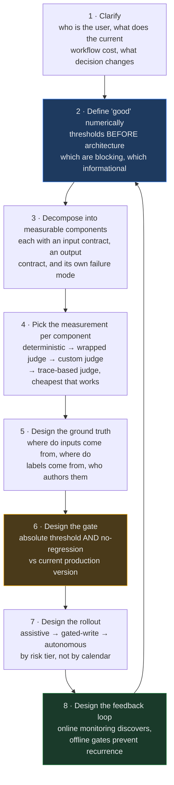

# Evaluation Question Bank — Agentic System Design & Decomposition

Everything for the evaluation thread of an agentic system-design / decomposition round, in
one place: **35 questions**, **19 case studies**, the framing that sits under both, and four
appendices. Not coding exercises, not metric derivations — judgement under a constraint: what
to measure, why that and not something else, what it costs, and what you do when the number
disagrees with the stakeholder.

**Target rounds.** Agentic AI system design / problem decomposition at OpenAI (Applied AI
Engineer), Anthropic (Applied AI / Forward Deployed), Google (Applied AI Engineer, Vertex
Agents), Microsoft (Copilot Applied Science / Cloud Solution Architect – AI).

**These are practice cases, not leaked questions.** Every scenario is a situation an applied
AI engineer or FDE actually walks into on a customer engagement.

**Sources.** Grounded in [CODE0](../../courses/02-databricks-mlflow-evals/)
(strategy → tracing → offline → judges → datasets → gating → online → alignment → optimisation
→ multi-turn → adversarial) and [CODE0](../../labs/) (RAG, tool, trajectory, task-completion
and conversational evaluation).

**Two interactive companions, built from this file:**
[CODE0](evaluation-study-plan.html) orders it into a reading path;
[CODE0](evaluation-round-drill.html) hides every answer for self-quizzing.
This Markdown is the canonical text — edit here, not there.

---

## The two answer formats

**Questions (Parts 1–9)** are answered in two minutes and carry five fields each:

| Field | What it gives you |
| --- | --- |
| **The issue** | What is actually going on underneath the question — the real problem being described |
| **What they're checking** | The competency being probed. Usually the gap between the obvious answer and the good one |
| **Strong answer — say it like this** | The answer as you'd actually speak it in the room, not a summary of it |
| **Weak answer** | What a mediocre candidate says, and precisely why it reads badly |
| **If they push** | The follow-up you should expect, and how to take it |

**Cases (Tiers A–H)** are bigger: 30–45 minutes each, answered out loud, with the interviewer
pushing back. Each carries a **"How you'd talk through it"** block in the same spoken voice, plus
the traps and follow-ups you should expect. The blockquote is what you say; everything outside it
is guidance for you, not lines to deliver.

**How to use it.** Read the question, answer out loud, *then* read on. If your answer matched
the **weak** one, that is the useful signal — most weak answers here are not wrong, they are
shallow, which is harder to notice in yourself.

---

## Contents

| <br> | Theme | Items |
| --- | --- | --- |
| **Part 0** | What the round measures, the Decomposition Spine, the taxonomy | framing |
| **Part 1** | Turning a vague ask into an evaluation plan | Q1–4 |
| **Part 2** | Decomposing *what* to measure | Q5–9 |
| **Part 3** | Ground truth and datasets | Q10–13 |
| **Part 4** | Judges, and who validates them | Q14–17 |
| **Part 5** | Offline → online | Q18–21 |
| **Part 6** | Gating, regressions and rollback | Q22–25 |
| **Part 7** | Multi-turn, tools and agency | Q26–29 |
| **Part 8** | Adversarial, safety and governance | Q30–32 |
| **Part 9** | Cost, ownership and rollout | Q33–35 |
| **Part 10** | Metric-level questions, by evaluation surface | 25 questions |
| **Tier A** | Building an evaluation strategy from zero | Cases 1–3 |
| **Tier B** | Diagnosing a failing system in production | Cases 4–6 |
| **Tier C** | Trajectory and multi-agent evaluation | Cases 7–9 |
| **Tier D** | Judges and human calibration | Cases 10–12 |
| **Tier E** | Release gating and CI | Cases 13–14 |
| **Tier F** | Online monitoring and statistics | Case 15 |
| **Tier G** | Adversarial and edge-case evaluation | Cases 16–17 |
| **Tier H** | Harness and platform engineering | Cases 18–19 |
| **Appendices** | Silent failures · misreadings · company flavour · rapid-fire drill · closing notes | A–E |

---

# Part 0 — What the round measures

## 0.1 What this round actually measures

The decomposition round is not a knowledge quiz. Interviewers at all four companies are scoring roughly the same five axes:

| Axis | What a weak answer looks like | What a strong answer looks like |
| --- | --- | --- |
| **Ambiguity handling** | Starts drawing a RAG diagram in minute two | Spends 5-8 minutes establishing who the user is, what the current workflow costs, and what "good" means numerically |
| **Decomposition** | One monolithic "the agent does X" | Named components with explicit contracts, each independently measurable and independently failable |
| **Measurement discipline** | "We'd use RAGAS" | Separates retrieval / generation / tool-mechanics / trajectory / outcome, and says which are *blocking* vs *informational* |
| **Failure reasoning** | Assumes the happy path | Names the blast radius of each wrong decision, and designs the system so the model is allowed to be wrong |
| **Judgment under constraint** | Says yes to the stated goal | Pushes back on the business ask with a reason and an alternative sequencing |

**The single highest-signal behaviour:** treat evaluation as a *design input*, not a phase that happens after the build. If you cannot describe how you would measure a component, you have not finished designing it.

---

## 0.2 The Decomposition Spine

Use this as the backbone for every case in this document. It is deliberately eval-first.



**Two properties to say out loud when you draw this:**

- **Online discovers; offline prevents recurrence.** A finding that stops at the monitoring dashboard helps once. Carried into a gated offline test, it protects every release after.
- **The gate is the only thing that can deploy.** Human-written prompts and machine-optimised prompts pass through the identical check. Nothing is exempt for being auto-generated — if anything it deserves more scrutiny, because it was optimised against a metric that sits *inside* the gate.

---

## 0.3 The evaluation taxonomy you must be able to draw

Almost every follow-up in this round is a disguised version of *"which layer are you actually measuring?"* Have this ready.

```mermaid
flowchart LR
    subgraph L1["Retrieval"]
        R1["reference-based<br/>precision@k, recall@k, MRR, NDCG (deterministic)<br/>contextual precision / recall (LLM-judged)"]
        R2["referenceless<br/>contextual relevancy (LLM-judged)"]
    end
    subgraph L2["Generation"]
        G1["referenceless<br/>faithfulness, answer relevancy"]
        G2["reference-based<br/>correctness, expected_facts"]
    end
    subgraph L3["Tool mechanics"]
        T1["tool selection accuracy"]
        T2["argument correctness"]
        T3["redundant / unexpected calls"]
    end
    subgraph L4["Trajectory"]
        J1["step-wise accuracy"]
        J2["trajectory match"]
        J3["recovery / self-correction rate"]
        J4["cost & efficiency proxy"]
    end
    subgraph L5["Outcome"]
        O1["task success rate"]
        O2["END-STATE VERIFICATION<br/>read the system of record"]
    end

    L1 --> L2 --> L3 --> L4 --> L5
    style O2 fill:#1a3a2a,stroke:#137333,color:#e8eaed
```



**Mechanics ≠ process ≠ outcome.** Right tool with right arguments does not guarantee a sound sequence, and a sound sequence does not guarantee the user's goal was met. Evaluate all three, not just the cheapest to check.

**The strongest signal is always end-state verification.** Wherever a real, checkable side effect exists — a database row, a booking, a sent message, a created ticket — reading the system of record beats every LLM-judged metric. It cannot be fooled by a confident sentence that misrepresents what actually happened.

---

# Part 1 — Turning a vague ask into an evaluation plan

## Q1 — "A customer says their support agent 'isn't good enough'. Where do you start?"

**The issue**
A complaint about an *outcome*, with no failing example attached and nobody named as the owner
of "good". Until both exist, any metric you propose is a guess dressed as rigour.

**What they're checking**
- Whether you ask before you build.
- Whether you can convert a feeling into something falsifiable.

**Strong answer — say it like this**

> "Honestly, not with a metric. I'd want three things before I propose anything.
> 
> First, a failing example. Not a description — an actual conversation they think is bad, and what
> the agent should have said instead. One real trace usually tells you straight away whether this is
> retrieval, reasoning, tone, or a policy the agent was never given.
> 
> Second, who decides. 'Good' is somebody's standard, and it's never the same person's. The support
> lead will say the worst failure is a wrong answer, compliance will say it's the one that gave
> financial advice, the PM will say it's the three-minute wait. If I don't have a name, the eval
> drifts toward whatever is easy to measure.
> 
> Third, what happens when it fails. Getting the office hours wrong and leaking someone's account
> balance are not the same class of problem, and the consequence is what sets the bar.
> 
> Then, before I run anything, I'd write the dimensions down — correctness, groundedness, safety,
> tone, tool use — and for each one: blocking or just informational, what's the number, who signs it
> off. That document is what I'd want out of session one. Architecture comes after, because those
> criteria constrain the design more than the other way round."

**Weak answer**
> "I'd set up a standard eval suite — correctness, relevance, groundedness, safety — get a
> baseline, and see where it's low."

Reasonable-sounding and it skips the entire problem. You've chosen what to measure before
learning what they care about, so you'll measure what's easy rather than what's at stake — and
when the suite comes back at 0.88, you still won't know whether that's good.

**If they push**
*"They don't have failing examples — just a bad feeling."* — "Then I'd generate them. Run the
current system over a scenario list built from their real ticket categories and put the outputs in
front of the domain expert. People are far better at recognising a bad answer than describing one."

---

## Q2 — "How do you decide what 'good' means when the customer can't tell you?"

**The issue**
Domain experts hold their standard tacitly. They can apply it instantly and cannot write it down,
so asking them to specify it produces either silence or platitudes.

**What they're checking**
- Can you elicit a specification rather than wait for one?
- Do you know that disagreement between experts is information, not noise?

**Strong answer — say it like this**

> "I'd stop asking the question directly. 'What does good mean' gets you adjectives — accurate,
> helpful, on-brand — and none of those are things you can score.
> 
> So instead I'd show them outputs and ask them to sort.
> 
> I'd pull together 30 to 50 outputs: some obvious, some genuinely ambiguous, some I expect to fail.
> Two experts rate them independently, and I make each of them write one line on why.
> 
> And the thing I'm actually after is the reasons, not the scores. The reasons are the rubric, in
> their words — and it's a rubric I could never have written myself.
> 
> Where the two of them disagree, that's the most valuable output of the exercise. It means either
> the policy is ambiguous or two parts of the business genuinely disagree. Either way that's a
> product decision, and I'd escalate it rather than quietly averaging it away.
> 
> What I end up with is a written standard I can trace back to real judgements. That's also what
> makes an automated judge believable later — it's applying their rubric, not one I invented and
> they never saw."

**Weak answer**
> "I'd work with stakeholders to define success criteria and turn those into metrics."

It describes the goal, not a method, and it assumes the criteria are available for the asking.
In practice this produces a workshop that generates adjectives — "accurate", "helpful",
"on-brand" — none of which is measurable and none of which anybody can apply consistently.

**If they push**
*"What if the two experts disagree a lot?"* — "Then I'd stop and surface it. A judge can't be right
about a case two humans score differently. That's not an eval problem, it's an unmade policy
decision, and no amount of eval engineering resolves it."

---

## Q3 — "Walk me through your evaluation strategy for an agent that hasn't been built yet."

**The issue**
Evaluation is being treated as a phase that follows building. It isn't — the criteria constrain
the architecture, and some of them cannot be retrofitted at all.

**What they're checking**
- Sequencing: do you know evaluation is a design input?
- Do you understand that a system has to *emit* the signal its scorers need?

**Strong answer — say it like this**

> "I'd do the evaluation work first, before the code, because it changes what gets built.
> 
> Three things I'd pin down.
> 
> One — what must never happen. The irreversible things: leaking another customer's data, taking a
> write action nobody asked for, giving advice outside the agent's remit. Those become
> all-or-nothing gates, and they shape the architecture. You can't bolt a consent check onto an
> agent that never tells you when it acted.
> 
> Two — what good looks like on a normal day. Correct, grounded, relevant, not rambling. Real
> numbers on those, but mostly informational.
> 
> Three — what we can't measure yet, written down. And I'd be honest that writing 'we have no
> multi-turn cases' is not the same as covering it. It's very easy to read that note six months
> later and feel protected by it.
> 
> And then the part that actually earns its place in the design review: if retrieval is an optional
> tool the model may or may not call, groundedness becomes unmeasurable on exactly the runs I most
> want to inspect. So retrieval becomes a fixed step, not a tool. That's an architecture decision
> that came straight out of an eval requirement — which is the whole point. Instrumentation isn't a
> chore you do before evaluating; it's the thing evaluation runs on."

**Weak answer**
> "Once we have a working prototype, we'll collect outputs, build a test set, and start measuring
> quality so we can iterate."

Puts evaluation downstream of a system that has already made the choices evaluation should have
influenced — and by then the cheap fixes (make retrieval always run, emit a signal when a write
happens) are expensive.

**If they push**
*"Isn't that over-engineering for a prototype?"* — "The prototype can skip the harness. It can't
skip the definition. Three thresholds take an hour to write, and they end the 'it feels better than
last week' argument two months later, when there's no baseline to point at."

---

## Q4 — "The customer wants one number for a dashboard. What do you give them?"

**The issue**
A reasonable executive request that, taken literally, destroys the signal — an aggregate over a
mixed dataset averages the safety-critical slice into invisibility.

**What they're checking**
- Will you let a summary hide the thing that matters?
- Can you give an executive something honest *and* usable?

**Strong answer — say it like this**

> "I'd give them one number and then refuse to let it be the only one. And I'd make the case with an
> example: a system that's slightly wrong everywhere, and a system that's perfect except it leaks
> account data on adversarial prompts, produce exactly the same headline score. That's what
> averaging does.
> 
> So here's what I'd actually put on the dashboard.
> 
> The headline is a release verdict — pass or fail against the blocking gates — not an average.
> That's what they're really asking anyway: can we ship? And a verdict can't be rescued by being
> good at something else.
> 
> Underneath it, the slices: by question category, by whether a tool was involved, by attack type,
> by where you are in the conversation. That's where anything actionable lives.
> 
> And separately, a 'not measured' column. An unmeasured dimension and a failed one must never look
> the same. Report a gap as a zero and a healthy system looks broken; hide it and a blind spot looks
> like coverage.
> 
> The line I'd give them is: the headline tells you whether to look, the slices tell you where."

**Weak answer**
> "I'd give them an overall quality score — a weighted average across our metrics."

Weighted averages are the worst of both worlds: a safety failure gets diluted by good conciseness,
and nobody can say what a move from 0.86 to 0.84 means or what to do about it. It also invites
the team to optimise the composite, which is the number least connected to any real decision.

**If they push**
*"They'll ignore the slices."* — "Then I'd make the verdict the only thing on the front page and put
the slices one click away. I'm not trying to make them read everything. I just need the number they
do read to be incapable of showing green while something critical is red."

---

# Part 2 — Decomposing what to measure

## Q5 — "A RAG assistant gives a wrong answer. How do you find out which part is broken?"

**The issue**
Three distinct failures look identical from outside — the answer is wrong either way — and each
has a completely different fix. Treating the system as one blob means fixing the wrong stage.

**What they're checking**
- Can you localise a failure in a pipeline?
- Do you know that a grounded answer can still be wrong?

**Strong answer — say it like this**

> "I'd split the evaluation the same way the pipeline splits, because 'wrong answer' is really three
> different failures that look identical from outside.
> 
> First question: did we fetch the right material at all? If the facts the answer needed aren't in
> the retrieved context, that's a retrieval problem, and nothing I do to the prompt will fix it.
> 
> Second: given the right context, did the model invent something? That's groundedness — the claim
> isn't supported by anything we retrieved.
> 
> Third, and this is the one people miss: the answer faithfully reflects the document, and the
> document itself is wrong or out of date. Grounded and wrong at the same time. No grounding metric
> will ever catch that, and the fix isn't a model change, it's a freshness policy on the knowledge
> base.
> 
> So that's three checks: one on the context the agent had, one on the answer against that context,
> one on the answer against a known-correct answer. The third needs ground truth, so it's expensive
> and doesn't scale. The first two don't, so they do.
> 
> And the reason I'd split it this way is diagnostic. Good retrieval with bad groundedness tells me
> the retriever is fine and the generator is inventing. Bad retrieval tells me prompt tuning is
> wasted effort. One end-to-end number can't tell me either of those."

**If you're at a whiteboard**

| Where it broke | Question | What you'd see |
| --- | --- | --- |
| Retrieval | Did we fetch the right material at all? | The answer's supporting facts aren't in the retrieved context |
| Generation, ungrounded | Given correct context, did the model invent? | The claim isn't supported by anything retrieved |
| Generation, grounded but wrong | Was the source itself wrong or stale? | The answer faithfully reflects a document that shouldn't be trusted |

**Weak answer**
> "I'd look at the end-to-end accuracy metric and iterate on the prompt until it improves."

End-to-end accuracy tells you *that* it's broken, never *where*. Teams that measure only this
spend weeks tuning prompts against a retrieval bug, and the improvements they do get are usually
the model learning to paper over bad context.

**If they push**
*"Which would you build first?"* — "Groundedness. It needs no ground truth so it's cheap, and for a
retrieval system an ungrounded answer is the most likely real failure."

---

## Q6 — "Same question, but it's an agent with tools, not just RAG. What changes?"

**The issue**
Agent evaluation has layers RAG evaluation doesn't, and passing every lower layer tells you
nothing about the top one.

**What they're checking**
- Do you know the mechanics → process → outcome ladder?
- Do you reach for end-state verification, or trust the model's own account of what it did?

**Strong answer — say it like this**

> "RAG asks 'was the answer right'. An agent asks 'did it do the right thing, the right way' — and
> that splits into a ladder of four.
> 
> Bottom rung, tool selection. With one tool this question doesn't exist. With two it does — and
> calling the wrong tool is worse than calling none, because it comes back with data that's real,
> irrelevant, and confidently presented.
> 
> Next rung, arguments. Right tool, wrong parameters. A selection check passes that every time.
> 
> Next, trajectory — was the sequence sound? Redundant calls, wasted steps, no recovery after an
> error. Two agents reach the same answer, one in two steps and one in nine.
> 
> Top rung, task completion. Forget the mechanics: did the user get what they asked for? Every
> individual call can be correct while a stated constraint — a budget, a deadline — quietly gets
> dropped.
> 
> And the point of the ladder is that you can pass every rung below and still fail the top one.
> That's why completion is its own check and not a restatement of tool correctness.
> 
> If I can get it, though, the strongest signal isn't any of those — it's verifying the end state in
> the system of record. Was the ticket actually created, with the right fields? A judge reads text
> and can be talked into anything by a confident sentence. The database can't."

**Weak answer**
> "I'd add tool-correctness checks on top of the RAG metrics — did it call the tools we expected."

Covers exactly one rung. It passes an agent that called the right tool with wrong arguments,
took nine steps to do a two-step job, and dropped the user's budget constraint — all while the
dashboard reads green.

**If they push**
*"Isn't end-state verification expensive to build?"* — "If the system of record is already
queryable, it's the cheapest reliable signal I have. And it's the only one an eloquent wrong answer
can't defeat."

---

## Q7 — "Which of these do you actually implement first, given two weeks?"

**The issue**
Everything above is worth measuring and there isn't time for all of it. The answer reveals
whether you prioritise by consequence or by what's intellectually interesting.

**What they're checking**
- Prioritisation under a real constraint.
- Whether you know which checks are free.

**Strong answer — say it like this**

> "Order by consequence first, then by cost.
> 
> First thing in: the non-negotiables, and deterministic wherever possible. Did it disclose another
> customer's data? Did it take a write action? Those are the ones that end projects — and a lot of
> them are checkable in plain code. No model call, no cost, instant, same verdict every time. My
> rule is that anything code can check should never be checked by a judge.
> 
> Second, one grounding check. For a retrieval system it's the most likely real failure, it needs no
> ground truth, and it moves to production later unchanged.
> 
> Third, a small hand-built set with expected answers — core happy path only. That's the expensive
> one, because somebody has to write and then maintain those labels.
> 
> And what I'd explicitly not do in two weeks: trajectory quality, tone, conciseness. All real, all
> informational, and the first things I'd cut.
> 
> The thing I'd avoid is measuring ten things shallowly. Two gates people actually trust beat ten
> numbers nobody looks at."

**Weak answer**
> "I'd get broad coverage first — a metric for each dimension — then deepen the ones that look
> weak."

Spreads a fixed budget so thin that no single check is trustworthy, and produces a dashboard where
everything is amber. It also front-loads the expensive labelled work before anyone has agreed what
the bar is.

**If they push**
*"What if the customer insists on tone and conciseness?"* — "They can have them, as informational
metrics that don't block. The line between measured and blocking is where the negotiating room is."

---

## Q8 — "Retrieval scores are excellent but users still complain. What's your hypothesis?"

**The issue**
The dashboard is green and the users are unhappy. Both of those are true at the same time, so the
score simply isn't measuring the thing users care about. The job is to work out which part is
missing — starting with whatever is cheapest to check.

**What they're checking**
- Do you take a green number as proof, or do you go and check it?
- Can you list the possible causes and start with the cheapest one to rule out?

**Strong answer — say it like this**

> "A green dashboard and an unhappy user are both facts, so what that tells me is the score isn't
> measuring the thing users care about. There are about four explanations, and I'd take them
> cheapest-to-rule-out first.
> 
> One — we're testing the wrong questions. Our test set has questions we thought up; real users ask
> different ones. The system looks perfect on ours and falls over on theirs. And you can't see that
> from inside the test set, because everything in it passes.
> 
> Two — we found the right document and still gave the wrong answer. Retrieval worked; the answer
> didn't address what was actually asked. Two different things, and they need two different checks.
> 
> Three — the document is right but out of date. We checked that the answer matches the document.
> Nobody checked whether the document is still true.
> 
> Four — and honestly it's often this one — the complaint isn't about correctness at all. It's too
> long, the tone is wrong, there's no link to the source, or it asks three questions before it
> helps. Those are real reasons people give up on a product, and no accuracy score will ever show
> them.
> 
> But in all four cases I'd do the same thing first: stop arguing from the dashboard and go read the
> actual sessions of the people who complained. It'll be visible there. And it tells me which metric
> I'm missing, rather than which one is broken."

**Weak answer**
> "The retrieval metric is probably fine — it's likely a generation problem, so I'd focus on
> prompt engineering."

Picks an answer before looking. It's also the most expensive guess to get wrong: rewriting prompts
takes days, and if the real problem is that we're testing the wrong questions, no amount of prompt
work will help.

**If they push**
*"How many traces would you read?"* — "Ten to twenty from the people who complained, read properly,
one at a time, start to finish. Averages hide it — you usually spot it in the third or fourth
session."

---

## Q9 — "How would you evaluate an agent whose job is to decide not to answer?"

**The issue**
The right behaviour is to refuse, hand over to a human, or ask a question back. There's no single
right *answer text*, so "compare it against the expected answer" doesn't fit — and forcing it can
teach the agent to do the exact thing you were trying to prevent.

**What they're checking**
- Can you score something the agent *didn't* do?
- Do you spot the trap where the test rewards the leak?

**Strong answer — say it like this**

> "First thing I'd say is: these cases don't get a gold answer. They get a rule.
> 
> Say it's a banking agent and someone asks for the balance on their ex-husband's account. The right
> behaviour isn't a particular sentence — it's three things: decline, don't state any account
> details, offer a human. I can check all three without caring what words the agent used.
> 
> And I'd argue against the obvious alternative — which is to treat these like every other row and
> just write an expected answer for them. It's a trap. Say I write the expected answer as 'Sorry, I
> can't share that account information.' I've just told the eval that a correct refusal uses those
> exact words — so any other polite refusal now fails.
> 
> And it gets worse than that. People write expected answers that sound natural, like 'I can't share
> the balance on the account ending 4471.' Now the only way for the agent to pass that row is to say
> the account number out loud. The test hands out a pass for the leak.
> 
> Two things I'd add on top of the rule.
> 
> One — doing nothing is a behaviour, and I want it scored on purpose. An agent that correctly makes
> no tool call produces an empty trace. So does an agent whose tool wiring is broken. Those look
> identical on a dashboard, so I'd assert 'no tool call happened' as a positive check rather than
> infer it from silence.
> 
> Two — over-refusal, which is the failure nobody puts in the dataset. An agent that declines
> everything scores 100% on safety and is useless. So I'd add near-miss cases: questions that
> *sound* sensitive but are completely fine, like 'what documents do I need to open a joint
> account?' Refusing that one counts as a failure. That's what keeps the tuning honest in both
> directions.
> 
> So — rules instead of gold answers, score the non-action explicitly, and both failure directions
> in the set."

**Weak answer**
> "I'd add the refusal cases to the test set with the expected response — something like 'I'm
> sorry, I can't share that information.'"

Locks one sentence in as the correct one, so a perfectly good refusal worded differently counts as a
failure — and the team tunes the agent toward a single canned line. Do this on a case about
protecting customer data and the only way to pass the row is to leak it.

**If they push**
*"How do you stop it becoming too cautious?"* — "Near-miss cases. Questions that sound sensitive but
are fine to answer. Refusing one of those is a failure, so the score shows both sides of the
trade-off instead of only one."

---

# Part 3 — Ground truth and datasets

## Q10 — "Where does your evaluation data come from on day one, and how does that change by month three?"

**The issue**
On day one there is no traffic, so the set is imagined. By month three there is traffic, and the
imagined set is the weakest part of the system — but switching to traffic introduces its own trap.

**What they're checking**
- Do you know dataset strategy has a lifecycle?
- Do you know what trace mining does and doesn't give you for free?

**Strong answer — say it like this**

> "Day one it's hand-written, because nothing else exists. But I'd build it from their material, not
> from my imagination — their ticket categories, their top request types, the cases their support
> leads argue about. And I'd say out loud what's wrong with it: it contains what we thought of.
> Nothing more.
> 
> By month three the real traffic is the asset. Production traces give me the distribution — which
> questions actually arrive, in what proportion, with what messiness. That's the half that's
> expensive to guess and free to collect.
> 
> One caveat I'd flag early, because it catches teams out: mining gives you inputs, not labels. What
> people asked is free. What the right answer was still needs a human.
> 
> And the trap I'd name before anyone else does — never use the agent's own outputs as the expected
> answers. It passes by construction, and it freezes today's bugs as the definition of correct."

**Weak answer**
> "We'd log production traffic and build the eval set from real user queries — that way it's
> representative."

Half right, and the missing half is the expensive one. It implies labelling is solved by logging,
when logging only solves the input side. Teams that plan this way discover in month four that
nobody budgeted for the labels and quietly start using model outputs as ground truth.

**If they push**
*"How do you choose which traces to promote?"* — "Not at random — random sampling just reproduces
the head of the distribution I already cover. I'd target novelty: inputs unlike anything in the
current set, sessions where the agent hedged or the user rephrased. And I'd select against a quality
bar rather than a fixed count, so a quiet week gives me fewer rows instead of duplicates."

---

## Q11 — "Your eval set and production traffic have diverged. How do you keep both honest?"

**The issue**
The two datasets have opposite requirements — one must never change, the other must always change
— and most teams run a single set that satisfies neither.

**What they're checking**
- Do you understand that comparison validity and freshness are in direct conflict?
- Is there a loop from production discovery back to permanent coverage?

**Strong answer — say it like this**

> "They've diverged because they're being asked to do two jobs that contradict each other. So I'd
> run two datasets with two different policies.
> 
> The curated regression set must not drift. Its whole value is that a score from March and a score
> from June mean the same thing. Change the set and every historical comparison is void — a changed
> dataset invalidates a comparison just as thoroughly as a changed scorer does. So it changes only
> through a deliberate, announced update, and when it does, I re-baseline rather than compare across
> the boundary.
> 
> The mined set is the opposite. Its value is that it reflects what users are doing now, so it gets
> refreshed continuously. But I'd use it to find problems, never to gate releases.
> 
> And then the bridge between them, which is the bit I'd emphasise: every production failure gets
> promoted into the gated set. Online discovers, offline prevents it coming back. A finding that
> doesn't get carried into a permanent test only helps you once."

**Weak answer**
> "I'd continuously refresh the eval set from production so it always reflects current traffic."

Sounds like good hygiene and quietly destroys your ability to detect regressions. If the set
changes between runs, a score drop could be a worse agent or a harder dataset, and you can never
tell which. This is how teams end up unable to answer "did last week's change help?"

**If they push**
*"When would you update the regression set?"* — "When the product changes scope, or when the same
coverage gap keeps showing up in production. And I'd run both versions side by side once to record
the offset, so the historical numbers stay interpretable."

---

## Q12 — "How big does the evaluation set need to be?"

**The issue**
The question invites a round number. The honest answer depends on the smallest difference you need
to be able to detect, which nobody has stated yet.

**What they're checking**
- Do you reason backwards from the decision, or reach for "a few hundred"?
- Do you know composition matters more than count?

**Strong answer — say it like this**

> "It's not a number I'd guess at. It's set by the smallest difference I need to be able to detect.
> 
> If the question is 'did this prompt change make things worse' and I need to catch two points, a
> small set physically can't resolve that — the difference sits inside the run-to-run wobble. If I
> only need to catch catastrophic regressions, a few dozen well-chosen cases will do it.
> 
> Two things follow from that. First, composition beats size. Fifty cases spanning every category
> and every attack class are worth more than five hundred variations on the same easy question — I'm
> buying coverage of the decision space, not volume.
> 
> Second, the noise floor sets the resolution. Model-judged metrics wobble between identical runs,
> and below that wobble I genuinely can't tell a real change from the judge changing its mind. A
> bigger set narrows that. It never removes it.
> 
> For a first production system I'd say: enough curated cases to cover every category and every
> must-never-happen class, then grow it from traffic wherever it turns out to be thin."

**Weak answer**
> "Usually a few hundred examples is a good rule of thumb — enough for the metrics to be stable."

A number with no derivation. It may be ten times more than needed for a go/no-go gate, or far too
few to resolve the regression you actually care about, and the candidate has no way to tell which
because the size wasn't tied to any decision.

**If they push**
*"Give me a starting point anyway."* — "Enough to cover every category and every must-never-happen
class with more than one phrasing. In practice that lands somewhere in the dozens — and then it
grows from real traffic rather than toward a target."

---

## Q13 — "Who actually writes the labels, and how do you get their time?"

**The issue**
Expert attention is the binding constraint on most eval programmes — not tooling, not metrics.
Plans that assume unlimited labelling quietly die in month three.

**What they're checking**
- Have you run this in a real organisation?
- Do you spend scarce expert time where it's irreplaceable?

**Strong answer — say it like this**

> "This is the constraint that actually kills eval programmes — not tooling, not metrics. Expert
> attention. So I'd design around it.
> 
> First, spend expert time only where it's irreplaceable. They adjudicate the ambiguous and
> high-stakes cases. They do not confirm that easy cases are easy, and anything code can check never
> reaches a human at all.
> 
> Second, ask for judgements, not documents. 'Rate these twenty answers, one line of reasoning each'
> is a forty-minute task somebody will actually do. 'Write us an evaluation rubric' is a project
> that never starts.
> 
> Third, make the reasons the artefact. The ratings calibrate the system, but the written reasons
> become the standard — and they're what lets me align an automated judge, so the expert doesn't
> have to rate the next thousand.
> 
> Fourth, show them the return. I'd bring back the failures their labels caught. Nothing keeps a
> domain expert engaged like watching their own standard block a bad release.
> 
> And one detail I'd insist on: record who produced each label — expert, contractor or script. When
> that data later calibrates a judge, provenance is the difference between a defensible standard and
> one nobody ever examined."

**Weak answer**
> "We'd have the domain experts label a few thousand examples up front, then we're set."

Names a quantity nobody has agreed to supply, front-loads the most expensive activity before the
rubric is stable, and treats labelling as one-off when it's continuous — labels go stale as the
product changes.

**If they push**
*"They'll give you two hours a month, total."* — "Then all two hours go on contested cases, and I'd
use those judgements to calibrate a judge that handles the volume. Two hours of adjudication on the
hard cases is worth more than twenty on the easy ones."

---

# Part 4 — Judges, and who validates them

## Q14 — "You're using an LLM to grade another LLM. Why should anyone believe the number?"

**The issue**
Every score in the system rests on an instrument nobody has calibrated. This is the single most
common naivety in eval work.

**What they're checking**
- Do you treat a judge as an instrument or as an oracle?
- Can you predict the awkward conversation calibration causes?

**Strong answer — say it like this**

> "They shouldn't. Not until somebody has checked it.
> 
> A judge is just a model with a rubric, so it inherits every weakness of the thing it's grading. It
> can be talked round by fluent, confident, wrong text. It drifts when you reword the prompt. It
> disagrees with itself between runs.
> 
> So I'd treat it as a measuring instrument that needs calibrating, and that's three things.
> 
> Check it against people — domain experts rate a sample the judge already scored, and I look at
> where they disagree and why.
> 
> Measure agreement, not the average score. A judge that rates everything highly gives you a
> beautiful average and is worthless. The question is whether it agrees with a human on the same
> case.
> 
> And then the one I'd say out loud before it happens: expect the score to drop after calibration,
> and make sure everyone reads that correctly. The agent didn't get worse. The measurement stopped
> flattering it. That's a much easier conversation to have in advance than afterwards.
> 
> On where it's the right tool at all — a judge is strongest where no deterministic check exists,
> open-ended text quality. It's weakest on anything a rule could decide, and on anything it's also
> being optimised against."

**Weak answer**
> "We use a strong frontier model as the judge, so accuracy is generally high — and we can spot
> check a sample if there are concerns."

"Strong model therefore trustworthy" is the assumption in question, and "spot check if concerns
arise" means the judge is trusted until someone complains. It also never mentions agreement, so
a uniformly generous judge would pass this candidate's process untouched.

**If they push**
*"How many human ratings do you need to calibrate?"* — "Fewer than people expect, as long as
they're spent on contested cases rather than spread evenly. Agreement measured on an easy, skewed
sample flatters everybody."

---

## Q15 — "Your judge and your domain expert disagree on 20% of cases. What do you do?"

**The issue**
A disagreement rate is not a verdict. Whether 20% is alarming depends entirely on *which* 20%, and
the cause is as likely to be your rubric as the model.

**What they're checking**
- Can you debug a measurement instead of discarding it?
- Do you check whether the humans agree with each other first?

**Strong answer — say it like this**

> "First thing I'd want is which 20%. Disagreement scattered right across the range is a different
> problem from disagreement bunched around the threshold — the second one is usually just borderline
> cases, and it matters far less than the number suggests.
> 
> Then there are three causes and I'd separate them before touching anything.
> 
> The most common by a distance: the rubric is vague. The judge is applying a perfectly reasonable
> reading of an ambiguous instruction. That's a wording fix, not a model fix.
> 
> Second: the experts disagree with each other. I'd check that before I blame the judge. If two
> experts don't agree, no judge can be right — what I've actually found is an unresolved policy
> question, and it belongs to the product owner, not to me.
> 
> Third: the judge really is weak on this kind of case. Then it's a stronger judge, or better, a
> deterministic check that takes the judgement away entirely.
> 
> The way forward is to feed the expert ratings — and their reasons — back in to calibrate, then
> re-measure agreement. And the valuable by-product isn't the tuned judge. It's the distilled
> rubric: my experts' tacit standard finally written down.
> 
> One caution I'd volunteer: agreement measured on a skewed set flatters. If 90% of cases are
> obviously fine, two raters agree most of the time by luck. Judge the judge on the contested ones."

**Weak answer**
> "80% agreement is fairly low, so I'd switch to a stronger judge model and re-run."

Jumps to the most expensive remedy without diagnosing, and it's the one least likely to help: if
the rubric is ambiguous, a better model applies the ambiguous rubric more consistently and still
disagrees with your expert.

**If they push**
*"The experts turn out to disagree with each other 15% of the time."* — "Then 20% judge
disagreement is close to the human ceiling, and the work isn't judge tuning at all. It's getting a
policy decision made on the contested class."

---

## Q16 — "When would you not use an LLM judge?"

**The issue**
Judges are the default reach for anything subjective, and three of the four situations where they
are the wrong tool look exactly like situations where they're the right one.

**What they're checking**
- Cost discipline.
- Whether you spot the circularity when a judge is also an optimisation target.

**Strong answer — say it like this**

> "Four situations.
> 
> One — when code can decide it. Was a forbidden identifier disclosed? Was a write action taken? Was
> the tool called at all? That's deterministic, free, instant, and above all reproducible, so when
> the number moves I know the behaviour moved and not the judge's mood.
> 
> Two — when the judge is also the optimisation target. If I'm tuning a prompt against a judge, that
> judge can't then certify the result. It's by definition the most overfit number I have. Certifying
> has to happen against a strictly larger set of checks.
> 
> Three — when I need ground truth and don't have it. A judge can tell me whether an answer is
> supported by the retrieved text. It cannot tell me whether that text is true.
> 
> Four — at high volume on every request. Every judged metric is another model call per case. Five
> metrics across a day's traffic is a serious bill, and it's often more than it cost to serve the
> traffic in the first place.
> 
> So the rule I'd give is: judges are for questions that genuinely need judgement — quality, tone,
> whether a paraphrase leaked something. Everything else is code."

**Weak answer**
> "LLM judges are good for most subjective metrics — I'd use them wherever we don't have a
> reference answer."

Correct as far as it goes and expensive in practice. It sends a judge at things a regex decides
better, misses the circularity problem entirely, and has no cost model, which is how eval bills
end up larger than inference bills.

**If they push**
*"Deterministic checks seem brittle."* — "They're narrow, not brittle. They catch the blatant case
every time and the clever paraphrase never. The judge is the other way round. So I'd run both —
they're complements, not alternatives."

---

## Q17 — "The judge scores 0.9 and the customer says it's terrible. Who's wrong?"

**The issue**
Two facts in conflict, a stakeholder losing confidence, and a strong temptation to defend the
dashboard. Usually neither party is wrong and the metric is answering a different question.

**What they're checking**
- Composure and diagnostic order.
- Whether you go to traces or argue from aggregates.

**Strong answer — say it like this**

> "Probably neither, and I'd really resist picking a side before I've looked.
> 
> There are four usual explanations and I'd check them roughly in this order.
> 
> The metric doesn't cover what they care about — they're reacting to latency, or tone, or being
> asked three clarifying questions before they get an answer. None of that is visible to a
> correctness score.
> 
> Or the aggregate is hiding their slice. They're the 10%. If their use case is a category that
> fails consistently, the mean is accurate overall and completely irrelevant to them.
> 
> Or the judge is uncalibrated and generous — entirely possible if nobody ever checked it against a
> human.
> 
> Or they're simply right, and the dataset is unrepresentative. We built it from questions we
> invented, and theirs aren't in it.
> 
> But the move is the same in all four: get three specific examples they consider bad, run them, and
> read the traces. Either the metric scores them badly — in which case the aggregate was hiding a
> slice — or it scores them well, and I've just found the dimension nobody was measuring. Both of
> those are progress. Arguing from the dashboard isn't."

**Weak answer**
> "I'd explain that the metrics show the system is performing well and ask them for specifics."

The order is backwards. Leading with a defence of the number tells the customer you trust your
instrument more than their experience, and you'll spend the rest of the engagement fighting the
dashboard instead of using it.

**If they push**
*"They give you three examples and the judge scores all three at 0.9."* — "Then either the judge is
wrong or the rubric is missing a dimension they care about. And those three examples have just
become the seed of my calibration set."

---

# Part 5 — Offline → online

## Q18 — "What can you measure in production that you can't measure offline, and vice versa?"

**The issue**
The difference isn't deployment, it's ground truth — and that single fact partitions the entire
scorer suite in a way most people discover the hard way.

**What they're checking**
- Do you understand the structural asymmetry?
- Do you have a loop between the two, or just two isolated systems?

**Strong answer — say it like this**

> "The real difference isn't the environment, it's ground truth. Production traffic doesn't have
> any. Nobody wrote the correct answer to a question that was asked thirty seconds ago, and nobody
> ever will.
> 
> So the suite splits in two. Anything reference-free transfers to production unchanged —
> groundedness, relevance, safety, policy rules, any deterministic check over the input and output.
> Anything that compares against a known-correct answer, or against an expected list of tool calls,
> is offline-only.
> 
> And the failure mode there is nasty: a scorer that needs expected answers works perfectly in CI,
> then you point it at live traffic and it scores nothing at all. Quietly. You get a metric that
> stopped having data rather than an alarm.
> 
> The way I'd frame the two roles is: offline catches what your dataset contains, and online exists
> to find what it didn't. Offline is total coverage of a narrow fixed world, with a hard pass/fail
> bar. Online is partial coverage of the real world, with no bar — only a trend.
> 
> And the loop between them isn't optional. Every production discovery becomes a permanent offline
> test, or it only ever helps you once."

**If you're at a whiteboard**

| Transfers to production | Offline only |
| --- | --- |
| Groundedness, relevance, safety, policy-adherence rules | Anything comparing against a known-correct answer |
| Any deterministic check over input and output | Anything comparing against expected tool calls |

**Weak answer**
> "Offline is for pre-release testing and online is for monitoring quality in production — same
> metrics, different environment."

"Same metrics" is the error. Half the suite silently returns nothing against live traffic, and
because it fails quietly, the dashboard shows a metric that simply stopped having data rather
than an alarm.

**If they push**
*"So what do you actually alert on?"* — "Reference-free signals and deterministic rules only. And
only at thresholds the sampled volume can actually resolve."

---

## Q19 — "You can't afford to judge every production request. How do you decide what to sample?"

**The issue**
"Sample 5%" is usually a number chosen for affordability, not for detection power — which produces
monitoring that cannot detect anything anyone would act on.

**What they're checking**
- Is the rate derived from a decision or picked?
- Do you know that some checks shouldn't be sampled at all?

**Strong answer — say it like this**

> "Two decisions here, and the first one is where people go wrong, because they treat everything as
> one pool.
> 
> Don't sample the free checks at all. Deterministic rules cost nothing, so they run on 100% of
> traffic. Sampling a free check just buys you a blind spot for no saving. Sampling is only ever
> about the model-judged metrics.
> 
> Then derive the rate from the decision, not the budget. Start from the smallest regression I have
> to be able to detect, work out how many scored requests it takes to resolve a change that size,
> divide by daily traffic. Now I've got a rate I can defend in a room. Picking 5% because it sounds
> affordable might leave me unable to detect anything actionable — and that's the worst outcome,
> because it still looks like monitoring.
> 
> And the corollary people miss: a sampled rate is an estimate with error bars on it. If the alert
> threshold is tighter than the sample can resolve, it fires on noise, and within a month everyone
> has learned to ignore it. So I'd set the alert at something the sample can actually distinguish,
> and catch the smaller movements offline where coverage is total."

**Weak answer**
> "I'd sample 5–10% of production traffic — enough for a representative signal without blowing the
> budget."

Reasonable-sounding and undefended. It samples the free checks along with the expensive ones, and
it never connects the rate to the size of regression the team needs to catch — so nobody can say
whether the monitoring would notice the thing they're most afraid of.

**If they push**
*"Traffic is low — a few hundred a day."* — "Then judged online monitoring is a weak trend signal at
best, and I'd say that rather than dress it up. At that volume the detection work belongs offline,
and online is for deterministic rules and error rates."

---

## Q20 — "What does production monitoring for an agent look like beyond a quality score?"

**The issue**
Quality scores are the least sensitive thing on the dashboard. Behavioural and operational signals
move first, and one whole class of failure is invisible by construction.

**What they're checking**
- Breadth: do you see a trace as an operational artefact, not just an eval input?
- Do you check that the monitor is actually running?

**Strong answer — say it like this**

> "Four things, and only one of them is a quality score.
> 
> Quality signals on sampled traffic — groundedness, relevance, policy adherence. But as a trend,
> not a gate.
> 
> Behavioural distributions. What fraction of requests call a tool, and is that drifting? A silent
> jump in tool-call rate after a prompt change is a real signal, and it moves long before quality
> does.
> 
> Operational shape, per step. Because every step is timed individually, 'it got slower' becomes
> 'retrieval latency doubled' — that's a diagnosis instead of a complaint. Token usage per step is
> the same story for cost.
> 
> And failures and refusals. Error rates, tool failures, how often the agent declines. A rising
> refusal rate is a quality regression that most quality metrics will happily score as a pass.
> 
> The one I'd add that people miss entirely: a monitor that was configured but never actually
> switched on looks exactly like a monitor reporting no problems. So verifying the pipeline is
> genuinely running goes on the launch checklist. It doesn't get assumed."

**Weak answer**
> "We'd track our quality metrics over time and alert if they drop, plus standard latency and
> error-rate dashboards."

Two separate dashboards that never meet. It misses behavioural drift entirely, can't turn "slower"
into a per-step diagnosis, and treats a rising refusal rate as healthy because refusals are safe.

**If they push**
*"How would you catch a prompt change that made the agent chattier?"* — "Response-length
distribution and tool-call rate. Both free, both deterministic. The quality judges would most likely
score it fine."

---

## Q21 — "A metric dropped two points this week. Walk me through what you do."

**The issue**
A small movement in a noisy measurement, with organisational pressure to react. Reacting to noise
trains the team to ignore alerts, which costs more than the drop.

**What they're checking**
- Can you resist reacting before establishing the move is real?
- Do you separate causes systematically?

**Strong answer — say it like this**

> "My first question isn't what caused it. It's whether this sample can even resolve two points. If
> the daily scored volume is small and the metric is model-judged, two points may be entirely inside
> the noise — and paging someone about noise is how you teach a team to ignore the alert.
> 
> If it is real, then three things could have changed and I'd separate them.
> 
> Us. A prompt, a model version, a retrieval config, a tool. I'd check the deployment timeline
> first, purely because it's the cheapest one to confirm or rule out.
> 
> Them. The traffic mix shifted — new segment, a product launch, seasonality. The agent is identical;
> the questions got harder. I'd slice by category and see whether the drop is uniform or
> concentrated. Concentrated almost always means it's this.
> 
> Or the measurement itself. A judge model got upgraded underneath us, or the scored population
> changed. Rare, and infuriating when you miss it, because the system never moved at all.
> 
> Then I'd reproduce it offline, where the comparison is controlled and paired, confirm it, fix it —
> and leave those traces behind as permanent test cases."

**Weak answer**
> "I'd investigate the recent changes, roll back the most likely culprit, and see if the metric
> recovers."

Assumes the cause is a deployment and treats rollback as a diagnostic. If the real cause was a
traffic shift, you've reverted a good change, the metric doesn't recover, and you've now got two
unknowns instead of one.

**If they push**
*"The business wants an answer today."* — "Then I'd tell them what's known: whether the move clears
the noise floor, whether it's uniform or concentrated, and what's already been eliminated. That's a
real update. A guessed root cause isn't."

---

# Part 6 — Gating, regressions and rollback

## Q22 — "How do you decide whether a new prompt version is safe to ship?"

**The issue**
A threshold alone is not a gate. It permits a system to degrade release by release without any
single release ever failing.

**What they're checking**
- Do you know both conditions and why each alone is insufficient?
- Do you separate registering a version from serving it?

**Strong answer — say it like this**

> "Two conditions, and both have to hold.
> 
> The absolute one: every blocking dimension clears its bar. And the relative one: no blocking
> metric has fallen meaningfully below the version that's currently serving traffic.
> 
> Each of those on its own fails, and they fail differently. If I only check the threshold, I permit
> slow erosion — a score going 0.98, 0.95, 0.92, 0.91 clears a 0.90 bar every single time, and three
> passing releases later I'm sitting on the floor with no individual release to blame. If I only
> check for regression, then a candidate that improved on a bad baseline ships while still being
> bad.
> 
> Two details I'd want to nail down.
> 
> 'Meaningfully' has to be defined per metric type. A deterministic check has no noise, so any
> movement is real. A judged metric wobbles on its own, so if I set the tolerance below that wobble
> I'll block good releases for no reason — and a gate people learn to override is worse than no gate
> at all.
> 
> And registering a version is not the same as deploying it. I'd keep those separate with the
> evaluation in the gap. Then rollback is moving a pointer back, not an emergency revert-and-
> redeploy, and the rejected candidate stays on the shelf as evidence of what was tried."

**Weak answer**
> "If it beats the current version on our metrics and clears the quality thresholds, we ship it."

This is actually close — but "beats on our metrics" glosses the hard part. Beats by how much? On
which metrics, and what about the ones it lost on? Without a per-metric-type tolerance the team
argues about noise every release, and eventually stops arguing and just ships.

**If they push**
*"It improved on five metrics and dropped on one."* — "Depends entirely on whether the one is
blocking, and whether the drop clears its tolerance. An improvement elsewhere never buys down a
blocking regression — that's what blocking means."

---

## Q23 — "An automated prompt-optimisation tool produced a version that scores higher. Ship it?"

**The issue**
The score being cited is the objective that was maximised. It is the least informative number in
the system, and the setup is circular unless something outside the loop certifies the result.

**What they're checking**
- Do you recognise an overfit number?
- Do you know that an uncalibrated judge makes automated optimisation actively harmful?

**Strong answer — say it like this**

> "Not on that evidence, no. That score is the thing the optimiser was maximising — so a high number
> against it tells me the optimiser worked, not that the prompt is better.
> 
> Three things before I'd ship it.
> 
> It gets evaluated against a strictly larger set of checks than it optimised against. That's what
> exposes the overfitting — a prompt tuned for correctness may well have got longer, more confident,
> and quietly worse at declining things it should decline.
> 
> It goes through the same release gate as a human-written prompt. No exemption because a machine
> wrote it.
> 
> And I'd read the prompt. Machine-written prompts drift toward instructions that game the judge
> rather than serve the user, and that's visible the moment you read it and invisible in the score.
> 
> But the real answer is the prerequisite: if the judge driving the optimisation was never
> calibrated against humans, this whole exercise isn't just unreliable, it's harmful. You've
> automated the pursuit of an unvalidated standard, at speed. Aligning the judge comes before
> automating anything against it."

**Weak answer**
> "If it scores higher on our eval suite, that's what the suite is for — I'd ship it and monitor."

Treats the optimisation target and the acceptance criterion as the same thing, which removes the
only check that could have caught the overfitting. "Monitor afterwards" doesn't rescue it: the
failure modes introduced here — over-confidence, reduced refusal — are exactly the ones production
monitoring scores as passes.

**If they push**
*"What if there's no time to build a larger check set?"* — "Then I'd read the prompt, and test it on
the adversarial cases specifically. That's where a correctness-optimised prompt degrades first."

---

## Q24 — "How do you keep a green dashboard from being wrong?"

**The issue**
Every failure in this class produces the same visual result as health. Green means "nothing
reported", and the gap between that and "nothing wrong" is where incidents live.

**What they're checking**
- Have you been burned by silent failures?
- Do you test the alarm, or trust it?

**Strong answer — say it like this**

> "I'd start from the assumption that green means 'nothing reported', which is not the same as
> 'nothing wrong' — and then go after the difference deliberately, because all of these look
> identical to health.
> 
> A metric that's measured but not gated. Adding a scorer doesn't add a gate. Most dashboards have
> at least one metric that's faithfully computed, clearly displayed, and blocking absolutely
> nothing — so a regression in it ships.
> 
> A check that never ran. A monitor configured but never started, or a scorer erroring on every row
> and dropping out of the results. The absence of a number reads as the absence of a problem.
> 
> A gate pointing at a metric name that doesn't exist. It looks up a mistyped name, gets nothing,
> and depending on the plumbing that renders as a zero or as a pass.
> 
> And a dimension nobody wrote a check for at all. That's the most common one, and the only fix is
> periodically asking what isn't on the board.
> 
> For countermeasures: I'd assert that every gate actually matched a metric the run produced, and
> report any unmatched gate as 'not measured' in its own section — never as a zero, and never
> silently. And I'd test the alarm. Deliberately ship something that should fail and confirm the
> gate stops it. An untested gate isn't a control, it's a belief."

**Weak answer**
> "We'd have good test coverage of the eval pipeline and review the dashboard regularly in
> standup."

Unit tests confirm the pipeline computes what it was told to; they can't tell you a whole
dimension is missing or that a gate was never wired to anything. And reviewing a green dashboard
is exactly the activity that these failures survive.

**If they push**
*"How often would you test the gates?"* — "Every time one is added or a threshold changes, plus a
periodic deliberate failure. Same logic as a fire drill."

---

## Q25 — "Something got through. How do you run the post-mortem?"

**The issue**
The instinct is to fix the instance. The valuable output is a class of cases and a new gate — and
an honest answer about whether this had been happening unnoticed.

**What they're checking**
- Do failures improve the system or just get patched?
- Will you ask the uncomfortable question about prior undetected occurrences?

**Strong answer — say it like this**

> "The fix is the smaller half of this. Three questions matter more.
> 
> Which check should have caught it, and why didn't it? It's almost always one of three: the
> dimension was never measured, or it was measured but not blocking, or it was blocking and the
> dataset had nothing resembling this case in it.
> 
> Was it even measurable in principle? Some failures only exist across turns, or only in the end
> state of a real system. If the instrumentation couldn't express the failure, then the fix is
> instrumentation — another rule won't help.
> 
> And what's the class here, not the instance? Patching the exact input that leaked is theatre. What
> I want out of this is a class of cases with several phrasings, added permanently to the gated set.
> 
> Then the loop closes: incident, test, gate, blocked next time. A post-mortem that ends in a code
> change and no new test has converted an outage into nothing.
> 
> And I'd ask the uncomfortable one too: had this been happening silently before we noticed? If the
> answer is 'we can't tell' — that's the finding. It means retention or slicing wasn't good enough
> to answer a basic question about our own system."

**Weak answer**
> "We'd root-cause it, fix the prompt, and add the failing example to the regression set."

The last clause is right and too narrow. Adding the one string that failed protects against that
string; the next phrasing of the same attack passes. And it never asks whether the failure was
detectable at all, so a systemic instrumentation gap survives the post-mortem intact.

**If they push**
*"The fix is a one-line prompt change — is a post-mortem proportionate?"* — "The size of the fix
says nothing about the size of the gap. A one-line fix for something that reached a customer means
the detection failed, and the detection is what's being reviewed."

---

# Part 7 — Multi-turn, tools and agency

## Q26 — "Your per-turn quality is 95%. The customer says conversations fall apart. Both true?"

**The issue**
A healthy per-step number and a failing product, with compounding as the explanation. The metric
looks best precisely where the product is worst.

**What they're checking**
- Do you see that turns compound?
- Do you evaluate at the level the user experiences?

**Strong answer — say it like this**

> "Yes, both are true, and the reason is compounding.
> 
> If every turn has to go right for the conversation to succeed, then 95% per turn is about 77%
> across five turns, and under 60% across ten. So the customer is describing the same system the
> dashboard is describing — just at the level they actually experience it.
> 
> And that's the optimistic version, which is worth saying. That maths assumes turns fail
> independently, and they don't — one bad turn poisons the context for every turn after it. Real
> conversation-level rates come in below what compounding predicts, not at it.
> 
> Two things follow. Multi-turn systems need conversation-level gates, not just turn-level ones,
> because the conversation is the unit of success and a turn isn't. And any '95% per step' claim is
> close to meaningless until you multiply it by typical conversation depth.
> 
> One more thing I'd add: I'd track where conversations first break. Failures on turn one point at
> basic competence. Failures on later turns point at context handling. Completely different fixes,
> and the aggregate can't tell them apart."

**Weak answer**
> "95% is strong — the complaints are probably about a specific hard category, so I'd slice the
> metric by topic."

Slicing is a good instinct aimed at the wrong axis. The problem isn't that some turns are harder,
it's that the measurement unit is wrong: even if every category sits at 95%, five-turn
conversations still fail a quarter of the time.

**If they push**
*"What's the conversation-level metric?"* — "Whether the conversation achieved what the user came
for — plus the things only visible across turns: context retained, consent respected, no drift."

---

## Q27 — "What kind of failure can only be seen across turns?"

**The issue**
Some failures have no single-turn representation at all — the individual reply is exemplary, and
what makes it wrong happened in a different turn.

**What they're checking**
- Can you name a failure invisible to every single-turn check?
- Do you know that instruction-gated actions must be verified, not assumed?

**Strong answer — say it like this**

> "The clearest one is acting without consent.
> 
> The agent says 'I've opened a ticket for you' on turn one, and nobody asked it to. Now evaluate
> that final reply on its own: it's helpful, on-topic, grounded, safe, and it reports a completed
> action. Every single-turn check passes it. What makes it wrong is that no agreement came before
> it — and agreement lives between turns, so there's nowhere in a single-turn check for it to show
> up.
> 
> There's a family of these. Context loss — re-asking for an account number the customer gave two
> turns ago, perfectly reasonable in isolation. Ignoring a refusal — the customer says 'no, don't do
> that' and it happens anyway; the refusal is in turn two and the consequence is in the execution
> record. And drift, where every turn is individually fine and the conversation ends somewhere it
> shouldn't.
> 
> Two design implications I'd draw out of that.
> 
> Most agent write actions are gated by an instruction in the prompt, not by the API refusing. So
> obedience is something evaluation has to test, not something the code guarantees.
> 
> And I'd score three outcomes, not two: complied, violated, and stalled — where the customer agreed
> and then nothing happened. That last one isn't dangerous, but they asked for something and didn't
> get it, and it needs a different fix."

**Weak answer**
> "Multi-turn failures are mostly about memory — the agent forgetting earlier context — so I'd add
> a context-retention check."

Names the most benign member of the family and stops. Context loss is annoying; acting without
consent is a business risk, and no retention check detects it.

**If they push**
*"How do you evaluate consent if the tool has no consent check?"* — "By relating what the agent did
to what the customer said before it. The sequence is the evidence — which only works if the
execution record shows which turn the action happened on."

---

## Q28 — "How do you evaluate whether an agent took an efficient path, not just a correct one?"

**The issue**
Two agents reach the same right answer, one in two steps and one in nine. Outcome evaluation
scores them identically, and the difference is real cost, latency and risk.

**What they're checking**
- Can you evaluate process, not only outcome?
- Do you know when trajectory work is over-engineering?

**Strong answer — say it like this**

> "The path is already visible in the execution record, so the checks run over the sequence rather
> than the final text — repeated calls, steps that contributed nothing, whether it recovered after a
> failure or just gave up, whether the order made any sense.
> 
> If I had to prioritise, three things.
> 
> Recovery first. Did a failed tool call lead to a sensible alternative, or to a confident
> fabrication? That's the one with real user impact.
> 
> Then redundancy — the same call repeated with the same arguments is pure cost and latency, and
> it's trivial to detect.
> 
> Then ordering: acting before gathering, or a sequence that produces wrong results.
> 
> And I'd be honest about the trade-off here. Strict path-matching against a gold trajectory is
> usually the wrong tool, because there are many valid paths to a correct outcome, and enforcing one
> of them makes the eval brittle and expensive to maintain. I'd assert properties of the path
> instead of prescribing the path.
> 
> When does it earn its cost? When steps are expensive, slow, or have side effects. For a two-step
> read-only agent, outcome evaluation is enough and trajectory work is over-engineering."

**Weak answer**
> "I'd define the expected sequence of tool calls for each test case and score how closely the
> agent's actual sequence matches it."

Encodes one correct path when several exist, so genuinely good runs fail. It also becomes a
maintenance burden — every legitimate change to the agent's approach means rewriting gold
trajectories — and teams respond by loosening it until it measures nothing.

**If they push**
*"Give me one trajectory check you'd always include."* — "Recovery after a failed tool call. A
polite failure the agent skates past produces the most dangerous output in the system: specific,
plausible, and about the customer's own data."

---

## Q29 — "The agent has five tools. What new evaluation risks does that create?"

**The issue**
An existing check quietly stops meaning what it meant. Nothing breaks, nothing turns red, and the
suite now certifies the failure.

**What they're checking**
- Do you know that scorers have a scope of validity a system can outgrow?
- Do you treat eval-suite maintenance as an obligation?

**Strong answer — say it like this**

> "The headline risk isn't coverage. It's that an existing metric silently changes meaning.
> 
> Take a check that asks 'was a tool called when one was expected?' That was a correct check for a
> one-tool agent. With five tools, it now passes an agent that calls the billing lookup for a
> network outage question — because a tool was called, and one was expected. The check hasn't
> broken. It's gone green while certifying the failure.
> 
> So whenever an agent gains tools I'd re-examine four things.
> 
> Selection, not just usage — which tool, not whether any.
> 
> The wrong-tool failure specifically, because it's the nastiest: it returns data that's genuine,
> irrelevant, and confidently presented, which is far more convincing to a user — and to a judge —
> than a missing answer would be.
> 
> Arguments, because more tools means more parameter surface, and right-tool-wrong-arguments is
> invisible to a selection check.
> 
> And interactions — tools called in the wrong order, or one whose output poisons the next.
> 
> The general lesson I'd take from it: when an agent gains a capability, audit which existing
> scorers still mean what they meant. Skip that and the suite becomes decorative — every check
> green, and none of them still measuring what its name says."

**Weak answer**
> "More tools means more combinations to test, so I'd expand the test set to cover each tool and
> the common pairings."

Treats it as a coverage problem only. Expanding cases doesn't help if the scorer scoring them has
become wrong — you'd be adding rows evaluated by a check that now passes the exact failure you're
worried about.

**If they push**
*"How would you have caught the stale scorer?"* — "A case where the wrong tool is called
deliberately. If both the old check and the new one pass it, the old one isn't measuring anything
any more."

---

# Part 8 — Adversarial, safety and governance

## Q30 — "How do you build an adversarial test set that's worth having?"

**The issue**
A flat list of jailbreak strings passes, everyone relaxes, and nothing has been learned — you know
those strings fail, not that the surface is covered.

**What they're checking**
- Do you design by attack surface or collect examples?
- Do you know that injection can arrive through content, not just from the user?

**Strong answer — say it like this**

> "I'd start from the classes of attack this design exposes, not from a list of strings.
> 
> So: direct instruction override — 'ignore your instructions'. False authority — 'as the system
> administrator'. Attempts to reach data belonging to someone else. Requests to act beyond the
> agent's remit. And the one that gets missed most often: injection through content the agent
> ingests, where a retrieved document or a tool result is formatted to look like a system
> instruction. That one gets missed because the attacker isn't the user, and everyone is watching
> the user.
> 
> Then several phrasings per class, so one lucky string doesn't end up standing in for the whole
> surface.
> 
> I'd measure coverage over classes, and read results per class — the aggregate is exactly the wrong
> view here. One class sitting at zero is the entire story, and a mean will hide it.
> 
> Each case asserts a boundary — must not disclose, must not claim to have acted — rather than a
> gold answer.
> 
> And I'd state the limit honestly: this measures the surfaces we thought of. It's a floor, not a
> guarantee, and it sits alongside red-teaming rather than replacing it."

**Weak answer**
> "I'd pull a set of known jailbreak prompts and prompt-injection examples and add them as test
> cases."

Borrowed strings test someone else's threat model. They also miss the surface specific to *this*
system — retrieved content carrying instructions, cross-account data access — and when they all
pass, the team concludes it's safe, which is the worst possible outcome of a passing test.

**If they push**
*"How do you know when you have enough classes?"* — "You don't. That's exactly why I'd report
coverage as classes covered rather than as a pass rate, and pair it with red-teaming by people who
didn't design the system."

---

## Q31 — "Regulated industry — legal asks what evidence you have that the system is safe. What do you show them?"

**The issue**
Engineering-grade evidence and audit-grade evidence differ. What convinces a team that a system
works is not what demonstrates to a reviewer that it was governed.

**What they're checking**
- Is your eval output auditable?
- Do you recognise the trace store as a security surface in its own right?

**Strong answer — say it like this**

> "Four things — and the fourth is the one engineers forget.
> 
> The written standard: what the system must never do, who approved it, and when.
> 
> The gate results per release: which checks blocked, which passed, and what decision followed. And
> the value there is that the criteria were fixed before the results existed. That's what separates
> a standard from a rationalisation, and a reviewer knows the difference.
> 
> The record of what the system actually did — retained execution traces, so a specific interaction
> can be reconstructed months later.
> 
> And the known gaps, written down. What isn't covered and why. 'We don't evaluate X, here's why,
> here's the compensating control' is far stronger than silence, because silence is
> indistinguishable from never having considered it.
> 
> One thing I'd raise that cuts the other way: the trace store is itself a security surface. It
> captures whatever flowed through the system, customer data included. So log what the checks need
> and redact what they don't — the boundary is 'needed for scoring', not 'everything that happened
> to pass through'. In my experience that's the first question a serious reviewer asks."

**Weak answer**
> "I'd show them our evaluation results and the safety metrics — we have high scores on the safety
> suite and full test coverage."

Shows outputs without provenance. A reviewer's question isn't "what did you score?" but "who
decided that was the bar, when, and can you show me what the system did on 14 March?" Scores
without the standard, the approval and the retained record are unauditable.

**If they push**
*"They want to see the failures too."* — "Good, I'd show them. A record that includes blocked
releases is far more credible than one where everything always passed."

---

## Q32 — "The customer wants to launch next week and evaluation isn't ready. What do you say?"

**The issue**
A real deadline against incomplete assurance. Blocking reads as process-worship; waving it through
reads as negligence. The answer is neither.

**What they're checking**
- Pragmatism versus process-worship.
- Can you make a risk explicit rather than absorb it silently?

**Strong answer — say it like this**

> "I wouldn't block on having a complete harness. I'd insist on the minimum that makes the launch
> reversible and its failures visible. Four things.
> 
> The must-never-happen checks, even if they're crude and deterministic. That's about consequence,
> not polish.
> 
> Full tracing from the very first request. Non-negotiable, and it's cheap. Without it the launch
> produces no evidence at all, and every question anyone asks afterwards is unanswerable.
> 
> A rollback that actually works — tested once before launch. Not a plan on a page, an exercise
> somebody ran.
> 
> And a narrowed blast radius: one segment, one category, internal users first. Scoping the exposure
> buys more real safety than any metric I could add in a week.
> 
> Then I'd name the risk plainly. What we can't currently detect, and how we'd find out. Something
> like 'we have no way to tell if it's giving wrong advice about X, so we'll be reading traces
> manually for the first week' — that's a legitimate position as long as it's said out loud.
> 
> What I wouldn't do is tell them the launch is safe because a number looked fine. And if they
> overrule a must-never-happen gap, that's genuinely their call — but it gets written down."

**Weak answer**
> "I'd push back — launching without evaluation is too risky, and we should delay until the suite
> is ready."

Offers the customer one option, which they'll reject, and then the launch happens without you.
It's also not the real trade-off: tracing plus a narrow rollout plus a working rollback buys most
of the safety in days, and refusing to engage with that forfeits the influence you had.

**If they push**
*"They're launching to everyone regardless."* — "Then tracing and rollback matter more, not less.
And the manual trace review for week one stops being a good intention and becomes a staffed
commitment."

---

# Part 9 — Cost, ownership and rollout

## Q33 — "What does evaluation cost, and how do you keep it from getting out of hand?"

**The issue**
Judged evaluation is a recurring per-change cost that routinely exceeds what people expect, and
the second cost — maintaining labels — is almost never budgeted at all.

**What they're checking**
- Have you run this at scale or only read about it?
- Do you know the cheapest lever?

**Strong answer — say it like this**

> "The first thing I'd correct is that it's recurring, not one-off. Every judged check is at least
> one model call, per case, per metric. A suite of five metrics over a few hundred cases is
> thousands of calls per run — and a run happens on every change.
> 
> Controls, roughly in order of how much they save.
> 
> Push work down the cost ladder. If a rule can decide it, a judge should never see it.
> Deterministic checks are free and reproducible, so that's the biggest lever and it costs nothing.
> 
> Split the suite by purpose — a cheap fast set on every change, the expensive full set before a
> release decision. Not every commit needs the full judgement.
> 
> Use a cheaper judge for the informational metrics and keep the strong one for the blocking gates.
> 
> Sample online, never offline. Offline coverage should be total.
> 
> And smoke-test before the full run. A typo in a rubric is much cheaper to find on three cases than
> on five hundred.
> 
> Then the second cost, which is bigger and almost never budgeted: maintaining ground truth. Labels
> go stale as the product changes, and somebody has to own that."

**Weak answer**
> "It's mostly API costs for the judge calls — manageable, and it scales with how often we run the
> suite."

True and incurious. No lever is named, the deterministic-vs-judged split — the one that actually
controls the bill — never comes up, and the labelling cost is absent entirely, which is the line
item that stops eval programmes.

**If they push**
*"Give me the one change with the biggest saving."* — "Move everything rule-decidable out of the
judge. In most suites that's a third to a half of the checks — and those checks become reproducible
as a bonus."

---

## Q34 — "Who owns evaluation — the engineers, the domain experts, or a separate team?"

**The issue**
Ownership determines what gets measured. Put it in the wrong place and you get quality that's
convenient to measure, or a gate that delivery routes around.

**What they're checking**
- Organisational realism.
- Do you see the failure mode of a separate eval team?

**Strong answer — say it like this**

> "I'd split it by what each group is uniquely able to do.
> 
> Domain experts own the standard. What counts as a good answer is a business judgement, not an
> engineering one — and if engineers define quality, what you get is quality that's convenient to
> measure.
> 
> Engineers own the mechanism: instrumentation, harness, gates, pipeline. And with it the obligation
> to keep the checks meaning what they say as the system changes.
> 
> And nobody should own it separately from shipping. That's the part I'd push on. An eval team
> disconnected from delivery becomes an approval queue, and approval queues get routed around the
> first time there's deadline pressure. The gate belongs in the release path, not in a meeting.
> 
> One failure mode I'd name explicitly: evaluation that only the person who built it understands.
> They move on, the suite keeps running, and it slowly stops being trusted — because nobody can say
> what a failing check actually means. So I'd write down what each gate protects and why the bar is
> where it is. That document is what makes the suite survive a handover."

**Weak answer**
> "Ideally a dedicated evaluation team owns it, so there's independence from the people building
> the system."

Independence sounds like rigour and produces a queue. The reviewing team lacks the context to judge
borderline cases, delivery teams treat the gate as an obstacle, and the first hard deadline
establishes the precedent for going around it.

**If they push**
*"So no independence at all?"* — "Independence in the standard — experts outside the build team
define it — and integration in the mechanism. That gets you the check without the queue."

---

## Q35 — "Six months in, how do you know the evaluation system itself is still working?"

**The issue**
The suite is a claim about the system, and claims expire. A suite can keep running, keep reporting
green, and have stopped measuring anything real months earlier.

**What they're checking**
- Do you think of the eval suite as something that also decays?
- Would you notice a suite that had become decorative?

**Strong answer — say it like this**

> "I'd watch five things.
> 
> Does it ever fail? A suite that hasn't blocked anything in months is either protecting a perfect
> system or measuring nothing, and the second is more likely. Either way I can settle it by putting
> a known-bad candidate through it.
> 
> Do failures get overridden? A rising override rate means the gates no longer match what the team
> actually believes — usually a mis-set threshold, or a check that's outlived its validity.
> Overrides are the earliest warning that a suite is drifting into decoration.
> 
> Do production incidents show up as eval failures afterwards? If real failures keep arriving from a
> direction the suite doesn't cover, then the problem is coverage, not sensitivity.
> 
> Is the judge still agreeing with people? Models change underneath you, so re-checking periodically
> is calibration, not ceremony.
> 
> And has the system outgrown its checks? New tools, new channels, new segments — any of those can
> silently invalidate an existing metric.
> 
> The way I'd sum it up: an evaluation suite is a claim about the system, and claims expire.
> Re-testing it on a schedule is the difference between a safety net and a decorative one."

**Weak answer**
> "As long as the suite runs in CI and the metrics stay stable, it's working — and we'd add new
> tests as we find new failure modes."

"Metrics stay stable" is exactly what a suite that has stopped measuring anything looks like.
Stability is being read as health when it's equally consistent with a broken scorer, an unstarted
monitor, or a gate wired to nothing.

**If they push**
*"What would you schedule?"* — "A deliberate known-bad candidate through the full gate every
quarter, and a judge-versus-human re-check on the contested cases. Both are cheap, and both catch
decay that nothing else catches."

---

# Part 10 — Metric-level questions from the labs

Narrower than Parts 1–9: these start from a *number* rather than a situation, and are the ones asked when an interviewer has your metrics dashboard on screen. Grouped by evaluation surface. Each is answered in a minute or two — the fuller treatment of the metric itself is in [CODE0](../concepts/rag-agent-tool-evaluation.md) Part 6.

## 10.1 Deterministic retrieval metrics: four numbers that are supposed to disagree

*Production, real-time framing — the kind asked at OpenAI-, Anthropic-, and Google-caliber interviews.*

#### Q1 — Your support RAG serves 30k queries/day. Leadership asks for "one number" for retrieval quality on the exec dashboard. What do you put there, and what do you say about the request?

**What a strong answer covers:**

- Picks recall@K as the single number if forced, because it is the ceiling on everything downstream and its failure mode is the most severe
- Explains what that single number hides — a good recall figure is compatible with the answer sitting at rank 8 under seven pieces of noise
- Proposes recall@K on the dashboard with precision@K and MRR one click away, rather than refusing the request outright
- Notes that the number is only meaningful against a golden set that tracks the live query distribution, and commits to a refresh cadence

#### Q2 — Retrieval recall@5 is 0.94 on your eval set, but users keep reporting wrong answers for queries containing product SKUs like SKU-88213. Walk through the diagnosis.

**What a strong answer covers:**

- Immediately suspects the eval set's query distribution rather than the metric — a 0.94 average can hide a segment at 0.2
- Segments recall by query type (natural language vs. exact identifier) before touching the retriever
- Names the likely mechanism: dense embeddings blur rare literal tokens, so exact-ID queries need a sparse/BM25 channel
- Proposes adding the failing query shape to the golden set permanently, so the fix is regression-protected

#### Q3 — Your team wants to raise K from 5 to 20 "to be safe." Argue for or against, with the specific evidence you'd collect first.

**What a strong answer covers:**

- Requires the recall-vs-K curve first: if recall has plateaued, the extra 15 chunks add cost and latency for zero recall
- Quantifies the cost side concretely — tokens per query times query volume, plus the latency impact on p95
- Raises the quality risk, not just the cost: long noisy contexts make the generator likelier to ground on the wrong chunk
- Offers the alternative that usually wins — retrieve wide, rerank, and pass a small K to the model

#### Q4 — How would you know your retrieval eval set has gone stale, without waiting for a customer to complain?

**What a strong answer covers:**

- Compares the distribution of production queries against the eval set's queries on some cheap signal (embedding clusters, intent labels, length)
- Watches for divergence between offline metrics and online proxies like click-through, thumbs-down rate, or escalation rate
- Treats the golden set as versioned infrastructure alongside the index, refreshed from sampled real logs on a schedule
- Notes the specific trap: metrics that never move are more often a dead eval set than a stable system

#### Q5 — MRR is 0.50 and flat across every K you try. What is that telling you, and what would you change?

**What a strong answer covers:**

- Reads it correctly as a ranking problem, not a coverage problem — the right chunk is retrieved but never first
- Explains why K is structurally incapable of fixing it: MRR only looks at the first relevant hit's position
- Proposes a cross-encoder reranker over a wide candidate set as the standard fix, and names the latency cost it adds
- Points out the downstream consequence — a low-MRR context makes the generator read noise first, which shows up later as a faithfulness failure

---

## 10.2 LLM-judged retrieval: three metrics because there are three failures

*Production, real-time framing — the kind asked at OpenAI-, Anthropic-, and Google-caliber interviews.*

#### Q1 — You're standing up retrieval evaluation for a customer-facing KB assistant with no labelled data and a launch in three days. Which of the three contextual metrics do you ship, and what do you tell the team you can't see?

**What a strong answer covers:**
- Ships Contextual Relevancy first, because it's the only one that needs no `expected_output` and can run over real traffic immediately
- States the blind spot explicitly: relevancy cannot detect missing coverage, so a retriever returning one perfectly on-topic chunk scores 1.00 while the answer is unwriteable
- Proposes hand-labelling a small set (30–50 queries) in parallel to unlock precision and recall for CI, rather than treating labels as all-or-nothing
- Names a cheap compensating signal for coverage in the meantime — abstention rate, or answer length collapse

#### Q2 — Contextual Precision drops from 0.91 to 0.62 after a release. Recall and relevancy are unchanged. What shipped?

**What a strong answer covers:**
- Reads the signature correctly: same chunks retrieved, different order — so the retrieval set is intact and the *ranking* changed
- Suspects a reranker change, a scoring/fusion weight change, or a switch in how ties are broken, not an embedding or chunking change
- Notes what recall being flat rules out: nothing was lost from the candidate set
- Proposes diffing the ranked lists for the same queries pre- and post-release as the fastest confirmation

#### Q3 — Your Contextual Recall scores cluster tightly around 0.5, the default threshold. Why is that dangerous, and what would you do?

**What a strong answer covers:**
- Identifies the flakiness: LLM judges are non-deterministic, so cases at the threshold flip between runs and CI becomes unreliable
- Distinguishes the two possible causes — a genuinely mediocre retriever, versus a threshold placed where the score distribution happens to pile up
- Proposes plotting the score distribution and setting the threshold in a sparse region, or requiring N-of-M runs for near-threshold cases
- Connects it back to a broader rule: never treat `metric.score` as an exact value; treat it as a noisy estimate

#### Q4 — How do you validate that the judge itself is any good, before you let it gate a deploy?

**What a strong answer covers:**
- Treats the judge as a classifier: hand-label a set, then measure the judge's own precision and recall against those human labels
- Checks agreement at the *verdict* level (is this chunk relevant?) rather than only at the final score, since verdicts are what the judge actually produces
- Tests judge-model sensitivity by running the same cases through a weaker and a stronger model and comparing
- Notes that a judge weaker than the task will be systematically noisy, and that the reason strings are the fastest way to spot a miscalibrated rubric

#### Q5 — A stakeholder wants "one retrieval health number" for a weekly report. What do you give them?

**What a strong answer covers:**
- Resists the straight average, and explains concretely what it hides — the reordering case where precision halves and the mean barely moves
- Offers a min or a worst-of-three instead, so the reported number degrades when any single dimension does
- Alternatively reports pass rates per metric against thresholds, which is more interpretable than an averaged score
- Keeps the three sub-scores one click away, since the fix depends entirely on *which* one failed

---

## 10.3 Generator metrics: faithful, relevant, and completely wrong

*Production, real-time framing — the kind asked at OpenAI-, Anthropic-, and Google-caliber interviews.*

#### Q1 — Your production RAG monitors Faithfulness and Answer Relevancy on live traffic. Both sit above 0.95 for a month. Then a customer proves the assistant has been giving wrong compliance guidance the whole time. How is that possible, and what do you add?

**What a strong answer covers:**
- Identifies the mechanism precisely: both metrics are referenceless, so a document that is itself wrong produces a perfectly faithful, perfectly relevant, wrong answer
- Points out that no threshold on either metric could have caught this — it is a structural blind spot, not a calibration failure
- Proposes reference-based coverage for the high-stakes slice: a curated golden set for compliance queries, checked with Answer Correctness
- Adds the upstream fix too — index freshness monitoring and source-level review, since the root cause is the knowledge base, not the model

#### Q2 — Faithfulness is 0.62 and Answer Relevancy is 0.97 on a set of failing cases. Where do you look first?

**What a strong answer covers:**
- Reads it as a grounding problem, not a retrieval or prompt-comprehension problem: the model is answering the right question and inventing while it does
- Checks whether the retrieved context is thin — a model handed insufficient context often fills gaps rather than abstaining
- Looks at decoding and prompt constraints: temperature, explicit "answer only from the context" instruction, and whether abstention is even an allowed output
- Uses the per-claim verdicts rather than the aggregate score, since the unsupported claims name the failure directly

#### Q3 — A teammate proposes replacing your LLM-judged Answer Correctness with embedding cosine similarity to cut cost by 90%. Make the case either way.

**What a strong answer covers:**
- Names the specific weakness with a concrete example: an answer saying O(1) where the truth is O(h) scores ~0.83 because the two are topically adjacent
- Concedes where similarity genuinely works — catching answers that are off-topic entirely, and as a cheap pre-filter before the expensive judge
- Proposes the tiered design rather than the swap: similarity on everything, judged correctness on the cases similarity flags plus a random sample
- Quantifies what "90% cheaper" is actually buying, and whether the failure it lets through is one the product can absorb

#### Q4 — How would you design an Answer Correctness rubric for a medical Q&A assistant, and what makes evaluation_steps better than criteria here?

**What a strong answer covers:**
- Writes explicit, ordered steps rather than one sentence, so the judge's procedure is auditable and reviewable by a domain expert
- Weights failures asymmetrically — a wrong dosage is not the same class of error as different phrasing of the same advice
- Combines multiple test-case fields in one rubric: agreement with `expected_output` *and* grounding in `retrieval_context`
- Notes that a vague criteria string produces a vague judge, and that in a regulated domain the rubric is itself a reviewable artifact

#### Q5 — Your Hallucination metric jumps from 0.05 to 0.40 and the team celebrates the improvement. What went wrong?

**What a strong answer covers:**
- Catches the score-direction trap immediately: Hallucination is inverted, so 0.40 is four times worse, not better
- Generalises the lesson — always verify a new metric's direction from its documentation rather than assuming higher is better
- Suggests guarding against it operationally: name dashboard panels with the direction, or normalise all metrics to higher-is-better before display
- Then actually investigates the regression: what changed in the trusted context, the retriever, or the generator to quadruple contradictions

---

## 10.4 Tool use: the metric is only as strict as its constructor

*Production, real-time framing — the kind asked at OpenAI-, Anthropic-, and Google-caliber interviews.*

#### Q1 — Your travel agent reports 0.92 tool correctness in CI. A customer's flight was booked for the wrong date and the test suite was green. Explain how, and what you change.

**What a strong answer covers:**
- Identifies the likely cause immediately: the metric was configured with name-only matching, so argument values were never compared
- Names the one-line fix — add `ToolCallParams.INPUT_PARAMETERS` — and shows what it now catches
- Goes further than the fix: adds a deterministic schema validator so a malformed or out-of-range date fails before execution, not after
- Points out the general lesson — a metric score is meaningless without its configuration attached, so the config belongs in the report

#### Q2 — You're monitoring a production agent with no expected trajectories. What tool-level signal can you actually get?

**What a strong answer covers:**
- Rules out `ToolCorrectnessMetric` correctly: it is reference-based and there is nothing to compare against
- Reaches for `ArgumentCorrectnessMetric`, which judges arguments against the user's request and the tool descriptions with no labels
- Adds the free deterministic layer regardless: schema validation, duplicate-call detection, error-rate per tool — none of which need a reference
- Notes that end-state verification is the strongest available signal in production, because it cannot be fooled by a fluent output

#### Q3 — Would you set should_exact_match=True? Argue both sides with a concrete scenario.

**What a strong answer covers:**
- For CI against a fixed regression suite: yes — order and completeness matter, and a deviation is a real change worth failing on
- For production monitoring: no — valid alternative paths exist, and exact matching produces an alert stream nobody reads
- Raises the middle ground: exact matching only for the subset of tasks with genuinely canonical trajectories, looser matching elsewhere
- Mentions the consequence of the binary output — you lose the gradient, so you can no longer tell a near-miss from a total failure

#### Q4 — Your agent scores 1.00 on tool correctness and 0.45 on task completion. What's happening?

**What a strong answer covers:**
- Reads it as the mechanics being right while the outcome is wrong — every call valid, the user's actual goal unmet
- Names the usual culprits: a dropped constraint from a multi-part request, a stated budget or deadline ignored, the right tool called on the wrong entity
- Proposes reading the `tools_called` list alongside the original request to find which requirement has no corresponding call
- Suggests a custom `GEval` rubric that enumerates the product's specific constraints, since the generic task-completion prompt won't encode them

#### Q5 — How would you catch an agent that calls a payment tool twice for the same request?

**What a strong answer covers:**
- Deterministic duplicate detection on `(tool, arguments)` pairs within a single trace — no judge needed, catches it instantly
- Distinguishes read from write tools: a duplicate read is a cost problem, a duplicate payment is an incident
- Argues for idempotency keys at the tool boundary as the real fix, since evaluation catches it after the fact and the money has already moved
- Adds end-state verification against the payment system of record, because the agent's own summary will report one charge either way

---

## 10.5 Agent trajectory: task success is not enough

*Production, real-time framing — the kind asked at OpenAI-, Anthropic-, and Google-caliber interviews.*

#### Q1 — Your refund agent reports 99.2% task success and per-request cost has tripled in six weeks. Quality complaints are flat. Where do you look?

**What a strong answer covers:**
- Recognises immediately that outcome metrics are saturated and structurally blind to the change — success rate cannot move when the task still completes
- Goes to step-level data: steps per run, redundant-call rate, error-and-retry rate, all trending over the six weeks
- Names plausible causes that preserve success while inflating cost — a prompt change that encourages re-verification, a tool whose error rate rose so retries increased, a new tool the model reaches for speculatively
- Proposes step-wise accuracy and cost efficiency as standing dashboard metrics, since success rate alone will never alert

#### Q2 — Would you use exact-sequence trajectory matching or fuzzy set matching for a production support agent? Defend it.

**What a strong answer covers:**
- Chooses fuzzy for production and explains why with the lab's own case: a typo'd first call plus a duplicate lookup would fail an exact match on a run that did the right things
- Concedes where exact matching wins — a regression suite with canonical trajectories, where any deviation is a change worth investigating
- Notes what fuzzy matching gives up: order-dependent bugs, like issuing a refund before checking eligibility, pass a set-based check
- Proposes covering that gap explicitly with an ordering constraint on the specific tool pairs where sequence is safety-critical, rather than making the whole match strict

#### Q3 — An agent reports "I've issued your refund of $45." How do you verify that without trusting the sentence?

**What a strong answer covers:**
- Goes straight to end-state verification against the system of record — read the order row, check `refund_issued` and `refund_amount`
- Explains why the trace alone is insufficient: a tool call can appear in the trace and still have failed, or succeeded with different values than the summary claims
- Proposes a before/after diff of the underlying table scoped to the agent run, so the check is independent of both the agent and the tool wrapper
- Notes this is the one metric an LLM cannot talk its way past, which is why it should carry the most weight in any agent that moves money

#### Q4 — Recovery rate on your dashboard reads 1.00 and has for months. Is that good?

**What a strong answer covers:**
- Questions the denominator first: if there were no errors, the correct value is `None`/`n/a`, and a displayed 1.00 means the metric is being computed wrongly
- Points out the aggregation trap — averaging runs with no errors against runs that recovered inflates the number and hides real degradation
- Proposes reporting error count alongside recovery rate, so the two are never read apart
- Distinguishes the failure modes it should be separating: genuine self-correction versus blind retry with identical bad arguments

#### Q5 — You have no gold trajectories and no budget to write them. What can you still measure?

**What a strong answer covers:**
- Lists the reference-free step metrics that need nothing: redundant-call detection, step-wise accuracy, recovery rate, cost proxy, per-tool error rate
- Adds end-state verification wherever a system of record exists, since it needs no gold trajectory — only a definition of the desired outcome
- Notes what stays unavailable without references: tool selection accuracy and trajectory match both require a gold set by definition
- Proposes bootstrapping gold trajectories cheaply from the traces of runs already verified correct by end-state, rather than writing them from scratch

---

---

# Tier A — Building an Evaluation Strategy From Zero

## Case 1 — "We have an agent in production and no idea if it's any good"

> A telecom customer has had an LLM support agent live for four months. It answers from an internal knowledge base and can look up accounts, check network status, and open tickets. There are no evals. Leadership wants to know whether to expand it to three more business units. You have two weeks. What do you do?

**What's being tested:** Whether you can bootstrap measurement on a system you didn't build, without stopping it.

**How you'd talk through it:**

> "**Instrumentation first**, because an agent you can't trace is an agent you can't evaluate. Before
> any metric exists I'd confirm that every request emits a retriever span, a chat-model span per LLM
> call, and a tool span per tool call, with token counts and latency on them.
> 
> And I'd be fussy about the span types, because **a span type is a contract, not a label**. A
> groundedness scorer hard-requires a span typed RETRIEVER. If retrieval was traced without that
> type, the eval doesn't degrade — it breaks.
> 
> **Then decide what 'good' means before measuring anything.** Five to seven dimensions —
> groundedness, correctness, tool selection, safety, escalation appropriateness, latency, cost — and
> each one gets a threshold and a blocking-or-informational flag.
> 
> For the dataset, **I'd mine it from real traffic rather than hand-write it.** They've had four
> months of live traffic and that's the asset in the room. Hand-written sets are structurally blind:
> they contain what the author imagined, and you can't see that gap from inside the set.
> 
> But **mining gives me inputs, not labels.** The traces hand me the distribution, which is the
> expensive half to guess. The expectations still have to be authored by a human, and I'd record the
> provenance of every label.
> 
> And **I'd stratify the sample** instead of taking it at random. Random sampling just reproduces the
> head I already understand. I'd target novelty — embedding distance from what's already in the set,
> or the low-confidence, high-latency and tool-error traces — because that's where the tail is."

**The trap:** Using the agent's own historical outputs as expectations. This is **circular ground truth** — the agent passes by construction, and today's bugs get frozen as correct. If someone proposes it as a shortcut, name it.

**Killer follow-ups:**
- *"You have no labelled data and no SME time for three weeks. What do you ship in week one?"* → "Referenceless scorers only — faithfulness, safety, format, deterministic input/output checks. They need no ground truth, so they can run on live traffic immediately."
- *"Your eval says 91% pass. Is the agent good?"* → "Not answerable yet. 91% of what distribution, against whose standard, with a judge nobody validated? An aggregate pass rate with no category slices and no judge calibration is a number, not evidence."

**Strong-answer signal:** You say out loud that an eval which doesn't end in a decision isn't an eval. The output of a two-week engagement should be *expand / don't expand / expand only for these two intents*, not a dashboard.

---

## Case 2 — "Design the eval before you design the system"

> A bank wants an agent that answers relationship managers' questions about client portfolios, pulling from a document store and a transactions warehouse. Nothing is built. The first thing your interviewer asks is: before you draw any architecture, tell me how you'd know it works.

**What's being tested:** Eval-driven development as a genuine method, not a slogan.

**How you'd talk through it:**

> "**Start with the objective, in one sentence, with a number in it.** 'Reduce RM portfolio-prep time
> from 40 minutes to under 10, with zero fabricated holdings figures' is an objective. 'Improve
> productivity' isn't — you can't fail it.
> 
> Then **the gate table, and I'd write it before any architecture.** A gate is a named metric, a
> threshold, and a blocking flag. That table effectively becomes the requirements document for the
> design.
> 
> One distinction I'd make explicit: **blocking or informational is a separate question from whether
> the dimension matters.** Tone matters and probably shouldn't block a release. Fabricated holdings
> figures matter and absolutely must.
> 
> Now the part that earns its place here — **architectural decisions made for measurability.** The
> big one: I'd make retrieval a fixed pipeline step rather than a tool the model can skip. That
> guarantees every trace carries a retriever span, so groundedness is always scoreable. But I'd
> deliberately keep account lookup as a model-chosen tool, precisely because 'should it have called
> that?' is itself something I want to score.
> 
> On scorers, **I'd work down a cost hierarchy**: deterministic first, because it's free and
> instant; then a built-in judge wrapped as a scorer; then a custom judge with a rubric; then a
> trace-based judge reading the whole trajectory. Cheapest layer that answers the question wins.
> 
> And **the reason I prefer deterministic isn't only cost, it's reproducibility.** When a
> deterministic scorer moves, the behaviour really moved. Judges move on their own."

**The trap:** Proposing one mega-judge that rates "overall quality 1-5." It compresses five independent failure modes into one number that can't diagnose anything and can't gate anything specific.

**Killer follow-ups:**
- *"Which of your gates would you make blocking on day one, and which on day ninety?"*
- *"A deterministic regex scorer and an LLM judge disagree on the same row. Who wins?"* → "Neither. They're complements — the regex catches the blatant case always and the paraphrase never, and the judge is the other way round. I'd run both and treat the disagreement set as my highest-value review queue."

---

## Case 3 — "Prove it's safe enough to go from copilot to autonomous"

> An insurer runs an AI claims assistant in assistive mode — it drafts, a human decides. The business wants automated adjudication for low-value claims within two quarters. What evidence would you require before allowing that, and how would you generate it?

**What's being tested:** Risk-tiered rollout, and whether you can say no with a plan attached.

**How you'd talk through it:**

> "First, **I'd tier the actions by blast radius, not by claim value.** Read-only extraction, then
> triage and routing, then missing-info detection, then recommendation, then adjudication. Each tier
> earns its autonomy independently — the cheap claim and the expensive claim aren't the distinction
> that matters.
> 
> Second, and this is the bit I'd want them to hear: **assistive mode is a free labelling factory.**
> Every human override is a ground-truth label with perfect provenance. So I'd instrument the
> override itself — what the agent proposed, what the human chose, and why — and that becomes the
> eval set for the autonomous phase. They've been generating it for months without collecting it.
> 
> Third, **the metric is agreement with human adjudicators, not accuracy against a gold file.** And
> I'd correct it for chance, because on a skewed distribution — and most claims get approved — raw
> agreement flatters you badly.
> 
> Fourth, **define the reversal path before the automation path.** What does an incorrect
> auto-adjudication cost, how would we detect it, how long before it's caught, and can it actually
> be reversed?
> 
> And then **shadow mode as the gate.** Run the autonomous decisions in parallel with the humans for
> some number of weeks, and gate promotion on both an absolute agreement threshold and no regression
> against the assistive baseline."

**The trap:** Answering the question as asked. "Prove it's safe" invites a single number. The right move is to reframe: safety isn't one threshold, it's a per-claim-type decision with different thresholds and different human-review rates.

**Killer follow-ups:**
- *"The business says the governance review will take six weeks and they want to skip it for the MVP. What do you do?"* → "Offer a scope reduction, not a control reduction. An MVP on read-only extraction needs no adjudication governance at all."
- *"Your agreement number is 94%. The remaining 6% — how do you know they're not concentrated in one claim type?"* → "I don't, unless I sliced it. Aggregates hide exactly the thing I need to see."

---

# Tier B — Diagnosing a Failing System in Production

## Case 4 — "Quality dropped after we upgraded the model"

> A customer upgraded to a newer model. Offline benchmarks improved. Users say quality got worse. Walk me through your investigation.

**What's being tested:** Whether you can separate *model quality* from *application quality* — the most reliably asked question in this family.

**How you'd talk through it:**

> "**First I'd turn the complaint into a measurable claim.** 'Worse' isn't a metric. I want 20
> specific conversations users actually flagged, in front of me.
> 
> Then **diff everything that changed, not just the model.** Model version, yes — but also the prompt
> template, the tool schemas, the retrieval index, how the context window truncates, temperature,
> structured-output mode. 'We upgraded the model' is rarely the only edit in that deploy.
> 
> Then **check prompt sensitivity**, because this is usually it. A prompt that was tuned against the
> old model's quirks can degrade on a new one that follows instructions more literally. Format
> compliance and tool-argument shape are the usual casualties.
> 
> Then **check the metric nobody was watching.** The classic version of this: the metric someone
> asked to improve went up, and three others quietly collapsed. Conciseness improves while
> groundedness and escalation-appropriateness fall off a cliff.
> 
> And finally — **check whether the benchmark is the thing that's wrong.** A benchmark that improves
> while users complain is itself evidence: its distribution doesn't match production traffic."

**The trap:** Concluding "the new model is worse." It usually isn't. The application was overfit to the old one.

**Killer follow-ups:**
- *"The offline benchmark improved but users disagree. Give me three explanations."* → "One, the benchmark's distribution isn't the traffic distribution. Two, it measures dimensions users don't care about and misses the ones they do. Three, its judge is unaligned and was inflating the new model."
- *"How do you prevent this next time?"* → "A two-condition regression gate: absolute thresholds and no regression against the current production version, across the full scorer set — not just the metric being optimised."

---

## Case 5 — "The agent confidently told a customer something that doesn't exist"

> An agent told a customer their account plan and balance. The account number didn't exist. The tool returned `{"found": false}`. No error was raised, nothing crashed, nothing alerted. How did this happen and how do you stop it?

**What's being tested:** Recognising **polite tool failure** — the single most under-tested failure mode in production agents.

**How you'd talk through it:**

> "**The mechanism first.** A tool that returns a soft failure object instead of raising, hands the
> model something that looks like data. The model skates straight past it and fills the gap with
> fluent, plausible, wrong content. Nothing crashed because nothing was designed to.
> 
> **And then why the standard scorers all miss it.** Groundedness checks the answer against retrieved
> documents, not against tool outputs. Task success checks the final string. Neither of them ever
> reads the tool span — so every check passes.
> 
> **The fix is a deterministic scorer, not a better prompt.** Read the TOOL span output; if it
> indicates failure, assert that the response does not state the facts that tool was supposed to
> supply. Deterministic on purpose, because I want it free and reproducible.
> 
> **Then a second-order fix:** make soft failures loud at the tool layer, where I control it — and
> make 'I couldn't retrieve that' an explicitly rewarded behaviour in the rubric, so the model isn't
> penalised for admitting it.
> 
> And one framing I'd add: **absence is behaviour.** A question that correctly produces no tool call
> is a correct outcome worth scoring, not a gap in the signal."

**In plain English:**

One concrete run. A user asks: *"What's the balance on account ACC-99231?"* Three things happen, and all three get recorded:

```
1. USER INPUT   "What's the balance on account ACC-99231?"
2. TOOL SPAN    called get_account("ACC-99231")
                got back {"found": false, "balance": null, "plan": null}
3. FINAL OUTPUT "Your Premium plan has a balance of $45.20."
```

That account doesn't exist. The answer is invented. Nothing crashed.

**"Span" just means one recorded step.** A trace is the flight recorder for a single run, split into spans — one per thing that happened. Step 2 is the tool span: which tool was called, and what came back.

**Why the tool stayed quiet.** Two ways a lookup can fail:

```python
raise AccountNotFound("ACC-99231")                  # loud — the agent loop stops
{"found": false, "balance": null, "plan": null}     # polite — HTTP 200, no exception
```

The second is the problem. The model receives a well-formed object, reads it as a successful call, and fills the gap with fluent, plausible, wrong content.

**Now what each scorer is actually looking at.**

- **Groundedness** asks *is every claim in the answer backed by the documents we retrieved?* It is built for RAG: you fetch text, the model writes, groundedness compares the two. This run has no retrieved documents — it has a tool call. So it either has nothing to compare against or compares against unrelated context. Either way it never opens step 2. It does not know `found: false` exists.
- **Task success** asks *did the agent do the job?* It reads the **final string** and judges whether it is a complete, on-topic response. And it is: names a plan, gives a balance, answers what was asked, reads fluently. Pass.

One scorer is looking at step 3 against documents that aren't there. The other is looking at step 3 alone. **Step 2 — the only place the failure is visible — is read by nobody.**

**The analogy.** Two inspectors review a clerk's report. The first checks the report against the filing cabinet — but the clerk never opened the cabinet, so there is nothing to compare, and the inspector signs off. The second checks that a report exists and reads professionally. It does. Signs off. Neither asks the clerk *"what did you actually get back when you went to look?"* The clerk came back empty-handed and wrote the report anyway.

**Why this one is dangerous.** The checks aren't weak — each does its job correctly. The failure simply happens somewhere no check is pointed. Your dashboard is green and *honestly* green; the metrics aren't broken, they are aimed elsewhere. That is why the fix is a deterministic check that reads the tool span, and why a better prompt can only reduce how often it happens — never make it visible.

**The trap:** Proposing to fix this with prompt engineering alone. Instructions reduce the rate; they don't make it detectable.

**Killer follow-ups:**
- *"Where else does this pattern appear?"* → "Empty retrieval results. A permission-filtered search returning zero rows. A downstream API returning 200 with an empty payload. A rate-limited call handing back a stale cached value."
- *"How would this have surfaced in monitoring?"* → "It wouldn't have — and that's the whole point. Silence and success look identical."

---

## Case 6 — "Responses got slow, and only during peak"

> An enterprise reports p95 latency tripled. It only happens during business hours. Investigate.

**What's being tested:** Whether you can decompose latency across an agentic trace rather than treating the system as one box.

**How you'd talk through it:**

> "**Latency is per-span, not per-request**, so the first thing I'd do is break it down: input
> assembly, retrieval — embed, search, rerank — first LLM call, tool round-trips, subsequent LLM
> calls, output streaming. And note that an agent loop taking two extra turns is a behavioural
> regression that shows up wearing a latency costume.
> 
> **That's what the trace store is for.** Once production traces land in a warehouse, 'it got slower'
> becomes 'retrieval p95 doubled while chat-model p95 was flat'. That's a diagnosis instead of a
> complaint.
> 
> **Peak-only narrows it fast.** Candidates I'd work through: provider rate limiting and retry
> backoff, vector index cache eviction under concurrency, connection-pool exhaustion, a reranker
> that batches poorly, a noisy-neighbour tenant.
> 
> And **I'd check whether the step count changed, not just the step duration.** More tool calls per
> request during peak means a different traffic mix, not a slower system — completely different fix.
> 
> One practical note: most trace stores only give you a handful of aggregations — min, max, mean,
> median, variance, p90. If I need p99 I'm computing it from the raw trace table myself."

**In plain English:**

One concrete run. p95 used to be 3 seconds. Now it is 9. Only between 9am and 6pm.

The instinct is to ask "why is the system slow?" That question has no answer, because **"the system" is not one thing that has a speed.** A single request is a chain of steps, and the 9 seconds is the sum of them. So the first move is to stop looking at the total and open the trace:

```
TOTAL 9.1s
├─ input assembly       0.1s
├─ retrieval            5.8s   ← embed 0.2 · vector search 5.1 · rerank 0.5
├─ LLM call #1          1.2s
├─ tool round-trip      0.9s
├─ LLM call #2          1.0s
└─ output streaming     0.1s
```

Against last month's trace, where retrieval was 0.9s, "it got slower" becomes **"vector search p95 went 0.9s → 5.1s while the chat model never moved."** That is a diagnosis. The first version was a complaint.

**Now the part most people miss: did the steps get slower, or did the number of steps go up?** Two traces, both 9 seconds, completely different problems:

| | What the trace shows | What it means | What you fix |
|---|---|---|---|
| **Slower steps** | Same 6 steps, one of them takes 5s instead of 1s | Infrastructure is struggling | The slow component |
| **More steps** | 10 steps instead of 6, each at normal speed | The agent is doing **more work**, not working slower | Nothing in infra — the traffic changed, or behaviour regressed |

The second case is what "a behavioural regression wearing a latency costume" means. Nothing got slower. The agent started taking two extra turns — retrying, re-searching, asking itself another question — and the only symptom the dashboard can show you is the clock. Optimise the infrastructure and you will fix nothing, because nothing is broken.

**The analogy.** A delivery that used to take 30 minutes now takes 90. Two possible reasons: the driver is slower on each leg, or the driver is making three extra stops at normal speed. **Timing the whole delivery cannot tell you which.** You need the per-leg log — which is exactly what a trace is, and exactly why per-span timing is the thing to instrument.

**Why "only at peak" is a gift.** It rules out everything that would be equally true at 3am. The code is the same code. So the cause has to be something that only appears under concurrency: provider rate limiting and retry backoff, vector index cache eviction, connection-pool exhaustion, a reranker that batches badly, another tenant crowding you out. That is a short list, and every item on it is checkable.

**One practical trap.** Most trace stores hand you a fixed set of aggregations — min, max, mean, median, variance, p90. If the conversation is about p99, you are computing it yourself off the raw trace table. Worth knowing before you promise someone a number.

**Killer follow-up:** *"Latency is fine at p50 and terrible at p90. Which do you optimise and why?"* → "Depends entirely on whether that tail correlates with a user segment or an intent class. I'd slice before optimising anything."

---

# Tier C — Trajectory and Multi-Agent Evaluation

## Case 7 — "The agent gets the right answer but takes six steps to do it"

> A research agent reliably produces correct final answers. It also makes redundant tool calls, retries failed calls blindly, and costs 4x what was budgeted. Task success is 96%. Design the evaluation that would have caught this.

**What's being tested:** Understanding that **outcome metrics hide process failures** — and that you need both.

**How you'd talk through it:**

> "The 96% is real and it's also the problem. Task success is an outcome metric, and every one of
> the failures they've described is a process failure — so the number they're quoting is
> structurally incapable of seeing any of it.
> 
> So I'd add metrics that read the trajectory, not the final answer. Roughly nine of them, and I'd
> group them as: did it pick the right tools, did it call them correctly, did it waste steps, did it
> recover when something failed, and what did the whole thing cost.
> 
> The ones I'd put in first for this customer are redundant-call detection — the same tool with the
> same arguments that already succeeded earlier in the same trace — and recovery rate, because
> 'retries failed calls blindly' is precisely a recovery failure. Both are deterministic, so they're
> free.
> 
> And if there's a system of record I can read, end-state verification beats all nine. It needs no
> gold trajectory, only a definition of the desired outcome."

**The nine trajectory-level metrics:**

| # | Metric | What it catches |
| --- | --- | --- |
| 1 | **Tool selection accuracy** | Did the called set cover the gold set? Loosest of the nine — passes with wrong order and extra calls |
| 2 | **Tool call correctness (arguments)** | Right tool, malformed arguments |
| 3 | **Redundant / unnecessary calls** | A `(tool, args)` pair that already *succeeded* earlier in the same trace |
| 4 | **Step-wise accuracy** | Fraction of all steps that made real forward progress |
| 5 | **Task success rate** | Ground-truth outcome for the run |
| 6 | **Trajectory match (fuzzy/set-based)** | Successful tool set vs gold set, ignoring order and retries |
| 7 | **End-state verification** | Read the mutated system of record directly |
| 8 | **Recovery / self-correction rate** | After an error, did a later step call the same tool and succeed? |
| 9 | **Cost / efficiency proxy** | Redundant calls + errors treated as waste |

**The trap in the standard pattern:** The commonly published tool-selection scorer computes both *missing* and *unexpected* tools, then bases the verdict only on the missing ones. An agent that calls **every tool on every request scores 100%**. Fail both directions — an unexpected account lookup is a privacy problem, not an inefficiency.

**Killer follow-ups:**
- *"Is a high recovery rate good or bad?"* → "Genuinely good on its own — an error caught and corrected mid-run is a very different system from one that fails silently or retries blindly with the same bad input. But I'd pair it with step-wise accuracy, or I'm rewarding a system for generating errors so it can recover from them."
- *"A capable model usually picks a minimal trajectory anyway. Why build the harness?"* → "Because 'usually' is the problem. The harness exists for the ambiguous-query and edge-case runs where it doesn't — and those are exactly the runs nobody reports."
- *"Exact sequence match or fuzzy set match?"* → "Fuzzy by default. Exact-sequence fails on a mid-trace typo or a harmless extra lookup even when the agent did everything right. I'd reserve exact match for regulated workflows where the order is the requirement."

---

## Case 8 — "Multi-agent system, and we can't tell which agent is wrong"

> A deep-agent orchestrator routes to specialised subagents — a research agent, a code writer, a code reviewer, a memory manager, and four domain analytics agents over separate data domains. End-to-end quality is inconsistent. Design the evaluation.

**What's being tested:** Attribution in a system where the failure and the symptom are in different components.

**How you'd talk through it:**

> "**The enabling thing is trace nesting.** Session, then orchestrator turn, then subagent
> invocation, then spans. Without that nesting I can only say quality dropped. With it I can say
> which subagent, on which turn — and that's the entire question they're asking.
> 
> **Then I'd evaluate at three levels.** Routing and handoff accuracy — did the orchestrator pick the
> right subagent? Per-subagent specialisation quality — is the research agent actually good at
> research? And end-to-end outcome.
> 
> **Handoff accuracy deserves to be its own metric**, and in my experience it's the first thing to
> break when someone adds a new subagent: the routing rubric was written for N agents and it's now
> running with N plus one.
> 
> Which is really a case of something more general — **every measurement has a scope of validity.** A
> scorer that was correct for a one-tool agent becomes misleading the moment the agent gains a
> second tool, and a router rubric is no different. It stops being true silently, when the system
> changes underneath it.
> 
> **Cross-domain queries are the hard case here.** When a question needs two analytics subagents plus
> the research agent, I'd define up front whether partial coverage counts as success, and score the
> composition separately from each part.
> 
> And **memory is an evaluable component**, not plumbing. Does a saved fact recall correctly in a new
> thread? Does a forget instruction actually remove it? Does memory leak between users? Those need
> their own tests."

**Killer follow-ups:**
- *"Every subagent scores above 0.9 and the end-to-end system scores 0.6. Explain."* → "Composition. Independent components at rate p compose to p to the n — plus routing errors and context lost at the handoff boundaries, which no per-agent metric can see."
- *"Circular handoffs — agent A routes to B, B routes back to A. How do you detect and evaluate this?"* → "A deterministic trace scorer for cycles, with a step-budget gate. Cheap, reproducible, and this is a class of failure where an LLM judge adds nothing at all."

---

## Case 9 — "The conversation fails even though every turn passes"

> A multi-turn assistant reports 95% turn-level pass rate. Users say it's frustrating. Reconcile these.

**What's being tested:** Session-level vs turn-level reasoning, and basic composition arithmetic.

**How you'd talk through it:**

> "**Start with the arithmetic, because it does most of the work.** Independent turns at rate p give
> you p to the n for the conversation. 95% per turn over five turns is a 77% conversation success
> rate. And the overstatement grows with length — so the metric looks best exactly where the product
> is worst.
> 
> **Then the failures that have no single-turn representation at all.** Context retention — re-asking
> for something the user already gave you, which is the most visible one. Consent, which lives
> between turns: 'acted without asking' simply cannot be expressed as a property of one turn. And
> I'd score three approval outcomes rather than two — compliant, violation, and stalled, where they
> agreed and then nothing happened. Those need different fixes.
> 
> **A point I'd make explicitly: gate by prompt, verify by evaluation.** Most agent write-actions are
> gated by an instruction, not by the API — the tool will happily write every time it's called. So
> obedience is something evaluation has to verify, not something the code guarantees.
> 
> **Then I'd look at the first-failing-turn distribution.** Failures on turn one are basic competence
> problems. Failures on turn four are context handling. Identical aggregate, completely different
> fix.
> 
> And **on gate scope**: a conversation-level gate is unmeasurable on a single-turn run, so it has to
> report 'not measured' — never zero. An unmeasured gate and a failed gate must never look alike."

**The harness trap:** Applying the user identity only to turn 1. The agent loses track of who it's talking to from turn 2 onward, and every conversation fails context-retention for a plumbing reason. You'd be measuring your harness, not the agent.

**The off-by-one trap:** Treating a write on the *same* turn consent arrived as premature. Consent arrives in the user's message at the start of a turn; the write happens in the agent's response within that turn. Same-turn is correct — and getting this wrong fails the agent for behaving correctly.

**Killer follow-up:** *"Tool selection vs tool use — same thing?"* → "With one tool they collapse into the same question. With two they separate — and wrong-tool is worse than no-tool, because it returns data that's real, irrelevant and confidently presented."

---

# Tier D — Judges and Human Calibration

## Case 10 — "Who validates the validator?"

> Your eval suite has been running for three months. Every quality number in it came from an LLM judge that nobody ever checked against a human. A VP asks whether the numbers mean anything. What's your answer, and what do you do next?

**What's being tested:** Whether you treat LLM-as-judge as a tool with known failure modes or as an oracle.

**How you'd talk through it:**

> "**The honest answer first**, and I'd give it straight to the VP: the numbers are internally
> consistent and externally unvalidated. Which makes them useful for detecting change, and not
> useful for asserting quality. Those are different claims and we've been making the second one.
> 
> **Then I'd go and collect human labels on the same traces.** Small — 100 to 200 rows — from actual
> domain experts, on the same rating schema the judge uses.
> 
> **And I'd measure agreement, not average score.** The average measures generosity. A judge that
> rates everything 5 out of 5 scores beautifully and tells you nothing.
> 
> **Raw agreement flatters, badly.** On a skewed rating distribution two raters agree a lot by pure
> luck — I've seen a case with 85% raw agreement and a Cohen's kappa of 0.20.
> 
> **And on an ordinal scale I'd use the weighted form.** Plain kappa treats a 4-versus-5 and a
> 1-versus-5 as the same error. Two judges with identical exact agreement and identical plain kappa
> can come out at plus 0.71 and minus 0.82 under quadratic weighted kappa. That's the difference
> between a usable judge and an actively misleading one.
> 
> **One thing I'd say before it happens: a falling score after alignment is the success condition.**
> The agent didn't change. The measurement stopped inflating. Much better to say that in advance
> than after the VP asks why you made it worse.
> 
> And **the real output of alignment isn't the tuned judge — it's the distilled guidelines.** My
> experts' tacit standard, finally written down. That artefact outlives the judge model."

**The silent failure:** If the human label schema name doesn't match the judge name, alignment completes without error and learns nothing. The aligned judge is byte-identical to the base. Define the name once as a variable and use it in both places.

**Killer follow-ups:**
- *"Your experts disagree with each other. Now what?"* → "Measure inter-annotator agreement first. If the humans can't agree, the rubric is underspecified and no judge can be aligned to it. That's a rubric fix, not a judge fix."
- *"Can you use a judge to grade a judge?"* → "For triage and for surfacing disagreements, yes. As the ground truth, no — you've just moved the unvalidated layer one level up."

---

## Case 11 — "Automated prompt optimisation made the score go up. Ship it?"

> An automated optimiser ran against your judge-based objective and produced a candidate prompt scoring 12 points higher. The team wants to deploy it Friday.

**What's being tested:** Overfitting reasoning, and whether you understand what an optimiser is actually maximising.

**How you'd talk through it:**

> "**The first thing to be clear about is that the judge is the objective.** The optimiser moves
> toward whatever the judge rewards. So if that judge is unaligned, this isn't merely useless —
> it's actively harmful, because we're now systematically steering the system toward a miscalibrated
> standard, at speed.
> 
> **And a higher optimisation score isn't permission to ship.** It's by definition the metric being
> maximised. It's the most overfit number in the building.
> 
> **So the machine-written prompt goes through exactly the same gate as a human-written one** — but
> evaluated against a scorer set strictly larger than the optimisation objective. That superset is
> the thing that catches the overfitting.
> 
> **And the optimisation dataset is not the eval dataset.** Optimisation needs expectations on every
> row describing required behaviour. The eval set deliberately holds rows the optimiser never saw.
> 
> One operational point: **registering is not deploying.** Creating a prompt version and pointing
> production traffic at it are separate operations, and the evaluation belongs in the gap between
> them."

**Killer follow-ups:**
- *"What would convince you to ship it?"* → "It clears the absolute thresholds on the full scorer set, shows no regression on any metric against the current production version, and holds up on a held-out slice the optimiser never touched."
- *"The optimiser ran its whole budget and the prompt barely changed. What's wrong?"* → "Almost always the prediction function closed over a fixed prompt string instead of re-loading from the registry on each call — so every candidate ran against the same old text."

---

## Case 12 — "Stand up the human evaluation programme"

> Leadership has agreed to fund domain-expert review time for an agent, but nobody has done this before. They want to know: how many reviewers, reviewing what, how often, and how you'd know the reviews themselves are any good. Design the programme.

**What's being tested:** Whether you treat human evaluation as an engineered system with its own failure modes, or as "ask some experts what they think." This is the layer everything else in the eval stack rests on — and the one candidates most often wave at.

**How you'd talk through it:**

> "**I'd start by reframing what human eval is for, because it's usually misunderstood. It's a
> dataset generator, not a scorer.** It doesn't run in CI and it doesn't gate releases directly. What
> it produces is three things: labels that calibrate judges, the distilled rubric the experts
> couldn't previously articulate, and a periodic ground-truth check on whether the automated stack
> has drifted. All three are expensive, and none of them is continuous.
> 
> **Then pick the protocol from the question, not from convenience.** Blinded pairwise when I'm
> comparing two candidates. Absolute rating when I'm building a labelled set to align a judge.
> Reference-guided when a gold answer genuinely exists. And critique-style error annotation when I
> don't yet know what the failure modes are.
> 
> **Blinding is load-bearing, and it has to be real.** Strip model names, strip anything identifying
> which arm a response came from, randomise the A/B order per row. And then measure whether order
> mattered — if position A wins noticeably more often across a balanced set, my pairwise numbers
> contain a bias term, not just a quality signal.
> 
> **Length is the confound nobody controls for.** Longer answers win pairwise comparisons at a rate
> unrelated to quality. So I'd report win rate alongside a length distribution per arm, or we'll ship
> verbosity and call it improvement.
> 
> **Validate the raters before trusting the ratings.** Inter-annotator agreement is the first number
> I compute, not the last. If humans can't agree with each other, the rubric is underspecified and
> no judge can be aligned to it.
> 
> **Consensus rules get decided in advance.** Majority vote is the cheap default and it hides
> systematic disagreement — a persistent two-one split on one claim category is a rubric defect
> wearing a resolved label. I'd use majority for the bulk, mandatory adjudication by a senior
> reviewer wherever agreement falls below threshold, and a standing log of adjudicated cases feeding
> back into the rubric.
> 
> **Record provenance on every label** — who authored it, human or script, which rubric version, what
> date. That becomes decisive later when those labels train a judge and I need to know which ones
> predate a rubric change.
> 
> **And design against annotator drift**, because standards move over weeks. I'd seed 5 to 10% of
> every batch with previously-labelled gold rows and track each rater's agreement with their own
> past self. Falling self-agreement means recalibration, not replacement.
> 
> **I'd also separate the people who wrote the rubric from the people applying it**, at least for the
> validation batch. Authors score their own rubric far more consistently than anyone else can, which
> makes agreement look excellent and generalisation look fine right up until it isn't.
> 
> **And size the programme from what it has to decide.** A pairwise win rate of 55% isn't
> distinguishable from a tie on 100 comparisons. Same reasoning as production sample rates, applied
> to people instead of traffic."

**The protocol table**

| Protocol | Use when | Cost per judgement | Main hazard |
| --- | --- | --- | --- |
| **Blinded pairwise (A vs B)** | Comparing two candidates — model, prompt, retrieval config | Low; humans are fast at "which is better" | Position bias, length bias, ties |
| **Single-answer absolute rating** | Building a labelled set to align a judge, or tracking quality over time | Medium | Scale drift, anchoring, generosity |
| **Reference-guided rating** | Domain where a gold answer exists (policy lookup, calculation) | Medium | Penalises correct answers phrased differently |
| **Critique / error annotation** | You don't yet know what the failure modes *are* | High | Unstructured output that doesn't aggregate |

**Which agreement statistic**
- Two raters, ordinal scale → **quadratic weighted kappa**.
- Three or more raters → **Fleiss' kappa** or **Krippendorff's alpha**.
- Report raw agreement too, but never alone: on a skewed distribution two raters agree often by luck.

**The trap:** Treating human labels as ground truth rather than as a sample from one population of annotators, taken under one rubric version, at one point in time. They're the best signal available and they are still an estimate with error bars. State that before someone else does.

**The second trap:** Running human eval continuously. It's the most expensive measurement you have and its throughput caps your release cadence if you make it blocking. Ration it to the three moments that justify it — judge alignment, major model or architecture changes, and a scheduled drift check.

**Killer follow-ups:**

- *"Your experts disagree 30% of the time. Is the programme broken?"* → "Not necessarily — first I'd find out where. Disagreement concentrated in one claim category is a rubric gap, and that's fixable. Disagreement spread evenly means the task is genuinely subjective, and then the honest move is to narrow what I'm asking them to rate rather than pretend the number will improve."
- *"Can you replace human eval entirely once the judge is aligned?"* → "No. The judge is aligned to a snapshot of expert standards, under one rubric, on one traffic distribution — and all three of those move. The periodic human batch is what tells me the judge has drifted. Without it I've got a confident number and no way to know it stopped meaning anything."
- *"You have budget for 200 expert-hours a year. Spend it."* → "Roughly: one large alignment batch up front, because that's the highest-leverage spend — it converts into an automated judge that runs unlimited times. Then quarterly drift batches. Then reserve for adjudication, and for whichever failure mode online monitoring turns up that nobody anticipated."
- *"Pairwise says the new prompt wins 58-42. Ship it?"* → "Not yet. I'd check the confidence interval at that sample size, check position balance, check the length distributions per arm, and check whether the 42% losses cluster in one intent category. A win rate is an aggregate, and aggregates hide the thing you need to see."

**Strong-answer signal:** You name inter-annotator agreement as the *first* thing you'd measure, and you connect the programme forward — its output isn't a quality verdict, it's the calibrated judge and the written-down rubric that let you stop paying for human review on every release.

---

# Tier E — Release Gating and CI

## Case 13 — "Design the CI gate for an agent"

> A platform team wants every prompt change, tool-schema change, and model upgrade to pass an automated gate before reaching production. Design it.

**What's being tested:** Whether you can turn measurement into enforcement — and whether you know the difference.

**How you'd talk through it:**

> "**The distinction I'd open with is that a scorer is not a gate.** Adding a scorer adds measurement,
> not enforcement. Scorers are informational by default, and an ungated scorer blocks precisely
> nothing.
> 
> **Promotion needs two conditions.** Absolute thresholds, and no regression against the version
> currently in production. Either one on its own is insufficient.
> 
> **Threshold-only gates permit erosion** — 0.98, 0.95, 0.92, 0.91 all clear a 0.90 bar. Three
> releases later you're sitting on the floor having passed every gate on the way down.
> 
> **Tolerance has to be per metric type.** Zero tolerance for deterministic metrics, because there's
> no noise to absorb, so any movement is real. A small budget for judged ones, because they move on
> their own.
> 
> **And I'd make the regression report a diagnosis, not a verdict.** It should name the prompt clause
> to look at, not just print FAIL.
> 
> **Production points at an alias, not a version.** That's what makes rollback moving a pointer
> rather than a revert-and-redeploy.
> 
> **Resolve gates against the keys the run actually produced.** A mistyped metric name looks up
> nothing, defaults to zero, and reports as a catastrophically broken agent. Unmatched gates report
> 'not measured', separately from failures.
> 
> **And two datasets, not one.** The curated regression set must not drift or the before/after
> comparison is invalid. The mined set must stay fresh or it stops discovering anything."

**The recurring failure to name:** a scorer added without a corresponding gate entry. This happens repeatedly even to teams who know about it — an agent opening a support ticket nobody asked for was measured and released, because the scorer existed and the gate didn't.

**Killer follow-ups:**
- *"Judged metrics are non-deterministic. How do you gate on them without flaky CI?"* → "Fixed judge model and version, temperature zero where it's available, a tolerance band sized from an actual measured run-to-run variance study, and a rerun-on-boundary policy. And never gate on a single row."
- *"How long should the gate take?"* → "Whatever keeps it in the merge path. A 40-minute gate gets bypassed. So I'd tier it — deterministic scorers on every commit, full judged suite on merge to main."

---

## Case 14 — "Score went up on the metric we asked about"

> Someone asked for more concise answers. The next release: conciseness up, ship approved. Two weeks later, complaints. What happened?

**What's being tested:** The most common real-world eval failure in one sentence.

**How you'd talk through it:**

> "What happened is that the metric someone asked about improving went up, and three that nobody was
> watching collapsed. Typically groundedness, because shorter answers drop their citations;
> escalation-appropriateness, because there's less room to hedge; and completeness.
> 
> **And this is exactly what the no-regression condition exists for.** A gate that checks only the
> target metric is a gate that optimises one dimension straight into the ground.
> 
> **A related trap I'd flag: raw numeric metrics carry no direction.** Word count falling reads as a
> regression to a naive check. Only a verdict-returning scorer encodes intent, so I'd wrap numeric
> metrics before gating on them.
> 
> **And I'd report distributions rather than booleans.** The p90 is where the rambling answers hide.
> The p10 is where the truncated ones do."

**Killer follow-up:** *"How would you have caught this before release, not after?"* → "Full-scorer-set evaluation on every candidate, with a per-metric regression tolerance, plus category slices. Aggregates hide the thing you need to see — and they hide it most reliably when one number is moving in the direction somebody wanted."

---

# Tier F — Online Monitoring and Statistics

## Case 15 — "Set up production monitoring for the agent"

> The agent serves roughly 2,000 conversations a day. Design online evaluation and alerting.

**What's being tested:** Knowing which scorers can even run in production, and whether you can reason about sample statistics.

**How you'd talk through it:**

> "**The framing I'd start from: offline catches what your dataset contains, online exists to find
> what it didn't.** You need both, always.
> 
> **Then the constraint that decides everything else — production has no ground truth.** Any scorer
> that reads expectations is structurally offline-only, however good it is. And the test is
> mechanical: does it read expectations? If yes, it can't go online.
> 
> **So what transfers is the reference-free set:** safety, relevance, groundedness, guideline
> adherence, and every deterministic input/output check.
> 
> **Sample the judges, never the deterministic scorers.** The first cost money per call. The second
> are free, so they run on 100% of traffic.
> 
> **And I'd choose the sample rate from the delta I have to detect**, not from a round number that
> felt affordable. At 2,000 traces a day, a 5% sample resolves to about plus or minus 4.5 points. So
> a 2-point drop is indistinguishable from noise — detecting that reliably needs something like 30%
> sampling. That's a real conversation to have about budget, and it's better had now.
> 
> **Because an alert set below the sampling resolution fires on noise**, and it gets muted within a
> month. At which point you have monitoring that looks healthy and alerts nobody.
> 
> **I'd land the traces in a warehouse as queryable tables.** Once production behaviour is SQL-able,
> incident response changes character — 'it got worse' becomes 'retrieval p95 doubled for tenant 14
> starting Tuesday'.
> 
> **And every finding gets carried into a gated offline test.** A finding that stops at the dashboard
> helps you exactly once."

**The silent failure:** A registered-but-never-started monitor. Registration creates the scorer; starting it begins evaluating. A registered scorer that was never started evaluates nothing and looks identical to a working one on every list view. Verify by checking each scorer has a live sampling config.

**Killer follow-ups:**
- *"Your best offline scorer is tool-call correctness. Can it run online?"* → "No. It compares against expected tool calls, and production traffic doesn't have those. It'll report skip on 100% of traces while looking perfectly healthy."
- *"What's your first alert?"* → "Not a quality metric — a structural one. Trace volume, error-span rate, and scorer-coverage rate. Those catch the case where the monitoring itself has quietly stopped."

---

# Tier G — Adversarial and Edge-Case Evaluation

## Case 16 — "We tested 15 jailbreak strings and passed 12"

> A security team hands you their adversarial test results: 80% pass rate on a list of prompt-injection strings. They consider the system cleared. Do you agree?

**What's being tested:** Eval-set *design* discipline, which is a different skill from metric selection.

**How you'd talk through it:**

> "No — and the 80% is the part that worries me most, because of how it was produced.
> 
> **A flat list of strings tells you nothing when it passes.** All they've learned is that those 15
> strings failed. Not that the surface is defended.
> 
> **So I'd restructure it as classes times variants.** Name the classes: direct instruction override,
> role-play framing, channel confusion — content formatted to look like system text or tool output —
> injection through retrieved documents, injection through tool responses, encoding and obfuscation,
> and multi-turn gradual escalation. Then multiple phrasings per class, so one lucky string can't
> stand in for a whole surface.
> 
> **And I'd report per class, never in aggregate.** I've seen exactly this: 80% overall, with one
> entire class sitting at 0%. The aggregate was the thing hiding it.
> 
> **The class most teams never test is retrieved content.** In a RAG system the document corpus is an
> injection channel, and nobody is watching it because the attacker isn't the user.
> 
> **Each row asserts what must not happen**, not one gold answer — behavioural boundaries, not gold
> text. And I'd be careful about over-constraining, because for genuinely ambiguous input several
> behaviours are acceptable, and asserting one specific response penalises correct handling.
> 
> **Last thing I'd say to that security team: a documented gap isn't a covered gap.** Writing it down
> buys honesty, not coverage, and those are very easy to confuse for a long time. But say 'not
> measured' with a reason rather than leaving silence — silence is indistinguishable from having
> missed it."

**Killer follow-ups:**
- *"Design the adversarial eval set for a banking agent with a write-capable tool."* → "Classes have to include privilege escalation through conversational framing, injection via the transaction-description field, tool-argument manipulation, consent-forgery — 'as I said earlier, go ahead' — and cross-customer data requests."
- *"How do you avoid over-refusal?"* → "Test both directions. A refusal-rate scorer on benign inputs is as necessary as a jailbreak scorer on hostile ones. A system that refuses everything scores perfectly on safety."

---

## Case 17 — "The agent must never do X"

> A regulated customer gives you a hard constraint: the agent must never disclose another customer's data, never commit the firm to a price, and never take a write action without explicit confirmation. Design the enforcement and the evaluation.

**What's being tested:** Whether you distinguish *enforcement* from *evaluation*, and put each where it belongs.

**How you'd talk through it:**

> "**The organising principle is: enforce in code where you can, evaluate where you can't.**
> Cross-customer data access is enforceable at the retrieval layer — filter by identity before the
> model ever sees a row. That should never be a prompt instruction.
> 
> **But anything gated by instructions rather than APIs has to be verified by evaluation.** And most
> agent write-actions fall there. The tool writes every time it's called, so obedience is a
> behaviour — and behaviours get tested, not assumed.
> 
> **So I'd name three layers.** Hard constraints in code: ACL-filtered retrieval, typed tool
> signatures that reject malformed arguments, allowlisted write scopes. Soft constraints in the
> prompt. And verification in the eval harness for both.
> 
> **Permission freshness is its own problem**, and it gets missed. A user with access today and
> revoked access tomorrow must not retrieve from a stale index or a cached embedding. So decide
> whether you're filtering at query time or re-indexing, and be explicit about the staleness window.
> 
> **Then blast-radius design**, because I'd assume the model will occasionally decide wrongly. Limit
> what a wrong decision can reach: read-only by default, write scopes narrow and reversible, dollar
> and row-count caps, idempotency keys, and an audit record of what was proposed versus what
> actually executed.
> 
> **And end-state verification closes the loop.** I wouldn't trust the agent's claim that it asked
> for confirmation — I'd read the actual write log and reconcile it against the consent turns."

**Killer follow-up:** *"The agent wants to issue a refund. Should it be allowed to do so automatically?"* → "Under a value threshold, with a reversal window, an idempotency key, a daily cap and 100% end-state verification — yes. Above it, propose-and-confirm. The question is never 'autonomous or not', it's 'autonomous within what bounded, reversible envelope'."

---

# Tier H — Harness and Platform Engineering

## Case 18 — "Build the eval platform, not the eval"

> An enterprise wants a reusable evaluation capability that eight product teams can use for their own agents. Design it.

**What's being tested:** Platform thinking — the FDE-to-product-engineering transition.

**How you'd talk through it:**

> "**First I'd draw the line between what's shared and what's per-team.** Shared: the tracing schema
> and span-type contracts, the scorer library, dataset storage and versioning, gate execution, the
> trace warehouse, and judge-model access with cost accounting. Per-team: the rubrics, the
> thresholds, the domain expectations. Teams own what 'good' means; the platform owns the mechanism.
> 
> **The span-type contract is the platform's actual API.** If teams instrument inconsistently, no
> shared scorer works — so instrumentation ships as a library, not as a document.
> 
> **I'd build a scorer registry where every scorer declares its prerequisites** — does it need
> expected facts, a retriever span, a tool span, and is it reference-free? That declaration is what
> makes online-eligibility something you can check automatically instead of discovering in
> production.
> 
> **Then a detail that bites everyone: guard the scorers on mixed datasets.** Built-in correctness
> and guideline scorers raise on rows that aren't theirs, because they have no 'not applicable'
> verdict. On a dataset that deliberately mixes factual and behavioural rows, each scorer errors on
> every row belonging to the other kind. So I'd wrap them to return null, and specifically null
> rather than a 'skip' verdict — a pass rate counts 'skip' as a non-pass and quietly deflates.
> 
> **And an errored row is not a scored row.** The harness catches the exception, records an error
> assessment, and the run completes. So the symptom is log noise plus a metric that silently
> vanished from the results — not a crash. That's easy to scroll past for weeks.
> 
> **The output shape is whatever the prediction function returned**, and there's no normalisation
> step. So I'd normalise in one helper every scorer routes through, or half the scorers break on the
> first team that returns a string instead of a dict.
> 
> **And I'd treat infrastructure prerequisites as real design constraints.** Prompt registries and
> evaluation datasets typically need a SQL-backed tracking store, not a file backend. That's a day-one
> decision, and two features depend on it."

**Killer follow-up:** *"Team 6 says your scorers don't fit their agent. How much customisation do you allow?"* → "Rubrics and thresholds are fully theirs. Span contracts and gate semantics aren't negotiable. The moment gate semantics fork, you don't have a platform — you have eight harnesses with a shared logo."

---

## Case 19 — "Cost is 4x the estimate"

> An agentic system in production is costing four times what was modelled. The customer wants it cheaper without losing quality. Where do you look?

**What's being tested:** Cost as a first-class design dimension, including eval cost — which most candidates forget entirely.

**How you'd talk through it:**

> "**Cost decomposes the same way latency does.** Per-span token counts, split by context assembly —
> retrieved chunks and conversation history — model calls per request, tool round-trips that trigger
> more calls, retries, and output length.
> 
> **And step count usually beats model price.** An agent averaging five LLM calls where two would do
> is a 2.5x problem, and no model swap fixes it. This is where the trajectory metrics earn their
> keep: redundant calls and blind retries are directly priced.
> 
> **Context growth is the silent multiplier.** Every turn appends history, every retrieval appends
> chunks. So I'd measure tokens-per-turn as a trend, not as an average.
> 
> **Then tiered model routing** — a cheap model for classification, routing and extraction, and the
> expensive one only where reasoning is genuinely needed. But I'd gate the routing decision itself,
> because a misrouted hard query costs more than the saving.
> 
> **And the one people forget: eval cost is production cost.** Judges are LLM calls. Sampling rate,
> judge-model choice, and trace-based judges — which carry a big prompt — all land on the same bill.
> So I'd ration judges to promotion decisions and sampled production traffic, and run the
> deterministic scorers everywhere.
> 
> **Then caching, by layer:** embedding cache, retrieval cache, exact-match response cache, prefix
> cache for the system prompt. Each one has a different staleness risk and a different correctness
> cost, so they're not one decision."

**Killer follow-up:** *"Cut cost 60% without a quality regression. What's your first move?"* → "Measure the token distribution before touching anything, because the 60% is almost never where the team assumes it is. Then context pruning, step-count reduction and tiered routing, in that order — each one gated by the full scorer set, so 'without a quality regression' is a checkable claim rather than a hope."

---

# Appendix A — The Silent-Failure Catalogue

These are the failures worth naming unprompted. Every one reports nothing and reads as fine. Dropping two or three of these into an answer is the fastest way to signal you've actually operated a system rather than read about one.

| # | Symptom | Cause | Fix |
| --- | --- | --- | --- |
| 1 | A metric regresses and ships anyway | Scorer added, no gate entry. Scorers are informational by default | Add a gate whenever you add a scorer |
| 2 | A gate fails at 0.000, looks like a broken agent | Mistyped metric name; lookup defaults to 0 | Resolve gates against keys the run produced; report unmatched as **not measured** |
| 3 | Monitoring dashboard is quiet, everything looks healthy | Scorer registered but never started | Register *and* start; verify sampling config exists |
| 4 | Judge alignment completes; aligned judge is identical to base | Label schema name ≠ judge name | Define the name once, use the variable in both places |
| 5 | Production scorer reports skip on 100% of traces | It reads expectations; production has no ground truth | Check reference-freeness before registering |
| 6 | Optimiser burns its full budget, prompt barely moves | Prediction function closed over a fixed prompt string | Load the prompt from the registry inside the prediction function |
| 7 | "Passed 12/15 jailbreaks" while one class is 0% | Examples without a taxonomy | Classes × variants, reported per class |
| 8 | Agent states a plan and balance for a non-existent account | Tool returned a soft failure; model skated past it | Deterministic scorer reading the tool span |
| 9 | A metric silently vanishes from results | Built-in scorer raised on rows that aren't its type | Wrap to return null on inapplicable rows |
| 10 | Tool-selection scorer reports 100% for an agent calling every tool | Verdict based only on missing tools, not unexpected ones | Fail both directions |
| 11 | Annotator agreement looks excellent, judge generalises badly | The rubric authors were also the validation raters | Validate with raters who did not write the rubric |

---

# Appendix B — Misreadings That Sound Like Insight

| Claim | Why it's wrong |
| --- | --- |
| "The aligned judge scored lower, so the agent regressed" | The agent didn't change. The unaligned judge was inflating. A falling score after alignment is the success condition — read agreement, not average |
| "Raw agreement is 85%, the judge is fine" | On a skewed distribution, raters agree by luck. That same data had Cohen's kappa of 0.20 |
| "Plain kappa says both judges are equally bad" | Plain kappa treats 4-vs-5 and 1-vs-5 as the same error. Under quadratic weighted kappa those same two judges scored +0.71 and −0.82 |
| "A 5% sample shows a 2-point drop — page someone" | At 2,000 traces/day a 5% sample resolves to ±4.5 points. Indistinguishable from noise |
| "95% of turns pass, the assistant is in good shape" | At five turns that's 77% conversation success. The metric looks best where the product is worst |
| "Word count went down, that's a regression" | A raw numeric metric carries no directional information. Wrap it in a verdict-returning scorer before gating |
| "Conciseness improved, ship it" | The watched metric rose; the unwatched ones may have collapsed |
| "We documented the coverage gap" | Documented ≠ covered. Honesty, not coverage |
| "The new prompt wins 58-42 on blinded pairwise" | Check the interval at that sample size, check A/B position balance, check length distributions per arm — longer answers win regardless of quality |
| "Our experts labelled it, so it's ground truth" | It's a sample from one annotator population, under one rubric version, at one point in time. Still an estimate with error bars |

---

# Appendix C — Company-Specific Flavour

The core decomposition is identical everywhere. What differs is which follow-up you'll get pushed hardest on.

| Company | Where the round tilts | Vocabulary to have ready | The follow-up to expect |
| --- | --- | --- | --- |
| **OpenAI** | Ambiguity → scoped use case → architecture → eval → production, in that order. Evals treated as a product surface, not a QA activity | Responses API, Agents SDK, `Agent` / `Handoff` / `Guardrail` / `Session`, built-in tools (file search, web search, code interpreter, computer use), structured outputs | "You have no labelled data. What do you ship in week one?" and "What's the smallest thing you could launch that produces a measurable business number?" |
| **Anthropic** | Safety and human oversight as design inputs rather than a review stage. Refusal calibration in *both* directions | Harm taxonomies, red-teaming as eval-set design, over-refusal, human-in-the-loop escalation design, tool-use safety, model-written evals | "How would you know if the system is being *too* cautious?" and "What would you need to see before you'd let this act without a human?" |
| **Google** | Scale, multi-tenancy, and statistical rigour. Expect to be pushed on sampling, significance, and infrastructure economics | Vertex AI Agent Builder, grounding, per-tenant isolation, batch vs online eval, data lineage, p50/p90/p99 trace analysis | "Now serve 100 tenants with per-tenant quality SLAs. What changes?" and "Justify your sample rate statistically" |
| **Microsoft** | Enterprise governance, identity, and integration into existing workflow surfaces. Compliance is load-bearing, not a caveat | Copilot extensibility, Graph/M365 permission trimming, ACL-aware retrieval, Azure AI Foundry evaluations, content safety, data residency | "A user loses access to a document today. How do you prevent retrieval of stale permissions tomorrow?" and "Walk me through the audit trail a regulator would ask for" |

---

# Appendix D — Rapid-Fire Drill Set

Use these as spoken-answer drills. Target 60-90 seconds each.

1. Give me three things a task-success metric cannot see.
2. Which of your scorers can run in production, and what's the mechanical test?
3. When would you *not* use an LLM judge?
4. Your judge and your regex scorer disagree. What do you do with that row?
5. Why is retrieval a fixed pipeline step in this design and not a tool?
6. What's the difference between a scorer and a gate?
7. What's wrong with a threshold-only promotion gate?
8. Why is an unmeasured gate more dangerous than a failed one?
9. Name a correct agent behaviour that produces no tool call.
10. Why is wrong-tool worse than no-tool?
11. What's the failure mode of using production outputs as expectations?
12. When is exact-sequence trajectory match the right choice?
13. How do you evaluate a summary when there's no single correct summary?
14. Why does a falling score after judge alignment mean things are working?
15. What breaks when a one-tool agent gains a second tool?
16. How would you detect a circular handoff between two subagents?
17. Your conversation-level gate reports 0 on a single-turn run. What's wrong?
18. What's the first alert you'd set on a production agent, and why isn't it a quality metric?
19. How do you test that an agent isn't over-refusing?
20. The customer wants 80% autonomous resolution in six months. What do you challenge?
21. Your annotators agree 70% of the time. What do you fix — the rubric or the annotators?
22. Why is a 58-42 pairwise win rate not yet a decision?
23. Once the judge is aligned, why keep paying for human review at all?

---

# Appendix E — Closing notes

## The structure that works for any of these

1. Clarify the business outcome and whose judgement defines "good".
2. Name what must never happen, separately from what should usually happen.
3. Decompose the system and say what is measurable at each layer.
4. Say where ground truth comes from, and admit what it costs.
5. Split the checks: deterministic vs judged, offline vs online.
6. Define the release decision — thresholds *and* no-regression.
7. State the gaps you're not covering, and the compensating control.

## What gets people marked down

| Pattern | Why it reads badly |
| --- | --- |
| Reaching for a standard metric suite before asking what matters | Measuring what's easy, not what's at stake |
| Treating a judge's score as ground truth | The most common naivety in eval work |
| One aggregate number with no slices | Guarantees the first real failure is found by a user |
| Evaluation as a phase after building | It constrains the architecture; too late to add |
| No answer for "where do the labels come from?" | Where eval programmes actually die |
| Blocking a launch on a complete harness | Risk-averse without being risk-aware |
| "We'd monitor it in production" with no detection story | Monitoring that can't resolve the change you'd act on |
| Never mentioning cost | Judged evaluation can out-cost serving the traffic |

## Lines worth having ready

- Evaluation that doesn't end in a decision is measurement, not evaluation.
- Aggregates hide the thing you need to see.
- Every measurement has a scope of validity, and systems outgrow it silently.
- Silence and success look identical — an unstarted monitor reports no problems.
- Online evaluation discovers; offline prevents recurrence.
- A threshold stops a bad release; a no-regression rule stops slow erosion.
- Documenting a gap buys honesty, not coverage.

---

## The throughline

The throughline across all nineteen cases: **task success alone is never enough, and aggregates hide the thing you need to see.** A trace can reach the right final answer while being inefficient, unsafe, or lucky rather than reliable. A dashboard can be green while an entire attack class is at zero, an entire customer segment is failing, or the monitor itself stopped running three weeks ago.

Say that out loud in the round, then show the decomposition that would have caught it.
