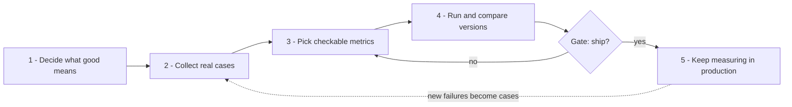
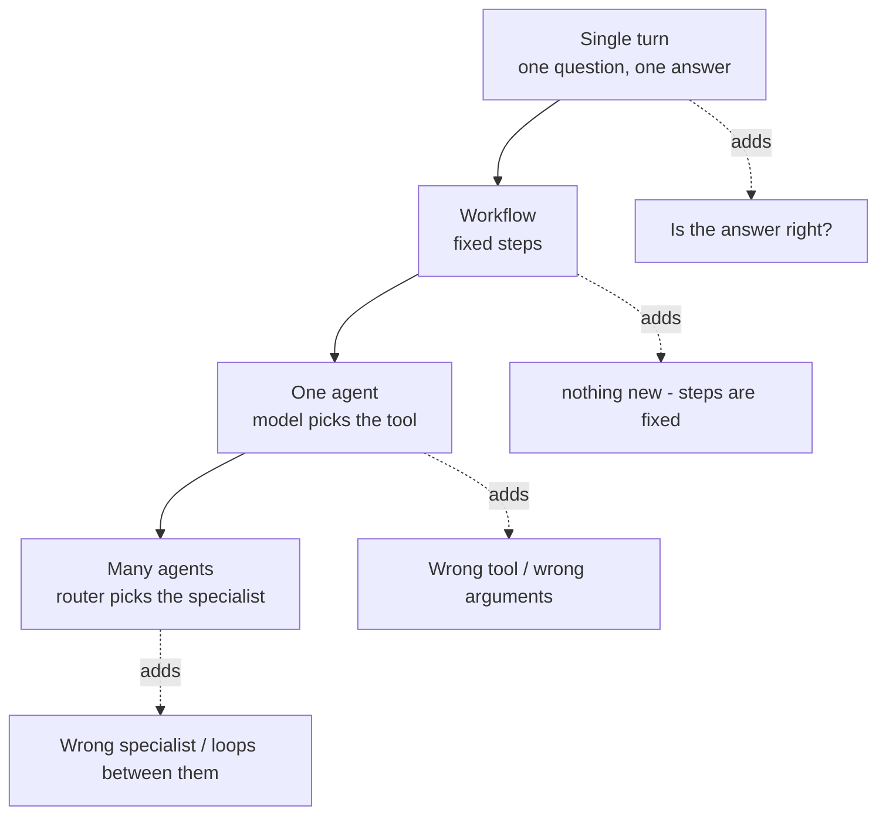
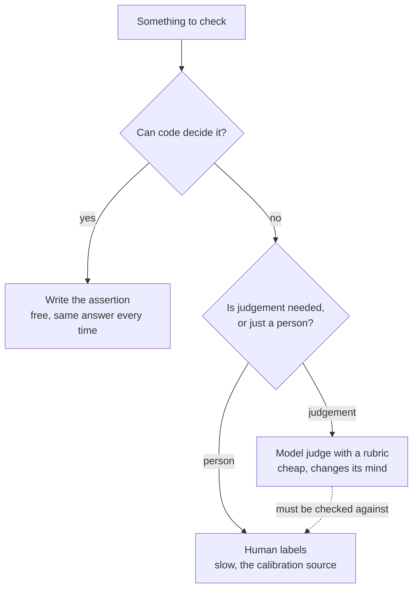

# Evaluating LLM Systems — A Plain-English Tutorial

A walkthrough of OpenAI's [Evaluation best practices guide](https://developers.openai.com/api/docs/guides/evaluation-best-practices?api-mode=responses),
written in simple language, with the notebook in **this repo** that teaches each idea properly.

**How to read this:** every concept gets 3–4 lines. That is enough to understand *what it is
and why you would use it*. When you want the real thing — code you can run, trade-offs,
failure modes — open the notebook listed under it.

**All notebook paths are relative to the repository root**, not to this file, so you can
paste them straight into `jupyter lab` or an editor.

> **Companion documents.** [`openai-eval-guide-coverage-gaps.md`](openai-eval-guide-coverage-gaps.md),
> beside this file, is the audit — which topics this repo covers, which were deliberately
> skipped, and why. **That one is the record; this one is the lesson.**
> [`concepts/openai-evaluation-guide-plain-english.md`](concepts/openai-evaluation-guide-plain-english.md)
> explains the same ideas as continuous prose with one worked example running through it —
> read that if a concept here is too compressed. **That one explains; this one makes you do it.**

---

## How to work through it — the TODO tracker

Every concept ends with a `- [ ] TODO` line. Tick it off as you go: this file *is* the
tracker, so commit it as you work and `git log` becomes your study history.

The TODOs are deliberately **not** "read the notebook". Each asks you to produce something
small — a number you measured, a threshold you changed, a check you watched fail — because
that is the difference between having read about evaluation and being able to defend one
under questioning. **If you can tick a box without opening an editor, the box is wrong.**

**21 TODOs.** Check your progress with:

```bash
grep -c '^- \[ \]' docs/openai-eval-guide-tutorial.md   # left to do
grep -c '^- \[x\]' docs/openai-eval-guide-tutorial.md   # done
```

A warning about cost, because this repo is not free to run: notebooks in
`courses/03-agentic-eval-harness/` replay cached judge verdicts, so re-running them spends
nothing. Anything that asks a judge a **new** question does spend. Each TODO below says which
it is.

---

## Contents

| #   | Chapter                                                                     | TODOs |
| --- | --------------------------------------------------------------------------- | ----- |
| 1   | [What an eval actually is](#1-what-an-eval-actually-is)                     | 2     |
| 2   | [Designing the process](#2-designing-the-process) — objective to loop       | 5     |
| 3   | [Where the checks go](#3-where-the-checks-go) — by system shape             | 4     |
| 4   | [Kinds of checker](#4-kinds-of-checker) — code, judge, human                | 6     |
| 5   | [Edge cases](#5-edge-cases)                                                 | 2     |
| 6   | [Improving with evals](#6-improving-with-evals)                             | 2     |
| 7   | [A path through this repo](#7-a-path-through-this-repo)                     | —     |

---

## 1. What an eval actually is

A test asserts that the output equals something. You cannot do that here, because the same
input gives different words every time. An **eval** asserts a *property* instead — is this
grounded? did it refuse? did it call the right tool? — and returns pass or fail.

That change of shape is the whole subject. Everything else is deciding which properties
matter and how much it costs to check them.

**In this repo:** `courses/01-rag-agent-tool-evaluation/00_Evaluation_Landscape.ipynb` — the
taxonomy, and section 4's decision procedure for picking a scorer.

- [ ] **TODO** — free. Open that notebook and write down, for your own project, the one
  property that must never be false. That sentence is your first eval, and everything in
  chapter 4 is about how to check it cheaply.

### 1.1 The metrics that measure words instead of truth

Before LLM judges, text was scored by word overlap with a reference: **BLEU**, **ROUGE**,
**BERTScore**. You will meet all three in papers and interviews, and they fail in a specific,
reproducible way.

Against *"Refunds are available within 14 days of renewal"*, inserting the word **not**
scores **ROUGE-L 0.94** — while a correct paraphrase scores **0.09**. The metric ranks the
false answer ten times above the true one.

**In this repo:** `courses/01-rag-agent-tool-evaluation/00_Evaluation_Landscape.ipynb` §1c —
both metrics implemented in ~30 lines of standard library so you can break them yourself.

- [ ] **TODO** — free. Run §1c's cell, then change a **number** or a **date** in the
  reference instead of adding "not". Does ROUGE notice? Write down which kinds of error this
  family is blind to — that list is the answer to *"why don't you use ROUGE?"*

---

## 2. Designing the process

OpenAI's five steps, in the order you actually do them.



### 2.1 Say what "good" means before you measure

*"The bot should be helpful"* cannot fail, so it is not a target. *"Resolve 75% of billing
questions without a human, and never state a balance for an account the lookup did not find"*
can.

Write the numbers **first**. Pick them after seeing a score and you will pick numbers the
score passes.

**In this repo:** `courses/02-databricks-mlflow-evals/00_eval_strategy_worksheet.ipynb` —
thresholds written before a single score existed.

- [ ] **TODO** — free. Fill in that worksheet's `EVAL_DIMENSIONS` for a system you know.
  Then ask a colleague to guess your thresholds. Where they guess differently, your
  definition of "good" was not written down properly.

### 2.2 Collect cases from production, not from your desk

A test set you invented passes because it contains what you thought of. It is blind in
exactly the way you are, and no amount of scoring fixes that.

Real sources: production logs, expert-written answers, historical tickets, and synthetic
variants of all three. Tag every case so you can report by segment later.

**In this repo:**

- `courses/03-agentic-eval-harness/03_the_golden_set.ipynb` — 40 cases, stratified by
  language, intent and question type, with a datasheet and a content hash.
- `courses/02-databricks-mlflow-evals/04_eval_datasets_from_traces.ipynb` — mining new cases
  out of production traces, and why hand-written sets are structurally blind.

- [ ] **TODO** — free. In notebook 03, delete a whole stratum from the golden set and re-run
  the stratum-count cell. Note what the overall pass rate does. That is the failure mode of
  an unstratified set, reproduced in one edit.

### 2.3 Metrics you can actually answer

*"Is this good?"* is not checkable. *"Is every claim supported by the cited document?"* is.
Prefer questions with a yes or no.

The related rule is that models are better at **choosing** than at **producing**. Ask a judge
to pick between two answers, or to classify one, rather than to write a score out of ten.

**In this repo:** `courses/01-rag-agent-tool-evaluation/00_Evaluation_Landscape.ipynb` §4 —
the code-first decision procedure, and where a judge is genuinely required.

- [ ] **TODO** — free. Take three metrics you would have picked for your own system and
  rewrite each as a yes/no question. Any you cannot rewrite is a metric you will argue about
  later.

### 2.4 Compare versions on the same inputs

One number alone tells you nothing. Run the old build and the new build over the *same*
cases and diff them — and read the whole table, because the normal shape of a regression is
one number up and one quietly down.

**In this repo:** `courses/02-databricks-mlflow-evals/05_prompt_versioning_and_regression.ipynb`
is built as exactly this trap: v2 improves the metric being watched and breaks three that
are not.

- [ ] **TODO** — free. Run that notebook and name the three unwatched metrics **before**
  scrolling to the answer. Whichever you missed is the one you would have shipped.

### 2.5 Keep measuring after launch

Offline you have a right answer to compare against. In production you never do, so the checks
change shape: cheap deterministic rules on 100% of traffic, expensive judges on 1–2%.

**In this repo:** `courses/03-agentic-eval-harness/12_online_evaluation_and_the_loop.ipynb` —
which metrics survive without a reference, five alerts, and two incident drills where you find
out which alert stays silent.

- [ ] **TODO** — free. Run the incident drills and write down **which alert does not fire**.
  An alert that never fires during a real incident is the most expensive kind of reassurance.

---

## 3. Where the checks go

What can go wrong depends on the shape of your system. Each shape adds exactly one new
failure to the one before it.



### 3.1 Tool choice and tool arguments are different bugs

*"Asked about a bill, called `reset_password`"* is a routing problem you fix in the prompt.
*"Called `get_balance('99231')` instead of `get_balance('ACC-99231')`"* is a parsing problem.
Same failed run, two different fixes, so two different checks.

**In this repo:** `courses/03-agentic-eval-harness/05_tool_call_evaluation.ipynb` — DeepEval's
`ToolCorrectnessMetric` for the choice, `ArgumentCorrectnessMetric` for the arguments, and the
result-handling section nobody writes.

- [ ] **TODO** — free (replays cache). Flip the `bad_arguments` fault switch and confirm the
  tool-name metric stays at 1.0 while argument correctness drops. If one number caught both,
  you could not tell the two bugs apart.

### 3.2 Did the task actually happen?

A fluent reply saying the refund was issued is not a refund. The only check that settles it
reads **the database**, and no framework ships it because only you know what your tables
should look like afterwards.

**In this repo:** `courses/03-agentic-eval-harness/06_agent_handoff_and_end_to_end.ipynb`
Part 5 — the final-state check, including the "exactly once" property that catches a double
refund.

- [ ] **TODO** — free. Make the agent refund twice in the trajectory fixture and confirm task
  completion still passes while the final-state check fails. That gap is why the check exists.

### 3.3 Routing, handoffs, and going round in circles

With several agents, two new things break: the router sends work to the wrong specialist, and
the specialists pass a job back and forth without finishing it. The second produces **no
answer at all**, expensively, and usually ends in a timeout rather than an error.

**In this repo:** `courses/03-agentic-eval-harness/06_agent_handoff_and_end_to_end.ipynb` —
routing accuracy with a confusion matrix (Part 1), handoff payload integrity (Part 2), and
loop detection (§2.1): a revisited agent, plus a hop bound for paths that never repeat.

- [ ] **TODO** — free. Run §2.1 and note that the clean set flags **zero** loops — because
  none of the 25 recorded trajectories contains a handoff at all. Then read the synthetic
  cases underneath. A check that has never gone red is not evidence that it works.

### 3.4 Report by segment, never as one number

An average hides the segment that is failing. The gate in this course blocks on the **worst
stratum**, not the mean, and that choice is the reason the whole course exists.

**In this repo:** `courses/03-agentic-eval-harness/10_stratified_reporting_and_statistics.ipynb`
— per-stratum reporting, and the arithmetic for how small a change a suite your size can
actually detect.

- [ ] **TODO** — free. Compute the detection limit for a 40-case suite. Then answer: if your
  gate's tolerance is tighter than that limit, what is the gate actually blocking on?

---

## 4. Kinds of checker

Three, and the rule for choosing is about reproducibility rather than money.



### 4.1 If code can decide it, never pay a model

Code is free and gives the same answer every time — so when the number moves, **the system
moved**. A judge's number moving tells you nothing on its own, because judges change their
minds between runs.

**In this repo:** `courses/03-agentic-eval-harness/07_safety_and_policy_checks.ipynb` — four
safety policies written as plain functions, and why there is no average anywhere in that
notebook.

- [ ] **TODO** — free. Add a fifth policy of your own as a function. The hard part is not the
  code; it is writing the rule precisely enough that it cannot be argued with.

### 4.2 Building a judge, three ways

`GEval` takes prose criteria. `DAGMetric` is an explicit decision tree. A RAGAS rubric fixes
the level descriptions. Same job, different trade-offs between expressiveness and being able
to answer *"why this score?"*

**In this repo:** `courses/03-agentic-eval-harness/08_building_custom_judges.ipynb` — all
three on the same cases, and the table showing where they disagree.

- [ ] **TODO** — free (replays cache). Find a case where the three judges disagree and decide
  which one you would put in the release gate. Then say what you lose by that choice.

### 4.3 Your judge is biased in three specific ways

**Position bias:** it prefers whichever answer it saw first. **Verbosity bias:** it prefers
the longer one. **Same-model bias:** it rates its own family's output highly. All three are
testable, and all three are embarrassing to discover after shipping.

**In this repo:** `courses/03-agentic-eval-harness/08_building_custom_judges.ipynb` Parts 5,
5.1 and 6. Part 5 swaps the order and counts verdict flips; §5.1 audits the length
distribution behind a win rate; Part 6 pits one model family against another.

- [ ] **TODO** — free (replays cache). Run §5.1 and note the two numbers that matter: the
  strong reply won **12 of 12**, and winners averaged **25.2 words against 18.7**. Explain in
  one sentence why those two facts together mean the position-bias result is not yet enough.

### 4.4 The length-controlled probe

The audit above shows quality and length are tangled. Separating them needs a controlled
test: pad the *worse* answer until it is the longer one, then judge again. If the good answer
still wins, length was not doing the work.

**In this repo:** the second cell of §5.1, behind a `RUN_LENGTH_PROBE` switch.

- [ ] **TODO** — **costs money** (~12 judge calls). Flip the switch and run it. If you would
  rather not spend, write down what each of the two possible outcomes would tell you — that is
  the reasoning the cell is testing, and the call only confirms it.

### 4.5 Humans: the calibration source, not the throughput

You cannot have a person read every answer. You can have two people read fifty, and use that
to find out whether your judge agrees with them — which is the only thing that licenses using
the judge on everything else.

Agreement alone is not enough. If 90% of replies are good and your judge says "good" every
time, agreement is 90% and **Cohen's kappa is 0**, which is the correct score for a judge that
has learned nothing.

**In this repo:** `courses/03-agentic-eval-harness/09_human_feedback_and_calibration.ipynb` —
a labelling panel, kappa derived by hand, and using labels to *set* a threshold instead of
guessing one.

- [ ] **TODO** — free. Derive kappa by hand for a 2×2 table you make up, then check it against
  the notebook's function. A kappa you cannot derive is one you cannot defend when somebody
  asks why 0.61 ships and 0.58 does not.

### 4.6 Blinded preference testing, and the second rater

Asking *"which of these two is better?"* needs three rules: **hide** which arm is the new
build, **randomise** which side it appears on, and use **two raters**. Drop any one and the
result is not measuring what you think.

Two humans who disagree with each other is a *rubric* problem, not a judge problem, and no
amount of judge tuning fixes it.

**In this repo:** `courses/03-agentic-eval-harness/09_human_feedback_and_calibration.ipynb`
§2.2 — the panel, human-to-human kappa, and a blinding check that the winner landed on the
left about half the time.

- [ ] **TODO** — free. Run §2.2 and look at the seed sweep at the bottom: the same raters,
  resampled, give kappa anywhere from 0.15 to 0.60. Write down how many cases you would need
  for that range to be tolerable, using notebook 10's arithmetic.

---

## 5. Edge cases

### 5.1 Collect kinds, not examples

Twenty jailbreak strings that are all the same *kind* of attack will all pass, and the green
tick tells you nothing about the kind you missed. Organise by attack surface instead: one
example each of multilingual, multi-intent, typo, polite tool failure, instruction override,
formatting conflict.

**In this repo:** `courses/02-databricks-mlflow-evals/10_capstone_edge_cases_and_crossref.ipynb`
— five attack classes by three variants, plus `edge_cases.py`, which tracks the guide's own
eleven-item list in code with a verdict and a justification per row.

- [ ] **TODO** — free. Open `OPENAI_EDGE_CASE_COVERAGE` in
  `courses/02-databricks-mlflow-evals/edge_cases.py` and find the one entry marked `n/a` that
  is **no longer true** of this repo. The answer is in the audit document if you get stuck.

### 5.2 The polite failure is the dangerous one

A tool that returns `{"found": false}` instead of raising does not crash anything. The model
skates past it, and the answer that follows is specific, confident, and wrong about the
customer's own account.

**In this repo:** the `ambiguous_tool_response` case in the same notebook, covering both read
tools' not-found paths.

- [ ] **TODO** — free. Make one of your own tools fail politely and watch what the agent says
  next. Then decide whether the fix belongs in the tool, the prompt, or the eval.

---

## 6. Improving with evals

### 6.1 The loop

Production traces get sampled, the odd ones get labelled by a human, the labelled failures
become new golden cases, and the gate gets harder. That circle is the point of the whole
exercise — the suite gets better at noticing precisely where it failed to notice.

**In this repo:** `courses/03-agentic-eval-harness/12_online_evaluation_and_the_loop.ipynb`
Part 6 closes the loop back into notebook 09 and then notebook 03.

- [ ] **TODO** — free. Take one failing production trace from the simulated day, write it up
  as a golden case in notebook 03's format, and note which stratum it belongs to. If it does
  not fit a stratum, your strata are incomplete.

### 6.2 Optimise the prompt, and gate the optimiser

Automated prompt optimisation works — and it optimises against your judge, so an optimised
prompt can pass the same gate a human-written one fails while being worse. Align the judge
first, then let the optimiser run, then gate its output like any other change.

**In this repo:** `courses/02-databricks-mlflow-evals/08_automated_improvement_gepa.ipynb`
(GEPA), gated by phase 5 and aligned by phase 7.

- [ ] **TODO** — free. Say in one sentence why running GEPA *before* judge alignment is the
  wrong order. That sentence is the whole argument for phase 7 existing.

---

## 7. A path through this repo

If you are starting from nothing and want the shortest route that still holds up:

| Step | Read / run | Why this one |
|---|---|---|
| 1 | `courses/01-rag-agent-tool-evaluation/00_Evaluation_Landscape.ipynb` | The taxonomy and the scorer decision. Nothing else makes sense first |
| 2 | `courses/03-agentic-eval-harness/03_the_golden_set.ipynb` | Everything downstream is an opinion about this file |
| 3 | `courses/03-agentic-eval-harness/04_rag_evaluation_with_ragas.ipynb` | Groundedness, reported by stratum rather than averaged |
| 4 | `courses/03-agentic-eval-harness/05_tool_call_evaluation.ipynb` | Where agent evaluation stops resembling RAG evaluation |
| 5 | `courses/03-agentic-eval-harness/08_building_custom_judges.ipynb` | Judges, and the three ways they lie |
| 6 | `courses/03-agentic-eval-harness/09_human_feedback_and_calibration.ipynb` | The only thing that licenses trusting a judge |
| 7 | `courses/03-agentic-eval-harness/11_the_release_gate_and_ci.ipynb` | Metrics measure; gates decide. This is the decision |
| 8 | `courses/03-agentic-eval-harness/12_online_evaluation_and_the_loop.ipynb` | What survives when the answer key is gone |

**If you have one evening:** steps 1, 2, 5 and 7. That is the arc — define good, build the
set, judge it, refuse to ship.

---

## What the guide covers that this repo deliberately skips

Four topics are in OpenAI's guide and deliberately not built here. The reasons are recorded
per row in [`openai-eval-guide-coverage-gaps.md`](openai-eval-guide-coverage-gaps.md):

- **Industry benchmarks** (MMLU, leaderboards) — this repo is about application-specific
  evaluation, and the guide itself treats benchmarks as the thing you move past.
- **Purchased datasets** — a data source with nothing to teach beyond the sentence.
- **Multimodal evaluation** — every system here is text-only. Audio and image inputs need a
  different agent, not a different technique.
- **Reinforcement fine-tuning** — the improvement lever here is the prompt.

And one genuine gap remains open: **OpenAI's own Evals API and Graders tool**. The repo
teaches the same ideas in DeepEval, RAGAS, MLflow and Phoenix; the vendor's own surface is the
one framework not represented, and it belongs in a new lab under `labs/` rather than a
numbered course.
