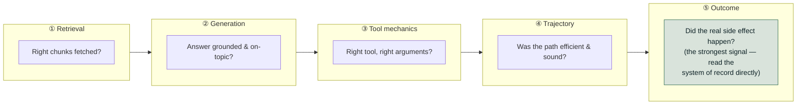
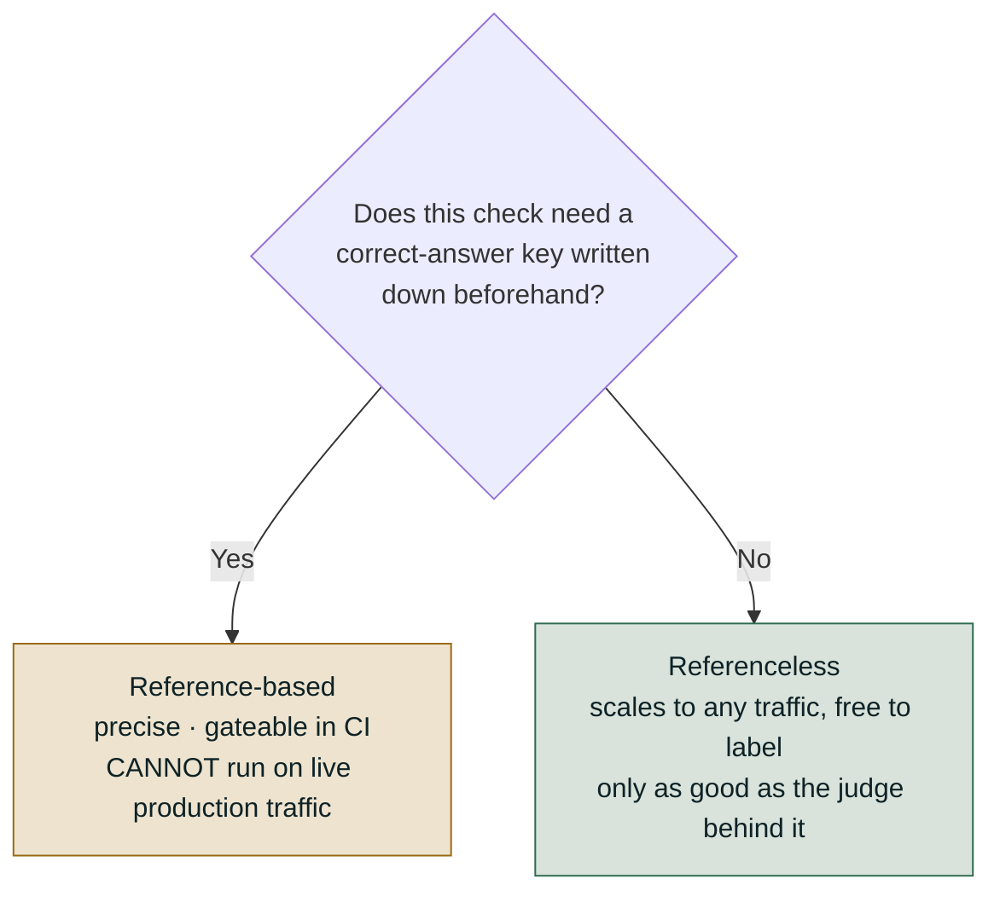
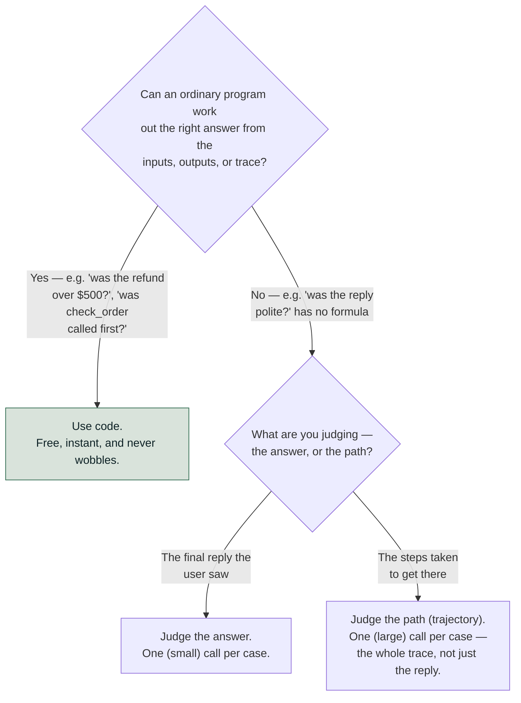
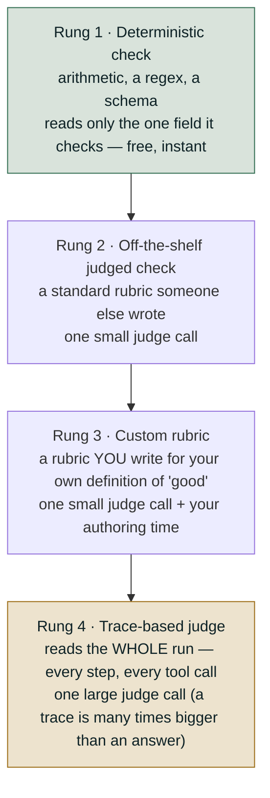
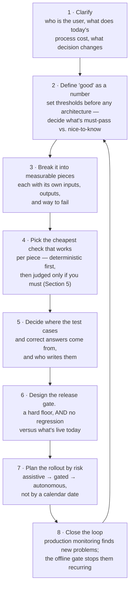

# Orientation: What There Is to Evaluate

*Decompose the system before measuring it, because one quality score cannot say which stage
broke.*

◷ 17 min · Level 0 · the entry point. Nothing here is executable — it is the vocabulary and the
decision rules every later level uses.

"Evaluate the AI system" sounds like one task. It is five, each failing differently and each
wanting a different fix, so the first decision is never which metric to use but which layer is
being measured.

> **Who this is for.** No library knowledge is assumed. Every technical term is defined in plain
> words the first time it appears, and the page explains what gets measured rather than what
> computes it.

---

## 1. Separate the Five Things You Can Evaluate

A chatbot that searches documents and answers a question is a small assembly line. It searches,
writes an answer, and — if it is an agent — calls tools in some order, across many turns, before
it finally does the thing the user wanted.

**Each stage fails for a different reason, and the fix for one does nothing for another.** One
blunt "is it good?" check cannot say which stage broke. The time then goes into fixing the
wrong thing.

Take a support agent that searches a knowledge base and can issue refunds. Its work breaks into
five layers, and a wrong final answer could come from any of them:

| Layer | The question it answers | A concrete symptom |
| --- | --- | --- |
| **① Retrieval** | Did we fetch the right information? | The agent quotes a policy that isn't the current one |
| **② Generation** | Given what it found, did it write a grounded, on-topic answer? | It invents a detail that wasn't in the source it read |
| **③ Tool mechanics** | Did it call the right tool with the right inputs? | It calls `refund()` with the wrong order ID |
| **④ Trajectory** | Was the *sequence* of steps sensible? | It checks the same order three times before acting |
| **⑤ Outcome** | Did the real-world result actually happen? | It says "refund issued" but no refund exists in the system |

**The rule to remember: mechanics ≠ process ≠ outcome.** Calling the right tool with the right
arguments does not mean the steps came in a sound order. A sound order does not mean the user's
goal was met. Check all three separately; none substitutes for the others.

**Outcome verification is the strongest check of the five.** A model writes *"Your refund of $45
has been issued"* just as fluently whether or not a refund happened. A judge reading only that
sentence can be fooled by confident, wrong prose. **A system of record cannot be talked into a
wrong verdict, because it is not reading a description of the event — it is reading the event.**

> **A sixth behaviour sits across the five layers rather than in them: conversational
> quality.** An agent can pass every layer-check on every individual turn and still fail the
> dialogue — forgetting what was said three turns ago, drifting off-topic, or over-advising.

That failure only shows up *across* turns, never within one. Level 2 picks it up properly.

### What breaks where, at a glance

The same five layers, read as a troubleshooting table: symptom on the left, what catches it and
what that costs on the right.

| | ① Retrieval (no labels) | ① Retrieval (with labels) | ② Generation | ③ Tool use | ④ Trajectory |
| --- | --- | --- | --- | --- | --- |
| **Symptom you'd notice** | "It hallucinated" | Missed a chunk you know exists | Answer is wrong but every metric is green | "Your flight is booked!" (it wasn't) | 99% success rate, but cost tripled |
| **What actually catches it** | An LLM judge scoring relevance | Precision@K / Recall@K (exact math) | Answer Correctness against a written answer | Checking the arguments passed to the tool | Reading the real system of record |
| **What it costs** | One judge call per case | Free, instant | 1–3 judge calls per case | Free (it's just checking a value) or one call | A full run of the whole trace |
| **What it needs** | Nothing pre-written | A list of which chunks are correct, written in advance | A correct answer, written in advance | The expected tool name/arguments, or nothing | The full trace plus the real system of record |
| **Runs in CI?** | Smoke set per commit | Every commit | Nightly full suite | Every commit | Pre-release |

---

## 2. Ask Whether the Check Needs an Answer Key

This is the single most important distinction in evaluation, because it decides *where* a check
can run.

A **reference-based** check compares the output to something a person wrote *before the system
ran* — the correct answer, chunk list, or tool call. It is precise, and perfect for automated
testing. Someone maintains that answer key, so it scales to a curated set, never to live
traffic. A **referenceless** check judges using only what the run itself produced. Faithfulness
compares the answer to the passages just retrieved. It scales to any real question at zero
labelling cost. It is less precise, and only as good as whatever is judging.

> **A common trap.** "Referenceless" does *not* mean "reads nothing." It means no *human-
> written correct answer* is involved. Faithfulness reads plenty — the question, the answer,
> and the retrieved passages — it just never reads a pre-written answer key.

**The mechanical test settles it every time.** Could this check score a brand-new question from
a real user, with zero human preparation? If yes, it is referenceless and can run in production.
**Nobody has written a right answer for a question that has not been asked yet**, so a check
needing one can never run on live traffic, however good it is.

> **This split cuts across the five layers, not along them.** One retrieval metric compares the
> passages to the *question* (referenceless); its neighbour compares the same passages to the
> *expected answer* (reference-based).

*Which layer is this?* and *does it need a reference?* are two independent questions.

**Mature setups run both** — reference-based checks in CI against a curated test set,
referenceless checks on live traffic. Each covers a gap the other cannot.

### The blind spot in word-overlap scores

Before anyone used an LLM to judge text, quality was scored by counting overlapping words
against a reference answer. These three still come up constantly, so it is worth knowing exactly
where they mislead:

| Metric | What it actually measures | What it was built for |
| --- | --- | --- |
| **BLEU** | How many chunks of words ("n-grams") in the answer also appear in the reference | Machine translation |
| **ROUGE-L** | The longest run of matching words shared between the answer and the reference | Summarization |
| **BERTScore** | The same idea, but matching by meaning (via embeddings) instead of exact words, so a paraphrase can still count | Anything where wording varies |

Here is the example that makes the failure concrete. Reference answer: *"Refunds are available
within 14 days of renewal."*

| Candidate answer | ROUGE-L | BLEU | Actually correct? |
| --- | --- | --- | --- |
| "Refunds are available within 14 days of renewal." | 1.00 | 1.00 | ✅ Yes |
| "Refunds are **not** available within 14 days of renewal." | 0.94 | 0.66 | ❌ **No** |
| "You can get your money back up to two weeks after the renewal date." | 0.09 | 0.00 | ✅ Yes |

One inserted word flips the meaning entirely, and it costs six points of ROUGE-L. A completely
correct paraphrase that shares almost no wording scores 0.09. **The metric ranks the false
answer ten times higher than the true one — reliably, not as a rare edge case.**

> **These metrics measure how similar the wording looks, not whether the statement is true.**

BERTScore fixes half of it. Row three's paraphrase is rescued; row two is not, because
"available" and "not available" sit close in embedding space too. Negation, numbers, dates and
conditions are where every similarity-based metric breaks down, and that is most of what a
support answer has to get right.

**Reach for them** where the output is templated or extractive, or where a regression test only
needs to know *whether the output changed*. They also earn their place where the score has been
measured against human judgment on real data. **Do not treat them as correctness.** A well-known guide's "ROUGE-L ≥
0.40" summarization threshold reads as *"the summary is drawn from the source text"* — a
formatting check. Where an answer key exists and correctness matters, later levels reach for a
judge with an explicit rubric instead.

---

## 3. Treat the Judge as an Instrument, Not an Oracle

Most referenceless checks work by handing the output to a second LLM and asking it to judge
quality against a rubric. It is the only practical way to score open-ended text at scale.
Treating the judge's number as ground truth is the most common mistake in evaluation work.

**The same input can come back with two different scores.** A judged score is a noisy estimate,
never an exact fact. Never gate a release on a single row. What follows is that agreement
matters more than average. A judge that rates everything highly has a beautiful average and is
useless. Watch how often it agrees with a human on the *same* case. **Nobody validates the
validator by default.** An unvalidated judge detects *that something changed*, not *that it is
good*.

A judge can also be fooled by confident, fluent, wrong text. That is exactly why outcome
verification matters, and why layer ⑤ sits at the end of Section 1's chain.

Four operational details cause most of the remaining surprises:

- **Judge capability.** A weaker model gives noisier scores; the judge usually needs to be at
  least as capable as the system it grades.
- **Rubric precision.** The precision put into the rubric is the precision that comes back.
- **Cost.** Five checks over 500 test cases is 2,500+ calls, which makes the
  reference-based/referenceless split a budget decision.
- **Score direction.** "Hallucination" 0.9 means a *lot* of hallucination. Check direction
  before wiring a threshold.

---

## 4. Reach for Code Before Reaching for a Judge

Every new check comes down to one question, asked twice.

A **scorer** is one automatic check: it looks at a single case and answers one yes/no or numeric
question about it. There are only two ways to build one.

| | How it works | What it costs |
| --- | --- | --- |
| **Code** | An ordinary program: `if amount > 500: fail` | Nothing — free and instant |
| **A judge** | A second LLM reads the case and gives a verdict | One API call, per case, per check |

Every named metric in every library is one of these two, wearing a framework's naming on top.
Some libraries ship a catalog of named measurements, others hand over a scoring function and a
trace to read. Neither shape lets anyone skip this decision or Section 2's — they only change
how the answer gets expressed.

**An agent needs the "path" question because it can reach a good answer through a terrible
process.** Refunding money without checking anything and getting lucky produces a perfectly nice
reply. Judge only the final answer and that never surfaces.

One wrinkle is not a third option. Sometimes a judge needs information it does not have. To
decide "did this follow our refund policy?", it needs the policy text handed to it, because it
cannot go fetch it. That is the same judge with someone bringing it the paperwork first.

> **"Code first" is about reliability, not cost.** When a code-based score changes, behaviour
> changed. When a judged score changes, you cannot always tell the system getting worse from
> the judge having a bad day.

Every judge added trades some of that certainty for a measurement not otherwise available. And a
judged score can never *certify* the thing it was used to optimize toward — that is asking the
judge to grade its own homework.

**Once a judge is needed, ask it to *choose*, not to *compose*.** Models are far better at
picking between options than at generating an unanchored score:

| Ask it this | Not this | Why |
| --- | --- | --- |
| "Which of these two replies is better?" | "Rate this out of ten" | A bare number has no anchor and drifts between runs — the other reply *is* the anchor |
| "Which of these four categories?" | "Describe what went wrong" | A closed set can be counted and compared; prose cannot |
| A yes/no decision tree ("did it cite? → is the citation right?") | "Judge the overall quality" | Each step has a real right answer, and the path explains the verdict |

---

## 5. Climb the Scorer Ladder Only When Forced

This is about how *sophisticated* a check needs to be. Start at the cheapest rung that answers
the question, and climb only when forced.

**Rung 2 to rung 3 changes the standard, not the mechanism** — same evidence, same cost per
call. The climb happens because a generic "is this complete?" rubric does not know a particular
answer needs a budget breakdown and a day-by-day itinerary.

**Rung 3 to rung 4 is the expensive jump**, because it changes what evidence the judge sees.
Make it only when the answer is not visible in the final output. Did it take a sensible path?
Did it recover from an earlier error? Did it ask permission before acting? **No rubric can
extract those from finished text.** The judge has to be shown the whole run.

**The most common overspend is paying for rung 4 where rung 1 would do.** Code counts redundant
calls, loops, steps and error-then-retry patterns directly. Paying a large-prompt judge to
count duplicate tool calls is how evaluation budgets disappear. Second most common is rung 3
for something a plain regex would settle.

Cost is a design input, not an afterthought. A judged rung costs a real call per case every time
it runs, which is why judged runs worth repeating get cached and replayed rather than re-scored.

---

## 6. Decide Where a Check Can Run Before Building It

Sections 2 and 5 meet in the one decision that matters when a system goes live. Does this check
need an answer key? If yes, it runs offline only. What does it cost per case? A free
deterministic check can run on every production request. A judged one costs a call each time,
so it gets sampled.

**A reference-based check skips every unlabeled production request, and a dashboard reports that
as health.** 100% "skipped" is not 100% "passed", but it reads that way at a glance. That is
exactly why mature teams run reference-based checks in CI against a curated set and referenceless
checks against sampled live traffic, rather than picking one and calling it done.

---

## 7. Rehearse the Decomposition Round

A system-design round on evaluation is not a trivia quiz about metric names. It scores how the
problem gets broken down, across five axes:

| Axis | A weak answer | A strong answer |
| --- | --- | --- |
| **Handling ambiguity** | Starts drawing a system diagram in minute two | Spends 5–8 minutes first on who the user is, what today's process costs, and what "good" means as a number |
| **Breaking the problem down** | One blob: "the agent does X" | Named components, each with a clear input/output and its own way to fail |
| **Measurement discipline** | "We'd use a RAG eval library" | Separates the five layers from Section 1, and says which are must-pass vs. nice-to-know |
| **Reasoning about failure** | Assumes everything goes right | Names what happens when each decision goes wrong, and designs so the model is *allowed* to be wrong safely |
| **Judgment under pressure** | Agrees with whatever's asked | Pushes back with a reason and a different plan |

**The highest-signal behaviour is treating evaluation as part of the design, not something
bolted on afterward.** A piece of the system whose measurement cannot be described is a piece
that has not finished being designed.

### The eight-step spine for any "design an evaluation" question

Two lines are worth having ready when drawing this out loud.

**"Online discovers; offline prevents recurrence."** A problem caught only by a live dashboard
gets fixed once. Turned into a permanent offline test, it protects every release after.

**"The gate is the only thing allowed to deploy."** A prompt a person wrote and a prompt a
machine optimized go through the same check. Nothing skips it for being machine-generated. An
optimized prompt deserves *more* scrutiny, since it was tuned against a metric living inside
that same gate.

---

## Key Takeaways

- Five layers fail differently — retrieval, generation, tool mechanics, trajectory, outcome —
  and mechanics, process and outcome each need checking separately.
- Whether a check needs a pre-written answer key decides where it can run, and that split cuts
  across the five layers rather than along them.
- Word-overlap scores rank a negated answer above a correct paraphrase, so they measure wording,
  not truth.
- A judged score is a noisy estimate; watch agreement with a human on the same case, not the
  average.
- Code before a judge, because a code score that moves means behaviour moved — and a judge can
  never certify what it was used to optimize.
- Start at the cheapest rung that answers the question; the classic overspend is a trace-reading
  judge counting something code could count for free.

## Check Yourself

1. An agent replies "Your refund of $45 has been issued" and the sentence is fluent, grounded
   and on-topic. Which layer is still unchecked, and why can no judge settle it? **Outcome. A
   judge reads a description of the event; only the system of record reads the event.**
2. A teammate proposes running answer-correctness checks on live production traffic. What is
   wrong with the plan? **Correctness needs a reference written before the run. Nobody wrote one
   for a question that has not been asked yet, so the check silently skips every real request.**
3. ROUGE-L scores a wrong answer 0.94 and a correct paraphrase 0.09. What does that tell you
   about what it measures? **Wording similarity, not truth. One inserted negation barely moves
   it, and a full paraphrase collapses it.**
4. A judge's average score is 0.93 and stable month over month. Why is that not yet evidence of
   quality? **A judge that rates everything highly has a beautiful average and no discrimination.
   Measure agreement with a human on the same case.**
5. You need to know whether the agent called the same tool three times in a row. Which rung, and
   what is the common mistake? **Rung 1 — code counts duplicates directly. The common mistake is
   paying a trace-reading judge to count them.**
6. Why can a judged metric never certify the thing it was used to optimize? **Optimizing against
   a metric tunes the system to that metric. Asking it to then confirm success is asking the
   judge to grade its own homework.**

---

## References

All content above was drawn only from material already in this repository. Nothing here was
invented, and no external source was consulted. This page is the restyled edition of
`archive/roadmap-explainers-org/00-orientation.md`; its content is the same, minus a framework-comparison section and a
notebook cost-tag glossary, both of which described tooling rather than decomposition.

**Notebook:**

- `courses/01-rag-agent-tool-evaluation/00_Evaluation_Landscape.ipynb` — the taxonomy
  (including the conversational-quality behavior and the cross-cutting reference-based/
  referenceless example), the ROUGE-L/BLEU example and when those metrics are the right tool,
  LLM-as-judge failure modes, and the code-vs-judge decision.

**Docs:**

- `docs/concepts/rag-agent-tool-evaluation.md`, Part 0 (§0.1–0.5) — the five-layer table, the
  "what breaks where" triage table (including the "runs in CI?" row), the two deciding
  questions, LLM-as-judge failure modes (including "measure agreement, not average"), and the
  scorer-cost ladder.
- `docs/interactive-labs/00-evaluation-index.html` — the same five-surface map presented as an
  interactive page (used to cross-check the triage table above; introduced no topic not
  already covered by the field guide).
- `docs/interview-prep/QUESTION_BANK.md`, Part 0 (§0.1–0.3) — what a decomposition round
  scores and the eight-step Decomposition Spine, both reproduced in full in Section 7 rather
  than pointed at.
- `docs/study-guide/evaluation-roadmap.md` — Level 0's topic list and goal statement, used to
  scope what this file needed to cover.
- `docs/study-guide/evaluation-topic-notebook-mapping.md` — Level 0's resource table and the
  per-notebook cost keys, which stay in that document rather than being restated here.

**Limitations.** This file was written by reading the repository's own material, not by running
any notebook or calling any API — no cost was incurred producing it, consistent with this
project's rule against executing anything that spends money without being asked. It does not
independently verify any vendor's documentation.
