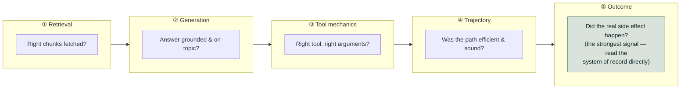
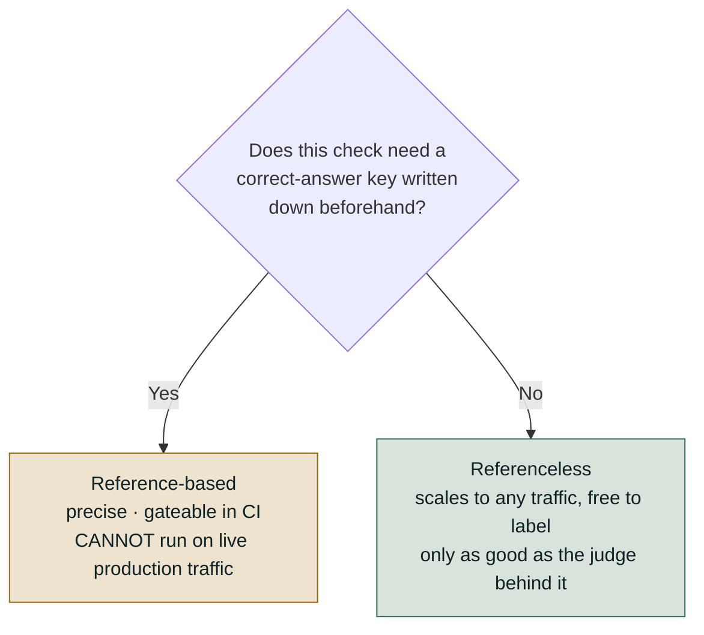
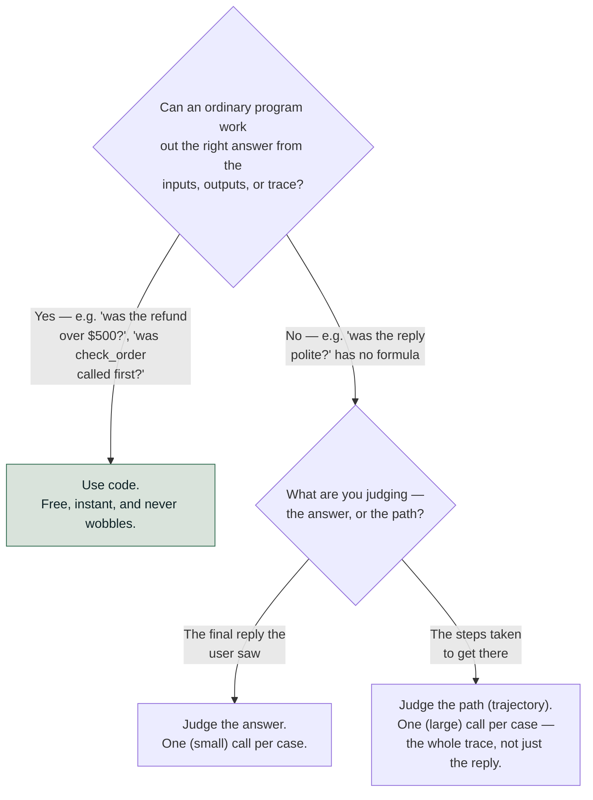
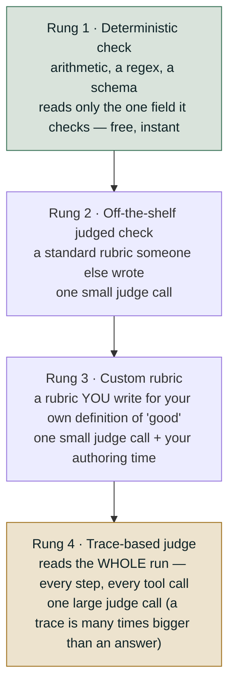
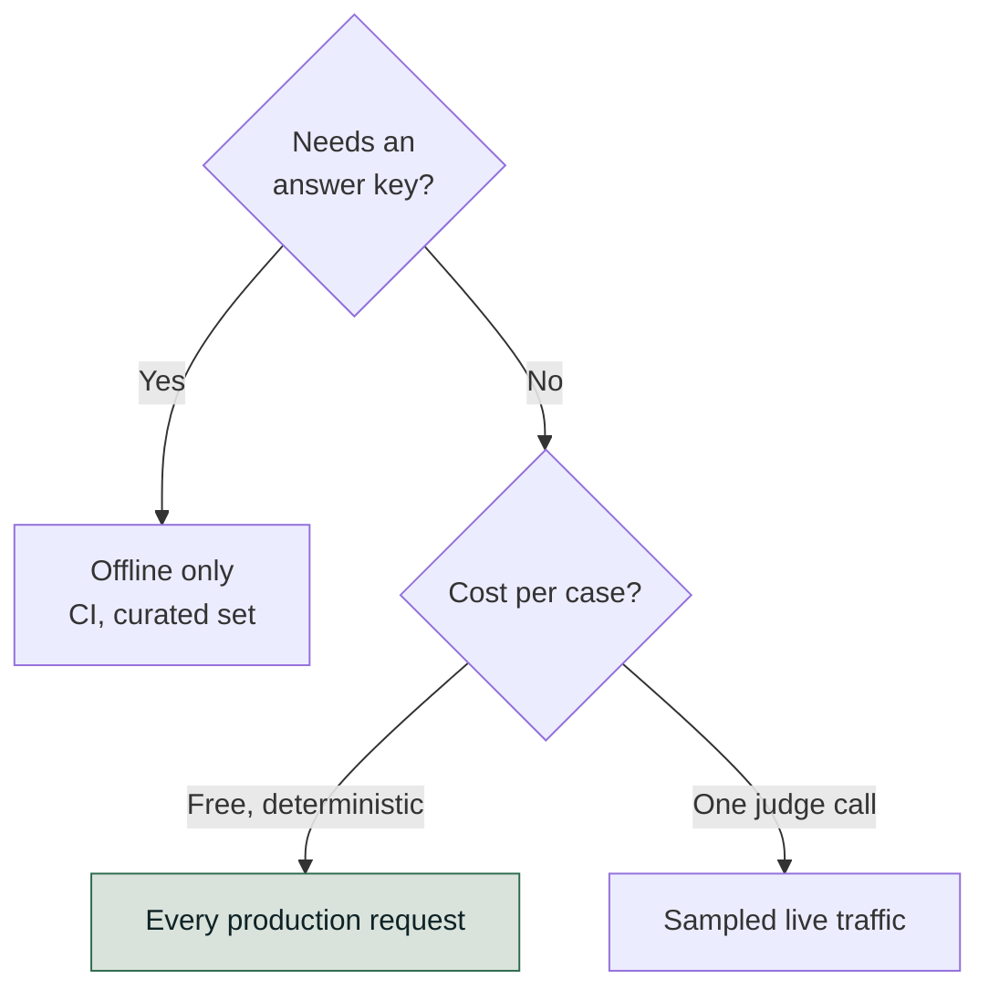
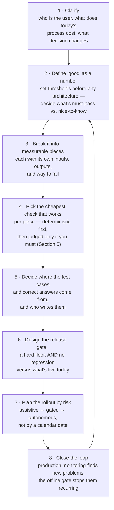

# Orientation: What There Is to Evaluate

*Decompose the system before measuring it, because one quality score cannot say which stage broke.*

◷ 18 min read, about 3 h with its notebook · Level 0 · the entry point. Nothing here is executable. It is the vocabulary and the decision rules every
later level uses.

"Evaluate the AI system" sounds like one task. It is five. Each fails differently and each wants a different fix. The first decision is which layer
is being measured. The metric comes after.

> **Who this is for.** No library knowledge is assumed. Every technical term is defined in plain words the first time it appears, and the page
> explains what gets measured rather than what computes it. Learning evaluation end to end? This is step one of [the
> roadmap](../study-guide/evaluation-roadmap.md). Preparing for an interview? [The study plan](../study-guide/evaluation-study-plan.html) is the
> shorter route.

---

## 1. Separate the Five Things You Can Evaluate

A chatbot that searches documents and answers a question is a small assembly line. It searches and writes an answer. If it is an agent, it also calls
tools in some order, across many turns, before it does the thing the user wanted.

- **Each stage fails for its own reason.** The fix for one does nothing for another.
- **One blunt check hides the stage.** An "is it good?" score cannot say which stage broke. The time then goes into fixing the wrong thing.

Take a support agent that searches a knowledge base and can issue refunds. A wrong final answer could come from any of its five layers:

| Layer | The question it answers | A concrete symptom |
| --- | --- | --- |
| **① Retrieval** | Did we fetch the right information? | The agent quotes a policy that isn't the current one |
| **② Generation** | Given what it found, did it write a grounded, on-topic answer? | It invents a detail that wasn't in the source it read |
| **③ Tool mechanics** | Did it call the right tool with the right inputs? | It calls `refund()` with the wrong order ID |
| **④ Trajectory** | Was the *sequence* of steps sensible? | It checks the same order three times before acting |
| **⑤ Outcome** | Did the real-world result actually happen? | It says "refund issued" but no refund exists in the system |

**Mechanics ≠ process ≠ outcome.** The right tool with the right arguments does not mean the steps came in a sound order. A sound order does not mean
the user's goal was met. Check all three separately.

This diagram shows the five layers in the order a run passes through them.

**Outcome verification is the one check fluent text cannot fool.** A **system of record** is the real store the action changes, such as the refunds
database.

- **Fluent text proves nothing.** A model writes *"Your refund of $45 has been issued"* just as fluently whether or not a refund happened.
- **A judge can be fooled.** A judge reading only that sentence can be fooled by confident, wrong prose.
- **A system of record cannot.** It reads the event itself. No prose can talk it into a wrong verdict.

> **A sixth behaviour sits across the five layers rather than in them: conversational quality.** An agent can pass every layer-check on every
> individual turn and still fail the dialogue by forgetting what was said three turns ago, drifting off-topic, or over-advising.

That failure only shows up *across* turns. Level 2 picks it up properly.

### What breaks where, at a glance

The same five layers as a troubleshooting table. Each column is a layer. Each row is the symptom, what catches it, what that costs and what it needs.

| | ① Retrieval (no labels) | ① Retrieval (with labels) | ② Generation | ③ Tool use | ④ Trajectory |
| --- | --- | --- | --- | --- | --- |
| **Symptom you'd notice** | "It hallucinated" | Missed a chunk you know exists | Answer is wrong but every metric is green | "Your flight is booked!" (it wasn't) | 99% success rate, but cost tripled |
| **What actually catches it** | An LLM judge scoring relevance | Precision@K / Recall@K (exact math) | Answer Correctness against a written answer | Checking the arguments passed to the tool | Reading the real system of record |
| **What it costs** | One judge call per case | Free, instant | 1–3 judge calls per case | Free (it's just checking a value) or one call | A full run of the whole trace |
| **What it needs** | Nothing pre-written | A list of which chunks are correct, written in advance | A correct answer, written in advance | The expected tool name/arguments, or nothing | The full trace plus the real system of record |
| **Runs in CI?** | Smoke set per commit | Every commit | Nightly full suite | Every commit | Pre-release |

---

## 2. Ask Whether the Check Needs an Answer Key

This distinction decides *where* a check can run. A **reference** is the answer key: a correct output a person wrote down before the system ran.

| | Reference-based | Referenceless |
| --- | --- | --- |
| **Compares the output to** | Something a person wrote *before the system ran*: the correct answer, chunk list, or tool call | Only what the run itself produced. Faithfulness compares the answer to the passages just retrieved |
| **Precision** | Precise. Perfect for automated testing | Less precise. Only as good as whatever is judging |
| **Scale** | A curated set, never live traffic. Someone maintains that answer key | Any real question, at zero labelling cost |

> **An easy trap.** "Referenceless" means no *human-written correct answer* is involved. It does *not* mean "reads nothing." Faithfulness reads the
> question, the answer and the retrieved passages. It never reads a pre-written answer key.

**The mechanical test settles it.** Could this check score a brand-new question from a real user, with zero human preparation?

- **Yes.** It is referenceless and can run in production.
- **No.** It needs a right answer written in advance. **Nobody has written a right answer for a question that has not been asked yet.** A check needing one can never run on live traffic, however good it is.

> **This split cuts across the five layers, not along them.** One retrieval metric compares the passages to the *question*. That one is
> referenceless. Its neighbour compares the same passages to the *expected answer*. That one is reference-based.

*Which layer is this?* and *does it need a reference?* are two independent questions.

This diagram shows the one question that sorts a check into either kind.

**Mature setups run both.** **CI** (continuous integration) is the set of tests that runs on every code change.

- **Reference-based checks run in CI** against a curated test set.
- **Referenceless checks run on live traffic.**

Each covers a gap the other cannot.

### The blind spot in word-overlap scores

Before anyone used an LLM to judge text, quality was scored by counting words shared with a reference answer. These three still come up:

| Metric | What it actually measures | What it was built for |
| --- | --- | --- |
| **BLEU** | How many chunks of words ("n-grams") in the answer also appear in the reference | Machine translation |
| **ROUGE-L** | The longest run of matching words shared between the answer and the reference | Summarization |
| **BERTScore** | The same idea, but matching by meaning instead of exact words. It uses embeddings, lists of numbers that stand for meaning. A paraphrase can still count | Anything where wording varies |

Take this reference answer: *"Refunds are available within 14 days of renewal."*

| Candidate answer | ROUGE-L | BLEU | Actually correct? |
| --- | --- | --- | --- |
| "Refunds are available within 14 days of renewal." | 1.00 | 1.00 | ✅ Yes |
| "Refunds are **not** available within 14 days of renewal." | 0.94 | 0.66 | ❌ **No** |
| "You can get your money back up to two weeks after the renewal date." | 0.09 | 0.00 | ✅ Yes |

- **One inserted word flips the meaning.** It costs six points of ROUGE-L.
- **A correct paraphrase collapses the score.** It shares almost no wording and scores 0.09.
- **The ranking comes out backwards.** The metric ranks the false answer ten times higher than the true one.

> **These metrics score how similar the wording looks. They cannot tell a true statement from a false one that uses the same words.**

**BERTScore fixes half of it.**

- **Row three is rescued.** The paraphrase now counts.
- **Row two is not.** "Available" and "not available" sit close in embedding space too.
- **Similarity breaks on the details.** Negation, numbers, dates and conditions are where every similarity-based metric breaks down. That is most of what a support answer has to get right.

**Reach for them** in three places:

- **Templated or extractive output.** The answer reuses fixed or copied wording.
- **Change detection.** A regression test only needs to know *whether the output changed*.
- **Validated use.** The score has been measured against human judgment on real data.

**Do not treat them as correctness.**

- **Read thresholds as format checks.** A published guide's "ROUGE-L ≥ 0.40" summarization threshold reads as *"the summary is drawn from the source text"*. That is a formatting check.
- **Use a judge for truth.** Where an answer key exists and correctness matters, later levels use a judge with an explicit rubric instead.

---

## 3. Treat the Judge as an Instrument, Not an Oracle

Most referenceless checks hand the output to a second LLM, the **judge**, and ask it to score quality against a **rubric** (a written scoring guide).
It is the only practical way to score open-ended text at scale. Treating the judge's number as ground truth is a common mistake in evaluation work.

- **Scores are noisy.** The same input can come back with two different scores. A judged score is an estimate. Never gate a release on a single row.
- **Agreement beats the average.** A judge that rates everything highly has a beautiful average and is useless. Watch how often it agrees with a human on the *same* case.
- **Nobody validates the validator by default.** An unvalidated judge detects *that something changed*. It cannot certify *that it is good*.
- **Fluent text can fool it.** A judge can be fooled by confident, fluent, wrong text. Outcome verification covers that case. That is why layer ⑤ sits at the end of Section 1's chain.

Four operational details cause further surprises:

- **Judge capability.** A weaker model gives noisier scores. The judge usually needs to be at least as capable as the system it grades.
- **Rubric precision.** The precision put into the rubric is the precision that comes back.
- **Cost.** Five checks over 500 test cases is 2,500+ calls. That makes the reference-based/referenceless split a budget decision.
- **Score direction.** "Hallucination" 0.9 means a *lot* of hallucination. Check direction before wiring a threshold.

---

## 4. Reach for Code Before Reaching for a Judge

Every new check comes down to one question, asked twice. A **scorer** is one automatic check. It looks at a single case and answers one yes/no or
numeric question about it. There are only two ways to build one.

| | How it works | What it costs |
| --- | --- | --- |
| **Code** | An ordinary program: `if amount > 500: fail` | Nothing. Free and instant |
| **A judge** | A second LLM reads the case and gives a verdict | One API call, per case, per check |

Every named metric in every library is one of these two, under a framework's name. Libraries come in two shapes:

- **A catalog.** The library ships named measurements.
- **A function and a trace.** The library hands over a scoring function and a **trace** (the step-by-step record of a run) to read.

Neither shape skips this decision or Section 2's. They only change how the answer gets expressed.

This diagram shows the two questions in the order to ask them.

- **An agent needs the "path" question.** It can reach a good answer through a terrible process. Refunding money without checking anything, and getting lucky, produces a nice reply. Judge only the final answer and that never surfaces.
- **Some judges need the paperwork.** To decide "did this follow our refund policy?", a judge needs the policy text handed to it. It cannot fetch the policy itself. It is the same judge, with someone bringing it the paperwork first.

> **The case for "code first" is reliability.** When a code-based score changes, behaviour changed. When a judged score changes, nobody can always
> tell the system getting worse from the judge having a bad day.

- **Each judge costs some certainty.** It buys a measurement not otherwise available.
- **A judged score cannot certify its own target.** If the system was optimized toward that score, asking the judge to confirm success is asking it to grade its own homework.

**Once a judge is needed, make it *choose*.** Ask it to pick between options, not to produce an unanchored score:

| Ask it this | Not this | Why |
| --- | --- | --- |
| "Which of these two replies is better?" | "Rate this out of ten" | A bare number has no anchor and drifts between runs. The other reply *is* the anchor |
| "Which of these four categories?" | "Describe what went wrong" | A closed set can be counted and compared. Prose cannot |
| A yes/no decision tree ("did it cite? → is the citation right?") | "Judge the overall quality" | Each step has a real right answer, and the path explains the verdict |

---

## 5. Climb the Scorer Ladder Only When Forced

This is about how *sophisticated* a check needs to be. Start at the cheapest rung that answers the question. Climb only when forced.

This diagram shows the four rungs, cheapest first.

- **Rung 2 to rung 3 changes the standard.** The evidence and the cost per call stay the same. A generic "is this complete?" rubric does not know a particular answer needs a budget breakdown and a day-by-day itinerary. That gap is why teams climb.
- **Rung 3 to rung 4 is the expensive jump.** It changes what evidence the judge sees. Make it only when the answer is not visible in the final output. **No rubric can extract these from finished text.** The judge has to be shown the whole run:
  - Did it take a sensible path?
  - Did it recover from an earlier error?
  - Did it ask permission before acting?

Two overspends to avoid:

- **Rung 4 where rung 1 would do.** Code counts redundant calls, loops, steps and error-then-retry patterns directly. Paying a large-prompt judge to count duplicate tool calls is how evaluation budgets disappear.
- **Rung 3 where a regex would do.** A custom rubric for something a plain regex would settle.

A judged rung costs a real call per case every time it runs. Judged runs worth repeating get cached and replayed rather than re-scored.

---

## 6. Decide Where a Check Can Run Before Building It

Sections 2 and 5 meet when a system goes live. Two questions place each check:

- **Does it need an answer key?** If yes, it runs offline only.
- **What does it cost per case?** A free deterministic check can run on every production request. A judged one costs a call each time. It gets sampled.

This diagram shows how the two questions route a check.

**A reference-based check skips every unlabeled production request, and a dashboard reports that as health.** 100% "skipped" is not 100% "passed".
It reads that way at a glance. Setups that work run both, rather than picking one and calling it done:

- **Reference-based checks** run in CI against a curated set.
- **Referenceless checks** run against sampled live traffic.

---

## 7. Rehearse the Decomposition Round

A system-design round on evaluation scores how the problem gets broken down, across five axes:

| Axis | A weak answer | A strong answer |
| --- | --- | --- |
| **Handling ambiguity** | Starts drawing a system diagram in minute two | Spends 5–8 minutes first on who the user is, what today's process costs, and what "good" means as a number |
| **Breaking the problem down** | One blob: "the agent does X" | Named components, each with a clear input/output and its own way to fail |
| **Measurement discipline** | "We'd use a RAG eval library" | Separates the five layers from Section 1, and says which are must-pass vs. nice-to-know |
| **Reasoning about failure** | Assumes everything goes right | Names what happens when each decision goes wrong, and designs so the model is *allowed* to be wrong safely |
| **Judgment under pressure** | Agrees with whatever's asked | Pushes back with a reason and a different plan |

**The highest-signal behaviour is treating evaluation as part of the design from the start.** A piece of the system whose measurement cannot be
described has not finished being designed.

### The eight-step spine for any "design an evaluation" question

This diagram shows the eight steps. Step 8 loops back to step 2.

Have two lines ready when drawing this out loud:

- **"Online discovers; offline prevents recurrence."** A problem caught only by a live dashboard gets fixed once. Turned into a permanent offline test, it protects every release after.
- **"The gate is the only thing allowed to deploy."** A prompt a person wrote and a prompt a machine optimized go through the same check. Nothing skips it for being machine-generated. An optimized prompt deserves *more* scrutiny. It was tuned against a metric inside that same gate.

---

## Key Takeaways

- Five layers (retrieval, generation, tool mechanics, trajectory, outcome) fail differently. Mechanics, process and outcome each need their own check.
- Whether a check needs a pre-written answer key decides where it can run. That split cuts across the five layers rather than along them.
- Word-overlap scores rank a negated answer above a correct paraphrase. They measure wording, not truth.
- A judged score is a noisy estimate. Watch agreement with a human on the same case, not the average.
- Code before a judge: a code score that moves means behaviour moved. A judge can never certify what it was used to optimize.
- Start at the cheapest rung that answers the question. The overspend to avoid is a trace-reading judge counting something code could count for free.

## Check Yourself

1. An agent replies "Your refund of $45 has been issued" and the sentence is fluent, grounded and on-topic. Which layer is still unchecked, and why
   can no judge settle it? **Outcome. A judge reads a description of the event. Only the system of record reads the event.**
2. A teammate proposes running answer-correctness checks on live production traffic. What is wrong with the plan? **Correctness needs a reference
   written before the run. Nobody wrote one for a question that has not been asked yet. The check silently skips every real request.**
3. ROUGE-L scores a wrong answer 0.94 and a correct paraphrase 0.09. What does that tell you about what it measures? **Wording similarity, not truth.
   One inserted negation barely moves it, and a full paraphrase collapses it.**
4. A judge's average score is 0.93 and stable month over month. Why is that not yet evidence of quality? **A judge that rates everything highly has a
   beautiful average and no discrimination. Measure agreement with a human on the same case.**
5. You need to know whether the agent called the same tool three times in a row. Which rung, and what is the common mistake? **Rung 1: code counts
   duplicates directly. The common mistake is paying a trace-reading judge to count them.**
6. Why can a judged metric never certify the thing it was used to optimize? **Optimizing against a metric tunes the system to that metric. Asking it
   to then confirm success is asking the judge to grade its own homework.**

---

## References

All content above was drawn only from material already in this repository. Nothing here was invented, and no external source was consulted. This page
is the restyled edition of `archive/roadmap-explainers-org/00-orientation.md`; its content is the same, minus a framework-comparison section and a
notebook cost-tag glossary, both of which described tooling rather than decomposition.

**Notebook:**

- `courses/01-rag-agent-tool-evaluation/00_Evaluation_Landscape.ipynb`: the taxonomy (including the conversational-quality behavior and the
  cross-cutting reference-based/ referenceless example), the ROUGE-L/BLEU example and when those metrics are the right tool, LLM-as-judge failure
  modes, and the code-vs-judge decision.

**Docs:**

- `docs/concepts/field-guide/01-the-map.md` (field guide part 1, formerly Part 0): the five-layer table, the "what breaks where" triage table (including the "runs in
  CI?" row), the two deciding questions, LLM-as-judge failure modes (including "measure agreement, not average"), and the scorer-cost ladder.
- `docs/interactive-labs/00-evaluation-index.html`: the same five-surface map presented as an interactive page (used to cross-check the triage table
  above; introduced no topic not already covered by the field guide).
- `docs/interview-prep/QUESTION_BANK.md`, Part 0 (§0.1–0.3): what a decomposition round scores and the eight-step Decomposition Spine, both reproduced
  in full in Section 7 rather than pointed at.
- `docs/study-guide/evaluation-roadmap.md`: Level 0's topic list and goal statement, used to scope what this file needed to cover.
- `docs/study-guide/evaluation-topic-notebook-mapping.md`: Level 0's resource table and the per-notebook cost keys, which stay in that document rather
  than being restated here.

**Limitations.** Written from the repository's own material without running any notebook or calling any API. It does not verify any vendor's
documentation.

---

**Next:** [Level 1, RAG: Retrieval and Generation](01-rag-retrieval-and-generation.md)
