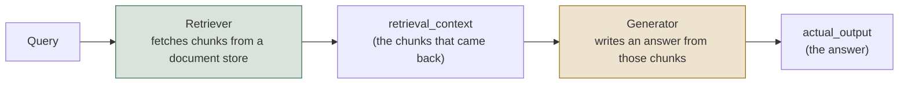
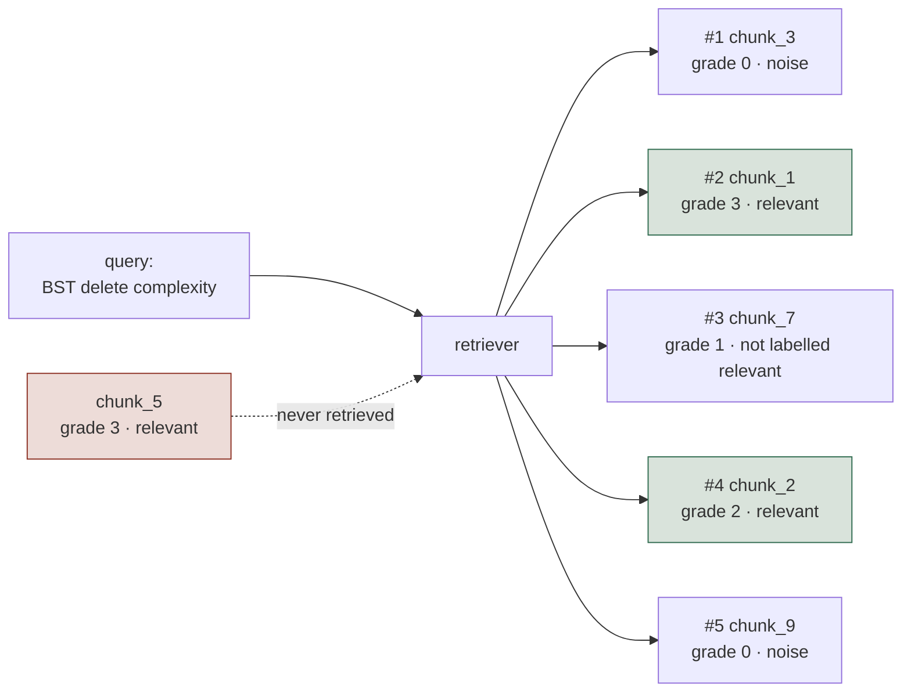
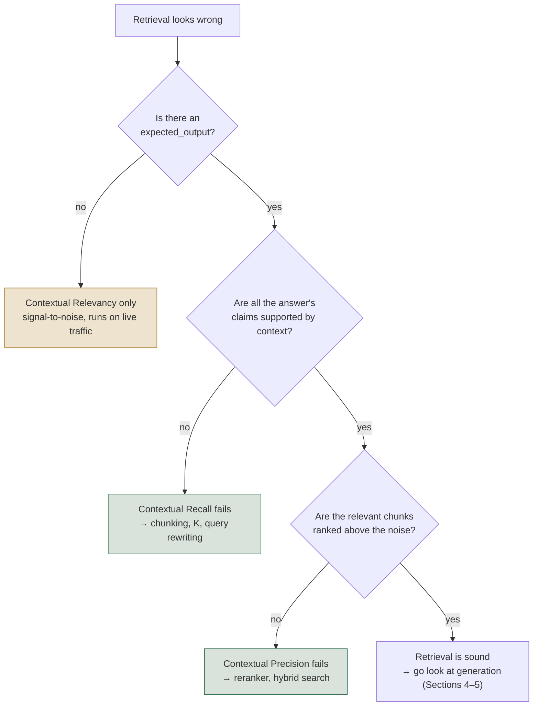
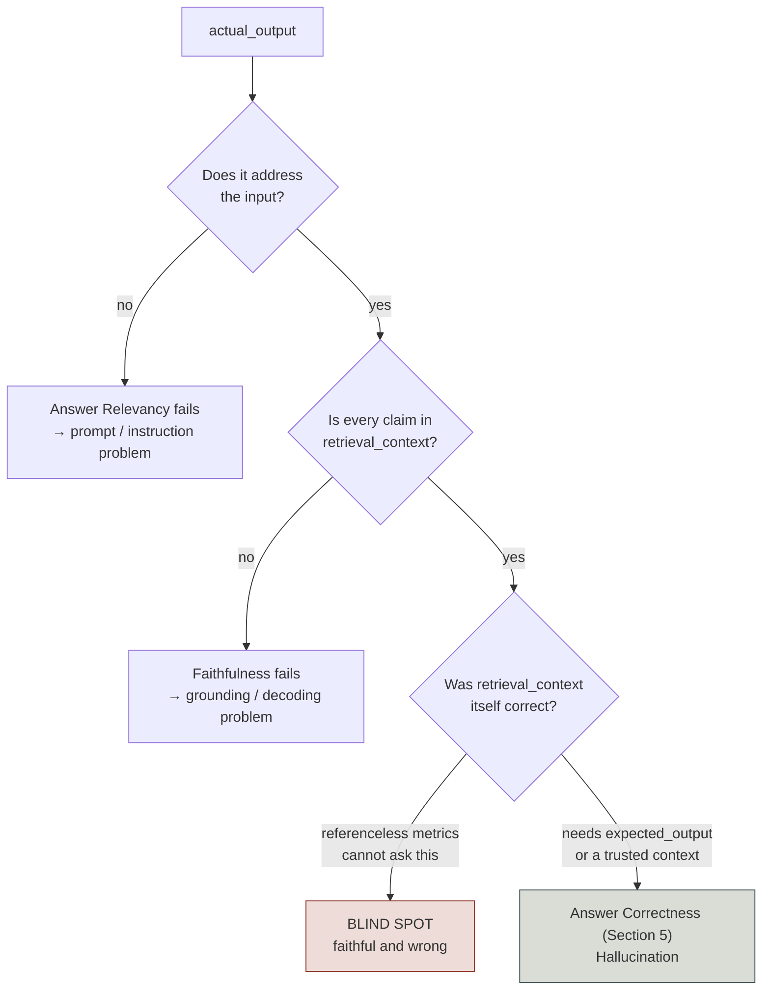
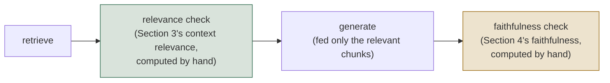
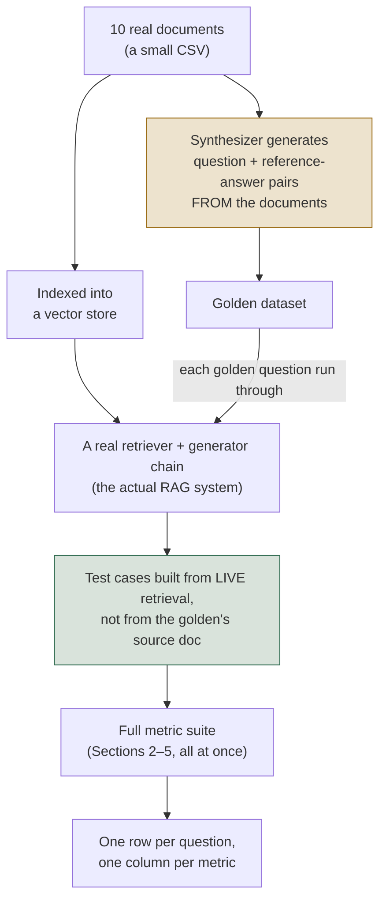

# RAG: Retrieval and Generation

*Evaluate retrieval and generation as two separate systems, because a generator cannot be
judged on evidence it never received.*

◷ 26 min · Level 1 · [Level 0](00-orientation.md) is the prerequisite — this page assumes the
five-surface map and the reference-based/referenceless split and builds on them.

A wrong answer is not evidence that the model hallucinated. If the retriever never fetched the chunk holding the fact, the generator answered faithfully
from a context that did not contain it. The two failures want opposite fixes: chunking and
reranking on one side, prompt and model on the other.

> **Who this is for.** No library knowledge is assumed. Field names such as `expected_output`
> and `retrieval_context` appear because they are the shared vocabulary of this work, and each
> is defined in plain words the first time it shows up. What the page does not do is explain any
> particular framework's API — the subject is what gets measured, not what computes it.

---

## 1. Evaluate the Two Halves Separately

A RAG (Retrieval-Augmented Generation) system answers in two steps: it **retrieves** chunks
from a document store, then **generates** an answer using those chunks as its only source of
truth.

**Every generation metric is bounded by retrieval.** Measure the generator while retrieval is
broken and the number describes retrieval, not the generator. Score the two halves apart first.

Retrieval metrics (Sections 2–3) score the box on the left. Did the right chunks come back, in
a good order? Generation metrics (Sections 4–5) score the box on the right. Given whatever
*did* come back, is the answer any good? Every metric here draws from exactly one box. That is
why a score table names the half to go fix.

Within each half the metrics split again on Level 0's line: does the check need a human-written
**label** or **reference answer**? Sections 2 and 4 need one; Sections 3 and, partly, 5 do not.

Sections 2, 4 and 5 reuse one toy question — *"What is the time complexity of deleting a node
from a binary search tree (BST)?"* — so the two-step failure stays visible. The fact ("O(h), where h is the tree's height") either
gets found or it does not. The answer either sticks to what was found or it does not.

---

## 2. Count What the Retriever Found, Before Any Judge

Did the retriever find the right chunks, and put them near the top? This is pure arithmetic over labelled ground truth: a query, the chunk IDs returned in rank
order, and the IDs a human wrote down once as *actually* relevant. No judge, no key, no cost.
It caps everything measured downstream.

**The four metrics:**

| Metric | Question it answers | Penalizes | Reach for it when |
| --- | --- | --- | --- |
| **Precision@K** | Of the K chunks retrieved, how many are relevant? | Noise in the retrieved set | Context windows are expensive and clutter is diluting the prompt |
| **Recall@K** | Of all the relevant chunks that exist, how many made the top K? | Missing evidence | You want to know the hard ceiling everything downstream is capped by |
| **MRR** (Mean Reciprocal Rank) | 1 / the rank of the *first* relevant hit | Burying the best chunk under noise | There's typically one best chunk and you care how early it lands |
| **nDCG@K** (normalized Discounted Cumulative Gain) | Is the ranking good once relevance is a matter of *degree*, not just yes/no? | Bad ordering among several relevant-but-unequal chunks | Relevance is graded (0–3) and more than one relevant chunk can coexist |

The formulas, in plain terms:

    Precision@K = (relevant chunks in top K) / K
    Recall@K    = (relevant chunks in top K) / (total relevant chunks that exist)
    MRR         = 1 / (rank of the FIRST relevant chunk)
    nDCG@K      = DCG@K / IDCG@K,   where DCG = Σ grade_i / log2(i + 2)

One detail is worth sitting with. **IDCG is computed over the ideal ranking of every relevant
chunk that exists — including ones the retriever never returned.** So nDCG stays capped below
1.0 no matter how the retrieved chunks are reordered.

### The worked example

`chunk_5` is the whole lesson: labelled relevant, graded 3, and never returned. **Precision and
MRR cannot see a chunk that never came back — Recall and nDCG can, and that is the only reason
the ceiling is visible at all.**

At K=5, four numbers fall out. **Precision@5 = 0.40** — 2 of the 5 retrieved chunks were
relevant (`chunk_1`, `chunk_2`), 3 were noise. **Recall@5 = 0.67** — 2 of the 3 relevant chunks
that exist were found, and `chunk_5` was missed entirely. **MRR = 0.50** — the first relevant
chunk, `chunk_1`, landed at rank 2, so 1/2. **nDCG@5 = 0.51** — the graded penalty for
`chunk_1` (grade 3) ranking below `chunk_3` (grade 0) is far larger than a swap between two
similarly-graded chunks.

What happens as K moves from 1 to 5:

| K | Precision@K | Recall@K | MRR | nDCG@K |
| - | - | - | - | - |
| 1 | 0.00 | 0.00 | 0.50 | 0.00 |
| 2 | 0.50 | 0.33 | 0.50 | 0.39 |
| 3 | 0.33 | 0.33 | 0.50 | 0.41 |
| 4 | 0.50 | 0.67 | 0.50 | 0.51 |
| 5 | 0.40 | 0.67 | 0.50 | 0.51 |

Three shapes in that table are diagnostic. Precision is not monotonic, so a precision number
quoted without its K means nothing. A flat, low MRR is a *ranking* problem — reach for a
reranker, not a larger K. Recall and nDCG flatlining together means a chunk is not reachable at
all. Raising K then buys tokens and latency and nothing else.

### Reading the four together

| What you see | What it means | Where to look |
| --- | --- | --- |
| Low recall, any precision | The answer isn't in the prompt at all | Chunking, embedding model, hybrid search, query rewriting |
| Good recall, low MRR | It's in the prompt, but buried | Reranker / cross-encoder |
| Good recall, falling precision | K is too large for this query | Dynamic K, or retrieve wide and rerank narrow |
| Good recall and MRR, low nDCG | Ranking ignores *degrees* of usefulness | Graded labels + a ranking-aware retriever |
| Everything good, answer still wrong | Retrieval is fine — the bug is downstream | Sections 4–5's generation metrics |

### When to use it, and when not to

**Reach for them** on day one of any eval setup, to compare retrievers or chunk sizes
repeatably, and for a CI gate that will never flake. Arithmetic cannot disagree with itself the
way a judge can. **Don't rely on them alone** without hand-labelled relevant chunk IDs, where
relevance is genuinely query-dependent, or where the golden set is stale. A stale set stays
green while the real system drifts.

---

## 3. Ask a Judge Three Questions, Not One

Same question as Section 2 — is retrieval working? — but with an LLM judge standing in for the
hand-labelled IDs that don't scale to production traffic. Ask it three separate questions, not one. Two of the three need a reference answer — `expected_output`, written before the system ran.

**A retriever can fail any one of the three while passing the other two.** That is why all
three ship rather than one blended number. Never average them: precision can halve while the
average barely moves, and nobody investigates.

| Metric | Question | Needs `expected_output`? | Cares about order? | Catches |
| --- | --- | --- | --- | --- |
| **Contextual Precision** | Are relevant chunks ranked *above* irrelevant ones? | Yes | Yes | A good chunk buried under noise |
| **Contextual Recall** | Does the context, as a whole, cover everything the expected answer needs? | Yes | No | Missing information — retrieval found *something*, not *enough* |
| **Contextual Relevancy** | Of everything retrieved, how much is actually on-topic? | No | No | Noise diluting the context, independent of ranking or completeness |

Precision cares about **order**. Recall cares about **coverage**. Relevancy cares about
**signal-to-noise**.

Two naming traps sit here. Contextual Relevancy is *exactly* Section 2's Precision@K formula
under another name — unweighted and order-blind. Contextual Precision is rank-weighted, and
that weighting is the whole difference. A relevant chunk near the top counts for more, so
reordering chunks moves Precision while leaving Relevancy untouched.

**One easy-to-miss detail about context recall:** it checks the retrieved context against `expected_output` — the reference answer — **not** against what the generator actually said (`actual_output`). It asks "was enough fetched to *support* the full expected answer?",
regardless of whether the generator used all of it. That trips people up constantly.

### The judge produces verdicts; arithmetic does the scoring

    Contextual Precision = Σ (precision@i, for each position i holding a relevant chunk) / (number of relevant chunks)
    Context recall    = (claims in expected_output supported by the context) / (total claims)
    Contextual Relevancy = (relevant chunks) / (total chunks retrieved)

The judge's only job is to label each chunk relevant/irrelevant, or each claim
supported/unsupported. Everything after that is deterministic math. The same verdicts always
produce the same score. Two judge runs can still disagree, because the *verdicts themselves*
are non-deterministic (Level 0, Section 3).

### One query, four retrieval outcomes

Question: *"What is Apache Spark used for?"*

| Scenario | Contextual Precision | Contextual Recall | Contextual Relevancy | What moved |
| --- | --- | --- | --- | --- |
| Healthy retrieval | 1.00 | 1.00 | 0.67 | — (baseline) |
| **Bad ranking** (same chunks, reordered) | **0.58** | 1.00 | 0.67 | Precision alone |
| **Thin coverage** (one perfect chunk only) | 1.00 | **0.50** | 1.00 | Recall alone |
| **Noise dilution** (1 relevant of 4 chunks) | **0.33** | 1.00 | **0.25** | Relevancy, dragging Precision with it |

Three things are easy to miss in that table. Healthy retrieval scores only 0.67 on Relevancy,
so a perfect 1.00 usually means K was set too small. Thin coverage scores 1.00 on two of three,
so running Relevancy alone makes a real coverage gap look perfect. Relevancy and Precision fail
together under noise dilution but decouple under bad ranking: noise ranked *above* signal is
both failures at once, a reordering only one.

### Deciding which of the three to run

Coverage is checked before ranking on purpose: there is no point tuning a reranker over a
context that never contained the answer in the first place.

### The threshold trap

The "thin coverage" scenario lands context recall at exactly **0.50**, which is also the most
common default pass threshold.

> **A score sitting exactly on its threshold is a coin toss, not a verdict.** The judge is
> non-deterministic, so one flipped claim-level verdict on a re-run flips the whole case.

Either move the threshold off where scores cluster, or re-run near-threshold cases and take a
majority.

### When to use it, and when not to

**Reach for them** on production traffic with no labelled chunk IDs, or where the golden set
misses the query shapes real users send. **Stay with Section 2** for a hard CI pass/fail line,
for head-to-head retriever comparisons, and at volume. Three contextual metrics over 500 test
cases is 1,500+ judge calls, before generation is measured at all.

---

## 4. Score the Answer With No Reference, and Know What That Cannot See

Given whatever *was* retrieved, is the answer any good — with no human-written reference for the
query being scored? These are the checks that can run against live production traffic.

| Metric | Question | Compares against |
| --- | --- | --- |
| **Answer relevancy** | Does the answer actually address the question that was asked? | `input` only |
| **Faithfulness** | Is the answer grounded in what was retrieved, with no invented claims? | `retrieval_context` |
| **Hallucination** | Does the answer align with a separately-supplied, trusted `context`, regardless of what retrieval fetched? | a curated `context`, not `retrieval_context` |

> **"Referenceless" does not mean "compares against nothing."** A reference is a correct answer
> a person wrote *before* the system ran. `retrieval_context` is not that — the pipeline
> produced it while answering. The mechanical test: could this metric score a brand-new query
> with zero human preparation?

Hallucination is the partial exception. Its trusted source is human-curated, so it needs a
maintained corpus — no *per-query* answer key, but not free either. Source material says what
is *true*, not what this answer *should have said*.

The judge doesn't score the answer as one blob. It decomposes first, and the three metrics use
**different decompositions of the same text**:

    Faithfulness     = (claims supported by retrieval_context) / (total claims)
    Answer relevancy = (statements that address the input) / (total statements)
    Hallucination    = (claims contradicting the trusted source) / (total claims)

An answer can have three grounded *claims* and only one on-topic *statement* — Faithfulness and
Answer Relevancy are not two takes on the same slicing of the text.

**A gotcha worth memorizing: Hallucination's score runs backwards.** A *higher* score means
*more* hallucination, the opposite convention from Faithfulness and Answer Relevancy. Always
check a new metric's score direction rather than assuming.

### Telling the three failures apart

An answer can be wrong in three genuinely different ways. Only two are visible to any
referenceless metric. It can be **faithful but irrelevant** — perfectly grounded, but answering
a different question than the one asked. It can be **relevant but unfaithful** — addressing the
question while inventing facts that aren't in the context. Or it can be **faithful to bad
context**, accurately reflecting retrieved chunks that were themselves wrong.

**Faithfulness is defined relative to the retrieved context, so it cannot ask whether that
context was true.** Neither can Answer Relevancy. Only a reference-based check (Section 5)
can — the blind spot is structural, not a tuning problem.

**Faithfulness vs. Hallucination — the distinction people get wrong:**

| | Faithfulness | Hallucination |
| --- | --- | --- |
| Compares against | the retrieved context — whatever *this* query's retriever fetched | a separate curated corpus, independent of retrieval |
| Score direction | Higher is better | **Higher is worse** |
| Changes per query? | Yes — the baseline moves with retrieval | No — the baseline is fixed |
| Catches | A generator inventing beyond what it was given | An answer contradicting known truth, however it got there |
| Blind to | Retrieved context that was itself wrong | Anything outside the curated context |
| Runs on live traffic | Yes, nothing extra needed | Only where you maintain a trusted corpus |

Use Faithfulness to police the generator. Use Hallucination against an independent trusted
source, regardless of what retrieval returned.

### When to use it, and when not to

Reach for referenceless metrics to monitor production traffic where nobody writes reference
answers, to catch decoding-level failures — invention, over-claiming, drifting off the question
— or wherever volume matters, since they scale to any input at zero labelling cost. Watch two traps: **semantic similarity standing in for correctness** (Section 5), and **vague `GEval` criteria** (Section 6). A rubric returns exactly the specificity it was given.

**A cheaper alternative for answer relevancy specifically.** Relevancy can also be scored with
embedding cosine similarity instead of a judge call. It is cheaper and faster. It misses the
subtler "technically similar wording, wrong answer" cases a judge would catch. Section 5 draws
the same tradeoff out fully.

**What each of the five metrics in this level structurally cannot catch**, gathered in one
place:

| Metric | Cannot catch |
| --- | --- |
| Contextual Precision / Recall / Relevancy (Section 3) | See Section 3's own triage table — each of the three is blind to the other two's failure mode |
| Answer Relevancy | A confidently wrong answer *to the right question* |
| Faithfulness | Context that was itself wrong |
| Hallucination | Anything outside the one curated context you supplied |
| Answer Correctness (Section 5) | Any query with no written reference to check against |
| Semantic Similarity (Section 5) | Wrong numbers and facts — it measures topic, not truth |

---

## 5. Check Correctness Against a Reference

**Is the answer actually correct**, against a known-good reference? Section 4's metrics never
ask, and this is the only place in Level 1 that catches "faithful to bad context."

Answer correctness has no single off-the-shelf definition. "Factually right" is task-specific, so the pattern is a `GEval`-style rubric you write (Section 6), not a metric you import. Answer Semantic
Similarity is not LLM-judged at all — it is plain embedding cosine similarity. That makes it
cheap, fast, and weak on a subtly wrong fact: two answers sit close in embedding space while
disagreeing on the one number that matters. Both need `expected_output`. That is the cost side of Level 0's tradeoff — exact, but only as
scalable as the reference answers can be kept current.

### The same four answers, now with reference-based scores added

Question: *"What is the time complexity of deleting a node from a BST?"* Reference: *"O(h),
where h is the height of the tree."*

| Answer | Answer Relevancy | Faithfulness | Hallucination ↓ | Answer Correctness | Semantic Similarity |
| --- | --- | --- | --- | --- | --- |
| Grounded & relevant | 1.00 | 1.00 | 0.00 | 0.95 | 0.94 |
| Faithful but irrelevant | 0.33 | 1.00 | 0.00 | 0.35 | 0.78 |
| Relevant but unfaithful | 1.00 | 0.50 | 0.50 | 0.40 | 0.91 |
| **Faithful to bad context** | **1.00** | **1.00** | **1.00** | **0.10** | 0.83 |

The last row is the whole section. Retrieval returned a chunk claiming BST deletion is O(1); the
generator repeated it accurately.

> **Both referenceless metrics report a perfect score on an answer that is simply false.** Only
> Answer Correctness catches it, at 0.10.

Semantic Similarity scores that same false answer **0.83**, because embeddings measure *topic*
and "constant time" sits close to "logarithmic time". Pair it with a judged correctness check;
never substitute it for one.

### Two ways to write the correctness rubric

A rubric-based judge takes one of two shapes, never both at once. **`criteria`** is a one-line
statement (*"determine whether actual_output is factually correct relative to expected_output,
focusing on whether key facts match — wording may differ"*), which the judge expands into its own
steps internally. **`evaluation_steps`** is an ordered procedure you write (*"1. list the
statements in actual_output, 2. check each is relevant to input, 3. check each agrees with
expected_output, 4. check each is grounded in retrieval_context, 5. penalize anything
invented"*), weaving question, reference and retrieved context into one rubric.
`evaluation_steps` is the more controllable of the two: the procedure is written down instead of
invented per run.

### When to use it, and when not to

**Reach for them** where the feared failure is *wrongness* rather than *ungroundedness* — every
index-corruption and stale-document case Section 4 cannot see. Also for gating CI on a
controlled test set, and for comparing prompt or model versions against a fixed reference.
**Watch two traps:** semantic similarity standing in for correctness, and a `criteria` line too vague to say what should fail.

---

## 6. Write the Rubric, or the Judge Writes It for You

Every `GEval` rubric comes down to one fact. **Either the test is written down, or the judge invents one per run.**

| You give the judge | What happens | Result |
| --- | --- | --- |
| One sentence — *"check the answer is accurate"* | The judge has to invent its own evaluation steps, and invents slightly different ones on every run | The same answer gets different scores on different runs |
| Explicit steps — *"1. every figure appears in the context, 2. it answers the question asked, 3. no advice beyond the policy"* | The judge follows the procedure you wrote | The same answer gets the same score every time |

Write explicit steps whenever a one-liner won't pin down what should fail. Steps also check
several things in one pass — relevance, agreement with a reference, grounding — instead of
three separate metrics.

**A vague rubric never errors.** The numbers wobble from run to run with nothing pointing at
the rubric as the cause. It fails as noise, not as a visible break. **The test: if the rubric's
author cannot say precisely what would make an answer fail, neither can the judge.**

Hand a human grader "mark this fairly" instead of a marking scheme and five graders return five
different grades, every one individually defensible.

---

## 7. Gate the Pipeline, Don't Only Score It Afterwards

Sections 2–5 all score output **after the fact**. Context relevance and faithfulness can instead
run **inside the pipeline**, gating generation on bad retrieval before a user ever sees the
answer.

**A score computed after generation can only describe the answer; a score computed before it
can change the answer.** The relevance check runs *before* generation, so a real system
can branch on it — asking a clarifying question instead of generating a plausible answer from
noise. Building the same two checks from raw judge calls also demystifies the packaged metrics. It
shows what a context-relevance score is doing underneath.

The worked example retrieves three chunks for the BST question, one deliberately off-topic (a
fact about Python lists). The mock judge flags it `irrelevant` and filters it out *before*
generation runs. The answer scores **Faithfulness 1.00** — nothing to hallucinate from, because
only supporting chunks ever reached the generator.

> **Prototype against mocked judges first.** Same graph, byte-identical output, zero cost —
> debug the pipeline's *shape* before a real judge is involved.

Swapping in live judges is where non-determinism appears: the same graph run twice can extract
slightly different claims. Hence a temperature of zero, and tracking judge agreement itself
rather than trusting a single pass.

---

## 8. Build the System and Synthesize Its Golden Set

Sections 2–6 used hand-constructed test cases and Section 7 used fixture data in a toy graph.
The capstone does the real thing:

**Hand-writing reference answers doesn't scale past a handful of examples.** A synthesizer
generates question/expected-answer pairs directly from the documents instead, evolved along
chosen dimensions — requiring multi-step reasoning, say, or information from more than one
chunk. That yields a labelled eval set with no reference answer written by hand. Spot-check the
output anyway: a generated question is only as good as the process that produced it.

> **Build each test case by running the live retriever, not by reusing the source document.**
> That is the difference between testing the deployed pipeline and testing whether the generator
> writes well given hand-picked perfect context.

Run the whole suite — retrieval and generation, reference-based and referenceless — over every
golden question. The result is an aggregate table: mean, min and max per metric. That is how a
RAG quality report actually gets read.

### The batch pattern

**A hand-built test case teaches what a metric does. It says nothing about the system.** Turning
one scored example into a real evaluation is always the same shape:

> dataset of inputs → call the **live** system once per row → score the real response → write
> the score back beside its input

A parametrized test runner is the simplest way to run it. Read the questions from a file, call
the live system once per row, score the response, write the score back beside its question, and
assert a floor. One eval row becomes one test, so the runner is both batch engine and pass/fail
reporter — no separate harness loop to maintain. Scores landing next to the input that produced
them is what makes a bad number one click from its cause.

---

## 9. Read the Table by Pattern, Not by Headline

A table of per-metric scores is diagnostic, not just descriptive.

Diagnose by pattern, not headline number. Low Contextual Precision with everything else high is
a ranking problem (Section 3). Low Faithfulness with high Contextual Relevancy is the generator
inventing despite good retrieval (Section 4).

**An 85% average with one category at zero and an 85% average spread evenly are two different
systems reporting one number.** Slice by query category, tenant, intent or document type before
concluding the system is fine.

---

## 10. Rehearse the Decomposition Questions

Sections 1–9 answered the conceptual questions. These are the follow-ups that arrive once an
interviewer has a score table on screen. Each is a decomposition problem in a dashboard's
clothing: name the layer that failed, then name the evidence that would prove it.

**"Leadership wants one number for retrieval quality on an exec dashboard. What do you put
there, and what do you say about the request?"**

Recall@K, with precision@K and MRR one click away. Then say the uncomfortable part out loud. A
healthy recall figure is perfectly compatible with the right chunk sitting at rank 8 under
noise. One number cannot carry a two-failure system, so the dashboard carries the ceiling and
links to the diagnosis.

**"Context precision drops from 0.91 to 0.62 after a release. Coverage and relevance are
unchanged. What shipped?"**

A ranking change — a reranker, fusion weights, or tie-breaking. The same chunks are still coming
back, or coverage would have moved too. Only their order changed, and precision is the only one
of the three that is rank-weighted.

**"Faithfulness and answer relevancy both sit above 0.95 for a month. Then a customer proves the
assistant has been giving wrong compliance guidance the whole time. How is that possible?"**

A wrong source document produces a perfectly faithful, perfectly relevant, wrong answer. No
threshold could have caught it, because the blind spot is structural rather than a tuning
failure. The fix is reference-based coverage on the high-stakes slice, plus monitoring how fresh
the index is.

---

## Key Takeaways

- Retrieval and generation are scored as two separate systems, because every generation metric
  is capped by what retrieval returned.
- Deterministic retrieval metrics are arithmetic over hand-labelled IDs — free, un-flaky, and
  the right first CI gate, but blind to a chunk that never came back unless you read Recall and
  nDCG.
- The three LLM-judged retrieval metrics answer three different questions — order, coverage,
  signal-to-noise — and averaging them hides the one that moved.
- Referenceless generation metrics scale to live traffic but are structurally blind to an answer
  that is faithful to a wrong context.
- Only a reference-based check catches "faithful to bad context"; Semantic Similarity measures
  topic, not truth, and scored a false answer 0.83.
- A rubric you did not write is a rubric the judge invents differently on every run.
- Evaluation moved inside the pipeline can change the answer, not just describe it.
- Synthesizing a golden set from your own documents is what makes reference-based evaluation
  affordable, and a hand-built test case only ever teaches the metric — test cases must be built
  from live retrieval, not the source document.
- Read the score table by pattern and slice it before concluding; an average hides a category
  sitting at zero.

## Check Yourself

1. Recall@5 is 0.67 and raising K to 20 doesn't move it. What does that tell you, and what would
   you *not* spend time on? **The relevant chunk isn't reachable at all — a retrieval/chunking
   or embedding problem. Don't tune the reranker; MRR wasn't the failure.**
2. Why can Precision@K fall as K rises while Recall@K cannot? **Precision divides by K, so
   adding noise dilutes it; recall divides by the fixed number of relevant chunks that exist, so
   more retrieval can only help or tie.**
3. Contextual Relevancy is 1.00. Why might that be bad news? **It usually means K was set too
   small — one perfect chunk and nothing else, which scores perfectly on relevancy while coverage
   quietly fails.**
4. Faithfulness is 1.00 and Answer Relevancy is 1.00, and the answer is still wrong. How?
   **Retrieval returned a chunk that was itself wrong. Faithfulness is defined relative to that
   context, so it cannot ask whether the context was true.**
5. Which single metric in this level would have caught question 4's failure, and what does it
   cost? **Answer correctness — and it costs a human-written reference answer for every query checked.**
6. Why is a judged score that wobbles between runs usually a rubric problem rather than a model
   problem? **A vague rubric makes the judge invent its own evaluation steps, and it invents
   slightly different ones each run. A vague rubric never errors — it fails as noise.**
7. What does running the relevance check *before* generation buy that scoring afterwards
   cannot? **The ability to branch — ask a clarifying question or refuse, instead of generating a
   plausible answer from noise.**
8. Why must capstone test cases be built from live retrieval rather than the golden set's source
   document? **Otherwise you are testing whether the generator writes well given hand-picked
   perfect context, not whether the deployed pipeline works.**
9. Your suite averages 85%. Why is that not yet a result? **An 85% spread evenly and an 85% with
    one category at zero are different systems. Slice by category, tenant, intent or document
    type first.**

---

## References

All content above was drawn only from material already in this repository. Nothing here was
invented, and no external source was consulted. This page is the restyled edition of
`org/01-rag-retrieval-and-generation.md`; its content is the same. The body names the field vocabulary (`expected_output`, `retrieval_context`, `GEval`) where it aids understanding, but deliberately avoids any framework's API surface or feature tour. The sources below name the libraries they use; that is provenance, not curriculum.

**Notebook:**

- `courses/01-rag-agent-tool-evaluation/01_Retrieval_Metrics_Deterministic.ipynb` — the four
  deterministic retrieval metrics, their formulas, and the BST worked example (Section 2).
- `courses/01-rag-agent-tool-evaluation/02_Retrieval_Metrics_LLM_Judged.ipynb` — the three
  Contextual metrics and the Apache Spark / Type 2 Diabetes / climate-change worked examples
  (Section 3).
- `courses/01-rag-agent-tool-evaluation/03_Generator_Metrics_Referenceless.ipynb` — Answer
  Relevancy, Faithfulness, and Hallucination, plus the "why referenceless" callout and the
  score-direction gotcha (Section 4).
- `courses/01-rag-agent-tool-evaluation/04_Generator_Metrics_Reference_Based.ipynb` — Answer
  Correctness (`GEval`, both configuration styles) and Answer Semantic Similarity (Sections 5–6).
- `courses/01-rag-agent-tool-evaluation/05_RAG_Eval_Inside_the_Pipeline.ipynb` — evaluation wired
  directly into a LangGraph pipeline as gates, mocked and then live (Section 7).
- `courses/01-rag-agent-tool-evaluation/06_RAGAS_in_Practice.ipynb` — the batch pattern folded
  into Section 8. This page does not cover the notebook's second-framework comparison, which is
  library mechanics rather than decomposition.
- `courses/01-rag-agent-tool-evaluation/07_RAG_Capstone_Build_and_Evaluate.ipynb` — building a
  real RAG system, synthesizing a golden dataset, and running the full metric suite end to end
  (Section 8).

**Docs:**

- `docs/concepts/rag-agent-tool-evaluation.md`, Part 1 (§1.1–§1.9) — the compressed reference
  version of every section above, plus §1.5 (writing a rubric) and §1.9 (reading results), which
  have no notebook of their own.
- `docs/concepts/rag-agent-tool-evaluation.md`, Part 6 (§6.1–§6.3) — the slow narrative version of
  Sections 2–5, walked against the same numbers used above, including the triage tables and the
  "when to use it / when not to" guidance reused directly in this file.
- `docs/interactive-labs/01-deterministic-retrieval-metrics.html`,
  `docs/interactive-labs/02-llm-judged-retrieval-metrics.html`,
  `docs/interactive-labs/03-generator-metrics.html` — the three companion labs; each contributed
  its scenario table and its own framing of the "what this metric is blind to" column, folded
  into Sections 2, 3, and 4–5 respectively rather than repeated separately.
- `docs/interview-prep/QUESTION_BANK.md`, Part 10, §10.1–§10.3 — the metric-level,
  dashboard-framed follow-up questions used in Section 11.
- `docs/study-guide/evaluation-roadmap.md` — used to scope Level 1's topic list and goal
  statement, not quoted directly.
- `docs/study-guide/evaluation-topic-notebook-mapping.md` — used for the resource list and cost
  tags (all Level 1 notebooks are tagged `key`, meaning they make live `OPENAI_API_KEY` calls
  when actually run; this file was written without running any of them).

**Limitations.** This file was written by reading the repository's own notebooks, field guide,
labs, and question bank — not by running any notebook or calling any API — no cost was incurred
producing it, consistent with this project's rule against executing anything that spends money
without being asked. It does not independently verify DeepEval's, RAGAS's, or LangGraph's own
upstream documentation; every description of what those libraries do is this repository's own
characterization, not a review of the vendors' docs.
