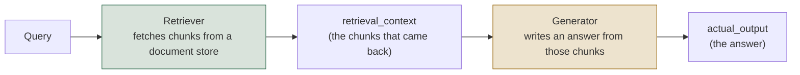
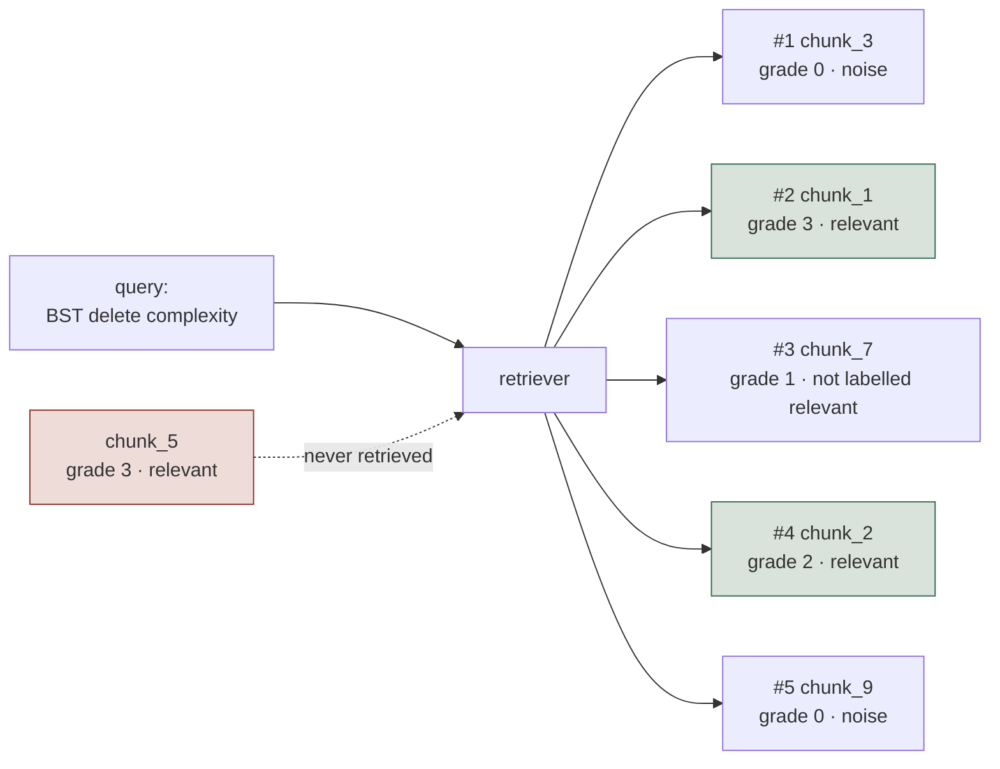
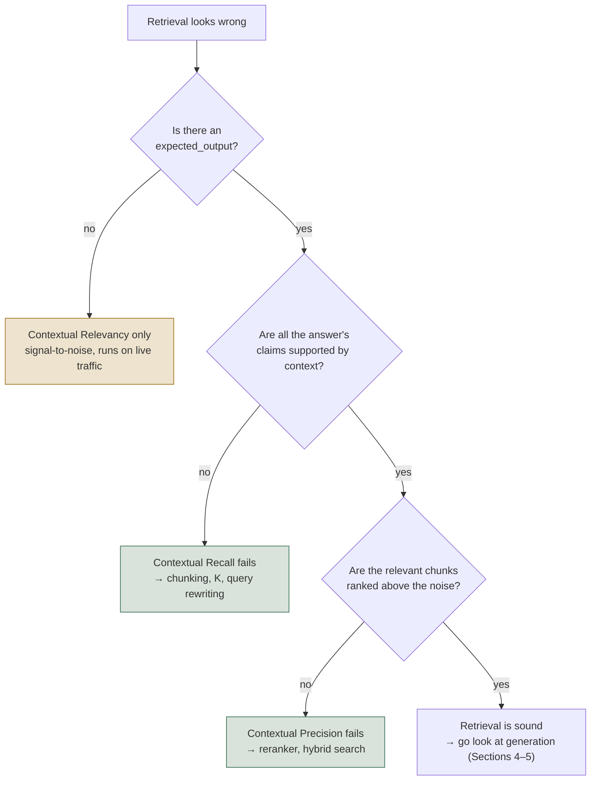
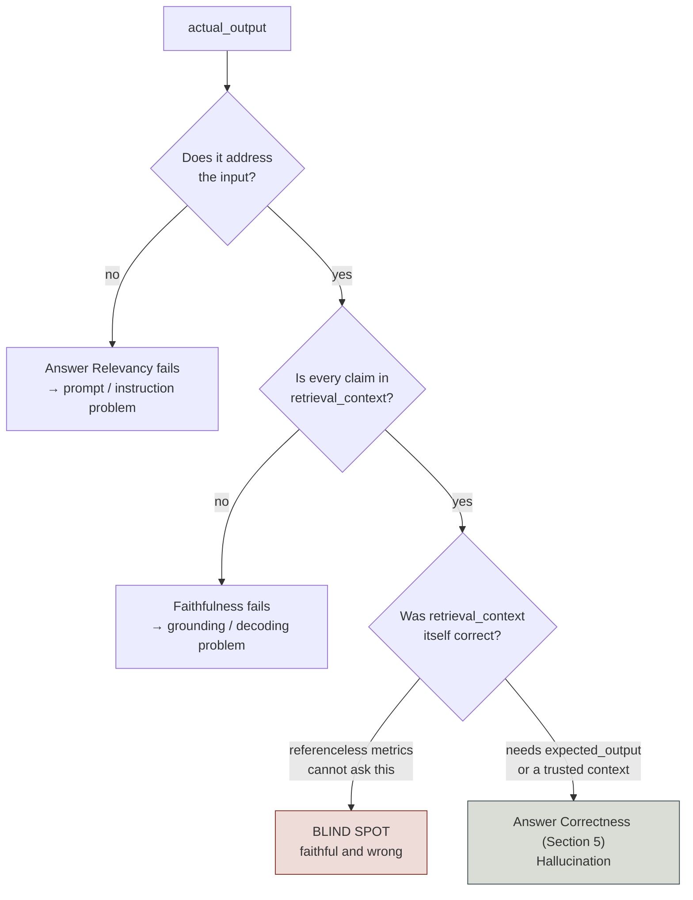
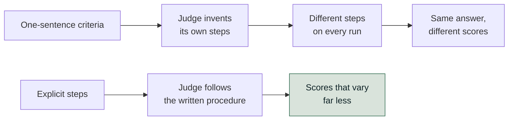
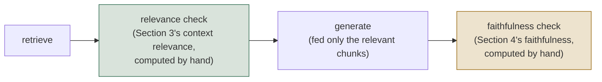
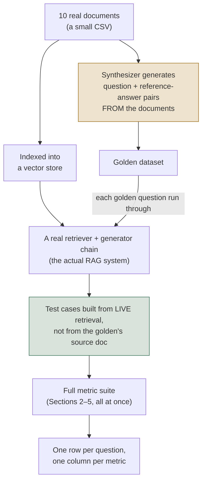
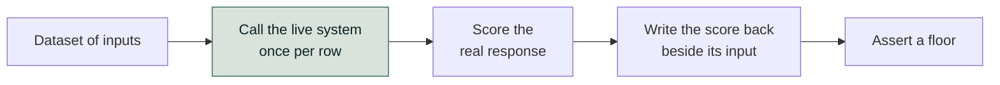
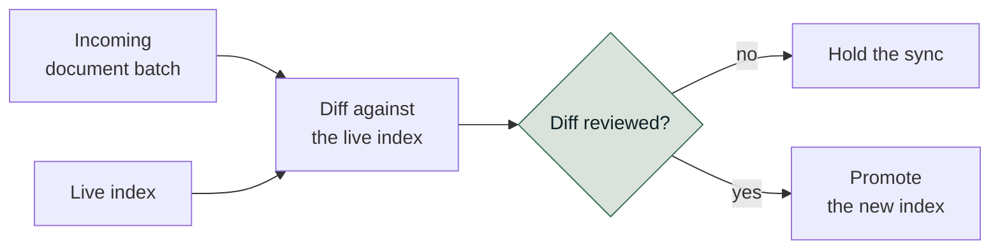

# RAG: Retrieval and Generation

*Evaluate retrieval and generation as two separate systems, because a generator cannot be judged on evidence it never received.*

◷ 27 min read · Level 1 · [Level 0](00-orientation.md) is the prerequisite. This page builds on its five-surface map and the reference-based/referenceless
split.

A wrong answer does not prove the model hallucinated. The retriever may never have fetched the chunk holding the fact. The generator then answered
faithfully from a context that did not contain it. The two failures want opposite fixes:

- **Retrieval failure.** Fix chunking and reranking.
- **Generation failure.** Fix the prompt and the model.

> **Who this is for.** No library knowledge is assumed. Field names such as `expected_output` and `retrieval_context` appear because they are the
> shared vocabulary of this work. Each is defined in plain words the first time it shows up. The page does not explain any framework's API. It
> covers what gets measured, whichever library computes it.

---

## 1. Evaluate the Two Halves Separately

A RAG (Retrieval-Augmented Generation) system answers in two steps. It **retrieves** chunks from a document store. Then it **generates** an answer,
using those chunks as its only source of truth.

Terms used on this page:

- **Chunk**: a short passage cut from a document so it can be searched.
- **`retrieval_context`**: the chunks that came back for one query.
- **`actual_output`**: the answer the generator wrote.
- **Judge**: an LLM that scores another model's output.
- **Reference**: a correct answer a person wrote before the system ran. Its field name is `expected_output`.

Two limits shape every score on this page:

- **Retrieval bounds every generation metric.** Measure the generator while retrieval is broken, and the number describes retrieval instead. Score
  the two halves apart first.
- **Ingestion bounds retrieval.** Ingestion is the job that loads documents into the index. A document can miss the index three ways: the loader
  dropped it, the parser or OCR mangled it, or it was embedded with a different model than the query. Each one shows up as a retrieval failure that
  no retriever change can fix. Count, checksum and spot-check the index before tuning anything
  ([field guide, upstream checks](../concepts/field-guide/02-rag-retrieval.md#2-did-the-evidence-ever-reach-the-index)).

This diagram shows the two boxes and the field each one produces.

Each metric draws from exactly one box. A score table therefore names the half to go fix.

- **Retrieval metrics (Sections 2–3)** score the box on the left. Did the right chunks come back, in a good order?
- **Generation metrics (Sections 4–5)** score the box on the right. Given whatever *did* come back, is the answer any good?

Within each half the metrics split again on Level 0's line. Does the check need a human-written **label** or **reference answer**?

- **Sections 2 and 5** need one.
- **Section 4** does not.
- **Section 3** is split. Two of its three checks need a reference.

Sections 2, 4 and 5 reuse one toy question. It keeps the two-step failure visible: *"What is the time complexity of deleting a node from a binary
search tree (BST)?"*

- **Retrieval.** The fact ("O(h), where h is the tree's height") either gets found or it does not.
- **Generation.** The answer either sticks to what was found or it does not.

---

## 2. Count What the Retriever Found, Before Any Judge

Did the retriever find the right chunks, and put them near the top? This check is pure arithmetic over labelled ground truth. It needs no judge and
no API key, and it costs nothing. What it measures caps everything downstream.

The inputs:

- **The query.**
- **The returned chunk IDs**, in rank order.
- **The relevant IDs**, which a human wrote down once.

The four metrics:

- **Precision@K** measures noise.
- **Recall@K** measures missing evidence.
- **MRR** (Mean Reciprocal Rank) measures how early the first relevant hit lands.
- **nDCG@K** (normalized Discounted Cumulative Gain) measures ranking quality when relevance is graded 0–3.

Definitions and formulas are in the [field guide, retrieval with labels](../concepts/field-guide/02-rag-retrieval.md#3-retrieval-with-labels) and its
[worked retrieval lab](../concepts/field-guide/02-rag-retrieval.md#32-four-metrics-four-questions).

**nDCG's ideal ranking includes relevant chunks the retriever never returned.** It stays capped below 1.0, however the retrieved chunks are reordered.

### The worked example

This diagram shows what came back for the BST query, with each chunk's relevance grade.

`chunk_5` is labelled relevant, graded 3, and never returned.

- **Precision and MRR cannot see a chunk that never came back.**
- **Recall and nDCG can.** They are the only metrics that show the ceiling.

At K=5, four numbers fall out:

- **Precision@5 = 0.40.** 2 of the 5 retrieved chunks were relevant (`chunk_1`, `chunk_2`). 3 were noise.
- **Recall@5 = 0.67.** 2 of the 3 relevant chunks that exist were found. `chunk_5` was missed entirely.
- **MRR = 0.50.** The first relevant chunk, `chunk_1`, landed at rank 2. That gives 1/2.
- **nDCG@5 = 0.51.** `chunk_1` (grade 3) ranks below `chunk_3` (grade 0). That costs far more than a swap between two similarly-graded chunks.

What happens as K moves from 1 to 5:

| K | Precision@K | Recall@K | MRR  | nDCG@K |
| - | ----------- | -------- | ---- | ------ |
| 1 | 0.00        | 0.00     | 0.50 | 0.00   |
| 2 | 0.50        | 0.33     | 0.50 | 0.39   |
| 3 | 0.33        | 0.33     | 0.50 | 0.41   |
| 4 | 0.50        | 0.67     | 0.50 | 0.51   |
| 5 | 0.40        | 0.67     | 0.50 | 0.51   |

Three shapes in that table are diagnostic:

- **Precision is not monotonic.** A precision number quoted without its K means nothing.
- **A flat, low MRR is a *ranking* problem.** Reach for a reranker rather than a larger K.
- **Recall and nDCG flatline together.** A chunk is not reachable at all. Raising K then buys tokens and latency and nothing else.

### Reading the four together

| What you see                        | What it means                             | Where to look                                             |
| ----------------------------------- | ----------------------------------------- | --------------------------------------------------------- |
| Low recall, any precision           | The answer isn't in the prompt at all     | Chunking, embedding model, hybrid search, query rewriting |
| Good recall, low MRR                | It's in the prompt, but buried            | Reranker / cross-encoder                                  |
| Good recall, falling precision      | K is too large for this query             | Dynamic K, or retrieve wide and rerank narrow             |
| Good recall and MRR, low nDCG       | Ranking ignores *degrees* of usefulness   | Graded labels and a ranking-aware retriever               |
| Everything good, answer still wrong | Retrieval is fine. The bug is downstream  | Sections 4–5's generation metrics                         |

### When to use it, and when not to

**Reach for them** in three places:

- **Day one** of any eval setup.
- **Comparing retrievers or chunk sizes** repeatably.
- **A CI gate that will never flake.** Arithmetic cannot disagree with itself the way a judge can.

**Don't rely on them alone** in three cases:

- **No hand-labelled relevant chunk IDs exist.**
- **Relevance depends on the query.**
- **The golden set is stale.** A stale set stays green while the real system drifts.

---

## 3. Ask a Judge Three Questions, Not One

Section 2's question again: is retrieval working? This time an LLM judge stands in for the hand-labelled IDs, which don't scale to production
traffic. Ask it three separate questions. Two of them need `expected_output`, written before the system ran.

**A retriever can fail any one of the three while passing the other two.** Report all three and never average them. Precision can halve while the
average barely moves, and nobody investigates.

| Metric | Cares about | The question it asks | Runs without `expected_output`? |
| --- | --- | --- | --- |
| **Contextual Precision** | **Order** | Are relevant chunks ranked above noise? | No |
| **Contextual Recall** | **Coverage** | Does the context hold everything the expected answer needs? | No |
| **Contextual Relevancy** | **Signal-to-noise** | How much of what came back is on-topic? | Yes |

Definitions are in the [field guide, retrieval without labels](../concepts/field-guide/02-rag-retrieval.md#4-retrieval-without-labels). The
formulas are in the [worked judged-retrieval lab](../concepts/field-guide/02-rag-retrieval.md#41-three-checks-for-three-failures).

Three naming traps sit here:

- **Contextual Precision is rank-weighted.** A relevant chunk near the top counts for more. Reordering chunks moves Precision and leaves Relevancy
  untouched.
- **Contextual Relevancy is unweighted**, like Section 2's Precision@K. But the judge rates each statement inside a chunk, not each chunk. A verbose
  chunk holding one relevant sentence drags the score down. The chunker moves it as much as the retriever does.
- **Context recall checks the retrieved context against `expected_output`, the reference answer.** It does not check against what the generator
  said (`actual_output`). It asks "was enough fetched to *support* the full expected answer?", whether or not the generator used all of it.

### The judge produces verdicts; arithmetic does the scoring

The judge has one job. It labels each chunk (or statement) relevant or irrelevant, or each claim supported or unsupported. Everything after that is
deterministic math.

- **Same verdicts, same score.** The arithmetic never changes.
- **Two judge runs can still disagree.** The *verdicts themselves* are non-deterministic (Level 0, Section 3).

### One query, four retrieval outcomes

Question: *"What is Apache Spark used for?"*

| Scenario                                          | Contextual Precision | Contextual Recall | Contextual Relevancy | What moved                            |
| ------------------------------------------------- | -------------------- | ----------------- | -------------------- | ------------------------------------- |
| Healthy retrieval                                 | 1.00                 | 1.00              | 0.67                 | Nothing (baseline)                    |
| **Bad ranking** (same chunks, reordered)    | **0.58**       | 1.00              | 0.67                 | Precision alone                       |
| **Thin coverage** (one perfect chunk only)  | 1.00                 | **0.50**    | 1.00                 | Recall alone                          |
| **Noise dilution** (1 relevant of 4 chunks) | **0.33**       | 1.00              | **0.25**       | Relevancy, dragging Precision with it |

What the table shows:

- **Healthy retrieval scores only 0.67 on Relevancy.** A perfect 1.00 can mean K was set too small.
- **Thin coverage scores 1.00 on two of three.** Running Relevancy alone makes a real coverage gap look perfect.
- **Noise dilution fails Relevancy and Precision together.** Noise ranked *above* signal is both failures at once.
- **Bad ranking fails Precision alone.** A reordering is only one failure, and the two metrics decouple.

### Deciding which of the three to run

Coverage is checked before ranking. There is no point tuning a reranker over a context that never contained the answer.

### The threshold trap

The "thin coverage" scenario lands context recall at exactly **0.50**. That is also DeepEval's default pass threshold.

> **A score sitting exactly on its threshold is a coin toss.** The judge is non-deterministic. One flipped claim-level verdict on a re-run flips
> the whole case.

Two fixes:

- **Move the threshold** off where scores cluster.
- **Re-run near-threshold cases** and take a majority.

### When to use it, and when not to

**Reach for them** in two places:

- **Production traffic** with no labelled chunk IDs.
- **Query shapes the golden set misses**, the ones real users send.

**Stay with Section 2** in three places:

- **A hard CI pass/fail line.**
- **Head-to-head retriever comparisons.**
- **High volume.** Three contextual metrics over 500 test cases is 1,500+ judge calls, before generation is measured at all.

---

## 4. Score the Answer With No Reference, and Know What That Cannot See

Given whatever *was* retrieved, is the answer any good? These checks work when no human-written reference exists for the query. They can run
against live production traffic.

Each check holds the answer up against a different thing:

| Check | Compares the answer to |
| --- | --- |
| **Answer relevancy** | The `input`, the user's question |
| **Faithfulness** | The `retrieval_context` |
| **Hallucination** | A separately supplied, trusted `context` |

Definitions are in the [field guide, checks that need no reference](../concepts/field-guide/03-rag-generation.md#3-checks-that-need-no-reference).

> **"Referenceless" does not mean "compares against nothing."** A reference is a correct answer a person wrote *before* the system ran.
> `retrieval_context` is not one. The pipeline produced it while answering. The mechanical test: could this metric score a brand-new query with zero
> human preparation?

In production, report two of these as **rates** a dashboard can trend:

- **Unsupported-claim rate**: claims no retrieved source supports ÷ all claims. It tracks the generator inventing.
- **Contradiction rate**: claims that a source the system had contradicts ÷ all claims. It tracks conflict handling.

The two rates move for different reasons.

**Hallucination is the partial exception.** Its trusted source is human-curated. It needs a maintained corpus: no *per-query* answer key, but not
free either. Source material says what is *true*, not what this answer *should have said*.

**The judge splits the answer up before scoring it.**

- **Faithfulness and Hallucination** split it into *claims*.
- **Answer Relevancy** splits it into *statements*.
- **The score is a ratio** over those verdicts (formulas in the field guide's
  [claim decomposition section](../concepts/field-guide/03-rag-generation.md#2-claim-decomposition)).

An answer can have three grounded *claims* and only one on-topic *statement*.

**Hallucination's score runs backwards.** A *higher* score means *more* hallucination. Faithfulness and Answer Relevancy use the opposite
convention. Always check a new metric's score direction rather than assuming.

### Telling the three failures apart

An answer can be wrong in three different ways. Only two are visible to any referenceless metric.

| Failure | What it looks like | Seen by referenceless metrics? |
| --- | --- | --- |
| **Faithful but irrelevant** | Grounded, but answers a different question than the one asked | Yes |
| **Relevant but unfaithful** | Addresses the question while inventing facts that aren't in the context | Yes |
| **Faithful to bad context** | Accurately reflects retrieved chunks that were themselves wrong | No |

The third row is a blind spot by definition:

- **Faithfulness is defined relative to the retrieved context.** It cannot ask whether that context was true.
- **Answer Relevancy cannot ask either.**
- **Only a reference-based check (Section 5) can.** The blind spot comes from the definition, and no tuning closes it.

**Faithfulness and Hallucination differ in their baseline.**

- **Faithfulness** checks against each query's retrieval, which moves every time. Use it to police the generator.
- **Hallucination** checks against a fixed curated corpus. Use it against an independent trusted source, whatever retrieval returned.

The side-by-side table is in [field guide, checks that need no reference](../concepts/field-guide/03-rag-generation.md#3-checks-that-need-no-reference).
It also holds the four-way split of "hallucination": unsupported, contradicted, stale, inaccessible. That split names the team that owns a failing
claim.

### When to use it, and when not to

**Reach for referenceless metrics** in three places:

- **Production traffic** where nobody writes reference answers.
- **Decoding-level failures**: invention, over-claiming, drifting off the question.
- **High volume.** They scale to any input at zero labelling cost.

**Watch two traps:** semantic similarity standing in for correctness (Section 5), and vague `GEval` criteria (Section 6).

**A cheaper option for answer relevancy.** Embedding cosine similarity can score relevancy with no judge call.

- **Gain:** it is cheaper and faster.
- **Loss:** it misses the subtler cases a judge would catch, where the wording is close and the answer is wrong.

Section 5 draws out the same tradeoff in full.

**What each metric in this level structurally cannot catch**, gathered in one place:

| Metric                                                | Cannot catch                                                                                 |
| ----------------------------------------------------- | -------------------------------------------------------------------------------------------- |
| Contextual Precision / Recall / Relevancy (Section 3) | See Section 3's own triage table. Each of the three is blind to the other two's failure mode |
| Answer Relevancy                                      | A confidently wrong answer *to the right question*                                           |
| Faithfulness                                          | Context that was itself wrong                                                                |
| Hallucination                                         | Anything outside the one curated context you supplied                                        |
| Answer Correctness (Section 5)                        | Any query with no written reference to check against                                         |
| Semantic Similarity (Section 5)                       | Wrong numbers and facts. It measures topic, not truth                                        |

---

## 5. Check Correctness Against a Reference

**Is the answer actually correct**, against a known-good reference? Section 4's metrics never ask. This is the only place in Level 1 that catches
"faithful to bad context."

Two metrics sit here, and both need `expected_output`:

- **Answer Correctness** has no single off-the-shelf definition
  ([field guide, checks against a reference](../concepts/field-guide/03-rag-generation.md#5-checks-against-a-reference)). "Factually right" is
  task-specific. The pattern is a `GEval`-style rubric you write (Section 6), not a metric you import.
- **Answer Semantic Similarity** is plain embedding cosine similarity, with no LLM judge at all. It is cheap and fast, and weak on a subtly wrong
  fact. Two answers can sit close in embedding space while disagreeing on the one number that matters.

That is the cost side of Level 0's tradeoff. Reference-based checks are exact, but only as scalable as the reference answers can be kept current.

### The same four answers, now with reference-based scores added

Question: *"What is the time complexity of deleting a node from a BST?"* Reference: *"O(h), where h is the height of the tree."*

| Answer                            | Answer Relevancy | Faithfulness   | Hallucination ↓ | Answer Correctness | Semantic Similarity |
| --------------------------------- | ---------------- | -------------- | ---------------- | ------------------ | ------------------- |
| Grounded & relevant               | 1.00             | 1.00           | 0.00             | 0.95               | 0.94                |
| Faithful but irrelevant           | 0.33             | 1.00           | 0.00             | 0.35               | 0.78                |
| Relevant but unfaithful           | 1.00             | 0.50           | 0.50             | 0.40               | 0.91                |
| **Faithful to bad context** | **1.00**   | **1.00** | **1.00**   | **0.10**     | 0.83                |

In the last row, retrieval returned a chunk claiming BST deletion is O(1). The generator repeated it accurately.

> **Both referenceless metrics report a perfect score on an answer that is false.** Only Answer Correctness catches it, at 0.10.

Semantic Similarity scores that same false answer **0.83**. Embeddings measure *topic*, and an answer that says O(1) sits close to a reference that
says O(h). Pair it with a judged correctness check. Never substitute it for one.

### Two ways to write the correctness rubric

A rubric-based judge takes one of two shapes, never both at once:

- **`criteria`** is a one-line statement. The judge expands it into its own steps internally. Example: *"determine whether actual_output is
  factually correct relative to expected_output, focusing on whether key facts match (wording may differ)"*.
- **`evaluation_steps`** is an ordered procedure you write. It weaves question, reference and retrieved context into one rubric. Example: *"1. list
  the statements in actual_output, 2. check each is relevant to input, 3. check each agrees with expected_output, 4. check each is grounded in
  retrieval_context, 5. penalize anything invented"*.

`evaluation_steps` is the more controllable of the two. The procedure is written down instead of invented per run.

### When to use it, and when not to

**Reach for them** where the feared failure is *wrongness* rather than *ungroundedness*:

- **Every index-corruption and stale-document case** Section 4 cannot see.
- **Gating CI** on a controlled test set.
- **Comparing prompt or model versions** against a fixed reference.

**Watch two traps:** semantic similarity standing in for correctness, and a `criteria` line too vague to say what should fail.

---

## 6. Write the Rubric, or the Judge Writes It for You

`GEval` is a judge driven by a rubric written in plain language. Give it no written steps, and the judge invents its own test on each run.

This diagram shows the two paths a rubric can take.

| You give the judge                                                                                                             | What happens                                                                                       | Result                                                  |
| ------------------------------------------------------------------------------------------------------------------------------ | -------------------------------------------------------------------------------------------------- | ------------------------------------------------------- |
| One sentence: *"check the answer is accurate"*                                                                                 | The judge has to invent its own evaluation steps, and invents slightly different ones on every run | The same answer gets different scores on different runs |
| Explicit steps: *"1. every figure appears in the context, 2. it answers the question asked, 3. no advice beyond the policy"*   | The judge follows the procedure you wrote                                                          | The same answer's score varies far less between runs    |

How to use it:

- **Write explicit steps** whenever a one-liner won't pin down what should fail.
- **Let one rubric check several things.** Steps cover relevance, agreement with a reference and grounding in one pass, instead of three separate
  metrics.
- **Expect no error from a vague rubric.** The numbers wobble from run to run, and nothing points at the rubric as the cause. It fails as noise.
- **List what should make an answer fail**, then write one step for each.

Human graders behave the same way. Give five of them "mark this fairly" instead of a marking scheme, and they return five different grades. Each
grade is defensible on its own.

---

## 7. Gate the Pipeline, Don't Only Score It Afterwards

Sections 2–5 all score output after the fact. Context relevance and faithfulness can instead run inside the pipeline. There they gate generation on
bad retrieval before a user sees the answer.

**Timing decides what a score can do.**

- **After generation**, a score can only describe the answer.
- **Before generation**, a score can change the answer. A real system can branch on the relevance check. It can ask a clarifying question instead
  of generating a plausible answer from noise.

Building the same two checks from raw judge calls also shows what a packaged context-relevance score does underneath.

The worked example:

- **Three chunks** come back for the BST question. One is deliberately off-topic, a fact about Python lists.
- **The mock judge** flags it `irrelevant` and filters it out *before* generation runs.
- **The answer scores Faithfulness 1.00.** Only supporting chunks reached the generator. It had nothing to hallucinate from.

> **Prototype against mocked judges first.** Same graph, byte-identical output, zero cost. Debug the pipeline's *shape* before a real judge is
> involved.

Live judges bring non-determinism. The same graph run twice can extract slightly different claims. Two habits follow:

- **Set the temperature to zero.**
- **Track judge agreement itself** rather than trusting a single pass.

---

## 8. Build the System and Synthesize Its Golden Set

Sections 2–6 used hand-constructed test cases. Section 7 used fixture data in a toy graph. The capstone does the real thing:

**Hand-writing reference answers doesn't scale past a handful of examples.** A synthesizer generates question and expected-answer pairs straight
from the documents instead.

- **It evolves them along chosen dimensions**, such as needing multi-step reasoning or information from more than one chunk.
- **The result is a labelled eval set** with no reference answer written by hand.
- **Spot-check the output anyway.** A generated question is only as good as the process that produced it.

> **Build each test case by running the live retriever, not by reusing the source document.** That is the difference between testing the deployed
> pipeline and testing whether the generator writes well given hand-picked perfect context.

Run the whole suite over every golden question: retrieval and generation, reference-based and referenceless. The result is an aggregate table of
mean, min and max per metric. That is how a RAG quality report gets read.

### The batch pattern

**A hand-built test case teaches what a metric does. It says nothing about the system.** Turning one scored example into a real evaluation takes
the same steps each time.

This diagram shows the loop, one row at a time.

A parametrized test runner is one simple way to run it. It reads the questions from a file and runs the loop above.

- **One eval row becomes one test.** The runner is both batch engine and pass/fail reporter. There is no separate harness loop to maintain.
- **Each score lands next to the input that produced it.** A bad number is one click from its cause.

---

## 9. Read the Table by Pattern, Not by Headline

Read a table of per-metric scores by pattern:

- **Low Contextual Precision, everything else high**: a ranking problem (Section 3).
- **Low Faithfulness with high Contextual Relevancy**: the generator invents despite good retrieval (Section 4).

**Two systems can report the same 85% average.** One has a category at zero. The other spreads the 85% evenly. Slice by query category, tenant,
intent or document type before concluding the system is fine.

---

## 10. Run Retrieval as an Operation, Not a One-Off Score

Sections 2–9 score a retriever at one moment. In production the corpus changes underneath it every day. A retriever that passed last month can fail
today with no code change at all. Four habits keep the numbers honest over time.

**Measure freshness.** Stale context is one cause of Section 4's "faithful to bad context". Staleness has three tests:

| Test                           | What it measures                                                                                    | Fails when                                                                                        |
| ------------------------------ | --------------------------------------------------------------------------------------------------- | ------------------------------------------------------------------------------------------------- |
| **Time-to-index**              | Time from a source document changing to the new version being retrievable from the serving index    | It exceeds the freshness target set per corpus. A pricing page and an archive need different ones |
| **Effective-date cases**       | Golden cases whose right answer depends on which version of a document was in force on a given date | The answer cites the superseded version, or blends old and new                                    |
| **Stale-source refusal**       | Cases where the only matching source is expired or archived                                         | The system answers from it without saying it is out of date                                       |

**Diff a document sync before promoting the index.** Compare the incoming batch with what is live:

- **Documents** added, removed and changed.
- **Near-duplicates** of existing chunks.
- **New pages** that contradict old ones.

Promote only after the diff is reviewed. A bad sync is then caught as a change, not discovered later as a quality drop.

This diagram shows the sync gate.

**Version the retriever like a model.** Record these with every eval run and every production trace:

- **Chunking strategy.**
- **Embedding model.**
- **Index build.**
- **Reranker.**
- **Access-filter version.**

Without that record, a score change cannot be attributed. A prompt version gets pinned for the same reason. The retriever needs the same record.

**Watch retrieval-health metrics beside the quality scores.** They are cheap and mostly deterministic. Each one points at a single component:

| Metric                                                      | What it tells you                                                                                                                                                                                                    |
| ----------------------------------------------------------- | -------------------------------------------------------------------------------------------------------------------------------------------------------------------------------------------------------------------- |
| **Access-filter pass rate**                                 | Share of retrievals whose results all sit inside the user's permissions. Anything under 100% is a security defect, not a quality dip                                                                                 |
| **Embedding freshness**                                     | Share of indexed vectors built from the current version of their document. Falls when re-embedding lags behind edits                                                                                                 |
| **Duplicate-chunk rate**                                    | How often near-identical chunks take several top-K slots and crowd out distinct evidence. A sign of an ingestion bug                                                                                                 |
| **Query-rewrite impact**                                    | Recall@K for the rewritten query against the user's original. A rewrite that lowers recall is changing the user's intent                                                                                             |
| **Reranker delta**                                          | Rank of the relevant chunk (or MRR) before and after reranking. A negative delta means the reranker is optimising the wrong signal                                                                                   |
| **Similarity-threshold drop rate and no-result rate**       | How often a query loses candidates to the similarity cutoff, and how often it returns nothing. A rising no-result rate after a re-embed or threshold change is a retrieval outage that quality scores only see later |
| **Retriever comparison per query class**                    | Recall@K for dense, lexical and hybrid retrieval, split by query class (codes and IDs, natural questions, multilingual). Lexical can win on exact identifiers. An average hides that                                 |
| **Metadata-filter health**                                  | Null rate of each filter field against the source system, and recall with versus without the tenant/region/version filter. A filter that silently drops the right document looks like a retrieval miss               |

---

## 11. Rehearse the Decomposition Questions

Sections 1–10 answered the conceptual questions. These follow-ups arrive once an interviewer has a score table on screen. Each answer names the
layer that failed, then the evidence that would prove it.

**"Leadership wants one number for retrieval quality on an exec dashboard. What do you put there, and what do you say about the request?"**

Recall@K, with precision@K and MRR one click away. Then say out loud that a healthy recall figure is compatible with the right chunk sitting at rank
8 under noise. One number cannot carry a two-failure system. The dashboard carries the ceiling and links to the diagnosis.

**"Context precision drops from 0.91 to 0.62 after a release. Coverage and relevance are unchanged. What shipped?"**

A ranking change: a reranker, fusion weights, or tie-breaking. The same chunks are still coming back, or coverage would have moved too. Only their
order changed, and precision is the only one of the three that is rank-weighted.

**"Faithfulness and answer relevancy both sit above 0.95 for a month. Then a customer proves the assistant has been giving wrong compliance guidance
the whole time. How is that possible?"**

A wrong source document produces a perfectly faithful, perfectly relevant, wrong answer. No threshold could have caught it, because the blind spot is
structural. The fix is reference-based coverage on the high-stakes slice, plus monitoring how fresh the index is.

---

## Key Takeaways

- Retrieval and generation are scored as two separate systems. Every generation metric is capped by what retrieval returned.
- Deterministic retrieval metrics are arithmetic over hand-labelled IDs. They are free, un-flaky, and the right first CI gate. Only Recall and nDCG
  see a chunk that never came back.
- The three LLM-judged retrieval metrics answer three different questions: order, coverage, signal-to-noise. Averaging them hides the one that
  moved.
- Referenceless generation metrics scale to live traffic. They are structurally blind to an answer that is faithful to a wrong context.
- Only a reference-based check catches "faithful to bad context". Semantic Similarity measures topic, not truth, and scored a false answer 0.83.
- With no written evaluation steps, the judge invents its own on every run, and the scores wobble.
- Evaluation moved inside the pipeline can change the answer, not only describe it.
- Synthesizing a golden set from the system's own documents makes reference-based evaluation affordable. A hand-built test case only teaches the
  metric. Build test cases from live retrieval, not the source document.
- Read the score table by pattern, and slice it before concluding. An average hides a category sitting at zero.
- A retrieval score holds only until the corpus changes. Test freshness, version the retriever, and watch the health metrics that each point at one
  component.

## Check Yourself

1. Recall@5 is 0.67 and raising K to 20 doesn't move it. What does that tell you, and what would you *not* spend time on? **The relevant chunk isn't
   reachable at all: a retrieval/chunking or embedding problem. Don't tune the reranker. MRR wasn't the failure.**
2. Why can Precision@K fall as K rises while Recall@K cannot? **Precision divides by K, and adding noise dilutes it. Recall divides by the fixed
   number of relevant chunks that exist. More retrieval can only help or tie.**
3. Contextual Relevancy is 1.00. Why might that be bad news? **It can mean K was set too small: one perfect chunk and nothing else. That scores
   perfectly on relevancy while coverage quietly fails.**
4. Faithfulness is 1.00 and Answer Relevancy is 1.00, and the answer is still wrong. How? **Retrieval returned a chunk that was itself wrong.
   Faithfulness is defined relative to that context, so it cannot ask whether the context was true.**
5. Which single metric in this level would have caught question 4's failure, and what does it cost? **Answer correctness. It costs a human-written
   reference answer for every query checked.**
6. A judged score wobbles between runs. Why look at the rubric before the model? **A vague rubric makes the judge invent its own evaluation steps,
   and it invents slightly different ones each run. A vague rubric never errors. It fails as noise.**
7. What does running the relevance check *before* generation buy that scoring afterwards cannot? **The ability to branch: ask a clarifying question or
   refuse, instead of generating a plausible answer from noise.**
8. Why must capstone test cases be built from live retrieval rather than the golden set's source document? **Otherwise you are testing whether the
   generator writes well given hand-picked perfect context, not whether the deployed pipeline works.**
9. Your suite averages 85%. Why is that not yet a result? **An 85% spread evenly and an 85% with one category at zero are different systems. Slice by
   category, tenant, intent or document type first.**

---

## References

All content above was drawn only from material already in this repository. Nothing here was invented, and no external source was consulted. This page
is the restyled edition of `archive/roadmap-explainers-org/01-rag-retrieval-and-generation.md`; its content is the same. The body names the field
vocabulary (`expected_output`, `retrieval_context`, `GEval`) where it aids understanding, but deliberately avoids any framework's API surface or
feature tour. The sources below name the libraries they use; that is provenance, not curriculum.

**Notebook:**

- `courses/01-rag-agent-tool-evaluation/01_Retrieval_Metrics_Deterministic.ipynb`: the four deterministic retrieval metrics, their formulas, and the
  BST worked example (Section 2).
- `courses/01-rag-agent-tool-evaluation/02_Retrieval_Metrics_LLM_Judged.ipynb`: the three Contextual metrics and the Apache Spark / Type 2 Diabetes /
  climate-change worked examples (Section 3).
- `courses/01-rag-agent-tool-evaluation/03_Generator_Metrics_Referenceless.ipynb`: Answer Relevancy, Faithfulness, and Hallucination, plus the "why
  referenceless" callout and the score-direction gotcha (Section 4).
- `courses/01-rag-agent-tool-evaluation/04_Generator_Metrics_Reference_Based.ipynb`: Answer Correctness (`GEval`, both configuration styles) and
  Answer Semantic Similarity (Sections 5–6).
- `courses/01-rag-agent-tool-evaluation/05_RAG_Eval_Inside_the_Pipeline.ipynb`: evaluation wired directly into a LangGraph pipeline as gates, mocked
  and then live (Section 7).
- `courses/01-rag-agent-tool-evaluation/06_RAGAS_in_Practice.ipynb`: the batch pattern folded into Section 8. The notebook's second-framework
  comparison is library mechanics rather than decomposition, so it lives in the field guide §1.7 instead.
- `courses/01-rag-agent-tool-evaluation/07_RAG_Capstone_Build_and_Evaluate.ipynb`: building a real RAG system, synthesizing a golden dataset, and
  running the full metric suite end to end (Section 8).

**Docs:**

- `docs/concepts/field-guide/02-rag-retrieval.md`, `docs/concepts/field-guide/03-rag-generation.md` and `docs/concepts/field-guide/04-running-rag-evals.md`
  (field guide parts 2–4, formerly Part 1): the reference version of every section above and the canonical metric definitions this page links to,
  plus upstream ingestion failures, context construction, writing a rubric and reading results, which have no notebook of their own.
- `archive/AI_Engineer_Interview_Kit_RAG_Agents_Production_Failure_Scenarios_FINAL.pdf`: the ingestion failures behind Section 1's upstream note and
  the freshness tests in Section 10.
- The worked labs inside field guide parts 2 and 3 (formerly Part 6, §6.1–§6.3): the slow narrative version of Sections 2–5, walked against the same numbers used
  above, including the triage tables and the "when to use it / when not to" guidance reused directly in this file.
- `docs/interactive-labs/01-deterministic-retrieval-metrics.html`, `docs/interactive-labs/02-llm-judged-retrieval-metrics.html`,
  `docs/interactive-labs/03-generator-metrics.html`: the three companion labs; each contributed its scenario table and its own framing of the "what
  this metric is blind to" column, folded into Sections 2, 3, and 4–5 respectively rather than repeated separately.
- `docs/interview-prep/QUESTION_BANK.md`, Part 10, §10.1–§10.3: the metric-level, dashboard-framed follow-up questions used in Section 11.
- `docs/study-guide/evaluation-roadmap.md`: used to scope Level 1's topic list and goal statement, not quoted directly.
- `docs/study-guide/evaluation-topic-notebook-mapping.md`: used for the resource list and cost tags (all Level 1 notebooks are tagged `key`, meaning
  they make live `OPENAI_API_KEY` calls when actually run; this file was written without running any of them).

**Limitations.** Written from the repository's own notebooks, field guide, labs and question bank without running any notebook or calling any API. It
does not verify the upstream documentation of DeepEval, RAGAS or LangGraph. Every description of what those libraries do is this repository's own.

---

**Next:** [Level 2, Agents: Tools, Conversations, Trajectories, Outcomes](02-agents-tools-conversations-trajectories-outcomes.md) · **Previous:** [Level 0, Orientation: What There Is to Evaluate](00-orientation.md)
