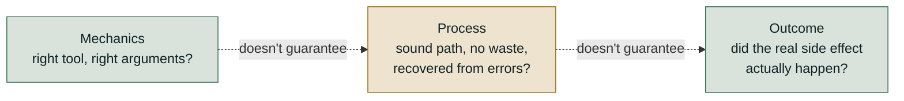
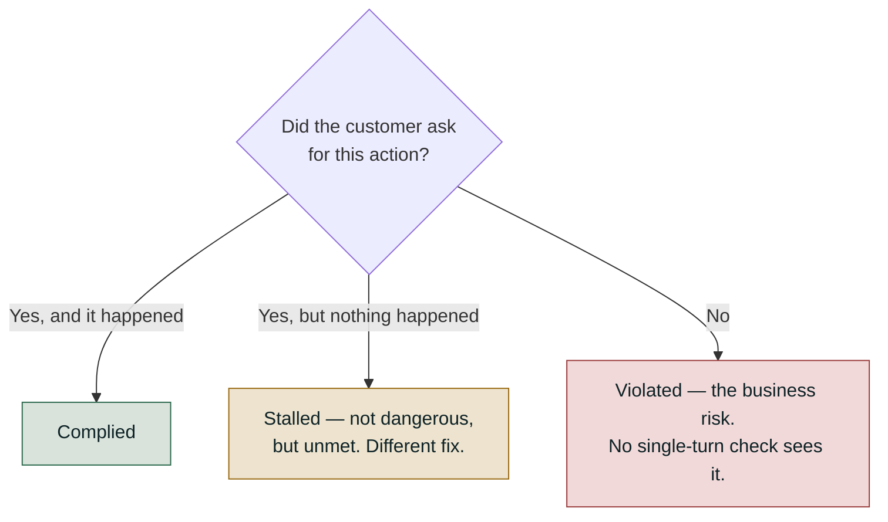

# Agents: Tools, Conversations, Trajectories, Outcomes

*Score mechanics, process and outcome separately, because passing any one of the three says
nothing about the other two.*

◷ 20 min · Level 2 · [Level 0](00-orientation.md) named tool mechanics, trajectory and outcome
as three of the five evaluable layers. This is where each gets built out, plus the multi-turn
axis Level 0 flagged and left open.

A good final reply is not evidence the agent did the job. The sentence *"Your flight is booked!"* reads identically whether the booking call succeeded,
failed, or never happened. This level pulls apart three questions that a single quality score
fuses into one.

> **Who this is for.** No library knowledge is assumed. Every technical term is defined in plain
> words the first time it appears.

---

Picture a customer-support agent with three tools: `search_orders`, `get_refund_policy`, and
`issue_refund`. A user writes: *"My order #4521 arrived broken, can I get a refund?"* A single "was the final
reply good?" check cannot say much here. Five different things can go wrong on the way, and
each needs a different fix. The wrong tool, or the right tool with a typo'd order
ID. Every tool called correctly and a refund $30 over the user's stated budget. Five steps for a
three-step job. A fluent *"Your refund of $45 has been issued"* with no refund recorded
anywhere. Or every turn handled well and the conversation still ending somewhere it shouldn't.

**Mechanics ≠ process ≠ outcome.** Whether the calls were mechanically correct, whether the path
was sound, and whether the real-world result happened are three separate questions. Everything
below runs on that one refund-agent example.



---

## 1. Score the Conversation, Not Just the Turn

Every check in Levels 0 and 1 scored one request/response pair. Real chatbots hold a conversation. Earlier turns constrain what a later turn should say. A
system can pass every individual turn and still fail the conversation.

### Why "95% per turn" is not 95% conversation quality

This is the most important arithmetic in the level, and almost nobody does it by default. If
each turn independently passes at rate *p*, the chance that **all** *n* turns pass is *p* raised
to the power *n*. Every turn has to go right, not most of them.

| Turn pass rate | 3 turns | 5 turns | 10 turns |
| --- | --- | --- | --- |
| 0.99 | 0.970 | 0.951 | 0.904 |
| **0.95** | 0.857 | **0.774** | 0.599 |
| 0.90 | 0.729 | 0.590 | 0.349 |

At a healthy-looking **95% per turn**, a conversation is more likely failed than not by **turn
14**. That is the *optimistic* version. It assumes turns fail independently, when in practice
one bad turn poisons the context for every turn after it, so real rates land below the table.

**Report the session-level number beside the turn-level one.** A dashboard showing "95% turn
quality" and a customer saying "conversations fall apart" describe the same system. The
dashboard is reporting it in the wrong unit. It follows that multi-turn systems need a
conversation-level gate, not only a turn-level one — see
[Level 6](06-the-release-gate-and-ci.md).

### The three things worth checking across turns

A whole dialogue is represented as an ordered list of turns and scored three ways:

| Check | What it asks |
| --- | --- |
| **Turn relevancy** | Over a sliding window of recent turns, is the last assistant turn relevant to what came before it? |
| **Knowledge retention** | Does the assistant correctly remember and reuse information the user supplied earlier? |
| **A custom conversational rubric** | Your own standard applied across the whole dialogue — "never diagnose, always recommend a doctor for serious concerns" for a medical chatbot |

Hand-writing dialogues does not scale. Simulating them does. Prompt a model to role-play "an
angry customer" or "someone who keeps changing their mind". Give it a goal and a policy, and
let it produce dialogues, curveballs included.

### Failures with no single-turn representation

Some failures cannot show up in any single-turn check. What makes them wrong happened in a
*different* turn from where the problem is visible.

**Acting without consent** is the sharpest case. *"I've opened a ticket for you"* on turn one,
unasked. Read alone, that reply is helpful, on-topic, grounded, and reports a completed action —
every single-turn check passes it. **The agreement that should have come first lives between turns, so there is nowhere for its
absence to show up.** Most write actions are gated by a prompt instruction rather than by the
tool refusing, so that obedience has to be tested. Two relatives behave the same way. Ignoring
a refusal: the user says "no, don't do that" on turn two, and it happens on turn four. Drift:
every turn is fine, and the conversation still ends somewhere it shouldn't.

**Score three outcomes here, not two** — *complied*, *violated*, and *stalled*, where the
customer agreed and then nothing happened. Stalled is not dangerous the way violated is, but the
customer asked for something and did not get it, and it needs a different fix than either.

One consequence is worth stating precisely. **A conversation-level check run on a single-turn
interaction must report "not measured", never zero.** An unmeasured check and a failed one must
never look identical on a dashboard.



---

## 2. Check the Mechanics: Right Tool, Right Arguments

Tool use is where an agent's output stops being text. It becomes a decision. A travel bot that says *"Your flight is booked!"* is useless if it never called the booking
API. **The confident sentence looks identical whether the call succeeded, failed, or never
happened.**

What you score is a sequence of decisions, then the output. Three checks cover it at three
granularities: **tool selection** (reference-based, for CI), **argument correctness**
(referenceless and judged, for production) and **multi-turn tool use** (across a dialogue). The
field guide's [§2.2](../concepts/rag-agent-tool-evaluation.md#22-tool-use) defines each one and
compares tool-use evaluation with ordinary output scoring. This section covers what the
definitions leave out: how much the configuration changes the number.

### Strict vs. loose matching: the same check can score 1.00 or 0.00

**Strictness lives in how the check is configured, not in the agent's behaviour.** The usual
default is looser than it looks. Take one expected trajectory: a flight search NYC→London on
2026-03-13, then a weather check for London that date. Run it against six traces — an exact
match, an extra unrequested currency conversion, the two calls in the wrong order, a missing
flight-search output, a transposed date (`03-31` for `03-13`), and a missing weather check.
Five of the six are broken in a way that should matter.

| Configuration | What it actually compares | Mean score across the six traces | What it misses |
| --- | --- | --- | --- |
| **A · names only** (the usual default) | Is a tool with this *name* present anywhere in the list? | **0.92** | Order, arguments, outputs and extra calls are all invisible — 5 of 6 traces score 1.00, and 4 of those 5 are broken |
| **B · names + arguments** | Names *and* arguments must match, still order-blind | 0.83 | Catches the wrong date (drops to 0.50). Still misses the extra call, the reversed order, and the dropped output |
| **C · exact list equality** | Same tools, same arguments, same recorded outputs, same order | 0.17 (5 of 6 score exactly 0) | Catches all five broken traces — and turns the check binary |

**Config A reading 0.92 is not measuring tool correctness. It is measuring whether the agent knows the tools exist.** A dashboard built on that default
looks nearly perfect. It is missing a reversed sequence, a silently dropped output and a wrong
travel date, all at once.

Both extremes are wrong: too strict fails a harmless extra call, too loose passes an agent that
fires every tool on every question. **Demand strict ordering only where the order genuinely is
the requirement** ([field guide §2.2, property 1](../concepts/rag-agent-tool-evaluation.md#22-tool-use)).

A selection check can also be handed the list of tools the agent *could* have called. Without
it, the check compares called tools to expected tools mechanically. With it, a judge also asks
whether the agent picked the *best* available tool.

> **Turning that on escalates a pure code check into a partly-judged one** — Level 0's cost
> ladder, applied to a single metric.

### Argument correctness: cheap check first, judge second

"Were the arguments right?" is two questions with different prices: *is it well-formed?* (code
answers it, free) and *does it make sense for the request?* (only a judge answers it). Validate
the schema first and spend the judge call only if that passes
([field guide §2.2, property 2](../concepts/rag-agent-tool-evaluation.md#22-tool-use)).

```python
# A structurally malformed call is worth zero -- no point spending a judge call
# to have a model tell you the date field isn't a date.
valid, reason = validate_args(test_case.tools_called)
if not valid:
    print(f"Score: 0\nReason: {reason}")   # judge never runs -- free rejection
else:
    metric.measure(test_case)              # now spend the LLM call
```

### Combine with the minimum, and score doing nothing

Two more rules from the field guide's
[§2.2, properties 3 and 4](../concepts/rag-agent-tool-evaluation.md#22-tool-use). **Combine a selection score and an
argument score with the minimum, not the mean**: right tool plus nonsense arguments is a failed
booking, not "half working". **Let the expected-tool list be empty**, so restraint ("What's your
refund policy?" needs no call) can pass, and a claimed action with no call behind it can fail.

---

## 3. Verify the Outcome, Not the Sentence

Everything in Section 2 judges mechanics. None of it asks the question the user cares about: did
the agent get the job done?

The gap is real in both directions. An agent can call every tool correctly and still book the
wrong hotel, because it silently dropped a stated budget. A slightly inefficient sequence can
still land on a fine outcome. A production suite needs both.

### Task completion as a judged check

A task-completion check is judged and referenceless. It reads the user's goal, the final
answer, and the list of tools called. Then it asks whether the underlying task was
accomplished. Passing the tool list is optional in most toolkits and worth doing anyway.

The case worth holding onto: an agent books a real, valid hotel reservation through
correctly-formed calls, but the price is $30/night over the user's stated $150 budget. Selection
and argument checks both score that run well, because the tools were right and the arguments
well-formed. A task-completion check is built to catch that the actual requirement — staying
under budget — was not met.

A constraint mentioned earlier in a conversation, like that budget, is exactly what gets lost
when the check infers the task from the last message, so state the task explicitly. The field
guide's [§2.3](../concepts/rag-agent-tool-evaluation.md#23-task-completion) covers how to set the check up and its two
escalations: a custom rubric when "done" is domain-specific, and verifying the side effect when
the stakes are too high for a judge.

> **A state-based check cannot be fooled by a fluent-but-wrong response.** Use it as the
> pass/fail gate wherever a checkable outcome exists, and keep the judged check for the fuzzy
> parts.

### Reading the record beats every judged check

*"Your refund of $45 has been issued"* reads as confident and complete whether or not a refund
happened. The order database, the booking system and the ledger cannot be fooled that way,
because they hold the event rather than a *description* of it.

> **Wherever a real side effect exists to check, reading it is the strongest signal in this
> level** — and it is free and deterministic.

One failure hides underneath all of this: the **polite tool failure**. A tool returns `found:
false` or an empty payload instead of raising, and the model fills the gap with an invented
balance. **Neither grounding nor task success reads the tool's own output**, so only a
deterministic check on the tool result catches it. The field guide's
[§2.4](../concepts/rag-agent-tool-evaluation.md#24-failure-mode--polite-tool-failure) walks it end to end.

### When the output is a query, compare what it returns

Some tools take code the agent wrote. In a text-to-SQL skill, the agent writes a query and the
answer is whatever that query returns. **Do not judge the SQL text. Judge the result.** Two
correct queries can look nothing alike, so run the generated query and a reference query on the
same data and compare the result sets: the same rows, the same values, and the same order where
the question asked for one. That check is deterministic and needs no judge. For a read-only
system it is the closest thing to verifying a side effect.

Run the cheap checks first, and stop at the first failure:

| Check | Catches | Cost |
| --- | --- | --- |
| Parses | Malformed SQL | Free |
| Executes | Wrong table or column names, type errors | One query |
| Touches only governed views | Queries that bypass the curated, permission-checked layer to reach raw tables | Free — read the query plan or the table list |
| Result set matches the reference | Wrong joins, filters, aggregations, time windows | Two queries |

Restricting the agent to governed views also helps evaluation. It shrinks the space of
plausible-but-wrong queries before anything has to be checked.

**When there is no reference query**, fall back to referenceless signals: the query executes,
stays inside governed views, returns a plausible row count, and the written answer actually
reflects the rows that came back. Say plainly that these are weaker. For a regulated domain,
write reference queries for the most frequent question patterns rather than living on the
fallback.

---

## 4. Judge the Path, Not Only Where It Ended

Given a multi-step run, was the *path* any good, independent of where it ended up? An agent can
reach the right answer in twice the steps. It can retry blindly instead of correcting. It can
repeat an identical call for no new information.

> **Sections 2 and 3 see none of that.** They read the final list of calls and the final answer,
> never the shape of the trace that produced them.

The standard approach runs the agent's loop to build a **trace**: a step-by-step record of what
was called, with what arguments, and what happened. That trace then goes to a *separate*
evaluation pass, scored against a **gold trajectory** — the sequence a human decided ahead of
time was correct. The agent never grades itself.

### The refund-agent scenario, and the nine checks against it

One deliberately messy trace exercises all nine checks at once: the support agent working the
order-#4521 refund. Its five-step trace contains a typo'd order ID that fails, a corrected retry that succeeds, a
policy lookup, an identical *redundant* repeat of that lookup, and finally the refund. The
refund really does mutate a mock order database, so end-state verification has something real
to check.

| # | Check | What it catches | Level in this trace |
| - | --- | --- | --- |
| 1 | **Tool selection accuracy** | Coverage only — does the called set include every tool in the gold set? Loosest of the nine | Outcome |
| 2 | **Argument correctness** | Right tool, invalid or malformed arguments | Outcome |
| 3 | **Redundant calls** | A (tool, arguments) pair that already *succeeded* earlier in the same trace | Step |
| 4 | **Step-wise accuracy** | Fraction of steps that made real forward progress (succeeded *and* weren't redundant) | Step |
| 5 | **Task success rate** | The ground-truth outcome for this one run | Outcome |
| 6 | **Trajectory match (fuzzy)** | Successful tool *set* vs. gold set, ignoring order and retries | Outcome |
| 7 | **End-state verification** | Reads the mutated system of record directly — not the agent's own claimed answer | Outcome |
| 8 | **Recovery / self-correction rate** | After an error, did a *later* step call the same tool and succeed? | Step |
| 9 | **Cost / efficiency proxy** | Redundant calls and errors treated as waste; `1 - wasted/total` | Step |

### Five of these nine never move

This is the most important reading of the scenario, and the reason step-level and outcome-level
checks have to run together. Progressively cleaning the same trace shows which checks are
sensitive to waste and which are not:

| Trace variant | Steps | Redundant (#3) | Step-wise (#4) | Recovery (#8) | Cost/efficiency (#9) |
| --- | --- | --- | --- | --- | --- |
| As actually traced | 5 | 1 | 0.60 | 1.00 | 0.60 |
| Without the redundant call | 4 | 0 | 0.75 | 1.00 | 0.75 |
| Without the typo'd ID (nothing to recover from) | 4 | 1 | 0.75 | n/a | 0.75 |
| Minimal clean path | 3 | 0 | **1.00** | n/a | **1.00** |

Checks **1, 2, 5, 6 and 7** stay flat and passing across all four variants. The agent used every
tool it needed and the refund really was recorded, waste or no waste. **Step-wise accuracy and
cost/efficiency swing from 0.60 to 1.00** as the waste comes out.

> **Task success alone reports "pass" on the messiest version of the trace** and says nothing
> about the wasted policy lookup or the wrong order ID that cost 40% more calls than needed.

The two checks that cannot be fooled by a fluent sentence are worth seeing as code, because they
are Section 3's "read the record, not the string" principle in practice:

```python
# 7 -- End-State Verification. Do NOT read result["final_answer"]; the agent
# wrote that string and it can be wrong. Read the system of record instead.
def end_state_verified(order_db_after, order_id, expected_amount):
    order = order_db_after[order_id]
    return order["refund_issued"] is True and order["refund_amount"] == expected_amount

# 8 -- Recovery. For every errored step, did a LATER step call the same tool
# and succeed? That is the difference between self-correction and blind retry.
def recovery_rate(trace):
    errors = [(i, s) for i, s in enumerate(trace) if s["status"] == "error"]
    if not errors:
        return None   # None, not 1.0 -- there was nothing to recover from
    recovered = sum(
        1 for i, s in errors
        if any(l["tool"] == s["tool"] and l["status"] == "ok" for l in trace[i + 1:])
    )
    return recovered / len(errors)
```

Recovery returns `None`, never `1.0`, when there were no errors. That is Section 1's "unmeasured
must never look like passed" rule again.

### Three traps

The field guide's [§3.2](../concepts/rag-agent-tool-evaluation.md#32-three-traps) names three: a selection scorer
that scores 100% for calling everything (fail unexpected calls too), exact-sequence matching as
the default (fuzzy by default, exact only where order is the requirement), and rewarding
recovery on its own (pair it with step-wise accuracy).

### From a hand-built trace to a live system

Hand-computing all nine from a toy trace is how the checks get learned. On a running system the
*questions* do not change, only where each answer comes from. The field guide's
[§3.3](../concepts/rag-agent-tool-evaluation.md#33-what-each-check-looks-like-on-a-live-system)
maps all nine to their production source. **An untraceable agent is unevaluable**: every request
needs a span per retrieval, per model call and per tool call, carrying tokens and latency, or
none of the nine has anything to read.

---

## 5. Rehearse the Design-Round Follow-Ups

Four questions test this level directly. Each is a decomposition problem in a dashboard's
clothing.

**"Per-turn quality is 95%, but the customer says conversations fall apart. Can both be true?"**

Both are true, and it is arithmetic rather than a mismatch. A weak answer assumes the complaint
must be about one hard category and proposes slicing by topic. Section 1's table shows a uniform
95% failing about a quarter of five-turn conversations. Track *where* conversations first break,
not just the rate.

**"What kind of failure can only be seen across turns?"**

Acting without consent. A weak answer says "multi-turn failures are mostly about memory, so I'd
add a context-retention check" — naming the most benign member of the family and stopping. The
final reply can pass every single-turn check and still be wrong, because the missing agreement
lived in an earlier turn. Score complied / violated / stalled, not pass / fail.

**"How do you evaluate whether an agent took an efficient path, not just a correct one?"**

Assert *properties* of the path — recovery, redundancy, ordering — rather than prescribing one
gold sequence. A weak answer defines the expected tool sequence per test case and scores how closely the
actual sequence matches. That encodes one path when several are valid. It then becomes a
maintenance burden, and gets loosened until it measures nothing.

**"The agent has five tools. What new evaluation risks does that create?"**

The real risk is a check silently changing meaning, not coverage. A weak answer treats it as
"more combinations to test". A check like "was a tool called when one was expected?" is correct
for a one-tool agent and **passes a wrong-tool call once there are five**. Nothing turns red, and
the check is now certifying the failure. Scorers have a scope of validity a system can outgrow,
so audit them whenever the agent gains a capability.

That last risk is worth carrying forward on its own. **Wrong-tool is worse than no-tool**,
because it returns data that is genuine, irrelevant and confidently presented — far more
convincing to a user, and to a judge, than a missing answer.

---

## Key Takeaways

- Per-turn quality compounds: 95% a turn is 77% over five turns, so report the session-level
  number beside the turn-level one.
- Acting without consent has no single-turn representation, and the three outcomes to score are
  complied, violated and stalled — never pass/fail.
- Tool-matching strictness is a decision, not a default; names-only matching scores 0.92 on six
  traces of which five are broken.
- Combine a selection score and an argument score with the minimum, because averaging lets a
  healthy dimension cover for a broken one.
- An empty expected-tool set is a real expectation: restraint deserves a passing score, and a
  claimed action with no call deserves a failing one.
- Wherever a real side effect exists, reading the system of record beats every judged check, and
  it is free.
- Five of the nine trajectory checks never move as waste is removed, so step-level and
  outcome-level checks have to run together.
- An untraceable agent is unevaluable — instrumentation is the precondition, not a detail.

## Check Yourself

1. Turn-level quality is 95% and a customer says five-turn conversations fall apart. Who is
   wrong? **Neither. 0.95 to the fifth power is 0.774, so roughly a quarter of five-turn
   conversations fail. The dashboard is reporting in the wrong unit.**
2. An agent replies "I've opened a ticket for you" on turn one, unprompted. Which single-turn
   check catches it? **None. The reply is helpful, on-topic and grounded. The missing agreement
   lives between turns, so there is nowhere for its absence to show up.**
3. A conversation-level check runs against a single-turn interaction. What must it report?
   **"Not measured" — never zero. An unmeasured check and a failed one must never look identical
   on a dashboard.**
4. Tool selection scores 1.0 and argument correctness scores 0.0. What is the combined score, and
   why? **0.0, the minimum. The booking failed; a mean of 0.5 would read as "half working" when
   nothing was.**
5. A suite only inspects calls that happened. Name the two failures it cannot see. **A tool
   called that wasn't needed, and a claimed action with no call behind it. Both need the expected
   set to be allowed to be empty.**
6. A tool returns `found: false` and the agent answers with a balance anyway. Which checks miss
   it? **Grounding and task success both — neither reads the tool's own output. Only a
   deterministic check on the tool result sees it.**
7. Cleaning the waste out of a trace moves two of the nine checks and leaves five flat. What does
   that tell you about task success? **It reports "pass" on the messiest trace. Outcome checks
   cannot see waste, so step-level checks have to run alongside them.**
8. A one-tool agent's "was a tool called when expected?" check gains four more tools. What
   happens? **It starts passing wrong-tool calls. The check's scope of validity was outgrown, and
   nothing turns red to say so.**

---

## References

All content above was drawn only from material already in this repository. Nothing here was
invented, and no external source was consulted.

**Notebook:**

- `courses/01-rag-agent-tool-evaluation/08_MultiTurn_Conversational_Evaluation.ipynb` — the
  turn-list representation of a dialogue, the three multi-turn checks, and conversation
  simulation.
- `courses/01-rag-agent-tool-evaluation/09_Tool_Use_Evaluation.ipynb` — tool selection, argument
  correctness, multi-turn tool use, the two-pass argument-validation pattern, and the
  minimum-not-average design.
- `courses/01-rag-agent-tool-evaluation/10_Task_Completion_Evaluation.ipynb` — task completion,
  the budget-violation worked example, the custom-rubric escalation, and the case for state-based
  outcome verification.
- `courses/01-rag-agent-tool-evaluation/12_Agent_Trajectory_Evaluation.ipynb` — the nine
  trajectory checks, the refund scenario, and the `end_state_verified` / `recovery_rate`
  functions.

**Docs:**

- `docs/concepts/rag-agent-tool-evaluation.md`, Part 2 (§2.1–2.4) and Part 3 (§3.1–3.3) — the
  multi-turn arithmetic and consent/stalled framing, the tool-use properties, the
  task-completion escalation ladder, the "polite tool failure" mode, the nine trajectory checks,
  the three traps, and the hand-built-trace-to-live-system table. Sections 2–4 now link to these
  for the definitions rather than restating them.
- `docs/concepts/databricks-mlflow-evals.md`, Part 4 — the conversation-success table used in
  Section 1.
- `docs/interactive-labs/04-tool-use-evaluation.html` — the six-trace, three-configuration
  strictness comparison used in Section 2 (its 0.92 / 0.83 / 0.17 mean scores were independently
  recomputed against the page's own scoring logic before use here).
- `docs/interactive-labs/05-agent-trajectory-evaluation.html` — the four-variant table used in
  Section 4, and the observation that five of the nine checks never move across those variants.
- `docs/interview-prep/QUESTION_BANK.md`, Part 7 (Q26–Q29) — the four questions reproduced in
  full in Section 5 rather than pointed at.
- `docs/study-guide/evaluation-roadmap.md` — Level 2's topic list and goal statement.
- `docs/study-guide/evaluation-topic-notebook-mapping.md` — Level 2's resource table.
- `archive/labs-multiturn-and-tool-eval/README.md` — checked and found to introduce no topic beyond what
  course 01 already covers.

**Limitations.** This file was written by reading the repository's own material, not by running
any notebook or calling any API — no cost was incurred producing it, consistent with this
project's rule against executing anything that spends money without being asked. The percentage
figures in Section 2's strictness table and Section 4's trajectory-variant table were recomputed
by hand against the scoring logic in each interactive lab's own source, not copied from a live
run. This file does not independently verify any vendor's documentation.
