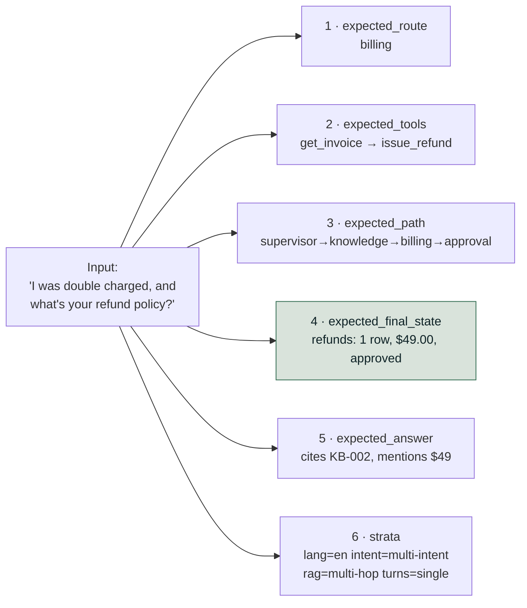
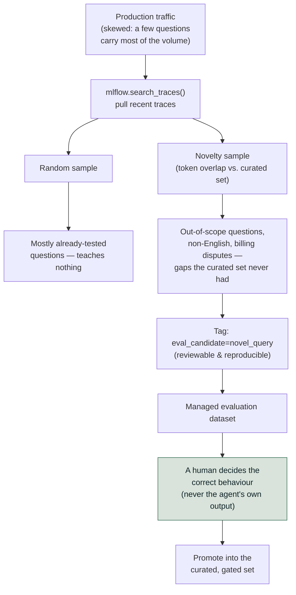

# Level 3 Explainer: Ground truth

*A plain-language walkthrough of everything Level 3 covers, pulled together from the two
notebooks, the field guide, and the interview question bank — with nothing repeated twice.*

> **Who this is for.** You don't need to know DeepEval, RAGAS, or MLflow to follow this.
> Every technical term is defined in plain words the first time it shows up. If you haven't
> read the Level 0 Explainer yet, the five-layer taxonomy it introduces (retrieval,
> generation, tool mechanics, trajectory, outcome) is assumed background here — this level is
> about where the *test cases and correct answers* for checking those layers actually come
> from.

---

## Why this level exists

Every metric from every other level in this roadmap needs two things to run: a question, and
a correct answer to compare against. Level 3 is entirely about that second thing — the file
that holds the questions and the answers, and the two different ways it can quietly lie to
you.

Two fictional support agents carry the examples in this level, borrowed unchanged from their
source notebooks:

- **Lumen Cloud** (`courses/03-agentic-eval-harness/03_the_golden_set.ipynb`) — a cloud
  hosting company's support agent that answers knowledge questions, issues refunds, changes
  account plans, and escalates to a human. Its 40 hand-written test cases are this level's
  main worked example.
- **TelcoAssist** (`courses/02-databricks-mlflow-evals/04_eval_datasets_from_traces.ipynb`) —
  a telecom support agent whose 12-row hand-written dataset is mined against real traffic to
  find what it never tested.

The goal, in the roadmap's own words: **know where cases and labels come from on day one and
by month three, and the two ways a dataset lies to you.** Everything below builds up to
exactly that.

---

## 1. Case anatomy — six expectations, not one

A plain question-answering test case needs a question and an expected answer. An **agentic**
test case needs six things, because an agent can go wrong in six different places, and a case
that only checks the final sentence can miss five of them.

Take one Lumen Cloud case: *"I was double charged, and what's your refund policy?"* Here is
everything that has to be nailed down before that case is worth anything:

| # | Field | What it pins down | Which later level scores it |
|---|---|---|---|
| 1 | `expected_route` | Which specialist should handle this (billing? knowledge? both?) | Trajectory (Level 2) |
| 2 | `expected_tools` | Which tools get called, in order, with which arguments — e.g. `get_invoice(customer_id="CUS-101")` then `issue_refund(invoice_id="INV-2041", amount=49.0)` | Tool-use (Level 2) |
| 3 | `expected_path` | The full node sequence: `supervisor → knowledge → billing → approval` | Trajectory (Level 2) |
| 4 | `expected_final_state` | The real database effect — exactly one refund row, $49.00, approved | Outcome verification (Level 2) |
| 5 | `expected_answer` (via `must_cite` / `must_contain`) | The answer must cite the right knowledge-base article and mention the right number | Generation (Level 0/1) |
| 6 | `strata` | Tags — language, intent, RAG type, turn count — that later group the results | Stratified reporting (Level 5) |

**A sixth of the anatomy is worth a second look: `expected_final_state` can correctly be
empty even when the case's `expected_behaviour` is "answer."** Lumen Cloud's `GC-016` asks for
a refund on a June invoice that sits outside the 30-day window — the right behaviour is to
*answer* (not refuse), but the right answer is a clear "no," so `final_state={"refunds": []}`
is the correct expectation, not a bug in the case. Six expectations means a case can pass on
behaviour and still fail on final state if the agent issues a refund anyway.

**Why this matters: a case with only an expected answer can only catch one class of bug.**
The agent can reach the right *sentence* through the wrong tool, on the wrong customer's
data, without approval — and an answer-only check passes all three. Six expectations catch
six different failures; one expectation catches one.

The notebook enforces this with a case-writing rule worth naming explicitly: **every field
you don't fill in is a check you have silently opted out of**, so a case constructor's
defaults should be the *weakest possible claim* (an empty tool list, an empty final state),
never a guess dressed up as a pass.



One case list loads into both frameworks: Lumen Cloud's 40 cases become a DeepEval
`EvaluationDataset` (all 40) and a RAGAS one (only cases with a `rag_type`, since billing,
account and escalation cases never retrieve documents), from one plain JSON file neither
framework owns.

> **A golden set kept as plain JSON survives a framework renaming its own classes.** RAGAS 0.4
> moved metrics to `ragas.metrics.collections`; DeepEval 4.x renamed `LLMTestCaseParams` to
> `SingleTurnParams` — both in minor releases. A set stored in a framework's object model
> would have needed migrating twice.

---

## 2. Stratification and the refusal quota

**Strata are decided *before* the cases are written, not after.** Lumen Cloud's 40 cases are
tagged, from the start, along four independent dimensions: `lang` (en/es/hi), `intent`
(knowledge/billing/account/escalation/multi-intent), `rag_type`
(factual/multi_hop/contradictory/absent/adversarial), and `turns` (single/multi). Tagging
retroactively means you tag whatever you happened to write — which, left to itself, is mostly
easy English.

**Report every dimension separately; never cross-tabulate them.** With 40 cases, crossing
language × intent × question type produces a grid of mostly-empty cells and a handful of
ones, where a "50% drop" in a cell of size 2 is one single case flipping.

Lumen Cloud's traffic is roughly 85% English; the golden set holds 22 English cases against 10
Spanish and 8 Hindi. Weight a 20-case sample to match the real 85/11/4 split instead and Hindi
shrinks until its score can only land on 0%, 100%, or nothing between — the documentation gap
becomes statistically invisible, not because the metric is wrong but because the sample cannot
see it.

> **You sample for detection, not for representativeness.**

**The refusal quota: how much of the set rewards doing nothing?** If a golden set contains no
cases where refusing, or escalating, or saying "I don't know" is the *correct* answer, then a
system that always answers scores perfectly — and your metric is now silently rewarding
confident invention. Lumen Cloud enforces a floor of at least a fifth of the set (an
explicit `assert` fails the notebook if the count drops below 20%) split across "absent"
knowledge questions (no article covers it), a genuinely ambiguous case where two articles
contradict each other, an adversarial prompt-injection attempt, and escalation cases (legal
threats, GDPR requests, outages) that must route to a human rather than being answered at
all.

**How small is too small to gate a release on?** The `hi` stratum has 8 cases. One case
flipping moves that stratum's score by 12.5 points, so a release gate set to "no worse than 5
points below baseline" would block releases at random whenever it looked at that stratum
alone. The fix used here is a floor, `MIN_CASES_TO_GATE = 8`: every stratum is *reported*, but
only strata at or above that size are allowed to *block* a release — smaller ones are
`report_only`. (Level 5 derives where a number like this actually comes from, from the
sample-size arithmetic; here it is simply applied.)

---

## 3. Dataset datasheets

**A dataset without a datasheet is a number with no provenance.** Six months from now, the
only question that matters about a score drop is *"did the system get worse, or did the test
change?"* — and only a version number and a changelog can answer that.

Lumen Cloud's datasheet, saved alongside the 40 cases in `golden_set.json`, holds:

| Field | Purpose | Example value from this level |
|---|---|---|
| `version` | Bumped on *any* change to the cases | `1.0.0` |
| `content_hash` | A hash over the cases only, so a change to the cases without a version bump is *visible instead of silent* | first 12 hex characters of a SHA-256 over the case list |
| `provenance` | Where the cases came from | "Hand-written against the fictional corpus... No production data, no PII." |
| `strata` | The stratum counts from Section 2, captured at this version | counts by `lang`, `intent`, `rag_type`, `turns` |
| `refusal_share` | The refusal-quota number from Section 2, captured at this version | rounded fraction of passive cases |
| `known_gaps` | Named, honest limitations | *"No stratum is large enough to detect a change smaller than ~15 points"; "Multi-turn is represented by a single case (GC-040)"; "Adversarial coverage is one prompt-injection case; a real suite needs a dedicated red-team set"; "hi/security has one thin source article, inherited from notebook 01's corpus"* |
| `changelog` | One entry per version, with what changed | `{"version": "1.0.0", "change": "Initial 40 cases."}` |

The `known_gaps` field is doing real work here, not filling space: it is the dataset
admitting, in writing, exactly what it cannot yet detect — which is the same honesty this
level's "you are done when you can" checklist asks for directly.

---

## 4. Mining production traces into eval datasets

Everything in Sections 1–3 describes a set someone sat down and wrote. That has one
structural flaw, whatever care went into it: **it can only contain the questions its author
thought of.** TelcoAssist's curated set has 12 rows, written by the same person who built the
agent — which means it tests the agent against that person's model of what users want, not
against what users actually do.

### The trap to name before touching production data: circular ground truth

Once real traces exist, there is an appealing shortcut: use the agent's own recorded
responses as the expected answers. Every trace already has an input *and* an output, so it
looks like a free labelled dataset.

**It isn't.** A trace records what the agent *did*, not what it *should have done*. Build
expectations from the agent's own outputs and the resulting dataset passes by construction —
it can only ever agree with itself. Worse, today's behaviour, bugs included, is now frozen as
the definition of correct: any future change away from current behaviour reads as a
*failure*, and any bug present today reads as *correct*. Regression detection becomes
structurally impossible.

> **The honest summary of trace mining:** it gives you realistic *inputs* for free.
> Expectations remain manual work. What you get for free is the *distribution* — which
> questions actually arrive, and in what proportion — and that is the expensive half to
> guess and the free half to collect.

### Sampling strategy is the whole game

Real support traffic is heavily skewed: a handful of questions carry most of the volume, and
everything interesting lives in the long tail. That shape is why *how* you sample from traces
matters more than how many you pull.

- **Random sampling reproduces the distribution**, which hands back the head the curated set
  already covers. TelcoAssist's random sample of 8 traces returns mostly-already-tested
  questions — the strategy working as designed, and teaching nothing.
- **Targeted sampling by novelty goes after the tail.** Score each query by token overlap with
  the curated set (`0.0` identical, `1.0` nothing like it) and keep what clears a threshold —
  no LLM call. At `NOVELTY_THRESHOLD = 0.40` the survivors are an out-of-scope question, a
  non-English request, a rambling multi-part message and a billing dispute, none of them in
  the curated 12 rows.
- **Select by threshold, not a fixed count.** "Top 10" pads the selection once genuinely novel
  material runs out, and the tail runs out fast. A threshold returns fewer rows on a quiet day
  and more after a real traffic shift.



**Tag the selection, don't just save a list of IDs.** A tag such as
`eval_candidate=novel_query` records *why* a trace was picked, so the selection becomes a
reproducible query later, not a list only its author can explain.

Mining TelcoAssist's traffic this way surfaced a genuine gap: the curated dataset has twelve
rows and not one of them asks a question the knowledge base cannot answer — so nobody knew
whether the agent said "I don't have that" or confidently invented a family-plan price. That
gap wasn't found by thinking harder about the agent; it was found by looking at what real
users actually asked. Closing it needed a scorer (`abstains_when_unsupported`) that didn't
exist before mining revealed the need for it.

> **Managed evaluation datasets need a SQL-backed MLflow tracking store** (SQLite, Postgres,
> MySQL, MSSQL) — the same requirement as the Prompt Registry, and another reason `file://`
> doesn't get you far.

`create_dataset` has two forms: `create_dataset(name=..., experiment_id=[...])` for OSS/local,
needing only that SQL store, and `create_dataset(uc_table_name="catalog.schema.table")` on
Databricks, which backs it with a Unity Catalog table and needs a Spark session. Either way a
managed dataset is versioned, attached to an experiment, and queryable by tags.

---

## 5. Provenance and merge-by-input-hash

Mined traces have inputs and they have the agent's own outputs — but per Section 4, they have
no usable ground truth. Someone has to decide what each one *should* have produced, and that
judgement needs to carry a record of who made it.

**`AssessmentSource` records who decided.** When a human labels a mined trace — for example,
deciding that a "do you offer family plans" question should be met with "I don't have that,
let me connect you with someone who does," never an invented plan name — that expectation is
attached with `AssessmentSource(source_type=AssessmentSourceType.HUMAN, source_id=...)`. This
is not bureaucracy: six months later, "is this expectation a domain expert's considered
judgement, or something a script inferred?" determines how much weight a failure against it
deserves, and whether it is safe to use for aligning a judge (Level 4) or optimizing a prompt.

**The honest accounting, stated directly in the source notebook:** mining surfaced eight
interesting traces in seconds; turning them into *tests* took a person deciding what each one
should do, and most of them were still waiting for that decision. Mining finds candidates. It
does not label them.

**`merge_records` deduplicates by input hash, not by trace ID.** Re-mine overlapping traffic
tomorrow and a query you've already added doesn't create a duplicate row — the same input
hash matches the existing record, and any *new* expectation you attach merges into what's
already there rather than overwriting it. Practically: label `{"expects_tool_call": false}`
today, mine the same query again next week and add `{"must_offer_human": true}`, and the
record ends up with both, still as one row. This is what makes continuous re-mining safe
instead of something that piles up copies over time.

---

## 6. Synthesized vs. hand-authored cases

This level's sources give three genuinely different answers to "where should a test case
come from," and the honest position is that you need more than one of them, for different
reasons:

| | Hand-authored (Lumen Cloud, Section 1) | Synthesized from documents (field guide §1.8) | Mined from traffic (Section 4) |
|---|---|---|---|
| Gives you | Full six-field cases, deliberately including the hard ones (contradictions, refusals, injections) | Question/answer pairs generated from your own source documents, along dimensions you choose (multi-step reasoning, multi-chunk) | Real inputs, in their real proportions |
| Blind to | Anything the author didn't imagine | Whatever the generation process itself is weak at — **spot-check them, generated questions are only as good as the process that made them** | Nothing on the input side — but carries no labels at all |
| A gotcha specific to this method | Structurally can't cover what you didn't think of | Building each case's context from the *source* documents (rather than by actually running the retriever on the generated question) tests whether the generator works given *perfect* context — which nothing in production ever has | Circular ground truth (Section 4) if you take the shortcut of using the agent's own outputs as the answer key |

Hand-writing a set doesn't scale past a handful of examples, so document-grounded synthesis is
the practical way to get volume — provided every generated case is spot-checked and its
retrieval context comes from actually running the retriever, not from the source passage the
question was generated from.

**The lifecycle view, day one versus month three:**

```
day one      no traffic exists   →  the set is imagined (hand-written / synthesized)
month three  traffic exists      →  the imagined set is now the known-weak part
```

On day one, hand-written is the only option, because nothing else exists yet — build it from
the client's own material (ticket categories, top request types, cases their support leads
argue about), not from guesswork, and say plainly that it only contains what you thought of.
By month three, real traffic is the asset: it gives you the *distribution*, which is the
expensive half to guess and the free half to collect — but, as Section 4 covers, it still
gives you no labels.

**Curated and mined are not competing options — they are complements with opposite
policies**, and running only one of them fails differently:

| | Curated regression set | Mined production set |
|---|---|---|
| Policy | Frozen; changes only by a deliberate, announced update | Refreshed continuously |
| Used to | **Gate releases** | **Find problems** |
| If you break the policy | A score drop becomes unreadable — was the agent worse, or was the test harder? | It goes stale and finds nothing new |

**The bridge between them is what closes the loop:** every production failure found by mining
gets promoted into the gated, curated set once it has a human-authored expectation — added as
rows to the curated dataset, as a new scorer if one didn't already exist, and, critically, **as
an entry in `QUALITY_GATES`**, since a scorer with no gate entry blocks nothing (the same
lesson Level 6's release gate teaches from the other direction). *Online discovers; offline
prevents it recurring.* A finding that stays in the mined set only ever helps once.

---

## 7. The two ways a dataset lies to you

This level's goal statement promises "the two ways a dataset lies to you." Having covered
every topic above, they are now nameable directly, and they are different failures with
different fixes:

1. **Circular ground truth (Section 4).** The dataset lies by *agreeing with the system it's
   supposed to be checking* — expectations built from the agent's own past outputs pass by
   construction and freeze today's bugs as correct. The fix: expectations always come from a
   human (or from documents, per Section 6), never from the thing being measured.
2. **Unrepresentative or drifted sampling (Sections 2, 4, 6).** The dataset lies by *looking
   healthy while it has gone blind* — either because it was sampled to match production
   traffic and quietly erased a small-but-important segment (the Hindi example in Section 2),
   or because it was left frozen for gating (correctly) but never refreshed by mining
   (incorrectly), so it stops resembling what users actually do. The fix: stratify and
   over-sample for detection rather than representativeness, and keep a *second*, continuously
   mined dataset whose job is specifically to notice drift, promoting real findings into the
   frozen set rather than changing the frozen set directly.

A curated set that never gets mined against will confidently keep reporting the same score
while the real world moves past it. A mined set used to gate releases will make every score
history meaningless. Level 3's whole discipline is running both, and never letting one do the
other's job.

---

## Question-bank corner — ground truth and datasets

*(From `QUESTION_BANK.md`, Part 3 — Q10 through Q13. No other part of the question bank
belongs to this level.)*

This section deliberately does not re-explain the underlying mechanics (case anatomy,
stratification, mining, provenance) — those are Sections 1–6 above. What follows is the
interview-specific framing: the analogy, the weak answer, and the follow-up push for each
question, since that framing is what a live round actually tests.

| Q | Question | The core idea, in one line | The analogy that lands it |
|---|---|---|---|
| **Q10** | Where does your evaluation data come from on day one, and how does that change by month three? | Day one: hand-written and honestly limited. Month three: traffic gives the distribution, never the labels. Never let the agent grade itself. | Setting an exam from your own lecture notes, then marking it against the notes — full marks, and you've learned nothing about whether the material was right. |
| **Q11** | Your eval set and production traffic have diverged. How do you keep both honest? | Run two datasets with two opposite policies (Section 6) rather than one set trying to do both jobs. | A bathroom scale you recalibrate every morning — you'll always weigh roughly the same, and you'll never know whether you lost weight. |
| **Q12** | How big does the evaluation set need to be? | Size is set by the smallest regression you must be able to detect, not a round number — composition (covering every category and must-never-happen class) beats raw count, and a judge's own run-to-run noise puts a floor under what any size can resolve. | A kitchen scale that reads to the nearest 100g — fine for flour, useless for telling whether you lost 20g, and weighing yourself more often doesn't fix that. |
| **Q13** | Who actually writes the labels, and how do you get their time? | Expert attention, not tooling, is the real constraint. Spend it only on ambiguous/contested cases, ask for ratings not documents, and record provenance (Section 5) on every label. If pushed on "they'll give you two hours a month, total," the answer is to spend all of it on the contested cases that calibrate a judge, not on confirming easy cases are easy. | A consultant surgeon doesn't take the blood samples — not because it's beneath them, but because that isn't where their scarce hours change the outcome. |

The follow-up each question pushes on, with the verdict to have ready:

- **Q10 — *how* do you choose traces to promote?** **Novelty-targeted, against a quality bar,
  never a fixed count.**
- **Q11 — *when* do you update the frozen set?** **On a scope change or a repeating production
  gap — and run both versions side by side once to record the offset, so history stays
  interpretable.**
- **Q12 — how many cases?** **Enough to cover every category and must-never-happen class with
  more than one phrasing — in practice dozens — then grow it from traffic.**
- **Q13 — two hours a month, total?** **Spend all of it on contested cases; that is what
  calibrates a judge for the other thousand.**

---

## References

All content above was drawn only from material already in this repository. Nothing here was
invented, and no external source was consulted.

**Notebook:**

- `courses/03-agentic-eval-harness/03_the_golden_set.ipynb` — case anatomy (the six
  expectations and the case constructor's weakest-default rule), the 40 Lumen Cloud cases,
  per-dimension stratum counts, the refusal-quota assertion, the `MIN_CASES_TO_GATE` /
  gateable-vs-report-only policy, the traffic-weighted-sample break-it exercise (the Hindi
  example), the datasheet fields, and the one-file/two-frameworks loading of the same cases
  into DeepEval and RAGAS.
- `courses/02-databricks-mlflow-evals/04_eval_datasets_from_traces.ipynb` — the circular
  ground-truth trap, the TelcoAssist traffic shape and simulated traffic, `search_traces`
  mining, random vs. novelty-targeted sampling (including the exact threshold and the
  reasoning for selecting by threshold rather than fixed count), trace tagging, the
  SQL-backed-tracking-store requirement and the two `create_dataset` forms (OSS/local vs.
  Unity Catalog), managed dataset creation, `AssessmentSource` and human-authored
  expectations, `merge_records` dedup-by-input-hash semantics, the scorer the mined data
  motivated (`abstains_when_unsupported`), the `QUALITY_GATES` close-the-loop step, and the
  curated-vs-mined complementary-policies takeaway.

**Docs:**

- [Field guide §1.8](../../docs/concepts/rag-agent-tool-evaluation.md) — golden datasets: why
  hand-writing doesn't scale, generating from your own documents along chosen dimensions,
  spot-checking generated questions, and building context by running the retriever rather
  than from the source passage.
- `docs/interview-prep/QUESTION_BANK.md`, Part 3 (Q10–Q13) — the day-one/month-three
  lifecycle, the curated-vs-mined dual-policy answer, the sample-size-from-decision
  reasoning, and the expert-time-as-the-real-constraint framing (all summarized, not
  re-derived, in the Question-bank corner above — the underlying mechanics live in Sections
  1–6 and are not repeated there).
- `docs/study-guide/evaluation-roadmap.md` — Level 3's topic list and goal statement, used to
  scope what this file needed to cover.
- `docs/study-guide/evaluation-topic-notebook-mapping.md` — Level 3's resource table and the
  cost-key definitions (none / key) used above.

**Limitations.** This file was written by reading the repository's own material, not by
running any notebook or calling any API — no cost was incurred producing it, consistent with
this project's rule against executing anything that spends money without being asked. Per-case
and per-stratum counts quoted here (e.g. 22 English / 10 Spanish / 8 Hindi cases) were derived
by reading the case list directly from the notebook's source, not by running it; the `hi = 8`
figure is additionally stated verbatim in the notebook's own markdown, which corroborates the
count. This file does not independently verify DeepEval's, RAGAS's, or MLflow's own
documentation; descriptions of those tools above are this repository's characterization of
them, not a review of the vendors' docs.
