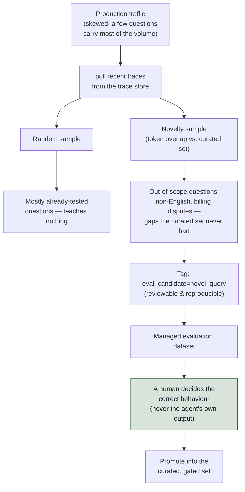

# Ground Truth: Where Cases and Labels Come From

*Collect inputs from real traffic but never labels from the system under test, because a dataset
built from its own answers can only agree with itself.*

◷ 22 min · Level 3 · [Level 0](00-orientation.md)'s five-layer taxonomy is assumed background.
This level is about where the test cases and correct answers for checking those layers come
from.

Every metric in this roadmap needs two things to run: a question, and a correct answer to
compare against. This level is entirely about the second thing — the file holding the questions
and the answers, and the two ways it can quietly lie.

> **Who this is for.** No library knowledge is assumed. Every technical term is defined in plain
> words the first time it appears.

Two fictional support agents carry the examples, borrowed unchanged from their source notebooks.
**Lumen Cloud** is a cloud host's support agent that answers knowledge questions, issues refunds,
changes plans and escalates to a human. Its 40 hand-written cases are the main worked example.
**TelcoAssist** is a telecom agent whose 12-row hand-written dataset gets mined against real
traffic to find what it never tested.

---

## 1. Pin Six Expectations, Not One

A plain question-answering case needs a question and an expected answer. An **agentic** case
needs six things. An agent can go wrong in six places, and a case checking only the final
sentence misses five of them.

Take one Lumen Cloud case: *"I was double charged, and what's your refund policy?"* Everything
below has to be nailed down before that case is worth anything.

| # | Field | What it pins down | Which later level scores it |
|---|---|---|---|
| 1 | Expected route | Which specialist should handle this (billing? knowledge? both?) | Trajectory (Level 2) |
| 2 | Expected tools | Which tools get called, in order, with which arguments — fetch the invoice, then issue a $49.00 refund against it | Tool-use (Level 2) |
| 3 | Expected path | The full node sequence: `supervisor → knowledge → billing → approval` | Trajectory (Level 2) |
| 4 | Expected final state | The real database effect — exactly one refund row, $49.00, approved | Outcome verification (Level 2) |
| 5 | Expected answer | The answer must cite the right knowledge-base article and mention the right number | Generation (Level 0/1) |
| 6 | Strata | Tags — language, intent, question type, turn count — that later group the results | Stratified reporting (Level 5) |

**Expected final state can correctly be empty even when the expected behaviour is "answer".**
One Lumen Cloud case asks for a refund on a June invoice outside the 30-day window. The right
behaviour is to answer rather than refuse, and the right answer is a clear "no". So an empty
refund list is the correct expectation, not a broken case. Six expectations means a case can
pass on behaviour and still fail on final state if the agent issues a refund anyway.

**A case with only an expected answer can only catch one class of bug.** The agent can reach the
right *sentence* through the wrong tool, on the wrong customer's data, without approval. An
answer-only check passes all three.

There is a case-writing rule worth naming. **Every field left unfilled is a check silently opted
out of.** So a case constructor's defaults should be the *weakest possible claim* — an empty tool
list, an empty final state — never a guess dressed up as a pass.


One case list should load into whichever scoring library is in use. Lumen Cloud's 40 cases feed
two different ones — all 40 to a general suite, and only the retrieval-bearing cases to a
RAG-specific one, since billing, account and escalation cases never retrieve documents. Both
read from one plain JSON file that neither library owns.

> **A golden set kept as plain JSON survives a library renaming its own classes.** Two of the
> libraries used in this repo renamed core classes in *minor* releases. A set stored inside a
> library's object model would have needed migrating twice.

---

## 2. Stratify Before Writing, and Keep a Refusal Quota

**Strata are decided before the cases are written, not after.** Lumen Cloud's 40 cases are
tagged from the start along four independent dimensions: language (en/es/hi), intent
(knowledge/billing/account/escalation/multi-intent), question type
(factual/multi-hop/contradictory/absent/adversarial), and turns (single/multi). **Tagging
retroactively means tagging whatever happened to get written**, which, left to itself, is mostly
easy English.

**Report every dimension separately. Never cross-tabulate them.** With 40 cases, crossing
language × intent × question type produces a grid of mostly-empty cells. A "50% drop" in a cell
of size 2 is one case flipping.

Lumen Cloud's traffic is roughly 85% English. The golden set holds 22 English cases against 10
Spanish and 8 Hindi. Weight a 20-case sample to match the real 85/11/4 split instead, and Hindi
shrinks until its score can only land on 0%, 100%, or nothing between. The documentation gap
becomes statistically invisible — not because the metric is wrong, but because the sample cannot
see it.

> **Sample for detection, not for representativeness.**

**Include hard negatives.** For retrieval cases, deliberately keep confusable documents in the
corpus the case runs against — an outdated version of the right policy, a sibling product's page
with near-identical wording. A set where the wrong documents are obviously wrong cannot catch the
most common production failure: high similarity, wrong context.

**The refusal quota asks how much of the set rewards doing nothing.** If no case has refusing,
escalating or saying "I don't know" as the *correct* answer, then a system that always answers
scores perfectly. The metric is now silently rewarding confident invention.

Lumen Cloud enforces a floor of at least a fifth of the set, with an assertion that fails the
build if the count drops below 20%. It splits across absent knowledge questions where no article
covers it, a genuinely ambiguous case where two articles contradict, an adversarial
prompt-injection attempt, and escalation cases — legal threats, GDPR requests, outages — that
must route to a human rather than being answered.

**How small is too small to gate a release on?** The Hindi stratum has 8 cases. One case flipping
moves that stratum by 12.5 points. A gate set to "no worse than 5 points below baseline" would
block releases at random. The fix is a floor: every stratum is *reported*, but only strata at or
above a minimum size may *block* a release. Smaller ones are report-only. Lumen Cloud sets it
as `MIN_CASES_TO_GATE = 8` in the golden-set notebook, and the CI gate applies the same number
as `min_cases_to_gate`. Level 5 derives where that number comes from; here it is simply applied.

---

## 3. Ship a Datasheet With the Dataset

**A dataset without a datasheet is a number with no provenance.** Six months on, the only
question that matters about a score drop is whether the system got worse or the test changed.
Only a version number and a changelog answer it.

Lumen Cloud's datasheet sits alongside the 40 cases in the same file.

| Field | Purpose | Example value from this level |
|---|---|---|
| Version | Bumped on *any* change to the cases | `1.0.0` |
| Content hash | A hash over the cases only, so a change without a version bump is *visible instead of silent* | first 12 hex characters of a SHA-256 over the case list |
| Provenance | Where the cases came from | "Hand-written against the fictional corpus... No production data, no PII." |
| Strata | The stratum counts from Section 2, captured at this version | counts by language, intent, question type, turns |
| Refusal share | The refusal-quota number from Section 2, captured at this version | rounded fraction of passive cases |
| Known gaps | Named, honest limitations | *"No stratum is large enough to detect a change smaller than ~15 points"; "Multi-turn is represented by a single case"; "Adversarial coverage is one prompt-injection case; a real suite needs a dedicated red-team set"* |
| Changelog | One entry per version, with what changed | `{"version": "1.0.0", "change": "Initial 40 cases."}` |

The known-gaps field does real work. It is the dataset admitting in writing exactly what it
cannot yet detect.

---

## 4. Mine Traffic for Inputs, Never for Labels

Sections 1–3 describe a set someone sat down and wrote. That has one structural flaw, whatever
care went into it. **It can only contain the questions its author thought of.** TelcoAssist's
curated set has 12 rows, written by the person who built the agent. It tests the agent against
that person's model of what users want, not against what users do.

### Circular ground truth, the trap to name first

Once real traces exist, an appealing shortcut appears: use the agent's own recorded responses as
the expected answers. Every trace already has an input *and* an output, so it looks like a free
labelled dataset.

**It isn't. A trace records what the agent did, not what it should have done.** Build
expectations from the agent's own outputs and the dataset passes by construction. It can only
ever agree with itself. Worse, today's behaviour is frozen as the definition of correct. Any
future change away from current behaviour reads as a *failure*, and any bug present today reads
as *correct*. Regression detection becomes structurally impossible.

> **The honest summary of trace mining:** it gives realistic *inputs* for free. Expectations
> remain manual work. What comes free is the *distribution* — which questions actually arrive,
> and in what proportion — and that is the expensive half to guess.

### Sampling strategy is the whole game

Real support traffic is heavily skewed. A handful of questions carry most of the volume, and
everything interesting lives in the long tail. That shape is why *how* traces get sampled
matters more than how many.

**Random sampling reproduces the distribution**, which hands back the head that the curated set
already covers. TelcoAssist's random sample of 8 traces returns mostly-already-tested questions.
The strategy is working as designed, and teaching nothing.

**Targeted sampling by novelty goes after the tail.** Score each query by token overlap with the
curated set — 0.0 identical, 1.0 nothing like it — and keep what clears a threshold. No judge
call needed. At a threshold of 0.40 the survivors are an out-of-scope question, a non-English
request, a rambling multi-part message and a billing dispute. None of them appear in the curated
12 rows.

**Select by threshold, not a fixed count.** "Top 10" pads the selection once genuinely novel
material runs out, and the tail runs out fast. A threshold returns fewer rows on a quiet day and
more after a real traffic shift.



**Tag the selection rather than saving a list of IDs.** A tag such as
`eval_candidate=novel_query` records *why* a trace was picked. The selection becomes a
reproducible query later, not a list only its author can explain.

Mining TelcoAssist's traffic surfaced a genuine gap. The curated dataset has twelve rows, and
not one asks a question the knowledge base cannot answer. Nobody knew whether the agent said "I
don't have that" or confidently invented a family-plan price. That gap was not found by thinking
harder about the agent. It was found by looking at what real users asked. Closing it needed a
new scorer for abstention that did not exist until mining revealed the need.

Whatever stores these datasets needs to be queryable and versioned rather than a pile of files.
A managed dataset is attached to an experiment, versioned, and searchable by tag — which is what
makes "re-run last month's selection" a query rather than an archaeology project.

### When the history is also the knowledge: split by time

A harder version of mining comes up when the system's own knowledge is built from the same
history the cases are drawn from. A support agent retrieves from past resolved tickets, and
the evaluation set is also past resolved tickets. **Retrieval over a corpus that contains the
very ticket being tested finds the ticket itself.** The score looks near-perfect and says
nothing about a ticket the system has never seen. That is **contamination**: the test leaked
into what the system draws on.

**Split by date, not at random.** Build the corpus, and any few-shot examples, from items up to
a cutoff. Evaluate only on items after it. That mirrors production, where every new ticket is
unseen by definition.

A random split fails here for a specific reason: **near-duplicates recur.** The same routine
request arrives hundreds of times in slightly different words, so a random split puts
near-copies on both sides and the leak survives. A date split helps but does not cure it,
because next month's routine request still resembles last month's. Deduplicate across the
cutoff too: normalise the text, compare by hash or by similarity, and report how many test
items still have a near-copy in the corpus.

| Split | What the score measures | Failure |
|---|---|---|
| Random | Recall of items the corpus already holds | Contaminated; near-copies on both sides |
| By date | Generalisation to unseen items, as in production | Still leaks recurring near-duplicates unless deduplicated |
| By date + near-duplicate filter | Generalisation across new phrasings | Needs a similarity threshold someone owns |

Two more rules carry over from Section 2. Stratify by ticket type, because the dominant
category swamps a random draw and leaves rare types with too few rows to read. And note the
cutoff date and the duplicate filter in the datasheet. Without them, nobody can tell later
whether a score drop came from the system or from the split.

---

## 5. Record Who Decided, and Merge by Input

Mined traces have inputs, and they have the agent's own outputs. Per Section 4, they have no
usable ground truth. Someone has to decide what each one *should* have produced, and that
judgement needs to carry a record of who made it.

**Record the source of every expectation.** When a human labels a mined trace — deciding that a
"do you offer family plans" question should be met with "I don't have that, let me connect you
with someone who does", never an invented plan name — that expectation is stored with the
labeller's identity attached. This is not bureaucracy. Six months later, whether an expectation
is a domain expert's considered judgement or something a script inferred decides how much weight
a failure against it deserves. It also decides whether the label is safe to use for aligning a
judge (Level 4) or optimizing a prompt.

**The honest accounting:** mining surfaced eight interesting traces in seconds. Turning them into
*tests* took a person deciding what each should do, and most were still waiting for that
decision. **Mining finds candidates. It does not label them.**

**Deduplicate by input hash, not by trace ID.** Re-mine overlapping traffic tomorrow and a query
already added does not create a duplicate row. The same input hash matches the existing record,
and any *new* expectation merges into what is there rather than overwriting it. Label "expects no
tool call" today, mine the same query next week and add "must offer a human", and the record
carries both as one row. That is what makes continuous re-mining safe instead of something that
piles up copies.

---

## 6. Run a Curated Set and a Mined Set With Opposite Policies

Three sources answer "where should a case come from", and more than one is needed.

| | Hand-authored (Section 1) | Synthesized from documents | Mined from traffic (Section 4) |
|---|---|---|---|
| Gives you | Full six-field cases, deliberately including the hard ones — contradictions, refusals, injections | Question/answer pairs generated from your own documents, along chosen dimensions | Real inputs, in their real proportions |
| Blind to | Anything the author didn't imagine | Whatever the generation process is weak at — **spot-check them** | Nothing on the input side, but carries no labels at all |
| A gotcha specific to this method | Structurally can't cover what nobody thought of | Building each case's context from the *source* documents rather than by running the retriever tests the generator against *perfect* context, which production never has | Circular ground truth, if the agent's own outputs become the answer key |

Hand-writing does not scale past a handful of examples, so document-grounded synthesis is the
practical way to get volume. Two conditions apply. Spot-check every generated case, and build its
retrieval context by actually running the retriever rather than reusing the source passage the
question came from.

**Keep a private holdout slice.** Anyone tuning prompts against the golden set will, over enough
iterations, fit it. Hold back a slice — stratified like the rest, refreshed from the mined set —
that only the release gate reads, never the people editing prompts. When the tuned set improves
and the holdout does not, the improvement was fitting, not progress.

### Synthesise volume, author judgement

A generator can write questions. It cannot decide what the business wants the agent to do. That
draws the line between what to synthesise and what a person has to write.

| Synthesise | Author by hand |
|---|---|
| Factual questions answerable from one document, in bulk | What counts as a correct refusal, escalation or "I don't know" — the refusal quota from Section 2 |
| Paraphrases of questions you already have | Final-state expectations: which rows a write must leave behind |
| Questions that need two or more chunks combined | Policy calls where the right answer is a business decision |
| Variants of a known attack phrasing | The attack *classes* themselves, and the strata and quotas the set must meet |

**Evolution is how a generator gets past easy questions.** It takes a simple seed question
written from a chunk and rewrites it along a chosen dimension. It can make the question need
several reasoning steps or several chunks. It can make it more concrete, add a constraint,
turn it into a comparison or a "what if", or widen it to a neighbouring topic. The weights on
each kind decide the mix. Left at defaults, the mix drifts towards whatever the generator finds
easy to write.

**Filter before anything reaches the set.** Generated questions come out ambiguous, unanswerable
from their own context, or near-identical to each other. Three filters catch most of that. A
critic model scores each question for clarity and self-containedness and regenerates the ones
below a threshold. Near-duplicates are removed. And a person spot-checks a sample, then tags the
survivors into the same strata as the hand-written cases, so a thousand easy English questions
cannot pass for coverage.

Two rules from the field guide's
[§1.8](../concepts/rag-agent-tool-evaluation.md#18-golden-datasets) apply to every synthetic case, and are not
repeated here: spot-check the output, and build each case's retrieval context by running the
real retriever. **Hands-on:** course 01's
[`07_RAG_Capstone_Build_and_Evaluate.ipynb`](../../courses/01-rag-agent-tool-evaluation/07_RAG_Capstone_Build_and_Evaluate.ipynb)
generates a golden set from its own documents with DeepEval's `Synthesizer`, using two
evolution types, and then scores the live pipeline against it.

**The lifecycle view, day one versus month three:**

```
day one      no traffic exists   →  the set is imagined (hand-written / synthesized)
month three  traffic exists      →  the imagined set is now the known-weak part
```

On day one, hand-written is the only option, because nothing else exists. Build it from the
client's own material — ticket categories, top request types, the cases their support leads argue
about — not from guesswork, and say plainly that it only contains what someone thought of. By
month three real traffic is the asset. It gives the *distribution*, which is the expensive half
to guess. It still gives no labels.

**Curated and mined are not competing options. They are complements with opposite policies**, and
running only one fails differently.

| | Curated regression set | Mined production set |
|---|---|---|
| Policy | Frozen; changes only by a deliberate, announced update | Refreshed continuously |
| Used to | **Gate releases** | **Find problems** |
| If you break the policy | A score drop becomes unreadable — worse agent, or harder test? | It goes stale and finds nothing new |

**The bridge between them closes the loop.** Every production failure found by mining gets
promoted into the gated set once it has a human-authored expectation: new rows in the curated
dataset, a new scorer if one did not exist, and an entry in the gate itself. **A scorer with no
gate entry blocks nothing** — the same lesson Level 6 teaches from the other direction. *Online
discovers; offline prevents it recurring.* A finding that stays in the mined set only ever helps
once.

---

## 7. Name the Two Ways a Dataset Lies

Both are now nameable directly. They are different failures with different fixes.

**Circular ground truth.** The dataset lies by *agreeing with the system it is supposed to be
checking*. Expectations built from the agent's own past outputs pass by construction and freeze
today's bugs as correct. The fix: expectations always come from a human or from documents, never
from the thing being measured.

**Unrepresentative or drifted sampling.** The dataset lies by *looking healthy while it has gone
blind*. Either it was sampled to match production traffic and quietly erased a small-but-important
segment — Section 2's Hindi case — or it was frozen for gating, correctly, and never refreshed by
mining, incorrectly, so it stopped resembling what users do. The fix: stratify and over-sample
for detection, and keep a *second*, continuously mined dataset whose job is noticing drift.
Promote real findings into the frozen set rather than editing the frozen set directly.

A curated set that never gets mined against will confidently report the same score while the real
world moves past it. A mined set used to gate releases makes every score history meaningless.
**The whole discipline is running both, and never letting one do the other's job.**

---

## 8. Rehearse the Ground-Truth Questions

Four questions test this level directly. Each has an analogy that lands it faster than an
explanation.

**"Where does your evaluation data come from on day one, and how does that change by month
three?"**

Day one: hand-written and honestly limited. Month three: traffic gives the distribution, never
the labels. Never let the agent grade itself. *The analogy:* setting an exam from your own lecture
notes, then marking it against those notes. Full marks, and nothing learned about whether the
material was right. **The follow-up is how traces get chosen for promotion** — novelty-targeted,
against a quality bar, never a fixed count.

**"Your eval set and production traffic have diverged. How do you keep both honest?"**

Run two datasets with two opposite policies rather than one set doing both jobs. *The analogy:* a
bathroom scale recalibrated every morning. It always reads roughly the same, and it can never
tell you whether you lost weight. **The follow-up is when the frozen set gets updated** — on a
scope change or a repeating production gap, and run both versions side by side once to record the
offset, so history stays interpretable.

**"How big does the evaluation set need to be?"**

Size is set by the smallest regression that must be detectable, not by a round number.
Composition beats raw count: cover every category and every must-never-happen class. A judge's
own run-to-run noise puts a floor under what any size can resolve. *The analogy:* a kitchen scale
reading to the nearest 100g. Fine for flour, useless for detecting a 20g loss, and weighing more
often does not fix it. **The follow-up is a number** — enough to cover every category and
must-never-happen class with more than one phrasing, in practice dozens, then grown from traffic.

**"Who actually writes the labels, and how do you get their time?"**

Expert attention, not tooling, is the real constraint. Spend it only on ambiguous and contested
cases, ask for ratings rather than documents, and record provenance on every label. *The
analogy:* a consultant surgeon does not take the blood samples. Not because it is beneath them,
but because that is not where their scarce hours change the outcome. **The follow-up is the hard
version: two hours a month, total.** Spend all of it on contested cases, because that is what
calibrates a judge for the other thousand.

---

## Key Takeaways

- An agentic case pins six expectations, and every field left unfilled is a check silently
  opted out of.
- Strata are chosen before cases are written, reported separately, and never cross-tabulated.
- A set with no refusal quota silently rewards confident invention.
- A datasheet with a version, a content hash and named known gaps is what makes a score drop
  readable six months later.
- Mining traffic gives inputs and the distribution for free; it never gives labels, and taking
  the agent's own output as the label makes regression detection impossible.
- Record who decided each expectation, and deduplicate by input hash so re-mining merges rather
  than duplicates.
- Curated and mined sets have opposite policies — one gates releases, one finds problems — and
  neither can do the other's job.
- A dataset lies by agreeing with the system it checks, or by looking healthy while it has gone
  blind.

## Check Yourself

1. A case records only the expected answer, and it passes. Name three failures that still could
   have happened. **Wrong tool, wrong customer's data, no approval step. All three reach the
   right sentence.**
2. A refund case expects the behaviour "answer" and an empty refund list. Is the case broken?
   **No. The invoice is outside the window, so the right answer is a clear "no" and the right
   final state is no refund at all.**
3. Your golden set is weighted to match production's 85/11/4 language split. What did that cost?
   **Detection. The smallest stratum shrinks until its score can only be 0% or 100%, so its gap
   becomes statistically invisible.**
4. A stratum has 8 cases and the gate blocks on a 5-point drop. What goes wrong? **One case
   flipping moves it 12.5 points, so the gate blocks at random. Report every stratum; let only
   large enough ones block.**
5. Why can a dataset built from the agent's own recorded outputs never detect a regression? **It
   agrees with itself by construction. Today's bugs are frozen as correct, so any change away
   from current behaviour reads as the failure.**
6. Random sampling of production traces returns mostly questions already covered. Is the sampler
   broken? **No — it is reproducing the real distribution, which is the head you already test.
   Sample by novelty to reach the tail.**
7. Mining surfaced eight interesting traces in seconds. How many new tests is that? **Zero until
   a person decides what each should have done. Mining finds candidates, it does not label
   them.**
8. A team refreshes its release-gating dataset every week with fresh production traffic. What
   breaks? **Score history. A drop can no longer be read as a worse agent or a harder test.**

---

## References

All content above was drawn only from material already in this repository. Nothing here was
invented, and no external source was consulted.

**Notebook:**

- `courses/03-agentic-eval-harness/03_the_golden_set.ipynb` — the Lumen Cloud 40-case set, the
  six-field case anatomy, stratification and the refusal quota, the minimum-size gating floor
  (`MIN_CASES_TO_GATE = 8`, applied as `min_cases_to_gate` in
  `courses/03-agentic-eval-harness/ci/apply_gate.py`), and the datasheet.
- `courses/01-rag-agent-tool-evaluation/07_RAG_Capstone_Build_and_Evaluate.ipynb` — synthetic
  golden-set generation with DeepEval's `Synthesizer` and its evolution settings.
- `courses/02-databricks-mlflow-evals/04_eval_datasets_from_traces.ipynb` — TelcoAssist, trace
  mining, random versus novelty sampling, the tagging pattern, label provenance, and
  merge-by-input-hash.

**Docs:**

- `docs/concepts/rag-agent-tool-evaluation.md`, §1.8 — document-grounded synthesis and its
  perfect-context gotcha.
- `docs/concepts/databricks-mlflow-evals.md` — the managed-dataset model and the curated-versus-
  mined policy split.
- `docs/interview-prep/QUESTION_BANK.md`, Part 3 (Q10–Q13) — the four questions and their
  analogies, reproduced in full in Section 8 rather than pointed at.
- `docs/study-guide/evaluation-roadmap.md` — Level 3's topic list and goal statement.
- `docs/study-guide/evaluation-topic-notebook-mapping.md` — Level 3's resource table.

**Limitations.** This file was written by reading the repository's own material, not by running
any notebook or calling any API — no cost was incurred producing it, consistent with this
project's rule against executing anything that spends money without being asked. It does not
independently verify any vendor's documentation.
