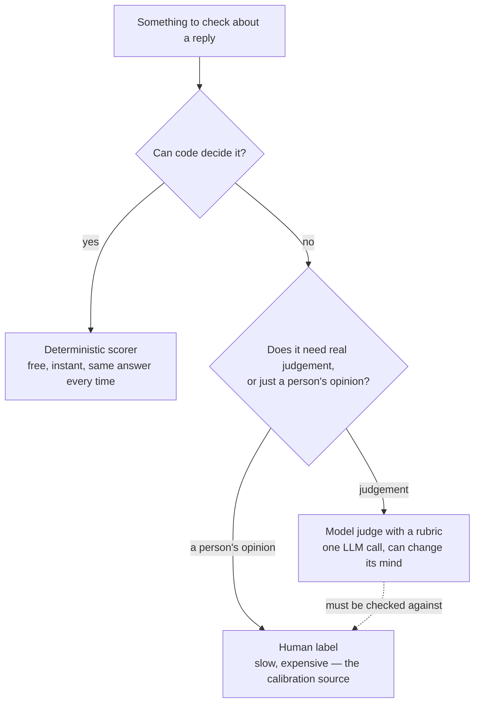

# Judges, and the Humans Who Validate Them

*A judge is the only way to score open-ended text at scale, and it cannot be trusted until it is
measured against the people who do not scale.*

◷ 25 min · Level 4 · [Level 3](03-ground-truth-v2.md) covered where reference answers come from.
This level answers what that leaves open: who decides whether a reply is actually good?

A customer asks, the agent answers, and somebody has to decide whether that was a good reply. A
person can read a handful. Thousands a day do not scale, so teams use another model to grade the
replies. That grading model is a **judge**.

> **Who this is for.** No library knowledge is assumed. Every technical term is defined in plain
> words the first time it appears.

If a judge is just another model, why believe its number? It can be fooled by fluent, wrong
text. It can prefer whichever answer it saw first. It can go easy on writing that reads like its
own.

> **A judge is an instrument, not an oracle**, and every instrument is calibrated against
> something more trustworthy: a person.

**Uncalibrated, a judge is still internally consistent, so it detects that something changed. It
cannot yet assert that either version is good.** Earning that is the rest of this level. The
running example is a customer-support reply, graded on whether it answers the question, whether
its claims are grounded, and whether it says what happens next.

---

## 1. Build the Judge in One of Three Shapes

There is more than one way to turn "is this reply good?" into a number. Each shape trades
expressiveness against how easy the result is to defend.

| | Prose criteria (`GEval`) | Decision tree | Fixed rubric levels |
|---|---|---|---|
| You write | criteria in prose, or explicit steps | an explicit branching tree | fixed level descriptions |
| Reproducibility | lowest | **highest** | high |
| Expresses nuance | **best** | only what you branched for | blunt at boundaries |
| "Why did this score X?" | a paragraph | **a path through the tree** | a level description |
| Cost to change | re-word and re-run | add a branch | re-word a level |
| Good for | exploration, fuzzy quality | compliance, auditability | stable regression scoring |

**Prose criteria** let the judge work out how to apply them. Fastest to write, hardest to debug:
a wrong score has no branch to point at, only a paragraph to re-word. Naming score ranges
("0–3: wrong, or confidently unsupported") reduces how much verdicts drift between runs.

**A decision tree** asks the same question as branches. Did the reply answer the question? If
yes, was every policy claim cited? If yes, did it say what happens next? Every path ends at a
fixed score, so runs taking the same branches land on the same number. The trade is that a tree
cannot express a nuance nobody anticipated, and adding one means adding a branch by hand.

**Fixed rubric levels** set a small number of bands — bad, weak, good — and describe what
separates them. Stable across runs, and blunt exactly at the boundaries. A reply that is "almost
good" scores the same as one that is "barely good".

### Reference-based versus reference-free

A judge can be built two ways. One version gets the golden set's reference answer to compare
against. The other gets only the question and the reply.

**Only the reference-free kind runs in production, because production traffic has no answer
key.** Running both versions over the same replies measures the **reference gap** — how much
signal disappears when a judge works without ground truth.

> **That gap is not zero, and it is the honest answer to "how much of my offline evaluation
> still applies once this ships?"**

### Know which rung a judged check stands on

Building any of the three is only worth it once a judged check is the right rung at all. The
failure modes are specific.

A judge decides whether text *sounds* right, which is exactly what a fluent, confident, wrong
answer exploits. A weaker judge produces noisier scores, so it should be at least as capable as
the task it grades. Two runs on the same input can disagree, especially near a threshold, so no
release should be gated on one row. **A vague rubric produces a judge that disagrees with
itself** — the specificity written down is the specificity that comes back. Cost compounds: five
judged dimensions over 500 cases is 2,500+ model calls. And score direction is not a convention,
so a hallucination score of 0.9 means a lot of hallucination.

Going from an off-the-shelf judged check to a custom rubric changes the standard applied, not
the mechanism or the cost. Going further, to a trace-based judge that reads the whole run,
changes what evidence the judge can see.

> **That second step is the expensive one**, worth making only when the answer genuinely is not
> present in the final output text.

### Let the judge return a category, not only a number

A reply leaving the customer with a partial answer is a different outcome from a failure, not a
lower score on the same scale. A **categorical** judge — named outcomes like `fully_resolved`,
`partially_resolved`, `unresolved` — preserves that instead of flattening it.

> **Say explicitly that a correct refusal or escalation counts as `fully_resolved`**, or the
> judge punishes an agent for following a policy it was told to follow.

Iterating is cheap if done right. Re-running a full evaluation to find out whether one guideline
is worded well is slow and wasteful. Call the judge's decision logic directly on a single
example instead: drafting a rubric then costs one model call and answers immediately.

---

## 2. Spend Judgement Only Where Judgement Is Needed

Not every question about a reply needs a model to answer it. Some have a definite, checkable
answer — was a specific tool called, how many words is this reply, does a customer ID that isn't
the requester's own appear in the text. **A judge is the wrong, expensive way to answer those.**

| | Code | Model judge | Human |
|---|---|---|---|
| Cost per check | ~£0 | ~£0.001 | ~£1 |
| Same answer twice? | Always | Usually | Often not |
| Can judge "is this polite?" | No | Yes | Yes |
| Realistic to run on | 100% of traffic | 1–2% of traffic | ~50 cases, once |

> **Code runs on everything, a judge on a slice, a human on a small deliberately chosen
> sample.** Which is why Section 4 spends so much care on *which* cases reach that scarce human
> attention.

### The cost hierarchy of scorers

| Kind | Cost per row | Deterministic? | Use it when |
|---|---|---|---|
| **Deterministic scorer** (plain code) | free, instant | yes — same input, same verdict | The rule has a definite answer: was a tool called, how many words, does a pattern match |
| **Configurable scorer** | free, instant | yes | The same deterministic check, needed at several settings at once |
| **Wrapped judge** (a judge call inside a custom scorer) | one model call | no | A judge is genuinely needed, but with extra context it can't extract alone |
| **Custom judge** | one model call | no | The question needs real judgement: quality, tone, whether a resolution happened |
| **Trace-based judge** | one model call, large prompt | no | Judging *how* the agent worked, not just what it said |

Deterministic scorers are free, so they run on every row while judged checks get rationed. They
are also reproducible in a way judges are not. **A deterministic metric moving means the system
changed. A judged one moving might be the judge having a different day.**

> **A custom scorer gets exactly what the agent's answer function returned — nothing normalises
> the shape first.** A scorer expecting a dictionary breaks on an agent returning a plain string.

### An unexpected tool call has to count as a failure too

A common pattern for "did the agent call the right tools?" checks only which *expected* tools
were missing, and ignores which unexpected ones were called. **Under that rule, an agent that
calls every tool available on every request scores 100%.** It never misses an expected call,
because it never misses any call.

| Expected a tool call? | Actually called one? | Verdict | What it means |
|---|---|---|---|
| yes | yes | pass | — |
| no | no | pass | — |
| yes | **no** | fail | Answered an account question without looking up the account — it made the answer up |
| no | **yes** | fail | Pulled customer data with no reason to — a privacy problem, not just efficiency |

That last row matters beyond tidiness. An agent reflexively fetching account data on every
question is one prompt-injection attack away from putting that data somewhere it should not go.

### Deterministic and judged on the same question is not redundant

Take a privacy check: did this reply disclose an account ID that isn't the requester's own? A
pattern-matching rule catches a literal ID like `CUST-1003` every single time, for free. It
cannot catch a paraphrase like *"the other account owes $152.90"*, which contains no ID at all.
A judge catches the paraphrase, but only probabilistically, and it costs a call every time.

Cheap-and-certain plus expensive-and-general beats either alone. **Knowing exactly what the
deterministic check does not cover is the whole value of having one** — its blind spot is
documented rather than hidden.

### Report the tail, not just the mean

Not every scorer returns pass/fail. A count aggregates across a run, and there are six valid
aggregations: min, max, mean, median, variance, p90.

> **The mean is the one people report and the p90 is the one worth watching.** A healthy average
> hides the tail of rambling replies that users actually complain about.

A scorer that hardcodes its own threshold can only run once. A configurable one takes its
settings as fields, so identical logic runs twice in one evaluation at two settings — a strict
80-word limit and a loose 250-word limit, reported as two named metrics.

A **trace-based judge** gets the whole execution trace and judges the path, not the destination.

> **Two agents can produce the identical correct reply, one in two steps and one in nine.** Only
> a trace-based judge tells those runs apart.

---

## 3. Test the Three Ways a Judge Lies

A judge is a model, so it inherits the weaknesses of the thing it grades — including biases with
nothing to do with the quality of the answer.

| Bias | What it is | The test |
|---|---|---|
| **Position bias** | The judge prefers whichever answer it saw first (or second) | Score the same pair in both orders and check the verdict does not flip |
| **Verbosity bias** | The judge prefers the longer answer, independent of quality | Pad the *worse* answer until it's longer, and judge again |
| **Same-model bias** | A judge from the same model family rates that family's output generously | Score with a judge from a different family and compare the *ranking*, not the raw numbers |

### Position bias

Ask a pairwise judge to choose between A and B, then ask again with the order swapped. **The
verdict should not change.** When it does, the judge is scoring which side of the screen an
answer appeared on, and every pairwise number it ever produced becomes suspect.

The analogy: two wine judges, one always preferring whichever glass is handed over first, the
other always preferring whichever glass is fuller. Neither is tasting the wine.

### Verbosity bias

> **Clearing a judge of position bias is necessary and not sufficient.** If the worse answer is
> also the shorter one, *"the better answer won"* and *"the longer answer won"* describe the same
> result, and swapping order can never tell them apart.

Two steps separate the explanations. **The length audit** is free, because it re-reads verdicts
that already exist. It puts the length distribution next to the win rate. In one run the
stronger reply won 12 of 12, winners averaging 25.2 words against 18.7 — 35% longer, every time.
That alone cannot separate quality from word count. **The length-controlled probe** costs model
calls. Pad the worse reply with filler until it is the longer one, then judge again. If the
better reply still wins, length was not doing the work. If the padded reply wins, the judge
measures word count, and every pairwise number it produced is suspect.

> **A win rate published without the length distribution beside it is partly a word count.**

### Same-model bias

A judge tends to recognise its own family's habits — phrasing, structure, hedging — and reads
that familiarity as quality. The test is to re-score with a judge from a genuinely different
family, not just a bigger model in the same one.

Two judges rarely give the same score. The number that matters is **whether the ranking
survives**, measured by rank correlation. High rank correlation with a positive mean difference
is benign: one judge is more generous, they agree which reply is better, and a gate comparing
two builds still works. Low rank correlation is serious: they do not agree which build is
better, and neither can gate a release alone.

Bias can also live in a **stratum** rather than overall. One language scoring lower across
*every* judge means the agent is genuinely worse there. Dropping for only *one* judge is a
property of that judge — commonly, scoring fluency in its own strongest language.

### The fourth failure mode, underneath all three

Those three are failures of a judge given a clear question. Underneath sits a simpler one: an
ambiguous question. A rubric whose levels overlap — "fairly good" against "good", with no line
between — leaves room to improvise, and improvisation does not reproduce.

> **The test is not "does the rubric sound reasonable" but "can two careful people apply it
> independently and agree"** — which is what Section 5's kappa measures.

This is the most common way a working judge quietly stops working. Somebody "clarifies" the
wording and removes the specificity that made it reproducible.

---

## 4. Collect the One Kind of Human Feedback That Calibrates

"Human feedback" names three genuinely different things. Treating them as interchangeable is why
many feedback efforts produce nothing useful.

| Kind | Where | Volume | Biased? | Can calibrate a judge? |
|---|---|---|---|---|
| **Runtime approval** | Inside the agent, blocking a pending action | Low | N/A — a decision, not a rating | **No** |
| **End-user feedback** (thumbs) | In production, voluntary | High | Severely — only the angriest and most delighted respond | **No** — a signal, never a label |
| **Expert annotation** | Offline, on a deliberately sampled set | Low | Only by your sampling choice | **Yes — the only one** |

A **runtime approval** is one blocking decision about one pending action. Should this refund go
out? It is not a rating of quality, so it cannot calibrate anything — though the approval process
itself needs evaluating, which Section 8 covers.

**End-user thumbs** are abundant and self-selected. The people who click are disproportionately
the angriest and the most delighted, which is not how the system is actually doing. Thumbs are a
useful *signal*, never a *label*.

**Expert annotation** is a domain expert rating a deliberately sampled set offline. It is the
only one both labelled and representative enough to calibrate a judge, because the sampling
choice is under your control.

### Choosing which cases to send a human

Labelling everything is impossible, so choosing *what* to send is the highest-leverage decision
in this step. "A random sample" is rarely the best answer.

| Strategy | What it gets you | What it costs you |
|---|---|---|
| Random | An unbiased estimate of overall quality | Mostly easy cases — little calibration signal |
| **Judge disagreement** | The cases where your judges are least reliable | A biased sample — never use it alone to estimate overall quality |
| Low judge score | Confirmation of known failures | Nothing about false negatives |
| Safety-adjacent | The cases most likely to hurt someone | A tiny, unrepresentative slice |

A practical default is **disagreement-first with a random tail**: the cases multiple judges could
not agree on, plus a smaller random sample so the labels still estimate overall agreement.

> **Tag the two groups separately.** Estimating overall agreement from the disagreement group
> alone understates the judge badly — those are its worst cases, picked on purpose.

Record a human's verdict on the **same scale** the judge uses, so the two compare directly
without inventing a mapping. Record how long the reviewer took to decide, too. That becomes the
input to Section 8's rubber-stamp check.

---

## 5. Measure Agreement Above Chance, Not Raw Agreement

Once a judge score and a human score exist for the same cases, calibration asks how often they
agree. Then it asks the harder question: **how often would they have agreed purely by luck?**

| | Human: good | Human: bad |
|---|---|---|
| **Judge: good** | *a* | *b* |
| **Judge: bad** | *c* | *d* |

Observed agreement is (*a* + *d*) / total. Expected agreement by chance is the probability both
happen to say "good" plus the probability both happen to say "bad". **Cohen's kappa** is
(observed − expected) / (1 − expected).

> **Raw agreement flatters on a skewed dataset.** If 90% of replies are fine, a judge saying
> "good" on every row agrees 90% of the time and has learned nothing.

Kappa corrects for exactly this. That do-nothing judge scores **0**.

### When plain kappa is not enough

On a 1–5 scale, plain kappa treats every disagreement as equally bad. One point off scores the
same as wildly off. That is the wrong penalty for an ordinal scale, where one point away is a
near-miss and four points away is a different opinion.

**Quadratic weighted kappa** penalises a disagreement by the *square* of its distance. Against
the same ten human ratings, a judge one point too generous and a judge uncorrelated with the
human score identically on the first two measures — 0.00 exact agreement, −0.25 plain kappa —
and are worlds apart on the third: **+0.71** against **−0.82**.

> **Only the off-by-one judge is cheaply fixable.** Shift its scale. The uncorrelated one has to
> be rebuilt.

### Set the threshold from labels instead of guessing it

A pass/fail cutoff starts as a guess. Once human labels exist it need not stay one. Sweep
candidate thresholds, compute kappa at each, and take the one maximising agreement with the
people whose judgement is meant to matter. A couple of hundred labels will not train anything.
They will tell you the pass mark is 0.62 rather than 0.70.

> **Maximising kappa treats a false pass and a false block as equally costly, and they rarely
> are.** A false pass on a refund agent ships a broken release. A false block annoys an engineer.

### Direction matters more than rate

When a judge and a human disagree, *which way* is more informative than how often. **Too
generous** — judge passes, human fails — is the direction that ships bad releases. **Too harsh**
— judge fails, human passes — blocks good releases and gets the judge switched off by a
frustrated team.

A kappa high overall but collapsing within one stratum, say near zero in Hindi, is not a judge
with a Hindi problem. It is a judge that cannot be used for a per-stratum release gate in that
language at all.

---

## 6. Align the Judge on Expert Disagreement

Calibration tells you *whether* a judge agrees with your experts. **Alignment** uses the pattern
in where they disagreed to improve the judge.

The technique reads traces carrying both a judge score and an expert rating — with the expert's
written comment, not just a number — distils the pattern in the disagreements into explicit
written guidelines, and adds those guidelines to the judge's own instructions.

Three details make or break it. **The label name must exactly match the judge's name**, because
that is how ratings pair with scores; get it wrong and alignment does not error, it finds no
pairs and hands back the judge you started with. **Comments are not optional**, because
alignment distils expert *reasoning* into guidelines, not expert *numbers* — a bare "2" says the
judge was wrong, and the comment becomes the guideline. **Set the embedding model explicitly**,
since alignment embeds every labelled trace and a default can silently send that traffic, and
its bill, somewhere unintended.

### Read the result the right way up

Here is the counter-intuitive part. **Alignment usually makes the judge's average score go down,
and that is the success condition, not a regression.**

The unaligned judge was grading against generic best practice and inflating scores. The aligned
judge applies the stricter standard the experts actually hold. **The agent has not changed
between the two runs. Only the measurement has become honest.**

Mean score fell 1.4 points between the unaligned and aligned judge while *every* agreement
measure rose: exact agreement 0.08 → 0.92, weighted kappa 0.29 → 0.96.

> **Read that from the bottom up.** The unaligned judge rated this agent 4.3 out of 5 while
> domain experts rated the same replies 2.8 — so every green light in an earlier gate was given
> on a number wrong by a point and a half.

That is the argument for the whole level. Alignment does not improve the agent. It makes every
*other* number produced about that agent mean something.

An aligned judge replaces the unaligned one everywhere: the release gate (Level 6), the sampled
production monitor (Level 7), and the reward signal for prompt optimisation.

> **Optimising against an unaligned judge tunes the agent toward a standard nobody holds** —
> worse than not optimising, because it is confidently wrong.

---

## 7. Blind the Preference Test, and Use Two Raters

Sections 5 and 6 score one reply at a time. A **preference test** asks a different question:
shown two replies to the same request, which one do people actually pick? It is the human
counterpart to the pairwise judge, and it is what a production canary comparison usually stands
in for.

Three rules make a preference test worth running. Dropping any one quietly invalidates the
result.

| Rule | Why it matters | What breaks without it |
|---|---|---|
| **Blind the arms** | The rater must not know which reply is the new build | People favour whatever they were told is "the improvement" |
| **Randomise the side** | Left and right coin-flipped per case, not fixed | Raters learn "the new one is always on the right" and guess the pattern instead of judging |
| **Use two raters** | One rater's taste is not a measurement | Agreement becomes unmeasurable — kappa needs two raters by definition |

Kappa between a judge and a human measures calibration. The same statistic **between two humans**
asks whether the rubric is *teachable* at all.

> **A judge disagreeing with a human is a judge problem. Two humans disagreeing with each other
> is a rubric problem** — no amount of judge tuning fixes it, because there is no single target
> to tune toward.

A blinding check is a cheap sanity test. Tally how often the winning reply landed on the left of
the screen. It should come out near 50%. A number far from that means the randomisation itself
is broken, independent of anything about quality.

> **A small panel's kappa swings on which cases happened to be sampled.** The same two raters,
> identically reliable, can produce kappa anywhere from roughly 0.15 to 0.60 across different
> case sets — that panel is reporting a *range*, not a measurement.

---

## 8. Check the Approver, Not Just the Approval

A runtime approval step is easy to check for *existence*. Does every refund carry an approval ID?
**That check passes completely while the approval step does nothing at all.**

> **It is the part of an evaluation system most likely to be quietly broken and least likely to
> be checked.**

Three signals, all computable from an approvals log, separate a real control from a rubber stamp.

| Signal | Healthy | Broken |
|---|---|---|
| Approval rate | Some real rejections happen | Close to 100% |
| Median decision time | Long enough to actually read the case | A second or two |
| Queue depth / age | Stable | Growing, or items quietly aging out unresolved |

> **A 99.8% approval rate with a 1.2-second median decision time is not a safety control — it is
> a latency cost with a compliance story attached.**

A genuine approver (≈86% approval, decisions in tens of seconds to minutes) and a rubber-stamping
one (≈99.9%, one to two seconds) both pass a check verifying that every refund has an approval ID
attached, because both do. A crude two-threshold rule catches it: approval rate above ~98% **and**
median decision time under ~5 seconds. The failure is not subtle, and a subtler detector would
only invite an argument about the cutoff.

**Judge drift is the related danger.** A judge drifting toward passing everything barely moves
raw agreement, because most replies really were fine. Kappa collapses toward zero, because a
judge with one opinion carries no information.

> **Kappa, not raw agreement, belongs on a production dashboard.**

---

## 9. Rehearse the Judge Questions

**"You're using an LLM to grade another LLM. Why should anyone believe the number?"**

They shouldn't, until it has been checked against a human and *agreement* — not average score —
has been measured. Expect the score to drop, and say so before it happens.

**"Your judge and your domain expert disagree on 20% of cases. What do you do?"**

Find out *which* 20% before touching anything. Scattered across the range means an unreliable
judge. Bunched at the threshold means borderline cases, and matters far less than the headline.
Then check whether the experts agree with *each other*. If two disagree 15% of the time, 20% is
near the human ceiling, and the work is deciding an open policy question rather than tuning a
model.

**"When would you not use an LLM judge?"**

Four situations. Code can decide the question outright. The judge is what an optimiser is tuned
against, so it cannot certify its own result. The humans have not agreed the standard yet.
Or volume is high enough that the judged-call bill exceeds the cost of serving the traffic.

**"The judge scores 0.9 and the customer says it's terrible. Who's wrong?"**

Usually neither. Get three examples the customer calls bad, run them, read the traces. All four
likely explanations — the metric does not cover what they care about, the aggregate hides their
slice, the judge was never calibrated, the golden set never had their kind of question — have the
same fix. Either the metric scores them badly too, or it scores them well and a dimension nobody
measured has been found. Both are progress. Arguing from the dashboard is not.

---

## Key Takeaways

- A judge is an instrument, not an oracle: uncalibrated it detects that something changed, and
  cannot assert that either version is good.
- Three judge shapes trade nuance against reproducibility, and only the reference-free kind
  survives deployment.
- Code runs on everything, a judge on a slice, a human on a deliberately chosen sample — and a
  tool-call check must fail in both directions.
- Position, verbosity and same-model bias are each testable, and clearing one says nothing about
  the others.
- Only expert annotation can calibrate a judge; thumbs are a signal and a runtime approval is a
  decision.
- Kappa, not raw agreement, is the measure — a do-nothing judge scores 90% agreement and zero
  kappa.
- Alignment lowers the average score and raises every agreement measure, because the measurement
  became honest rather than the agent getting worse.
- A preference test needs blinding, side randomisation and two raters; two humans disagreeing is
  a rubric problem, not a judge problem.
- An approval step that never rejects is a latency cost with a compliance story attached.

## Check Yourself

1. A judge has never been compared to a human. What is it still good for? **Detecting that
   something changed. It cannot yet assert either version is good.**
2. Your pairwise judge gives the same verdict in both orders. Is it trustworthy? **Not yet. If
   the worse answer is also shorter, "better won" and "longer won" are the same result. Pad the
   worse reply and re-judge.**
3. A tool-call scorer passes an agent that calls every available tool on every request. What is
   missing? **The unexpected-call direction. Coverage-only checks never see a privacy problem.**
4. 90% of replies are fine and your judge agrees with humans 90% of the time. How good is it?
   **Unknown — a judge saying "good" every time scores exactly that. Kappa corrects for it and
   gives that judge 0.**
5. Two judges score the same replies differently but rank the builds identically. Is that a
   problem? **No. High rank correlation with a mean offset still gates releases correctly. Low
   rank correlation is the serious case.**
6. Alignment drops the mean judge score by 1.4 points. Did the agent get worse? **No. The agent
   is unchanged; the measurement became honest. Every agreement measure rose.**
7. Your two human raters disagree 15% of the time. What does that tell you about your judge
   target? **There isn't a single one. That is a rubric problem, and no judge tuning fixes it.**
8. Every refund carries an approval ID, approval rate is 99.8%, median decision time 1.2
   seconds. What do you have? **A rubber stamp. The existence check passes completely while the
   control does nothing.**

---

## References

All content above was drawn only from material already in this repository. Nothing here was
invented, and no external source was consulted. This page is a restyled edition of
`04-judges-and-the-humans-who-validate-them.md`; its content is the same, with library class
names replaced by what each judge shape does.

**Notebook:**

- `courses/03-agentic-eval-harness/08_building_custom_judges.ipynb` — the three judge shapes, the
  reference-based/reference-free split and the reference gap, categorical judges, and cheap
  rubric iteration.
- `courses/02-databricks-mlflow-evals/` — the custom-scorer hierarchy, the tool-call scorer's
  two failure directions, the deterministic-plus-judged pairing, aggregation choices, judge
  alignment, and the rubber-stamp signals.

**Docs:**

- `docs/concepts/rag-agent-tool-evaluation.md`, §0.3 — the judge failure modes used in Section 1.
- `docs/concepts/databricks-mlflow-evals.md` — scorer cost hierarchy, bias tests, the
  human-feedback taxonomy, kappa and weighted kappa, alignment, and preference testing.
- `docs/interview-prep/QUESTION_BANK.md`, Part 4 (Q14–Q17) — the four questions reproduced in
  full in Section 9 rather than pointed at.
- `docs/study-guide/evaluation-roadmap.md` — Level 4's topic list and goal statement.
- `docs/study-guide/evaluation-topic-notebook-mapping.md` — Level 4's resource table.

**Limitations.** This file was written by reading the repository's own material, not by running
any notebook or calling any API — no cost was incurred producing it, consistent with this
project's rule against executing anything that spends money without being asked. It does not
independently verify any vendor's documentation.
